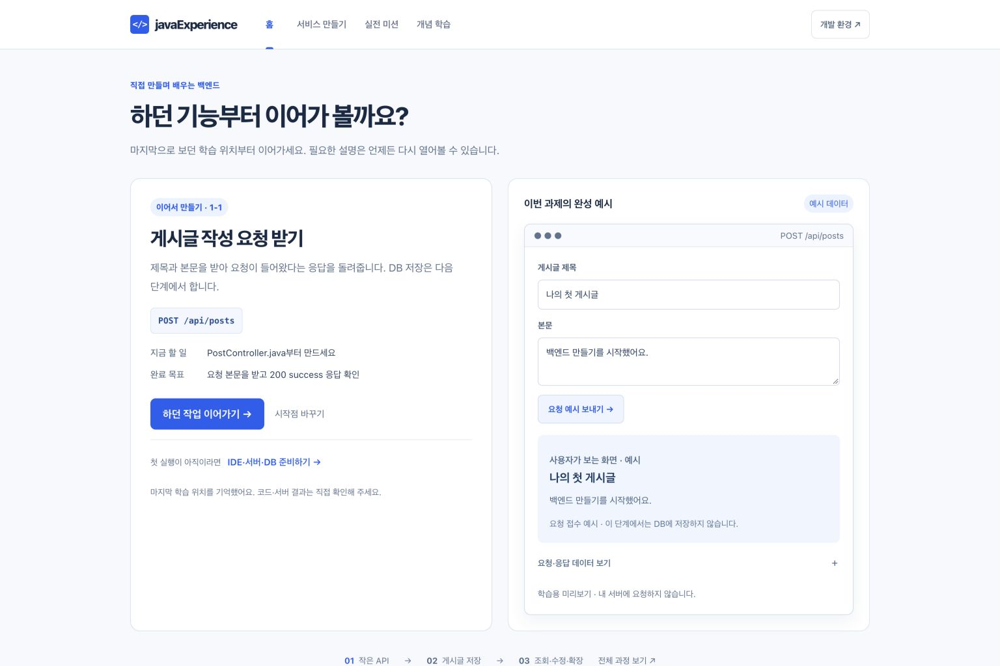
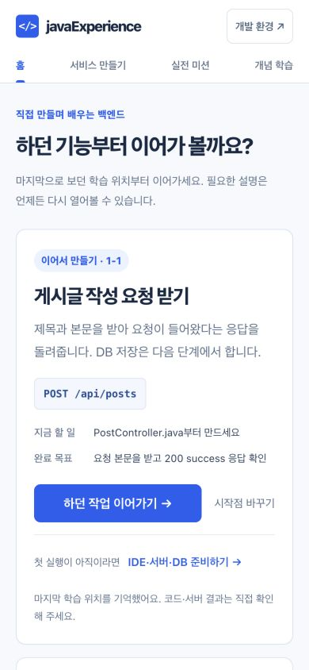
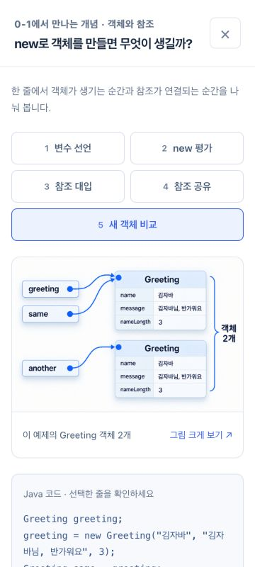

# 공통 학습 화면 PR 검증 · 2026-10-21

공통 홈·시작점 선택·6개 과제 이어하기·게시판 예시·객체 생성 5장면·134개 개념 목록/검색·P16 대표 상세를 검증했다. 개념별 후속 확장과 기능형 CRUD 5과제는 이번 범위가 아니다.

## 이력과 원본 보존

- 통합 기준 main: `80cf7ac8a64d5d91989d375de09efbbe9592535c`.
- 정제한 공통 기반: `64b9a0a2aac819a669eadd92a97f928185325ea9`.
- 기존 공통 스냅샷에서 브라우저 전체 캡처 3개의 PNG를 제외했다. 해당 캡처의 PNG/JPG 경로와 blob이 정제된 공개 이력에서 도달 불가임을 검사했다. 원본 브랜치는 재작성하지 않았다.
- 학습자 `src`, `build.gradle`, `compose.yaml`, `gradle`은 기준 main과 동일하다.
- 후속 작업은 정제된 공통 기반에 대응시켜 통합한다. 제외된 캡처를 가진 원본 스냅샷이나 원본 후속 브랜치를 직접 merge해 과거 이력을 다시 포함하지 않는다.

## 이미지와 자동 검사

- 원본 SHA가 같은 공통 PNG 514개에 기존 검증된 JPG 바이트를 재사용했다. 크기 변경·재생성·추가 재인코딩은 없다.
- 해당 자산 합계는 792,078,047 → 205,769,094 bytes다. 원본 이미지와 배포 JPG의 해시·치수·출처는 [변환 manifest](../common-jpg-2026-10-21/manifest.json)에 분리했다.
- Node v26.0.0 arm64에서 최종 문서 변경을 포함해 `npm run build`, `npm run inventory:visual`, 등록된 `test:*` 42개와 `audit:visual`, `audit:version-cards`, `audit:parity`, `audit:images`를 실행해 모두 통과했다.
- 빌드 결과는 HTML 339개, 시나리오 101단계, 링크 오류 0개다.
- 이미지 감사는 JPG 514개 SHA·치수·sampling, 현행 자산 출처 442건과 HTML 이미지 링크를 확인한다. 과거 실행 원본·기술 설명·원본 증거를 JPG 값으로 덮어쓰지 않았다.
- `git diff --check`를 통과했다.

## 실제 Chrome 조작

1536×1024, 360×800, 390×844 viewport에서 확인했다. [기계 판독 요약](browser-verification.json)은 이 검증 범위와 캡처 해시를 기록한다.

- 한글 이름 입력 후 미리보기 응답, 시작점 선택 적용, 환경 준비 dialog의 Escape와 호출 버튼 포커스 복귀.
- 게시판 예시의 필수 입력 오류, 글 작성 후 목록·상세 표시.
- 객체 생성 5장면의 객체 수 0→1→1→1→2와 최종 JPG 파일의 정상 로딩.
- 1-1 장면 이동→홈 복귀→새로고침 이어하기, SQL 시작점 재선택 시 기존 1-1 진행 보관·복귀.
- DTO 검색 7건, 한글 검색 제출, P16 요청 변환 오류 및 응답 JSON 장면, 검색 결과 복귀와 브라우저 뒤로/앞으로 검색 상태 유지.
- P16 원문 앵커의 접기 열림과 뒤로 복귀.
- 0-1·0-2·1-1·1-2·DB-01·DB-02 여섯 과제의 데스크톱/360px 렌더 및 페이지 가로 넘침 없음.
- 기록한 관찰 검사 29건의 실패는 0건이다. 새 최종 검증 탭에서 사이트 소스의 콘솔 오류는 0건이었고, 별도 확장 프로그램 오류 6건을 구분했다.
- HTTP 로그의 404 한 건은 기본 `/favicon.ico` 요청이다. 본문 학습 자산의 404는 관찰되지 않았다.

## 검증의 경계

Chrome viewport 검증이며 실제 휴대전화 하드웨어·모든 브라우저 검증은 아니다. 한글 입력과 검색은 실제 UI에서 확인했지만 모든 OS IME 조합을 전수 검증하지 않았다. 백엔드 API·MySQL을 이번 문서 UI 검증으로 실행하거나 완성했다고 표시하지 않는다.

자동 검사와 이번 조작 범위를 전체 학습 페이지의 시각·기술 사실 전수 검증으로 확대하지 않았다. 기존 parity와 inventory 상태를 일괄 verified로 올리지 않았다. 이번 원본 백업과 전체 로그는 로컬 보관하며, 공개 캡처에는 페이지 영역만 포함했다.
