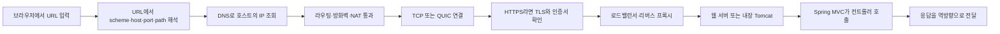
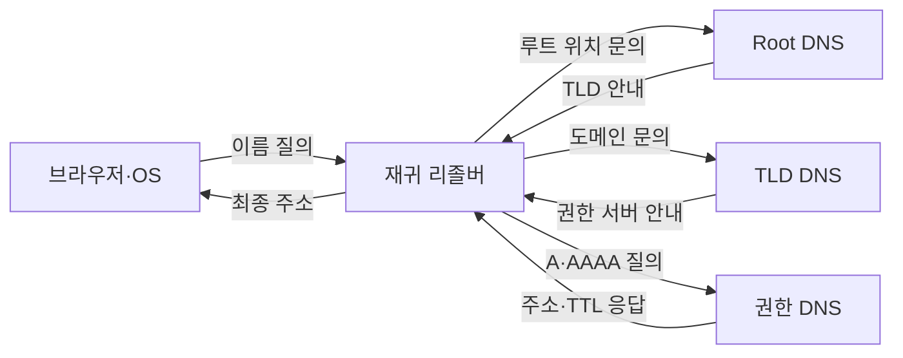
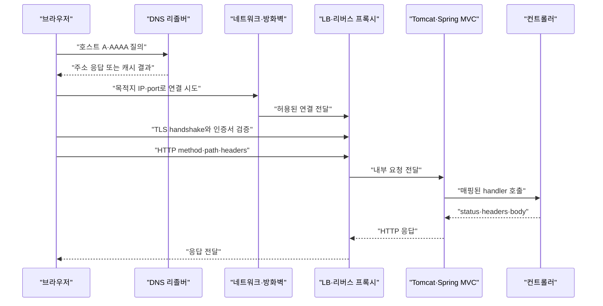

# D02. 서버·네트워크 기초 용어 — 요청이 서버에 닿기까지

> 브라우저 요청은 URL 해석과 DNS 조회를 거쳐 IP 주소와 포트의 서버 프로세스에 도착한다.
> 연결, TLS, 방화벽·NAT·로드밸런서·리버스 프록시를 통과해야 애플리케이션 코드에 닿는다.
> 장애는 DNS·연결·인증서·HTTP 응답으로 나눠 각 단계의 증거로 좁힌다.

## 1. 큰 그림



예를 들어 `https://api.example.com:8443/orders/42?expand=items#history`를 열면 브라우저가 이름의 IP를 알아내고, 해당 주소의 8443 포트로 연결한다. HTTPS에서는 HTTP 전에 TLS 인증서를 확인하고 암호화 키를 협상한다. 그 뒤 프록시·서버가 HTTP path를 처리한다. `#history`는 브라우저 내부 fragment라 HTTP 요청에 실리지 않는다.

“서버”는 한 대의 물리 장비라고 단정할 수 없다. DNS가 CDN/LB 주소를 반환하고 여러 애플리케이션이 뒤에 있을 수 있다. 물리 서버·VM·컨테이너는 D07, 개발 수명주기 중 이 요청 여정이 차지하는 자리는 D01 참조.

## 2. 용어 사전

| 용어 | 한 줄 정의 | 실무 예시 | 헷갈리는 것과 차이 |
|---|---|---|---|
| 클라이언트·서버 | 요청자·응답자의 역할 | 브라우저가 API 서버 호출 | 기기가 아니라 통신 역할이다. 한 프로그램이 양쪽 역할을 할 수 있다. |
| 물리 서버·VM·컨테이너 | 실제 장비·가상 하드웨어·격리된 프로세스 환경 | VM 안에서 컨테이너 앱 실행 | 자세한 인프라 차이는 D07 참조. |
| 호스트·IP | 호스트는 접속 대상 문맥, IP는 네트워크 주소 | `api.example.com`, `10.0.1.15` | 공인 IP도 라우트·방화벽·리스너가 없으면 접속 불가다. |
| 공인·사설 IP | 인터넷 라우팅 주소와 내부망 주소 | 공인 LB, 사설 앱 서버 | IPv4 사설 대역 예: `10/8`, `172.16/12`, `192.168/16`. 보안 허용과는 별개다. |
| 포트 | TCP/UDP 연결을 호스트 안의 소켓으로 구분 | HTTP 80, HTTPS 443, Boot 8080 | 프로세스 이름이 아니다. 목적지는 보통 IP:port로 특정한다. |
| localhost·`0.0.0.0` | localhost는 자기 자신, `0.0.0.0`은 IPv4 모든 로컬 인터페이스에 bind하는 주소 | `127.0.0.1:8080`, `server.address=0.0.0.0` | `0.0.0.0`은 접속 목적지가 아니다. 원격 컴퓨터의 localhost는 원격 자신이다. |
| 도메인·DNS | 도메인은 사람이 읽는 이름, DNS는 이름과 레코드를 조회하는 분산 시스템 | `dig api.example.com A` | DNS는 웹 서버 상태를 검사하지 않는다. |
| DNS 재귀 리졸버·권한 DNS | 재귀 리졸버는 답을 찾아 주고, 권한 DNS는 관리 도메인의 원본 레코드를 답한다 | 회사 DNS resolver가 권한 DNS 조회 | 역할과 조회 위치가 다르다. 캐시가 있으면 재귀 조회는 짧아진다. |
| A·AAAA·CNAME | IPv4·IPv6 주소 및 다른 이름을 가리키는 레코드 | A와 AAAA 등록, CDN 이름으로 CNAME | CNAME은 브라우저 HTTP redirect가 아니다. |
| URL·origin | URL은 접근 위치 문자열, origin은 보통 scheme·host·port 조합 | `https://host:8443/a?x=1` | fragment(`#...`)는 서버에 안 가고, scheme/port가 다르면 origin도 다를 수 있다. |
| TCP·QUIC | TCP는 신뢰성 있는 연결형 byte stream, QUIC은 UDP 위 전송·연결 기능 | HTTP/1.1·2는 TCP, HTTP/3은 QUIC | HTTP/3에 TCP SYN 절차를 적용하지 않는다. |
| HTTP·TLS·인증서 | HTTP는 요청/응답, TLS는 암호화·인증, 인증서는 이름과 공개키를 서명으로 연결 | HTTPS API 호출 | 인증서는 공개되고 개인키는 서버 비밀이다. HTTPS가 앱 취약점까지 막지는 않는다. |
| 포워드·리버스 프록시 | 클라이언트 편의 대리자와 서버 앞단의 대리자 | 회사 인터넷 proxy, Nginx `proxy_pass` | 배치 위치와 관리 주체가 다르다. |
| 로드밸런서·L4/L7 | 여러 대상으로 분산하며 L4는 IP/port, L7은 HTTP 내용을 주로 활용 | L4 연결 분산, L7 host/path 규칙 | 제품 기능은 겹치므로 실제 listener/rule을 본다. DNS 라운드로빈과도 다르다. |
| API 게이트웨이 | API 진입점의 라우팅과 API 정책을 처리 | 인증·쿼터·버전별 route | L7 LB/리버스 프록시와 기능이 겹칠 수 있다. |
| 웹 서버·WAS | 웹 수신·정적 파일·proxy와 애플리케이션 실행을 구분해 부르는 현업 용어 | Nginx 앞단, Boot 내장 Tomcat | 절대 경계가 아니다. Tomcat도 HTTP를 받고 Servlet을 실행한다. |
| 방화벽·보안 그룹 | 규칙으로 네트워크 흐름을 허용·차단 | OS 방화벽, 클라우드 443 인바운드 규칙 | 보안 그룹은 클라우드 개념이며 앱의 listen 상태와 별개다. |
| NAT·리스너·타깃 그룹 | NAT는 주소 변환, listener는 수신 규칙, target group은 전달 대상 묶음 | 사설 서버 outbound, LB 443 listener | NAT는 앱 proxy나 방화벽 정책 그 자체가 아니다. AWS 용어는 제품 사례다. |

```text
https://api.example.com:8443/orders/42?expand=items#history
└scheme┘ └────host────┘└port┘└──path───┘└──query───┘└fragment┘
```

HTTP와 HTTPS 기본 port는 각각 80, 443이며 URL에서 생략 가능하다. 실무 URL에 비밀번호를 넣지 않는다. 호스트명은 여러 IP를 반환할 수 있으므로, DNS 응답만으로 실제 연결 대상을 단정하지 않는다.

| 비교 | 차이 | 진단할 때 |
|---|---|---|
| 포워드 vs 리버스 proxy | 클라이언트 대신 전달 vs 서버 앞에서 내부로 전달 | 회사 proxy인지 서비스 라우팅인지 나눈다. |
| L4 vs L7 | 연결 주소·port vs HTTP host/path 등 | TCP 연결 오류와 L7 path 오류를 구별한다. |
| LISTEN vs 외부 도달 가능 | 프로세스 소켓 대기 vs 경로·방화벽까지 통과 | 로컬 port 확인 뒤 외부 클라이언트에서도 시험한다. |

## 3. 단계별로 보기

### 3.1 URL과 DNS

- **일어나는 일:** 브라우저가 scheme·host·port·path를 나눈다. host가 이름이면 브라우저/OS 캐시와 재귀 리졸버 등을 통해 A/AAAA 등을 조회한다. 캐시가 유효하면 루트부터 다시 묻지 않는다.
- **주체·입출력:** 브라우저, OS resolver, 재귀 리졸버, 권한 DNS. hostname과 레코드 종류가 입력, 주소와 TTL이 출력이다. `dig`, `nslookup`으로 본다.
- **실패 모양:** `NXDOMAIN`은 이름 없음, `SERVFAIL`은 조회 실패 신호다. 성공해도 서버 생존이나 HTTP route를 보장하지 않는다.

캐시가 비어 있는 전형적 조회는 아래와 같다. 재귀 리졸버가 Root·TLD의 위임 안내를 따라 권한 DNS에 도달한다. 실제 조회는 캐시, CNAME, DNS 사업자 구성에 따라 단축된다.



### 3.2 네트워크 연결, NAT, 방화벽

- **일어나는 일:** IP 라우팅으로 목적지에 간다. TCP 기반 HTTP/1.1·2는 SYN→SYN-ACK→ACK 후 byte stream을 연다. HTTP/3은 QUIC/UDP를 사용한다.
- **주체·입출력:** 라우터, NAT, OS/클라우드 방화벽, 서버 커널과 port listener. 목적지 IP·port가 입력이며 경로와 허용 규칙, 실제 listen socket이 모두 맞아야 상위 계층에 닿는다.
- **실패 모양:** `Connection refused`는 대상까지 닿았으나 거절/미수신인 경우가 흔하다. timeout은 경로·규칙상 응답이 사라진 경우가 많다. 둘 다 단독으로 원인을 확정하지 않으므로 서버의 `LISTEN` 및 ingress 규칙도 본다.

`localhost`는 접속을 시도한 바로 그 환경이다. 로컬 앱이 `127.0.0.1`에 bind하면 서버 내부에서만 접근 가능하다. `0.0.0.0` bind는 모든 IPv4 로컬 인터페이스에서 받겠다는 뜻이지만 외부 라우트와 방화벽 허용까지 만들지는 않는다. `localhost`가 IPv6 `::1`로 해석돼 IPv4 전용 listener와 맞지 않는 경우도 있다.

NAT는 사설 IP의 패킷 주소를 바꿔 전달하는 기능이다. 예를 들어 AWS public NAT gateway는 사설 서브넷 인스턴스의 outbound 연결에 주소 변환을 제공하지만 unsolicited inbound 연결을 그 인스턴스로 열어 주지는 않는다. NAT, firewall, app listener는 별개로 점검한다.

### 3.3 TLS와 인증서

- **일어나는 일:** TCP를 쓰는 HTTPS는 TCP 연결 후 TLS handshake에서 설정과 세션 키를 협의하고 서버 인증서를 제시한다. 클라이언트는 신뢰 체인, 유효 기간, 접속 hostname의 일치 등을 검증한 다음 HTTP를 보호된 채널에 보낸다. HTTP/3은 QUIC의 보안 기능과 결합한다.
- **주체·입출력:** 브라우저 TLS stack, 인증 기관, TLS를 종료하는 LB/proxy/app. 인증서와 서버 개인키가 서버 측 자료이고, 검증된 피어와 세션 키가 연결의 결과다. `openssl s_client`로 협상을 관찰한다.
- **실패 모양:** certificate verify, 만료, hostname 오류는 TCP 이후의 TLS 오류다. TLS가 LB에서 끝나고 내부 구간은 HTTP일 수도 있으므로 termination 지점을 찾는다.

TLS는 응답 데이터의 업무상 진실성이나 코드 안전성을 보장하지 않는다. LB 이후 구간도 암호화해야 하는지 토폴로지와 정책으로 결정한다. 검증 오류를 숨기려고 인증서 확인을 끄는 것은 해결이 아니다.

### 3.4 로드밸런서·리버스 프록시

- **일어나는 일:** L4는 주로 연결 주소·port, L7은 복호화 후 HTTP host/path/header 등으로 target을 고를 수 있다. Nginx `proxy_pass`는 요청을 upstream에 보내고 그 응답을 클라이언트로 돌려준다. LB는 health check를 통과한 타깃에 분산하기도 한다.
- **입력·출력과 주체:** 클라우드 LB, Nginx/Apache, API gateway. listener, routing rule, upstream 주소·port, health 경로가 입력이고 내부 앱의 응답이 외부 응답으로 나온다. access log, target 상태, `curl -v`를 본다.
- **실패 모양:** 비정상 타깃·연결 실패는 502/503 계열, upstream 대기 만료는 504로 보일 수 있으나 제품/설정마다 다르다. 외부 path와 내부 path가 바뀌어 앱이 404를 내기도 한다. Nginx `proxy_pass`의 URI 포함 여부가 location 경로 전달에 영향을 주므로 upstream log로 확인한다.

`Forwarded`/`X-Forwarded-For` 등은 신뢰 proxy 경계 밖에서 들어온 값을 무조건 믿으면 안 된다. 클라이언트가 위조할 수 있다. Spring 전달 헤더 설정은 S05·S12 참조. API gateway와 reverse proxy를 배타적 제품군이라고 단정하지 말고 인증·쿼터·TLS 종료·routing이 실제 어디서 이뤄지는지 확인한다.

### 3.5 Tomcat에서 Spring 컨트롤러까지

- **일어나는 일:** 웹 서버가 정적 파일을 응답하거나 WAS로 넘길 수 있다. Boot 서블릿 앱은 내장 Tomcat이 HTTP를 받아 Servlet 기반 Spring MVC로 보낸다. handler 세부 흐름은 S05 참조.
- **입력·출력:** HTTP method, path, headers, body가 요청이고 status·headers·body가 응답이다. Boot 4.1 문서는 내장 서블릿 서버의 기본 HTTP port를 8080으로 안내한다.
- **실패 모양:** HTTP 연결 후 mapping을 못 찾으면 404, 처리 중 예외면 5xx가 가능하다. 외부 path rewrite, 앱 listen port, 앞단과 앱 양쪽 로그를 비교한다.

외부 공인 LB만 열고 Tomcat은 사설망 8080으로 두는 구성도 흔하다. “웹 서버 vs WAS”는 역할 중심의 현업 구분이지 절대적인 제품 경계가 아니다. API 설계는 S06, 쿠버네티스 네트워크는 S19 참조.

브라우저에서 컨트롤러까지의 예시는 HTTP/1.1·2와 TLS 종료형 L7 proxy 기준이다. HTTP/3이나 TLS passthrough에서는 연결 단계가 달라진다.



## 4. 직접 해보기

### 4.1 로컬 Spring Boot 서버

Java 25와 Gradle Wrapper를 갖춘 Boot 4.1.1 프로젝트를 만들고, Spring Initializr에서는 Gradle Kotlin DSL·Java 25·Spring Web MVC를 고른다. 아래는 핵심 Gradle 설정이다.

```kotlin
plugins {
    java
    id("org.springframework.boot") version "4.1.1"
}

group = "com.example"
version = "0.0.1-SNAPSHOT"
java { toolchain { languageVersion = JavaLanguageVersion.of(25) } }
repositories { mavenCentral() }
dependencies {
    implementation(platform("org.springframework.boot:spring-boot-dependencies:4.1.1"))
    implementation("org.springframework.boot:spring-boot-starter-webmvc")
}
```

`src/main/resources/application.properties`:

```properties
server.port=8080
```

`src/main/java/com/example/ProbeApplication.java`:

```java
package com.example;

import org.springframework.boot.SpringApplication;
import org.springframework.boot.autoconfigure.SpringBootApplication;
import org.springframework.web.bind.annotation.GetMapping;
import org.springframework.web.bind.annotation.RestController;

@SpringBootApplication
public class ProbeApplication {
    public static void main(String[] args) {
        SpringApplication.run(ProbeApplication.class, args);
    }
}

@RestController
class ProbeController {
    @GetMapping("/probe")
    String probe() { return "ok"; }
}
```

터미널 1에서 실행하고, 2에서 요청한다. Wrapper가 없다면 설치된 Gradle로 `gradle wrapper`를 먼저 생성한다.

```bash
java -version
./gradlew --version
./gradlew bootRun

# 두 번째 터미널
curl -v --connect-timeout 2 http://127.0.0.1:8080/probe
```

정상 응답 body는 `ok`, status는 `200`이어야 한다. `curl -v`에서 목적지·연결·HTTP request/response를 확인한다. `Connection refused`면 DNS가 아니라 앱 실행과 listener port부터 확인한다. Spring 코드는 Boot 4.1 기준이며 여기서 실행하지 않았다.

### 4.2 DNS·port·TLS 점검

```bash
# macOS/Linux의 DNS 질의
dig +noall +answer example.com A
dig +noall +answer example.com AAAA
nslookup example.com

# macOS/Linux에서 TCP 8080 LISTEN 확인
lsof -nP -iTCP:8080 -sTCP:LISTEN

# Linux 대안
ss -lntp '( sport = :8080 )'

# OpenSSL 1.1.1+에서 SNI와 hostname 검증
openssl s_client -connect example.com:443 -servername example.com \
  -verify_hostname example.com -verify_return_error </dev/null
```

`curl --resolve example.com:443:203.0.113.10 https://example.com/`은 DNS만 우회해 특정 주소를 확인할 때 쓴다. `203.0.113.0/24`는 문서용 대역이므로 실제 점검 시 대상 IP로 바꾼다. URL hostname을 보존하므로 Host와 TLS SNI도 해당 이름으로 시험한다.

진단 순서는 `dig` 이름 확인 → `curl -v`의 실제 IP:port와 연결 → HTTPS 인증서/TLS → HTTP status·proxy/app 로그 → 서버 `lsof`/`ss`의 listener다. DNS 성공은 HTTP 성공이 아니며, 404는 어떤 HTTP handler까지 닿았다는 증거일 수 있어도 올바른 서비스에 도달했다는 뜻은 아니다.

## 5. 자주 하는 오해와 실수

1. DNS 응답이 있으니 서버 정상 → DNS는 주소만 준다 → 연결과 앱 상태는 `curl -v`, LB·앱 로그로 따로 본다.
2. localhost가 되니 다른 PC에서도 됨 → localhost는 각 컴퓨터 자신이다 → bind 주소, route, 인바운드 규칙을 확인한다.
3. LISTEN이니 외부에서도 접속 → socket과 외부 경로는 별개다 → 서버 로컬 다음에 실제 외부 클라이언트에서 확인한다.
4. `0.0.0.0`이 브라우저 목적지 → 서버 bind용 wildcard다 → 접속에는 실제 IP나 도메인을 쓴다.
5. HTTPS면 내부 구간도 암호화 → LB에서 TLS 종료 후 HTTP upstream일 수 있다 → 종료 위치와 upstream scheme을 점검한다.
6. 외부 path가 앱에 그대로 전달 → L7 rule·`proxy_pass`가 변환할 수 있다 → 외부와 upstream 로그의 path를 비교한다.
7. 외부 IP가 곧 앱 서버 IP → CDN/LB/NAT 주소일 수 있다 → DNS, target, app listener를 층별로 본다.
8. 전달 헤더는 항상 신뢰 → 외부 사용자가 위조할 수 있다 → 신뢰 proxy 경계에서만 허용한다.
9. HTTP/3도 TCP handshake → HTTP/3은 QUIC/UDP 기반이다 → 실제 프로토콜에 맞게 연결을 진단한다.

## 6. 시각화 설계 메모

1. **요청 여정** `[목적: URL부터 응답까지 연결 | 요소: 브라우저, DNS, 방화벽/NAT, LB/proxy, Tomcat, controller | 관계: 요청 정방향·응답 역방향 | 애니메이션: URL 분해→DNS→연결→TLS→앱→응답 | 강조: 서버 한 대에 바로 붙는다는 오해]`. 1절 flowchart와 3절 sequenceDiagram을 잇는다.
2. **DNS 확대** `[목적: 재귀 조회와 캐시 설명 | 요소: 브라우저/OS cache, resolver, Root, TLD, 권한 DNS, A/AAAA | 관계: 질의 하향, 위임·주소 응답 상향 | 애니메이션: cache hit/miss→Root→TLD→권한→TTL 저장 | 강조: 브라우저가 매번 모든 DNS에 직접 질의한다는 오해]`. 3.1절 diagram 대응.
3. **장애 계층 분기** `[목적: 증상에 맞는 다음 확인 제시 | 요소: NXDOMAIN, timeout, refused, TLS 오류, 404, 502/504, 확인 명령 | 관계: 증상→계층→관찰 명령 | 애니메이션: DNS→network→listener→TLS→HTTP 단계별 분기 | 강조: 모든 timeout/5xx가 방화벽 문제라는 오해]`. 4절 진단 순서 대응.

## 7. 자가점검 Q&A (면접 대비)

### Q1. DNS에서 IP를 받았는데 요청이 timeout이다. DNS 문제인가?

반드시 그렇지는 않다. DNS는 주소만 답한다. 라우팅·방화벽·포트 listener·앱은 다음 계층이므로 `curl -v`와 서버 상태를 본다.

**꼬리질문:** refused와 timeout 차이는? → refused는 도달 후 거절된 경우가 흔하고 timeout은 응답이 유실된 경우가 많지만, 각각 경로와 listener를 확인해야 확정할 수 있다.

### Q2. localhost에서는 되지만 외부에서 안 된다. 무엇을 확인하나?

먼저 서버가 loopback에만 bind했는지 `lsof`/`ss`로 본다. 다음에 외부 인터페이스 bind, 라우트와 방화벽 규칙을 확인한다. localhost는 각 요청 컴퓨터 자신이다.

**꼬리질문:** `0.0.0.0`이면 무조건 외부 연결 가능한가? → 아니다. wildcard bind일 뿐 라우트·방화벽 허용은 따로 필요하다.

### Q3. HTTPS에서 인증서는 무엇을 증명하며 TLS는 언제 도나?

TCP HTTPS에서는 TCP 연결 뒤 TLS handshake, 그 뒤 HTTP다. 인증서 체인과 hostname 등을 확인해 연결 상대 서버를 검증하고 세션 키를 협상한다. 인증서와 비밀 개인키는 별개다.

**꼬리질문:** LB에서 TLS를 종료하면 앱까지 암호화되나? → 내부 upstream이 HTTP일 수 있으니 종료 위치와 구간 설정을 확인한다.

### Q4. L4와 L7 로드밸런서의 차이는?

L4는 IP·port 같은 연결 정보를 주로 쓰고, L7은 HTTP를 읽어 host/path별 전달도 할 수 있다. 실제 지원 방식은 제품 listener와 routing rule을 확인한다.

**꼬리질문:** API gateway는 완전히 다른 계층인가? → L7 proxy/LB와 겹칠 수 있다. 인증·쿼터·API 버전 등 정책 역할을 확인한다.

### Q5. Nginx와 내장 Tomcat이 함께 있으면 요청은 어떻게 가나?

Nginx가 요청을 받아 정적 파일을 주거나 upstream Tomcat에 전달한다. Boot 내장 Tomcat은 HTTP를 Servlet 기반 Spring MVC로 넘겨 컨트롤러 응답을 받는다. 응답은 역방향으로 돌아간다.

**꼬리질문:** 앞단의 502와 앱의 404는 어떻게 나누나? → access/error log와 응답 발생 주체를 확인한다. 상태 코드만으로 원인을 단정하지 않는다.

### Q6. NAT와 방화벽은 같은 기능인가?

NAT는 패킷 주소 변환, 방화벽은 규칙 기반 허용/차단이다. 사설 서버도 NAT와 출구 route가 있으면 외부로 연결을 시작할 수 있다. NAT가 inbound 허용을 자동으로 뜻하지 않는다.

**꼬리질문:** 사설 서버가 외부 API를 호출할 수 있나? → outbound route와 NAT 등 출구 경로가 구성되면 가능하다.

### Q7. HTTP/3 연결을 TCP 3-way handshake로 설명해도 되나?

아니다. HTTP/1.1·2는 주로 TCP와, HTTP/3은 QUIC과 사용한다. QUIC은 UDP 위에서 연결과 보안 기능을 제공하므로 TCP SYN 절차와 구분한다.

**꼬리질문:** HTTP/3도 TLS 보안을 쓰나? → QUIC은 TLS 1.3 보안 기능과 통합된다.

## 8. 참고문헌

- MDN, Overview of HTTP — https://developer.mozilla.org/en-US/docs/Web/HTTP/Overview — HTTP client/server/proxy 구성.
- MDN, What is a Domain Name? — https://developer.mozilla.org/en-US/docs/Learn_web_development/Howto/Web_mechanics/What_is_a_domain_name — 도메인과 label.
- Cloudflare, What is DNS? — https://www.cloudflare.com/learning/dns/what-is-dns/ — Chrome에서 조회해 DNS 역할과 단계 확인.
- web.dev, What are the parts of a URL? — https://web.dev/articles/url-parts — URL 구성요소 용어.
- RFC 9114, HTTP/3 — https://www.rfc-editor.org/rfc/rfc9114.html — HTTP/3과 QUIC.
- MDN, Transport Layer Security — https://developer.mozilla.org/en-US/docs/Web/Security/Defenses/Transport_Layer_Security — TLS handshake 및 서버 인증서.
- NGINX, Reverse Proxy — https://docs.nginx.com/nginx/admin-guide/web-server/reverse-proxy/ — upstream 요청·응답과 `proxy_pass`.
- AWS, Application Load Balancers — https://docs.aws.amazon.com/elasticloadbalancing/latest/application/application-load-balancers.html — listener, rule, target group 사례.
- AWS, Network Load Balancers — https://docs.aws.amazon.com/elasticloadbalancing/latest/network/network-load-balancers.html — NLB listener와 타깃.
- AWS, NAT gateways — https://docs.aws.amazon.com/vpc/latest/userguide/vpc-nat-gateway.html — 사설 subnet outbound 주소 변환.
- Linux man-pages, ip(7) — https://man7.org/linux/man-pages/man7/ip.7.html — `INADDR_ANY`와 소켓 bind.
- Spring Boot 4.1, Servlet Web Applications — https://docs.spring.io/spring-boot/4.1/reference/web/servlet.html — embedded servlet container와 기본 port 8080.
