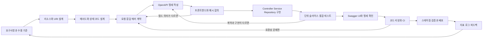
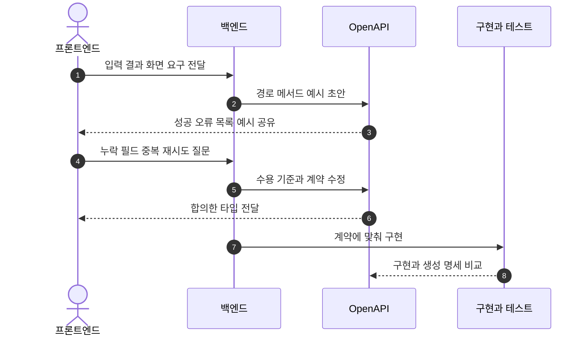
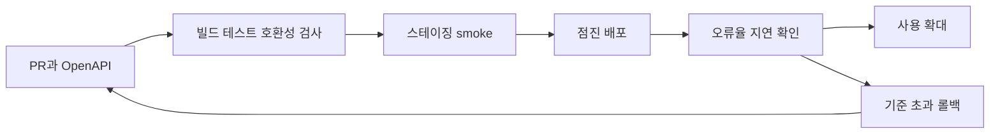

# D03. REST API 개발 과정 — 요구사항에서 배포 가능한 API까지

> API 작업은 엔드포인트 하나를 코딩하는 일이 아니라, 소비자와 합의한 계약을 구현하고 안전하게 배포하는 과정이다.
> URI·메서드·상태 코드·요청/응답·에러를 먼저 정하면 프론트엔드와 백엔드가 병렬로 움직일 수 있다.
> OpenAPI 명세, 테스트, 리뷰, 단계적 배포가 계약의 누락과 하위호환 파손을 초기에 드러낸다.

## 1. 큰 그림



그림은 “무엇을 만들지 결정”에서 “운영 결과를 보고 다음 변경을 시작”하는 순환을 보여준다. 설계 단계에서 전부 확정한 뒤 한 번에 넘기는 폭포수 절차가 아니다. 예를 들어 프론트엔드가 목록 화면에 필요한 정렬 기준을 발견하면 응답 예시와 페이지네이션 계약을 고친 뒤 구현을 이어 간다. 변경 내용은 OpenAPI diff와 리뷰에 다시 반영한다. 배포는 작업의 끝이 아니라 사용 가능한 계약을 운영 환경에 전달한 시점이다.

이 문서는 전체 개발 과정 D01 중에서도 **한 API 변경을 정의하고 합의해 구현·검증·배포하는 세부 작업 흐름**을 다룬다. 빌드 파이프라인·운영 관측·MVC 내부는 각각 D04·D09·S05를 참조한다.

## 2. 용어 사전

| 용어 | 한 줄 정의 | 실무 예시 | 헷갈리는 것과 차이 |
|---|---|---|---|
| 요구사항 | 해결할 문제·제약 | “할 일을 등록하고 찾는다” | 화면 기능보다 목적·범위가 넓다 |
| 수용 기준 | 완료를 판정할 결과 | 유효한 생성은 201 | 구현법이 아니라 관찰 가능한 조건 |
| 리소스 | API가 다루는 대상 | `task`, `order` | 화면·DB 테이블과 같을 필요 없음 |
| 엔드포인트 | HTTP 메서드와 경로 | `POST /api/v1/tasks` | 경로만 말하면 호출 의미가 불완전 |
| URI·URL | 식별자 / 위치까지 포함한 주소 | `/tasks/42` | 현업에선 혼용하나 명세에선 구분 |
| 경로 변수 | 경로의 자원 식별 값 | `/tasks/{id}` | 필터를 담는 쿼리와 다름 |
| 쿼리 매개변수 | 필터·정렬·페이지 조건 | `?status=open&limit=20` | 자원 식별보다 선택 조건에 적합 |
| 헤더 | 본문 밖 메타데이터 | `Content-Type` | JSON 필드가 아니며 HTTP 동작에 영향 |
| 요청 본문 | 서버에 보낼 데이터 | `{"title":"점검"}` | 복합 입력에 적합 |
| 상태 코드 | 요청 결과의 표준 분류 | 201, 409 | 본문의 `success` 필드로 대체 불가 |
| 안전한 메서드 | 의도상 리소스를 바꾸지 않는 메서드 | 조회 `GET` | 로그 기록 등 부수 동작과 구분 |
| 멱등성 | 같은 요청을 반복해도 의도 효과가 같은 성질 | `PUT`, `DELETE` | 응답이 같다는 뜻은 아님 |
| 멱등 키 | 중복 명령을 막는 클라이언트 키 | 결제 재시도 키 | 서버 저장·만료 정책이 필요 |
| 계약 | 소비자가 의존하는 입력·출력·의미 | 필수 `title`, UUID `id` | 문서뿐 아니라 실제 동작·변경 규칙 포함 |
| OpenAPI | HTTP API 설명 규격 | `openapi.yaml` | Swagger UI는 규격이 아닌 표시 도구 |
| 명세 우선·코드 우선 | 명세를 먼저 작성 / 코드에서 생성 | YAML-first / springdoc | 작성 순서 차이, 일치 검증은 양쪽 모두 필요 |
| 페이지네이션 | 목록을 나눠 전달 | `limit`, `nextPageToken` | page 번호·offset과 커서 방식은 안정성이 다름 |
| Problem Details | RFC 9457 오류 본문 형식 | `application/problem+json` | 상세 설명이 HTTP 상태 코드를 대체하지 않음 |
| 인증·인가 | 주체 확인 / 허용 작업 확인 | Bearer 토큰, 소유권 검사 | 로그인됐어도 작업 권한은 없을 수 있음 |
| 버저닝 | 호환되지 않는 계약을 식별·공존 | 경로 `/v1` | 변경마다 버전을 올리지 않음 |
| 하위호환 | 기존 소비자가 새 서버에서도 동작 | 선택 응답 필드 추가 | 의미가 바뀌면 파싱돼도 깨질 수 있음 |
| 슬라이스·통합 테스트 | 일부 계층 / 연결된 앱 경로 검증 | `@WebMvcTest` / 랜덤 포트 | 테스트 범위·비용이 다름 |
| 리뷰·릴리스·배포 | 변경 검토 / 공개 결정 / 환경에 전달 | PR, 스테이징 배포 | 팀마다 release 의미가 달라 확인 필요 |

## 3. 단계별로 보기

### 3.1 요구사항과 기준

**무엇:** “할 일을 등록한다”를 중복 제출, 필수 필드, 권한, 빈 목록 등 질문으로 나누고 테스트 가능한 수용 기준으로 바꾼다. 예: 유효한 생성은 `201`과 `Location`을 반환한다. **누가·입력·산출물:** 제품·프론트·백엔드가 이슈에서 시나리오·정책을 확인해 범위, 예외, 완료 조건을 남긴다. **실패 신호:** “비어 있음”, “최신”의 뜻이 다르거나 화면 요구가 구현 후 처음 나온다. 미결정 정책은 담당자를 정해 질문으로 남긴다.

### 3.2 리소스와 HTTP 계약

**무엇:** 리소스를 이름 붙이고 컬렉션 생성은 `POST /api/v1/tasks`, 단건 조회는 `GET /api/v1/tasks/{taskId}`처럼 메서드와 경로를 한 쌍으로 정한다. **누가·입력·산출물:** 백엔드와 소비자가 기준·기존 URI를 보고 엔드포인트, 파라미터, 성공·오류 예시를 만든다. **실패:** GET으로 변경을 수행하거나 모든 성공을 200, 모든 실패를 같은 오류로 뭉갠다.

| HTTP 요소 | 예시 | 합의할 것 |
|---|---|---|
| 메서드·경로 | `POST /api/v1/tasks` | 의도·재시도 의미 |
| 경로·쿼리 | `/tasks/{id}`, `?limit=20` | 식별 형식, 기본·최대값, 정렬 |
| 헤더 | `Content-Type`, `Authorization: Bearer <token>` | JSON 형식, 버전·인증 요구 |
| 본문 | `{"title":"점검"}` | 필수·선택·널·검증 규칙 |
| 응답 | `201`, `Location`, JSON | 성공·오류 상태, 본문 존재 여부 |

`200`은 성공 표현, `201`은 자원 생성(가능하면 `Location`), `202`는 비동기 접수, `204`는 본문 없는 성공이다. `400` 입력 오류, `401` 인증 자격 부재, `403` 이해했으나 거부, `404` 현재 표현이 없거나 비공개, `409` 현재 상태와 충돌, `422` 형식은 알지만 지시를 처리하지 못한 경우를 검토한다(RFC 9110). 안전 메서드는 의도상 읽기 전용이며 `PUT`, `DELETE`와 안전 메서드는 멱등이다. `POST` 재시도 중복이 치명적이면 멱등 키의 범위·보관·본문 불일치 규칙을 추가한다. 버전은 경로(`/v1`), 헤더, 쿼리, 미디어 타입 중 고른다. Framework 7 MVC는 네 위치를 지원한다. 경로는 라우팅·로그에서 읽기 쉽고, 헤더는 URL이 안정적인 대신 캐시 키·도구 설정을 명확히 해야 한다. 파괴적 변경에만 새 버전을 두고 지원 종료 계획을 공개한다.

### 3.3 OpenAPI와 소비자 합의

**무엇:** OpenAPI Description은 소스 없이 HTTP API를 발견·이해하게 하는 언어 독립 설명이다. 경로별 파라미터, 스키마, 상태, 보안과 성공·오류 예시를 적는다. 필수·nullable, 날짜·시간대, enum, 페이지 기본값도 합의한다. **누가·도구·산출물:** 여러 소비자라면 YAML PR(design-first), 작은 내부 API라면 코드에서 생성(code-first)으로 시작할 수 있다. 프론트엔드와 예시를 공유해 버전 관리 명세를 남긴다. Swagger UI는 명세를 탐색하는 도구다. **실패:** 문서의 `201`과 실제 `200`이 다르거나 합의 전 각자 임시 타입을 만든다.



명세 우선은 병렬 작업·계약 리뷰에, 코드 우선은 빠른 시작에 편하다. 어느 쪽이든 생성 설명의 차이를 테스트나 CI diff로 찾는다. 애노테이션만 적고 오류 예시·호환 정책을 비우면 합의가 끝난 게 아니다.

### 3.4 구현과 검증

Controller는 HTTP 변환, Service는 유스케이스 규칙, Repository는 영속성 접근을 담당하게 나누고 요청·응답 DTO로 외부 계약과 DB 구조를 분리한다. 입력 검증·권한·트랜잭션 경계를 맞춘다. **입력·산출물:** 승인된 명세와 기존 규칙에서 코드·설정·DB 변경을 만든다. **실패:** Controller가 정책과 SQL을 모두 갖거나 엔티티를 그대로 반환한다. 구현 전체는 P06, REST 원칙·클라이언트는 S06, MVC 호출 내부는 S05 참조.

테스트는 Service 단위 테스트(정책), `@WebMvcTest`(경로·JSON·상태·오류), 통합 테스트(설정·저장소 연결)로 경계를 나눈다. `@SpringBootTest`의 기본 `MOCK`은 실제 서버를 띄우지 않으며 포트 검증은 `RANDOM_PORT` 등을 사용한다. OpenAPI `/v3/api-docs`와 Swagger UI를 비교하고 스테이징에서 핵심 요청을 smoke 테스트한다. 실패 신호는 문서와 응답 불일치, 컨텍스트 전체를 과도하게 올리는 빠른 테스트다. Spring 테스트 심화는 S18 참조.

오류 표준 RFC 9457은 `type`(문제 종류 URI), `title`, `status`, 발생 설명 `detail`, 식별자 `instance`를 정의한다. `application/problem+json`으로 반환하고 안정된 확장 코드·필드 오류를 더할 수 있다. HTTP 상태와 body의 `status`를 일치시키고 SQL·스택·토큰을 노출하지 않는다. 클라이언트는 문구 대신 `type`이나 코드를 분기 기준으로 쓴다. Spring Framework의 `ProblemDetail`, `ErrorResponse`, `ResponseEntityExceptionHandler`가 지원한다.

### 3.5 리뷰·배포·피드백

리뷰에서 필수 필드 추가, 제거·이름·타입 변경, 상태·의미 변경을 이전 소비자 관점으로 확인한다. 새 응답 필드도 엄격한 파서에선 깨질 수 있다. OpenAPI diff는 보조 장치다. CI는 빌드·테스트·명세를 검사하고, 스테이징 smoke 후 배포한다. 오류율·지연이 기준을 넘으면 책임자와 롤백을 정한다. 배포 방식은 D06, CI/CD는 D08 참조.



## 4. 직접 해보기

아래 실습은 로컬의 빈 디렉터리에 Spring Boot 프로젝트를 준비한다고 가정한다. Spring Initializr에서 **Gradle, Java 25, Spring Boot 4.1.1, Spring Web MVC, Validation**을 고르고, `build.gradle`에 springdoc과 테스트 의존성을 추가한다. springdoc 공식 문서의 현재 버전은 3.1.1이며 Spring Boot 4 Web MVC 데모를 제공한다. 프로젝트의 Boot 플러그인·의존성 카탈로그와 팀 저장소 정책에 맞춰 실제 버전 잠금을 확인한다.

```groovy
plugins {
    id 'java'
    id 'org.springframework.boot' version '4.1.1'
}

java {
    toolchain { languageVersion = JavaLanguageVersion.of(25) }
}

repositories { mavenCentral() }

dependencies {
    implementation 'org.springframework.boot:spring-boot-starter-webmvc'
    implementation 'org.springframework.boot:spring-boot-starter-validation'
    implementation 'org.springdoc:springdoc-openapi-starter-webmvc-ui:3.1.1'
    testImplementation 'org.springframework.boot:spring-boot-starter-test'
}
```

Initializr가 만든 `@SpringBootApplication`과 Gradle Wrapper를 유지하고, 아래 Controller와 Advice를 같은 패키지에 둔다. **(미실행)** 이 샘플은 DB 대신 메모리 맵을 사용하므로 프로세스가 재시작되면 데이터가 사라진다. 실무 전환 시 저장소를 Service/Repository로 옮기고 트랜잭션·동시성 정책을 더한다.

```java
package example.tasks;

import java.net.URI;
import java.util.UUID;
import java.util.concurrent.ConcurrentHashMap;
import java.util.concurrent.ConcurrentMap;
import jakarta.validation.Valid;
import jakarta.validation.constraints.NotBlank;
import org.springframework.http.HttpStatus;
import org.springframework.http.ProblemDetail;
import org.springframework.http.ResponseEntity;
import org.springframework.web.bind.annotation.ExceptionHandler;
import org.springframework.web.bind.annotation.GetMapping;
import org.springframework.web.bind.annotation.PathVariable;
import org.springframework.web.bind.annotation.PostMapping;
import org.springframework.web.bind.annotation.RequestBody;
import org.springframework.web.bind.annotation.RequestMapping;
import org.springframework.web.bind.annotation.RestController;
import org.springframework.web.bind.annotation.RestControllerAdvice;

@RestController
@RequestMapping("/api/v1/tasks")
class TaskController {
    private final ConcurrentMap<UUID, Task> tasks = new ConcurrentHashMap<>();

    @PostMapping
    ResponseEntity<Task> create(@Valid @RequestBody CreateTask input) {
        Task task = new Task(UUID.randomUUID(), input.title());
        tasks.put(task.id(), task);
        return ResponseEntity.created(URI.create("/api/v1/tasks/" + task.id())).body(task);
    }

    @GetMapping("/{taskId}")
    Task find(@PathVariable UUID taskId) {
        Task task = tasks.get(taskId);
        if (task == null) throw new TaskNotFound(taskId);
        return task;
    }

    record CreateTask(@NotBlank String title) {}
    record Task(UUID id, String title) {}
}

class TaskNotFound extends RuntimeException {
    TaskNotFound(UUID id) { super("Task not found: " + id); }
}

@RestControllerAdvice
class ApiErrors {
    @ExceptionHandler(TaskNotFound.class)
    ProblemDetail notFound(TaskNotFound exception) {
        ProblemDetail problem = ProblemDetail.forStatusAndDetail(
                HttpStatus.NOT_FOUND, exception.getMessage());
        problem.setType(URI.create("https://api.example.test/problems/task-not-found"));
        problem.setTitle("Task not found");
        return problem;
    }
}
```

실행하고 호출한다. `curl -i`는 헤더와 상태 코드까지 보여 주므로 본문만 보는 것보다 계약을 확인하기 좋다.

```bash
./gradlew bootRun

curl -i -X POST http://localhost:8080/api/v1/tasks \
  -H 'Content-Type: application/json' \
  -d '{"title":"배포 점검"}'

curl -i http://localhost:8080/api/v1/tasks/00000000-0000-0000-0000-000000000000
curl -i http://localhost:8080/v3/api-docs
```

첫 호출에서 `201`, `Location`, JSON의 `id`·`title`을 확인한다. 없는 UUID 호출에서는 `404`와 문제 응답이 기대 결과다. `/v3/api-docs`는 기계 판독 OpenAPI JSON이며, 브라우저에서 `/swagger-ui.html`을 열면 경로·스키마를 탐색한다. `http POST :8080/api/v1/tasks title='배포 점검'`처럼 HTTPie로도 같은 요청을 만들 수 있다. Postman은 요청 컬렉션과 환경별 변수 공유, IntelliJ HTTP Client는 프로젝트에 커밋하는 `.http` 요청 파일, `curl`은 자동화·CI에서 재현 가능한 최소 호출에 편하다. 인증 토큰은 실제 환경에서 승인된 테스트 자격 증명으로 설정하고 저장소나 명령 이력에 넣지 않는다.

다음으로 `@WebMvcTest(TaskController.class)`에서 제목 누락의 400과 생성의 201/`Location`을, 별도 통합 테스트에서 애플리케이션 전체 설정을 검증한다. 문서 응답의 status·body를 API 계약과 대조하고, 기존 응답을 쓰는 가상 소비자 관점으로 OpenAPI diff를 확인한다. 이 글의 코드는 실습용 제안이며 이 환경에서 컴파일·실행하지 않았다. 클라우드 배포는 선택이며, 우선 로컬·스테이징에서 같은 요청 파일을 재사용한다.

## 5. 자주 하는 오해와 실수

1. **경로만 정하면 설계 완료 →** 메서드·상태·본문이 비어 소비자가 추측한다. **대처:** 성공·오류 예시까지 계약한다.
2. **Swagger가 곧 OpenAPI →** 규격과 표시 도구는 다르다. **대처:** 버전 관리할 Description을 정한다.
3. **GET이라 안전 →** 실제 GET이 상태를 바꾸면 프리패치·재시도가 문제를 만든다. **대처:** 조회 전용으로 둔다.
4. **멱등이면 응답도 동일 →** 반복의 의도 효과가 같은 성질이다. **대처:** 결과 상태와 응답 코드를 나눠 본다.
5. **필드 추가는 항상 호환 →** 엄격한 파서·의미 변화가 기존 소비자를 깬다. **대처:** 파서 관행과 명세 diff를 확인한다.
6. **모든 오류를 200으로 반환 →** 클라이언트·모니터링이 성공으로 오인한다. **대처:** 실제 의미의 HTTP 오류와 Problem Details를 쓴다.
7. **401과 403은 같다 →** 인증 자격 부재와 권한 거부가 다르다. **대처:** 권한·존재 노출 정책을 합의한다.
8. **Swagger UI 호출 성공이면 배포 완료 →** 수동 한 경로만 확인했다. **대처:** 계층별 테스트와 배포 후 smoke·지표를 확인한다.
9. **페이지 번호면 충분 →** 목록 변경 중 중복·누락이 생길 수 있다. **대처:** 정렬 안정성·커서 토큰을 검토한다.
10. **모든 변경마다 버전 증가 →** 소비자 분기 비용이 쌓인다. **대처:** 호환 변경과 파괴적 변경을 구별한다.

## 6. 시각화 설계 메모

1. **전체 흐름 지도** — [목적 |] 작업의 위치 설명. [노드/요소 |] 1절의 요구·설계·계약·구현·검증·배포. [화살표/관계 |] 순차 진행과 피드백. [애니메이션 |] 앞으로 재생 후 운영 피드백으로 복귀. [강조할 오해 |] 배포는 학습의 끝이 아니다.
2. **API 합의 시퀀스** — [목적 |] 소비자와 계약을 왕복하는 과정. [노드/요소 |] 프론트·백엔드·OpenAPI·코드. [화살표/관계 |] 요구·예시·질문·수정. [애니메이션 |] 질문 뒤 명세 갱신과 diff 표시. [강조할 오해 |] UI 생성은 합의 완료가 아니다.
3. **배포 안전망** — [목적 |] 검증·실패 지점 확인. [노드/요소 |] 3.5절의 CI·스테이징·모니터링·롤백. [화살표/관계 |] 통과 관문과 되돌림. [애니메이션 |] 지표 초과 때 롤백 경로 강조. [강조할 오해 |] CI 녹색이 운영 안전을 보장하지 않는다.

## 7. 자가점검 Q&A (면접 대비)

### Q1. API 개발 흐름은?
요구·수용 기준에서 시작해 리소스, URI, 메서드, 상태를 정한다. OpenAPI 예시로 소비자와 합의하고 구현·테스트·리뷰를 거쳐 배포한다. 운영 지표와 피드백으로 다음 변경을 연다.

**꼬리질문:** 프론트와 병렬 개발은 언제?  
**답:** 입력·응답·오류 계약과 예시가 합의된 뒤다.

### Q2. OpenAPI와 Swagger UI 차이는?
OpenAPI는 HTTP API를 표현하는 규격이다. Swagger UI는 Description을 탐색·호출하는 도구다. UI가 실제 Controller 동작과 일치하는지는 테스트해야 한다.

**꼬리질문:** 코드 우선이면 명세를 남겨야 하나?  
**답:** 그렇다. 생성 설명도 리뷰할 소비자 계약이다.

### Q3. GET과 POST의 재시도 차이는?
GET은 안전·멱등하게 구현한다. POST 재호출은 중복 생성이 될 수 있다. 필요한 업무는 멱등 키의 범위·만료·불일치 처리를 계약한다.

**꼬리질문:** DELETE 재호출의 상태 코드가 달라도 멱등인가?  
**답:** 최종 의도 효과가 같으면 가능하다.

### Q4. 401·403과 Problem Details를 설명하라.
401은 유효 자격 부재, 403은 이해했으나 거부다. RFC 9457은 HTTP 상태에 `type`, `title`, `detail` 등의 기계 판독 정보를 더한다. 인증 심화는 S12·S13 참조.

**꼬리질문:** body의 `status`만 보면 되나?  
**답:** 아니며 실제 HTTP 상태와 일치시켜야 한다.

### Q5. 페이지네이션에서 cursor를 언제 쓰나?
offset은 앞 항목 변동 시 중복·누락될 수 있다. 커서는 정렬 기준으로 다음 위치를 이어 읽기 쉽지만 토큰 검증과 만료 설계가 필요하다. 크기·정렬·종료 신호도 계약한다.

**꼬리질문:** 토큰에 DB offset을 노출해도 되나?  
**답:** 내부 구조가 계약이 되지 않도록 불투명하게 둔다.

### Q6. 하위호환 변경은 어떻게 판단하나?
기존 소비자가 새 서버와 통신해 기대한 의미대로 동작하는지 본다. 필수 입력 추가·필드 제거·타입 축소·의미 변경은 위험하다. 선택 필드도 엄격한 파서에서 실패할 수 있다.

**꼬리질문:** 파괴적 변경은 어떻게 내나?  
**답:** 버전·이행 기간·구버전 종료 기준을 소비자와 합의한다.

### Q7. `@WebMvcTest`와 `@SpringBootTest`를 비교하라.
전자는 MVC 매핑·JSON·오류 경계, 후자는 앱 설정과 여러 구성 요소 연결을 본다. Boot의 기본 `MOCK`은 서버를 띄우지 않는다. 포트 검증은 `RANDOM_PORT` 등을 지정한다.

**꼬리질문:** 통합 테스트가 늘 더 좋은가?  
**답:** 아니다. 빠른 경계 검증을 슬라이스·단위 테스트로 나눈다.

### Q8. 명세와 코드가 다르면?
운영 동작은 코드지만 합의 기준은 팀이 정한 명세다. design-first는 명세에 구현을 맞추고 code-first도 생성 설명을 리뷰한다. diff와 테스트로 양쪽 불일치를 드러낸다.

**꼬리질문:** 테스트 통과, 필수 필드 추가 diff면?  
**답:** 소비자 파괴 여부를 확인하고 버전·이행을 합의하거나 변경을 되돌린다.

## 8. 참고문헌

- OpenAPI Specification — https://swagger.io/specification/ — OpenAPI Description의 목적, 버전 규칙, 도구 활용 범위를 확인했다.
- springdoc-openapi 공식 문서 — https://springdoc.org/ — Spring Boot 4 데모, Web MVC UI 모듈, `/v3/api-docs`와 Swagger UI 경로를 확인했다.
- RFC 9110, HTTP Semantics — https://www.rfc-editor.org/rfc/rfc9110.html — 메서드 안전성·멱등성 및 주요 상태 코드 의미를 확인했다.
- RFC 9457, Problem Details for HTTP APIs — https://www.rfc-editor.org/rfc/rfc9457.html — 표준 오류 필드, 확장 필드, `application/problem+json` 예시를 확인했다.
- Spring Framework, API Versioning — https://docs.spring.io/spring-framework/reference/web/webmvc-versioning.html — MVC의 버전 해석 전략과 헤더·쿼리·미디어 타입·경로 지원을 확인했다.
- Spring Framework, Error Responses — https://docs.spring.io/spring-framework/reference/web/webmvc/mvc-ann-rest-exceptions.html — `ProblemDetail`·`ErrorResponse`·`ResponseEntityExceptionHandler`와 콘텐츠 타입 처리를 확인했다.
- Spring Boot, Testing Spring Boot Applications — https://docs.spring.io/spring-boot/reference/testing/spring-boot-applications.html — `@SpringBootTest` 기본 MOCK 환경, 실제 포트와 테스트 슬라이스 선택을 확인했다.
- Google AIP-180, Backwards compatibility — https://google.aip.dev/180 — API 호환성을 소스·전송·의미 관점에서 구분하고 추가·변경을 검토하는 지침을 확인했다.
- Google AIP-158, Pagination — https://google.aip.dev/158 — 페이지 크기 기본·상한, 후속 페이지 토큰과 불투명 토큰 원칙을 확인했다.
- RFC 6750, Bearer Token Usage — https://www.rfc-editor.org/rfc/rfc6750.html — Bearer 토큰을 `Authorization` 요청 헤더로 보내는 규칙을 확인했다.
