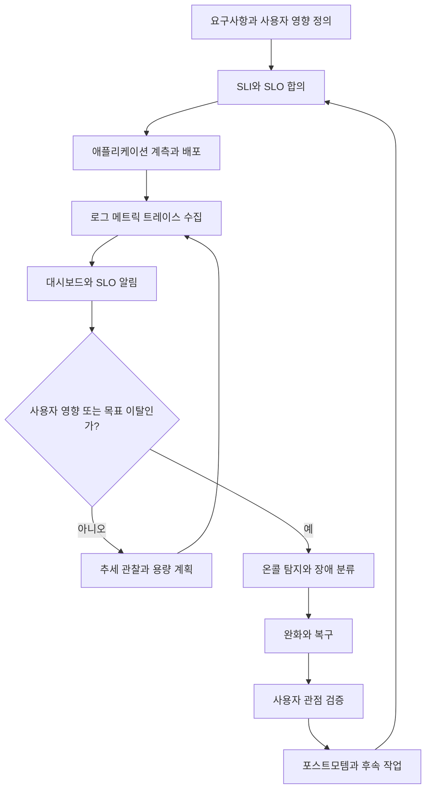
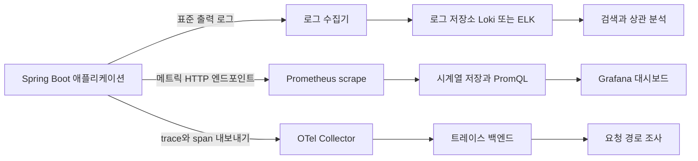
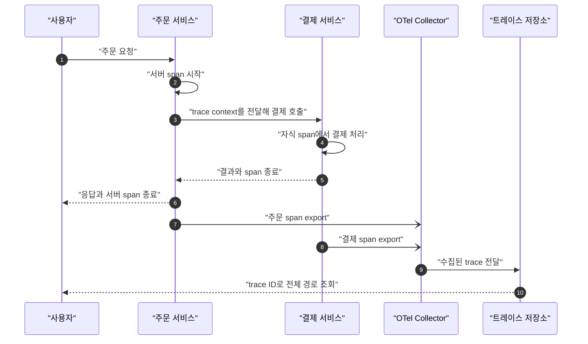
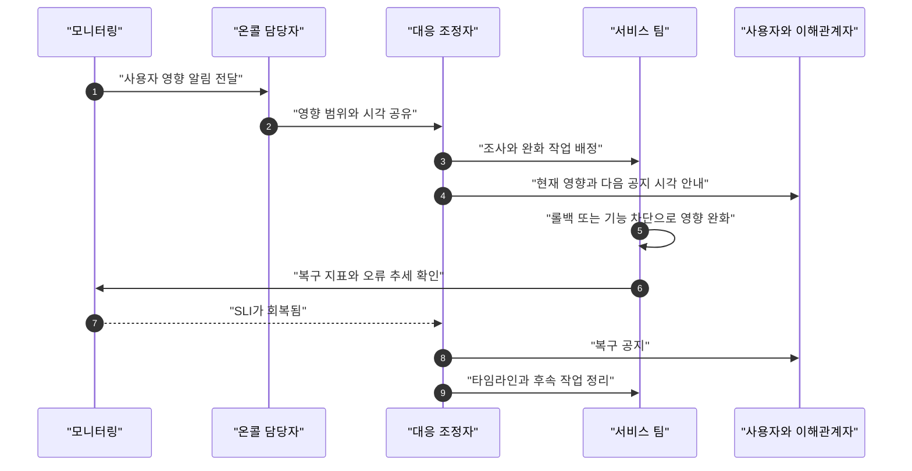

# D09. 운영과 관측 — 배포 이후 서버를 지켜보는 법

> 배포는 운영의 시작이다. 사용자가 체감하는 신호를 SLI로 정하고 목표를 SLO로 합의한다.
> 메트릭은 “얼마나/얼마나 자주”, 로그는 “무슨 사건”, 트레이스는 “요청이 어디를 거쳤나”에 답한다.
> 장애는 탐지 후 영향부터 줄이고, 복구를 확인한 뒤 비난 없는 포스트모템으로 재발 가능성을 낮춘다.

## 1. 큰 그림



제품팀과 개발팀은 기대 동작을 SLI로 측정하고 수준을 SLO로 정한다. 애플리케이션 신호는 수집·저장되어 대시보드와 알림에 쓰인다. 알림을 받은 온콜은 장애를 분류하고 영향부터 줄인다. 정상 동작을 확인한 뒤 원인과 개선 작업을 남겨 다음 목표와 설계에 반영한다.

**전체 개발 과정에서의 위치:** D01의 요구사항·설계·구현·검증·배포 다음 단계이며, 운영 피드백이 다시 요구사항과 설계로 연결되는 구간이다(전체 과정은 → D01 참조).

## 2. 용어 사전

| 용어 | 한 줄 정의 | 실무 예시 | 헷갈리는 것과 차이 |
|---|---|---|---|
| 가용성 | 정한 조건에서 정상 응답한 비율 | 정상 결제 요청 99.9% | 프로세스 생존만으로 사용자 기능을 증명하지 못한다 |
| 다운타임 | 합의한 SLI를 만족하지 못한 시간·구간 | API가 5xx를 반환한 시간 | 요청 기준 실패율과 시간 기준은 계산이 다르다 |
| SLI | 서비스 수준을 나타내는 측정 지표 | 성공한 유효 요청 / 전체 유효 요청 | 분자·분모, 집계 구간, 제외 조건까지 정한다 |
| SLO | SLI의 내부 목표 | 최근 30일 성공률 99.9% | SLA와 달리 내부 운영 의사결정용 목표다 |
| SLA | 서비스 수준에 관한 대외 약속과 미달 조건 | 약속 미달 시 크레딧 지급 | 계약상 결과가 붙을 수 있다 |
| 에러 버짓 | SLO에서 허용되는 실패 몫 | 목표 99.9%면 요청 기준 0.1% | 배포 위험과 안정화 작업을 판단한다 |
| 모니터링 | 정한 지표를 수집·조회·알림하는 일 | CPU 경보 | 관측성은 신호로 원인을 좁히는 능력까지 본다 |
| 관측성 | 외부 신호로 시스템 동작을 추론하는 능력 | 특정 요청 지연 원인 추적 | 계측·상관관계·질의가 필요하다 |
| 로그 | 시각과 맥락이 있는 사건 기록 | 주문 ID와 오류 코드가 든 JSON | 한 줄만으로 요청 경로를 재구성하기 어렵다 |
| 메트릭 | 시간에 따라 집계하는 숫자 시계열 | 초당 요청 수, 오류율, 지연 분포 | 개별 주문 상세 저장소가 아니다 |
| 트레이스 / span | 요청 전체 경로 / 그 안의 개별 작업 구간 | 주문에서 결제 호출까지 추적 | 부모·자식 span으로 호출 관계를 표현한다 |
| 대시보드 | 핵심 상태와 추세를 보는 화면 | 성공률, p95 지연, 트래픽 | 화면이 있다고 문제가 자동 해결되지는 않는다 |
| 알림, alert/page | 주의·즉시 대응을 전달하는 신호 | 급격한 오류 예산 소진으로 온콜 호출 | 기록용 티켓과 즉시 페이지를 나눈다 |
| 임계치와 노이즈 | 알림 조건 / 행동을 유발하지 않는 반복 알림 | 큐 적체 기준과 반복 CPU 경보 | 사용자 영향과 행동 가능성을 기준으로 조정한다 |
| 온콜, 당직 | 정해진 시간에 알림을 받고 대응 | 결제 서비스 1차 당직 | 권한·절차·지원 담당이 같이 필요하다 |
| 장애, incident | 사용자나 사업에 의미 있는 영향이 난 사건 | 결제 성공률이 목표 아래로 하락 | 원인을 알아야 장애로 부르는 것은 아니다 |
| 완화, mitigation | 원인이 남아도 현재 영향을 줄이는 조치 | 문제 버전 롤백, 기능 차단 | 근본 수정과 구분해 먼저 서비스를 안정시킨다 |
| 포스트모템 | 영향·타임라인·기여 요인·후속 조치 기록 | 캐시 오류와 감지 지연 개선 | 개인 비난이 목적이 아니다 |
| 용량 계획 | 예상 부하와 자원 한계를 비교해 여유를 정함 | 피크의 DB 연결 수 산정 | CPU만으로 모든 병목을 설명하지 못한다 |
| 스케일 업 | 한 인스턴스에 CPU·메모리를 더 배정 | 큰 메모리 인스턴스로 변경 | 단순하지만 단일 노드 한계가 남는다 |
| 스케일 아웃, 수평 확장 | 인스턴스·파드 수를 늘려 일을 나눔 | 파드 3개에서 8개로 확대 | 로컬 세션에 의존하면 단순 증설만으로 확장되지 않는다 |
| 오토스케일 | 지표와 정책에 따라 용량을 자동 조정 | 부하에 맞춰 파드 수 조절 | 측정·기동·웜업 지연이 있다 |
| 무상태 설계 | 요청 상태를 특정 인스턴스에 묶지 않는 구조 | 세션을 공유 저장소나 토큰으로 관리 | 도메인 데이터가 없다는 뜻은 아니다 |
| 캐시 | 재사용 결과를 가까운 곳에 임시 저장 | 상품 조회 결과를 Redis에 보관 | 만료·무효화·일관성을 설계한다 |
| CDN | 엣지에서 콘텐츠를 전달·캐싱 | 정적 이미지와 공개 응답 전달 | 개인화 응답을 무조건 캐시하면 안 된다 |
| 백업 | 장애 뒤 복구할 데이터 사본 | DB 사본을 별도 계정에 보관 | 성공 로그만으로 복원 가능성이 증명되지 않는다 |
| RPO | 복구 시 허용 가능한 데이터 손실 범위 | 최대 5분 손실 허용 | 서비스 복구 시간인 RTO와 다르다 |
| RTO | 장애 후 서비스 복구까지 허용하는 시간 | 2시간 안에 핵심 API 복구 | RPO를 만족해도 RTO는 실패할 수 있다 |
| scrape | Prometheus가 메트릭 주소를 주기적으로 읽음 | `/actuator/prometheus` 조회 | 로그 파일 수집과 다르다 |
| 라벨 카디널리티 | 라벨 조합으로 만들어지는 시계열 수 | `userId` 라벨로 시계열 폭증 | 요청마다 바뀌는 값은 메트릭 라벨에 부적절하다 |

## 3. 단계별로 보기

### 3.1 사용자 관점의 목표를 정한다

먼저 “정상”의 기준을 합의한다. 서버가 200을 반환해도 잘못된 상품이 담기거나 결제가 중복되면 사용자는 정상으로 보지 않는다. SLI 후보는 유효 요청의 성공률, 지연, 데이터 정확성, 작업 완료율이다. 분모에서 제외할 요청이 있다면 기준을 문서화한다.

SLO에는 지표·목표·기간·측정 위치를 적는다. “최근 30일 정상 결제 요청의 99.9% 성공”처럼 조건을 함께 정한다. 요청 기준 실패 허용분은 0.1%다. 이를 30일의 시간 기준으로 환산한 43.2분이 요청 기준 SLI에 그대로 적용되진 않는다. Google SRE도 SLI·SLO·SLA를 구분하고 사용자 행동을 측정하라고 설명한다 [R1].

SLO는 신뢰성과 출시 속도 사이의 판단 기준이다. 에러 버짓이 줄면 위험한 변경을 미루고 안정화에 집중할 수 있다. 계약상 결과는 SLA에, 내부 판단은 SLO에 둔다.

### 3.2 텔레메트리를 만들고 흐르게 한다

세 신호는 서로 대체재가 아니다. 메트릭은 “언제부터 요청이 늘었나, 지연과 오류가 얼마나 큰가”라는 범위와 추세를 빠르게 잡는다. 로그는 “이 주문에서 어떤 예외가 났나”처럼 사건의 세부 맥락을 찾는다. 트레이스는 “이 요청이 어떤 서비스에서 얼마나 기다렸나”를 보여준다. OpenTelemetry는 로그·메트릭·트레이스를 텔레메트리로 설명하며, 트레이스는 분산된 요청 경로를 관찰하게 한다 [R2].



로그 수집기는 표준 출력을 모아 Loki나 Elasticsearch 계열 저장소에 전달한다. Prometheus는 애플리케이션·exporter에서 메트릭을 주기적으로 가져와 시계열로 저장하고, Grafana 등에서 조회한다. Prometheus의 pull 방식·라벨·규칙 평가는 공식 개요에 정리되어 있다 [R3]. 트레이스는 span의 요청 문맥을 SDK나 Collector를 거쳐 백엔드로 보낸다.



trace ID와 span 관계가 이어져야 서비스 기록을 한 요청으로 볼 수 있다. 문맥 전파가 끊기면 trace도 끊긴다. 전체 저장 비용을 고려해 샘플링 정책을 정하고, 민감한 토큰·개인정보를 신호에 넣지 않는다.

수집기 지연이 애플리케이션 요청을 막지 않도록 버퍼·재시도·드롭 정책을 점검한다. 로그에는 검색 문맥을 둘 수 있지만 사용자별 ID를 메트릭 라벨에 넣으면 시계열이 폭증한다. 메트릭 라벨은 상태 코드 그룹·경로 템플릿처럼 값 종류가 제한된 항목으로 고른다.

### 3.3 대시보드와 알림을 운영 가능한 형태로 만든다

대시보드에는 요청량·오류율·지연 분포·포화도와 배포 시각을 둔다. 평균 지연만 보면 느린 일부 요청이 가려지므로 p95·p99도 살핀다. 패널의 단위와 집계 범위를 표시한다.

알림은 “지금 어떤 행동을 할 것인가?”에 답해야 한다. 사용자 실패나 SLO 악화는 페이지 후보이고, 사용자 영향 없는 일시적 CPU 상승은 기록용 티켓일 수 있다. 같은 경보가 반복되면 기간·집계·억제 조건·수신자를 조정한다. 야간 담당자의 권한과 조치 문서도 준비한다.

첫 운영 서비스의 기본값은 사용자 성공률·지연을 SLI로 정하고 이를 묶는 SLO 하나를 합의한 뒤, Prometheus scrape와 Grafana 대시보드로 메트릭을 보는 것이다. 페이지는 SLO에 영향을 주고 온콜이 즉시 할 조치가 있을 때 연결한다.

### 3.4 탐지부터 복구까지 같은 상황판을 쓴다

온콜은 증상·영향 범위·시작 시각·최근 변경을 확인한다. 심각한 장애에서는 대응 조정자, 조사자, 공지 담당으로 역할을 나눈다. 조정자는 우선순위와 갱신 시각을 정하고 조사자는 세 신호로 가설을 좁힌다.



완화에는 롤백, 트래픽 우회, 기능 차단, 요청 제한, 읽기 전용 전환 등이 있다. 원인 규명 때문에 대응을 늦추지 않는다. 복구는 사용자 SLI와 의존 서비스 상태로 확인한다. 종료 후 타임라인·영향·감지 지연·기여 요인·후속 작업을 기록한다. 포스트모템은 재발 가능성과 피해를 줄이며, 비난 대신 당시 시스템 조건과 개선을 다룬다 [R4].

### 3.5 용량과 확장, 캐시를 함께 설계한다

인스턴스를 늘려도 DB 연결이나 외부 API 한도가 먼저 찰 수 있다. 처리량·지연 분포·큐 길이·자원·오류율을 함께 본다. 스케일 업은 한 노드의 자원을, 스케일 아웃은 인스턴스 수를 늘린다. 수평 확장 시 세션·파일 상태를 공유 계층으로 옮기고 DB·큐 한도도 측정한다.

오토스케일은 관측 부하를 목표와 비교해 용량을 조정한다. Kubernetes `HorizontalPodAutoscaler`는 CPU·메모리·사용자 정의 메트릭으로 복제 수를 조절한다. 문서상 컨트롤러 기본 조회 간격은 15초이며 설정으로 달라질 수 있다 [R5]. 파드 기동과 JVM 웜업까지 걸리므로 최소 여유 용량, 부하 제한, 사전 확장도 고려한다.

캐시는 원본 부하와 지연을 낮추지만 TTL·무효화·동시 갱신과 장애 시 원본 부하를 설계해야 한다. CDN은 엣지 캐시로 전달 지연을 줄이고 가용성을 높일 수 있다 [R6]. 개인 데이터의 공유 캐시 노출을 막도록 키와 헤더를 검토한다. 과부하 때 품질 저하나 요청 제한도 연쇄 장애를 막는 수단이다 [R7].

### 3.6 백업과 재해 복구를 실제로 시험한다

RPO 5분은 허용 데이터 손실, RTO 2시간은 복구 목표 시간이다. 백업 주기·보존·키 접근·사본 위치·복원 절차를 정한다. 격리 환경에서 복원해 데이터와 애플리케이션을 확인한다. 복제는 삭제·손상도 전파할 수 있어 백업을 대체하지 않는다.

가용성은 컴포넌트 중복과 빠른 전환, 재해 복구는 전체 워크로드를 다른 위치에서 재가동하는 문제다. AWS도 사업 요구에 맞는 RTO·RPO와 복구 시험·자동화를 권한다 [R8]. 훈련에서 달성한 시간과 데이터 손실량을 기록한다.

## 4. 직접 해보기

아래 실습은 Mac 로컬에서 Docker Compose로 Prometheus와 Grafana를 실행하고, 호스트에서 실행한 Spring Boot 4.1 애플리케이션의 메트릭을 긁어 보는 구성이다. Java 25와 Gradle Wrapper를 사용하는 프로젝트를 준비한다.

애플리케이션의 `/actuator/prometheus` 노출 설정은 이 문서 범위가 아니므로 → S16의 Actuator·Micrometer 설정을 먼저 적용한다. 여기서는 수집·조회 흐름에 집중한다.

프로젝트 루트에 `ops/prometheus.yml` 파일을 만든다.

```yaml
global:
  scrape_interval: 15s

scrape_configs:
  - job_name: "spring-app"
    metrics_path: "/actuator/prometheus"
    static_configs:
      - targets: ["host.docker.internal:8080"]
```

같은 프로젝트의 `ops/compose.yaml`은 다음과 같이 둔다.

```yaml
services:
  prometheus:
    image: prom/prometheus:latest
    ports:
      - "9090:9090"
    volumes:
      - ./prometheus.yml:/etc/prometheus/prometheus.yml:ro
  grafana:
    image: grafana/grafana:latest
    ports:
      - "3000:3000"
    environment:
      GF_SECURITY_ADMIN_USER: admin
      GF_SECURITY_ADMIN_PASSWORD: local-only-change-me
    depends_on:
      - prometheus
```

로컬 학습용이라 이미지 태그는 움직이는 `latest`를 사용했다. 팀 실습을 반복하거나 운영에 적용할 때는 이미지 버전을 고정하고 갱신 절차를 둔다. 먼저 앱을 켠다.

```bash
./gradlew bootRun
```

새 터미널에서 메트릭 주소가 응답하는지 확인하고, 모니터링 구성요소를 실행한다.

```bash
curl -fsS --output /tmp/spring-metrics.txt http://localhost:8080/actuator/prometheus
sed -n '1,20p' /tmp/spring-metrics.txt
docker compose -f ops/compose.yaml up -d
docker compose -f ops/compose.yaml ps
```

`curl` 응답이 404면 앱 엔드포인트 설정이나 포트를 확인한다. Prometheus의 `http://localhost:9090/targets`에서 `spring-app`이 `UP`인지 본다. 쿼리 화면에서 `up{job="spring-app"}`를 실행하면 스크레이프 성공 시 1, 실패 시 0이 나온다.

Grafana(`http://localhost:3000`)에 로그인한 뒤 데이터 소스를 Prometheus로 추가하고 URL을 `http://prometheus:9090`으로 지정한다. Grafana와 Prometheus가 Compose 네트워크 안에서 이름으로 통신하기 때문이다.

이제 요청을 몇 번 보내 그래프 변화를 만든다. 앱을 잠시 종료하면 scrape target이 실패하고 `up`이 0으로 바뀌며, 다시 실행하면 1로 회복되어야 한다. 이 결과는 “앱이 메트릭 주소에서 scrape에 응답한다”는 뜻이지 전체 사용자 기능이 정상이라는 증거는 아니다. 잘못된 응답이 200으로 나가는 경우나 DB 장애는 별도 SLI·로그·트레이스로 확인해야 한다. 사용한 구성을 정리할 때는 다음 명령을 실행한다.

```bash
docker compose -f ops/compose.yaml down
```

## 5. 자주 하는 오해와 실수

1. **“프로세스가 살아 있으면 서비스도 정상이다” →** 헬스체크가 성공해도 결제·검색 같은 사용자 동작이 실패할 수 있다 → 블랙박스 확인과 사용자 관점 SLI를 함께 둔다.
2. **“99.9% 가용성이면 한 달에 43분만 장애 나면 된다” →** 그 환산은 시간 기반 정의에서만 근사적으로 맞고 요청 기준 SLI에는 그대로 적용되지 않는다 → 분자·분모와 기간, 제외 조건을 SLO에 적는다.
3. **“대시보드가 있으면 관측된다” →** 대시보드는 이미 선택한 질문에 대한 화면이고 미지의 오류를 자동으로 설명하지 않는다 → 요청 경로 상관관계와 검색 가능한 로그·트레이스, 계측 품질을 확보한다.
4. **“로그를 많이 남기면 원인을 안다” →** 요청 ID나 시각이 없고 여러 서비스 로그가 연결되지 않으면 사건을 찾기 어렵다 → 공통 상관 ID와 구조화 필드, 보존·민감정보 정책을 둔다.
5. **“CPU 80%면 무조건 페이지를 울린다” →** 사용자 영향 없이 잠깐 치솟거나 오토스케일로 회복할 수 있고, 반대로 CPU가 낮아도 외부 DB 대기 때문에 실패할 수 있다 → 사용자 영향 알림과 자원 지표를 구분한다.
6. **“오토스케일을 켜면 용량 계획은 끝났다” →** 지표 수집과 파드 준비에 시간이 들며 DB·외부 API가 병목일 수 있다 → 최대치, 최소 여유, 확장 지연, 다운스케일 안정성, 하위 의존성 한도를 점검한다.
7. **“백업 작업이 성공했으니 복구 가능하다” →** 키 권한·손상·절차 누락으로 복구에 실패할 수 있다 → 분리된 환경에서 실제 복원 훈련을 하고 달성한 RPO·RTO를 기록한다.
8. **“장애 원인을 찾은 뒤 사용자에게 알리면 된다” →** 조사 중에도 영향은 계속된다 → 먼저 영향·다음 공지 시각을 공유하고 완화와 조사를 병행한다.
9. **“포스트모템은 담당자를 정해 경고하는 문서다” →** 비난은 정보를 숨기게 만들어 조직의 반복 실패를 남긴다 → 당시의 가시성·권한·절차를 살펴 재발 방지 작업에 담당자와 기한을 붙인다.
10. **“캐시는 읽기 부하를 공짜로 없앤다” →** 만료 시 동시 요청이 원본에 몰리거나 오래된 개인 데이터가 노출될 수 있다 → 적중률뿐 아니라 무효화, stampede, 키 구성, 원본 보호를 검토한다.

## 6. 시각화 설계 메모

| 목적 | 노드·요소 | 화살표·관계 | 단계별 애니메이션 순서 | 강조할 오해 |
|---|---|---|---|---|
| 개발에서 운영·개선까지 큰 흐름을 기억한다(1절 flowchart) | 요구사항, SLI/SLO, 배포, 3종 신호, 알림, 온콜, 복구, 포스트모템 | 배포 후 신호가 알림으로 연결되고 개선이 목표로 되돌아가는 루프 | 목표 정의 → 계측 → 배포 → 관측 → 장애 대응 → 학습 루프 | 운영은 배포 완료와 함께 끝나지 않는다 |
| 한 요청에서 세 신호가 답하는 질문을 비교한다(3.2절 flowchart) | 서비스, 로그 수집기, Prometheus, Grafana, OTel Collector, trace 저장소 | 로그는 사건, 메트릭은 시계열, 트레이스는 요청 경로로 각 저장소에 이동 | 요청 발생 → 세 신호 생성 → 수집·저장 → trace ID와 시간으로 교차 확인 | 세 신호 중 하나가 나머지를 대체하지 않는다 |
| 장애 대응 시 누가 무엇을 하는지 구분한다(3.4절 sequenceDiagram) | 모니터링, 온콜, 대응 조정자, 조사팀, 사용자 | 영향 알림, 역할 배정, 완화, SLI 검증, 공지 | 탐지 → 분류 → 영향 완화 → 회복 확인 → 공지·후속 작업 | 원인 분석이 끝날 때까지 완화를 기다리지 않는다 |
| RPO와 RTO를 복구 훈련에 연결한다(3.6절) | 운영 데이터, 백업 사본, 복원 환경, 사용자 API | 데이터 사본 복원과 서비스 재개를 별도 시간축으로 표현 | 장애 시점 → 마지막 복구 가능 지점 → 복원 → 검증 완료 | 백업 시간과 서비스 복구 시간은 같은 목표가 아니다 |

## 7. 자가점검 Q&A (면접 대비)

### Q1. SLI, SLO, SLA를 실제 결제 API 사례로 구분해 설명하라.

SLI는 유효 결제 요청의 성공 비율이고, 분자·분모·측정 구간까지 정해야 한다. SLO는 그 SLI의 내부 목표(예: 최근 30일 99.9%)다. SLA는 고객과 합의한 약속과 미달 시 크레딧 같은 결과를 포함할 수 있다.

**꼬리질문 — 에러 버짓은 어디에 쓰나?** SLO까지 허용된 실패 몫을 배포 위험이나 안정화 작업의 의사결정에 쓴다.

### Q2. 모니터링과 관측성의 차이를 말하고, 왜 메트릭 하나로 장애를 설명하기 어려운가?

모니터링은 알려진 상태를 지표와 경보로 추적한다. 관측성은 로그·메트릭·트레이스 등 신호를 질문해 예상하지 못한 상태의 원인을 좁히는 능력이다. 메트릭은 범위와 추세에 강하지만 특정 요청의 세부 사건과 서비스 호출 경로는 로그와 트레이스가 더 잘 보여준다.

**꼬리질문 — trace ID가 왜 유용한가?** 서비스별 로그와 span을 동일 요청 단위로 찾아 시간 순서와 병목 구간을 맞출 수 있다.

### Q3. CPU 임계치 알림과 SLO 기반 알림을 어떻게 나눌 것인가?

CPU는 용량과 과부하 징후를 조사하는 원인 신호다. 사용자 성공률·지연처럼 SLO와 연결한 신호는 실제 영향을 탐지하는 기준이 된다. CPU가 높아도 영향이 없다면 티켓·대시보드로 보고, 사용자가 실패하면 즉시 대응하도록 알림을 분류한다.

**꼬리질문 — 같은 알림이 반복되는데 아무도 조치하지 않는다면?** 페이지 기준·억제 조건·오너·조치 문서를 재검토하고, 행동 없는 페이지는 티켓이나 관찰 지표로 바꾼다.

### Q4. 애플리케이션 인스턴스를 수평 확장했는데도 지연이 나아지지 않는 원인은?

DB 연결 한도, 외부 API 제한, 공유 락, 직렬화된 큐가 병목일 수 있다. 세션이나 파일이 특정 인스턴스 메모리에 묶여 요청을 고정 라우팅할 수도 있다. 전체 요청 흐름의 지연·포화도를 보고 병목 계층을 찾는다.

**꼬리질문 — 무상태 설계는 도메인 상태를 없애나?** 아니다. 요청을 어느 인스턴스가 처리해도 되도록 세션 같은 실행 상태를 외부화하는 뜻이며 주문·계정 같은 도메인 데이터는 계속 저장한다.

### Q5. RTO와 RPO가 각각 1시간이라면 백업 정책만 세워도 되는가?

아니다. RPO는 허용 가능한 데이터 손실량, RTO는 서비스 재개까지의 목표 시간이다. 백업 주기·보존·키 접근과 함께 복원 절차, 네트워크·애플리케이션 재구성 시간을 시험해야 두 목표를 검증할 수 있다.

**꼬리질문 — 복제본이 있는데 백업도 필요한 이유는?** 실수 삭제나 손상이 복제될 수 있어, 이전 시점으로 복구할 별도 사본과 보존 정책이 필요하다.

### Q6. 장애를 감지한 직후 조사자가 할 첫 행동은 무엇인가?

사용자 영향 범위와 현재 증상을 확인하고, 영향이 계속되면 원인 확정 전에 완화책을 검토한다. 큰 장애에서는 조정·조사·공지 역할을 나누고 공지 시각을 합의한다. 완화 뒤 SLI와 사용자 기능이 실제 회복됐는지 확인한다.

**꼬리질문 — 롤백은 원인 해결인가?** 보통은 아니다. 알려진 나쁜 변경을 되돌려 피해를 줄이는 완화이며, 이후 원인 분석과 수정이 이어진다.

### Q7. 포스트모템에서 “실수한 개발자가 설정을 잘못 바꿨다”로 끝내면 부족한 이유는?

그 설명은 어떤 조건에서 실수가 가능했고 왜 검증·롤백·탐지가 실패했는지 드러내지 않는다. 설정 리뷰, 배포 보호 장치, 지표와 경보, 복구 문서 등 시스템 요인을 찾고 구체적 후속 작업으로 바꿔야 한다. 비난 없는 기록은 사건의 사실과 책임 있는 개선을 함께 남긴다.

**꼬리질문 — 후속 작업에는 무엇을 넣나?** 재발 가능성이나 피해를 줄이는 변경, 담당자, 완료 기한, 성공 여부를 확인할 방법을 적는다.

주제 경계: Actuator·Micrometer 설정은 → S16, 성능 튜닝은 → S17 참조.

## 8. 참고문헌

- [R1] Google SRE, Service Level Objectives — https://sre.google/sre-book/service-level-objectives/ — SLI·SLO·SLA의 구분과 사용자 관점의 측정 지표.
- [R2] OpenTelemetry, Observability primer — https://opentelemetry.io/docs/concepts/observability-primer/ — 관측성, 신뢰성, 텔레메트리, 로그·span·trace 설명.
- [R3] Prometheus, Overview — https://prometheus.io/docs/introduction/overview/ — 메트릭 시계열, pull scrape, 구성요소와 Grafana 연동 개요.
- [R4] Google SRE, Postmortem Culture: Learning from Failure — https://sre.google/sre-book/postmortem-culture/ — 비난 없는 포스트모템과 후속 예방 조치의 목적.
- [R5] Kubernetes, Horizontal Pod Autoscaling — https://kubernetes.io/docs/concepts/workloads/autoscaling/horizontal-pod-autoscale/ — HPA 제어 루프와 스케일 대상·메트릭 설명.
- [R6] AWS CloudFront, What is Amazon CloudFront? — https://docs.aws.amazon.com/AmazonCloudFront/latest/DeveloperGuide/Introduction.html — 엣지 전달과 콘텐츠 캐시의 지연·가용성 효과.
- [R7] Google SRE, Handling Overload — https://sre.google/sre-book/handling-overload/ — 과부하 상황의 저하 응답과 부하 제어 배경.
- [R8] AWS Well-Architected, Plan for Disaster Recovery (DR) — https://docs.aws.amazon.com/wellarchitected/latest/reliability-pillar/plan-for-disaster-recovery-dr.html — 사업 요구 기반 RTO·RPO, 복구 시험과 자동화.
- Google SRE, Monitoring Distributed Systems — https://sre.google/sre-book/monitoring-distributed-systems/ — 모니터링·대시보드·알림 용어와 운영 신호.
- Google SRE, Practical Alerting from Time-Series Data — https://sre.google/sre-book/practical-alerting/ — 시계열 모니터링과 실무 알림 원칙.
- Grafana Loki, Loki architecture — https://grafana.com/docs/loki/latest/get-started/architecture/ — 로그 저장소의 구성과 수평 확장 구조.
