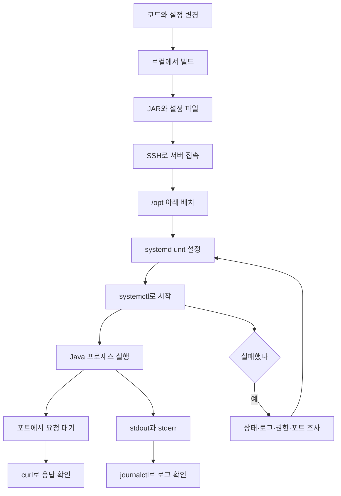
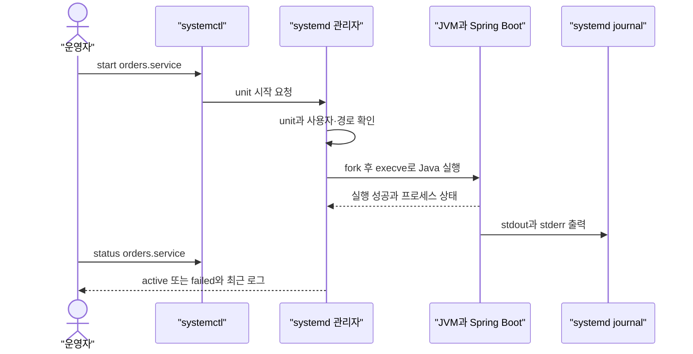
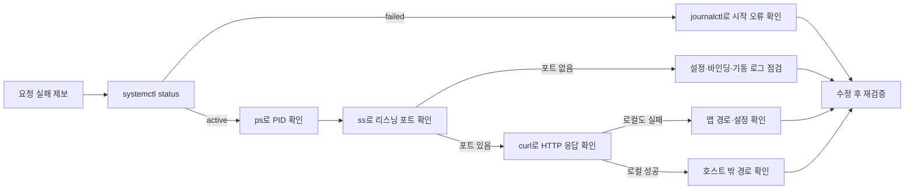

# D12. 리눅스·터미널 기본 — 서버에서 살아남기

> 터미널은 명령을 입력하는 창이고, 쉘은 그 명령을 해석해 프로그램을 실행하는 인터프리터다.
> 서버 장애를 볼 때는 파일·프로세스·포트·서비스·로그를 한 흐름으로 추적한다.
> Java 프로세스를 systemd가 관리하게 만들고, 상태와 journal 로그로 시작·실패·종료 원인을 확인한다.

## 1. 큰 그림

서버의 사용자·Java 경로·환경·작업 위치가 맞아야 산출물이 실행된다. 장애는 서비스와 로그에서 프로세스·포트·디스크로 좁힌다.

서버 접속·관찰 기초다(D01). 배포 전략은 D06, 네트워크는 D02 참조.

## 2. 용어 사전

| 용어 | 한 줄 정의 | 실무 예시 | 헷갈리는 것과 차이 |
|---|---|---|---|
| 터미널 | 문자 입출력 창 | Terminal에서 SSH | 창이며 쉘은 별도 프로그램 |
| 쉘 | 명령 해석·실행기 | Bash에서 <code>ls</code> | 터미널과 같지 않다 |
| 프롬프트 | 쉘이 입력 대기 중임을 보임 | <code>user@host:~$</code> | 모양은 권한 증명이 아님 |
| 경로 | 파일 위치, 절대 또는 현재 기준 상대 | <code>/opt/app</code>, <code>../config</code> | <code>pwd</code>가 상대 경로 기준 |
| 표준 스트림 | 입력 0, 출력 1, 오류 2 | <code>cmd &gt;out 2&gt;err</code> | stdout과 stderr는 따로 연결 가능 |
| 파이프·리다이렉션 | 프로세스 간 전달 / 파일 연결 | <code>journalctl | grep ERROR</code> | 파이프는 기본 stdout만 보냄 |
| 환경변수 | 자식 프로세스에 넘기는 설정 | <code>JAVA_HOME</code> | 쉘 변수는 <code>export</code>해야 전달 |
| <code>PATH</code> | 실행파일 탐색 디렉터리 목록 | <code>command -v java</code> | <code>JAVA_HOME</code>과 다름 |
| 파일시스템 경로 | 설정·로그·앱·홈의 위치 | <code>/etc</code>, <code>/var/log</code>, <code>/opt</code>, <code>/home</code> | journal 로그는 파일 경로와 별도일 수 있음 |
| rwx 권한·소유권 | 사용자/그룹/기타별 접근 비트와 소유자 | <code>chmod 640</code>, <code>chown</code> | 모드 변경과 소유권 변경은 다름 |
| 프로세스·PID | 실행 중 프로그램과 현재 식별 번호 | <code>ps -p 1234</code> | PID는 종료 뒤 재사용될 수 있음 |
| 시그널 | 프로세스 제어 알림 | <code>kill -TERM PID</code> | TERM은 정리 가능, KILL은 강제 |
| 포트·리스닝 | 네트워크 종단과 연결 대기 상태 | <code>ss -lntp</code> | 열린 포트가 외부 접근 보장은 아님 |
| 서비스·unit | systemd가 관리하는 작업 단위 | <code>orders.service</code> | 서비스는 unit 종류 중 하나 |
| systemctl 동작 | 상태 조회·시작·부팅 등록 요청 | <code>status</code>, <code>restart</code>, <code>enable</code> | <code>daemon-reload</code>는 정의 재읽기 |
| journal | systemd 로그 수집·조회 체계 | <code>journalctl -u orders</code> | 일반 텍스트 파일 로그와 다름 |
| 용량 도구 | 파일시스템·폴더·메모리 사용량 확인 | <code>df</code>, <code>du</code>, <code>free</code> | 각각 측정 범위가 다름 |
| SSH·키 인증 | 암호화 원격 접속과 사용자 인증 | <code>ssh -i key user@host</code> | 공개키는 서버, 개인키는 클라이언트 |
| 파일 전송 | SSH 기반 복사·동기화 | <code>scp</code>, <code>rsync</code> | rsync는 변경분 동기화에 적합 |
| 컨테이너 | 격리된 프로세스 실행 환경 | <code>docker exec</code> | 컨테이너 도구·파일은 호스트와 다름 |
| 패키지 관리자 | OS 패키지 설치·갱신 도구 | <code>apt</code>, <code>dnf</code>, <code>yum</code> | 앱 jar 배치와 시스템 패키지 설치는 다름 |
| 파일 명령 | 읽기·검색·복사·이동·삭제 도구 | <code>cat</code>, <code>less</code>, <code>grep</code>, <code>find</code>, <code>cp</code>, <code>mv</code>, <code>rm</code> | rm은 휴지통 없이 삭제 |
| 네트워크 확인 | 소켓·TCP·HTTP·ICMP를 점검하는 명령 | <code>ss</code>, <code>lsof -i</code>, <code>nc</code>, <code>curl</code>, <code>ping</code> | ping은 포트나 HTTP를 확인하지 않음 |

## 3. 단계별로 보기

### 3.1 쉘과 파일

무엇이 일어나나: Bash는 명령을 나누고 변수·따옴표를 처리한 뒤 builtin 또는 실행 파일을 실행한다. <code>cd</code>는 현재 쉘의 작업 위치를 바꾸므로 builtin이다. <code>PATH</code>는 실행 파일 검색 경로이며 <code>command -v java</code>로 실제 선택된 프로그램을 본다. <code>&gt;</code>는 stdout을 덮어쓰고 <code>&gt;&gt;</code>는 추가한다. <code>2&gt;</code>는 stderr를 분리하며 <code>2&gt;&amp;1</code>은 stderr를 stdout의 현재 대상으로 연결한다. 리다이렉션은 왼쪽에서 오른쪽으로 적용되므로 순서를 바꾸면 결과가 달라진다. 파이프 <code>|</code>는 기본적으로 stdout만 다음 명령의 stdin에 보낸다.

누가/도구: 개발자와 쉘, <code>pwd</code>, <code>ls</code>, <code>cat</code>, <code>less</code>, <code>grep</code>, <code>find</code>.

입력과 산출물: 경로·명령·환경이 입력이고, 출력·종료 상태·프로세스가 결과다. <code>/etc</code>는 설정, <code>/var/log</code>는 텍스트 로그가 흔한 위치, <code>/opt</code>는 추가 앱, <code>/home</code>은 사용자 홈으로 쓰인다. 리눅스 로그가 꼭 파일로만 저장되는 것은 아니다.

실패하면: <code>command not found</code>는 설치 또는 <code>PATH</code>, <code>Permission denied</code>는 파일 권한이나 상위 디렉터리 통과 권한을 본다. <code>cat</code>은 짧은 파일, <code>less</code>는 긴 파일에 쓰고, <code>grep -n ERROR file</code>이나 <code>find /opt/orders -name '*.jar'</code>처럼 검색 경로를 좁힌다. <code>cp</code>는 복사, <code>mv</code>는 이동·이름 변경이다. <code>rm</code>은 휴지통 없이 지우므로 대상과 <code>pwd</code>를 확인하고 <code>rm -i</code>부터 쓴다.

### 3.2 권한·프로세스·네트워크

무엇이 일어나나: rwx는 소유자·그룹·기타별 권한이다. 파일 x는 실행, 디렉터리 x는 경로 탐색을 뜻한다. <code>chmod 640</code>은 소유자 rw·그룹 r, <code>chown</code>은 소유권 변경이다. <code>sudo</code>는 필요한 명령에만 쓴다. <code>ps</code>·<code>top</code>은 프로세스 관찰, <code>kill</code>은 기본 SIGTERM 종료 요청이다. SIGKILL은 정리 기회 없는 강제 종료다.

포트는 프로세스가 연 소켓에서 확인한다. <code>ss -lntp</code>가 기본 선택이고 <code>netstat -lntp</code>는 구형 환경에서 볼 수 있다. <code>lsof -i :8080</code>은 파일을 연 프로세스와 포트를 연결한다. <code>curl</code>은 HTTP 응답, <code>nc -vz host 8080</code>은 TCP 연결 가능성을 확인한다. <code>ping</code>은 ICMP만 확인하므로 TCP 포트 테스트가 아니다.

누가/도구: 운영자, <code>chmod</code>, <code>chown</code>, <code>sudo</code>, <code>ps</code>, <code>top</code>, <code>kill</code>, <code>ss</code>, <code>lsof</code>, <code>curl</code>, <code>ping</code>, <code>nc</code>.

입력과 산출물: 소유자·모드·PID·주소를 입력으로 삼아 접근 여부·프로세스·소켓 상태를 확인한다.

실패하면: <code>ls -l</code>로 서비스 계정과 파일 권한을 비교한다. 프로세스·포트 부재는 각각 서비스 상태와 로그·바인딩 설정을 본다. <code>chmod -R 777</code>은 피한다.

### 3.3 SSH에서 서비스 기동까지

무엇이 일어나나: SSH는 원격 로그인을 암호화하며 host key 확인과 사용자 인증을 거친다. 공개키는 서버 계정에 등록하고 개인키는 클라이언트에 보관한다. <code>scp</code>는 파일 복사, <code>rsync</code>는 차이를 비교해 동기화한다. systemd는 unit의 사용자·작업 디렉터리·실행 명령으로 서비스를 만들고 프로세스 종료를 감시한다. <code>Type=exec</code>는 실행 파일을 실제로 시작했는지 확인한다. Spring Boot의 stdout/stderr는 systemd가 수집해 journal에서 볼 수 있다.

누가/도구: 운영자, SSH, <code>scp</code>/<code>rsync</code>, <code>systemctl</code>, JVM, <code>journalctl</code>.

입력과 산출물: jar·unit·환경 설정을 넣으면 프로세스·포트·로그가 생긴다. <code>systemctl status orders</code>, <code>journalctl -u orders -b -n 100</code>, <code>ss -lntp</code>, 로컬 <code>curl</code> 순으로 본다. <code>daemon-reload</code>는 unit 정의를 다시 읽고, <code>restart</code>는 앱을 재시작하며, <code>enable</code>은 부팅 자동 시작을 등록한다.

실패하면: SSH <code>Permission denied (publickey)</code>는 계정·키 등록·지정키를, timeout은 호스트·포트 경로를 확인한다. <code>systemctl start</code> 성공은 HTTP 준비 완료가 아니다. 서비스가 failed면 journal을 보고, 프로세스는 있으나 포트가 없으면 시작 로그와 바인딩 설정을 확인한다.

### 3.4 장애를 계층적으로 좁히기

무엇이 일어나나: 먼저 관리자 상태, 이어 프로세스·소켓·HTTP·로그를 확인한다. <code>df -h</code>는 파일시스템 공간, <code>du -sh 경로</code>는 디렉터리 점유량이다. <code>free -h</code>에서는 단순 free보다 available을 본다. 값 차이는 열린 채 삭제된 파일이나 다른 마운트에서 생길 수 있다.

누가/도구: 당직자, <code>systemctl</code>, <code>ps</code>, <code>ss</code>, <code>curl</code>, <code>journalctl</code>, <code>df</code>, <code>du</code>, <code>free</code>.

입력과 산출물: 실패 증상과 시각에서 시작해 원인 후보와 조치 결과로 좁힌다.

실패하면: <code>journalctl -u orders -b -n 200</code> 또는 <code>grep 'ERROR'</code>와 시간 문자열로 로그를 좁힌다. 시간대를 기록하고 재시작 전 상태를 남긴다.

## 4. 직접 해보기

아래 실습은 Linux VM이나 개발 컨테이너에서 한다. 운영 서비스는 중지·삭제하지 않는다. systemd 관리자 권한이 없으면 unit 실습 대신 로컬 프로세스를 관찰한다.

### 실습 A — 파일·환경·권한

~~~bash
pwd
cat /etc/os-release
printf 'JAVA_HOME=%s\n' "$JAVA_HOME"
command -v java
printf 'error\n' > /tmp/d12-a
printf 'warning\n' >> /tmp/d12-a
cp /tmp/d12-a /tmp/d12-copy
mv /tmp/d12-copy /tmp/d12-renamed
grep -nE 'error|warning' /tmp/d12-a
find /tmp -maxdepth 1 -name 'd12-*' -ls
rm -i /tmp/d12-renamed
~~~

<code>&gt;</code>는 덮어쓰고 <code>&gt;&gt;</code>는 추가한다. 짧은 파일은 <code>cat</code>, 긴 파일은 <code>less</code>. 삭제 전 경로를 확인한다. <code>export</code>는 변수를 자식에 전달하고 <code>PATH</code>와 <code>JAVA_HOME</code>은 역할이 다르다.

### 실습 B — 프로세스·소켓·용량

~~~bash
chmod 640 /tmp/d12-a
ls -l /tmp/d12-a
sleep 300 &
pid=$!
ps -p "$pid" -o pid,ppid,stat,cmd
top
kill -TERM "$pid"
ss -lntp
lsof -i :8080
df -h
du -sh /tmp
free -h
~~~

<code>htop</code>은 선택 도구다. SIGTERM 뒤 <code>ps</code>로 확인한다. <code>netstat</code>도 가능하지만 <code>ss</code>를 우선 쓴다. <code>curl</code>은 HTTP, <code>nc</code>는 TCP, <code>ping</code>은 ICMP를 확인한다.

### 실습 C — 로그·패키지·컨테이너

~~~bash
journalctl -b -n 30 --no-pager
journalctl -u orders -b -p warning --since "1 hour ago" --no-pager
grep -n 'ERROR' app.log
tail -f app.log
docker logs --tail 100 --follow api
docker exec -it api sh
~~~

<code>tail -f</code>는 Ctrl-C로 끝낸다. journal과 파일 로그는 별개다. Debian/Ubuntu는 <code>apt</code>, RHEL 계열은 <code>dnf</code>를 쓰며 <code>yum</code>은 호환 명령일 수 있다. 컨테이너에는 쉘·진단 도구가 없거나 내부 변경이 재생성 후 사라질 수 있다.

### 실습 D — SSH와 Spring Boot systemd 서비스

SSH 키를 받은 후 형식에 맞춰 접속하고, 전송 전에는 <code>rsync --dry-run</code>으로 대상을 확인한다.

~~~bash
ssh -i ~/.ssh/id_ed25519 deploy@example-host
scp build/libs/app.jar deploy@example-host:/tmp/app.jar
rsync -av --dry-run build/libs/ deploy@example-host:/tmp/build-libs/
~~~

사전 조건은 Boot 4.1.x / Java 25 / Gradle 빌드로 만든 실행 jar와 서버 Java 런타임이다. 프로젝트에서는 보통 <code>./gradlew bootJar</code>로 jar를 만든다. 관리자에게 전용 사용자 <code>orders</code>와 <code>/opt/orders</code>를 준비하도록 하고, jar를 해당 계정이 읽을 수 있게 배치한다. 아래 unit은 서버 경로에 맞게 수정한다.

<code>/etc/systemd/system/orders.service</code>:

~~~ini
[Unit]
Description=Orders Spring Boot application
After=network.target

[Service]
Type=exec
User=orders
Group=orders
WorkingDirectory=/opt/orders
EnvironmentFile=-/etc/orders/orders.env
ExecStart=/usr/lib/jvm/java-25-openjdk/bin/java -jar /opt/orders/app.jar
Restart=on-failure
RestartSec=5
SuccessExitStatus=143
TimeoutStopSec=45

[Install]
WantedBy=multi-user.target
~~~

Java 경로는 배포판에 따라 다르므로 <code>readlink -f "$(command -v java)"</code>로 확인해 <code>ExecStart</code>를 바꾼다. 환경 파일은 <code>KEY=value</code> 형식으로 제한하며 쉘 명령을 실행하는 파일로 취급하지 않는다. unit 편집 후 정의를 읽고 기동 상태·로그·포트를 확인한다.

~~~bash
sudo systemctl daemon-reload
sudo systemctl start orders.service
sudo systemctl status orders.service --no-pager
sudo journalctl -u orders.service -b -n 100 --no-pager
sudo systemctl enable orders.service
ss -lntp
curl -i http://127.0.0.1:8080/
~~~

부팅 자동 등록과 즉시 시작은 <code>sudo systemctl enable --now orders.service</code>다. unit 변경은 <code>daemon-reload</code> 후 <code>restart</code>해야 프로세스에 반영된다. graceful shutdown이 필요하면 Spring 설정과 <code>TimeoutStopSec</code>를 맞춘다. 이 systemd 예제는 권한이 필요한 환경이라 미실행이다.

## 5. 자주 하는 오해와 실수

1. **프롬프트가 <code>$</code>면 일반 사용자다 →** 꾸밀 수 있는 표시일 뿐이다. <code>id</code>, <code>hostname</code>, <code>pwd</code>로 확인한다.
2. **<code>chmod 777</code>이면 해결이다 →** 모두에게 쓰기를 열어 위험하다. 소유자·그룹을 확인해 최소 권한만 준다.
3. **<code>kill</code>을 실행하면 끝났다 →** 기본은 정리 가능한 <code>SIGTERM</code> 요청이다. <code>ps</code>로 종료를 확인하고 <code>SIGKILL</code>은 마지막에 쓴다.
4. **<code>systemctl start</code> 성공이면 API가 응답한다 →** 프로세스 시작과 포트·HTTP 준비는 별개다. 상태, 소켓, 로컬 <code>curl</code> 순으로 본다.
5. **ping이 되면 TCP 포트도 열린 것이다 →** ping은 ICMP다. <code>nc -vz</code>나 HTTP 요청으로 목표 포트를 확인한다.
6. **모든 로그는 <code>/var/log</code> 텍스트 파일이다 →** systemd journal에만 있을 수 있다. <code>journalctl -u 서비스명</code>도 확인한다.
7. **<code>df</code>와 <code>du</code>가 다르면 오류다 →** 파일시스템과 디렉터리라는 측정 범위가 다르다. 열린 채 삭제된 파일도 확인한다.
8. **SSH 접속 또는 컨테이너 쉘 진입이 곧 배포 성공이다 →** 실행 계정·unit·포트·HTTP를 따로 확인하고 컨테이너 상태와 호스트 상태를 구분한다.

## 6. 시각화 설계 메모

1. **배포 흐름** | 코드→jar→SSH→unit→JVM→포트·로그 | 순차 진행 | 복사만으론 부족. 1절.
2. **systemd 시작** | 운영자·systemctl·systemd·JVM·journal | 시작·로그 | start ≠ HTTP 성공. 3.3.
3. **장애 조사** | 서비스·PID·socket·HTTP·로그 | 분기 | 재시작 전 증거. 3.4.
4. **권한 조합기** | 사용자별 rwx와 파일/디렉터리 | 640 변환 | 디렉터리 x는 경로 통과.
 
## 7. 자가점검 Q&A (면접 대비)

**Q1. 터미널과 쉘은 어떻게 다른가?**  
터미널은 문자 입출력 창이고 쉘은 입력을 해석해 명령을 실행한다.  
한 터미널에서 여러 쉘을 사용할 수 있다.  
따라서 프롬프트만 보고 원격인지 로컬인지 단정하지 않는다.  
**꼬리질문: <code>cd</code>가 builtin인 이유는?** 현재 쉘의 경로를 바꿔야 하므로 자식 프로그램으로는 충분하지 않다.

**Q2. <code>&gt;</code>와 <code>|</code>의 차이는?**  
<code>&gt;</code>는 출력을 파일에 연결하고 <code>|</code>는 앞 명령의 stdout을 뒤 명령의 stdin으로 보낸다.  
stderr는 자동으로 파이프에 합쳐지지 않는다.  
로그를 볼 때 두 스트림이 어디로 연결되는지 확인한다.  
**꼬리질문: <code>2&gt;&amp;1</code>은?** stderr를 stdout의 현재 대상으로 연결하며 순서에 따라 결과가 달라진다.

**Q3. <code>chmod 640</code>과 디렉터리 x의 의미는?**  
소유자는 rw, 그룹은 r, 기타는 권한이 없다.  
디렉터리 x는 경로를 통과하는 권한이다.  
필요한 사용자에게만 읽기·쓰기·탐색 권한을 연다.  
**꼬리질문: 로그 접근 실패 시 첫 조치는?** <code>ls -l</code>과 <code>id</code>로 소유권과 서비스 계정을 대조한다.

**Q4. <code>SIGTERM</code>과 <code>SIGKILL</code>은?**  
TERM은 정리할 기회를 주는 종료 요청이다.  
KILL은 처리할 수 없는 강제 종료라 마지막 수단이다.  
서비스 관리자는 종료 결과를 확인한 뒤 재시작할 수 있다.  
**꼬리질문: TERM이 보낸 뒤 무엇을 하나?** <code>ps</code>나 <code>systemctl status</code>로 종료 여부를 관찰한다.

**Q5. <code>daemon-reload</code>, <code>restart</code>, <code>enable</code>은?**  
앞은 unit 정의 재읽기, restart는 프로세스 재시작, enable은 부팅 자동 시작 등록이다.  
각 동작은 서로 대체하지 않는다.  
설정 재읽기와 실제 프로세스 반영 단계를 구분한다.  
**꼬리질문: 지금 시작하면서 자동 등록하려면?** <code>systemctl enable --now orders.service</code>를 쓴다.

**Q6. 프로세스가 있는데 요청이 실패하면?**  
<code>ss -lntp</code>로 리스닝을 확인하고 서버 안에서 <code>curl</code>을 해 본다.  
로컬 응답과 외부 응답 차이로 앱과 외부 경로를 나눈다.  
리스닝 소켓 하나만으로 전체 요청 경로를 증명할 수 없다.  
**꼬리질문: ping은 포트를 확인하나?** 아니다. ICMP만 확인하므로 <code>nc</code>나 HTTP 요청이 필요하다.

**Q7. <code>df</code>와 <code>du</code>가 다르면?**  
df는 파일시스템 공간, du는 선택한 디렉터리 점유량을 나타낸다.  
열린 채 삭제된 파일이나 다른 마운트가 차이를 만들 수 있다.  
따라서 삭제 직후 파일시스템 여유가 늘지 않을 수 있다.  
**꼬리질문: 로그 삭제 후 공간이 그대로면?** <code>df</code>로 포화 마운트를 찾고 열린 파일과 journal을 조사한다.

**Q8. SSH 성공은 서비스 정상의 증거인가?**  
SSH는 원격 계정 인증과 세션만 확인한다. 앱의 권한·unit·포트·HTTP는 별도 점검한다.  
접속 계층과 애플리케이션 계층을 따로 진단한다.  
**꼬리질문: unit이 즉시 failed면?** <code>systemctl status</code>와 <code>journalctl -u orders -b</code>에서 실행 경로와 오류를 본다.

## 8. 참고문헌

- GNU Bash Reference Manual — https://www.gnu.org/software/bash/manual/bash.html — 쉘·파이프·리다이렉션.
- systemctl — https://www.freedesktop.org/software/systemd/man/latest/systemctl.html — unit 조회·상태·제어.
- systemd.service — https://www.freedesktop.org/software/systemd/man/latest/systemd.service.html — 프로세스 감독과 <code>Type=exec</code>.
- ssh(1) — https://man.openbsd.org/ssh — 원격 로그인과 명령 실행.
- Installing Spring Boot Applications — https://docs.spring.io/spring-boot/how-to/deployment/installing.html — jar의 systemd 서비스 예제.
- journalctl(1) — https://www.man7.org/linux/man-pages/man1/journalctl.1.html — journal 조회·필터.
- signal(7) — https://www.man7.org/linux/man-pages/man7/signal.7.html — 시그널 동작.
- chmod(1) — https://www.man7.org/linux/man-pages/man1/chmod.1.html — 파일 모드 변경.
- ss(8) — https://www.man7.org/linux/man-pages/man8/ss.8.html — 소켓·리스닝 조회.
- df(1) — https://www.man7.org/linux/man-pages/man1/df.1.html — 파일시스템 공간 확인.
- docker container logs — https://docs.docker.com/reference/cli/docker/container/logs/ — 컨테이너 로그 조회.
- docker container exec — https://docs.docker.com/reference/cli/docker/container/exec/ — 실행 중 컨테이너 안에서 명령 실행.
