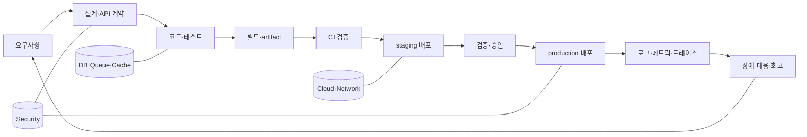

# D13. 백엔드 개발 용어 사전 — 회의에서 들리는 말 전부

> 백엔드 개발은 요구사항을 코드로 바꾸고, 검증한 산출물을 운영 환경에 배포한 뒤 관측·개선하는 흐름이다.
> 용어는 단독 암기보다 “어느 단계의 어떤 입력·산출물인가”로 읽어야 회의에서 정확히 쓸 수 있다.
> 아래 표는 짧은 정의와 회의 예문을 제공하며, 자세한 내용은 `더 보기`의 기존 문서로 넘긴다.

## 1. 사용법

이 문서는 사전이면서 지도를 겸한다. 먼저 2절에서 모르는 말을 찾고, 같은 행의 예문으로 실제 쓰임을 확인한다. 이어서 3절에서 비슷한 말을 비교하고, 4절에서 한국 현업 표현을 표준 용어로 번역한다. 예를 들어 “스테이징에 배포 치고 smoke 돌리자”는 “staging 환경에 release artifact를 deploy하고 핵심 경로의 smoke test를 수행하자”라는 뜻이다.

`더 보기`는 이 저장소의 실제 문서 ID만 사용했다. D01은 전체 생명주기, D02는 서버·네트워크, D03은 REST API 과정, D04는 빌드, D05는 디버깅, D06은 배포, D07은 인프라 선택, D08은 CI/CD, D09는 운영·관측, D10은 DB, D11은 보안, D12는 터미널을 소유한다. Java·Spring 세부 동작은 J/S 문서를 참조한다.

위 그림에서 화살표는 조직마다 달라질 수 있지만 산출물의 흐름은 유지된다. 요구사항은 ticket·acceptance criteria가 되고, 설계는 API schema·ADR이 되며, 코드와 테스트는 commit·pull request가 된다. 빌드는 JAR·container image를 만들고, CI는 이를 재현 가능하게 검증한다. 배포 후 관측 데이터가 다시 다음 요구사항과 운영 개선으로 들어온다. 이 문서는 전체 개발 과정인 D01을 용어 수준으로 확장한 것이다.

## 2. 분야별 용어 사전

### 개발 일반

| 용어 | 영문/약어 | 한 줄 정의 | 예문(회의에서 이렇게 쓴다) | 더 보기 |
|---|---|---|---|---|
| 요구사항 | requirement | 시스템이 해야 할 일 또는 지켜야 할 제약 | “요구사항을 acceptance criteria로 쪼개자.” | D01 |
| 기능 | feature | 사용자에게 제공하는 동작 단위 | “이번 feature는 검색 필터다.” | D03 |
| 버그 | bug/defect | 기대 동작과 실제 동작의 차이 | “재현 절차가 있는 bug인가?” | D05 |
| 이슈 | issue | 작업·질문·결함을 추적하는 등록 항목 | “이슈에 로그와 환경을 붙여 주세요.” | D05 |
| 티켓 | ticket | 이슈 트래커에서 관리하는 업무 카드 | “티켓 범위를 이번 스프린트에 넣는다.” | D08 |
| 스펙 | specification | 동작·형식·제약을 합의한 명세 | “스펙에 timeout을 명시했나?” | D03 |
| 계약 | contract | 제공자와 소비자가 지키기로 한 인터페이스 | “consumer contract가 깨지지 않았나?” | D03 |
| 산출물 | artifact/deliverable | 단계가 끝날 때 남는 파일·기록·결정 | “배포 artifact의 checksum을 보관하자.” | D04 |
| 의존성 | dependency | 동작하려면 필요한 다른 모듈·서비스 | “런타임 의존성과 빌드 의존성을 나눠 보자.” | P08 |
| 런타임 | runtime | 프로그램이 실제 실행되는 환경·시간 | “runtime에서만 나는 설정 문제다.” | D01 |
| 환경 | environment | 코드가 실행되는 구분된 조건 집합 | “local과 staging 환경 변수가 다르다.” | D06 |
| 설정 | configuration/config | 실행 방식을 정하는 외부 값 | “config를 코드에 하드코딩하지 말자.” | S04 |
| 리팩터링 | refactoring | 외부 동작을 유지하며 내부 구조를 개선 | “기능 추가 전에 이 클래스부터 리팩터링한다.” | J21 |
| 기술 부채 | technical debt | 빠른 선택으로 미래 변경 비용이 쌓인 상태 | “이번 부채는 이자율이 높아 먼저 갚자.” | D01 |
| 회귀 | regression | 변경 뒤 이미 되던 동작이 깨지는 현상 | “회귀 테스트를 PR에 추가하자.” | J19 |

### Java

| 용어 | 영문/약어 | 한 줄 정의 | 예문(회의에서 이렇게 쓴다) | 더 보기 |
|---|---|---|---|---|
| JDK | Java Development Kit | Java 컴파일·실행·개발 도구 묶음 | “CI와 로컬 JDK major를 맞추자.” | J17 |
| JVM | Java Virtual Machine | Java bytecode를 실행하는 가상 머신 | “JVM heap과 container limit을 같이 보자.” | J13 |
| JRE | Java Runtime Environment | Java 프로그램 실행에 필요한 런타임 개념 | “현대 JDK 배포판에서는 별도 JRE를 전제하지 않는다.” | J17 |
| 바이트코드 | bytecode | Java compiler가 만든 JVM 실행 형식 | “소스가 아니라 bytecode 호환성을 확인한다.” | J13 |
| 클래스패스 | classpath | 클래스·리소스를 찾는 경로 집합 | “classpath 충돌로 다른 버전이 로드됐다.” | J13 |
| 클래스 로더 | class loader | 클래스를 찾아 JVM에 정의하는 구성 요소 | “두 class loader가 같은 이름을 다르게 볼 수 있다.” | J13 |
| 힙 | heap | 객체와 배열이 할당되는 JVM 메모리 영역 | “heap 부족인지 native 메모리인지 나눠 보자.” | J14 |
| GC | Garbage Collection | 도달할 수 없는 객체를 회수하는 자동 메모리 관리 | “GC pause가 latency를 올렸다.” | J14 |
| JIT | Just-In-Time compiler | 실행 중 hot code를 기계어로 최적화하는 컴파일러 | “warm-up 전후 JIT 효과를 구분하자.” | J15 |
| 예외 | exception | 정상 흐름에서 벗어난 실패를 표현하는 객체 | “예외를 삼키지 말고 원인을 남겨라.” | J04 |
| checked exception | checked exception | 컴파일러가 처리 또는 선언을 요구하는 예외 | “checked exception 경계를 service에 두자.” | J04 |
| record | record | 상태 중심 불변 데이터 모델을 간결하게 선언하는 Java 형식 | “DTO는 record로 충분한지 보자.” | J05 |
| sealed class | sealed class | 상속 가능한 타입을 제한하는 선언 | “도메인 상태의 분기를 sealed로 고정한다.” | J05 |
| virtual thread | virtual thread | JVM이 관리하는 가벼운 스레드 실행 단위 | “blocking I/O 서버에 virtual thread를 검토한다.” | J12 |
| thread-safe | thread-safe | 여러 스레드가 함께 사용해도 불변식이 깨지지 않는 성질 | “이 client가 thread-safe인지 문서로 확인하자.” | J10 |

### Spring

| 용어 | 영문/약어 | 한 줄 정의 | 예문(회의에서 이렇게 쓴다) | 더 보기 |
|---|---|---|---|---|
| Spring Framework | Spring | IoC·웹·데이터·트랜잭션 등을 제공하는 Java framework | “Framework 7 API 기준으로 확인하자.” | S01 |
| Spring Boot | Boot | Spring 애플리케이션의 기본 구성·실행·패키징을 돕는 도구 | “Boot 4.1 baseline으로 올린다.” | P01 |
| 빈 | bean | Spring container가 생성·관리하는 객체 | “이 빈의 scope가 singleton인가?” | S01 |
| IoC | Inversion of Control | 객체 생성·연결 제어를 외부 컨테이너에 맡기는 원칙 | “new를 줄이고 IoC 경계를 분명히 하자.” | S01 |
| DI | Dependency Injection | 필요한 의존 객체를 외부에서 주입하는 방식 | “생성자 DI로 필수 의존성을 드러낸다.” | S01 |
| 컴포넌트 스캔 | component scanning | 애노테이션이 붙은 클래스를 찾아 빈으로 등록하는 과정 | “scan base package가 애매하다.” | S03 |
| 자동 구성 | auto-configuration | classpath·설정·조건에 따라 기본 빈을 구성하는 기능 | “자동 구성이 왜 back-off됐는지 condition report를 보자.” | S03 |
| 프록시 | proxy | 대상 앞에서 호출을 가로채 부가 동작을 넣는 객체 | “트랜잭션은 프록시 경계를 통과해야 한다.” | S02 |
| AOP | Aspect-Oriented Programming | 횡단 관심사를 join point에 적용하는 방식 | “로깅 AOP가 비즈니스 예외를 가리지 않게 한다.” | S02 |
| MVC | Model-View-Controller | 요청 처리와 표현을 역할별로 나누는 웹 구조 | “Controller는 orchestration만 맡긴다.” | S05 |
| DispatcherServlet | DispatcherServlet | Spring MVC 요청을 적절한 handler로 보내는 중심 서블릿 | “DispatcherServlet 이후 resolver 흐름을 확인한다.” | S05 |
| WebFlux | Spring WebFlux | reactive 기반 비동기 웹 스택 | “blocking JDBC와 WebFlux를 섞지 말자.” | S07 |
| Actuator | Spring Boot Actuator | 운영 엔드포인트·health·metrics 등을 제공하는 모듈 | “Actuator 노출 범위는 내부망으로 제한한다.” | S16 |
| 프로파일 | profile | 환경별 빈·설정을 선택하는 이름표 | “staging profile에서만 seed를 켠다.” | S04 |
| 트랜잭션 | transaction | 여러 DB 작업을 하나의 원자적 단위로 묶는 경계 | “트랜잭션을 외부 API 호출까지 잡지 말자.” | S08 |

### 웹·HTTP

| 용어 | 영문/약어 | 한 줄 정의 | 예문(회의에서 이렇게 쓴다) | 더 보기 |
|---|---|---|---|---|
| 클라이언트 | client/user agent | 요청을 시작해 서버 기능을 사용하는 주체 | “이 endpoint의 client는 모바일 앱이다.” | D02 |
| 서버 | server | 요청을 받고 처리 결과를 반환하는 프로그램·호스트 | “서버가 아니라 upstream이 timeout을 냈다.” | D02 |
| HTTP | Hypertext Transfer Protocol | 애플리케이션 간 request와 response를 교환하는 프로토콜 | “HTTP 의미론에 맞는 method를 쓰자.” | D02 |
| HTTPS | HTTP over TLS | TLS로 보호된 HTTP 통신 | “내부망이어도 HTTPS를 유지한다.” | D11 |
| URL | Uniform Resource Locator | 자원 위치와 접근 방식을 나타내는 문자열 | “query string에 비밀값을 넣지 마라.” | D02 |
| URI | Uniform Resource Identifier | 자원을 식별하는 문자열 | “URI와 URL을 엄밀히 구분할 필요가 있는가?” | S06 |
| request | 요청 | client가 보낸 method·target·header·body 묶음 | “request body validation부터 보자.” | S05 |
| response | 응답 | 서버가 보낸 status·header·body 묶음 | “에러 response schema를 통일한다.” | S05 |
| method | HTTP method | 요청 의도를 나타내는 GET·POST·PUT·PATCH·DELETE 등 | “부분 수정이면 PATCH 의미가 맞다.” | S06 |
| status code | 상태 코드 | 응답 처리 결과를 3자리 숫자로 표현 | “검증 실패는 4xx로 내려야 한다.” | S06 |
| header | 헤더 | 메시지의 메타데이터 필드 | “trace ID를 response header에도 돌려준다.” | D02 |
| body | 본문 | 요청·응답의 실제 표현 데이터 | “body가 비어도 Content-Length를 확인한다.” | S06 |
| content negotiation | 콘텐츠 협상 | client와 server가 표현 형식을 협의하는 과정 | “Accept에 맞는 representation을 내보낸다.” | S06 |
| TLS | Transport Layer Security | 통신 상대 인증과 전송 구간 암호화를 제공하는 프로토콜 | “인증서 만료 알람이 있는가?” | D11 |
| 프록시 | proxy | client·server 사이에서 전달·캐시·정책을 수행하는 중간자 | “reverse proxy가 request body를 제한한다.” | D02 |

### API

| 용어 | 영문/약어 | 한 줄 정의 | 예문(회의에서 이렇게 쓴다) | 더 보기 |
|---|---|---|---|---|
| API | Application Programming Interface | 프로그램이 기능·데이터를 요청하는 공개 접점 | “API의 소비자를 먼저 열거하자.” | D03 |
| REST | Representational State Transfer | 자원·표현·상태 전이를 중심으로 한 웹 아키텍처 스타일 | “REST라고 부르려면 method 의미도 지키자.” | S06 |
| endpoint | endpoint | 호출 가능한 API의 구체적 method+경로 | “이 endpoint의 p95가 높다.” | D03 |
| resource | resource | API가 식별하고 조작하는 대상 | “resource 이름을 동사로 만들지 않는다.” | S06 |
| payload | payload | 메시지에서 전달하려는 실제 데이터 | “payload에 내부 DB ID를 노출하지 말자.” | S06 |
| DTO | Data Transfer Object | 경계 간 전달 형식을 표현하는 객체 | “request DTO와 response DTO를 분리한다.” | P06 |
| schema | schema | 데이터 필드·타입·제약의 구조 정의 | “schema 변경은 하위 호환인가?” | D03 |
| OpenAPI | OAS | HTTP API를 언어 독립적으로 기술하는 표준 | “OpenAPI로 client와 문서를 생성한다.” | D03 |
| idempotent | 멱등 | 같은 요청을 여러 번 적용해도 최종 효과가 같은 성질 | “PUT 재시도는 idempotent해야 한다.” | S06 |
| pagination | 페이지네이션 | 큰 목록을 여러 응답 단위로 나누는 방식 | “offset보다 cursor pagination이 맞다.” | S06 |
| rate limit | 요청률 제한 | 일정 시간의 호출량을 제한하는 정책 | “partner API rate limit을 초과했다.” | D11 |
| versioning | 버전 관리 | 호환이 깨지는 API 계약을 식별하는 방식 | “URL보다 header versioning을 택한 이유는?” | D03 |
| backward compatible | 하위 호환 | 기존 소비자가 변경 뒤에도 동작하는 성질 | “필드 추가는 보통 backward compatible다.” | D03 |
| webhook | webhook | 사건 발생 시 제공자가 consumer URL로 호출하는 방식 | “결제 webhook은 서명 검증이 필수다.” | S14 |
| SDK | Software Development Kit | 특정 API 사용을 감싼 개발 도구·라이브러리 묶음 | “SDK가 retry를 숨겨 중복 요청을 만들지 않는가?” | S06 |

### DB

| 용어 | 영문/약어 | 한 줄 정의 | 예문(회의에서 이렇게 쓴다) | 더 보기 |
|---|---|---|---|---|
| DB | database | 구조화한 데이터를 저장·조회하는 시스템 | “운영 DB에서 직접 수정하지 않는다.” | D10 |
| RDBMS | Relational DBMS | 관계형 테이블과 SQL을 제공하는 DB 관리 시스템 | “이 데이터는 RDBMS가 적합하다.” | D10 |
| 테이블 | table | 행과 열로 레코드를 저장하는 관계형 구조 | “테이블 경계를 aggregate에 맞추자.” | D10 |
| row | record/행 | 테이블의 하나의 데이터 항목 | “row 수가 급증한 이유를 찾자.” | D10 |
| column | field/열 | 레코드가 가진 하나의 속성 | “nullable column인가를 먼저 합의한다.” | D10 |
| primary key | PK | 행을 유일하게 식별하는 키 | “PK는 외부 공개 ID와 분리한다.” | D10 |
| foreign key | FK | 다른 테이블의 키를 참조하는 제약 | “FK를 둘지 애플리케이션에서 검증할지 결정한다.” | D10 |
| index | 인덱스 | 검색 조건을 빠르게 찾도록 만든 자료 구조 | “인덱스가 있어도 선택도가 낮다.” | D10 |
| query | 질의 | 데이터를 읽거나 변경하는 명령 | “실행 계획으로 query를 검증하자.” | S10 |
| join | 조인 | 관련 테이블의 행을 조건으로 결합 | “이 join이 fan-out을 만들지 않는가?” | D10 |
| normalization | 정규화 | 중복과 갱신 이상을 줄이도록 구조를 분해 | “쓰기 모델은 정규화한다.” | D10 |
| denormalization | 반정규화 | 읽기 비용을 위해 중복 데이터를 의도적으로 저장 | “조회량 때문에 제한적으로 반정규화한다.” | D10 |
| transaction isolation | 트랜잭션 격리 | 동시 트랜잭션이 서로 보는 범위를 정하는 성질 | “isolation level을 올리면 경합이 생긴다.” | S08 |
| deadlock | 교착 상태 | 트랜잭션들이 서로의 잠금을 기다려 진행하지 못하는 상태 | “deadlock retry와 lock 순서를 정한다.” | D10 |
| migration | 스키마 마이그레이션 | DB 구조·데이터를 버전 순서대로 변경하는 작업 | “앱 배포와 migration 순서를 분리한다.” | S11 |
| connection pool | 연결 풀 | DB 연결을 미리 만들어 재사용하는 관리자 | “pool 고갈과 DB 느림을 구분하자.” | S10 |

### 빌드

| 용어 | 영문/약어 | 한 줄 정의 | 예문(회의에서 이렇게 쓴다) | 더 보기 |
|---|---|---|---|---|
| 소스 | source code | 사람이 작성하고 버전 관리하는 코드 | “소스와 생성물을 구분해 commit한다.” | D04 |
| 컴파일 | compile | 소스를 실행 가능한 중간 형식으로 변환 | “컴파일은 되지만 테스트가 실패한다.” | D04 |
| 빌드 | build | 컴파일·테스트·패키징을 묶은 재현 가능한 과정 | “clean build로 다시 재현해 보자.” | D04 |
| Gradle | Gradle | JVM 프로젝트의 빌드 자동화 도구 | “Gradle task graph를 확인한다.” | P08 |
| Maven | Maven | convention과 dependency 관리 중심의 빌드 도구 | “Maven plugin 버전이 CI와 다르다.” | P08 |
| dependency resolution | 의존성 해결 | 필요한 라이브러리 버전과 전이 의존성을 결정 | “transitive dependency가 끌려왔다.” | P08 |
| artifact | 빌드 artifact | 빌드가 만든 JAR·ZIP·image 같은 배포 대상 | “동일 artifact를 staging과 prod에 승격한다.” | D04 |
| JAR | Java ARchive | Java 클래스·리소스·메타데이터를 묶은 압축 형식 | “executable JAR로 실행한다.” | P05 |
| source set | 소스 집합 | main·test처럼 목적별 파일 집합 | “integrationTest source set을 분리한다.” | P08 |
| 캐시 | build cache | 이전 결과를 재사용해 빌드를 빠르게 하는 저장소 | “캐시 오염이면 캐시를 무효화한다.” | D04 |
| reproducible build | 재현 가능한 빌드 | 같은 입력이 같은 결과를 내는 빌드 | “빌드 시간을 고정해 reproducible하게 한다.” | D04 |
| packaging | 패키징 | 실행에 필요한 파일을 배포 형식으로 묶는 단계 | “패키징 뒤 checksum을 남긴다.” | D04 |
| plugin | 플러그인 | 빌드 도구에 작업·규칙을 추가하는 모듈 | “plugin이 JDK 25를 지원하는가?” | P08 |
| lockfile | lock 파일 | 의존성의 정확한 버전을 고정하는 파일 | “lockfile을 갱신한 PR인가?” | P08 |
| checksum | 체크섬 | 파일 내용으로 계산한 무결성 확인 값 | “받은 image digest를 checksum처럼 검증한다.” | D06 |

### Git·협업

| 용어 | 영문/약어 | 한 줄 정의 | 예문(회의에서 이렇게 쓴다) | 더 보기 |
|---|---|---|---|---|
| 저장소 | repository/repo | 코드와 Git 이력을 보관하는 공간 | “repo 권한을 read-only로 준다.” | P13 |
| commit | 커밋 | 변경 내용을 이력에 기록한 단위 | “한 commit에 한 의도를 담자.” | P13 |
| branch | 브랜치 | 독립된 변경 흐름을 가리키는 이름 | “feature branch를 main에 합친다.” | P13 |
| merge | 병합 | 두 이력의 변경을 하나로 결합 | “merge conflict를 해결하고 테스트한다.” | P13 |
| rebase | 리베이스 | 커밋을 다른 기준점 위에 다시 재생하는 작업 | “공유 branch는 rebase하지 않는다.” | P13 |
| clone | 복제 | 원격 저장소를 로컬로 가져오는 작업 | “새 환경에서 repo를 clone한다.” | P13 |
| fetch | 가져오기 | 원격 이력만 로컬에 갱신하는 작업 | “merge 전 fetch부터 한다.” | P13 |
| pull | 당겨오기 | fetch 뒤 로컬 branch에 통합하는 명령 흐름 | “자동 pull로 로컬 변경을 덮지 않게 하자.” | P13 |
| push | 올리기 | 로컬 commit을 원격 저장소에 전송 | “검증 후 push하고 PR을 연다.” | P13 |
| tag | 태그 | 특정 commit을 이름으로 고정하는 표시 | “release tag는 이동시키지 않는다.” | P13 |
| PR/MR | Pull/Merge Request | 변경을 검토·논의·통합하기 위한 요청 | “PR에 테스트 결과를 붙여 주세요.” | D08 |
| conflict | 충돌 | 같은 영역의 변경이 자동 병합되지 않는 상태 | “conflict를 의미를 이해하고 해결한다.” | P13 |
| code review | 코드 리뷰 | 변경의 정확성·설계·유지보수성을 동료가 검토 | “review는 스타일보다 결함 위험을 먼저 본다.” | D08 |
| protected branch | 보호 브랜치 | 승인·CI 등 조건 없이는 직접 변경할 수 없는 branch | “main은 protected branch다.” | D08 |
| blame | blame | 한 줄의 마지막 변경 commit·작성자를 찾는 Git 기능 | “blame은 책임 추궁이 아니라 맥락 찾기다.” | P13 |

### CI/CD

| 용어 | 영문/약어 | 한 줄 정의 | 예문(회의에서 이렇게 쓴다) | 더 보기 |
|---|---|---|---|---|
| CI | Continuous Integration | 작은 변경을 자주 통합하고 자동 검증하는 방식 | “CI가 빨라야 PR 대기 시간이 줄어든다.” | D08 |
| CD | Continuous Delivery/Deployment | 검증된 변경을 릴리스·배포까지 자동화하는 방식 | “우리 CD는 delivery인가 deployment인가?” | D08 |
| pipeline | 파이프라인 | checkout부터 배포까지 연결된 자동 작업 흐름 | “pipeline 어느 stage에서 깨졌나?” | D08 |
| workflow | 워크플로 | trigger와 job으로 정의한 자동화 시나리오 | “merge 이벤트 workflow가 돈다.” | D08 |
| job | 작업 | runner에서 수행되는 논리적 실행 단위 | “lint job을 병렬화한다.” | D08 |
| step | 단계 | job 안의 한 명령 또는 action | “이 step은 secret을 로그에 찍는다.” | D08 |
| runner | 실행기 | CI 작업을 실제로 실행하는 머신·컨테이너 | “self-hosted runner의 JDK를 갱신하자.” | D08 |
| trigger | 트리거 | workflow를 시작시키는 사건 | “tag push를 release trigger로 쓴다.” | D08 |
| gate | 품질 관문 | 다음 단계로 넘어가기 위한 자동·수동 조건 | “coverage gate 미달이면 배포 금지다.” | D08 |
| release | 릴리스 | 특정 버전을 사용자에게 제공하는 행위·기록 | “release note와 artifact를 함께 만든다.” | D06 |
| promotion | 승격 | 동일 artifact를 더 신뢰하는 환경으로 이동 | “staging 검증 후 prod로 promotion한다.” | D06 |
| rollback | 롤백 | 이전 정상 버전으로 되돌리는 조치 | “schema가 호환돼야 rollback 가능하다.” | D06 |
| GitOps | Git 운영 | Git의 선언 상태를 운영 자동화의 기준으로 삼는 방식 | “클러스터 변경은 GitOps PR로 한다.” | D08 |
| deployment frequency | 배포 빈도 | 일정 기간 production에 배포하는 횟수 | “빈도만 올리고 실패율을 보지 않으면 안 된다.” | D08 |
| lead time | 변경 리드타임 | 변경 시작부터 production 반영까지 걸린 시간 | “lead time을 PR 대기와 분리해 보자.” | D08 |

### 배포

| 용어 | 영문/약어 | 한 줄 정의 | 예문(회의에서 이렇게 쓴다) | 더 보기 |
|---|---|---|---|---|
| 배포 | deploy | 빌드된 소프트웨어를 실행 환경에 설치·전환하는 행위 | “오늘 밤 배포한다.” | D06 |
| 디플로이 | deployment | deploy의 명사형으로 배포 단위·상태를 뜻함 | “deployment 상태가 progressing이다.” | D06 |
| 무중단 배포 | zero-downtime deployment | 서비스 중단 없이 새 버전을 전환 | “readiness가 있어야 무중단이 된다.” | D06 |
| rolling update | 롤링 업데이트 | 인스턴스를 일부씩 교체하는 배포 방식 | “rolling 중 capacity 여유가 있는가?” | D06 |
| blue-green | 블루그린 | 두 환경을 두고 트래픽을 한 번에 전환 | “blue-green은 빠른 rollback이 장점이다.” | D06 |
| canary | 카나리 | 일부 트래픽에 새 버전을 먼저 노출 | “canary 지표가 괜찮을 때 확대한다.” | D06 |
| feature flag | 기능 플래그 | 배포와 기능 공개를 분리하는 조건 토글 | “flag off로 즉시 기능을 숨긴다.” | D06 |
| readiness | 준비 상태 | 트래픽을 받아도 되는 상태 | “readiness 실패 인스턴스에는 요청을 보내지 않는다.” | S16 |
| liveness | 생존 상태 | 프로세스가 회복 불가로 멈추지 않았는지 나타내는 상태 | “liveness를 DB health와 묶지 마라.” | S16 |
| startup probe | 시작 검사 | 느린 애플리케이션의 초기 기동을 확인하는 검사 | “startup 동안 liveness가 죽이지 않게 한다.” | S16 |
| 환경 승격 | environment promotion | 검증 결과와 artifact를 다음 환경으로 이동 | “staging 승격 조건을 문서화한다.” | D06 |
| maintenance window | 점검 창 | 변경으로 영향이 날 수 있어 계획한 시간대 | “호환 안 되는 migration은 maintenance window에서 한다.” | D06 |
| rollback plan | 복구 계획 | 실패 시 이전 상태로 되돌리는 사전 절차 | “배포 승인에는 rollback plan이 있어야 한다.” | D06 |
| hotfix | 긴급 수정 | production 장애·치명 결함을 우선 고치는 변경 | “hotfix 후 정상 branch에도 backport한다.” | D06 |
| blast radius | 영향 범위 | 한 변경·장애가 영향을 미치는 시스템 범위 | “flag로 blast radius를 줄인다.” | D09 |

### 인프라·클라우드

| 용어 | 영문/약어 | 한 줄 정의 | 예문(회의에서 이렇게 쓴다) | 더 보기 |
|---|---|---|---|---|
| 온프레미스 | on-premises | 조직이 직접 소유·운영하는 시설의 인프라 | “온프레미스는 하드웨어 조달도 책임진다.” | D07 |
| 클라우드 | cloud | 필요에 따라 컴퓨팅 자원을 임대·자동화하는 운영 모델 | “클라우드라고 운영 책임이 사라지지는 않는다.” | D07 |
| IaaS | Infrastructure as a Service | VM·네트워크·디스크 같은 인프라를 서비스로 제공 | “IaaS에서는 OS patch를 우리가 한다.” | D07 |
| PaaS | Platform as a Service | 애플리케이션 실행 플랫폼을 관리형으로 제공 | “PaaS가 팀의 운영 범위를 줄인다.” | D07 |
| SaaS | Software as a Service | 완성된 소프트웨어를 서비스로 사용 | “이 티켓 시스템은 SaaS다.” | D07 |
| region | 리전 | 클라우드의 지리적 배포 영역 | “DB와 app을 같은 region에 둘까?” | D07 |
| availability zone | AZ | 리전 안의 장애 격리 단위 | “AZ 하나가 내려가도 서비스해야 한다.” | D07 |
| VM | Virtual Machine | 가상화된 컴퓨터 실행 환경 | “VM autoscaling 기준을 CPU만 두지 말자.” | D07 |
| container | 컨테이너 | 격리된 프로세스와 실행 파일을 묶은 실행 단위 | “container는 VM과 같은 경계가 아니다.” | D07 |
| image | container image | 컨테이너를 만들기 위한 불변 파일 시스템·메타데이터 묶음 | “image를 digest로 pin한다.” | D06 |
| registry | 이미지 레지스트리 | image·artifact를 저장·배포하는 저장소 | “registry 접근권한을 최소화한다.” | D06 |
| Dockerfile | Dockerfile | container image 생성 단계를 선언하는 파일 | “Dockerfile의 base image를 갱신한다.” | P14 |
| Kubernetes | K8s | 컨테이너화된 workload를 오케스트레이션하는 시스템 | “K8s 용어는 control plane 기준으로 보자.” | S20 |
| Pod | Pod | Kubernetes에서 함께 스케줄되는 하나 이상의 컨테이너 단위 | “Pod IP를 영구 주소로 쓰지 않는다.” | S20 |
| Deployment | Kubernetes Deployment | 원하는 Pod replica와 업데이트를 선언하는 리소스 | “Deployment rollout을 확인한다.” | S20 |
| Service | Kubernetes Service | 변하는 Pod 집합에 안정적인 네트워크 접점을 제공 | “Service selector가 Pod label과 맞나?” | S20 |
| ConfigMap | ConfigMap | 비밀이 아닌 Kubernetes 설정 데이터 객체 | “ConfigMap과 secret을 구분한다.” | S20 |
| Secret | Secret | 자격 증명 등 민감 값을 위한 Kubernetes 객체 | “Secret도 평문 취급하지 않는다.” | D11 |

### 네트워크

| 용어 | 영문/약어 | 한 줄 정의 | 예문(회의에서 이렇게 쓴다) | 더 보기 |
|---|---|---|---|---|
| IP | Internet Protocol address | 네트워크 인터페이스를 식별하는 주소 | “allowlist에 Pod IP를 넣지 마라.” | D02 |
| IPv4/IPv6 | Internet Protocol v4/v6 | IP 주소 체계의 두 세대 | “IPv6-only 환경도 고려했나?” | D02 |
| TCP | Transmission Control Protocol | 순서·재전송을 보장하는 연결 지향 전송 프로토콜 | “TCP 연결 수와 HTTP 요청 수는 다르다.” | D02 |
| UDP | User Datagram Protocol | 연결·전달 보장을 최소화한 전송 프로토콜 | “UDP라서 항상 빠르다는 뜻은 아니다.” | D02 |
| 포트 | port | 호스트 안의 네트워크 서비스 논리 번호 | “8080 포트가 실제로 listen 중인가?” | D02 |
| DNS | Domain Name System | 도메인 이름을 IP 등 자원으로 해석하는 시스템 | “DNS TTL 때문에 전환이 늦다.” | D02 |
| hostname | 호스트명 | 네트워크에서 호스트를 부르는 이름 | “hostname 검증과 인증서 이름이 일치하나?” | D02 |
| socket | 소켓 | 프로세스가 네트워크 통신을 다루는 끝점 | “socket timeout과 request timeout을 분리한다.” | D02 |
| latency | 지연 시간 | 요청 시작부터 결과까지 걸린 시간 | “평균보다 p99 latency를 보자.” | D09 |
| throughput | 처리량 | 시간당 처리한 요청·바이트·작업의 양 | “throughput을 올리면 DB가 병목이다.” | D09 |
| bandwidth | 대역폭 | 링크가 단위 시간에 전달할 수 있는 데이터량 | “파일 응답은 bandwidth를 점유한다.” | D02 |
| load balancer | 부하 분산기 | 여러 backend로 트래픽을 분배하는 구성 요소 | “health check 실패 backend는 제외한다.” | D02 |
| reverse proxy | 리버스 프록시 | 서버 앞에서 요청을 받아 내부 서버로 전달하는 프록시 | “TLS termination은 reverse proxy에서 한다.” | D02 |
| timeout | 타임아웃 | 일정 시간 안에 응답이 없으면 실패로 판단하는 제한 | “connect와 read timeout을 각각 설정한다.” | D02 |
| retry | 재시도 | 실패한 작업을 다시 실행하는 정책 | “retry에는 backoff와 최대 횟수가 필요하다.” | S14 |
| circuit breaker | 회로 차단기 | 실패가 지속되는 downstream 호출을 잠시 차단하는 패턴 | “circuit open을 장애로 오해하지 말자.” | S20 |

### 운영·관측

| 용어 | 영문/약어 | 한 줄 정의 | 예문(회의에서 이렇게 쓴다) | 더 보기 |
|---|---|---|---|---|
| 운영 | operations | production 서비스를 안정적으로 유지하는 활동 | “운영 runbook을 최신화하자.” | D09 |
| 로그 | log | 시점·주체·사건을 기록한 이벤트 데이터 | “로그에 개인정보를 남기지 마라.” | D09 |
| 구조화 로그 | structured log | JSON 등 필드가 분리된 로그 | “message 문자열보다 구조화 필드를 검색한다.” | D09 |
| 메트릭 | metric | 시간에 따른 수치 측정값 | “error rate 메트릭에 alert를 건다.” | D09 |
| 트레이스 | trace | 하나의 요청이 여러 서비스를 지난 경로 기록 | “trace ID로 API와 DB span을 잇는다.” | S16 |
| span | span | trace 안의 한 작업 구간 | “느린 span이 외부 결제 호출이다.” | S16 |
| 관측성 | observability | 외부 출력으로 내부 상태를 추론하는 능력 | “로그만으로는 관측성이 부족하다.” | D09 |
| health check | 건강 검사 | 서비스가 요청을 처리할 수 있는지 확인하는 검사 | “health check가 의존성 장애를 의미하는가?” | S16 |
| SLI | Service Level Indicator | 서비스 품질을 측정하는 지표 | “가용성 SLI를 status code로 정의한다.” | D09 |
| SLO | Service Level Objective | SLI에 대해 내부적으로 정한 목표 | “SLO 99.9%의 error budget을 계산한다.” | D09 |
| SLA | Service Level Agreement | 고객과 계약한 서비스 수준 약속 | “SLA와 내부 SLO를 혼동하지 말자.” | D09 |
| error budget | 오류 예산 | SLO에서 허용되는 실패·중단의 예산 | “예산을 다 쓰면 위험한 배포를 멈춘다.” | D09 |
| alert | 알림 | 조건을 만족한 운영 신호를 사람에게 전달 | “모든 로그를 alert로 만들지 마라.” | D09 |
| incident | 장애 사건 | 정상 서비스 수준을 떨어뜨린 운영 사건 | “incident commander를 지정한다.” | D09 |
| postmortem | 장애 회고 | 비난 없이 원인·대응·재발 방지를 기록하는 문서 | “postmortem에 action item owner를 적는다.” | D09 |
| runbook | 운영 절차서 | 반복 운영·장애 대응의 실행 지침 | “이 alert의 runbook 링크가 비어 있다.” | D09 |

### 보안

| 용어 | 영문/약어 | 한 줄 정의 | 예문(회의에서 이렇게 쓴다) | 더 보기 |
|---|---|---|---|---|
| 인증 | authentication/AuthN | 주체가 누구인지 확인하는 과정 | “인증과 인가를 분리해 설명하자.” | D11 |
| 인가 | authorization/AuthZ | 인증된 주체가 무엇을 할 수 있는지 결정 | “관리자 인가를 endpoint마다 검사한다.” | D11 |
| 식별 | identification | 주체가 자신을 나타내는 과정 | “로그인 ID는 식별자일 뿐 권한이 아니다.” | D11 |
| principal | 보안 주체 | 인증된 사용자·서비스를 나타내는 모델 | “principal에서 tenant를 꺼낸다.” | S12 |
| credential | 자격 증명 | 신원을 증명하는 비밀번호·토큰·키 | “credential을 소스에 commit하지 않는다.” | D11 |
| session | 세션 | 여러 요청에 걸친 사용자 상태의 논리적 묶음 | “세션 고정 공격을 방지한다.” | S12 |
| cookie | 쿠키 | client가 저장하고 요청에 다시 보내는 작은 값 | “보안 cookie 속성을 설정한다.” | D11 |
| CSRF | Cross-Site Request Forgery | 다른 사이트가 사용자의 권한으로 요청하게 하는 공격 | “cookie 인증이면 CSRF 방어를 검토한다.” | D11 |
| XSS | Cross-Site Scripting | 악성 스크립트를 사용자 화면에서 실행시키는 공격 | “출력 인코딩으로 XSS를 막는다.” | D11 |
| SQL injection | SQLi | 입력이 SQL 구조로 해석되게 만드는 공격 | “parameterized query를 사용한다.” | D10 |
| SSRF | Server-Side Request Forgery | 서버가 공격자 의도 주소로 요청하게 하는 공격 | “metadata endpoint로의 SSRF를 차단한다.” | D11 |
| 암호화 | encryption | 평문을 키 없이는 읽기 어려운 암호문으로 변환 | “전송 구간과 저장 구간 암호화를 나눈다.” | D11 |
| 해시 | hash | 입력을 고정 길이 값으로 일방향 변환 | “비밀번호는 적절한 password hash로 저장한다.” | D11 |
| salt | 솔트 | 같은 비밀번호도 다른 해시가 되도록 넣는 임의 값 | “salt를 비밀번호와 함께 평문 저장해도 된다.” | D11 |
| least privilege | 최소 권한 | 업무에 필요한 최소 권한만 부여하는 원칙 | “DB 계정은 least privilege로 만든다.” | D11 |
| secret rotation | 비밀 회전 | 키·토큰을 새 값으로 교체하는 운영 절차 | “rotation 중 구·신 키를 잠시 모두 검증한다.” | D11 |

### 테스트

| 용어 | 영문/약어 | 한 줄 정의 | 예문(회의에서 이렇게 쓴다) | 더 보기 |
|---|---|---|---|---|
| 테스트 | test | 기대 결과를 자동 또는 수동으로 확인하는 절차 | “실패를 재현하는 테스트부터 만든다.” | J19 |
| 단위 테스트 | unit test | 작은 단위의 로직을 격리해 검증하는 테스트 | “단위 테스트는 빠르고 결정적이어야 한다.” | J19 |
| 통합 테스트 | integration test | 여러 모듈·실제 인프라의 결합을 검증 | “repository 통합 테스트를 Testcontainers로 돌린다.” | S18 |
| E2E 테스트 | end-to-end test | 사용자 경로의 처음부터 끝까지 검증 | “결제 E2E는 핵심 happy path만 유지한다.” | S18 |
| 회귀 테스트 | regression test | 기존 동작이 유지되는지 재검증하는 테스트 | “이 버그의 회귀 테스트를 남긴다.” | J19 |
| smoke test | 연기 테스트 | 배포 직후 핵심 기능이 살아 있는지 빠르게 확인 | “배포 후 smoke가 먼저다.” | D06 |
| sanity test | 건전성 테스트 | 특정 변경이 기본적으로 의도대로 동작하는지 좁게 확인 | “전체 suite 전 sanity를 돌린다.” | J19 |
| mock | 모의 객체 | 실제 의존성 대신 호출·응답을 통제하는 테스트 대역 | “mock 과다로 구현 테스트가 되지 않았나?” | J19 |
| stub | 스텁 | 미리 정한 값을 반환하는 테스트 대역 | “외부 환율 API는 stub으로 고정한다.” | J19 |
| spy | 스파이 | 실제 동작을 하면서 호출 기록을 관찰하는 대역 | “spy로 event publish 횟수를 검증한다.” | J19 |
| fixture | 테스트 픽스처 | 테스트에 필요한 고정 데이터·환경 | “fixture 생성 비용이 너무 크다.” | S18 |
| assertion | 단언 | 실제 결과가 기대 조건과 같은지 검사 | “상태 코드만 말고 body assertion도 한다.” | J19 |
| flaky test | 불안정 테스트 | 같은 코드인데 환경·순서에 따라 간헐적으로 실패하는 테스트 | “flaky를 retry로 숨기지 말자.” | S18 |
| coverage | 커버리지 | 테스트가 실행한 코드·분기 등의 비율 | “coverage 숫자보다 중요한 분기를 보자.” | J19 |
| contract test | 계약 테스트 | 서비스 제공자와 소비자의 인터페이스 합의를 검증 | “consumer contract가 provider 변경을 잡는다.” | D03 |

### 아키텍처·분산 시스템

| 용어 | 영문/약어 | 한 줄 정의 | 예문(회의에서 이렇게 쓴다) | 더 보기 |
|---|---|---|---|---|
| 모놀리스 | monolith | 하나의 배포 단위에 여러 기능이 함께 있는 시스템 | “모놀리스라고 곧 나쁜 구조는 아니다.” | S22 |
| MSA | Microservices Architecture | 기능을 독립 서비스와 배포 단위로 나누는 구조 | “MSA 전환의 운영비도 계산하자.” | S20 |
| 서비스 경계 | service boundary | 한 서비스가 소유·변경하는 책임의 경계 | “DB보다 도메인으로 경계를 잡는다.” | S22 |
| bounded context | 바운디드 컨텍스트 | 도메인 모델과 용어가 유효한 명시적 경계 | “주문과 배송의 status 의미가 다르다.” | S22 |
| DDD | Domain-Driven Design | 도메인 모델과 경계를 중심으로 설계하는 접근 | “DDD 용어를 코드와 회의에서 일치시킨다.” | S22 |
| aggregate | 애그리거트 | 변경 불변식을 한 트랜잭션 경계로 묶은 객체 그래프 | “aggregate 밖 엔티티를 직접 수정하지 않는다.” | S22 |
| layered architecture | 계층형 구조 | 표현·응용·도메인·인프라 책임을 계층으로 분리 | “controller에서 DB를 직접 부르지 않는다.” | P02 |
| hexagonal architecture | 육각형 아키텍처 | 핵심을 port와 adapter로 외부 기술에서 격리 | “DB adapter 교체가 쉬운가?” | S22 |
| event | 이벤트 | 이미 일어난 사실을 나타내는 불변 메시지 | “OrderPlaced event는 과거형 이름으로 짓는다.” | S14 |
| command | 커맨드 | 어떤 동작을 요청하는 메시지 | “command는 거부될 수 있다.” | S14 |
| event-driven | 이벤트 기반 | 상태 변화를 event 발행·구독으로 연결하는 방식 | “event-driven이면 최종 일관성을 설명해야 한다.” | S14 |
| message broker | 메시지 브로커 | producer와 consumer 사이에서 메시지를 전달·보관 | “broker lag을 운영 지표로 본다.” | S14 |
| producer | 생산자 | 메시지를 발행하는 주체 | “producer retry가 중복 event를 만들 수 있다.” | S14 |
| consumer | 소비자 | 메시지를 읽고 처리하는 주체 | “consumer는 중복 delivery에 안전해야 한다.” | S14 |
| queue | 큐 | 먼저 들어온 작업을 순서대로 처리하도록 보관하는 구조 | “queue가 쌓이면 consumer를 늘린다.” | S14 |
| topic | 토픽 | 메시지를 분류하는 논리적 채널 | “topic retention을 업무 보존 기간과 맞춘다.” | S14 |
| eventual consistency | 최종 일관성 | 시간이 지나면 복제본·서비스 상태가 수렴하는 성질 | “조회 직후 반영 지연을 UX로 처리한다.” | S20 |
| CQRS | Command Query Responsibility Segregation | 변경 모델과 조회 모델의 책임을 분리하는 패턴 | “CQRS가 항상 DB를 두 개 뜻하지는 않는다.” | S22 |
| saga | 사가 | 분산 트랜잭션을 보상 작업들의 흐름으로 조정하는 패턴 | “사가 실패 시 보상 순서를 정의한다.” | S20 |
| idempotency key | 멱등성 키 | 재시도 요청을 같은 작업으로 식별하는 키 | “결제 요청에 idempotency key를 받는다.” | S14 |

### 조직·프로세스

| 용어 | 영문/약어 | 한 줄 정의 | 예문(회의에서 이렇게 쓴다) | 더 보기 |
|---|---|---|---|---|
| 애자일 | Agile | 짧은 반복과 피드백으로 가치를 전달하는 개발 접근 | “애자일은 계획이 없다는 뜻이 아니다.” | D08 |
| 스프린트 | sprint | 정해진 기간 동안 목표를 달성하는 반복 주기 | “이번 sprint 목표를 한 문장으로 쓰자.” | D08 |
| 백로그 | backlog | 아직 처리하지 않은 우선순위 작업 목록 | “백로그를 기술 부채와 기능으로 나눈다.” | D08 |
| refinement | 백로그 정제 | 다음 작업의 범위·조건·추정치를 다듬는 회의 | “refinement 전에 로그를 확인한다.” | D08 |
| planning | 계획 회의 | 반복 주기의 목표와 작업을 정하는 활동 | “planning에서 capacity를 과대평가하지 말자.” | D08 |
| stand-up | 데일리 | 짧게 진행 상황·막힘·다음 행동을 공유하는 회의 | “stand-up은 보고회보다 blocker 해결용이다.” | D08 |
| retrospective | 회고 | 일하는 방식을 돌아보고 개선 실험을 정하는 활동 | “회고 action item의 완료 여부를 본다.” | D08 |
| stakeholder | 이해관계자 | 결과에 영향을 주거나 영향을 받는 사람·조직 | “stakeholder와 SLA를 먼저 합의한다.” | D01 |
| owner | 담당자 | 결과에 대한 실행 책임을 가진 사람 | “owner가 없으면 action item이 사라진다.” | D09 |
| acceptance criteria | 인수 조건 | 티켓이 완료됐다고 판단할 구체적 조건 | “acceptance criteria에 실패 케이스도 넣자.” | D03 |
| definition of done | DoD | 작업 완료의 공통 품질 기준 | “테스트와 문서까지 DoD다.” | D08 |
| QA | Quality Assurance | 품질을 예방·검증하는 역할과 활동 | “QA 시작 전에 테스트 데이터가 준비돼야 한다.” | D03 |
| UAT | User Acceptance Test | 사용자·업무 담당자가 요구사항 충족을 승인하는 테스트 | “UAT sign-off 후 production 승인한다.” | D03 |
| RFC | Request for Comments | 설계·변경안을 공유하고 의견을 받는 문서 | “RFC에서 대안과 trade-off를 비교한다.” | S22 |
| ADR | Architecture Decision Record | 중요한 설계 결정을 맥락·결과와 함께 기록한 문서 | “왜 Kafka를 택했는지 ADR에 남긴다.” | S22 |
| blocker | 막힘 | 다른 작업을 진행하지 못하게 하는 장애 요인 | “인증서 발급이 blocker다.” | D05 |

## 3. 헷갈리는 쌍 30개

| 쌍 | 구분 |
|---|---|
| 인증 vs 인가 | 인증(AuthN)은 누구인지 확인하고, 인가(AuthZ)는 확인된 주체의 행동 권한을 결정한다. 로그인 성공이 관리자 권한을 뜻하지 않는다. |
| API vs endpoint | API는 기능 접점 전체의 계약이고 endpoint는 그 계약의 특정 method·경로다. |
| URI vs URL | URI는 식별자라는 넓은 개념이고 URL은 위치·접근 방법까지 포함하는 URI다. 실무에서는 혼용되지만 설계 문서에서는 정의를 밝혀라. |
| PUT vs PATCH | PUT은 대상 표현을 전체 교체하는 의미, PATCH는 부분 수정 의미다. 실제 구현이 다르면 문서와 멱등성도 함께 고쳐라. |
| 401 vs 403 | 401은 인증 자격이 없거나 유효하지 않음, 403은 인증됐지만 권한이 없음이다. |
| 404 vs 410 | 404는 현재 대상을 찾을 수 없음, 410은 해당 자원이 영구적으로 사라졌음을 표현한다. |
| timeout vs retry | timeout은 기다리는 상한, retry는 실패 뒤 다시 시도하는 정책이다. retry가 timeout을 곱해 장애를 증폭할 수 있다. |
| proxy vs reverse proxy | 일반 proxy는 client 편에, reverse proxy는 server 앞에 놓인다는 관점 차이다. |
| latency vs throughput | latency는 한 요청의 시간, throughput은 시간당 처리량이다. 처리량을 높여도 개별 요청 지연은 나빠질 수 있다. |
| cache vs database | cache는 빠른 재사용을 위한 보조 저장소이고 DB는 지속성과 정합성을 책임지는 원장이다. |
| index vs primary key | primary key는 식별·제약의 의미가 중심이고 index는 조회를 빠르게 하는 구조다. PK가 보통 인덱스를 만들지만 개념은 다르다. |
| row lock vs table lock | 전자는 일부 행의 동시 접근을 막고 후자는 테이블 범위를 막는다. 범위가 넓을수록 경합이 커진다. |
| compile vs build | compile은 변환 한 단계, build는 compile·test·package 등 전체 자동화 흐름이다. |
| artifact vs source | source는 입력, artifact는 빌드 결과다. 운영에는 재빌드한 다른 파일이 아니라 검증한 동일 artifact를 승격한다. |
| JDK vs JVM | JDK는 개발·실행 도구 묶음, JVM은 bytecode를 실행하는 엔진이다. |
| Spring vs Spring Boot | Spring은 framework 기능 집합, Boot는 기본 설정·실행·패키징을 편하게 하는 도구다. |
| bean vs object | 모든 bean은 객체지만 모든 객체가 Spring bean은 아니다. container가 생명주기를 관리해야 bean이다. |
| filter vs interceptor | Servlet filter는 DispatcherServlet 전후의 웹 컨테이너 경계, interceptor는 Spring MVC handler 실행 전후의 경계다. |
| unit vs integration test | unit은 격리된 작은 단위, integration은 실제 결합·인프라 계약을 검증한다. |
| mock vs stub | mock은 상호작용 검증을 포함한 대역, stub은 미리 정한 반환값을 제공하는 대역이다. 라이브러리마다 용어 사용은 다를 수 있다. |
| smoke vs regression | smoke는 배포 직후 핵심 생존 확인, regression은 기존 기능 전반의 회귀 확인이다. |
| CI vs CD | CI는 통합·자동 검증, CD는 검증한 변경을 릴리스·배포 가능한 상태로 만드는 자동화다. Deployment까지 자동이면 보통 continuous deployment라고 구분한다. |
| release vs deploy | release는 사용자에게 버전을 제공하는 결정·기록, deploy는 실행 환경에 설치·전환하는 행위다. feature flag로 둘을 분리할 수 있다. |
| rolling vs blue-green | rolling은 일부 인스턴스를 순차 교체하고, blue-green은 별도 두 환경 사이를 전환한다. |
| image vs container | image는 실행할 불변 템플릿, container는 그 image에서 실제 실행된 격리 프로세스다. |
| Pod vs container | container는 프로세스 실행 단위, Pod는 Kubernetes가 함께 스케줄·네트워크·수명 관리하는 최소 단위다. |
| liveness vs readiness | liveness 실패는 재시작 판단, readiness 실패는 트래픽 제외 판단이다. DB 장애를 liveness에 연결하면 연쇄 재시작이 된다. |
| event vs command | event는 이미 발생한 사실을 알리고, command는 수신자에게 행동을 요청한다. 이름과 재처리 정책이 달라진다. |
| at-least-once vs exactly-once | at-least-once는 중복 가능성을 감수하고 전달, exactly-once는 시스템 전체에서 달성하기 어려운 강한 보장이다. consumer 멱등성을 기본으로 설계한다. |

## 4. 한국 현업 은어·줄임말

| 현업 표현 | 표준 뜻 | 회의에서 확인할 질문 |
|---|---|---|
| 배포 친다 | deploy한다 | 대상 환경·artifact·승인 조건은 무엇인가? |
| 올린다 | push하거나 deploy하거나 문서를 공유한다 | Git push인가 서버 deploy인가? |
| 내린다 | 서비스 중지·트래픽 차단·기능 비활성화 중 하나 | 무엇을 어느 범위에서 내리는가? |
| 롤백한다 | 이전 정상 버전으로 되돌린다 | DB schema가 구버전과 호환되는가? |
| 핫픽스 | production 긴급 수정 | 정상 branch backport와 사후 테스트가 있는가? |
| 스테이징 | staging 환경 | production과 데이터·설정 차이는 무엇인가? |
| 운영/상용 | production | 실제 사용자·매출 트래픽이 흐르는 환경인가? |
| 개발계 | development environment | 테스트용 데이터와 외부 연동이 격리됐는가? |
| 리뷰 달다 | PR에 review comment를 남기다 | blocking 의견인가 제안인가? |
| 리뷰 털다 | PR을 집중적으로 검토하다 | 설계·보안·테스트 중 무엇을 중점으로 보나? |
| 머지한다 | branch/PR을 통합하다 | CI와 필수 승인이 끝났나? |
| 따다 | branch를 만들거나 특정 commit을 가져오다 | cherry-pick인가 branch 생성인가? |
| 태운다 | 빌드·배포·작업을 실행 흐름에 넣다 | 어떤 pipeline과 trigger를 타는가? |
| 물린다 | 연결·의존·할당한다 | DB connection인가 담당자 owner인가? |
| 물고 있다 | lock·작업·장애를 계속 점유한다 | 어떤 리소스를 얼마나 점유 중인가? |
| 터졌다 | 예외·장애·빌드 실패가 발생했다 | 증상, 시작 시각, 영향 범위는? |
| 삽질 | 가설 없이 반복 시도한 작업 | 재현 조건과 다음 검증 가설은? |
| 삽을 푼다 | 장애를 분석하고 원인을 제거한다 | 임시 복구와 영구 조치를 분리했나? |
| 로그를 본다 | 로그를 검색·상관관계 분석한다 | trace ID·시간대·필드 기준이 있는가? |
| 지표가 튄다 | 메트릭이 평소 범위를 벗어난다 | traffic·error·latency 중 어떤 신호인가? |
| 알람이 울린다 | alert 조건이 발생했다 | paging 대상인가 ticket 대상인가? |
| 죽었다 | 프로세스 종료 또는 health 실패 | liveness 실패인가 readiness 제외인가? |
| 살아 있다 | 프로세스가 떠 있고 기본 응답을 한다 | 실제 핵심 기능까지 정상인가? |
| 병목이다 | 전체 처리량을 제한하는 가장 느린 지점이다 | 측정한 근거와 포화 자원은? |
| 물량이 많다 | 트래픽·데이터·작업량이 증가했다 | 초당 요청·행 수·메시지 수 중 무엇인가? |
| 스케일 아웃 | 인스턴스 수를 늘린다 | 상태 공유·DB 한계·비용은? |
| 스케일 업 | 인스턴스 한 대의 자원을 키운다 | 수직 확장의 한계와 장애 영향은? |
| 태스크 | ticket 또는 실행 작업을 뜻한다 | 업무 카드인가 CI job인가? |
| 막혔다 | blocker로 진행 불가다 | 누가 어떤 결정을 해주면 풀리는가? |
| 감으로 간다 | 근거 측정 없이 진행한다 | 로그·테스트·지표로 확인할 방법은? |
| 일단 배포 | 위험을 인지하지 못한 채 production 반영을 서두른다 | rollback과 blast radius 축소책이 있는가? |
| 공수 | 작업에 필요한 사람-시간 추정치 | 가정·의존성·검증 작업까지 포함했나? |
| 범위가 샌다 | 요구사항이 계속 추가된다 | 이번 release의 in/out을 다시 고정하자. |
| 데드라인 | 완료 마감 시점 | 품질 기준을 낮추는 것과 범위 조정 중 무엇인가? |
| 대충 | acceptance criteria가 불명확한 상태 | 통과 조건을 숫자·예시로 바꿀 수 있는가? |
| 백포트 | 수정 commit을 다른 유지 branch에도 적용 | 충돌·검증·release note가 필요한가? |

## 8. 참고문헌

- MDN, “Glossary of web terms” — https://developer.mozilla.org/en-US/docs/Glossary — 웹 기술 용어집의 목적과 탐색 범위를 확인했다.
- MDN, “Overview of HTTP” — https://developer.mozilla.org/en-US/docs/Web/HTTP/Overview — HTTP client/server, request/response, proxy와 계층 개념의 근거로 사용했다.
- Kubernetes, “Glossary” — https://kubernetes.io/docs/reference/glossary/ — API server, Pod, Service, workload, label 등 Kubernetes 표준 용어의 근거로 사용했다.
- Martin Fowler, “Bliki” — https://martinfowler.com/bliki/ — sensible default와 개발·아키텍처 용어가 맥락에 따라 쓰인다는 관점을 확인했다.
- Spring Framework, “Reference Documentation” — https://docs.spring.io/spring-framework/reference/index.html — IoC, AOP, MVC, WebFlux, transaction, observability 등 Spring 공식 용어 범위를 확인했다.
- Git, “gitglossary Documentation” — https://git-scm.com/docs/gitglossary — repository, object, branch, merge, rebase 등 Git 용어의 공식 정의를 확인했다.
- Docker Docs, “What is a container?” — https://docs.docker.com/get-started/docker-concepts/the-basics/what-is-a-container/ — container의 격리·독립·이식성 개념을 확인했다.
- OpenAPI Initiative, “OpenAPI Specification v3.2.1” — https://spec.openapis.org/oas/latest.html — 언어 독립적인 HTTP API interface description의 정의와 표준 키워드를 확인했다.
- OWASP Foundation, “OWASP Top 10” — https://owasp.org/www-project-top-ten/ — 웹 애플리케이션 주요 보안 위험을 설명하는 표준 인식 문서의 성격을 확인했다.
- “The Twelve-Factor App” — https://12factor.net/ — 설정 외부화, 의존성 명시, 개발·운영 차이 축소 등 서비스 운영 어휘의 근거로 사용했다.
