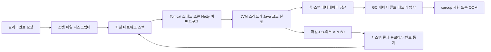
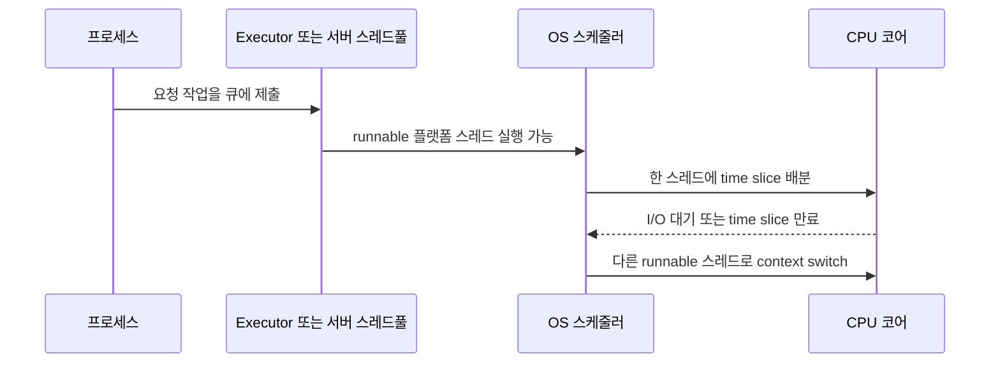
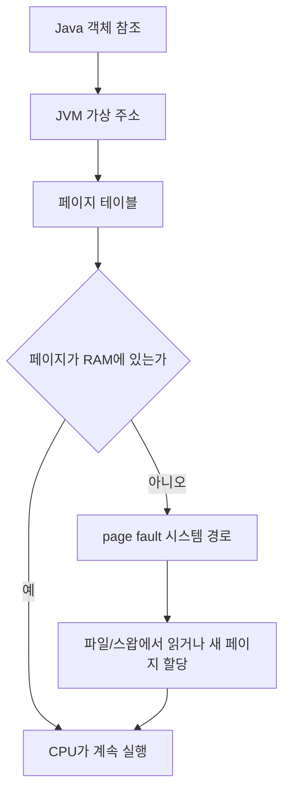
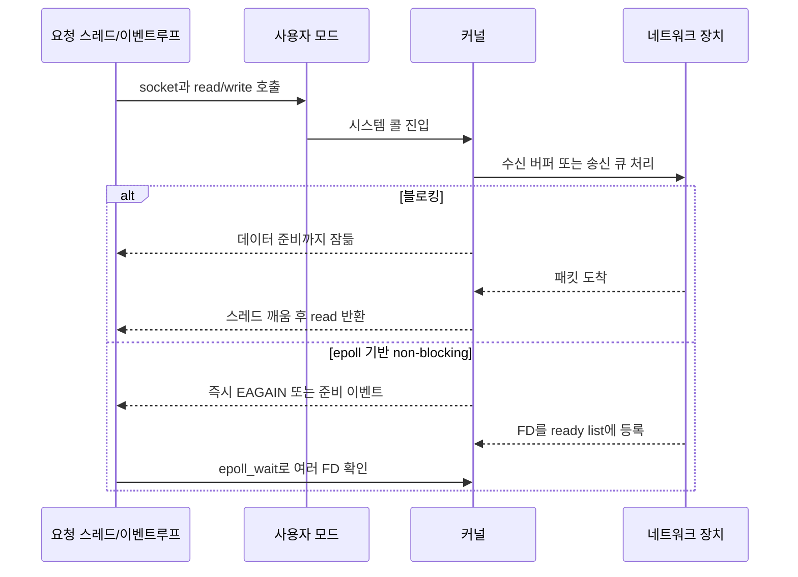

# D14. 백엔드 개발자를 위한 운영체제 기초 — 프로세스·스레드·메모리·I/O

> 프로그램은 프로세스가 되어 주소 공간을 얻고, 스레드가 CPU를 나눠 쓰며, 시스템 콜을 통해 커널의 메모리·파일·소켓을 사용한다.
> 서버 성능은 CPU 계산 시간만이 아니라 스케줄링, 페이지 폴트, 파일 디스크립터, I/O 대기와 스레드풀 포화의 합이다.
> JVM과 Spring도 이 흐름 위에 있으므로, 장애 때 Java 로그와 `ps`, `/proc`, `vmstat`를 함께 본다.

## 1. 큰 그림



운영체제는 여러 프로그램을 동시에 실행하는 것처럼 보이게 한다. 프로세스별 가상 주소 공간을 만들고, 각 프로세스의 스레드를 CPU 코어에 배치한다. 파일·소켓 작업은 시스템 콜로 커널에 요청하며, 커널은 잠든 스레드를 깨우거나 `epoll`로 여러 디스크립터를 감시한다.

Spring Boot의 요청 한 건도 이 흐름의 한 지점이다. JVM 프로세스 안에서 Tomcat 작업 스레드가 요청을 실행하거나, WebFlux의 Netty 이벤트루프가 이벤트를 처리한다. 컨테이너에서는 같은 프로세스가 namespace로 보이는 자원을 격리하고 cgroup으로 CPU·메모리 사용량을 제한한다. 이 문서는 전체 개발 과정(D01) 중 “프로그램이 실행되어 서버 자원과 상호작용하는 단계”를 소유한다.

## 2. 용어 사전

| 용어 | 한 줄 정의 | 실무 예시 | 헷갈리는 것과 차이 |
|---|---|---|---|
| 프로그램 | 디스크에 저장된 실행 파일과 코드·데이터 | `java -jar app.jar` | 실행 중인 인스턴스는 프로세스다 |
| 프로세스 | 독립된 가상 주소 공간과 자원으로 실행 중인 프로그램 | JVM 한 개, PID 1234 | 스레드는 같은 프로세스 자원을 공유한다 |
| PID | 프로세스 식별자 | `ps -p 1234` | TID는 스레드 식별자다 |
| 스레드 | CPU 스케줄링의 실행 단위 | 요청 처리 스레드 | 프로세스보다 가볍지만 공유 상태 경쟁이 생긴다 |
| 플랫폼 스레드 | OS 스레드에 일대일로 연결된 Java 스레드 | Tomcat worker | virtual thread와 달리 OS 스레드를 생애 동안 점유한다 |
| 가상 스레드 | JVM이 소수의 OS 스레드에 많은 Java 스레드를 매핑하는 스레드 | `Thread.ofVirtual()` | 빠른 CPU가 아니라 대기 동시성 확장이 목적이다 |
| 컨텍스트 스위칭 | 실행 스레드를 바꾸며 레지스터·스택 상태를 저장/복원하는 일 | runnable 스레드가 코어 수보다 많음 | 병렬 실행은 여러 코어에서 동시에 실행되는 상태다 |
| 동시성 | 작업이 겹치는 시간 구간을 갖도록 구성한 것 | 여러 요청의 I/O 대기 | 병렬성은 실제로 여러 코어에서 동시에 계산하는 것 |
| 스케줄러 | runnable 작업에 CPU를 배분하는 커널 구성요소 | CPU 부하 때 run queue 증가 | 애플리케이션 Executor는 작업 큐를 관리한다 |
| 주소 공간 | 프로세스가 자기 것처럼 보는 가상 주소 범위 | heap, stack, mmap 영역 | 물리 RAM과 같지 않으며 페이지로 매핑된다 |
| 코드(text) | 실행 명령이 놓이는 읽기 중심 영역 | 클래스 로더가 실행 코드 사용 | Java 클래스 메타데이터는 주로 native 메모리 영역이다 |
| 데이터 영역 | 전역·정적 데이터와 초기화되지 않은 데이터 | native 프로그램의 전역 변수 | Java 객체 정적 필드는 JVM 관리 구조에 놓인다 |
| 힙 | 동적으로 할당한 객체 영역 | `new Order()` | JVM heap과 OS 프로세스 전체 RSS는 같은 값이 아니다 |
| 스택 | 함수 호출 프레임과 지역 변수의 실행 중 저장소 | Java 메서드 호출 스택 | 스레드마다 있으며 `StackOverflowError`와 관련된다 |
| 페이지 | 가상 메모리의 고정 크기 관리 단위 | page fault, resident page | 페이지 크기와 객체 크기를 혼동하지 않는다 |
| 스왑 | RAM 페이지를 디스크로 내보내는 공간/동작 | swap-in 지연 | OOM과 같은 말은 아니나 압박을 키울 수 있다 |
| 페이지 폴트 | 필요한 페이지 매핑이 없어 커널 처리가 필요한 사건 | demand paging, mmap | 항상 오류는 아니다. 정상적인 minor fault도 있다 |
| RSS | 현재 물리 메모리에 상주한 페이지의 대략적 양 | 컨테이너 메모리 사용량 관찰 | JVM `-Xmx`보다 native·스레드·파일 매핑이 더해진다 |
| OOM Killer | 메모리가 고갈될 때 커널이 희생 프로세스를 종료하는 동작 | 컨테이너가 갑자기 137 종료 | Java heap OOM은 JVM 예외, kernel OOM은 프로세스 밖 종료다 |
| 파일 디스크립터(FD) | 프로세스의 열린 파일/소켓을 가리키는 작은 정수 | `0,1,2`, TCP 소켓, epoll FD | 파일만 뜻하지 않고 커널 객체 핸들이다 |
| 소켓 | 프로세스가 네트워크 통신에 사용하는 FD 기반 끝점 | HTTP keep-alive 연결 | 연결(connection)은 소켓 두 끝점의 상태다 |
| 시스템 콜 | 사용자 모드가 커널 기능을 요청하는 경계 | `read`, `write`, `epoll_wait` | 일반 Java 메서드 호출보다 비용과 권한 전환이 크다 |
| 사용자 모드 | 애플리케이션 권한으로 실행되는 CPU 상태 | JVM 바이트코드 실행 | 커널 모드에서만 장치·스케줄링을 직접 관리한다 |
| 블로킹 I/O | 작업이 완료될 때까지 호출 스레드가 기다리는 I/O | `InputStream.read()` | non-blocking은 즉시 반환하고 준비 이벤트를 다시 기다린다 |
| I/O 멀티플렉싱 | 한 스레드가 여러 FD의 준비 상태를 감시하는 모델 | `select`, `poll`, `epoll` | 비동기 I/O는 완료 통지를 중심으로 한 더 넓은 모델이다 |
| 이벤트루프 | 이벤트를 하나씩 꺼내 콜백/작업을 실행하는 반복기 | Netty event loop | 이벤트루프에서 긴 블로킹 작업을 하면 모든 연결이 지연된다 |
| 스레드풀 | 작업을 재사용 스레드와 큐에 배분하는 구조 | Tomcat executor, DB pool | 큐 크기와 거부 정책까지 포함해 용량을 정한다 |
| 뮤텍스 | 한 번에 한 소유자만 임계구역에 들어가는 잠금 | 공유 캐시 갱신 | 세마포어는 허용 수를 나타내며 소유자 개념이 다르다 |
| 세마포어 | 동시에 진입 가능한 수를 나타내는 카운터 | 제한된 외부 API 동시 호출 | 뮤텍스는 보통 상호배제 하나를 표현한다 |
| 데드락 | 서로 자원을 기다리며 영원히 진행하지 못하는 상태 | lock A→B, 다른 쪽 B→A | 단순히 느린 락 경합과 다르다 |
| namespace | 프로세스가 보는 PID·mount·network 등의 시야를 분리 | 컨테이너 PID 1 | 자원 사용량 제한은 cgroup의 역할이다 |
| cgroup | 프로세스 그룹의 자원을 제한·계측하는 커널 기능 | 컨테이너 memory limit | 격리(namespace)와 제한(cgroup)은 별개다 |

## 3. 단계별로 보기

### 3.1 실행: 프로그램에서 프로세스로

쉘이 `java -jar app.jar`를 실행하면 런처가 JVM 프로세스를 만들고, JVM은 자신의 가상 주소 공간에 코드, 클래스 메타데이터, Java heap, 스레드 스택, native 라이브러리와 mmap 영역을 배치한다. Linux `fork()`는 호출 프로세스를 복제한 자식 프로세스를 만들며 부모와 자식의 주소 공간은 분리된다. 구현은 처음부터 모든 RAM을 복사하기보다 copy-on-write 페이지를 공유하고, 한쪽이 쓰는 시점에 페이지를 분리하는 방식으로 복제 비용을 늦춘다. `fork()` 후 자식이 `execve()`를 호출하면 실행 이미지를 다른 프로그램으로 바꾼다.

Java 프로세스의 RSS에는 heap 외에 플랫폼 스레드 스택, Metaspace, JIT 코드 캐시, direct buffer, native allocator, 파일 매핑과 소켓 버퍼도 포함된다. 그래서 `-Xmx`를 컨테이너 제한과 같게 잡으면 native 여유가 사라질 수 있다.

### 3.2 실행: 스레드와 스케줄링



스레드마다 호출 프레임과 지역 변수를 위한 스택이 있으므로 프로세스의 메모리와 공유 객체는 보통 힙·static 영역을 통해 공유된다. 스케줄러는 runnable 스레드 중 하나를 코어에 올린다. runnable 수가 코어 수를 넘으면 모두가 동시에 빨라지는 것이 아니라 대기열, 캐시 손실, context switch가 늘어난다. 반대로 I/O 대기 스레드는 CPU를 계속 차지하지 않으므로, “스레드 수가 CPU 코어 수보다 많다”만으로 문제라고 단정할 수 없다. CPU-bound 작업과 I/O-bound 작업을 구분해야 한다.

동시성은 I/O 대기 중 다른 작업을 진행하는 구조이고, 병렬성은 여러 코어의 실제 동시 계산이다. 비동기 I/O가 CPU 계산을 병렬화하지는 않는다. 공유 상태와 메모리 가시성은 JMM 주제(J10)로 이어진다.

### 3.3 메모리: 주소에서 페이지까지



프로세스는 가상 주소를 사용하고 MMU와 페이지 테이블이 이를 물리 프레임으로 번역한다. 새로 할당했지만 아직 접근하지 않은 메모리는 demand paging으로 실제 페이지가 필요할 때 준비될 수 있다. `mmap` 파일도 페이지 단위로 로드된다. Linux 메모리 관리 문서는 이를 같은 subsystem의 책임으로 설명한다.

메모리 압박에는 여러 얼굴이 있다. JVM heap이 가득 차면 GC 후에도 공간이 없어 `OutOfMemoryError`가 발생할 수 있다. 반면 cgroup의 memory limit을 넘거나 시스템 전체 여유가 없어지면 커널 OOM 처리로 프로세스가 SIGKILL될 수 있다. 전자는 애플리케이션이 예외를 기록할 기회가 있지만 후자는 종료 코드 137, 컨테이너 이벤트, 커널 로그로 나타날 수 있다. swap이 심하면 프로세스가 죽기 전에도 page fault와 swap-in 지연으로 latency가 급증한다.

### 3.4 I/O: 시스템 콜부터 이벤트루프까지



블로킹 `read`는 호출 스레드를 재우고, 데이터가 준비되면 커널이 깨운다. 연결 수가 많고 각 연결이 대부분 기다리는 서버는 연결마다 전용 플랫폼 스레드를 두면 스레드 스택과 스케줄링 비용이 커진다. `select`·`poll`·`epoll`은 한 실행 흐름이 여러 FD의 “지금 읽거나 쓸 수 있는가”를 감시하는 I/O 멀티플렉싱이다. `select(2)`는 FD 번호가 1024 미만이어야 한다는 제한이 있어 현대 애플리케이션에는 `poll`·`epoll`이 권장된다.

`epoll` 인스턴스는 관심 목록(interest list)과 준비 목록(ready list)을 커널에 둔다. `epoll_ctl`로 감시할 FD를 등록하고 `epoll_wait`로 준비된 항목을 받는다. level-triggered는 아직 읽을 데이터가 남아 있으면 계속 준비로 보고, edge-triggered는 상태 변화 때만 알린다. edge-triggered에서는 non-blocking FD를 사용하고 `read`/`write`가 `EAGAIN`을 반환할 때까지 처리해야 한다. 일부만 읽고 다시 기다리면 남은 데이터가 있어도 새 이벤트가 오지 않아 연결이 멈출 수 있다.

Spring Boot servlet 애플리케이션은 기본적으로 embedded Tomcat을 포함하고, WebFlux는 Reactor Netty를 포함한다. Tomcat 모델에서는 작업 스레드가 요청 코드의 블로킹 I/O 동안 기다리는 것이 자연스럽다. Netty 이벤트루프 모델에서는 이벤트루프가 짧은 작업만 처리하고, JDBC·파일 읽기 같은 블로킹 작업을 이벤트루프에서 실행하면 같은 루프의 여러 연결이 함께 지연된다. virtual thread는 Java 21에서 정식화된 JEP 444 기능으로, 블로킹 I/O 때 Java 실행을 suspend하여 carrier OS 스레드를 다른 virtual thread에 양보한다. 그래도 CPU-bound 코드를 더 빨리 만들거나 DB 커넥션 풀의 한도를 없애지는 않는다.

## 4. 직접 해보기

### 4.1 Java에서 플랫폼 스레드·virtual thread·파일 I/O 확인

아래 예제는 JDK 21에서도 실행 가능하고, Java 25 기준에서도 같은 API를 쓸 수 있다. virtual thread는 JEP 444(Java 21)로 정식화되었다. 예제는 스레드 종류를 구분하고, 파일 읽기라는 I/O를 실행한다.

```java
import java.nio.file.Files;
import java.nio.file.Path;
import java.util.concurrent.CountDownLatch;

public class OsBasicsDemo {
    public static void main(String[] args) throws Exception {
        CountDownLatch ready = new CountDownLatch(2);
        Thread platform = new Thread(() -> { ready.countDown(); sleep(120); }, "worker-io");
        Thread virtual = Thread.ofVirtual().name("worker-virtual").start(() -> {
            ready.countDown(); sleep(80);
        });
        platform.start();
        ready.await();
        System.out.println("pid=" + ProcessHandle.current().pid());
        System.out.println("platform=" + platform.getName()
                + ", virtual=" + virtual.getName());
        System.out.println("hosts-lines>=" + Files.readAllLines(Path.of("/etc/hosts")).size());
        platform.join();
        virtual.join();
        System.out.println("done=true");
    }
    static void sleep(long ms) {
        try { Thread.sleep(ms); }
        catch (InterruptedException e) { Thread.currentThread().interrupt(); }
    }
}
```

실행:

```bash
java _scratch/D14/OsBasicsDemo.java
```

실제 출력:

```text
pid=6933
platform=worker-io, virtual=worker-virtual
hosts-lines>=33
done=true
```

PID는 실행할 때마다 달라진다. 실행 중인 PID를 별도 터미널에서 관찰하려면 `ps -p <PID> -o pid,ppid,%cpu,%mem,rss,vsz,stat,command`, `ps -L -p <PID>`, `ls -l /proc/<PID>/fd`를 사용한다. `ps -L`은 프로세스 안의 스레드 단위까지 보여주며, `/proc/<PID>/fd` 항목 수는 열린 파일·소켓·epoll 수의 단서다.

### 4.2 Java 프로세스와 JVM 메모리 관찰

```bash
jps -lv
jcmd <PID> VM.command_line
jcmd <PID> Thread.print
jcmd <PID> GC.heap_info
cat /proc/<PID>/status | egrep 'VmRSS|VmSize|Threads|FDSize'
vmstat 1 5
```

`GC.heap_info`는 heap, `VmRSS`는 프로세스 상주 물리 페이지 관점이다. 둘의 차이는 Metaspace·direct buffer·thread stack·mmap도 포함해 해석한다. `vmstat`의 runnable·swap·si/so·wa로 CPU 포화와 I/O 대기를 구분한다.

### 4.3 FD 누수와 한도 확인

```bash
ulimit -n
cat /proc/<PID>/limits | grep -i 'open files'
ls /proc/<PID>/fd | wc -l
lsof -p <PID> | head -n 30
ss -tanp | grep <PID>
```

권한이 부족하면 `/proc/<PID>/fd`와 connection pool metric을 먼저 본다. FD 한도 증가는 누수 은폐가 될 수 있으므로, 증가하는 소켓·파일과 close 보장부터 확인한다.

### 4.4 Spring Boot 4.1에서 연결하기

Spring MVC는 `spring-boot-starter-webmvc`와 embedded Tomcat을, WebFlux는 `spring-boot-starter-webflux`와 Reactor Netty를 기본 조합으로 사용한다. Boot 4.1.1·Java 25 Gradle에서 `jps -lv`, `jcmd <PID> Thread.print`, `curl http://localhost:8080/`를 확인한다. 컨트롤러의 `Thread.sleep(5000)`은 Tomcat 스레드 점유를 보여준다. WebFlux 이벤트루프의 JDBC·파일 I/O는 여러 연결을 지연시키므로 실험 후 제거한다.

## 5. 자주 하는 오해와 실수

1. **“프로세스 메모리 = `-Xmx`” →** `-Xmx`는 Java heap 상한일 뿐이다. 스레드 스택, Metaspace, direct memory, native library, mmap과 페이지가 더해져 컨테이너 OOM이 날 수 있다. **대처:** heap과 RSS를 함께 보고 cgroup limit 아래에 native 여유를 남긴다.

2. **“스레드를 늘리면 처리량이 늘어난다” →** CPU-bound 작업은 코어보다 많은 스레드가 경합과 context switch를 키운다. I/O-bound 작업은 대기 동안 CPU를 놓치므로 다른 적정 모델이 필요하다. **대처:** CPU 사용률, run queue, 대기 시간, 풀 큐를 측정하고 상한을 정한다.

3. **“non-blocking이면 아무 코드나 이벤트루프에서 실행해도 된다” →** 네트워크 read가 non-blocking이어도 동기 JDBC·파일 I/O·큰 JSON 직렬화는 이벤트루프를 점유한다. **대처:** 이벤트루프에는 짧은 작업만 두고 별도 scheduler/worker로 격리하거나 blocking 서버 모델을 선택한다.

4. **“Java `OutOfMemoryError`와 컨테이너 OOM은 같다” →** 전자는 JVM이 예외를 던지는 heap/native 영역 고갈이고, 후자는 커널/cgroup이 프로세스를 SIGKILL할 수 있는 사건이다. **대처:** 애플리케이션 로그, 종료 코드 137, cgroup 이벤트와 커널 로그를 함께 확인한다.

5. **“FD 한도를 올리면 Too many open files가 해결된다” →** 한도 증가는 정상적인 높은 동시 연결에만 맞는 조치다. close 누수라면 더 늦게 장애가 날 뿐이다. **대처:** `/proc/<pid>/fd`, `lsof`, pool active/idle metric으로 증가하는 종류를 찾고 수명 관리를 고친다.

6. **“virtual thread는 CPU 작업도 빠르게 한다” →** virtual thread는 OS 스레드를 효율적으로 공유해 대기 동시성을 높이는 기능이지 CPU 실행 속도를 높이는 기능이 아니다. **대처:** I/O 대기 중심 작업에 적용하고 CPU 작업은 코어 수와 별도 executor로 제한한다.

7. **“서버가 느리면 GC부터 튜닝한다” →** swap, page fault, FD 고갈, 스레드풀 큐, DB 커넥션 대기일 수 있다. **대처:** 요청 latency와 함께 `vmstat`, `ps -L`, `/proc`, 풀 metric을 시간축으로 맞춘다.

## 6. 시각화 설계 메모

1. **[요청의 OS 경로 | 요소: client, socket FD, kernel, Tomcat/Netty, JVM, DB | 관계: 호출·대기·깨움 | 순서: 도착→ready→실행→DB 대기→응답 | 오해: Java 메서드 호출만으로 끝나지 않음]** 위 flowchart를 기본 장면으로 쓴다.

2. **[프로세스와 스레드 | 요소: PID, heap, stack, TID | 관계: 경계는 격리, heap은 공유 | 순서: JVM 생성→스레드 추가→carrier 공유 | 오해: 스레드는 프로세스와 같은 경계가 아님]** 2절과 3.2를 연결한다.

3. **[가상 메모리 | 요소: 참조, 페이지, page table, RAM, swap | 관계: 번역·fault·swap-in | 순서: 접근→fault→로드→재실행 | 오해: heap 상한과 RSS는 다름]** 3.3을 확장한다.

4. **[I/O 모델 비교 | 요소: 연결, 스레드, event loop, ready list | 관계: sleep/wakeup·notification | 순서: 증가→풀 포화→ready list→처리 | 오해: non-blocking FD와 앱 전체는 다름]** 3.4를 나란히 보여준다.

## 7. 자가점검 Q&A (면접 대비)

### Q1. 프로세스와 스레드의 차이는 무엇인가?

프로세스는 독립된 가상 주소 공간과 자원 경계를 갖고, 스레드는 한 프로세스 안의 실행 단위다. 스레드는 heap·FD 같은 자원을 공유해 전환과 통신이 상대적으로 가볍지만 경쟁과 장애 전파가 생긴다. 프로세스 분리는 비용이 더 크지만 한 프로세스의 메모리 오류가 다른 프로세스로 바로 번지지 않는다.

꼬리질문: `fork()` 직후 부모와 자식은 메모리를 바로 두 벌 복사하는가?  → 보통 copy-on-write로 페이지를 공유하다가 쓰기 시 분리한다.

### Q2. 동시성과 병렬성은 어떻게 다른가?

동시성은 여러 작업이 진행 가능하도록 번갈아 실행하거나 대기와 실행을 겹치는 구조다. 병렬성은 여러 CPU 코어가 실제로 동시에 작업을 실행하는 상태다. 한 코어의 event loop도 많은 연결을 동시 처리하지만 CPU 계산을 병렬 처리하는 것은 아니다.

꼬리질문: I/O를 non-blocking으로 바꾸면 CPU-bound 계산도 빨라지는가? → 아니다. I/O 대기 점유를 줄일 뿐 계산량과 코어 수는 그대로다.

### Q3. 컨텍스트 스위칭이 왜 비용인가?

스케줄러가 현재 스레드의 실행 상태를 저장하고 다른 스레드의 상태를 복원해야 한다. 이때 직접 작업 시간이 들고 CPU cache와 TLB locality가 약해질 수 있다. 따라서 runnable 스레드를 무작정 늘리는 대신 CPU-bound 풀의 상한과 큐를 관리한다.

꼬리질문: I/O 대기 스레드는 항상 context switch 악화의 주범인가? → 아니다. 잠든 스레드는 CPU를 쓰지 않으며, 문제는 runnable 과다·빈번한 전환과 메모리 비용까지 함께 봐야 한다.

### Q4. `epoll`은 무엇을 해결하며 edge-triggered의 함정은?

많은 FD의 I/O 준비 상태를 커널이 관리하고, 한 실행 흐름이 ready list를 받아 처리하게 한다. edge-triggered는 상태 변화 때 주로 알리므로 이벤트 후 non-blocking read/write를 `EAGAIN`까지 반복해야 한다. 일부 데이터만 소비하고 다시 기다리면 새 변화가 없어 영원히 알림을 못 받을 수 있다.

꼬리질문: level-triggered는 왜 초보 구현에서 다루기 쉬운가? → 읽을 데이터가 남아 있는 동안 다시 ready로 알려 처리 누락에 덜 취약하다.

### Q5. Java heap은 충분한데 컨테이너가 OOM으로 죽을 수 있는가?

가능하다. RSS에는 heap 외에 Metaspace, thread stack, direct buffer, native library, mmap과 페이지가 포함된다. cgroup limit은 이 프로세스 관점의 총 사용량에 적용되므로 `-Xmx`만 limit보다 작게 잡았다는 사실은 안전을 보장하지 않는다.

꼬리질문: Java 예외가 남지 않고 137로 끝났다면? → JVM 내부 OOM보다 SIGKILL/cgroup 또는 커널 OOM 가능성을 먼저 컨테이너 이벤트와 커널 로그에서 확인한다.

### Q6. 뮤텍스와 세마포어는 어떻게 구분하는가?

뮤텍스는 한 소유자만 임계구역에 들어가도록 상호배제를 표현하는 잠금이다. 세마포어는 허용된 동시 진입 수를 카운터로 표현하므로 DB 커넥션이나 외부 API 호출 수 제한에 맞다. 둘 다 잘못된 순서·해제 누락으로 대기와 장애를 만들 수 있다.

꼬리질문: 데드락의 전형적인 조건은? → 상호배제, 점유 후 대기, 강제 선점 불가, 순환 대기의 네 조건이 동시에 성립하는 상태다.

## 8. 참고문헌

- `epoll(7) — Linux manual page` — https://man7.org/linux/man-pages/man7/epoll.7.html — epoll과 LT·ET.
- `fork(2) — Linux manual page` — https://man7.org/linux/man-pages/man2/fork.2.html — 프로세스 복제와 FD 상속.
- `Operating Systems: Three Easy Pieces` — https://pages.cs.wisc.edu/~remzi/OSTEP/ — 프로세스·메모리·I/O 학습 구조.
- `cgroups(7) — Linux manual page` — https://man7.org/linux/man-pages/man7/cgroups.7.html — 계층적 자원 제한.
- `Memory Management — Linux Kernel` — https://www.kernel.org/doc/html/latest/admin-guide/mm/index.html — virtual memory와 paging.
- `proc_pid_fd(5)` — https://man7.org/linux/man-pages/man5/proc_pid_fd.5.html — FD와 소켓 관찰.
- `select(2)` — https://man7.org/linux/man-pages/man2/select.2.html — FD_SETSIZE와 multiplexing.
- `Virtual Threads — Java SE 25` — https://docs.oracle.com/en/java/javase/25/core/virtual-threads.html — virtual thread 적용 범위.
- `JEP 444: Virtual Threads` — https://openjdk.org/jeps/444 — Java 21 정식화.
- `Embedded Web Servers :: Spring Boot` — https://docs.spring.io/spring-boot/how-to/webserver.html — Tomcat과 Reactor Netty.
