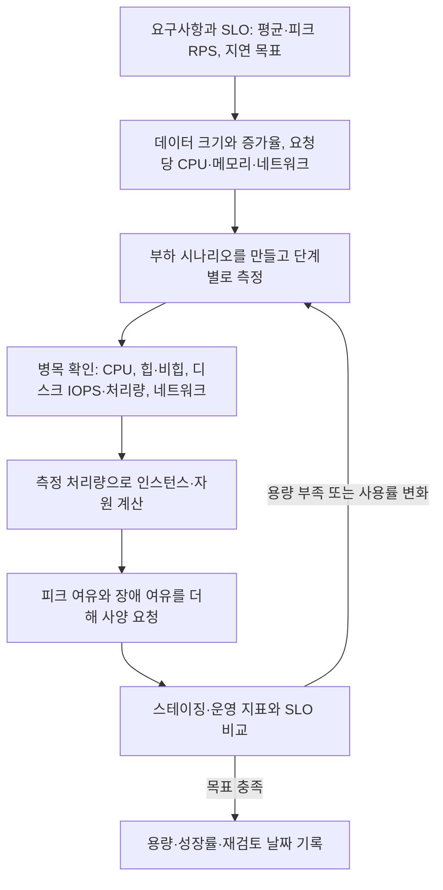
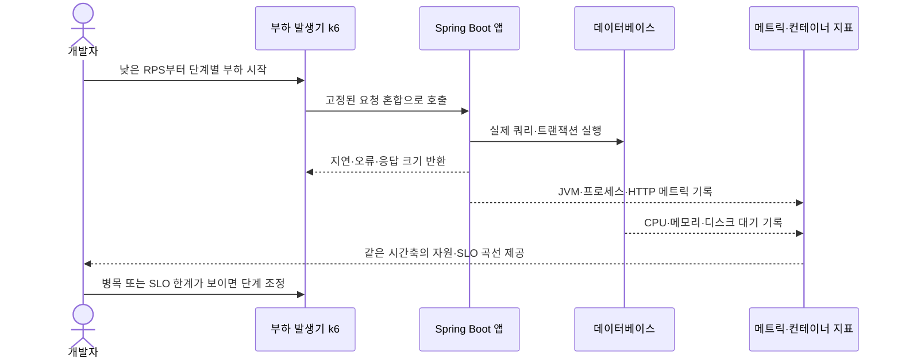

# D15. 서버 사양은 어떻게 정하나 — CPU·메모리·디스크·네트워크를 숫자로 잡는 법

> 사양은 부하에서 SLO를 지키는 처리량을 재고 피크·장애 여유를 계산해 정한다.
> 앱은 CPU·JVM 메모리 중심이며 대체로 인스턴스를 늘려 수평 확장하고, DB는 작업 집합을 담을 메모리와 저장장치 지연·IOPS가 중요하다.
> 처음 요청한 숫자는 결론이 아니라 검증 가능한 가설이다. 지표와 재검토 시점을 사양 요청서에 함께 남긴다.

## 1. 큰 그림



요청량을 올리며 지연·오류·자원 곡선을 측정해 병목을 찾고, SLO를 지키는 인스턴스당 처리량과 피크·장애 여유로 서버 수를 산출한다. 데이터와 피크 트래픽은 바뀌므로 운영 지표로 다시 측정한다.

이 문서는 전체 개발 과정 중 요구사항을 운영 자원으로 번역하고, 배포 전 용량을 확인하는 단계다(D01 참조). 온프렘과 클라우드의 큰 차이는 D07, JVM 컨테이너 인식 상세는 J16, OS 메모리·스레드는 D14를 참조한다.

## 2. 용어 사전

| 용어 | 한 줄 정의 | 실무 예시 | 헷갈리는 것과 차이 |
|---|---|---|---|
| 사양 산정 | 부하와 SLO를 만족하는 자원량을 근거와 함께 정하는 일 | “피크 500 RPS에서 인스턴스 4대” | 서버 신청서의 숫자는 측정 전엔 가설 |
| SLO | 사용자 관점에서 약속할 서비스 수준 목표 | p95 250ms 미만, 성공률 99.9% | SLA는 보상·계약 조건을 포함할 수 있음 |
| RPS | 초당 처리한 요청 수 | 로그인 API 120 RPS | TPS는 트랜잭션 수를 뜻하며 한 요청과 다를 수 있음 |
| 지연 시간 | 요청 한 건이 완료될 때까지 걸린 시간 | p95 230ms | 평균은 꼬리 지연을 가릴 수 있어 p95/p99도 본다 |
| 동시 처리 수 | 한 시점에 처리 중인 요청 수 | 평균 60개 in-flight | 스레드 수와 동일하다고 단정할 수 없음 |
| CPU 코어·vCPU | 계산에 쓸 수 있는 CPU 실행 자원 | 컨테이너 2 vCPU 한도 | vCPU가 물리 코어 하나와 항상 같진 않음 |
| CPU 포화 | 실행 자원이 바빠 새 작업이 대기하는 상태 | CPU 사용률과 run queue가 함께 증가 | CPU 사용률 100%만이 병목 징후는 아님 |
| CPU throttling | 컨테이너 CPU quota 때문에 실행이 제한된 시간 | CPU 한도 도달 후 p95 상승 | 호스트 CPU가 남아도 컨테이너는 제한될 수 있음 |
| 힙 | 객체를 할당하는 JVM 메모리 영역 | `-Xmx` 또는 ergonomics로 상한 결정 | 프로세스 메모리 전체가 아님 |
| 비힙·네이티브 | 메타스페이스, 스레드 스택, direct buffer, JVM 내부 등 | 힙은 여유인데 RSS가 컨테이너 한도에 접근 | `-Xmx` 밖의 메모리도 컨테이너 한도에 포함 |
| working set | 반복해서 읽혀 빠른 접근이 필요한 데이터·인덱스 집합 | 최근 주문과 고객 인덱스 페이지 | 전체 DB 크기와 같을 필요가 없음 |
| 버퍼 풀 | InnoDB가 테이블·인덱스 페이지를 캐시하는 메모리 | `innodb_buffer_pool_size` | OS 페이지 캐시나 JVM 힙과 다른 DB 내부 캐시 |
| IOPS | 저장장치가 초당 처리하는 입출력 작업 수 | 랜덤 4KiB 읽기 5,000 IOPS | MB/s 처리량과 서로 대체할 수 없음 |
| 디스크 처리량 | 초당 읽거나 쓸 수 있는 데이터 크기 | 200 MiB/s 순차 쓰기 | 작은 I/O가 많으면 IOPS가 먼저 한계일 수 있음 |
| 네트워크 대역폭 | 초당 전달 가능한 비트·바이트 양 | 100 Mbps 송신 | 지연, 패킷 손실, 연결 수 문제와 구분 |
| 피크 배수 | 평균 부하 대비 계획할 최고 부하 비율 | 평균 100, 피크 400 RPS → 4배 | 평균에만 맞추면 피크 때 대기열이 커짐 |
| 수직 확장(스케일 업) | 한 인스턴스의 CPU·메모리·디스크를 키움 | DB 클래스를 메모리 최적화로 변경 | 수평 확장과 달리 한 노드 한도가 있음 |
| 수평 확장(스케일 아웃) | 같은 역할의 인스턴스 수를 늘림 | 무상태 앱을 3대에서 5대로 | 세션·로컬 파일 상태가 있으면 먼저 외부화 필요 |
| 오토스케일링 | 지표와 정책에 따라 인스턴스 수를 자동 변경 | CPU·요청량 기준으로 앱 서버 추가 | 순간 피크 직후 늘지 않으므로 사전 여유가 필요 |
| 버스터블 | 일정 CPU 기준선과 축적 크레딧으로 순간 초과 사용을 허용하는 유형 | EC2 T 계열 CPU 크레딧 확인 | 지속 고부하 서버의 무조건 저렴한 대안이 아님 |
| EC2 인스턴스 타입 | AWS 가상 서버의 패밀리·세대·크기 조합 | `m7g.large` | `m`은 범용, `c` 연산, `r` 메모리 최적화 계열 예시 |
| EBS gp3 | 범용 SSD 볼륨으로 용량과 성능 축을 설정하는 유형 | 크기·IOPS·MiB/s 처리량 검토 | 용량만 키운다고 IOPS와 처리량이 자동으로 늘진 않음 |

## 3. 단계별로 보기

### 3.1 요구사항을 부하로 바꾼다

**무엇이 일어나나:** API별 평균·피크 RPS, 요청 크기, 읽기/쓰기 비율, 배치 시간대, p95/p99 목표를 정한다. 검색 80%, 주문 쓰기 20%인 서비스는 같은 RPS라도 CPU와 DB 부하가 다르다. 데이터 크기·증가량·로그 및 백업 보존 기간도 적는다.

**누가·도구:** 제품 담당자는 시나리오·SLO를, 개발자는 요청 흐름·외부 의존성을, 운영 담당자는 자원 한도를 정리한다. 로그·메트릭·업무 예측을 근거로 삼고 운영 데이터가 없으면 가정임을 표시한다.

**입력·산출물:** 요청 비중·평균/피크 RPS·응답 목표 → 부하 프로파일. 누락된 쓰기·배치 작업은 피크 p95 초과나 DB 포화로 드러난다.

리틀의 법칙은 평균 동시 진행량을 연결한다.

`L = λ × W`

`L`은 평균 in-flight 요청 수, `λ`는 초당 완료 수, `W`는 평균 응답 시간(초)이다. 500 RPS × 0.12초 = 평균 60개가 진행 중이다. p95를 평균 대신 넣지 않는다. 동시 요청 수가 스레드나 코어 수는 아니다. CPU 작업·DB 대기·비동기 I/O에 따라 실행 스레드는 달라진다.

### 3.2 자원별 병목을 찾는다

| 자원 | 앱 서버에서 주로 쓰는 곳 | DB 서버에서 주로 쓰는 곳 | 부족할 때 보이는 신호 |
|---|---|---|---|
| CPU | 비즈니스 로직, JSON 직렬화, TLS, GC | SQL 실행·정렬·조인·압축 | 사용률·대기열 상승, 처리량 정체, p95 증가. 컨테이너 throttling도 확인 |
| 메모리 | 힙 객체와 메타스페이스, 스레드 스택, direct buffer, JVM 네이티브 | InnoDB 버퍼 풀, 연결·정렬 버퍼, OS 여유 | GC 빈도·정지 시간 증가, 힙 OOM, 컨테이너 `OOMKilled`, 스왑·페이지 인/아웃 |
| 디스크 용량 | 로그·임시 파일·업로드 파일 | 데이터·인덱스·redo/binlog·임시 공간·백업 | 여유 공간 고갈 후 로그·DB 쓰기 실패, 복구·재기동 실패 |
| 디스크 IOPS·처리량 | 로그/파일 업로드·로컬 캐시 | 랜덤 페이지 읽기·쓰기, 로그 flush | CPU가 낮은데 DB 지연·I/O 대기가 높고 쿼리 p95가 상승 |
| 네트워크 | 클라이언트 응답·내부 API·DB 연결 | 앱 응답·복제·백업 송신 | 대역폭 포화, 재전송·연결 실패, 송신 대기와 응답시간 증가 |

**왜 앱과 DB 사양이 다른가:** 앱은 보통 요청 처리 인스턴스를 여러 개 둬 CPU와 JVM 프로세스 메모리를 나누기 쉽고, 세션·파일 상태를 외부에 두면 수평 확장이 가능하다. DB는 데이터와 로그 상태를 유지하며, 자주 읽는 페이지가 메모리에 들어오는지와 쓰기 I/O 지연이 성능에 크게 작용한다. DB를 늘리면 데이터 정합성·복제·쓰기 경로를 함께 설계해야 한다.

| 구분 | Spring Boot 앱 서버 | 관계형 DB 서버 |
|---|---|---|
| 우선 관찰 | CPU, 요청 지연/오류, 힙·비힙, 스레드 | working set 대비 메모리, 디스크 지연·IOPS, CPU, 연결 |
| 메모리 기준 | 컨테이너 한도 안에 JVM 힙과 네이티브 메모리를 함께 수용 | InnoDB 버퍼 풀을 키우되 연결·정렬·OS 여유도 남김 |
| 확장 경향 | 상태 외부화 시 수평 확장이 단순 | 먼저 수직 확장·읽기 복제본을 검토, 쓰기 확장은 별도 설계 |
| 장애 함정 | 힙만 보고 전체 프로세스 한도를 넘겨 OOMKilled | 버퍼 풀만 크게 잡아 OS·다른 메모리 소비자를 압박 |

### 3.3 JVM과 컨테이너 메모리를 함께 계산한다

컨테이너 메모리 한도는 힙의 한도가 아니다. JVM 프로세스가 쓸 수 있는 전체 예산으로 본다.

`컨테이너 한도 ≥ 힙 + 메타스페이스 + 스레드 스택 × 스레드 수 + 코드 캐시 + direct/mapped buffer + GC/JVM·JNI 네이티브 + 여유`

JDK 25 `java` 문서에서 `-XX:MaxRAMPercentage` 기본값은 **25%**다. JVM이 산정한 가용 최대 RAM 기준의 힙 상한 비율이며 컨테이너 전체 메모리 한도가 아니다. 2 GiB를 JVM이 가용 RAM으로 인식하면 25%는 약 0.5 GiB, 60%는 약 1.2 GiB의 힙 상한 계산으로 이어진다. 나머지 공간도 네이티브 사용량을 재 확인해야 한다.

힙을 컨테이너 한도에 맞춰 `-Xmx`로 꽉 채우면 스레드 스택·direct buffer·메타스페이스 등이 들어갈 공간이 사라진다. 힙 사용률이 낮은데도 `OOMKilled`가 날 수 있는 이유다. `-XX:MaxRAMPercentage`나 `-Xmx` 하나만으로 전체 메모리가 보장되지 않는다. 메모리 압박 시 GC 시간과 컨테이너 종료 원인을 같이 본다. JVM 및 OS 영역의 세부는 J16·D14를 참조한다.

### 3.4 DB 메모리와 저장장치를 정한다

InnoDB 버퍼 풀은 접근한 테이블·인덱스 페이지를 메모리에 캐시한다. 운영 DB의 총 용량보다 반복 사용되는 working set이 얼마나 큰지가 캐시 적중에 더 직접적이다. MySQL 8.4 문서는 전용 서버에서 물리 메모리의 최대 80%를 버퍼 풀에 할당하는 경우가 있다고 설명하고, `--innodb-dedicated-server` 자동 설정은 감지 RAM 1GB 미만에서 128MB(기본값), 1~4GB에서 50%, 4GB 초과에서 75%로 계산한다.

이는 해당 옵션을 켠 전용 서버의 동작이다. 일반적인 모든 MySQL 인스턴스에 75~80%를 기계적으로 적용하지 말고 `SELECT @@GLOBAL.innodb_buffer_pool_size;`로 실행값을 확인한다. 공유 호스트에서는 특히 OS와 다른 프로세스의 메모리를 남겨야 한다.

디스크 용량은 최소 다음 항목을 분리해서 계산한다.

`요구 용량 = 데이터 + 인덱스 + redo/binlog·임시 공간의 피크 + 보존할 백업 + 기간 내 증가분 + 운영 여유`

백업이 별도 스토리지에 있으면 DB 볼륨에 중복 산입하지 않는다. 증가율은 관측 기간과 기준일을 적는다(백업·복구는 R07 참조). 용량과 성능도 별개다.

랜덤 I/O가 많은 DB는 IOPS, 큰 블록을 연속 읽고 쓰는 작업은 처리량이 먼저 병목일 수 있다. 대략 `IOPS × 평균 I/O 크기 ≈ 처리량`이므로 둘 다 필요한 워크로드에서는 작은 랜덤 I/O와 큰 순차 I/O를 따로 측정한다.

AWS EBS gp3는 볼륨 크기와 별도로 IOPS·처리량 설정을 확인하는 유형이다. 스토리지 성능이 부족한데 용량만 키우는 변경은 해결이 아닐 수 있다.

### 3.5 부하 측정값으로 서버 수를 산출한다

요청량을 올려 SLO를 지키는 지속 처리량 `C`를 찾는다. 평균 CPU 외 p95/p99, 오류율, GC, 메모리, DB 지연을 함께 본다. 부하 발생기를 분리하고 워밍업과 안정 상태를 구분한다.

`필요 인스턴스 수 = ceil(피크 RPS × 여유 계수 ÷ 검증된 인스턴스당 지속 RPS)`

예를 들어 **가정치**로, 한 앱 인스턴스가 지연 목표를 지키면서 160 RPS를 처리했고 피크 예상이 500 RPS라고 하자. 25% 용량 여유를 두면 `ceil(500 × 1.25 / 160) = 4대`다. 이때 인스턴스 네 대의 명목 합계는 640 RPS여서 계획 피크 500 RPS에 28%의 여유가 있다.

한 대 장애 중에도 500 RPS를 감당해야 한다면 세 대 합계 480 RPS로 모자라므로 5대로 잡는다. 숫자 160은 벤치마크 결과가 아니라 예시 입력이며, 실제 값은 동일한 앱 버전·요청 혼합·DB 조건에서 측정해야 한다.

CPU 목표 사용률은 “평균 60%” 같은 단일 숫자로 정하지 않는다. 피크·장애·확장 지연에도 SLO를 지킬 헤드룸을 검증한다. 높은 순간 CPU가 항상 장애는 아니며, 낮은 평균 CPU에서도 직렬 작업이나 DB 대기가 병목일 수 있다. 앱 자동 확장은 DB 쓰기 용량을 늘려주지 않는다.

**측정 흐름**은 다음과 같다.



### 3.6 클라우드 사양 이름을 해석한다

EC2 이름은 보통 패밀리(계열)·세대·옵션 뒤에 점과 크기가 붙는다. 예를 들어 `m7g.large`의 `m`은 범용 계열, `7`은 세대, `g`는 Graviton 옵션, `large`는 크기다.

AWS 문서상 `c`는 연산 최적화, `r`은 메모리 최적화, `t`는 버스터블 계열이다. T 계열은 기준 CPU 성능을 두고 크레딧에 따라 기준을 넘겨 쓰므로 지속적인 CPU 부하가 있는 서비스는 CPU 크레딧 잔량·소진 동작과 장시간 부하를 확인한다.

RDS 클래스도 CPU와 메모리 용량을 정하는 타입·크기 조합이다(예: `db.r6g.2xlarge`). 앱 서버 인스턴스 이름만 보고 DB 자원 비율을 추측하지 않는다. EBS gp3는 용량, IOPS, 처리량을 별도 축으로 확인한다. AWS 공식 사양과 해당 리전·연결 구성에서 가능한 조합을 가격 계산기와 함께 검토한다. 사양을 말할 때 가격 숫자는 문서에 박제하지 말고 공식 가격 계산기로 산정한다.

온프렘은 구매·교체 기간을 고려해 예상 피크를 선확보한다. 클라우드는 작게 시작할 수 있지만 증설 소요·쿼터·비용을 계획한다(D07 참조).

## 4. 직접 해보기

아래는 애플리케이션이 로컬에서 실행되고 Actuator가 포함돼 있다는 전제다. Boot 4.1 / Java 25 / Gradle 프로젝트에 Actuator 의존성을 추가하고(`implementation("org.springframework.boot:spring-boot-starter-actuator")`), `application.properties`에 지표 조회를 위해 다음을 둔다.

```properties
management.endpoints.web.exposure.include=health,metrics
server.port=8080
```

실행해 지표가 실제로 들어오는지 확인한다.

```bash
java -version
./gradlew bootRun
curl -s http://localhost:8080/actuator/health
curl -s http://localhost:8080/actuator/metrics/jvm.memory.used
curl -s http://localhost:8080/actuator/metrics/process.cpu.usage
curl -s http://localhost:8080/actuator/metrics/http.server.requests
```

Meter 목록·측정 가능한 태그는 `/actuator/metrics` 응답에서 확인한다. 미터 값은 호출 이후에 생길 수 있으므로 요청을 보내고 다시 조회한다. `jvm.memory.used`는 힙·비힙 영역을 구분해 보고, `process.cpu.usage`는 프로세스가 실행 중인 환경의 지원을 확인한다. `http.server.requests`는 요청의 지연·결과 태그를 확인한다. 운영에서 무인증으로 노출하지 말고 접근 정책을 적용한다.

컨테이너 자원을 같이 관찰하려면 동일한 앱 이미지를 낮은 제한으로 실행해 제한이 어떻게 드러나는지 본다. 이미지명은 로컬 환경의 빌드 결과로 바꾼다.

```bash
docker run --rm --memory=2g --cpus=2 -p 8080:8080 my-service:local
# 다른 터미널에서
docker stats
```

부하 발생 도구는 로컬 또는 스테이징에만 사용한다. **운영 환경을 대상으로 부하 테스트하지 않는다.** 아래 `load.js`는 20 RPS에서 100 RPS까지 요청률을 올리고, p95 250ms 및 오류율 1%를 예시 기준으로 삼는다. 경로와 임계치는 서비스 SLO에 맞춰 바꾼다.

```javascript
import http from 'k6/http';
import { check } from 'k6';

export const options = {
  scenarios: {
    capacity: {
      executor: 'ramping-arrival-rate',
      startRate: 20,
      timeUnit: '1s',
      preAllocatedVUs: 50,
      maxVUs: 200,
      stages: [
        { target: 20, duration: '1m' },
        { target: 50, duration: '1m' },
        { target: 100, duration: '1m' },
      ],
    },
  },
  thresholds: {
    http_req_failed: ['rate<0.01'],
    http_req_duration: ['p(95)<250'],
  },
};

export default function () {
  const res = http.get('http://host.docker.internal:8080/actuator/health');
  check(res, { 'HTTP 200': (r) => r.status === 200 });
}
```

`load.js`로 저장해 실행한다. Mac·Windows의 Docker 런타임은 보통 `host.docker.internal`을 제공한다. 이 이름이 해석되지 않으면(Linux 등) `--add-host=host.docker.internal:host-gateway`를 추가한다.

```bash
docker run --rm -v "$PWD/load.js:/scripts/load.js:ro" -w /scripts grafana/k6 run load.js
```

각 단계에서 p95·오류·`dropped_iterations`를 기록하고 Actuator·`docker stats`의 CPU와 메모리를 비교한다. 헬스 엔드포인트는 연결 확인용일 뿐이다. 실제 산정에는 대표 API·DB 데이터와 요청 혼합을 사용하고 부하 발생기 용량도 확인한다.

## 5. 자주 하는 오해와 실수

1. **“2 GiB 컨테이너니까 `-Xmx2g`로 충분하다” →** 힙 외 네이티브 메모리도 컨테이너 한도를 쓰므로 `OOMKilled`가 날 수 있다. **대처:** 힙과 RSS를 함께 재고 여유를 남긴다.
2. **“평균 RPS만 처리하면 된다” →** 피크 때 대기열과 지연이 급증한다. **대처:** 평균·피크·장애 시 생존 부하를 요청서에 적는다.
3. **“동시 요청 수 60이니까 스레드도 60개면 된다” →** Little의 법칙은 평균 in-flight 수다. 스레드 크기는 블로킹·CPU 작업·비동기 방식에 달린다. **대처:** CPU·DB 대기와 함께 측정한다.
4. **“볼륨 용량을 키우면 쿼리가 빨라진다” →** 용량과 IOPS·처리량은 다른 축이다. **대처:** 저장장치 대기와 I/O 크기로 병목 축을 찾는다(S17 참조).
5. **“T 계열은 기준보다 높은 CPU를 계속 쓸 수 있다” →** 크레딧과 기준 성능에 제약된다. **대처:** 장시간 부하에서 CPU 크레딧을 확인한다.
6. **“앱 인스턴스를 늘리면 모든 병목이 줄어든다” →** DB CPU·IOPS·연결이 먼저 막힐 수 있다. **대처:** 앱과 DB를 각각 관찰하고 산정한다.

## 6. 시각화 설계 메모


| 제안 | 목적·노드/요소 | 화살표·관계 | 단계별 애니메이션 순서 | 강조할 오해 |
|---|---|---|---|---|
| 측정에서 재산정까지의 용량 루프(1절 flowchart) | SLO, 부하 프로파일, 테스트, 자원 지표, 인스턴스 수, 운영 재검토 | 요구에서 테스트·산정·운영으로 흐르고, 운영 결과가 테스트로 돌아감 | SLO 입력 → RPS 단계 상승 → 병목 표시 → 수량 계산 → 운영 지표로 재검토 | 사양 신청은 측정 전 확정 답이 아니라 반복되는 가설 |
| 요청 처리와 메트릭 sequence(3.5절) | 개발자, k6, 앱, DB, 메트릭 | 요청은 앱·DB를 왕복하고 지연·자원 관측은 개발자에게 돌아옴 | 부하 전송 → DB 쿼리 → 응답 기록 → JVM·DB 자원 동시 표시 → 병목 선택 | 앱 응답 시간만 보고 DB 병목을 놓치지 않기 |
| 앱 대 DB 자원 레이더/비교도 | 앱 CPU·힙·비힙·복제 수, DB working set·버퍼 풀·IOPS·단일 쓰기 경로 | 앱 확장은 요청을 분산하지만 DB 상태·저장장치 용량은 별도 한계 | 앱 수 증가 → DB 유입량 증가 → DB 디스크/메모리 포화 가능성 강조 → DB 확장 선택지 표시 | 앱 서버와 DB 서버를 같은 코어·메모리 비율로 신청하지 않기 |
| 피크와 장애 여유 인터랙티브 계산기 | 피크 RPS, 인스턴스당 검증 RPS, 여유율, 장애 대수 | 입력값이 필요 대수·장애 후 잔여 처리량에 연결 | 각 입력 조절 → `ceil(피크×여유/검증량)` 갱신 → 한 대 제거 → SLO 미달 지점 강조 | 평시 용량과 N+1 장애 용량은 다른 계산 |

## 7. 자가점검 Q&A (면접 대비)

**Q1. 서버 사양을 요청할 때 CPU 코어 수부터 정하지 않는 이유는?**

요청량과 응답 목표가 먼저 있어야 코어 수의 근거가 생긴다. 같은 RPS라도 CPU 계산 비중, DB 대기, 응답 크기에 따라 필요한 자원이 다르다. 대표 요청으로 부하를 걸어 인스턴스당 지속 처리량을 재고 피크와 여유를 적용한다.

- 꼬리질문: 운영 피크가 불명확하면? **답:** 트래픽 로그·제품 예측에서 가정을 만들고, 예측 범위별 시나리오와 재검토 날짜를 적는다.

**Q2. 리틀의 법칙으로 60개 동시 요청을 얻으면 스레드 60개를 설정해도 되나?**

아니다. 초당 500건과 평균 120ms로 계산한 60은 평균 in-flight 요청 수다. 요청이 CPU를 쓰는지 DB나 외부 호출을 기다리는지, 비동기 방식인지에 따라 스레드 필요량은 달라진다. 실제 스레드 대기와 CPU 포화를 보며 조정한다.

- 꼬리질문: `W`에 p95를 넣어도 되나? **답:** 기본식의 값은 평균이므로 평균 응답 시간을 쓴다. p95는 SLO 검증 지표로 따로 관리한다.

**Q3. 컨테이너 2 GiB에서 `MaxRAMPercentage=60`은 무슨 뜻인가?**

JDK의 힙 상한 계산에 쓰는 가용 RAM의 60%를 목표로 한다. 2 GiB가 JVM이 인식한 가용 메모리라면 최대 힙 계산은 약 1.2 GiB다. 나머지 0.8 GiB가 프로세스 전체의 사용 보장이나 안전 여유라는 뜻은 아니므로 실제 RSS와 네이티브 메모리를 측정한다.

- 꼬리질문: 기본값은? **답:** Java 25 `java` 명령 문서상 25%다. 모든 배포 환경이 컨테이너 메모리를 예상대로 인식하는지도 확인한다.

**Q4. 앱 서버와 DB 서버는 왜 같은 방식으로 늘리지 않나?**

상태를 외부에 둔 앱은 인스턴스 여러 대로 요청을 분산하기 쉽다. DB는 데이터·쓰기 순서·복제 상태를 유지하고 메모리 캐시와 저장장치 성능이 직접 중요하다. DB 인스턴스 추가는 정합성·복제 지연·쓰기 분산 설계를 포함한다.

- 꼬리질문: 앱 서버를 늘린 뒤 DB가 느려지면? **답:** 앱 수만 늘리지 말고 쿼리·DB CPU·버퍼 풀·IOPS·연결 대기를 측정해 병목을 찾는다.

**Q5. DB가 1TB면 버퍼 풀도 1TB여야 하나?**

반드시 그렇지 않다. 자주 접근하는 테이블·인덱스 working set과 메모리 예산이 기준이다. 버퍼 풀이 작으면 반복 읽기에서 디스크 접근이 늘 수 있지만, 지나치게 크게 잡으면 OS나 연결 버퍼가 압박을 받는다. 실제 적중·읽기·스왑을 보고 정한다.

- 꼬리질문: MySQL 8.4의 전용 서버 자동 설정은? **답:** `--innodb-dedicated-server` 사용 때 감지 메모리에 따라 1GB 미만 128MB, 1~4GB 50%, 4GB 초과 75%로 자동 산정한다. 실행 옵션과 실제 변수값을 확인한다.

**Q6. 디스크가 부족한지 느린지 어떻게 구분하나?**

용량 부족은 여유 바이트가 소진돼 DB나 로그의 쓰기가 실패하는 문제다. 성능 부족은 여유 공간이 있어도 IOPS·처리량·지연이 한계에 도달해 쿼리가 느려지는 현상이다. 두 지표를 분리해 확인한다.

- 꼬리질문: gp3에서 볼 항목은? **답:** 용량뿐 아니라 설정된 IOPS와 MiB/s 처리량, 실제 I/O 크기·대기를 본다.

**Q7. 한 인스턴스가 160 RPS, 피크가 500 RPS일 때 4대로 충분한가?**

25% 용량 여유 계산은 `ceil(500×1.25/160)=4`다. 하지만 한 대 장애 후 세 대의 합계는 480 RPS이므로 피크를 못 받친다. 장애 중에도 목표를 유지해야 하면 5대 또는 다시 측정한 더 큰 인스턴스 조합을 요청한다.

- 꼬리질문: 160 RPS 값은 어디서 오나? **답:** 운영과 비슷한 요청 비율·데이터·DB 조건에서 SLO를 지키며 측정한 값이다. 예시 숫자를 실측치처럼 쓰지 않는다.

## 8. 참고문헌

- Java 25 `java` 명령 — https://docs.oracle.com/en/java/javase/25/docs/specs/man/java.html — `-XX:MaxRAMPercentage` 기본값 25%.
- Docker resource constraints — https://docs.docker.com/engine/containers/resource_constraints/ — 컨테이너 CPU·메모리 제한 및 OOM 동작.
- Spring Boot Metrics — https://docs.spring.io/spring-boot/reference/actuator/metrics.html — Actuator HTTP 요청 미터.
- Grafana k6 문서 — https://grafana.com/docs/k6/latest/ — 부하·성능 테스트 도구 사용법.
- EC2 인스턴스 이름 규칙 — https://docs.aws.amazon.com/ec2/latest/instancetypes/instance-type-names.html — 인스턴스 패밀리·세대·크기 표기.
- EC2 버스터블 성능 인스턴스 — https://docs.aws.amazon.com/AWSEC2/latest/UserGuide/burstable-performance-instances.html — T 계열 기준 CPU와 크레딧 모델.
- RDS DB 인스턴스 클래스 — https://docs.aws.amazon.com/AmazonRDS/latest/UserGuide/Concepts.DBInstanceClass.html — DB 클래스별 컴퓨팅·메모리 개념.
- EBS 볼륨 유형 — https://docs.aws.amazon.com/ebs/latest/userguide/ebs-volume-types.html — SSD 유형과 IOPS·처리량 축.
- MySQL 8.4 InnoDB Buffer Pool — https://dev.mysql.com/doc/refman/8.4/en/innodb-buffer-pool.html — 버퍼 풀의 페이지 캐시와 working set.
- MySQL 8.4 전용 서버 InnoDB 자동 설정 — https://dev.mysql.com/doc/refman/8.4/en/innodb-dedicated-server.html — 전용 서버 모드의 버퍼 풀 자동 산정 기준.
