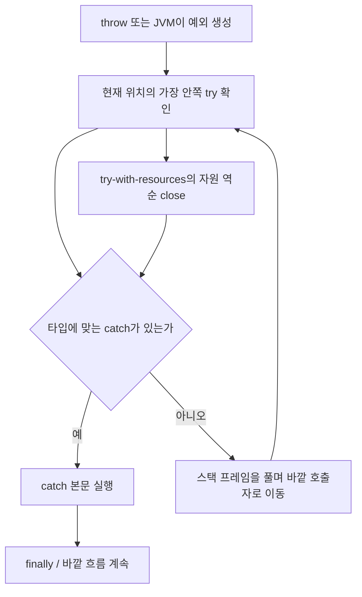

# J04. 예외 처리

> 예외는 실패 지점에서 복구 지점으로 제어를 옮기고, 실패의 종류와 원인을 전달한다.
> 체크 예외는 호출자에게 복구 결정을 강제하고, 언체크 예외는 호출자가 계약을 어겼거나 현재 계층에서 복구할 수 없다는 뜻으로 쓴다.
> 리소스는 `try-with-resources`로 닫고, 정리 과정의 실패는 원래 실패의 suppressed 예외로 보존한다.

## 1. 왜 알아야 하나

파일을 쓰던 중 본문에서 `IOException`이 났는데 `finally`의 `close()`가 또 예외를 던지면, 잘못 작성된 정리 코드는 처음 쓰기 실패를 덮어써서 로그에 닫기 실패만 남길 수 있다. 원인을 찾는 데 필요한 가장 중요한 정보가 사라진다. `try-with-resources`는 본문 실패를 주 예외로 유지하고 닫기 실패를 suppressed 목록에 붙인다.

또 다른 사고는 계층 사이에서 예외를 바꾸며 원인을 버리는 것이다. 저장소 계층의 `SQLException`을 서비스 예외로 바꿀 때 `new ServiceException(e.getMessage())`만 던지면 DB 드라이버와 호출 경로가 담긴 원인 체인이 사라진다.

반대로 모든 예외를 `catch (Exception)`으로 잡아 `null`을 반환하면 호출자는 실패와 정상적인 “값 없음”을 구분하지 못한다. 예외 타입과 체인은 로그 장식이 아니라 복구·관측·API 경계의 계약이다.

## 2. 핵심 개념

모든 던질 수 있는 객체는 `Throwable` 하위 타입이다. 표준 계층은 `Object → Throwable → Error / Exception`이고, `RuntimeException`은 `Exception`의 하위 타입이다.

JVM도 배열 범위 오류 같은 런타임 실패를 `Throwable` 하위 객체로 표현한다. JLS는 예외를 발생 지점에서 프로그램이 지정한 포착 지점으로 제어를 옮기는 비지역 제어 이동으로 정의한다.[JLS 11.1, 11.3]

| 용어 | 뜻 | 설계상 의미 |
|---|---|---|
| `Throwable` | JVM 또는 `throw`가 던질 수 있는 최상위 타입 | 일반 애플리케이션 코드에서 `catch(Throwable)`로 모두 삼키지 않는다. |
| `Error` | 가상 머신·링크·심각한 자원 문제 등 보통 애플리케이션이 복구하지 않는 상태 | `OutOfMemoryError` 등까지 정상 흐름처럼 처리하려 들지 않는다. |
| checked exception | `RuntimeException` 및 `Error` 하위가 아닌 `Throwable` 하위 타입 | 메서드가 던지면 잡거나 `throws`로 선언해야 한다. |
| unchecked exception | `RuntimeException` 또는 `Error` 하위 타입 | `throws` 선언과 호출자 포착을 컴파일러가 강제하지 않는다. |
| cause | 현재 예외를 발생시킨 원인 예외 | 추상화 경계에서 타입을 바꿔도 저수준 원인을 보존한다. |
| suppressed exception | 주 실패와 별도로 정리 과정에서 발생했지만 함께 보존한 예외 | 자원 닫기 실패처럼 주 실패를 대체하면 안 되는 예외를 기록한다. |
| stack trace | `Throwable`이 생성될 때의 스레드 호출 스택 정보 | 실패가 만들어진 경로를 보여 주며 예외 객체 생성 비용의 일부가 된다. |

컴파일러는 타입 계층과 메서드 선언을 바탕으로 표현식·문장이 던질 수 있는 checked 타입을 분석한다. `Throwable` 자체와 `IOException`은 checked지만 `RuntimeException`, `NullPointerException`, `Error`는 unchecked다.

호출자는 checked 예외를 처리하거나 자신도 `throws`로 노출해야 한다. 이는 누락을 줄이는 대신 예외를 API 시그니처에 전파한다.[JLS 11.2; `Throwable` API]

| 구분 | checked (`IOException`) | unchecked (`IllegalArgumentException`) |
|---|---|---|
| 컴파일러 요구 | `catch` 또는 `throws` 필요 | 처리·선언 강제 없음 |
| 보통의 의미 | 호출자가 대안을 고를 수 있는 외부 실패 | 호출자 계약 위반, 불변식 위반 또는 현재 계층에서 복구 불가능한 실패 |
| 장점 | 처리 책임이 코드에 드러남 | 시그니처가 덜 오염되고 람다·콜백 API와 조합이 쉽다 |
| 비용·위험 | 전파 계층마다 선언·변환 부담, 무의미한 catch 유도 | 호출자가 놓치기 쉽고 복구 경로가 코드에서 감춰질 수 있음 |

호출자가 다른 파일 선택·재시도처럼 의미 있는 복구를 할 수 있고 책임을 API 계약으로 고정하려면 checked를 고려한다. 호출자가 해결할 수 없거나 입력 계약·객체 상태가 잘못된 실패라면 unchecked가 자연스럽다. 기준은 “누가 어떤 대안을 실행할 수 있는가”다. Oracle의 unchecked 논의는 JDK 8 튜토리얼이며 체크 규칙은 현행 JLS를 따른다.

## 3. 내부 동작·원리

### 발생부터 포착까지



`throw e` 또는 JVM 감지가 정상 흐름을 중단하면 런타임은 가장 가까운 `try`의 `catch`를 소스 순서대로 검사해 호환되는 첫 처리기를 찾는다. 없으면 프레임을 풀어 호출 메서드에서 다시 찾는다(스택 언와인딩). 끝까지 없으면 미처리 예외 경로로 간다. `catch (Exception)`은 `Error`를 잡지 않지만 `catch (Throwable)`은 잡으므로 복구 불가능한 오류까지 삼킬 위험이 크다.

checked 검사와 런타임 catch 선택은 별개다. `throws IOException`은 JVM 명령이 아니라 컴파일 시 누락된 처리를 찾게 하는 선언이다. 실행 중에는 checked 여부와 무관하게 `Throwable` 타입 호환성으로 catch를 고른다. unchecked도 잡을 수 있고 checked도 바깥까지 전파된다.[JLS 11.2–11.3]

### `try-with-resources`와 suppressed

리소스는 `AutoCloseable`의 `close()`를 제공한다. `try (resource...)`는 본문 종료 시 닫고 여러 자원은 선언 역순으로 닫는다. 래퍼를 먼저 닫는 순서다. Java 7에 도입된 이 문법은 수동 null 검사와 `finally`를 줄이고 본문·닫기 실패를 보존한다.[Oracle 튜토리얼 `try-with-resources`; `AutoCloseable` API]

본문과 `close()`가 모두 실패하면 본문 예외가 주 예외이고 닫기 예외는 `getSuppressed()`에 추가된다. 여러 닫기 실패도 닫기 순서대로 보존된다. 본문이 정상 종료하면 닫기 실패가 주 예외가 되며 여러 닫기가 실패하면 첫 실패가 나가고 나머지는 suppressed다. cause는 예외의 원인, suppressed는 주 실패 중 추가된 실패다.[`Throwable` API]

수동 `finally`의 `close()`는 본문 예외를 덮을 수 있고 suppressed 보존도 자동 적용하지 않는다. 가능한 자원은 TWR로 표현한다.

### `finally`의 완료 규칙

`finally`는 try/catch 뒤 실행되지만 그 자체의 완료가 앞선 완료를 덮을 수 있다. `return 10` 중 `finally`가 `return 20` 하면 20이 반환되고 새 예외도 앞 예외를 가릴 수 있다. 반환·던지기·분기 이동을 두지 말고 정리만 수행한다. `System.exit`나 JVM 중단에서는 실행을 기대하지 않는다.[Oracle 튜토리얼 `finally`]

### 예외 변환과 체이닝

하위 예외를 그대로 노출하면 상위 API가 구현에 묶일 수 있으므로 경계에서 의미 있는 타입으로 변환한다. `new StorageException(message, e)`처럼 cause를 보존해야 실제 실패 타입과 호출 경로를 잃지 않는다.[Oracle 튜토리얼 `Chained Exceptions`; `Throwable` API]

catch는 실제 처리나 의미 있는 변환에 사용한다. 로그만 남기고 다시 던지면 계층마다 중복 기록될 수 있다. “선택적 프로필 없음”처럼 호출자가 분기할 정상 결과는 `Optional` 등으로 표현하고, 예상 못 한 실패를 `null`로 위장하지 않는다.

### 스택 트레이스는 언제 비용을 쓰나

`Throwable`은 생성 시점 스택을 담으므로 객체 생성과 추적 정보 보관 비용이 든다. 규모는 환경에 따라 달라 수치로 단정하지 않는다.[`Throwable` API]

흔한 정상 분기는 결과 타입이나 `Optional`로 모델링하고 비용은 프로파일링한다. 재사용 예외는 생성 스택이 현재 실패를 가리키지 않을 수 있어 보통 실패마다 새 객체를 만든다.

### 람다에서 checked exception이 막히는 이유

람다의 허용 예외는 대상 함수형 인터페이스의 추상 메서드 시그니처가 결정한다. `Runnable.run()`과 `Consumer.accept()`는 checked를 선언하지 않지만 `Callable.call()`이나 `IOAction.run() throws IOException`은 전달 가능하다.[JLS 15.27; JLS 11.2]

호출부가 처리하게 하려면 checked 인터페이스를 쓰고, unchecked 계약의 API 경계에서는 `UncheckedIOException`에 cause를 담는다. sneaky-throw는 선언과 실제 실패를 달라지게 해 호출을 예측하기 어렵게 만든다.

## 4. 코드로 확인

다음 예제는 JDK 21 Corretto 21.0.6에서 각각 단일 파일로 실행했다. Java 25에서도 사용하는 언어 기능과 표준 API는 동일하다.

### 4.1 계층 경계에서 원인을 보존하고 `finally` 반환 함정을 보기

```java
import java.io.IOException;

public class ExceptionBoundaryDemo {
    static final class StorageException extends RuntimeException {
        private final String code;

        StorageException(String code, String message, Throwable cause) {
            super(message, cause);
            this.code = code;
        }

        String code() {
            return code;
        }
    }

    static void readStorage() {
        try {
            throw new IOException("disk failure");
        } catch (IOException e) {
            throw new StorageException("STORE_READ_FAILED", "저장소 읽기 실패", e);
        }
    }

    static int badFinallyReturn() {
        try {
            return 10;
        } finally {
            return 20;
        }
    }

    public static void main(String[] args) {
        try {
            readStorage();
        } catch (StorageException e) {
            System.out.println(e.code());
            System.out.println(e.getCause().getClass().getSimpleName() + ": " + e.getCause().getMessage());
        }
        System.out.println("finally return=" + badFinallyReturn());
    }
}
```

실행 출력:

```text
STORE_READ_FAILED
IOException: disk failure
finally return=20
```

서비스 경계가 안정된 코드와 메시지를 제공하면서 저장소 실패를 cause로 유지한다. 마지막 출력은 `finally`의 `return`이 준비된 반환값을 덮어쓴다는 증거다. 이 예제의 `finally` 반환은 함정 재현용이며 실제 코드에 쓰면 안 된다.

### 4.2 주 예외와 닫기 실패의 suppressed 보존

```java
import java.io.IOException;

public class SuppressedDemo {
    static final class Resource implements AutoCloseable {
        private final String name;

        Resource(String name) {
            this.name = name;
        }

        @Override
        public void close() throws IOException {
            System.out.println("close " + name);
            throw new IOException("close " + name + " failed");
        }
    }

    public static void main(String[] args) {
        try (Resource first = new Resource("A"); Resource second = new Resource("B")) {
            System.out.println("body");
            throw new IOException("body failed");
        } catch (IOException e) {
            System.out.println("primary=" + e.getMessage());
            for (Throwable suppressed : e.getSuppressed()) {
                System.out.println("suppressed=" + suppressed.getMessage());
            }
        }
    }
}
```

실행 출력:

```text
body
close B
close A
primary=body failed
suppressed=close B failed
suppressed=close A failed
```

역순으로 닫히며 본문 실패는 주 예외로 살아 있다. 로그에서 본문 스택뿐 아니라 suppressed를 펼쳐야 종료 실패까지 볼 수 있다.

### 4.3 checked 예외를 받는 함수형 인터페이스와 래퍼

```java
import java.io.IOException;
import java.io.UncheckedIOException;

public class CheckedLambdaDemo {
    @FunctionalInterface
    interface IOAction {
        void run() throws IOException;
    }

    static Runnable unchecked(IOAction action) {
        return () -> {
            try {
                action.run();
            } catch (IOException e) {
                throw new UncheckedIOException("작업 실패", e);
            }
        };
    }

    public static void main(String[] args) {
        Runnable task = unchecked(() -> {
            throw new IOException("read failed");
        });

        try {
            task.run();
        } catch (UncheckedIOException e) {
            System.out.println(e.getClass().getSimpleName());
            System.out.println(e.getCause().getClass().getSimpleName() + ": " + e.getCause().getMessage());
        }
    }
}
```

실행 출력:

```text
UncheckedIOException
IOException: read failed
```

자체 함수형 인터페이스에서는 `IOException`을 합법적으로 전달할 수 있다. `Runnable`로 변환하는 지점에서 이를 unchecked 계약으로 바꾸며, 원인 예외는 그대로 붙인다. 이 어댑터를 선택할 때는 호출자가 실제로 예외를 어디서 처리할지 함께 정해야 한다.

## 5. 버전별 변화 — 왜 바뀌었나

| 시기 | 변화 | 이전 한계와 근거 |
|---|---|---|
| Java SE 7 | `try-with-resources`와 suppressed 예외 지원 | 수동 `finally`에서 닫기 예외가 본문 예외를 덮어 진단 정보를 잃을 수 있었다. Oracle 튜토리얼은 TWR가 Java SE 7에 도입됐고 `AutoCloseable` 자원을 자동으로 닫는다고 설명한다. 현재 의미는 Java 25 API와 JLS를 기준으로 확인한다. |
| Java SE 9 | final 또는 effectively-final 변수를 새 선언 없이 resource로 지정 가능 | Java 7 형식은 `try` 헤더 안에 매번 새 변수를 선언해야 기존 자원 변수를 자연스럽게 관리하기 어려웠다. JEP 213은 이 한계를 완화했다. |
| Java SE 25 기준 | `Throwable` 계층, 체크 규칙, cause·suppressed 모델은 JLS 11과 표준 API에 명시 | 이 조사에서 예외 처리의 기본 제어 의미가 바뀐 별도 Java 25 언어 변경은 확인되지 않았다. 기준 설명은 JLS 25와 SE 25 API를 사용한다. |

## 6. 실무 가이드

- 파일·소켓·DB 커서 등 `AutoCloseable` 자원을 열면 → `try-with-resources`에 선언한다. 닫기 순서와 주 예외/suppressed 보존을 언어가 처리한다.
- 호출자가 입력 변경·재시도 등 구체적인 복구 결정을 할 수 있고 그 의무가 API 계약이어야 하면 → checked 예외를 고려한다. 호출자가 처리할 수 없는 예외를 기계적으로 `throws`에 늘어놓지 않는다.
- 외부 계층의 세부 예외를 내부 구현에 가두고 안정된 도메인 실패로 표현해야 하면 → 경계에서 의미 있는 사용자 정의 예외로 바꾸되 원래 예외를 cause로 둔다.
- 인자·상태가 계약에 어긋났거나 현재 계층이 복구할 수 없는 실패라면 → 적절한 unchecked 예외를 쓴다. 메시지 문자열을 분기용 API로 만들지 말고 안정된 오류 코드나 필드를 제공한다.
- 자주 발생하는 정상 결과가 “없음”, “중복”, “다음 페이지 없음”이라면 → 예외 대신 명시적 반환값이나 결과 타입을 검토한다. 실제로 드문 실패만 예외로 남긴다.
- 람다 대상 API가 checked를 선언하지 않으면 → checked 예외를 받는 자체 함수형 인터페이스를 만들거나 명시적인 어댑터 경계에서 의미 있는 unchecked 타입으로 변환한다.
- **기본값 추천:** 일반 애플리케이션 내부의 복구 불가능한 실패는 도메인 의미를 담은 unchecked 예외로 표현하고, I/O처럼 호출자가 처리할 가치가 있는 checked 예외는 바깥 경계까지 보존한다. 자원 정리는 항상 `try-with-resources`를 우선한다.

Spring MVC 응답 예외 변환은 → S05 참조. 트랜잭션 롤백 규칙은 → S08 참조.

## 7. 함정·안티패턴

1. **증상:** 원래 DB 오류 대신 “서비스 처리 실패” 한 줄만 남는다 → **원인:** 새 예외에 `e.getMessage()`만 복사하고 cause를 누락했다 → **대처:** `new ServiceException(message, e)`로 연결하고, 메시지에 SQL·토큰 같은 민감 값을 다시 노출하지 않는다.

2. **증상:** 파일 쓰기 실패가 간헐적으로 닫기 오류로 기록되고 원래 오류가 보이지 않는다 → **원인:** `finally`의 `close()`가 try 본문 예외를 대체했다 → **대처:** `AutoCloseable`이면 TWR로 바꾸고 `getSuppressed()`를 포함해 진단한다.

3. **증상:** 메서드가 반환해야 할 값이 엉뚱하게 바뀌거나 기존 예외가 사라진다 → **원인:** `finally` 안의 `return` 또는 새 `throw`가 앞서 준비된 완료를 덮었다 → **대처:** `finally`는 무조건 반환 없이 정리만 한다. 정리 실패를 전파해야 하는 상황은 TWR의 의미를 사용한다.

4. **증상:** 상위 코드가 오류와 “값 없음”을 구별하지 못하고 뒤에서 NPE가 난다 → **원인:** 광범위한 catch에서 `null`, 빈 객체, 성공 코드 같은 값으로 실패를 위장했다 → **대처:** 실제 정상 결과는 명시적 반환값으로, 실패는 의미 있는 예외로 구분한다.

5. **증상:** 한 요청에 같은 예외 로그가 여러 건 쌓여 알람이 폭증한다 → **원인:** 각 계층에서 로그를 남기고 같은 예외를 다시 던졌다 → **대처:** 각 계층은 의미를 변환하거나 복구한다. 최종 실패를 관측할 책임이 있는 경계 한 곳에서 충분한 문맥과 함께 기록한다.

6. **증상:** 컬렉션 람다에서만 `IOException` 컴파일 오류가 나거나 API마다 wrapper가 제각각이다 → **원인:** 람다의 타입이 `Runnable`/`Consumer`라 추상 메서드에 checked 예외 선언이 없다 → **대처:** checked를 선언한 함수형 인터페이스를 사용하거나 `UncheckedIOException` 등 일관된 어댑터를 한 경계에서 적용한다.

7. **증상:** 서버의 흔한 분기에서 예외·스택 로그가 급증한다 → **원인:** 정상적인 탐색 실패나 검증 결과를 제어 흐름 예외로 사용한다 → **대처:** 반환 결과로 모델링하고 프로파일링한다. 병목 수치나 최적화 효과는 측정 환경 없이 단정하지 않는다.

## 8. 자가점검 Q&A (면접 대비)

### Q1. `Exception`과 `RuntimeException`의 차이는 무엇이며 컴파일러가 무엇을 보장하나?

`RuntimeException`은 `Exception`의 하위 클래스다. 그 하위 타입은 unchecked이므로 호출자가 catch하거나 `throws`로 선언할 의무가 없다. 일반 `Exception` 하위 중 `RuntimeException`·`Error` 계열이 아닌 타입은 checked로 분석된다. 컴파일러는 checked 예외의 누락을 검사하지만, 런타임 복구 가능성까지 보장하지는 않는다.

**꼬리질문:** unchecked는 잡을 수 없는가? → 잡을 수 있다. 단지 컴파일러가 처리 여부를 강제하지 않을 뿐이다.

### Q2. checked exception은 언제 설계상 유용한가?

호출자가 상황을 이해하고 대체 입력·재시도·사용자 안내 같은 복구 결정을 할 수 있을 때 유용하다. 호출자에게 처리를 강제하는 대신 예외 선언이 API 표면에 전파된다. 따라서 “모든 실패를 checked로 만들면 안전하다”는 결론은 틀리며 복구 주체와 계층 간 계약을 함께 봐야 한다. 복구가 불가능한 내부 실패까지 checked로 강제하면 무의미한 catch가 생긴다.

**꼬리질문:** 반대로 checked 예외가 API를 바꾸기 어렵게 만드는 이유는? → 호출자가 catch 또는 선언을 해야 하므로 새 예외를 추가하면 호출 계층 코드도 함께 수정될 수 있다.

### Q3. `catch (Exception)`은 `Error`도 잡는가? `catch (Throwable)`은?

`Exception`과 `Error`는 `Throwable`의 형제 갈래이므로 `catch (Exception)`은 `Error`를 잡지 않는다. `catch (Throwable)`은 두 갈래를 모두 포착한다.

`Error`는 보통 애플리케이션이 안전하게 복구할 수 없으므로, 경계에서 특별한 목적 없이 `Throwable`을 잡아 계속 실행하면 상태 악화를 숨길 수 있다. JVM 종료·프로세스 중단에 대한 안전장치로 catch 블록을 오해하지 않는다.

**꼬리질문:** `finally`는 무슨 일이 있어도 실행되나? → 정상적인 제어 이탈에 대해 실행되지만 JVM 강제 종료나 프로세스 종료에서는 보장되지 않는다.

### Q4. TWR에서 본문과 `close()`가 모두 예외를 던지면 어떤 예외가 바깥으로 나가는가?

본문의 예외가 주 예외로 전파된다. `close()`에서 난 예외는 주 예외의 `getSuppressed()` 목록에 추가된다. 자원이 여러 개면 선언 역순으로 닫으며 닫기 실패도 그 순서로 보존된다. 본문이 정상 종료했다면 닫기 실패가 주 예외가 된다.

**꼬리질문:** cause와 suppressed는 같은가? → 아니다. cause는 현재 예외를 만든 원인이고 suppressed는 주 실패를 처리하는 중 부수적으로 발생한 실패다.

### Q5. `finally`에서 반환하거나 새 예외를 던지면 왜 위험한가?

`finally`의 완료가 앞선 `try`/`catch` 완료를 덮어쓸 수 있다. 반환값을 바꾸고 이미 발생한 예외를 유실시키므로 원래 실패가 진단되지 않는다. `finally`는 반환·던지기보다 상태 정리만 수행하게 제한한다. AutoCloseable 정리는 TWR에 맡긴다.

**꼬리질문:** finally가 필요한 코드라면 무엇을 확인하나? → finally 안 모든 경로가 원래 제어 흐름을 가리지 않고 정리만 하는지 확인한다.

### Q6. 예외를 추상화 계층에서 바꿀 때 원인을 왜 붙여야 하나?

상위 계층은 하위 라이브러리 타입에 결합되지 않도록 의미 있는 예외 타입을 제공할 수 있다. 하지만 원인을 버리면 실제 실패 타입·스택·저수준 진단 정보가 사라진다. 생성자에 cause를 넘겨 `getCause()` 체인을 보존한다. 사용자에게 보여 줄 메시지와 내부 진단 정보를 같은 문자열에 무분별하게 섞지 않는다.

**꼬리질문:** catch해서 로그만 남기고 다시 던져도 되나? → 가능하지만 각 계층 중복 로그보다 최종 관측 경계를 정하고, 변환이나 복구 없이 기록만 반복하지 않는 편이 낫다.

### Q7. checked 예외를 던지는 메서드를 `Consumer` 람다에서 호출할 수 없는 이유는?

람다 문법의 제한이 아니라 목표 함수형 인터페이스 메서드 계약의 제한이다. `Consumer.accept()`는 checked 예외를 선언하지 않아 컴파일러가 이를 넘기는 람다를 허용하지 않는다. checked 예외를 선언하는 자체 SAM을 쓰거나 API 경계에서 의미 있는 unchecked wrapper에 원인을 담는다. 무조건 `RuntimeException`으로 감싸기보다 호출자가 어디서 처리할지 정한다.

**꼬리질문:** `Callable`은 왜 가능한가? → `Callable.call()` 시그니처가 `throws Exception`을 선언하므로 해당 checked 예외가 함수형 메서드 계약에 포함된다.

### Q8. 예외가 비싼 편이라는 말은 어떤 맥락에서 맞나?

`Throwable`은 생성 시점의 스택 스냅샷을 담으므로 예외 생성과 추적 정보 보관 비용이 있다. 예외가 드물면 진단 가치가 있고, 흔한 정상 분기마다 예외를 던지면 불필요한 생성·추적·로그 작업이 생길 수 있다. 환경별 비용 수치를 일반화하지 말고 정상 결과는 결과 타입으로 모델링한 뒤 실제 경로를 프로파일링한다. stack trace를 비활성화하는 최적화는 관측 가능성과 함께 측정 후 판단한다.

**꼬리질문:** 예외 객체를 재사용하면 되는가? → 생성 당시 스택이 현재 실패 위치를 나타내지 않을 수 있어 보통 실패별 새 객체를 만든다.

## 9. 참고문헌

- Java Language Specification, Java SE 25, Chapter 11: Exceptions — https://docs.oracle.com/javase/specs/jls/se25/html/jls-11.html — 예외 종류, checked 검사, 런타임 처리기의 기준 규칙.
- Java Language Specification, Java SE 25, Chapter 15: Expressions — https://docs.oracle.com/javase/specs/jls/se25/html/jls-15.html — 람다 표현식(§15.27)과 표현식의 예외 분석 근거.
- `Throwable` (Java SE 25 API) — https://docs.oracle.com/en/java/javase/25/docs/api/java.base/java/lang/Throwable.html — checked 분류, 스택 스냅샷, cause와 suppressed API.
- `AutoCloseable` (Java SE 25 API) — https://docs.oracle.com/en/java/javase/25/docs/api/java.base/java/lang/AutoCloseable.html — TWR에서 `close()`를 자동 호출하는 리소스 계약.
- The Java Tutorials: Lesson: Exceptions — https://docs.oracle.com/javase/tutorial/essential/exceptions/index.html — 예외 학습 범위와 하위 절의 안내. JDK 8 튜토리얼임을 감안했다.
- The Java Tutorials: The finally Block — https://docs.oracle.com/javase/tutorial/essential/exceptions/finally.html — finally의 완료와 자원 정리 주의점.
- The Java Tutorials: The try-with-resources Statement — https://docs.oracle.com/javase/tutorial/essential/exceptions/tryResourceClose.html — `AutoCloseable` 자원과 TWR 사용법.
- The Java Tutorials: Chained Exceptions — https://docs.oracle.com/javase/tutorial/essential/exceptions/chained.html — 예외 cause 연결 API와 계층 변환 예.
- JEP 213: Milling Project Coin — https://openjdk.org/jeps/213 — Java 9의 effectively-final resource 변수 개선.
