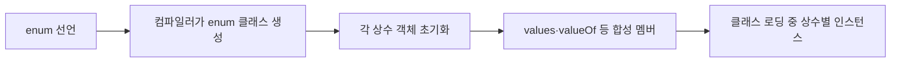

# J06. enum·애노테이션·리플렉션

> - `enum`은 제한된 값 집합을 타입으로 고정하며, 상수별 동작과 `EnumMap`·`EnumSet`으로 상태와 권한을 안전하게 표현한다.
> - 애노테이션은 메타데이터 선언이고, 보존 정책에 따라 컴파일러·도구·런타임 중 누가 읽을 수 있는지가 달라진다.
> - 리플렉션·`MethodHandle`·`VarHandle`·동적 프록시는 각기 다른 동적 접근 도구다. 일반 경로는 정적 호출로 두고, 동적 요구가 있을 때만 좁은 경계에서 쓴다.

## 1. 왜 알아야 하나

주문 상태를 `int`로 DB에 저장하면 값 삽입·재정렬만으로 과거 데이터의 뜻이 바뀐다. 상태 이름·전이 규칙·저장 표현을 분리하지 않으면 업무 규칙이 배포 뒤 깨진다.

`getAnnotation()`이 `null`이면 `@Retention` 누락이 원인일 수 있다. Lombok·MapStruct는 실행 중 마술이 아니라 컴파일 처리 결과이므로 생성 코드가 안 보일 때 빌드 설정부터 살펴야 한다.

프록시 핸들러에서 `Method.invoke()`를 쓰면 대상 예외는 `InvocationTargetException`으로 감싸지고, `equals()`를 프록시에 재위임하면 무한 재호출될 수 있다.

## 2. 핵심 개념

| 용어 | 뜻 | 실무에서 기억할 점 |
|---|---|---|
| enum 상수 | enum 타입이 정의한 유한한 값 하나 | 고유 객체다. 이름과 선언 순서가 있지만 ordinal은 영속 식별자가 아니다. |
| `EnumMap` | 한 enum 타입만 키로 받는 `Map` | 내부 배열 표현, enum 선언 순서 순회, `null` 키 불가. |
| `EnumSet` | 한 enum 타입만 원소로 받는 `Set` | 비트 벡터 표현, 플래그 집합에 적합. `null` 원소 불가. |
| annotation interface | `@interface` 메타데이터 타입 | 원소는 매개변수 없는 메서드이며 값의 형식이 제한된다. |
| retention | 애노테이션 정보를 어느 단계까지 보존할지 | `SOURCE`, `CLASS`, `RUNTIME`; 생략하면 `CLASS`. |
| annotation processor | 컴파일 중 애노테이션과 타입 모델을 처리 | 표준 API는 여러 라운드로 동작하고 소스·리소스를 생성할 수 있다. |
| reflection | 런타임 `Class`, `Method`, `Field` 메타데이터를 조회·호출 | 동적 도구다. 접근 제어와 모듈 경계를 무조건 우회하지 않는다. |
| `MethodHandle` | `MethodType`을 가진 동적 호출 핸들 | `Lookup`이 접근을 확인한다. 호출 타입이 중요하다. |
| `VarHandle` | 변수·배열 요소를 정해진 접근 모드로 읽고 쓰는 핸들 | 일반 읽기/쓰기뿐 아니라 volatile, CAS 계열도 제공한다. |
| 동적 프록시 | 인터페이스 구현체처럼 보이는 런타임 객체 | 호출을 `InvocationHandler.invoke()`로 위임한다. |

### 헷갈리는 쌍

| 구분 | A | B |
|---|---|---|
| `ordinal()` vs `name()` | 선언 순서의 0 기반 정수 | 선언한 상수 이름. 외부 저장 시 rename 고려 |
| `SOURCE` vs `CLASS` vs `RUNTIME` | 소스에서만 보존 | class 파일 보존 / class 파일과 런타임 조회까지 보존 |
| 컴파일 처리 vs 리플렉션 | 컴파일러가 타입 모델을 보고 소스·리소스 등을 생성 | 실행 중 메타데이터를 찾아 호출하거나 값을 읽음 |
| `MethodHandle` vs reflection | 호출 타입이 명시된 핸들 | `Method` 메타데이터 기반 호출, `Object` 경계 사용 |
| `VarHandle` vs `AtomicInteger` | 필드·배열 요소 등 기존 변수에 다양한 메모리 접근 모드를 적용 | 원자 변수 객체가 값을 소유하며 제한된 연산을 제공 |

애노테이션 원소는 primitive, `String`, enum, `Class`, 다른 애노테이션 또는 그 배열이다. 매개변수는 없으며 기본값 없는 원소는 사용 시 지정한다.

## 3. 내부 동작·원리

### 3.1 enum은 이름 있는 정수 상수가 아니다



컴파일러는 상수 인스턴스와 `values()`, `valueOf(String)`을 제공한다. enum은 `Enum<E>`를 직접 상속해 임의 인스턴스를 허용하지 않으므로 `==`로 비교한다. 직렬화는 상수 이름으로 복원한다.

각 enum 상수는 싱글턴 객체다. 불변 전략은 상수에, 요청별 상태는 별도 객체에 둔다.

`ordinal()`은 재정렬 시 뜻이 바뀌므로 외부 식별값으로 저장하지 않는다. 명시적 코드나 관리된 이름을 쓰며, 이름 변경은 데이터 마이그레이션이다. JPA 저장은 → S09 참조.

`EnumMap`은 enum 키를 배열로 표현하고 선언 순서로 순회한다. `EnumSet`은 비트 벡터라 권한·전이 후보에 적합하다. 구현 크기에 결합하지 말고, 동시 변경은 외부에서 동기화한다.

### 3.2 애노테이션은 선언 데이터이고, 정책이 소비자를 정한다

```text
소스 @Annotation
    │ 컴파일러: @Target 검사, 상수식·원소 형식 검사
    ├─ SOURCE  ───────────────> 소스 처리 후 폐기
    ├─ CLASS   ───────────────> .class에 기록, 런타임 리플렉션에는 미노출
    └─ RUNTIME ───────────────> .class에 기록, 런타임 reflection으로 조회
```

`@Target`으로 적용 대상을 제한한다. `TYPE_USE`·`TYPE_PARAMETER`는 타입 사용·타입 매개변수용이다.

기본 정책은 `CLASS`다. 런타임 조회엔 `RUNTIME`, 소스 분석만 필요하면 `SOURCE`를 고른다.

`@Inherited`는 클래스 애노테이션 조회에만 적용되며 필드·메서드·인터페이스에는 전파되지 않는다. 직접 선언 조회는 `getDeclaredAnnotation(s)`, 상속을 포함하면 `getAnnotation(s)`를 쓴다. `@Repeatable`은 여러 개를 반환할 수 있다.

### 3.3 annotation processor는 컴파일 라운드에서 동작한다

```text
javac 입력 소스·클래스
       │
       ▼
  1차 annotation-processing round ── processor가 요소·애노테이션 조회
       │                                      │
       │                         Filer로 새 소스/리소스 생성
       │                                      ▼
  다음 round: 새로 생성된 소스도 처리 대상 ── 반복
       │
       ▼ 마지막 round ── 일반 컴파일·바이트코드 생성 완료
```

도구는 processor를 만들고 `init()`한 뒤 라운드마다 같은 객체의 `process()`를 부른다. `Filer`는 파일 생성, `Messager`는 진단에 쓴다. 처리 완료 반환값은 다른 processor에도 영향을 준다.

MapStruct는 매퍼 구현 소스를 생성한다. Lombok은 processor로 시작해 `javac` 전용 처리기로 위임한다. IDE·빌드 processor와 JDK를 맞추고 컴파일러 연동 변화를 확인한다.

### 3.4 reflection, 핸들, 프록시의 호출 경로

```text
요청 코드
 ├─ Class / Method / Field ── 조회·접근 검사 ── invoke/get/set
 ├─ MethodHandle ── Lookup으로 핸들 생성 ── 타입이 맞는 동적 호출
 ├─ VarHandle ── 변수 좌표 + 접근 모드 ── get/set/CAS 등
 └─ JDK Proxy ── 인터페이스 메서드 ── InvocationHandler.invoke(proxy, method, args)
                                                    └─ 대상 호출/정책/결과 반환
```

reflection은 설정 바인딩·직렬화·의존성 연결처럼 대상 멤버를 실행 중 결정할 때 쓴다. 문자열 이름, 박싱, 인수 배열, 접근 검사의 동적 경계가 따른다. 모듈 경계 때문에 `setAccessible(true)`가 항상 성공하지 않으므로 `trySetAccessible()` 결과와 실패 원인을 처리한다.

`MethodHandle`은 `Lookup`이 만드는 호출 핸들이며 `MethodType`을 가진다. `invokeExact`는 호출부의 정적 인수·반환 타입이 정확히 일치해야 한다. 핸들은 접근 권한이 결부되므로 권한 있는 `Lookup`을 무분별하게 공유하지 않는다.

`VarHandle`은 정적·객체 필드와 배열 원소 같은 변수를 다룬다. `get`, `set`, `getVolatile`, `compareAndSet` 등의 가시성·원자성 의미가 다르므로 JMM 보장을 이해한 저수준 코드에만 쓴다. 예제의 CAS 계열 호출은 단일 스레드에서 API 모양만 보여 준다.

JDK 프록시는 지정한 인터페이스를 구현하며 `InvocationHandler`에 proxy·`Method`·인수 배열을 넘긴다. 무인수 메서드의 인수는 `null`, primitive는 래퍼로 전달된다. 반환값과 `equals`·`hashCode`·`toString`을 명시적으로 처리한다.

`Method.invoke()`로 위임하면 `InvocationTargetException`의 원인을 꺼내 예외 계약을 보존한다. Spring AOP 프록시 방식은 → S02 참조.

reflection은 “항상 느리고 MethodHandle은 항상 빠르다”가 아니다. JEP 416은 JDK 18부터 `Method`, `Constructor`, `Field`를 method handles 기반으로 재구현했다. 성능은 메타데이터의 상수화, 호출 빈도, 워밍업, JIT, 인수 형태에 좌우된다. 설정 단계에서 메타데이터를 캐시하고, 핫 경로는 프로파일링 후 바꾼다. 정적 호출을 불필요하게 reflection으로 바꾸지 않는다.

## 4. 코드로 확인

예제 3개를 Corretto 21.0.6 소스 파일 모드로 실행했다.

### 예제 1 — `EnumMap`·`EnumSet`으로 상태 전이 제한

```java
import java.util.EnumMap;
import java.util.EnumSet;
import java.util.Map;

public class EnumWorkflow {
    enum OrderState { CREATED, PAID, SHIPPED, CANCELLED }

    private static final Map<OrderState, EnumSet<OrderState>> ALLOWED = new EnumMap<>(OrderState.class);
    static {
        ALLOWED.put(OrderState.CREATED, EnumSet.of(OrderState.PAID, OrderState.CANCELLED));
        ALLOWED.put(OrderState.PAID, EnumSet.of(OrderState.SHIPPED, OrderState.CANCELLED));
        ALLOWED.put(OrderState.SHIPPED, EnumSet.noneOf(OrderState.class));
        ALLOWED.put(OrderState.CANCELLED, EnumSet.noneOf(OrderState.class));
    }

    static OrderState move(OrderState from, OrderState to) {
        if (!ALLOWED.get(from).contains(to)) {
            throw new IllegalStateException(from + " -> " + to + " is not allowed");
        }
        return to;
    }

    public static void main(String[] args) {
        System.out.println("allowed=" + ALLOWED.get(OrderState.CREATED));
        System.out.println("move=" + move(OrderState.CREATED, OrderState.PAID));
        System.out.println("enumMapOrder=" + ALLOWED.keySet());
        System.out.println("ordinal=" + OrderState.PAID.ordinal() + " (display only)");
    }
}
```

실제 출력:

```text
allowed=[PAID, CANCELLED]
move=PAID
enumMapOrder=[CREATED, PAID, SHIPPED, CANCELLED]
ordinal=1 (display only)
```

enum 조합으로 전이를 검증하고 `ordinal()`은 저장하지 않는다. 실서비스에선 전이표를 불변으로 공개한다.

### 예제 2 — 보존 정책이 런타임 조회를 바꾼다

```java
import java.lang.annotation.ElementType;
import java.lang.annotation.Retention;
import java.lang.annotation.RetentionPolicy;
import java.lang.annotation.Target;

public class AnnotationRead {
    public static void main(String[] args) {
        Audited audited = Invoice.class.getAnnotation(Audited.class);
        System.out.println("audited=" + audited.value() + ", level=" + audited.level());
        System.out.println("classRetentionVisible=" + (Invoice.class.getAnnotation(BytecodeOnly.class) != null));
    }
}

@Retention(RetentionPolicy.RUNTIME)
@Target(ElementType.TYPE)
@interface Audited {
    String value();
    int level() default 1;
}

@Retention(RetentionPolicy.CLASS)
@Target(ElementType.TYPE)
@interface BytecodeOnly { }

@Audited(value = "invoice", level = 2)
@BytecodeOnly
class Invoice { }
```

실제 출력:

```text
audited=invoice, level=2
classRetentionVisible=false
```

`CLASS` 애노테이션이 클래스 파일에 기록되는 것과 `Class.getAnnotation()`에서 보이는 것은 다른 조건이다. 실행 시 읽을 메타데이터라면 `RUNTIME`을 명시한다.

### 예제 3 — Proxy·`MethodHandle`·`VarHandle`

```java
import java.lang.invoke.MethodHandle;
import java.lang.invoke.MethodHandles;
import java.lang.invoke.MethodType;
import java.lang.invoke.VarHandle;
import java.lang.reflect.Proxy;

public class InvocationTools {
    interface Greeter { String greet(String name); }
    static class GreeterImpl implements Greeter {
        public String greet(String name) { return "hello " + name; }
    }
    private static int counter;

    public static void main(String[] args) throws Throwable {
        Greeter target = new GreeterImpl();
        Greeter proxy = (Greeter) Proxy.newProxyInstance(
                Greeter.class.getClassLoader(), new Class<?>[]{Greeter.class},
                (instance, method, args1) -> {
                    if (method.getDeclaringClass() == Object.class) {
                        return switch (method.getName()) {
                            case "toString" -> "GreeterProxy";
                            case "hashCode" -> System.identityHashCode(instance);
                            case "equals" -> instance == args1[0];
                            default -> throw new UnsupportedOperationException(method.getName());
                        };
                    }
                    return method.invoke(target, args1);
                });
        System.out.println("proxy=" + proxy.greet("Mina"));
        System.out.println("proxyToString=" + proxy);

        MethodHandle greet = MethodHandles.lookup().findVirtual(
                Greeter.class, "greet", MethodType.methodType(String.class, String.class));
        String directHandleCall = (String) greet.invokeExact((Greeter) target, "Jin");
        System.out.println("methodHandle=" + directHandleCall);

        VarHandle counterHandle = MethodHandles.lookup().findStaticVarHandle(
                InvocationTools.class, "counter", int.class);
        counterHandle.set(10);
        int previous = (int) counterHandle.getAndAdd(2);
        System.out.println("varHandle=" + previous + " -> " + counterHandle.get());
    }
}
```

실제 출력:

```text
proxy=hello Mina
proxyToString=GreeterProxy
methodHandle=hello Jin
varHandle=10 -> 12
```

`Object` 메서드를 따로 처리해 프록시 재귀를 막는다. 운영 코드에선 `InvocationTargetException` 원인을 풀어 예외 계약을 지킨다. `invokeExact()` 호출 타입은 핸들과 일치해야 한다.

## 5. 버전별 변화 — 왜 바뀌었나

| 시기 | 변화와 이전 한계 | 근거 |
|---|---|---|
| Java 5 | enum은 정수 상수의 타입 한계를, 애노테이션은 구조화되지 않은 주석의 한계를 보완했다. | `Enum`, `Retention` API Since 1.5; JLS 8·9 |
| Java 6 | 라운드 기반 standard processor가 컴파일러별 플러그인의 이식성 한계를 줄였다. | `Processor` API |
| Java 7 | 타입 있는 호출 핸들이 reflection 호출의 타입 표현 한계를 보완했다. | `MethodHandles` API Since 1.7 |
| Java 18 | core reflection을 method handles 위에 재구현했다. 구현 경로를 줄였지만 API 계약은 유지했다. | [JEP 416](https://openjdk.org/jeps/416) |

Java 문법 → J05 참조.

## 6. 실무 가이드

- **고정된 업무 값이면 enum을 기본으로 써라.** 잘못된 값 혼용을 타입 검사로 막는다.
- **부가 정보가 불변이면 enum 필드로, 사용자별 가변 상태는 별도 객체로 둬라.** 상수 객체는 공유된다.
- **enum 키 맵은 `EnumMap`, 플래그 집합은 `EnumSet`을 써라.** 자료구조의 배열·비트 벡터 표현과 순서가 맞는다.
- **상태 머신은 전이표를 한곳에 두고 전이 함수에서 검증하라.** 외부에서 상태를 임의 변경하지 못하게 한다.
- **enum을 외부 저장할 때 ordinal을 피하고 명시 코드나 관리된 이름을 써라.** 순서 변경을 데이터 의미 변경으로 만들지 않는다.
- **컴파일 시 코드 생성은 표준 annotation processor부터 검토하라.** 런타임 reflection 소비자는 `RUNTIME`, 컴파일 도구는 필요한 `SOURCE`/`CLASS`를 지정한다.
- **동적 멤버 선택이 꼭 필요하면 reflection을 경계에 두고 결과를 캐시하라.** 정상 경로는 정적 호출로 유지한다.
- **성능 문제를 측정한 뒤 `MethodHandle`을 비교하고, CAS·volatile 필드 접근에만 `VarHandle`을 써라.** 고정된 성능 순위나 메모리 순서를 가정하지 않는다.
- **인터페이스에 동적 로깅·계측이 필요하면 JDK Proxy를 고려하라.** `Object` 메서드와 예외 정책을 핸들러에서 정한다.

**기본값 추천:** 업무 모델의 한정된 선택지는 `enum`, 일반 메서드 호출은 정적 호출, 메타데이터는 컴파일 처리부터 시작한다. reflection·핸들·프록시는 프레임워크 경계나 실제로 런타임 선택이 필요한 곳에 한정한다.

## 7. 함정·안티패턴

1. **ordinal을 영속화 →** 재정렬 뒤 숫자의 뜻이 바뀜 → 명시적 저장 코드와 마이그레이션을 둔다.
2. **`@Retention` 생략 →** 기본 `CLASS`라 reflection에서 보이지 않음 → 런타임 소비자에는 `RUNTIME`을 선언한다.
3. **`@Inherited`를 모든 요소에 기대 →** 메서드·필드·인터페이스로 전파되지 않음 → 조회 API와 계층 순회를 명시한다.
4. **`setAccessible(true)`를 모듈 우회로 사용 →** 접근이 거부될 수 있음 → 공개 API를 우선하고 `trySetAccessible()` 결과를 처리한다.
5. **요청마다 멤버를 이름 검색 →** 오타·탐색 비용이 반복됨 → 시작 시 검증·캐시하거나 정적 호출로 바꾼다.
6. **프록시 핸들러에서 proxy 메서드를 재호출 →** 재귀·스택 오버플로 → `Object` 메서드는 별도 처리하고 대상/메서드 정보만 기록한다.
7. **`Method.invoke()` 예외를 덮음 →** 원인과 API 계약이 사라짐 → `InvocationTargetException.getCause()`를 전달 규칙에 맞게 처리한다.
8. **Lombok IDE·CI 설정을 다르게 유지 →** 로컬과 빌드 결과가 달라짐 → 플러그인·processor·JDK를 맞추고 CI에서 깨끗하게 빌드한다.

## 8. 자가점검 Q&A (면접 대비)

### Q1. enum을 정수 상수 대신 쓰는 핵심 이점은?

**답:** 값 집합이 타입이 되어 다른 enum·정수와 잘못 섞이지 않는다. 상수별 동작과 불변 데이터를 둘 수 있지만 저장 표현은 별도로 안정화한다.

**꼬리질문:** `ordinal()`을 저장하면 왜 위험한가?

**답:** 순서 변경이 인덱스 의미를 바꾼다. 명시적인 저장 코드나 관리된 이름을 사용한다.

### Q2. `EnumMap`과 `HashMap<Enum, V>` 중 언제 `EnumMap`을 고르나?

**답:** 키가 단일 enum일 때 `EnumMap`을 쓴다. 배열 기반이고 선언 순서로 순회한다. 범용 키가 필요하면 `HashMap`을 고른다.

**꼬리질문:** `EnumMap`의 순회 순서는 무엇을 기준으로 하나?

**답:** enum 선언 순서다. 도메인 순서가 다르면 별도 규칙으로 정렬한다.

### Q3. `@Retention`을 생략한 애노테이션을 reflection으로 읽을 수 없는 이유는?

**답:** 기본값은 `CLASS`다. 클래스 파일에는 남지만 일반 런타임 reflection 대상은 아니다. 런타임 소비자는 `RUNTIME`을 지정한다.

**꼬리질문:** 컴파일 후에도 클래스 파일에 남길 애노테이션은?

**답:** `CLASS`다. 바이트코드 분석 도구가 클래스 파일에서 읽을 수 있다.

### Q4. annotation processor와 reflection의 차이는?

**답:** processor는 컴파일 라운드에서 타입을 분석하고 파일을 생성한다. reflection은 실행 중 메타데이터를 조회·호출한다. 생성 시점과 대상 선택 시점이 다르다.

**꼬리질문:** MapStruct가 런타임 reflection 대신 얻는 실익은?

**답:** 매핑 구현을 생성해 일반 메서드 호출로 실행한다. 타입 오류를 빌드 단계에서 찾기 쉽다.

### Q5. reflection 호출은 무조건 느리고 `MethodHandle`은 항상 빠른가?

**답:** 아니다. JEP 416은 JDK 18에 core reflection을 method handles 기반으로 재구현했다. 비용은 호출 형태·캐시·최적화에 달려 측정이 필요하다.

**꼬리질문:** `MethodHandle.invokeExact()`에서 흔한 실수는?

**답:** 호출부 정적 타입과 `MethodType` 불일치다. 호출 지점에서 형식을 맞춘다.

### Q6. `VarHandle`은 reflection `Field`와 같은 도구인가?

**답:** `Field`는 멤버 메타데이터 접근용이고 `VarHandle`은 변수의 plain·volatile·CAS 접근 모드를 표현한다. 후자는 메모리 순서가 필요한 저수준 코드에 맞다.

**꼬리질문:** `VarHandle.get()`은 항상 volatile read인가?

**답:** 아니다. 원하는 가시성에 맞게 `getVolatile` 등 access mode를 고른다.

### Q7. JDK 동적 프록시 핸들러가 호출을 받는 모양은?

**답:** `invoke()`가 proxy, 인터페이스 메서드 `Method`, 인수 배열을 받는다. 무인수 배열은 `null`일 수 있고 primitive는 박싱된다. 반환·예외는 인터페이스 계약을 따른다.

**꼬리질문:** `equals()`·`toString()`도 왜 주의해야 하나?

**답:** 이 메서드들도 핸들러로 올 수 있다. 프록시에 재위임하지 말고 식별 정책을 직접 정의한다.

### Q8. `@Inherited`는 메서드 애노테이션에도 적용되나?

**답:** 아니다. 하위 클래스 타입 조회에만 적용되며 메서드 override·필드·인터페이스로 전파되지 않는다.

**꼬리질문:** 현재 클래스에 직접 선언된 애노테이션만 보고 싶으면?

**답:** `getDeclaredAnnotation(s)` 계열을 쓴다. `getAnnotation()`은 상속 규칙을 반영한다.

## 9. 참고문헌

- `Proxy` (Java SE 25 API) — https://docs.oracle.com/en/java/javase/25/docs/api/java.base/java/lang/reflect/Proxy.html — 생성·호출 위임.
- `Enum` (Java SE 25 API) — https://docs.oracle.com/en/java/javase/25/docs/api/java.base/java/lang/Enum.html — 공통 기반·직렬화.
- `EnumMap`·`EnumSet` (Java SE 25 API) — https://docs.oracle.com/en/java/javase/25/docs/api/java.base/java/util/EnumMap.html · https://docs.oracle.com/en/java/javase/25/docs/api/java.base/java/util/EnumSet.html — 표현·순서.
- `Retention`·`Target` (Java SE 25 API) — https://docs.oracle.com/en/java/javase/25/docs/api/java.base/java/lang/annotation/Retention.html · https://docs.oracle.com/en/java/javase/25/docs/api/java.base/java/lang/annotation/Target.html — 보존·적용 범위.
- `Processor` (Java SE 25 API) — https://docs.oracle.com/en/java/javase/25/docs/api/java.compiler/javax/annotation/processing/Processor.html — 라운드 프로토콜.
- `MethodHandles`·`VarHandle` (Java SE 25 API) — https://docs.oracle.com/en/java/javase/25/docs/api/java.base/java/lang/invoke/MethodHandles.html · https://docs.oracle.com/en/java/javase/25/docs/api/java.base/java/lang/invoke/VarHandle.html — 호출·변수 접근.
- JLS Chapter 8, “Classes” — https://docs.oracle.com/javase/specs/jls/se25/html/jls-8.html — enum 클래스 문법이 속한 클래스 규칙 장.
- JLS Chapter 9, “Interfaces” — https://docs.oracle.com/javase/specs/jls/se25/html/jls-9.html — annotation interface, 대상·보존·반복 규칙 목차와 장 구조.
- JEP 416, “Reimplement Core Reflection with Method Handles” — https://openjdk.org/jeps/416 — Java 18 reflection 구현 변경과 비목표(API 계약 유지).
- Lombok, “Execution Path” — https://projectlombok.org/contributing/lombok-execution-path — `javac` annotation processor로 시작해 컴파일러별 처리기로 위임하는 과정.
- MapStruct 1.6.3 Reference Guide — https://mapstruct.org/documentation/stable/reference/html/ — 컴파일 시 매핑 구현을 생성하는 annotation processor 사용 설명.
