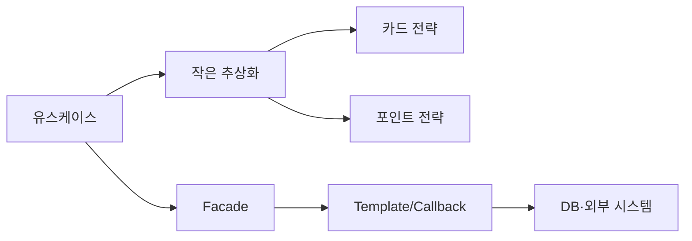

# J21. 디자인 패턴과 SOLID — Spring 안에서 찾기

> SOLID는 패턴 이름을 외우는 규칙이 아니라 변경 이유와 의존성의 방향을 통제하는 설계 기준이다.
> Spring은 IoC·프록시·이벤트·템플릿으로 GoF 패턴을 프레임워크 안에 녹였지만, 빈이라고 싱글턴이 되는 것은 아니다.
> 기본 선택은 작은 인터페이스, 생성자 주입, 조합과 람다이며 패턴은 반복되는 변화 지점이 확인될 때만 도입한다.

## 1. 왜 알아야 하나

결제 코드에 `if ("CARD")`, `if ("POINT")`를 계속 붙이면 새 결제수단 하나가 기존 분기와 테스트를 모두 건드린다. `UserService`가 SQL 실행, 비밀번호 해시, 메일 발송, CSV 생성까지 맡으면 메일 요구사항 변경이 거래 로직 배포로 번진다. 이런 코드는 처음에는 짧지만 변경 때마다 회귀 버그와 긴 수동 테스트를 만든다.

면접에서 “Spring 빈은 싱글턴인가?”에 “그렇다”고 답하면 안 된다. singleton 스코프는 컨테이너별 하나이며 전역 객체나 스레드 안전성을 보장하지 않는다. `this.save()`가 `@Transactional`을 우회하는 이유도 프록시로 설명해야 한다.

## 2. 핵심 개념

### SOLID 용어

| 원칙 | 판단 질문 | 실무적 결과 |
|---|---|---|
| SRP 단일 책임 | 이 클래스가 바뀌는 이유가 몇 개인가? | 업무 정책과 입출력·인프라를 분리 |
| OCP 개방-폐쇄 | 새 정책을 추가할 때 기존 코드를 수정하는가? | 다형성·전략·레지스트리로 확장 |
| LSP 리스코프 치환 | 하위 타입을 상위 타입 대신 넣어도 계약이 유지되는가? | 상속보다 명시적 계약·조합 |
| ISP 인터페이스 분리 | 사용하지 않는 메서드까지 의존하는가? | 역할별 작은 인터페이스 |
| DIP 의존성 역전 | 고수준 정책이 구체 DB·SDK를 직접 아는가? | 고수준과 저수준 모두 추상화에 의존 |

책임은 같은 이유로 함께 바뀌는 정책의 묶음이다.

### 패턴 용어와 선택표

| 상황 | 선택 | 사례 | 주의 |
|---|---|---|---|
| 생성·표현 분리 | Factory/Builder | `BeanFactory`, `List.of` | 단순 생성에 금지 |
| 알고리즘 교체 | Strategy | `Comparator`, 결제 맵 | 키 검증 |
| 공통 골격 | Template/Callback | `JdbcTemplate` | 훅 폭증 주의 |
| 호출 전후 기능 | Proxy/Decorator | AOP, `InputStream` | 순서·self 호출 |
| 계약 연결 | Adapter | MVC `HandlerAdapter` | 도메인 정책 금지 |
| 여러 객체에 통지 | Observer | `ApplicationEvent` | 동기 시간·예외 |
| 하위 시스템 단순화 | Facade | 유스케이스 API | 전부 재노출 금지 |
| 부분·전체 동일 취급 | Composite | 메뉴·파일 트리 | 의미가 다르면 금지 |

## 3. 내부 동작·원리

### SOLID가 코드 흐름을 바꾸는 방식



호출자는 `I`만 알고 구현체 선택은 조립 지점에 둔다. Spring에서는 빈 정의와 생성자 주입이 그 지점이다. `ApplicationContext`는 `BeanFactory`에 이벤트·라이프사이클을 더한다. DIP는 인터페이스 개수보다 정책 코드가 컨테이너·JDBC·SDK에 묶이지 않게 경계를 정하는 일이다.

`JdbcTemplate`은 커넥션·실행·해제·예외 변환 골격을 갖고 SQL과 `RowMapper`만 받는다. MVC의 `HandlerAdapter`는 서로 다른 핸들러를 공통 호출 흐름에 연결한다. `ApplicationContext` 이벤트는 발행자와 리스너를 분리하지만 기본 처리가 동기라면 리스너 시간이 요청에 포함된다.

### 패턴별 문제→구조→Spring 사례→주의

1. **Singleton** — Spring singleton은 컨테이너별 하나인 스코프이며 전역 싱글턴과 다르다. 무상태 빈을 기본으로 한다.

2. **Factory/정적 팩토리** — `BeanFactory`는 빈을 찾고 `List.of(...)`는 수정 불가 리스트를 만든다. 변경 가능하면 복사한다.

3. **Builder** — 선택 매개변수가 많을 때 필수·선택값을 명시한다. 작은 DTO에는 과잉이다. 세부 내용은 → P04.

4. **Strategy** — `Comparator`나 결제 구현체처럼 알고리즘을 교체한다. Spring 키 맵은 외부 키와 누락을 검증한다.

5. **Template Method / Callback** — 골격은 고정하고 훅 또는 콜백만 바꾼다. `JdbcTemplate`은 자원·예외를 템플릿이 맡는다.

6. **Proxy** — 실제 객체 앞에서 부가 기능을 실행한다. `@Transactional`은 프록시 경로에서만 적용된다. 원리는 → S02.

7. **Decorator** — `BufferedInputStream`처럼 같은 `InputStream` 계약에 기능을 층층이 추가한다. close 순서를 관리한다.

8. **Adapter** — MVC `HandlerAdapter`처럼 기존 계약을 `DispatcherServlet` 흐름에 맞춘다. 도메인 정책은 넣지 않는다.

9. **Observer** — publisher와 listener를 분리한다. 기본 동기 이벤트의 시간·예외를 관찰한다. 원리는 → S01.

10. **Facade** — `CheckoutFacade.checkout()`처럼 하위 호출 순서를 좁은 유스케이스 API로 감춘다.

11. **Composite** — 잎과 컨테이너를 같은 `Component`로 다뤄 메뉴·파일 트리를 순회한다. 연산 의미가 다르면 쓰지 않는다.

## 4. 코드로 확인

다음 파일은 SOLID와 Strategy·Factory·Decorator를 실행한다.

```java
import java.io.*;
import java.util.*;
import java.util.function.Function;

public class SolidPatternDemo {
  static class BadOrderService { void save() {} void mail() {} int total() { return 0; } }
  record Order(int price) {}
  interface OrderStore { void save(Order o); }
  interface Notifier { void send(Order o); }
  static final class OrderService { // SRP + DIP
    private final OrderStore store; private final Notifier notifier;
    OrderService(OrderStore s, Notifier n) { store=s; notifier=n; }
    void place(Order o) { store.save(o); notifier.send(o); }
  }

  interface Payment { void pay(int won); }
  static final class Card implements Payment { public void pay(int w) { System.out.println("card:"+w); } }
  static final class Point implements Payment { public void pay(int w) { System.out.println("point:"+w); } }
  static final class Checkout { private final Map<String,Payment> ps;
    Checkout(Map<String,Payment> ps) { this.ps=Map.copyOf(ps); }
    void pay(String key,int won) { Optional.ofNullable(ps.get(key)).orElseThrow().pay(won); }
  }

  interface Reader { String read(); }
  interface Writer { void write(String s); }
  static final class MemoryFile implements Reader,Writer { String v="";
    public String read(){return v;} public void write(String s){v=s;} }

  static List<String> sorted(List<String> xs) {
    return xs.stream().sorted(Comparator.comparing(String::length).thenComparing(Function.identity())).toList();
  }
  static InputStream decorated(byte[] bytes) { return new BufferedInputStream(new ByteArrayInputStream(bytes)); }
  public static void main(String[] args) throws Exception {
    var file = new MemoryFile(); file.write("ok"); System.out.println("isp:"+file.read());
    var c = new Checkout(Map.of("card", new Card(), "point", new Point())); c.pay("point", 1000);
    System.out.println("sort:"+sorted(List.of("bbb","a","cc")));
    try (var in=decorated("abc".getBytes())) { System.out.println("decorator:"+(char)in.read()); }
    var sink = new OrderStore(){ public void save(Order o){System.out.println("save:"+o.price());} };
    new OrderService(sink, o -> System.out.println("mail:"+o.price())).place(new Order(42));
  }
}
```

실행 명령: `java _scratch/J21/SolidPatternDemo.java` (JDK 21). 실제 출력:

```text
isp:ok
point:1000
sort:[a, cc, bbb]
decorator:a
save:42
mail:42
```

OCP는 구현·맵 등록만 추가하고, DIP는 저장소·알림 추상화를 받는다. LSP는 계약을 지킬 때, ISP는 읽기 클라이언트가 `Writer`를 모를 때 성립한다.

Spring에서는 같은 인터페이스 빈을 다음처럼 키 맵으로 조립한다(미실행).

```java
Map<String, PaymentStrategy> byName = strategies.stream().collect(
    Collectors.toUnmodifiableMap(PaymentStrategy::name, Function.identity()));
byName.get(name).pay(money);
```

(미실행) `JdbcTemplate`은 SQL과 결과 매핑만 콜백으로 넘긴다.

```java
List<Actor> actors = jdbcTemplate.query(
    "select first_name, last_name from t_actor",
    (rs, rowNum) -> new Actor(rs.getString("first_name"), rs.getString("last_name")));
```

Spring 문서가 설명하듯 템플릿은 자원 생성·해제와 JDBC 예외 변환을 맡고, 애플리케이션은 SQL과 추출을 맡는다. 이것이 반복적인 `try/finally`를 상속 계층 대신 콜백으로 바꾼 이유다.

## 5. 버전별 변화 — 왜 바뀌었나

- Java 8: 람다와 `Comparator`의 정적 조합 메서드가 전략 객체의 보일러플레이트를 줄였다. 이전에는 익명 비교 클래스를 작성해야 했으므로 `Comparator.comparing`처럼 함수로 전략을 전달하는 방식이 실용화됐다. 근거: [Comparator Java SE 25 API](https://docs.oracle.com/en/java/javase/25/docs/api/java.base/java/util/Comparator.html).
- Java 9: `List.of`/`List.copyOf`가 불변 컬렉션을 정적 팩토리로 제공했다. 이전의 `Arrays.asList`는 크기 변경과 수정 의미가 혼동되었고 구현 노출도 컸다. 근거: [List Java SE 25 API](https://docs.oracle.com/en/java/javase/25/docs/api/java.base/java/util/List.html).
- Spring 5→7 계열: 패턴 교체를 확인하지 못했으며 컨테이너·AOP·JDBC 추상화의 목적은 유지됐다.
- 기준 버전: 이 문서는 Java 25, Spring Framework 7.0.x, Spring Boot 4.1.x를 기준으로 쓰되 순수 Java 실행은 제공된 JDK 21로 했다. Java 22+ 전용 문법은 사용하지 않았다.

## 6. 실무 가이드

- 알고리즘 분기가 반복되면 Strategy를 만들고, Spring에서는 `List<Strategy>`를 검증된 키 맵으로 조립하라. 새 전략이 기존 정책을 수정하지 않게 한다.
- SQL마다 커넥션·예외·close 코드가 반복되면 `JdbcTemplate`과 RowMapper 콜백을 써라. 이유는 자원 골격을 검증된 템플릿에 맡기기 때문이다.
- 서비스가 여러 하위 시스템의 호출 순서를 외부에 노출하면 Facade를 만들되, 트랜잭션 경계와 실패 보상은 Facade에 명시하라.
- 요청 전후 로깅·트랜잭션처럼 횡단 관심사면 프록시/AOP를 쓰되, self-invocation과 프록시 타입을 테스트하라.
- 파일·압축·버퍼처럼 동일 스트림 계약을 층층이 확장하면 Decorator를 쓰고, flush/close 소유자를 하나로 정하라.
- **기본값 추천:** 생성자 주입 + 작은 인터페이스 + 단순 조합을 먼저 선택하고, 실제로 두 번째 변화가 생긴 지점에만 Factory/Strategy/Facade를 추가하라.

## 7. 함정·안티패턴

1. **God class** — 증상: 주문 변경 하나가 결제·메일·DB 테스트를 모두 깨뜨린다 → 원인: 여러 변경 이유와 인프라가 한 클래스에 있음 → 대처: 유스케이스 조정, 정책, 포트/어댑터를 나누고 생성자 의존성 수를 줄인다.
2. **과잉 추상화** — 증상: 메서드 하나짜리 인터페이스와 팩토리 파일만 늘어난다 → 원인: 아직 변하지 않는 코드를 패턴으로 선행 설계함 → 대처: 구체 클래스가 명확하면 그대로 두고 두 번째 구현·변경 요구를 기다린다.
3. **싱글턴 상태 오염** — 증상: 테스트 순서에 따라 결과가 달라지거나 동시 요청 데이터가 섞인다 → 원인: singleton 빈 필드에 요청 상태를 저장함 → 대처: 빈을 무상태로 만들고 요청 상태는 지역 변수·명시적 scope에 둔다.
4. **프록시 우회** — 증상: `@Transactional`/로깅이 메서드 호출에 적용되지 않는다 → 원인: 같은 객체의 `this` 호출, private/final 메서드, 프록시가 아닌 객체 직접 생성 → 대처: 외부 빈 경계를 통해 호출하고 통합 테스트로 트랜잭션 경계를 확인한다.
## 8. 자가점검 Q&A (면접 대비)

### Q1. Spring singleton 빈은 JVM 전역 싱글턴인가?
아니다. 컨테이너의 singleton 스코프에서 컨테이너당 하나다. 두 `ApplicationContext`에는 서로 다른 인스턴스가 있을 수 있고, 객체의 스레드 안전성도 직접 보장해야 한다.
꼬리질문: 왜 서비스 빈을 무상태로 만드는가? → 여러 요청이 같은 객체를 동시에 사용하므로 요청별 데이터를 필드에 두면 경합과 누출이 생긴다.

### Q2. Strategy와 단순 if의 경계는?
알고리즘이 실제로 교체되고 독립 테스트·추가가 반복될 때 Strategy다. 한 번의 두 분기까지 억지로 클래스로 나누면 탐색 비용만 늘어난다.
꼬리질문: Spring에서 키 맵의 위험은? → 중복 키·누락 키를 조립 시점에 검증하고, 외부 키는 허용 목록으로 제한해야 한다.

### Q3. JdbcTemplate은 Template Method인가 Callback인가?
공통 JDBC 흐름을 객체가 고정하고 `RowMapper`·`PreparedStatementCreator`를 전달받으므로 Template Callback 성격이 강하다. 상속으로 훅을 구현하는 고전 Template Method와 목적은 같지만 확장 방식이 다르다.
꼬리질문: 직접 JDBC보다 무엇을 줄이는가? → 자원 해제와 SQLException 변환의 반복이며 SQL 자체를 숨기지는 않는다.

### Q4. `@Transactional`이 self-invocation에서 빠지는 이유는?
Spring AOP가 대상 객체를 프록시로 감싸는 방식이기 때문이다. 외부 호출은 프록시를 통과하지만 `this.other()`는 실제 객체 내부 점프라 interceptor가 실행되지 않는다.
꼬리질문: 해결은? → 경계를 별도 빈으로 분리하거나 외부 프록시 호출로 설계를 바꾼다. 프록시를 주입받아 자기 자신을 호출하는 꼼수는 피한다.

### Q5. LSP 위반과 예외는 어떤 관계인가?
하위 타입이 정상 입력을 거부하거나 결과·불변식을 바꾸면 위반이다. 상위 계약에 없던 제한을 호출자에게 떠넘기면 안 된다.
꼬리질문: 상속을 꼭 써야 할 때는? → 대체 가능 조건과 불변식을 테스트로 고정하고, 확장점이 명확한 얕은 계층만 둔다.

### Q6. `List.of`와 `Arrays.asList`를 같은 불변 리스트로 봐도 되는가?
아니다. `List.of`는 수정 불가이며 null 원소도 허용하지 않는다. 변경 가능성이 필요하면 복사해 사용한다.
꼬리질문: 요소가 mutable이면? → 리스트 구조만 불변일 뿐 요소 객체의 상태 변경까지 막지는 않는다.

## 9. 참고문헌

- The Catalog of Design Patterns — https://refactoring.guru/design-patterns/catalog — 패턴 분류.
- SOLID — https://en.wikipedia.org/wiki/SOLID — 다섯 원칙 정의.
- Using the JDBC Core Classes — https://docs.spring.io/spring-framework/reference/data-access/jdbc/core.html — `JdbcTemplate`·콜백.
- The BeanFactory API — https://docs.spring.io/spring-framework/reference/core/beans/beanfactory.html — 컨테이너 차이.
- Additional Capabilities of the ApplicationContext — https://docs.spring.io/spring-framework/reference/core/beans/context-introduction.html — 이벤트 계약.
- AOP Proxies — https://docs.spring.io/spring-framework/reference/core/aop/introduction-proxies.html — 프록시 방식.
- Processing — https://docs.spring.io/spring-framework/reference/web/webmvc/mvc-servlet/sequence.html — `HandlerAdapter` 흐름.
- Comparator (Java SE 25) — https://docs.oracle.com/en/java/javase/25/docs/api/java.base/java/util/Comparator.html — 비교 전략.
- List (Java SE 25) — https://docs.oracle.com/en/java/javase/25/docs/api/java.base/java/util/List.html — 불변 정적 팩토리.
