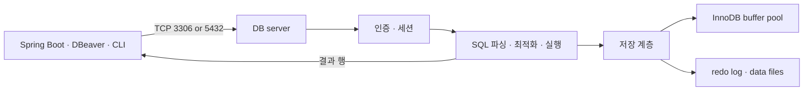

# R01. DB 서버란 무엇인가 — DBMS·데이터베이스·스키마·테이블, 그리고 MySQL·PostgreSQL

> 3줄 요약 — DBMS는 데이터를 관리하는 소프트웨어이고, DB 서버는 그 DBMS가 실행되어 연결을 받는 프로세스·머신이다.  
> MySQL에서 `DATABASE`와 `SCHEMA`는 같은 뜻이지만, PostgreSQL은 database 안에 schema가 있고 그 안에 테이블이 있다.  
> Spring Boot, DBeaver, CLI는 클라이언트다. 서버에 연결해 SQL을 보내고, MySQL의 InnoDB 같은 스토리지 엔진이 데이터를 메모리와 디스크에서 관리한다.

## 1. 한 줄로 말하면

데이터베이스 관리 시스템(DBMS)은 데이터를 저장하고 조회·변경하며 동시 접근과 장애 복구를 관리하는 소프트웨어다. DB 서버는 그 DBMS가 실행되는 프로세스 또는 그 프로세스를 담은 머신을 가리킨다. 데이터베이스는 서버가 관리하는 논리적 데이터 묶음이며, 그 안에 스키마와 테이블 같은 객체가 놓인다.

이 구분이 필요한 이유는 장애 원인을 정확히 나누기 위해서다. `Unknown database`는 서버에는 닿았지만 요청한 논리 이름을 찾지 못한 경우고, `Connection refused`는 대개 그 주소와 포트에 서버가 연결을 받지 않는 경우다. 테이블 이름을 틀린 문제를 서버 설치 문제로, 포트 문제를 SQL 오류로 진단하면 해결이 늦어진다.

## 2. 당장 알아야 할 것

1. **서버와 데이터베이스는 다른 층이다.** 한 MySQL 서버 인스턴스가 여러 database를 관리한다. `SHOW DATABASES;`는 현재 계정에 보이는 목록이다.

2. **MySQL과 PostgreSQL에서 `schema`의 위치가 다르다.** MySQL은 `CREATE SCHEMA`가 `CREATE DATABASE`의 별칭이다. PostgreSQL은 `server/cluster → database → schema → table` 구조다. PostgreSQL의 한 연결은 한 database를 선택하고, 그 안의 다른 schema는 권한과 `search_path`에 따라 함께 조회할 수 있다.

3. **테이블은 열과 행으로 데이터를 표현한다.** `member`의 열은 `id`, `login_id`, `name`처럼 속성이고, 한 행은 한 회원 레코드다. `DESCRIBE member;`는 열 구성을 확인한다. 타입·키·제약 설계는 → R03.

4. **앱도 DB 클라이언트다.** Spring Boot 애플리케이션, DBeaver, `mysql`, `psql`은 접속 방식만 다를 뿐 서버로 SQL을 보내는 클라이언트다. 로컬 기본 포트는 MySQL `3306`, PostgreSQL `5432`지만 설정으로 바꿀 수 있다. 실제 값은 해당 서버에 질의한다.

5. **연결 성공은 인증과 세션 생성까지 확인한 것이다.** TCP 연결 뒤 사용자 인증을 거쳐 세션이 생긴다. database 선택·권한 오류는 별도로 발생한다. 상세 설정은 → P19.

6. **스토리지 엔진은 MySQL 안에서 테이블을 실제 관리한다.** MySQL 8.4의 기본 엔진은 InnoDB다. InnoDB는 트랜잭션, 행 잠금, 외래 키, 장애 복구를 제공한다. `SHOW TABLE STATUS`의 `Engine` 열이나 `SHOW CREATE TABLE member;`로 테이블 엔진을 확인한다.

7. **메모리 사용은 DB 서버의 일부다.** InnoDB buffer pool은 접근한 테이블·인덱스 페이지를 메모리에 캐시한다. 자주 읽는 페이지가 메모리에 있으면 매번 파일을 읽지 않아도 된다. 따라서 서버의 메모리와 데이터 디렉터리는 애플리케이션 프로세스와 별도로 고려해야 한다.

8. **같은 컴퓨터에 여러 DB 서버를 둘 수 있다.** MySQL과 PostgreSQL은 기본 포트가 달라 함께 실행할 수 있다. 같은 제품의 두 번째 인스턴스는 다른 포트와 별도 데이터 디렉터리가 필요하다. 같은 데이터 디렉터리를 두 서버 프로세스가 동시에 쓰면 안 된다. 실제 서버 값은 `SHOW VARIABLES LIKE 'datadir';` 또는 PostgreSQL `SHOW data_directory;`로 확인한다.

9. **관리형 DB도 DBMS 자체는 같다.** RDS/Aurora, Cloud SQL은 공급자가 관리 작업을 맡지만 앱의 네트워크 연결·권한은 필요하다. 책임 비교는 아래 치트시트를 본다.

## 3. 따라 하기

실습 기준은 Java 25, Spring Boot 4.1.1, MySQL 8.4, 연습 DB `ds_practice`다. `practice/schema/schema.sql`과 `seed.sql`이 적재된 인스턴스를 전제로 한다. `schema.sql`은 첫 부분에서 `DROP DATABASE IF EXISTS ds_practice`를 실행하므로 공유·보존 DB에 그대로 적재하지 않는다. 여기서는 DB나 Docker를 실행하지 않는다.



PostgreSQL은 연결마다 서버 프로세스를 두고, MySQL은 다중 스레드 SQL 서버로 동작한다. 공통 클라이언트 흐름을 나타낸 그림이며, 저장 계층의 구현은 제품별로 다르다.

### 단계 1 — 어떤 서버에 접속했는지 확인

터미널에서 서버 주소와 포트를 지정하고 `mysql` 클라이언트를 실행한다. `--password` 뒤에 값을 적지 않으면 비밀번호를 프롬프트로 입력한다.

```bash
mysql --host=127.0.0.1 --port=3306 --user=practice_user --password ds_practice
```

접속 후 다음 읽기 전용 SQL을 실행한다.

```sql
SELECT VERSION() AS server_version, DATABASE() AS current_database;
SHOW DATABASES LIKE 'ds_practice';
SHOW VARIABLES WHERE Variable_name IN ('port', 'datadir', 'default_storage_engine');
```

**확인 방법 (예상)**: `current_database`가 `ds_practice`이고, 포트·데이터 디렉터리·기본 엔진 변수가 한 행씩 표시된다. `server_version`은 설치된 8.4 패치 버전에 따라 달라진다. 접속이 안 되면 다음 단계 전에 서버 주소, 실제 포트, 실행 상태를 확인한다.

### 단계 2 — database 안의 테이블과 데이터 확인

```sql
SHOW TABLES;
DESCRIBE member;
SELECT id, login_id, member_status, created_at
FROM member
ORDER BY id
LIMIT 3;
```

**확인 방법 (예상)**: `SHOW TABLES`에 `member`, `product`, `orders`, `order_item`, `payment` 등이 나온다. `member`에는 `id`, `login_id`, `name`, `email`, `phone`, `member_status`, `deleted_at`, `created_at`, `updated_at` 열이 있다. 마지막 SELECT의 실제 행 값은 시드 데이터에서 온다. 이 쿼리들은 DB를 변경하지 않는다.

### 단계 3 — MySQL에서 DATABASE와 SCHEMA 확인

연결한 database와 서버가 가진 database 목록은 별개 질문이다. `DATABASE()`는 현재 세션의 선택값이고 `SHOW DATABASES`는 서버 목록이다.

```sql
SELECT DATABASE();
SHOW DATABASES;
SHOW CREATE DATABASE ds_practice;
SHOW TABLES FROM ds_practice;
```

**확인 방법 (예상)**: `DATABASE()`는 `ds_practice`; `SHOW TABLES FROM ds_practice`는 해당 database의 테이블 목록을 반환한다. MySQL 매뉴얼에서 아래 두 구문은 동의어라고 정의한다. 다음은 설명용 구문이며, 주석을 풀어 실행하면 database를 실제 생성한다. MySQL의 `CREATE DATABASE`는 트랜잭션으로 되돌릴 수 없으므로 이 실습에서는 생성하지 않는다.

```sql
-- MySQL에서 아래 두 문장은 같은 동작이다. 실행하지 않는다.
-- CREATE DATABASE r01_sandbox;
-- CREATE SCHEMA r01_sandbox;
```

### 단계 4 — PostgreSQL에서는 schema가 한 단계 더 있다

아래 명령은 PostgreSQL의 `psql` 클라이언트에서 실행한다. 기존에 접근 가능한 `postgres` database에 연결하고, 서버의 database 목록과 현재 database의 schema·테이블을 각각 확인한다.

```bash
psql --host=127.0.0.1 --port=5432 --username=postgres --dbname=postgres
```

```text
\l
\conninfo
\dn
\dt public.*
```

**확인 방법 (예상)**: `\l`은 server/cluster의 database 목록, `\dn`은 현재 database의 schema 목록, `\dt public.*`는 `public` schema 안의 테이블 목록이다. `\c 다른_database`는 접속 대상을 바꾸며, 이는 schema를 바꾸는 명령이 아니다.

PostgreSQL DDL은 트랜잭션으로 롤백할 수 있으므로 임시 schema를 만들었다가 되돌리는 예를 실행할 수 있다.

```sql
BEGIN;
CREATE SCHEMA r01_demo;
ROLLBACK;
```

**확인 방법 (예상)**: `ROLLBACK` 뒤 `\dn`을 다시 실행하면 `r01_demo`는 보이지 않는다. PostgreSQL에서는 `CREATE DATABASE`가 트랜잭션 블록 안에서 허용되지 않지만, schema 생성은 위처럼 취소할 수 있다.

### 단계 5 — Spring Boot에서 서버 응답 확인

Spring Boot 애플리케이션도 같은 서버에 붙는 클라이언트다. 이미 프로젝트에서 `DataSource`와 JDBC 드라이버를 구성했다면, 다음 클래스를 `src/main/java/com/example/db/DatabaseProbe.java`에 두어 서버 응답 버전을 확인할 수 있다. DataSource 주소·계정·드라이버 설정은 → P19.

```java
package com.example.db;

import org.springframework.boot.CommandLineRunner;
import org.springframework.jdbc.core.JdbcTemplate;
import org.springframework.stereotype.Component;

@Component
public class DatabaseProbe implements CommandLineRunner {
    private final JdbcTemplate jdbcTemplate;

    public DatabaseProbe(JdbcTemplate jdbcTemplate) {
        this.jdbcTemplate = jdbcTemplate;
    }

    @Override
    public void run(String... args) {
        String version = jdbcTemplate.queryForObject("SELECT VERSION()", String.class);
        System.out.println("Database server: " + version);
    }
}
```

**확인 방법 (예상)**: 시작 로그 다음에 `Database server: 8.4.x`처럼 MySQL 버전이 출력된다. 이 코드는 Boot 4.1 API 기준이며, 실행하지 않아 `(미실행)`이다. 의존성 관리가 적용된 Gradle Kotlin DSL 표기와 Maven 대응 artifact는 다음과 같다. 세부 연결 구성은 → P19.

```kotlin
dependencies {
    implementation("org.springframework.boot:spring-boot-starter-jdbc")
    runtimeOnly("com.mysql:mysql-connector-j")
}
```

Maven에서는 `org.springframework.boot:spring-boot-starter-jdbc`와 `com.mysql:mysql-connector-j`를 선언한다. 드라이버 버전은 Boot 4.1.1의 dependency management를 따른다.

## 4. 치트시트

| 이름 | 용도 | 예시 | 주의 |
|---|---|---|---|
| DBMS | 데이터 저장·조회·복구 소프트웨어 | MySQL Server, PostgreSQL | DB 서버 프로세스와 구분 |
| DB 서버 | DBMS가 연결을 받는 실행 환경 | `127.0.0.1:3306` | 주소·포트가 맞아도 인증 실패 가능 |
| Database | 논리적 데이터 묶음 | MySQL `ds_practice`; PostgreSQL `postgres` | PostgreSQL에서는 schema보다 상위 |
| Schema | 객체 이름 공간 | PostgreSQL `public.member` | MySQL에선 database와 동의어 |
| Table | 행과 열로 된 관계형 데이터 객체 | `ds_practice.member` | MySQL 엔진에 따라 저장·기능 차이 |
| Row / Column | 레코드 / 속성 | 회원 한 명 / `login_id` | 구체 타입·제약은 → R03 |
| MySQL 포트 | 기본 TCP 접속 포트 | `3306`, `SHOW VARIABLES LIKE 'port'` | `--port`나 서버 설정으로 변경 가능 |
| PostgreSQL 포트 | 기본 TCP 접속 포트 | `5432`, `SHOW port` | 클러스터 안 모든 database가 공유 |
| 현재 대상 확인 | 실수로 다른 DB를 조회하지 않게 확인 | MySQL `SELECT DATABASE()`; PG `SELECT current_database()` | 접속 성공 후 첫 확인으로 사용 |
| PostgreSQL psql | 서버·schema 탐색 | `\l`, `\dn`, `\dt public.*` | `\` 명령은 SQL이 아니라 psql 명령 |

| 제품 | 라이선스 | 특징 | 국내 실무 분포 | Spring Boot 사용 경로 |
|---|---|---|---|---|
| MySQL | GPL 계열 Community 배포, 상용 라이선스 선택지도 있음 | 널리 쓰이는 client/server SQL DBMS, 8.4 기본 엔진은 InnoDB | 미확인 | JDBC 드라이버 + Spring `DataSource` |
| MariaDB | GPLv2 | MySQL과 호환되는 부분이 있지만 버전에 따른 차이가 있어 교체 전 확인 | 미확인 | MariaDB JDBC 드라이버 + `DataSource` |
| PostgreSQL | PostgreSQL License, 자유로운 오픈소스 라이선스 | database 아래 여러 schema를 두는 구조, 확장 기능이 풍부함 | 미확인 | PostgreSQL JDBC 드라이버 + `DataSource` |
| Oracle Database | XE 무료 사용 조건 및 상용 에디션별 조건이 다름 | 고급 상용 기능·관리 옵션이 있는 관계형 DBMS | 미확인 | Oracle JDBC 드라이버 + `DataSource` |
| SQL Server | 라이선스 계약·에디션별 조건 확인 필요 | Windows/Linux 배포 및 Microsoft 생태계 연동 | 미확인 | Microsoft JDBC 드라이버 + `DataSource` |
| SQLite | Public Domain | 앱 안에 포함되는 라이브러리, 별도 server 프로세스 없이 파일을 읽고 씀 | 미확인 | JDBC 드라이버를 통한 임베디드 사용; 서버 DB 대체와는 다름 |
| H2 | MPL 2.0 또는 EPL 1.0 | Java 기반, embedded/server 및 메모리 모드 제공 | 미확인 | JDBC 기반 개발·테스트에 편리; 운영 DB와 동작 차이 주의 |

국내 분포는 비교 가능한 최신 공개 통계가 없어 수치를 생략했다. JDBC 드라이버가 같아도 SQL 방언·타입·DDL은 같지 않다.

| 운영 방식 | 공급자·운영자 책임 | 앱 입장에서 | 적합한 상황 |
|---|---|---|---|
| 직접 설치 | 팀이 OS, DB 패치, 백업, 복구, HA와 모니터링을 설계·운영 | 정한 주소·포트·계정으로 TCP 연결 | 자체 인프라 제약, 특수 설정, 운영 역량 보유 |
| 관리형 DB | 공급자가 프로비저닝·백업·모니터링·일부 HA 작업 제공; 비용·한도·장애 모델은 서비스별 | 엔드포인트와 권한을 받아 연결; 네트워크 허용 규칙도 필요 | 인프라 운영을 줄이고 표준 엔진을 서비스로 쓰려는 경우 |

## 5. 자주 나는 에러와 해결

1. **`ERROR 1049 (42000): Unknown database 'ds_practice'`** → 접속한 MySQL 인스턴스에 그 이름이 없거나 다른 서버에 붙었다. → `SELECT @@hostname, @@port;`로 서버를 확인하고 `SHOW DATABASES;` 목록·적재 여부를 점검한다.

2. **`ERROR 1045 (28000): Access denied for user ...`** → 암호 오류, 해당 출발 호스트에 대한 권한 부재, 또는 계정 이름 오기다. → 계정·비밀번호·접속 호스트와 GRANT 범위를 확인한다. 암호를 SQL이나 셸 기록에 평문으로 남기지 않는다.

3. **`ERROR 2002 (HY000): Can't connect to local MySQL server through socket ...`** → 소켓 연결을 시도했지만 로컬 서버가 실행 중이 아니거나 클라이언트 기본 소켓 경로와 서버 경로가 다르다. → 서버 상태를 확인하고 TCP 접속을 `--host=127.0.0.1 --port=3306`처럼 명시한다.

4. **`FATAL: database "app" does not exist`** → PostgreSQL 서버에는 연결했지만 `app`이라는 database가 없다. 이것은 schema나 table 오류가 아니다. → `\l`로 database 목록을 보고 올바른 `--dbname`을 지정한다.

5. **`ERROR: relation "member" does not exist`** → PostgreSQL에서 현재 database의 `search_path`에 `member`가 없거나 대소문자·schema 이름이 다르다. → `\dn`, `\dt *.*`로 위치를 확인하고 `SELECT * FROM public.member;`처럼 schema를 명시한다.


## 6. 한 단계 더

클라이언트는 서버의 TCP 주소로 연결하고 인증이 끝나면 세션 안에서 SQL을 보낸다. PostgreSQL은 공식 구조 설명에서 접속을 관리하는 서버 프로세스와 클라이언트별 서버 프로세스를 구분한다. MySQL 서버는 다중 스레드 SQL 서버이며, SQL 요청은 파싱·실행 단계를 거쳐 선택된 스토리지 엔진으로 내려간다. InnoDB는 테이블·인덱스 페이지를 buffer pool에 캐시하고, 수정 기록은 redo log에 남겨 장애 복구에 활용한다. 버퍼에 페이지가 없으면 디스크에서 읽고, 변경된 페이지는 테이블스페이스 파일에 반영된다. 서버 메모리·스토리지·접속 포트는 애플리케이션 JVM 메모리와 별도 자원이다.  
관계형과 NoSQL 선택은 → R02, 테이블·타입·제약은 → R03, SQL·트랜잭션은 → R04, DBeaver 같은 도구는 → R06, Spring Boot 연결 설정은 → P19.

## 7. 자가점검 Q&A (면접 대비)

### Q1. DBMS와 DB 서버의 차이는?

DBMS는 데이터 관리 프로그램이다. DB 서버는 클라이언트 접속을 받는 DBMS 프로세스 또는 이를 담은 머신이다. 한 프로세스가 여러 database를 관리할 수 있다.  
**꼬리질문:** SQLite는 DB 서버인가? **답:** 일반적인 SQLite 사용에서는 별도 서버가 아니라 애플리케이션 프로세스 안에서 동작하는 라이브러리다.

### Q2. PostgreSQL에서 database와 schema를 왜 둘 다 쓰나?

한 cluster 안에 database가 여럿 있고 연결은 하나를 선택한다. database 안 schema가 테이블·함수의 이름을 나눈다. 권한이 있으면 같은 database의 다른 schema 객체도 참조할 수 있다.  
**꼬리질문:** 다른 database의 테이블을 `schema.table`로 바로 읽을 수 있나? **답:** 기본 구조에서는 안 된다. 별도 연결이나 외부 테이블 기능을 사용해야 한다.

### Q3. MySQL의 `CREATE SCHEMA`는 PostgreSQL과 같은가?

아니다. MySQL에서 `CREATE SCHEMA`는 database 생성의 동의어다. PostgreSQL에서는 현재 database 안에 schema를 만든다. 이식성 있는 스크립트는 이 계층 차이를 처리해야 한다.  
**꼬리질문:** MySQL `USE x`와 PostgreSQL `SET search_path TO x`는 같은가? **답:** 아니다. `USE`는 MySQL database를 선택하고, `search_path`는 PostgreSQL 현재 database 안에서 이름을 찾을 schema 순서를 정한다.

### Q4. Spring Boot가 DB 서버인가, 클라이언트인가?

일반 웹 애플리케이션에서 Spring Boot는 클라이언트다. JDBC `DataSource`가 연결해 SQL을 보내고 저장·동시성·복구는 DB 서버가 맡는다. JVM과 DB 서버는 같은 머신일 수도 있다.  
**꼬리질문:** 앱이 시작되면 DB 서버도 자동으로 함께 뜨나? **답:** 원격·별도 서버 구성이 일반적이며 자동으로 뜨지 않는다. 임베디드 DB를 명시적으로 구성한 경우는 예외다.

### Q5. MySQL에 InnoDB가 있는데 DBMS와 어떻게 다른가?

MySQL Server는 SQL·세션을 관리하는 DBMS다. InnoDB는 테이블·인덱스·트랜잭션·파일을 다루는 스토리지 엔진이다. 8.4 기본 엔진은 InnoDB다.  
**꼬리질문:** buffer pool은 테이블 데이터베이스인가? **답:** 아니다. InnoDB가 자주 쓰는 페이지를 담는 메모리 캐시다.

### Q6. `Connection refused`와 `Unknown database`는 어떻게 다른가?

전자는 해당 주소·포트에서 연결을 받는 서버가 없는 네트워크·프로세스 문제다. 후자는 접속한 서버에 요청한 database 이름이 없는 구성 문제다. 먼저 TCP 주소와 포트를 확인한 뒤 database 목록을 본다.  
**꼬리질문:** 비밀번호 오류는 어느 단계인가? **답:** TCP 연결 뒤 인증 단계이므로 보통 `Access denied` 같은 오류가 난다.

## 8. 참고문헌

- MySQL 8.4 Reference Manual — [What is MySQL?](https://dev.mysql.com/doc/refman/8.4/en/what-is-mysql.html), [CREATE DATABASE](https://dev.mysql.com/doc/refman/8.4/en/create-database.html), [InnoDB 소개](https://dev.mysql.com/doc/refman/8.4/en/innodb-introduction.html), [buffer pool](https://dev.mysql.com/doc/refman/8.4/en/innodb-buffer-pool.html), [redo log](https://dev.mysql.com/doc/refman/8.4/en/innodb-redo-log.html), [system variables](https://dev.mysql.com/doc/refman/8.4/en/server-system-variables.html) — 정의·동의어, 기본 엔진, 캐시·복구·포트.
- PostgreSQL 18 Documentation — [아키텍처](https://www.postgresql.org/docs/current/tutorial-arch.html), [Schemas](https://www.postgresql.org/docs/current/ddl-schemas.html), [Connections](https://www.postgresql.org/docs/current/runtime-config-connection.html), [psql](https://www.postgresql.org/docs/current/app-psql.html), [License](https://www.postgresql.org/about/licence/) — database/schema 계층, 연결·포트, CLI와 라이선스.
- [MariaDB Foundation](https://mariadb.org/about/), [Oracle Database Licensing](https://docs.oracle.com/en/database/oracle/oracle-database/21/dblic/Licensing-Information.html), [Microsoft Learn: SQL Server](https://learn.microsoft.com/en-us/sql/sql-server/what-is-sql-server?view=sql-server-ver17) — GPLv2와 Oracle·SQL Server 에디션 및 계약 정보.
- SQLite — [About](https://www.sqlite.org/about.html), [SQLite Is Serverless](https://www.sqlite.org/serverless.html); H2 — [Main](https://www.h2database.com/html/main.html), [License](https://www.h2database.com/html/license.html) — 임베디드 구조, 모드와 라이선스.
- Spring Boot Reference — [SQL Databases](https://docs.spring.io/spring-boot/reference/data/sql.html), [Managed Dependency Coordinates](https://docs.spring.io/spring-boot/appendix/dependency-versions/coordinates.html) — `DataSource`/JDBC와 Boot 4.1.1 드라이버 의존성 버전 관리.
- Amazon Aurora User Guide — What is Amazon Aurora? — https://docs.aws.amazon.com/AmazonRDS/latest/AuroraUserGuide/CHAP_AuroraOverview.html; Google Cloud SQL — Introduction — https://cloud.google.com/sql/docs/introduction — 관리형 관계형 DB 서비스와 지원 엔진.
