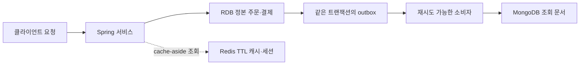

# R02. RDB vs NoSQL — MongoDB·Redis·Cassandra는 무엇이고 언제 쓰나

> 기본값은 RDB다. 주문·결제처럼 관계와 제약, 여러 행의 원자성이 중요한 데이터는 MySQL에 둔다.
> NoSQL은 유행이나 막연한 확장성 때문에 고르는 게 아니라, 문서·키·파티션 중심의 특정 조회 패턴에 맞춰 고른다.
> 서비스에서는 RDB를 정본으로 두고 Redis 캐시·세션이나 MongoDB 조회용 문서를 필요할 때 덧붙인다.

## 1. 한 줄로 말하면

RDB는 테이블·제약·SQL 트랜잭션을 쓰고, NoSQL은 문서·키-값·와이드 컬럼·그래프 등 접근 패턴별 모델을 고른다. NoSQL도 스키마와 규칙은 필요하다. 주문·결제는 RDB, 문서·키·분산 시계열 조회는 해당 NoSQL이 맞을 수 있다.

| 종류 | 데이터 모양 | 잘 맞는 조회 | 대표 제품 |
|---|---|---|---|
| 관계형 | 테이블, 외래키, 제약, SQL | 조인·집계·다양한 조건 검색, 관계 무결성 | MySQL, PostgreSQL |
| 문서형 | JSON과 비슷한 BSON 문서, 컬렉션 | 문서 단위 조회·갱신, 함께 읽는 중첩 데이터 | MongoDB |
| 키-값 | 키 하나로 값 조회, 만료 시간 가능 | 캐시·세션·토큰·카운터 | Redis, DynamoDB |
| 와이드 컬럼 | 파티션 키로 분배되는 행·컬럼 | 파티션 키를 아는 대량 쓰기·범위 조회 | Cassandra |
| 그래프 | 노드와 간선, 속성 | 관계 경로 탐색·추천 관계 | Neo4j |
| 검색 | 반전 인덱스와 검색 문서 | 전문 검색·형태소·관련도 순위 | Elasticsearch (검색엔진, 정본 DB로 쓰지 않음) |

## 2. 당장 알아야 할 것

### 2.1 정본 데이터와 보조 저장소의 역할부터 정한다

기본은 주문·결제 RDB 정본, 재생성 가능한 Redis 캐시, 조회용 MongoDB 투영이다.

| 상황 | 먼저 고를 것 | 이유 |
|---|---|---|
| 재고 차감·주문 상태·결제 원장 | RDB | FK·유니크·체크 제약과 다중 행 트랜잭션이 유용 |
| 짧은 TTL의 상품 요약·세션 | Redis | 키로 빠르게 읽고 만료시키는 동작이 자연스러움 |
| 여러 상품 유형의 상세가 한 화면에서 함께 읽힘 | MongoDB 검토 | 접근 단위와 문서 경계를 맞추면 단일 문서 조회가 가능 |
| 사용자·월별 이벤트가 계속 쌓이고 노드 분산이 필요 | Cassandra 검토 | 파티션 키로 데이터 위치와 조회 경로를 설계 |

저장소 추가는 RDB만으로 부족하다는 실측 근거가 있을 때 결정한다.

### 2.2 RDB는 연결과 제약을 데이터베이스가 검사한다

연습 스키마에서 `orders.member_id`와 `order_item.order_id`는 FK이고, 상태는 CHECK, 주문 번호는 UNIQUE로 제한된다. DB가 잘못된 참조·중복 번호·허용되지 않은 상태를 거절한다.

### 2.3 MongoDB는 문서 경계를 조회 패턴에 맞춘다

MongoDB 문서는 필드 구성이 달라도 되지만 모델링 책임은 남는다. 자주 같이 읽는 제한된 값은 임베딩하고, 독립 조회·수정되거나 커지는 관계는 ID로 참조한다. 단일 문서는 원자적이며 다중 문서 ACID 트랜잭션도 지원한다.

주문 스냅샷에 구매 당시 가격을 보존한다.

```json
{
  "_id": "order-2026-000042",
  "orderNo": "order-2026-000042",
  "memberId": 101,
  "status": "PAID",
  "orderedAt": "2026-09-20T10:00:00Z",
  "items": [{ "productId": 27, "productName": "상품 A", "quantity": 2, "unitPrice": 12000 }]
}
```

설명용 문서다. 자주 바뀌는 회원 정보와 무한히 커지는 배열은 분리한다. MongoDB 문서 한도는 16 MiB다.

### 2.4 Redis는 “캐시 제품”보다 자료 구조 서버로 이해한다

Redis는 String, Hash, List, Set, Sorted Set, Stream 등을 제공한다. 캐시에는 TTL을 두고, 세션은 만료·메모리 제거(eviction)와 재생성 경로를 정한다. Redis가 항상 휘발성이라고 보거나 업무 원본을 캐시에만 두지 않는다.

```text
SET product:27:summary '{"name":"상품 A","price":12000}' EX 60
```

cache-aside는 Redis 미스 때 RDB를 조회해 TTL과 함께 저장한다. RDB 쓰기 후 캐시를 삭제·갱신하며, 두 저장소는 하나의 원자 작업이 아니다.

### 2.5 Cassandra는 테이블을 조회 요청마다 설계한다

Cassandra는 파티션 키가 노드 분배를, 클러스터링 컬럼이 파티션 내 정렬을 정하는 와이드 컬럼 DB다. 조회는 파티션 키를 제공하도록 설계하며, 필요한 접근 경로가 다르면 데이터를 중복한 테이블을 둘 수 있다.

### 2.6 ACID와 CAP의 “일관성”은 서로 다른 질문이다

ACID 일관성은 트랜잭션 전후 업무 불변식이 유지되는 성질이다. CAP의 Consistency는 네트워크 분할(partition) 중 복제본이 같은 최신 값을 보이는 성질(선형화 가능성)이다. 분할 중 가용성과의 절충을 설명하며, 제품이 평소 둘 중 하나만 제공한다는 뜻은 아니다.

### 2.7 종류별 대표 기능만 기억한다

- DynamoDB는 관리형 키-값·문서 DB, Neo4j는 관계 경로 탐색에 맞는다.
- Elasticsearch는 전문 검색용이며 주문 원장으로 삼지 않는다.

## 3. 따라 하기

Boot 4.1.1 / Java 25 기준이다. SQL은 `ds_practice` 조회 예제이며 Docker·DB·앱은 실행하지 않았다.

### 3.1 Spring Boot에 필요한 드라이버만 넣는다

`build.gradle.kts`에 Boot BOM을 적용하고 필요한 starter만 남긴다.

```kotlin
plugins {
    java
    id("org.springframework.boot") version "4.1.1"
}

java {
    toolchain { languageVersion = JavaLanguageVersion.of(25) }
}

dependencies {
    implementation(platform("org.springframework.boot:spring-boot-dependencies:4.1.1"))
    implementation("org.springframework.boot:spring-boot-starter-data-jpa")
    implementation("org.springframework.boot:spring-boot-starter-data-mongodb")
    implementation("org.springframework.boot:spring-boot-starter-data-redis")
    runtimeOnly("com.mysql:mysql-connector-j")
}
```

Maven은 Boot parent/BOM 4.1.1과 같은 starter를 쓴다. Spring Data stable은 JPA·Redis 4.1.1, MongoDB 5.1.1이며 Boot 관리 Mongo 버전은 `(미확인)`이다.

`src/main/resources/application.yaml`은 기존 연습 DB와 개발용 MongoDB·Redis 접속 정보를 둔다. 비밀번호는 환경 변수로 주입한다.

```yaml
spring:
  datasource:
    url: jdbc:mysql://localhost:3306/ds_practice?characterEncoding=UTF-8&serverTimezone=Asia/Seoul
    username: ${DB_USER}
    password: ${DB_PASSWORD}
  jpa:
    hibernate:
      ddl-auto: validate
    open-in-view: false
  data:
    mongodb:
      uri: mongodb://localhost:27017/ds_practice_docs
    redis:
      host: localhost
      port: 6379
```

`ddl-auto: validate`는 매핑만 검사해 ORM이 스키마를 바꾸지 않게 한다. MongoDB·Redis는 서비스가 준비된 경우에만 연결한다.

### 3.2 RDB에서 실제 주문 조회를 붙인다

`ds_practice`에 접근 가능한 계정으로 실행한다. 호스트·계정은 환경에 맞춘다.

```bash
mysql -h 127.0.0.1 -u <계정> -p ds_practice
```

조인 결과는 주문·회원·상품 정보를 반환한다. `(예상)` 값은 seed에 따라 다르며 실행하지 않았다.

```sql
SELECT o.order_no, m.name AS member_name, o.order_status, o.ordered_at,
       p.name AS product_name, oi.quantity, oi.unit_price
FROM orders o
JOIN member m ON m.id = o.member_id
JOIN order_item oi ON oi.order_id = o.id
JOIN product p ON p.id = oi.product_id
WHERE o.member_id = 101 AND o.order_status = 'PAID'
ORDER BY o.ordered_at DESC, oi.id ASC
LIMIT 20;
```

```text
(예상; 값은 seed에 따라 달라짐)
order_no | member_name | order_status | ordered_at | product_name | quantity | unit_price
...      | ...         | ...          | ...        | ...          | ...      | ...
```

`src/main/java/example/OrderEntity.java`:

```java
package example;

import jakarta.persistence.Column;
import jakarta.persistence.Entity;
import jakarta.persistence.GeneratedValue;
import jakarta.persistence.GenerationType;
import jakarta.persistence.Id;
import jakarta.persistence.Table;
import java.math.BigDecimal;
import java.time.LocalDateTime;

@Entity
@Table(name = "orders")
public class OrderEntity {
    @Id
    @GeneratedValue(strategy = GenerationType.IDENTITY)
    private Long id;

    @Column(name = "order_no", nullable = false)
    private String orderNo;

    @Column(name = "member_id", nullable = false)
    private Long memberId;

    @Column(name = "order_status", nullable = false)
    private String orderStatus;

    @Column(name = "total_amount", nullable = false)
    private BigDecimal totalAmount;

    @Column(name = "ordered_at", nullable = false)
    private LocalDateTime orderedAt;

    protected OrderEntity() {}

}
```

`src/main/java/example/OrderRepository.java`:

```java
package example;

import java.util.List;
import org.springframework.data.domain.Pageable;
import org.springframework.data.jpa.repository.JpaRepository;

public interface OrderRepository extends JpaRepository<OrderEntity, Long> {
    List<OrderEntity> findByMemberIdAndOrderStatusOrderByOrderedAtDesc(
            Long memberId, String orderStatus, Pageable pageable);
}
```

기존 Boot 앱에서 호출한다. JPA 예제는 `(미실행)`이다.

### 3.3 문서형이 필요한 화면만 MongoDB 문서로 만든다

주문 화면용 조회 투영의 Spring Data 모델이다. 상품 스냅샷을 넣어 문서 한 번으로 읽는다. `(미실행)`

`src/main/java/example/OrderDocument.java`:

```java
package example;

import java.math.BigDecimal;
import java.time.Instant;
import java.util.List;
import org.springframework.data.annotation.Id;
import org.springframework.data.mongodb.core.mapping.Document;

@Document("orders")
public record OrderDocument(
        @Id String id,
        String orderNo,
        long memberId,
        String status,
        Instant orderedAt,
        List<OrderLine> items) {
    public record OrderLine(
            long productId, String productName, int quantity, BigDecimal unitPrice) {}
}
```

`src/main/java/example/OrderDocumentRepository.java`:

```java
package example;

import java.util.Optional;
import org.springframework.data.mongodb.repository.MongoRepository;

public interface OrderDocumentRepository
        extends MongoRepository<OrderDocument, String> {
    Optional<OrderDocument> findByOrderNo(String orderNo);
}
```

MongoDB 문서는 MySQL 주문 행과 자동 동기화되지 않는다. 동기화는 outbox와 재시도·중복 처리로 설계한다.

### 3.4 캐시 키와 TTL을 명시해 Redis를 쓴다

JSON 직렬화된 상품 요약을 60초 캐시하는 컴포넌트다. `(미실행)`

`src/main/java/example/ProductCache.java`:

```java
package example;

import java.time.Duration;
import org.springframework.data.redis.core.StringRedisTemplate;
import org.springframework.stereotype.Component;

@Component
public class ProductCache {
    private final StringRedisTemplate redis;

    public ProductCache(StringRedisTemplate redis) {
        this.redis = redis;
    }

    public void put(long productId, String json) {
        redis.opsForValue().set(
                "product:%d:summary".formatted(productId), json, Duration.ofSeconds(60));
    }

    public String get(long productId) {
        return redis.opsForValue().get("product:%d:summary".formatted(productId));
    }

    public void evict(long productId) {
        redis.delete("product:%d:summary".formatted(productId));
    }
}
```

조회 결과가 `null`이면 RDB에서 가져와 저장하고, 상품 갱신 후 `evict`한다. Redis와 RDB 갱신을 한 트랜잭션으로 취급하지 않는다.

### 3.5 Cassandra에서는 목표 조회와 파티션 키를 먼저 적는다

예를 들어 “회원 한 명의 한 달 주문을 최신 순으로 20개”가 자주 필요한 경우의 테이블이다. `order_month`는 조회 전에 `2026-09` 같은 값으로 계산한다.

```cql
CREATE TABLE orders_by_member_month (
  member_id bigint,
  order_month text,
  ordered_at timestamp,
  order_no text,
  order_status text,
  total_amount decimal,
  PRIMARY KEY ((member_id, order_month), ordered_at, order_no)
) WITH CLUSTERING ORDER BY (ordered_at DESC, order_no ASC);
```

```cql
SELECT order_no, ordered_at, order_status, total_amount
FROM orders_by_member_month
WHERE member_id = 101 AND order_month = '2026-09'
LIMIT 20;
```

MySQL 예제가 아닌 Cassandra CQL이다. 회원·월 단위 파티션은 장기 이력 한 곳 집중을 줄이지만, 특정 파티션의 쓰기 쏠림은 측정해야 한다.

## 4. 치트시트

| 이름 | 용도 | 예시 | 주의 |
|---|---|---|---|
| PK / FK | 행 식별·관계 참조 | `orders.member_id → member.id` | 인덱스·삭제 정책 고려 |
| RDB 트랜잭션 | 여러 행 원자 변경 | 서비스의 `@Transactional` | 외부 호출은 포함 안 됨 |
| Mongo 임베딩 / 참조 | 함께 읽기 / 독립 갱신 | `items[]` / `productId` | 크기·중복·별도 조회 고려 |
| Redis String + TTL | 캐시·세션 값 | `SET key value EX 60` | 만료·무효화 필요 |
| Redis Hash | 작은 필드 묶음 | `HSET session:abc memberId 101` | 큰 정본 객체는 재검토 |
| Cassandra 파티션 키 | 분산 위치·조회 범위 | `((member, month), ordered_at)` | 모든 쿼리에 키 고려 |
| Spring Data JPA | 관계형 Repository | `JpaRepository<OrderEntity, Long>` | 쿼리 계획 확인 |
| Spring Data MongoDB | 문서 Repository | `MongoRepository<OrderDocument, String>` | RDB와 별도 모델 |
| Spring Data Redis | Redis 연산 | `StringRedisTemplate` | 캐시 미스·직렬화 처리 |

## 5. 자주 나는 에러와 해결

1. **`Table 'ds_practice.orders' doesn't exist` →** 다른 DB에 접속했거나 스키마가 없다. URL과 `ds_practice` 적재 상태를 확인한다.

2. **`Schema-validation: missing column [...]` →** `@Column` 이름이 실제와 다르다. `schema.sql`과 대조하고 `ddl-auto: validate`를 유지한다.

3. **`Communications link failure` / `Connection refused` →** MySQL 주소·포트가 틀렸다. 앱 위치 기준 host와 포트 매핑을 확인한다.

4. **MongoDB `_id` 중복 `DuplicateKeyException` →** 같은 ID를 다시 넣었다. 재시도 시 업무 키·upsert·멱등성을 설계한다.

5. **Redis `Connection refused` 또는 캐시 미스 →** host·port, TTL, `product:{id}:summary` 키 규약을 확인한다.

6. **Cassandra `Cannot execute this query as it might involve data filtering` →** 파티션 키가 빠졌다. `ALLOW FILTERING` 대신 조회 테이블과 키를 재설계한다.

7. **RDB는 갱신됐는데 Redis/Mongo 값은 이전 값 →** 저장소 간 커밋은 원자적이지 않다. outbox·재시도·멱등 소비, 캐시 TTL·무효화를 둔다.

## 6. 한 단계 더

각 저장소의 트랜잭션은 저장소 사이의 원자 커밋을 보장하지 않는다. 주문과 outbox 이벤트를 RDB에서 함께 커밋하고 소비자가 MongoDB 투영을 재시도 가능하게 갱신한다. Redis는 만료·무효화할 파생 캐시로 둔다. Cassandra는 조회 쿼리와 파티션 키부터 설계한다.



다음 주제는 한 줄로 연결한다.

- Redis 캐시·세션 운영 → P23 참조
- 관계·키·정규화·인덱스를 포함한 RDB 설계 → R03 참조
- DB 서버·포트·프로세스 개념 → R01 참조

## 7. 자가점검 Q&A (면접 대비)

### Q1. NoSQL이면 스키마가 없는가?

아니다. 필드 구성이 문서마다 달라질 수 있어도 앱의 검증 규칙, 인덱스, 키 설계가 필요하다. 스키마가 코드와 저장 데이터에 분산될 뿐 사라지지 않는다.

**꼬리질문: MongoDB 컬렉션의 모든 문서가 같은 필드를 가져야 하는가?**

아니다. MongoDB는 유연한 스키마를 허용하며 필요한 영역에는 스키마 검증을 추가할 수 있다.

### Q2. 주문 상품은 MongoDB에서 임베딩할까, 참조할까?

주문 상세를 함께 읽고 구매 당시의 상품명·가격을 보존하려면 주문 문서에 스냅샷을 임베딩한다. 현재 상품 재고·가격처럼 자주 바뀌고 독립 조회되는 값은 참조하거나 별도로 조회한다.

**꼬리질문: 리뷰 전체도 상품 문서에 넣으면 빠르지 않은가?**

리뷰가 계속 늘면 문서 크기와 동시 갱신 문제가 생긴다. 화면에서 최근 몇 개만 필요하면 일부만 임베딩하고 전체 리뷰는 별도 컬렉션에 둔다.

### Q3. MongoDB는 여러 문서를 트랜잭션으로 묶을 수 없는가?

가능하다. 단일 문서 갱신은 원자적이며 여러 문서·컬렉션·샤드에 걸친 ACID 트랜잭션도 지원한다. 단, 함께 원자 처리할 데이터는 문서 경계로 모델링할 수 있는지 먼저 판단한다.

**꼬리질문: 그러면 MongoDB는 MySQL과 같은 사용법인가?**

아니다. 트랜잭션 지원 여부와 관계없이 관계·조인·제약을 모델링하는 방법과 성능 특성이 다르다.

### Q4. Redis를 캐시로 쓰면 DB 정합성이 자동으로 유지되는가?

아니다. RDB 커밋 뒤 캐시 삭제가 실패하거나 다른 쓰기가 겹칠 수 있다. TTL, 무효화, 재시도, 원본 재조회 경로를 정해야 한다.

**꼬리질문: Redis에 주문을 저장하고 MySQL은 나중에 맞춰도 되는가?**

결제·재고 원장을 Redis 캐시에만 두면 안 된다. 내구성과 정합성 요구를 만족하는 원본 저장소를 먼저 정하고 Redis는 보조로 사용한다.

### Q5. Cassandra 테이블을 RDB처럼 만들고 조건 검색하면 되지 않는가?

Cassandra는 파티션 키가 저장 위치와 효율적인 조회 범위를 결정한다. 조회 쿼리별 테이블 중복을 받아들이고 파티션 크기·핫스팟을 관리한다.

**꼬리질문: Cassandra의 파티션 키가 빠지면 무엇이 문제인가?**

전체 노드를 훑거나 필터링하게 되어 비용과 지연이 커질 수 있다. 필요한 접근 경로에 맞는 파티션 키를 설계한다.

### Q6. CAP의 일관성과 ACID의 일관성은 같은 뜻인가?

아니다. ACID는 트랜잭션이 업무 제약을 유지하는가를 말한다. CAP의 일관성은 네트워크 분할 중 복제본 간 읽기·쓰기 관찰을 다루는 분산 시스템 속성이다.

**꼬리질문: 네트워크 분할이 없는 평소에도 CAP의 선택을 그대로 적용하는가?**

CAP의 상충은 분할 상황에서 문제 된다. 실제 제품의 읽기·쓰기 보장은 복제 및 승인 설정까지 확인해야 한다.

## 8. 참고문헌

- MongoDB 모델링·임베딩·참조 — https://www.mongodb.com/docs/manual/core/data-modeling-introduction/ · https://www.mongodb.com/docs/manual/data-modeling/embedding/ · https://www.mongodb.com/docs/manual/data-modeling/referencing/ — 모델링.
- MongoDB 트랜잭션 — https://www.mongodb.com/docs/manual/core/transactions/ — ACID.
- Redis 자료형 — https://redis.io/docs/latest/develop/data-types/ — 자료형 개요.
- Spring Data MongoDB — https://docs.spring.io/spring-data/mongodb/reference/ · https://docs.spring.io/spring-data/mongodb/reference/mongodb/repositories/repositories.html — API.
- Spring Data Redis — https://docs.spring.io/spring-data/redis/reference/ · https://docs.spring.io/spring-data/redis/reference/redis/template.html — Template.
- Spring Data JPA·Boot BOM — https://docs.spring.io/spring-data/jpa/reference/ · https://docs.spring.io/spring-boot/appendix/dependency-versions/coordinates.html — API·버전.
- Spring Boot Build Systems — https://docs.spring.io/spring-boot/reference/using/build-systems.html — starter 이름·BOM 적용.
- Cassandra — https://cassandra.apache.org/doc/latest/cassandra/architecture/overview.html — 파티션.
- MySQL 8.4 InnoDB — https://dev.mysql.com/doc/refman/8.4/en/innodb-transaction-model.html — 트랜잭션.
