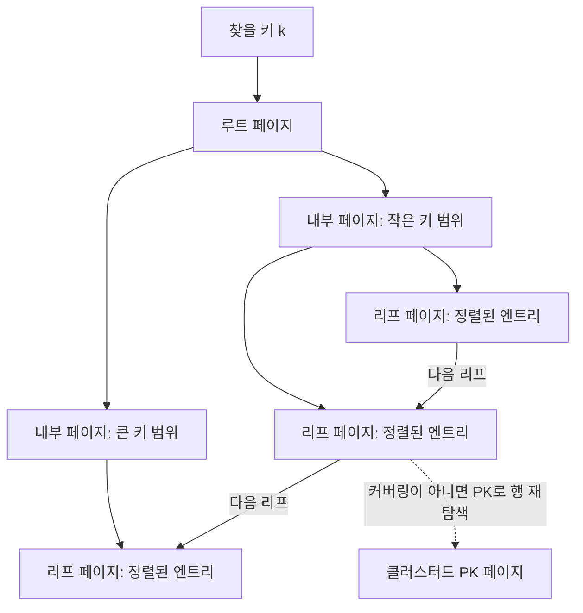

# R05. 인덱스와 B-Tree — 왜 빨라지고, 언제 안 타나

> - 인덱스는 정렬된 키를 B-Tree 페이지에 저장해 전체 행을 훑지 않고 후보를 좁힌다.
> - InnoDB의 PK 인덱스는 행 자체이고, 보조 인덱스 리프에는 PK가 붙어 필요한 행을 다시 찾는다.
> - 인덱스는 조건·정렬·조회 열과 맞아야 쓰이며, 최종 판단은 `EXPLAIN`에서 한다.

## 1. 한 줄로 말하면

인덱스는 테이블 행의 일부 열을 키로 정렬해 저장한 별도 탐색 구조다. MySQL InnoDB는 일반 인덱스에 B-Tree를 쓰므로 전체 테이블을 읽는 대신 트리 높이에 해당하는 페이지를 찾아가고, 범위 검색은 리프 페이지를 이어 읽는다. 읽기는 줄지만 인덱스 공간을 쓰며 `INSERT`·`UPDATE`·`DELETE` 때마다 키도 관리해야 한다. 인덱스를 만들었다는 사실보다 실제 쿼리가 그 인덱스를 쓸 수 있는 모양인지가 중요하다.

## 2. 당장 알아야 할 것

1. **테이블 스캔은 후보 행 수만큼 확인한다.** 조건에 맞는 인덱스가 없으면 MySQL은 테이블을 훑고 `WHERE` 조건을 검사한다. 행 수가 커지면 읽는 페이지와 비교 작업도 대체로 늘지만, 경과 시간은 버퍼 캐시·행 크기·동시 부하·저장장치에 따라 달라진다. 매번 `SELECT *`로 작은 로컬 테이블이 빠르다고 운영 테이블도 괜찮다고 결론 내리지 않는다.

2. **InnoDB에서 PK는 클러스터드 인덱스다.** PK 리프 페이지에 행의 나머지 열이 들어 있다. PK가 없는 테이블은 적합한 `NOT NULL UNIQUE` 인덱스를 클러스터드 인덱스로 택하고, 그것도 없으면 내부 행 ID를 쓰는 숨은 클러스터드 인덱스를 만든다. 테이블마다 PK를 명시한다.

3. **보조 인덱스는 PK를 포함한다.** `KEY ix_orders_member_date (member_id, ordered_at DESC)` 리프는 보조 키와 그 행의 PK를 갖는다. `member_id`로 보조 인덱스를 찾은 뒤 다른 열이 필요하면 PK로 클러스터드 인덱스를 다시 찾는다. 긴 PK는 모든 보조 인덱스의 공간과 캐시 부담을 키우므로 PK 설계도 인덱스 비용의 일부다.

4. **복합 인덱스는 순서가 쿼리 계약이다.** `(member_id, ordered_at)`은 `member_id` 단독이나 두 열 조건에 맞지만 `ordered_at` 단독 탐색에는 바로 쓸 수 없다. 앞 열이 같다는 범위까지 리프가 정렬되어 있어 그 뒤의 열은 동등 비교·범위·정렬 목적을 함께 고려한다. 보통 선두 동등 조건 다음에 첫 범위 조건을 두며, 그 범위 뒤 열은 탐색 범위를 더 좁히는 데 제한이 있다(커버링이나 인덱스 조건 필터에는 여전히 기여할 수 있다). `ix_orders_member_date`가 있으므로 회원별 기간 조회는 다음처럼 작성한다.

   ```sql
   SELECT id, ordered_at
   FROM orders
   WHERE member_id = 42
     AND ordered_at >= '2026-08-01 00:00:00'
     AND ordered_at <  '2026-09-01 00:00:00'
   ORDER BY ordered_at DESC;
   ```

5. **커버링 인덱스면 행 재조회가 사라질 수 있다.** 검색 조건과 반환 열이 인덱스에 모두 있으면 MySQL은 인덱스만 읽을 수 있고 `Extra`에 `Using index`가 표시된다. InnoDB 보조 인덱스에는 PK도 있으므로 위 쿼리의 `id`, `ordered_at`은 해당 인덱스로 충족될 수 있다. 필요한 열만 조회하면 커버링 가능성을 높이지만, 모든 반환 열을 억지로 인덱스에 넣으면 쓰기·공간 비용이 커진다.

6. **컬럼을 가공하지 말고 검색 범위로 표현한다.** 아래 첫 조건은 인덱스 열마다 함수를 계산해야 해 일반 B-Tree 탐색을 막을 수 있다. 반개구간으로 바꾸면 경계 검색이 가능하다.

   ```sql
   -- 피할 형태: 날짜 부분을 행마다 계산
   WHERE DATE(ordered_at) = '2026-08-15'
   -- 권장 형태
   WHERE ordered_at >= '2026-08-15 00:00:00'
     AND ordered_at <  '2026-08-16 00:00:00'
   ```

   `LIKE '%키워드'`처럼 와일드카드가 앞에 있는 검색도 시작 위치를 모르는 B-Tree로는 접두 탐색할 수 없다. `LIKE '키워드%'`는 콜레이션과 패턴 등에 따라 후보가 될 수 있지만 `EXPLAIN`으로 확인한다. 컬럼과 바인드 값의 타입을 맞춰 암묵적 변환을 피한다. 예를 들어 숫자 키 `product.id`를 문자열 파라미터와 비교하기보다 JDBC 파라미터도 숫자 타입으로 바인딩한다. 형 변환이 컬럼 쪽에 적용되면 키 순서 탐색이 막힐 수 있다.

7. **인덱스가 있어도 전체 스캔이 더 쌀 수 있다.** 작은 테이블, 선택도가 낮아 대부분의 행이 맞는 조건, 많은 행을 반환하는 보고서 쿼리는 인덱스를 타고 행마다 PK 조회를 하는 것보다 순차 스캔이 쌀 수 있다. `status='ACTIVE'`처럼 값이 몇 종류뿐인 열 하나만 색인하면 특히 그렇다. `OR`가 섞이면 한 인덱스로 범위를 만들기 어려울 수 있고, MySQL이 `index_merge`를 택하기도 한다. 실제 계획을 본 뒤 쿼리를 나누거나 인덱스 조합을 검토한다.

8. **인덱스 수는 읽기 이득과 쓰기 비용의 균형이다.** 인덱스마다 디스크·버퍼 풀 공간이 들고, 키가 바뀌는 쓰기는 각 관련 트리를 갱신한다. 모든 필터 열에 단일 인덱스를 하나씩 추가하지 말고, 트래픽에서 자주 실행되는 조회의 조건·정렬·선택 열을 모아 후보를 만든다. 기본 추천은 PK와 유일성 제약 인덱스, 그리고 측정으로 확인한 자주 쓰는 복합 조회 인덱스만 두는 것이다.

9. **`EXPLAIN`은 실행 시간표가 아니라 계획과 추정치다.** 우선 `key`(택한 인덱스), `type`(접근 방법), `rows`(읽을 행 수 추정), `Extra`를 읽는다. `possible_keys`는 후보 목록이라 실제 사용을 보장하지 않는다. `rows`는 초가 아니며, `type=ALL`도 작은 테이블에서 합리적일 수 있다. 성능 문제는 실제 데이터 규모와 실행 지표를 함께 본다.

## 3. 따라 하기

연습 DB는 `ds_practice`의 MySQL 8.4 스키마를 사용한다. 아래 `product.name`은 스키마에서 인덱스를 두지 않은 열이고, 상품 행은 80개다. 그 정도로 작은 테이블에서는 인덱스를 추가해도 옵티마이저가 전체 스캔을 고를 수 있으므로, 강제 인덱스 계획과 자연 선택 계획을 모두 확인한다.

DDL은 트랜잭션 롤백 대상이 아니므로 마지막 `DROP INDEX`까지 같은 DB 세션에서 실행한다. 이 실습 SQL은 직접 실행하지 않았다. 결과는 모두 예상이다.

### 1단계: 기준 계획을 확인한다

DBeaver에서 `ds_practice`에 연결해 SQL 편집기를 연다. 먼저 기존 키와 인덱스 없는 조건의 계획을 확인한다.

```sql
USE ds_practice;

SHOW INDEX FROM product;

EXPLAIN
SELECT id, name
FROM product
WHERE name = '연습용 상품';
```

**확인 방법 (예상):** `SHOW INDEX`의 `Key_name`에 `PRIMARY`, `ix_product_category_sale`, `ix_product_stock` 등이 보이고 `name` 인덱스는 없다. 따라서 기준 계획은 대개 `type=ALL`, `key=NULL`이다. 실제 옵티마이저 출력은 통계·버전에 따라 검토한다.

### 2단계: 후보 인덱스를 만들고 계획을 비교한다

```sql
CREATE INDEX ix_r05_product_name_demo
    ON product (name);

-- 옵티마이저가 실제로 고를지 확인
EXPLAIN
SELECT id, name
FROM product
WHERE name = '연습용 상품';

-- 인덱스가 이 조건에 사용 가능한지 분리해서 확인
EXPLAIN
SELECT id, name
FROM product FORCE INDEX (ix_r05_product_name_demo)
WHERE name = '연습용 상품';
```

**확인 방법 (예상):** 자연 선택 결과의 `key`가 `NULL`일 수도 있다. 80개 행에서는 전체 읽기가 싸다고 추정할 수 있기 때문이다. `FORCE INDEX` 결과에서는 새 인덱스가 선택되어 `key=ix_r05_product_name_demo`, 동등 검색 접근(통상 `ref`)을 확인한다.

`id`는 PK여서 보조 인덱스에 포함되므로 이 조회는 커버링일 수 있고 `Extra`에 `Using index`가 나타날 수 있다. `rows`는 추정치로 실제 결과 행 수가 아니다.

### 3단계: 조회 모양을 바꿔 기존 복합 인덱스도 읽는다

```sql
EXPLAIN
SELECT id, ordered_at
FROM orders
WHERE member_id = 42
  AND ordered_at >= '2026-08-01 00:00:00'
  AND ordered_at <  '2026-09-01 00:00:00'
ORDER BY ordered_at DESC;
```

**확인 방법 (예상):** `key`가 `ix_orders_member_date`인지, `type`이 `range` 등 범위 접근인지 확인한다. `id`와 정렬·조건 열이 보조 인덱스에 있으므로 `Using index`가 가능한 모양이다. 다른 회원 ID나 데이터 분포에서는 `rows` 추정치가 달라진다. `key`가 다르면 `SHOW INDEX`와 전체 조건·반환 열을 다시 대조한다.

### 4단계: 실습 인덱스를 제거한다

```sql
DROP INDEX ix_r05_product_name_demo ON product;

SHOW INDEX FROM product;
```

**확인 방법 (예상):** `ix_r05_product_name_demo`가 목록에서 사라진다. CREATE 문을 다시 실행했는데 `Duplicate key name` 오류가 나면 이전 실행에서 DROP을 건너뛰었는지 먼저 `SHOW INDEX`로 확인한다. 실습 인덱스를 임의의 운영 테이블에서 지우지 않는다.

## 4. 치트시트

| 이름 | 용도 | 예시 | 주의 |
|---|---|---|---|
| 단일 인덱스 | 동등·범위 검색 시작점 | `KEY ix_stock (stock)` | 값이 몇 종류뿐이면 이득이 작을 수 있다 |
| 복합 인덱스 | 여러 조건과 정렬 지원 | `(member_id, ordered_at DESC)` | 왼쪽 접두부터 맞춘다 |
| 클러스터드 인덱스 | InnoDB 행 저장 및 PK 탐색 | `PRIMARY KEY (id)` | PK 변경은 비싸고 넓은 PK는 보조 키도 키운다 |
| 보조 인덱스 | PK 외 조건으로 행 찾기 | `(category_id, sale_status)` | 필요한 본문 열은 PK로 한 번 더 찾을 수 있다 |
| 커버링 인덱스 | 인덱스만 읽어 결과 반환 | 조건·반환 열이 인덱스 안에 있음 | `EXPLAIN Extra`의 `Using index` 확인 |
| `EXPLAIN` | 옵티마이저 계획 확인 | `EXPLAIN SELECT ...` | 실제 실행 시간이나 반환 행 수가 아니다 |
| `type` | 접근 방식 | `const`, `ref`, `range`, `index`, `ALL` | 계층 순위로만 판단하지 말고 rows와 쿼리를 함께 본다 |
| `key` / `rows` | 선택된 키 / 검사 행 추정 | `key=ix_...`, `rows=...` | `possible_keys`만으로 인덱스 사용이라 말하지 않는다 |
| `Using filesort` | 인덱스 순서만으로 정렬 못 해 별도 정렬 | `ORDER BY` 열·방향 확인 | 이름과 달리 반드시 디스크 정렬을 뜻하지 않는다 |
| `Using temporary` | 중간 임시 테이블 사용 | `GROUP BY`, `DISTINCT` 등에서 점검 | 존재만으로 오류는 아니며 입력 행 규모가 관건이다 |
| 해시 / 전문 검색 | 각각 주로 동등 검색 / 텍스트 토큰 검색용 대안 | MySQL InnoDB B-Tree가 기본 | 범위 검색·자연어 검색까지 B-Tree 하나로 해결하지 않는다 |

`type=index`는 인덱스 전체를 훑는 접근일 수 있고, `Extra=Using index`는 쿼리에 필요한 열이 인덱스 안에 있다는 표시다. 둘은 다른 열이다. `Using filesort`와 `Using temporary`는 조사 신호이지 그 자체가 무조건 장애는 아니다. 예를 들어 정렬 대상이 몇 행뿐이면 따로 정렬하는 편이 합리적일 수 있다.

## 5. 자주 나는 에러와 해결

- **계획에 `type=ALL`, `key=NULL` →** 조건 열에 적절한 인덱스가 없거나 선택도가 낮고 테이블이 작아 전체 스캔이 더 싸다고 판단했다 → `SHOW INDEX`로 키 순서를 보고 실제 파라미터의 `EXPLAIN`을 비교한다. `ALL`만 보고 무조건 인덱스를 추가하지 않는다.
- **복합 인덱스가 있는데 `key=NULL` →** `(member_id, ordered_at)`을 `ordered_at` 단독 조건으로 찾고 있거나 인덱스 선두 열을 빠뜨렸다 → 자주 쓰는 조건 순서에 맞춰 키를 재설계한다. 기존 키로 해결하려고 불필요한 조건을 SQL에 덧붙이지 않는다.
- **`WHERE DATE(ordered_at)=...`가 느림 →** 인덱스 컬럼을 함수로 감싸면 원래 B-Tree 키 순서로 구간을 찾지 못한다 → `>= 시작시각 AND < 다음날시작`처럼 반개구간을 쓴다.
- **`LIKE '%abc'` 검색이 전체 스캔 →** 첫 문자가 와일드카드라 검색 시작 키가 없다 → 접두 검색이 요구사항에 맞으면 `LIKE 'abc%'`로 바꾼다. 포함 문자열 검색이면 전문 검색 등 목적에 맞는 방식을 별도로 검토한다.
- **`Using filesort`가 계속 보임 →** 필터 인덱스와 `ORDER BY` 열 순서·방향이 다르거나 정렬 요구를 기존 키가 충족하지 않는다 → 실제 필터, 동등 조건, 범위 조건, 정렬 순서에 맞는 복합 인덱스를 검토하고 정렬 대상 행 수를 확인한다.
- **인덱스 추가 뒤 `key`가 여전히 `NULL` →** 선택도가 낮거나 조회 결과가 커서 인덱스 탐색과 행 재조회 비용이 더 높게 추산된다 → 버퍼·통계·실행 행 수를 살펴본다. 확인용으로만 `FORCE INDEX`를 써 자연 계획과 비교한다.
- **`CREATE INDEX`에서 `Duplicate key name` →** 같은 이름의 인덱스가 이미 있다 → `SHOW INDEX FROM 테이블명`으로 확인하고 이전 실습의 임시 인덱스만 적절히 제거한 뒤 재실행한다.

## 6. 한 단계 더

B-Tree의 루트·내부 페이지는 다음 페이지 범위를 가리키는 경계 키를 담고, 리프 페이지는 실제 인덱스 엔트리를 정렬 상태로 담는다. InnoDB 기본 인덱스 페이지 크기는 16KB이고, 한 페이지에 여러 키와 자식 포인터가 들어가므로 이진 검색 트리처럼 키마다 별도 페이지를 방문하지 않는다. 트리의 높은 분기 수가 높이를 낮춰 디스크 페이지 접근을 줄인다.

첫 키를 찾은 뒤 범위는 리프 페이지의 연결 순서대로 읽으므로 `log N` 탐색 다음에 `K`개 결과를 훑는 비용이 더해진다. 키 삽입과 삭제 때 페이지 분할·병합 등 균형 유지 비용도 생긴다. MySQL 문서는 일반 인덱스를 B-Tree라고 부르며, 교재에서는 리프에 데이터 엔트리가 놓이는 특성을 설명할 때 B+Tree라는 말을 자주 쓴다.



일반 이진 검색 트리·순회는 → J23, 인덱스를 이용한 페이징은 → W15, 쿼리 성능 튜닝 전반은 → S17, 컬럼 타입·제약은 → R03을 참조한다.

## 7. 자가점검 Q&A (면접 대비)

**Q1. 인덱스가 있으면 조회는 항상 빨라지나?**  
아니다. 작은 테이블이나 조건에 맞는 행이 대부분이면 순차 스캔이 페이지와 행 재조회 비용이 적다. 인덱스는 선택도와 쿼리 형태에 맞을 때 이득이다.  
**꼬리질문: `key=NULL`이면 인덱스 생성 실패인가?**  
아니다. 후보가 없거나 옵티마이저가 비용상 선택하지 않은 것이다. `possible_keys`, `SHOW INDEX`, 조건 분포를 함께 본다.

**Q2. InnoDB의 PK 인덱스와 보조 인덱스 차이는?**  
클러스터드 PK의 리프에는 행 자체가 있다. 보조 인덱스 리프에는 보조 키와 PK가 있으므로 다른 열을 읽으려면 PK로 행을 다시 탐색한다.  
**꼬리질문: PK를 짧게 두는 이유는?**  
PK 값이 보조 인덱스마다 붙으므로 넓은 PK는 인덱스 저장 공간과 메모리 점유도 함께 키운다.

**Q3. `(a,b,c)` 인덱스가 바로 지원하는 조건은?**  
`a`, `(a,b)`, `(a,b,c)`처럼 왼쪽부터 이어진 조건이다. `b` 단독은 선두 키가 없어서 같은 방식으로 탐색하기 어렵다. 실제 사용 여부는 `EXPLAIN`으로 확인한다.  
**꼬리질문: 모든 열을 동등 조건으로 주면 순서가 상관없나?**  
인덱스 정의 순서와 선두 접두 규칙은 여전히 중요하다. 다른 쿼리의 접두·정렬 요구도 함께 보고 순서를 정한다.

**Q4. `Using index`와 `type=index`는 같은 뜻인가?**  
아니다. `Using index`는 필요한 결과 열을 인덱스만 읽어 충족한다는 뜻이다. `type=index`는 인덱스 트리를 훑는 접근 유형이라 전체 스캔일 수도 있다.  
**꼬리질문: 커버링 인덱스는 항상 만들어야 하나?**  
아니다. 반환 열을 늘릴수록 키가 커지고 쓰기 비용이 든다. 빈번한 읽기에 효과가 있는지 재야 한다.

**Q5. 날짜 검색에서 `DATE(created_at)=...`보다 범위 조건이 나은 이유는?**  
함수를 열에 적용하면 원래 인덱스 키 순서로 바로 경계를 탐색하지 못할 수 있다. 하루 시작 이상, 다음 날 시작 미만으로 쓰면 범위 검색이 가능하다.  
**꼬리질문: 왜 `BETWEEN` 대신 반개구간을 자주 쓰나?**  
시간 정밀도 끝값을 계산할 필요가 없고 날짜 경계가 겹치지 않는다. 연속 날짜 구간을 조합하기 쉽다.

**Q6. `rows`가 1000이면 1000ms인가?**  
아니다. `rows`는 옵티마이저가 읽을 것으로 추산한 행 수다. 조인 순서별 추정이며 실행 시간, 반환 행 수, 실제 읽은 행 수와 같지 않다.  
**꼬리질문: 실제 실행 시간은 어떻게 보나?**  
실제 쿼리 지표나 실행 계획 분석 기능을 데이터가 있는 안전한 환경에서 확인하고, 부하·캐시 조건을 함께 기록한다.

**Q7. 인덱스는 왜 쓰기를 느리게 하나?**  
행 변경 때마다 영향을 받는 인덱스의 키 순서를 유지해야 하고, 삽입 위치에 따라 페이지 작업이 생긴다. 인덱스 수가 늘면 저장 공간과 쓰기 작업도 늘어난다.  
**꼬리질문: 인덱스를 몇 개 두는 게 적당한가?**  
고정 숫자로 정할 수 없다. 실제 빈도 높은 쿼리에 필요한 최소 집합을 두고 읽기 개선과 쓰기 비용을 함께 측정한다.

## 8. 참고문헌

- MySQL 8.4, Clustered and Secondary Indexes — https://dev.mysql.com/doc/refman/8.4/en/innodb-index-types.html — PK 클러스터드 인덱스, 보조 인덱스의 PK 포함 및 재탐색을 확인했다.
- MySQL 8.4, The Physical Structure of an InnoDB Index — https://dev.mysql.com/doc/refman/8.4/en/innodb-physical-structure.html — InnoDB B-Tree와 기본 16KB 인덱스 페이지를 확인했다.
- MySQL 8.4, Multiple-Column Indexes — https://dev.mysql.com/doc/refman/8.4/en/multiple-column-indexes.html — 복합 인덱스 왼쪽 접두 및 조건 예제를 확인했다.
- MySQL 8.4, How MySQL Uses Indexes — https://dev.mysql.com/doc/refman/8.4/en/mysql-indexes.html — 커버링 조회와 작은 테이블·대량 조회에서 인덱스 이득이 줄 수 있음을 확인했다.
- MySQL 8.4, EXPLAIN Output Format — https://dev.mysql.com/doc/refman/8.4/en/explain-output.html — `type`, `key`, `rows`, `Extra` 및 전체 스캔·정렬 관련 설명을 확인했다.
- MySQL 8.4, Optimization and Indexes — https://dev.mysql.com/doc/refman/8.4/en/optimization-indexes.html — 불필요한 인덱스의 공간·쓰기 비용을 확인했다.
- Use The Index, Luke!, The Search Tree (B-Tree) Makes the Index Fast — https://use-the-index-luke.com/sql/anatomy/the-tree — 루트·분기·리프와 리프 연결, 균형 트리 탐색을 확인했다.
- PostgreSQL 18, Index Types — https://www.postgresql.org/docs/current/indexes-types.html — B-Tree의 동등·범위 검색과 다른 인덱스 종류를 비교 확인했다.
