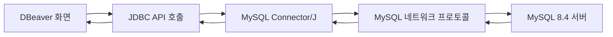
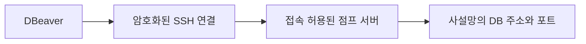

# R06. DB 클라이언트 도구 — DBeaver는 무엇이고 왜 여러 DB에 붙을 수 있나

> 3줄 요약 — DBeaver는 DB 서버가 아니라 접속·SQL 실행·결과 확인·스키마 탐색을 돕는 데스크톱 DB 클라이언트다.  
> MySQL·PostgreSQL·Oracle 같은 관계형 DB는 각 DB용 JDBC 드라이버가 서로 다른 네트워크 프로토콜을 JDBC 호출로 연결해 준다.  
> 운영 접속은 읽기 전용 권한, 구분되는 연결 색, 수동 트랜잭션, 결과 반출 제한을 함께 적용한다.

## 1. 한 줄로 말하면

DBeaver는 DB 서버에 네트워크로 접속해 SQL을 보내고, 결과와 스키마 정보를 사람이 탐색·편집·내보내기 쉽게 보여 주는 범용 DB 클라이언트다. MySQL과 PostgreSQL처럼 서로 다른 서버에 붙는 까닭은 DB마다 맞는 드라이버를 사용하기 때문이다.

개발자는 매번 터미널 명령과 접속 옵션을 외우는 대신 한 화면에서 연결, SQL 편집, 결과 표, ERD, 데이터 편집을 이어서 쓸 수 있다. DBeaver를 닫아도 DB 서버와 데이터는 별도로 계속 존재한다.

## 2. 당장 알아야 할 것

1. **연결 정보는 서버의 주소와 계정이다.** 로컬 DB라면 `127.0.0.1`은 내 컴퓨터를 뜻하고 포트는 호스트에 공개된 포트다. 컨테이너 안의 MySQL 포트 `3306`과 내 컴퓨터의 공개 포트가 같다는 보장은 없다. 저장소의 연습용 Compose는 `13307:3306`으로 공개한다.

   ```text
   Host: 127.0.0.1   Port: (호스트에 공개된 포트)
   Database: ds_practice   User: practice
   ```

   브리프가 지정한 접속 예시는 포트 `13306`이다. 저장소의 `practice/starter/compose.yaml`을 실행한 경우 실제 공개 포트는 `13307`이므로 그 환경에서는 `13307`을 입력한다. 다른 포트로 설정된 MySQL을 `13306`으로 접속하면 연결 실패가 정상이다.

2. **드라이버는 DB 종류별 통역기이자 네트워크 클라이언트 코드다.** DBeaver에서 MySQL 연결을 처음 만들면 Connector/J가 없을 때 내려받도록 안내한다. PostgreSQL에는 PostgreSQL JDBC 드라이버, Oracle에는 Oracle JDBC 드라이버가 필요하다. 드라이버는 SQL 문법을 하나로 통일하지 않는다. DB별 SQL 차이, 인증, 데이터 형식은 그대로 남는다.

3. **JDBC는 관계형 DB 연결의 공통 Java 인터페이스다.** 클라이언트가 `Connection`, `Statement`, `ResultSet`에 해당하는 방식으로 드라이버를 호출하면 드라이버가 해당 DB의 프로토콜로 요청하고 응답을 변환한다. DBeaver는 이 결과와 메타데이터를 공통 화면으로 그린다. 그래서 PostgreSQL 쿼리가 MySQL에서 그대로 실행된다는 뜻은 아니다.

4. **MongoDB는 예외를 구분해서 이해한다.** MongoDB는 문서형 NoSQL이며 쿼리 모델도 관계형 SQL과 다르다. DBeaver PRO 지원 목록에는 MongoDB가 있다. 전용 연결 구현이 있어도 모든 DB가 같은 JDBC API나 SQL을 쓰는 것은 아니다. MongoDB 문서는 `db.collection.find(...)` 예를 별도로 안내한다.

5. **SQL 실행은 DB 서버가 한다.** DBeaver는 쿼리를 보내고 실행 결과를 받아 표로 보여 준다. 오래 걸리는 쿼리의 부하도 DB 서버에서 발생한다. 결과 행 제한은 화면 표시량만 줄이는 설정일 수 있으므로 큰 테이블에서 `SELECT *`를 먼저 실행하지 않는다.

6. **연결 창의 기능은 단순 조회를 넘어선다.** Navigator에서 데이터베이스·스키마·테이블·컬럼·인덱스·외래 키를 둘러보고, 테이블 데이터 보기, 쿼리 편집기, ERD, 데이터 편집과 내보내기를 할 수 있다. ERD의 관계선은 서버에 정의된 외래 키 메타데이터를 바탕으로 그려진다. DB에 외래 키 제약이 없으면 실제 업무상 관계가 있어도 자동으로 연결선이 나타나지 않을 수 있다.

7. **셀 편집은 서버 데이터 변경이다.** 결과 표에서 값을 바꾸고 저장하면 단순히 로컬 파일만 바뀌는 게 아니다. 변경 전후 행과 커밋 여부를 확인한다. 연습 데이터도 수정 예제에는 트랜잭션과 `ROLLBACK`을 사용한다. 운영에서는 클라이언트의 편집 기능 자체를 제한하는 편이 낫다.

8. **기본값 추천 — 로컬은 DBeaver Community + 연습 계정, 운영은 읽기 전용 계정을 쓴다.** 유료 커넥터는 플랜 지원 목록을 확인한다. 운영 연결은 read-only와 auto-commit off로 두고 Production 유형·별도 색(예: 빨강)으로 구분한다. 실행 전 SQL·조건·영향 행을 검토하고 대량 UPDATE/DELETE를 바로 실행하지 않는다. 결과 반출은 최소 컬럼만 허용한다.

9. **DBeaver는 앱의 DB 드라이버 설정을 대신하지 않는다.** 앱 연결은 별도 빌드 설정이다. Gradle Kotlin DSL은 `runtimeOnly("com.mysql:mysql-connector-j")`, Maven은 같은 좌표의 `<dependency>`를 쓴다. 버전과 접속 설정은 → P19 참조. DBeaver만 쓸 때 앱 빌드는 바꾸지 않는다.

## 3. 따라 하기

아래는 Spring Boot 4.1 / Java 25 앱 변경이 아닌 로컬 DB 클라이언트 실습이다. 연습 DB는 `ds_practice`이며 SQL 결과는 **(예상)**이다. MySQL·Docker는 실행하지 않았다.



드라이버는 클라이언트 구성의 일부다. SQL 실행 계획과 권한, 데이터 변경은 MySQL 서버의 규칙과 계정 권한에 따라 결정된다.

### 1단계 — 실행 중인 연습 DB의 포트와 계정 확인

이 저장소의 `practice/starter/compose.yaml`에는 아래 값이 설정되어 있다.

| 항목 | 값 | 의미 |
|---|---|---|
| DB 이름 | `ds_practice` | 연결 후 선택할 데이터베이스 |
| 사용자 | `practice` | 연습용 일반 계정 |
| 비밀번호 | `practice` | 로컬 연습 전용, 운영에 재사용 금지 |
| 호스트 공개 포트 | `13307` | `13307:3306` 중 왼쪽 값 |
| 컨테이너 포트 | `3306` | MySQL 서버가 컨테이너 안에서 받는 포트 |

브리프 예시 `13306`은 해당 포트가 실제 공개된 환경에서 쓴다. starter Compose를 실행했다면 `13307`을 입력한다. 현재 포트 매핑을 기준으로 선택한다.

**확인 방법:** Compose 설정의 `ports`가 `"13307:3306"`이면 DBeaver에는 `13307`을 입력한다. 이 문서에서는 컨테이너 시작이나 `mysql` CLI 실행을 요구하지 않는다.

### 2단계 — DBeaver에서 연결 만들기

1. **Database → New Database Connection**을 선택하고 드라이버에서 **MySQL**을 고른다.
2. 파일이 없으면 **Download**를 눌러 JDBC 드라이버를 가져온다. 다운로드 실패 시 프록시와 네트워크를 확인하고, 임의 사이트에서 JAR을 받지 않는다.
4. 연결 폼에 아래 기본값을 입력한다. 포트는 1단계에서 확인한 값으로 맞춘다.

   | 필드 | 입력 |
   |---|---|
   | Host | `127.0.0.1` |
   | Port | 브리프 예시 `13306` 또는 starter Compose 사용 시 `13307` |
   | Database | `ds_practice` |
   | Username / Password | starter Compose 기준 `practice` / `practice` |

5. **Test Connection**을 누른다. 성공하면 마법사를 완료하고 Navigator에서 연결을 펼친다. 실패하면 에러와 포트 매핑을 대조한다.

**확인 방법:** 연결 아이콘이 활성화되고 Navigator에서 `ds_practice` 아래의 테이블을 확인할 수 있어야 한다. `member`, `product`, `orders`, `order_item`, `payment`는 연습 스키마에 정의된 테이블이다.

### 3단계 — 문자셋과 로컬 공개키 검색 옵션

연결을 우클릭해 **Edit Connection → Driver Properties**에서 `characterEncoding=UTF-8`로 둔다. Connector/J 속성이므로 연결 후 조회로 현재 DB와 문자셋을 확인한다.

```sql
SELECT DATABASE() AS current_database,
       @@character_set_connection AS connection_charset,
       @@collation_connection AS connection_collation;
```

**(예상)** 현재 DB는 `ds_practice`, 문자셋은 UTF-8 계열이다. collation은 서버 설정에 따라 다르다. 스키마와 seed는 `utf8mb4`를 사용한다.

MySQL 8 인증에서 아래 오류가 나오고 TLS를 사용하지 않는 로컬 연습 환경이라면 **Driver Properties**에서 `allowPublicKeyRetrieval=true`를 설정한 뒤 다시 테스트할 수 있다. 드라이버 속성 목록에 없으면 연결 URL의 query parameter로 추가한다.

```text
jdbc:mysql://127.0.0.1:13306/ds_practice?characterEncoding=UTF-8&allowPublicKeyRetrieval=true
```

위 URL은 브리프의 `13306` 예시다. 실제 starter Compose에는 `13307`을 넣는다. MySQL Connector/J에서 `allowPublicKeyRetrieval` 기본값은 `false`다.

이 옵션은 TLS 없이 인증할 때 서버에서 RSA 공개키를 가져오는 handshake를 허용하므로 운영 연결에 습관처럼 켜지 않는다. 운영은 검증 가능한 인증서가 설정된 TLS를 구성하고, 공개키 검색을 허용하지 않아도 되는 인증 구성을 사용한다.

**확인 방법:** 연결 성공 및 `current_database=ds_practice`를 확인한다. 글자가 깨지면 원본 저장 값과 드라이버 문자셋을 점검한다.

### 4단계 — 테이블을 살펴보고 쿼리 결과 읽기

Navigator에서 `ds_practice`를 펼치고 `Tables → member`를 열면 컬럼과 제약 조건을 탐색할 수 있다. SQL Editor를 열어 다음 조회를 실행한다. 스키마에 있는 `member_status`, `created_at`, `login_id`, `name` 컬럼만 사용한다.

```sql
SELECT id, login_id, name, member_status, created_at
FROM member
WHERE member_status = 'ACTIVE'
ORDER BY created_at DESC
LIMIT 20;
```

**(예상)** 결과 그리드에 활성 회원의 최대 20행이 표시된다. 행을 더블클릭하면 데이터 편집기가 열리지만, 이 조회에서는 값을 바꾸지 않는다. 컬럼 헤더 정렬이나 필터를 사용해도 SQL이 어떻게 바뀌었는지 확인하면 학습에 도움이 된다.

**확인 방법:** 행 수와 컬럼명을 본다. 제한을 늘릴 때는 WHERE와 조회 컬럼을 먼저 좁히고 무제한 `SELECT *`를 피한다.

### 5단계 — 안전하게 데이터 편집 연습하기

그리드에서 데이터 편집 기능을 익힐 때도 쿼리가 어떤 행을 바꾸는지 명확히 제한한다. 아래는 `product`의 `id=1` 행에서 수량만 잠시 늘려 본 뒤 되돌리는 예다. 테이블의 `id`, `stock`, `name` 컬럼은 스키마에서 확인했다.

```sql
START TRANSACTION;

UPDATE product
SET stock = stock + 1
WHERE id = 1;

SELECT id, name, stock
FROM product
WHERE id = 1;

ROLLBACK;
```

**(예상)** 조회 중에는 재고가 1 증가한 것처럼 보이고 `ROLLBACK` 후에는 원래 값으로 돌아간다. 실제로 이 SQL을 문서 검수 과정에서 실행하지 않았다. DDL처럼 MySQL에서 암묵적으로 커밋될 수 있는 문장은 롤백 보호로 간주하지 않는다. 운영 데이터는 이 실습을 실행하지 말고 승인된 절차를 따른다.

**확인 방법:** UPDATE 행 수와 최종 `ROLLBACK`을 확인한다. auto-commit off여도 `COMMIT`을 누르면 변경은 확정된다.

### 6단계 — ERD와 CSV 내보내기

1. 테이블 또는 스키마를 선택하고 컨텍스트 메뉴에서 **ER Diagram** 생성 항목을 연다. 외래 키가 있으면 테이블 사이 관계를 볼 수 있다. 다이어그램이 실제 업무 관계 전부를 추측해서 채워 주지는 않는다.
2. 결과 그리드 또는 테이블에서 **Export Data**를 선택한다.
3. 필요한 행과 컬럼만 선택하고 CSV 같은 형식을 고른다. 저장 위치, 문자 인코딩, 헤더 포함 여부를 확인한 뒤 내보낸다.

**확인 방법:** ERD에서 `orders → order_item`의 외래 키를 확인한다. CSV는 직접 열어 컬럼명과 한글이 올바르게 표시되는지 확인하되, `member.email`, `member.phone`, 배송 주소처럼 개인을 식별할 수 있는 데이터는 업무 승인 없이 로컬 파일이나 공유 폴더로 내보내지 않는다.

### 원격 DB — SSH 터널과 TLS

원격 DB 포트를 인터넷에 직접 열어 두는 대신 SSH 터널을 쓸 수 있다. Connection 설정의 **SSH** 탭에서 점프 서버의 주소·포트(보통 SSH 서비스 포트)·사용자와 SSH 키를 지정한다. DB 탭에는 점프 서버에서 도달할 수 있는 DB의 사설 주소와 DB 포트를 입력한다. SSH 계정은 DB 계정과 별개다.



SSH는 네트워크 경로를 보호하지만 DB TLS와 계정 권한을 대신하지 않는다. SSL 탭에서 CA 인증서와 호스트명을 검증하고, 사설 인증서는 조직이 제공한 CA를 사용한다. 운영에서 **Skip host name validation**이나 인증서 검증 해제로 오류를 숨기지 않는다. 연결 테스트로 설정을 확인한다.

## 4. 치트시트

| 이름 | 용도 | 예시 | 주의 |
|---|---|---|---|
| New Database Connection | 새 서버 연결 만들기 | MySQL → host/port/database 입력 | 연결 이름·계정·서버 주소를 다시 확인 |
| JDBC Driver | RDBMS별 연결 라이브러리 | MySQL → Connector/J | 드라이버만 바꿔도 DB별 SQL 차이는 남음 |
| Test Connection | 접속 가능 여부 점검 | 연결 폼의 버튼 | 쿼리 권한과 원하는 스키마 권한은 별도 |
| SQL Editor | 쿼리 작성·실행 | `SELECT ... FROM orders` | 결과 행 수와 실행 대상을 확인 |
| Navigator | 객체 탐색 | tables, columns, indexes | 필터 설정이 객체를 숨길 수 있음 |
| ER Diagram | 관계 구조 보기 | `orders`, `order_item` 확인 | 실제 외래 키가 있어야 자동 관계선 표시 |
| Data Editor | 행 조회·수정 | 테이블 더블클릭 | 셀 저장은 DB 데이터를 변경할 수 있음 |
| Auto-commit | 문장별 자동 커밋 제어 | 툴바에서 수동 모드 확인 | 끄기만으로 대량 변경을 안전하게 만들지 못함 |
| SSH Tunnel | 사설망 DB 경유 | SSH 탭 + DB 사설 주소 | SSH 계정과 DB 계정은 별개 |
| SSL/TLS | DB 연결 암호화와 서버 검증 | CA 인증서, hostname 검증 | 인증서 검증을 비활성화해 운영 연결하지 않음 |
| Export Data | 조회 결과 파일로 내보내기 | 선택한 행을 CSV로 저장 | 필요 최소 컬럼만, 개인정보 별도 통제 |
| CLI | 빠른 접속·스크립트 실행 | `mysql -h 127.0.0.1 -P 13307 -u practice -p ds_practice` | MySQL 전용, 비밀번호를 명령 기록에 쓰지 않음 |

## 5. 자주 나는 에러와 해결

1. **`Public Key Retrieval is not allowed` →** TLS 없이 인증하는 과정에서 서버 공개키 검색이 필요하지만 Connector/J 기본값이 검색을 막는다 → 로컬 개발에서만 연결이 신뢰 가능한지 확인하고 `allowPublicKeyRetrieval=true`를 적용한다. 운영에서는 TLS와 인증서 검증을 설정한다.

2. **`Access denied for user '...'@'...'` →** 사용자명·암호가 다르거나, 그 계정이 접속 출처 또는 `ds_practice` 권한을 갖지 않는다 → 실제 환경의 자격 증명을 확인하고 최소 권한을 부여받는다. 권한 문제를 root 접속으로 우회하지 않는다.

3. **`Communications link failure` / `Connection refused` →** 서버가 꺼져 있거나 주소·포트가 다르거나, 컨테이너 포트가 호스트로 공개되지 않았다 → 브리프 예시 `13306`과 Compose의 `13307:3306`을 구분하고, 현재 실행 환경이 공개한 포트를 사용한다. 로컬 DB 접속에서 `localhost` 대신 `127.0.0.1`을 지정하면 주소 해석 혼선을 줄일 수 있다.

4. **`Public Key Retrieval` 대신 `No suitable driver` / 드라이버 다운로드 실패 →** 드라이버 라이브러리가 없거나 네트워크·프록시가 Maven 저장소 접근을 막는다 → DBeaver Driver Manager에서 MySQL 드라이버 상태와 프록시 설정을 확인하고, 조직이 승인한 경로에서만 드라이버를 설치한다.

5. **`The server time zone value ... is unrecognized` 또는 날짜·시각 오프셋이 다름 →** 드라이버와 MySQL 서버의 시간대 해석이 맞지 않는다 → 서버와 팀 표준을 확인하고 `serverTimezone=Asia/Seoul` 또는 UTC처럼 명시된 시간대를 연결 속성으로 맞춘다. 로컬 시계와 운영 DB 시각이 같다고 가정하지 않는다.

6. **한글이 깨지거나 `LIKE '%회원%'`가 검색되지 않음 →** 드라이버 연결 문자셋과 이미 저장된 바이트가 다르거나, 적재 당시 문자셋이 잘못됐다 → DBeaver에서 `characterEncoding=UTF-8`을 확인하고 `SELECT name, HEX(name) FROM member LIMIT 1;`로 저장 바이트를 본다. 기존 데이터가 잘못 인코딩됐으면 설정 변경만으로 원문이 자동 복구되지는 않는다.

7. **테이블이 보이지 않음 또는 빈 Navigator →** 잘못된 database/schema를 선택했거나 계정이 해당 객체를 볼 권한이 없고, Navigator 필터가 숨겼을 수 있다 → `SELECT DATABASE();`로 현재 DB를 확인하고 객체 필터와 `SHOW TABLES;` 결과를 대조한다. 실제 권한이 없는 경우 DB 관리자에게 필요한 범위만 요청한다.

## 6. 한 단계 더

DBeaver의 연결은 `화면 → DB별 드라이버 → DB 프로토콜 → 서버`로 이어진다. JDBC는 RDBMS 사이에서 연결과 결과를 다루는 공통 Java API를 제공하지만 SQL 방언, 인증 설정, 트랜잭션 기능을 같게 만들지는 않는다. 연결 폼은 기본 접속 정보를 저장하고, Driver Properties는 DB별 드라이버 추가 옵션을 전달한다.

ERD는 스키마 메타데이터를 보여 주며 서버 스키마를 대신 정의하지 않는다. SSH는 네트워크 경로, TLS는 통신 암호화와 서버 신원 검증을 담당한다. 계정 권한은 이 모든 UI 옵션보다 강한 안전 경계다.

| 도구 | 맞는 상황 | 특징 |
|---|---|---|
| DBeaver Community / PRO | 서로 다른 DB를 오가는 GUI 작업 | Community는 일반 RDBMS 시작점, PRO 지원 목록에는 MongoDB 포함. 플랜별 차이 확인 |
| DataGrip | DB 중심 개발 | JetBrains 독립 DB IDE, 데이터 소스·세션·쿼리 작업 |
| IntelliJ Database | 앱 코딩과 DB 탐색을 함께 함 | IDE에 통합된 DB 도구. 상세 기능은 에디션별로 확인 |
| MySQL Workbench | MySQL 개발·관리 | MySQL 전용 SQL·관리·성능 분석 |
| pgAdmin | PostgreSQL 관리 | PostgreSQL 전용 객체 관리·쿼리 도구 |
| TablePlus | 여러 관계형 DB GUI | 다중 DB 연결, 데이터 행 편집·가져오기·내보내기 |
| `mysql` / `psql` | 반복 실행·자동화·원격 셸 | 각각 MySQL·PostgreSQL 전용 CLI, 명령·옵션을 직접 다룸 |

에디션별 지원 목록을 확인한다. DB 서버 → R01, 앱 연결 → P19, IntelliJ → P15 참조.

## 7. 자가점검 Q&A (면접 대비)

### Q1. DBeaver가 꺼져 있어도 MySQL 데이터는 남는가?

**답:** 남는다. DBeaver는 요청을 전달하고 결과를 보여 주는 클라이언트이고 실제 저장은 MySQL 서버가 맡는다. 연결을 끊어도 이미 커밋된 데이터는 서버에 유지된다. 열린 트랜잭션과 편집 중 변경은 커밋 여부를 확인해야 한다.

**꼬리질문:** DBeaver에서 조회하면 쿼리는 어디서 실행되는가? → MySQL 서버에서 실행되고 DBeaver는 결과를 전달받아 표시한다.

### Q2. 한 프로그램이 MySQL, PostgreSQL, Oracle에 붙는 원리는 무엇인가?

**답:** 각 DB용 드라이버가 서버별 네트워크 프로토콜을 처리한다. RDBMS 연결에서는 JDBC 인터페이스를 통해 연결·문장 실행·결과와 메타데이터를 전달한다. DBeaver는 드라이버 위에 공통 편집기와 결과 UI를 제공한다. DB 고유 SQL과 데이터 타입 차이는 사라지지 않는다.

**꼬리질문:** JDBC가 SQL을 표준 문법 하나로 바꾸는가? → 아니다. JDBC는 주로 호출 API의 공통성을 제공하고 SQL 방언은 각 서버가 해석한다.

### Q3. 로컬에서 `allowPublicKeyRetrieval=true`를 켰다면 운영에도 켜도 되는가?

**답:** 운영에 그대로 복사하지 않는다. Connector/J의 기본값은 `false`이며 이 속성은 암호화되지 않은 인증 중 서버 공개키를 가져오는 handshake를 허용한다. 운영은 검증된 TLS와 적절한 키·인증서 구성을 사용한다. 왜 속성이 필요한지 서버 인증 방식과 함께 확인한다.

**꼬리질문:** SSH 터널을 쓰면 DB TLS가 불필요한가? → SSH가 네트워크 경로를 암호화해도 DB 서버 인증서 검증과 DB 권한은 별개다.

### Q4. 컨테이너 안 MySQL이 3306인데 DBeaver에는 왜 13307을 입력할 수 있는가?

**답:** 포트 매핑의 왼쪽은 호스트 포트, 오른쪽은 컨테이너 포트다. `13307:3306`이면 호스트의 `127.0.0.1:13307`로 들어온 요청이 컨테이너 `3306`에 전달된다. 같은 컴퓨터에서 실행하는 GUI는 호스트 쪽 공개 포트를 사용한다. 실제 포트 매핑을 확인하고 입력한다.

**꼬리질문:** starter Compose에서 사용할 포트는? → 현재 설정 기준 `13307`이며, `13306`은 실행 환경이 그 포트를 공개했을 때 사용한다.

### Q5. DBeaver의 read-only와 auto-commit off 중 무엇이 운영 안전을 보장하는가?

**답:** 둘 중 하나만 믿지 않는다. DB 계정을 읽기 전용으로 만들어 권한을 제한하고, 클라이언트 연결에도 read-only를 설정해 실수 가능성을 줄인다. auto-commit을 끄면 변경을 검토하고 되돌릴 여지가 있지만 잘못 커밋하거나 트랜잭션 밖에서 실행할 위험은 남는다. 운영 연결 색과 SQL 사전 검토를 더한다.

**꼬리질문:** auto-commit off면 DDL도 언제나 rollback되는가? → 아니다. MySQL은 일부 DDL에서 암묵적 커밋이 일어나므로 변경 가능성을 따로 확인해야 한다.

### Q6. 조회 결과를 CSV로 보내 달라는 요청을 받으면 무엇을 확인하는가?

**답:** 목적, 허용된 수신자, 꼭 필요한 행·컬럼인지 확인한다. 회원 이메일·전화번호나 배송 주소는 개인정보일 수 있어 기본적으로 제외하고, 승인된 저장 위치와 전송 절차를 쓴다. 결과 그리드 전체를 무심코 내보내지 않는다. 내보낸 파일의 접근 권한과 보관 기간도 따른다.

**꼬리질문:** 조회가 read-only이면 CSV 반출도 자동으로 안전한가? → 아니다. 데이터 변경 권한과 개인정보 반출 권한은 다른 통제다.

## 8. 참고문헌

- DBeaver Create connection — https://dbeaver.com/docs/dbeaver/Create-Connection/ — 연결과 보안 옵션.
- DBeaver MySQL — https://dbeaver.com/docs/dbeaver/Database-driver-MySQL/ — MySQL 지원 기능과 객체 탐색.
- DBeaver SSH configuration — https://dbeaver.com/docs/dbeaver/SSH-Configuration/ — SSH 터널 설정.
- DBeaver SSL configuration — https://dbeaver.com/docs/dbeaver/SSL-Configuration/ — 인증서와 SSL 옵션.
- DBeaver PRO supported databases — https://dbeaver.com/databases/ — PRO DB 지원 목록.
- DBeaver MongoDB — https://dbeaver.com/docs/dbeaver/MongoDB/ — MongoDB 쿼리 예.
- JetBrains DataGrip: Connection to a database — https://www.jetbrains.com/help/datagrip/connecting-to-a-database.html — 데이터 소스와 세션.
- MySQL Connector/J Security properties — https://dev.mysql.com/doc/connector-j/en/connector-j-connp-props-security.html — 공개키 검색 옵션과 기본값.
- MySQL Workbench — https://www.mysql.com/products/workbench/ — MySQL용 SQL·관리 기능.
- pgAdmin — https://www.pgadmin.org/ — PostgreSQL 관리·쿼리 기능.
- TablePlus — https://tableplus.com/ — 관계형 DB 연결과 데이터 편집·반출.
