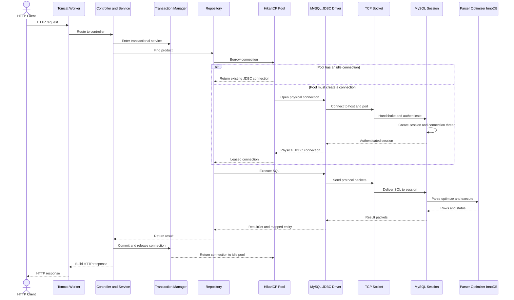
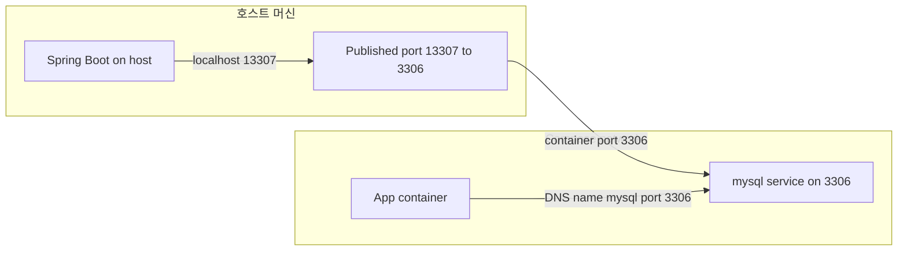

# R08. 앱 서버와 DB 서버는 어떻게 연결되나 — 요청 하나가 DB까지 가는 전체 그림

> 요청 스레드는 풀에서 이미 연결된 JDBC 커넥션을 빌려 SQL을 보내고, MySQL 세션이 결과를 돌려주면 트랜잭션 종료 시 커넥션을 풀에 반납한다.
> 접속 주소의 `localhost`는 앱 프로세스가 실행되는 네트워크 공간을 가리킨다. 앱과 DB가 어디서 실행되는지에 따라 주소와 포트가 달라진다.
> Tomcat 스레드 수·Hikari 풀 크기·MySQL `max_connections`는 앱 인스턴스 수까지 곱해 맞춰야 한다. 풀을 키우는 것만으로 DB 처리량이 늘지는 않는다.

## 1. 한 줄로 말하면

Spring Boot 앱은 JDBC 드라이버로 MySQL에 TCP 연결을 만들고, 요청 처리 중 HikariCP에서 커넥션을 빌려 SQL과 결과를 주고받는다. 보통 물리 연결은 매 요청마다 만들지 않고 풀에 보관해 재사용하며, 서비스 트랜잭션이 끝나면 연결을 닫는 대신 풀에 돌려준다. 이 흐름으로 주소·인증·풀·DB 한도 중 막힌 층을 구분한다.

## 2. 당장 알아야 할 것

> **이 저장소에 없는 예제 프로젝트** — `practice/starter`는 원래 공부자료가 쓰던 상품 API 예제 프로젝트다(자체 `compose.yaml`: 호스트 `13307` → 컨테이너 `3306`, DB `ds_practice`, 계정 `practice`/`practice`). 이 저장소에는 없으므로 아래 경로·명령은 그런 프로젝트를 직접 만들었을 때의 예시로 읽는다. 이 저장소에서는 루트 프로젝트에 같은 패턴을 적용한다 — `./gradlew test`는 Testcontainers의 일회용 MySQL을 쓰고, 개발 DB는 루트 [`compose.yaml`](../../compose.yaml)(호스트 `localhost:13308`, 계정 `community`/`community`)이다.

### 2.1 요청 하나의 길



idle 연결이 있으면 TCP 연결과 인증을 건너뛴다. 풀에서 빌린 `Connection.close()`는 보통 소켓을 끊지 않고 풀에 반환한다. Spring MVC 요청은 DB를 기다리는 동안 Tomcat 스레드를 점유하지만, DB 연결 수는 별도로 Hikari 풀이 제한한다.

### 2.2 주소는 앱이 있는 네트워크 위치에서 정한다

`localhost`는 접속을 시도하는 프로세스 자신의 네트워크 공간이다. 컨테이너 안에서는 그 컨테이너 자신을 가리킨다.

| 배치 | 앱이 쓸 주소 | JDBC URL 예시 | 확인할 점 |
|---|---|---|---|
| 앱과 DB가 같은 머신의 프로세스 | `localhost:3306` | `jdbc:mysql://localhost:3306/ds_practice` | MySQL이 로컬 3306에서 듣는지 확인 |
| 앱은 호스트, DB는 Docker | `localhost:13307` | `jdbc:mysql://localhost:13307/ds_practice` | 호스트 포트 13307이 컨테이너 3306으로 전달됨 |
| 앱과 DB가 같은 Compose 네트워크 | `mysql:3306` | `jdbc:mysql://mysql:3306/ds_practice` | Compose 서비스 이름 `mysql`로 DNS 조회. 컨테이너끼리는 호스트 공개 포트가 아니라 컨테이너 포트를 사용 |
| 별도 앱 서버와 DB 서버 | DB의 사설 IP:3306 | `jdbc:mysql://10.0.2.15:3306/ds_practice` | 라우팅, 방화벽과 보안 그룹에서 앱 서버만 허용 |
| 관리형 DB | DB 제공자의 엔드포인트:3306 | `jdbc:mysql://db-prod.example.ap-northeast-2.rds.amazonaws.com:3306/appdb` | 사설 서브넷·보안 그룹·TLS·계정 권한을 함께 설정 |



starter는 DB만 Compose 안에 있어 호스트 앱이 `localhost:13307`을 쓴다.

### 2.3 JDBC URL과 연결 옵션

형식은 `jdbc:mysql://host:port/database?property=value`다. 호스트와 포트는 TCP 목적지, `/database`는 기본 DB, `?` 뒤는 드라이버 옵션이다. 계정은 Spring의 `username`, `password`로 분리한다.

| 옵션 | 용도와 주의 |
|---|---|
| `characterEncoding=UTF-8` | 인코딩 명시. starter 값이며 서버·테이블은 `utf8mb4`로 맞춘다. Connector/J는 자동 감지할 수도 있다. |
| `connectionTimeZone=Asia/Seoul` | 시간 변환 기준. 이것만으로 MySQL 세션 `time_zone`까지 바뀌지는 않는다. |
| `serverTimezone=Asia/Seoul` | Connector/J 8.0.23부터 `connectionTimeZone`의 별칭. 새 설정은 새 이름을 우선하고 `TIMESTAMP`·`DATETIME` 차이를 확인한다. |
| `sslMode=VERIFY_IDENTITY` | TLS와 인증서·호스트 검증을 요구한다. 기본 `PREFERRED`는 TLS 미지원 서버에서 평문으로 내려갈 수 있다. |
| `useSSL=true` | 기존 설정 호환용. 8.0.13 이후에는 `sslMode`로 보안 요구를 표현한다. |
| `allowPublicKeyRetrieval=true` | 제한된 개발 환경용. 기본 `false`; 운영에서는 TLS 또는 고정 공개키를 우선한다. |

실습 URL은 `jdbc:mysql://localhost:13307/ds_practice?characterEncoding=UTF-8&serverTimezone=Asia/Seoul`이다. 값에 `&`, `?`, `#`, 공백 같은 예약 문자가 있으면 퍼센트 인코딩한다.

### 2.4 풀은 연결을 재사용하고 동시 사용량을 제한한다

HikariCP는 TCP 핸드셰이크·인증 비용을 아끼도록 연결을 재사용하고, 풀이 차면 `connectionTimeout`까지 대기시킨다.

```yaml
spring:
  datasource:
    hikari:
      maximum-pool-size: 10
      connection-timeout: 30000
```

`@Transactional`에서 DB를 쓰면 트랜잭션이 끝날 때까지 연결을 점유한다. 느린 외부 HTTP 호출까지 같은 범위에 두면 풀이 고갈될 수 있다.

OSIV는 응답 직렬화 중 지연 로딩 SQL을 발생시킬 수 있다. 물리 커넥션을 요청 내내 고정한다는 뜻은 아니지만 추가 쿼리가 응답을 늦출 수 있다. 실습은 `open-in-view: false`다.

### 2.5 세 숫자를 맞춰라

Spring Boot 4.1.1의 공통 애플리케이션 속성 문서상 Tomcat 작업 스레드 최대값은 200이다. Boot가 관리하는 HikariCP 7.0.2의 기본 `maximumPoolSize`는 10, MySQL 8.4의 `max_connections` 기본값은 151이다. 환경에 따라 달라지므로 실제 값을 확인한다.

| 계층 | 기본값 | 의미 |
|---|---:|---|
| Tomcat `server.tomcat.threads.max` | 200 | 동시 요청을 처리할 수 있는 작업 스레드 상한 |
| Hikari `maximumPoolSize` | 10 | 앱 인스턴스 하나가 동시에 빌릴 수 있는 DB 커넥션 상한 |
| MySQL `max_connections` | 151 | 서버가 허용하는 동시 클라이언트 연결 상한 |

`앱 인스턴스 수 × maximumPoolSize ≤ MySQL max_connections − 여유분`을 맞춘다. 앱 3대와 풀 10이면 앱 연결은 최대 30개다. 배치·운영 접속분을 빼고 실제 한도를 확인한다.

Tomcat 스레드 수에 맞춰 풀을 키우지 않는다. HikariCP 안내는 작은 풀부터 부하 시험으로 조정하라는 취지이지 성능 보증식이 아니다. `active`, `pending`, DB 지연을 함께 본다.

### 2.6 타임아웃은 서로 다른 시계를 가진다

| 설정 | 무엇을 제한하나 | 기준 |
|---|---|---|
| Hikari `connectionTimeout` | 풀이 커넥션을 빌려줄 때까지 대기하는 시간 | 기본 30초, TCP 연결 제한과 다름 |
| Hikari `maxLifetime` | 풀 커넥션의 최대 수명 | HikariCP 7.0.2 기본 30분. 사용 중인 연결은 반환된 뒤 폐기 |
| Hikari `idleTimeout` | idle 풀 연결을 제거하기 전 대기하는 시간 | 기본 10분. `minimumIdle < maximumPoolSize`일 때만 축소 |
| Hikari `keepaliveTime` | idle 연결을 주기적으로 검사해 중간 장비의 idle 종료를 피하는 간격 | HikariCP 7.0.2 기본 2분. idle 전용이며 `maxLifetime`보다 짧게 |
| MySQL `wait_timeout` | 비대화형 세션이 요청 없이 idle인 채 유지되는 시간 | 기본 28,800초(8시간), 서버 설정에서 확인 |

`maxLifetime`은 DB나 중간 네트워크 장비가 연결을 끊기 전에 풀이 교체하도록 짧게 둔다. keepalive는 idle 연결만 검사하며 긴 트랜잭션에는 효과가 없다.

### 2.7 관찰할 값

```sql
SHOW PROCESSLIST;
SHOW STATUS LIKE 'Threads_connected';
SHOW VARIABLES LIKE 'max_connections';
SHOW VARIABLES LIKE 'wait_timeout';
```

`SHOW PROCESSLIST`의 `User`, `Host`, `db`, `Command`로 앱 세션을 찾는다. 요청 후 풀의 정상 idle 연결은 `Sleep`일 수 있다. Actuator 메트릭 `hikaricp.connections.active`, `.idle`, `.pending`은 빌려간 수·유휴 수·대기 스레드를 뜻한다. `pending`과 요청 지연이 함께 지속되면 긴 트랜잭션과 느린 SQL을 본다.

로컬에서 조회하려면 메트릭 endpoint를 노출한다.

```yaml
management:
  endpoints:
    web:
      exposure:
        include: health,metrics
```

`/actuator/metrics/hikaricp.connections.active`로 확인한다. 운영에서는 인증과 네트워크 접근을 제한한다.
## 3. 따라 하기

**이 저장소에서 연결을 확인하려면** javaExperience 레포 루트에서 실행한다. DB 설정 파일은 [`compose.yaml`](../../compose.yaml)이다.

```bash
docker compose up -d mysql
docker compose ps
docker compose exec -T mysql mysql -ucommunity -pcommunity practice -e "SELECT DATABASE(); SELECT COUNT(*) FROM post;"
```

`mysql`이 `healthy`이고 `DATABASE()`가 `practice`인지 확인한다. 현재 저장소의 앱 연결은 [실행 안내](../../README.md)를 따른다. 아래 상품 API·세션 수는 별도 예제 프로젝트의 절차·과거 관찰이며, 위 명령으로 그 상품 API가 준비되지는 않는다.

### 별도 상품 API 예제의 절차와 관찰

`practice/starter`는 호스트 `13307`→컨테이너 `3306`, DB `ds_practice`, 계정 `practice`/`practice`다. Boot 4.1.1이고 toolchain은 Java 21(신규 기준 Java 25)이다.

### 단계 1 — DB 시작

```bash
cd practice/starter
docker compose up -d mysql
docker compose ps
```

**확인 방법:** `mysql` 서비스가 `healthy`, 포트가 `13307->3306`인지 확인한다. 초기화가 늦으면 `docker compose logs --tail=50 mysql`을 본다.

### 단계 2 — 앱 시작

`src/main/resources/application.yml`의 URL은 `jdbc:mysql://localhost:13307/ds_practice?characterEncoding=UTF-8&serverTimezone=Asia/Seoul`이다.

```bash
./gradlew bootRun
```

**확인 방법:** 기동 로그에서 Tomcat 8080과 시작 완료를 확인한다. 실패하면 오류 표의 호스트·포트·계정·DB명을 확인한다. Maven 대응 명령은 `mvn spring-boot:run`이다.

### 단계 3 — 요청 전후 DB 연결 보기

```bash
docker compose exec mysql mysql -upractice -ppractice ds_practice -e "SHOW PROCESSLIST; SHOW STATUS LIKE 'Threads_connected'; SHOW VARIABLES LIKE 'max_connections';"
curl -i http://localhost:8080/api/products/1
docker compose exec mysql mysql -upractice -ppractice ds_practice -e "SHOW PROCESSLIST; SHOW STATUS LIKE 'Threads_connected';"
```

**확인 방법:** `(예상) API는 HTTP 200과 id, categoryId, name, price, stock 등을 포함한 JSON을 반환한다.` 세션 수는 시점에 따라 다르다. 앱의 `User`, `Host`, `db`와 요청 후 `Sleep` 연결을 확인한다. Sleep은 누수의 증거가 아니다.

실제로 돌려 본 결과(2026-10-05, starter + MySQL 8.4.11, 기본 풀 설정):

```text
요청 전  SHOW PROCESSLIST → practice@192.168.65.1:* Sleep 10줄 + 지금 이 CLI 세션 1줄
         Threads_connected = 11, max_connections = 151
요청     GET /api/products/1 → 200
요청 후  Threads_connected = 11   (그대로)
메트릭   hikaricp.connections.active=0, idle=10, pending=0
```

- **앱이 뜨자마자 커넥션 10개가 이미 열려 있다.** Hikari `minimumIdle`을 따로 주지 않으면 `maximumPoolSize`(10)와 같아서, 기동 시 10개를 채워 둔다.
- **요청을 보내도 DB 연결 수는 늘지 않는다.** 요청은 열려 있던 10개 중 하나를 빌렸다 돌려준다. 이게 풀을 쓰는 이유다.
- Host가 `192.168.65.1`인 것은 앱이 호스트(맥)에서 돌고 DB가 Docker 안에 있어서다. DB 입장에서는 Docker 런타임(VM) 내부 네트워크 주소에서 들어온 연결로 보인다(포트 포워딩 경유). 이 주소는 런타임과 환경마다 다르다.

### 단계 4 — 풀 메트릭과 쿼리 맞춰 보기

개발 설정에 `management.endpoints.web.exposure.include: health,metrics`를 추가한 뒤 조회한다.

```bash
curl http://localhost:8080/actuator/metrics/hikaricp.connections.active
curl http://localhost:8080/actuator/metrics/hikaricp.connections.pending
```

**확인 방법:** `(예상) 응답 name은 조회한 메트릭 이름이며 measurements에 현재값이 있다.` `active=0` 뒤에도 `idle`은 남을 수 있다. 지속적인 `pending`과 요청 지연을 본다.

상품 단건 조회가 사용하는 스키마 컬럼은 다음과 같다.

```sql
SELECT p.id, p.name, p.price, p.stock
FROM product p
WHERE p.id = 1 AND p.deleted_at IS NULL;
```

**결과 (예상):** seed 데이터에 있고 삭제되지 않은 id 1 상품 한 행. 이 SELECT는 데이터를 변경하지 않는다.

## 4. 치트시트

| 이름 | 용도 | 예시 | 주의 |
|---|---|---|---|
| 호스트 / Compose 주소 | DB 목적지 | `localhost:13307` / `mysql:3306` | 실행 위치에 맞춤 |
| 풀 크기 | 앱별 동시 DB 연결 상한 | `maximum-pool-size: 10` | 앱 수를 곱해 서버 한도와 비교 |
| 풀 대기 | 커넥션 빌림 제한 | `connection-timeout: 30000` | TCP 제한과 다름 |
| 풀 수명 | 연결 교체 | `max-lifetime: 1800000` | 인프라 제한보다 짧게 |
| 관찰 | 세션·대기 확인 | `SHOW PROCESSLIST`, `hikaricp.connections.pending` | Sleep은 정상일 수 있음 |
## 5. 자주 나는 에러와 해결

세부 문구는 환경에 따라 다르다. 주소부터 인증·DB명·풀 순으로 좁힌다.

| 에러 원문 또는 증상 | 계층·원인 | 확인 명령·조치 |
|---|---|---|
| `java.net.UnknownHostException: mysql` | DNS. 호스트 앱이 Compose 이름 사용 | 앱 컨테이너에서 `getent hosts mysql`; 호스트 앱은 `localhost:13307` 사용 |
| `ERROR 2003: Can't connect to MySQL server on 'host_name' (111)` / `Connection refused` | 포트에 리스너가 없거나 매핑 오류 | `docker compose ps`; `nc -vz localhost 13307` |
| `connect timed out` | 방화벽·보안 그룹·라우팅에서 응답 없음 | 앱 서버에서 `nc -vz <db-host> 3306`; DB 측 허용 규칙 확인 |
| `ERROR 1045 (28000): Access denied for user 'practice'@'...' (using password: YES)` | 암호 또는 `'user'@'host'` 권한 불일치 | `docker compose exec mysql mysql -upractice -ppractice -e "SELECT USER(), CURRENT_USER();"` |
| `Unknown database 'ds_practice'` | DB명 오타 또는 다른 MySQL 접속 | `docker compose exec mysql mysql -upractice -ppractice -e "SHOW DATABASES;"` |
| `Too many connections` | MySQL 연결 상한 소진 | `SHOW PROCESSLIST`; `SHOW STATUS LIKE 'Threads_connected'`; `SHOW VARIABLES LIKE 'max_connections'` |
| `Connection is not available, request timed out after 30000ms (total=10, active=10, idle=0, waiting=...)` | Hikari 풀 고갈·장기 대기 | `/actuator/metrics/hikaricp.connections.active`와 `.pending`; 느린 SQL·긴 트랜잭션 확인 |
| `Communications link failure` / `The last packet successfully received ...` | 세션·소켓 단절, 재시작 또는 idle 제한 초과 | MySQL error log와 `SHOW VARIABLES LIKE 'wait_timeout'`; 프록시·방화벽 제한 대조 |

Hikari의 `active=최대`, `idle=0`, `waiting>0`은 앱 풀 대기다. 새 연결 생성 시 MySQL `Too many connections`가 따라오면 서버 전체 한도를 본다. 어느 계층의 시간이 만료됐는지 먼저 가른다.
## 6. 한 단계 더

요청은 트랜잭션에서 풀 커넥션을 빌려 JDBC 소켓으로 MySQL 세션과 통신한다. 풀과 MySQL은 각자 연결 상한·idle timeout을 관리한다. 진단은 DNS → TCP → 인증 → DB명 → 세션 → 풀 대기 → SQL 지연 순으로 좁힌다.

DBMS 내부는 → R01, JDBC/JPA 설정은 → P19, 트랜잭션은 → S08, 네트워크는 → D02, 서버 용량은 → D15 참조.

## 7. 자가점검 Q&A (면접 대비)

### Q1. 매 요청마다 새 연결을 만들면 안 되나?

TCP 핸드셰이크·인증·세션 초기화가 반복돼 지연과 DB 부하가 커진다. Hikari 풀은 물리 연결을 재사용하고 동시 DB 접속을 제한한다.

**꼬리질문:** `Connection.close()`는 소켓을 끊나? 풀 연결은 보통 닫는 대신 풀에 반환한다.

### Q2. Tomcat 200, Hikari 10이면 나머지 요청은?

DB 연결을 못 얻으면 요청은 풀에서 대기하고 `connectionTimeout` 뒤 실패한다. Tomcat은 요청, Hikari는 DB 연결 상한이다.

**꼬리질문:** Tomcat을 10으로 낮추면 해결되나? 전체 요청과 DB 비사용 요청도 있으므로 `pending`과 쿼리 지연을 보고 정한다.

### Q3. Compose 앱은 왜 `localhost:13307` 대신 `mysql:3306`을 쓰나?

컨테이너의 `localhost`는 자기 자신이다. 같은 Compose 네트워크의 서비스명 DNS를 쓰며 컨테이너 포트 3306으로 연결한다.

**꼬리질문:** 호스트 앱 주소는? 호스트 포트 매핑인 `localhost:13307`이다.

### Q4. 트랜잭션 안의 외부 HTTP 호출이 풀에 미치는 영향은?

응답을 기다리는 동안 서비스 트랜잭션과 연결 반환이 늦어져 다른 요청이 풀에서 대기한다. DB 작업과 외부 호출이 같은 트랜잭션에 묶이지 않게 경계를 검토한다.

**꼬리질문:** `keepaliveTime`으로 고칠 수 있나? 아니다. keepalive는 idle 연결용이며 빌려간 연결은 검사하지 않는다.

### Q5. 앱 3대, 풀 60이면 MySQL 기본 한도 안에 들어오나?

최대 앱 연결은 180개다. MySQL 8.4 `max_connections` 문서 기본값 151보다 많고 다른 접속분도 있어 초과할 수 있다.

**꼬리질문:** 서버 한도만 올리면 되나? DB 처리량·메모리·쿼리 경합을 측정해 풀과 서버 설정을 함께 정한다.

### Q6. `active=0`이면 DB 연결이 없다는 뜻인가?

아니다. 풀에서 빌려 쓰는 연결이 0이라는 뜻이며 `idle` 연결은 남아 재사용될 수 있다. DB에서는 그 연결이 `Sleep`으로 보일 수 있다.

**꼬리질문:** `pending>0`이면? 빌리려는 스레드가 대기 중이므로 지속 여부와 요청 지연을 함께 본다.

## 8. 참고문헌

- HikariCP About Pool Sizing — https://github.com/brettwooldridge/HikariCP/wiki/About-Pool-Sizing — 작은 풀을 부하 시험으로 조정하는 원칙.
- HikariCP 7.0.2 `HikariConfig` — https://github.com/brettwooldridge/HikariCP/blob/HikariCP-7.0.2/src/main/java/com/zaxxer/hikari/HikariConfig.java — 풀 기본값 확인.
- HikariCP 7.0.2 `HikariPool` — https://github.com/brettwooldridge/HikariCP/blob/HikariCP-7.0.2/src/main/java/com/zaxxer/hikari/pool/HikariPool.java — 대기 타임아웃 문구.
- Spring Boot 속성 — https://docs.spring.io/spring-boot/appendix/application-properties/index.html — Tomcat 스레드 기본값.
- Spring Boot Metrics — https://docs.spring.io/spring-boot/reference/actuator/metrics.html — Hikari 메트릭.
- Compose Networking — https://docs.docker.com/compose/how-tos/networking/ — 서비스 DNS.
- Connector/J URL — https://dev.mysql.com/doc/connector-j/en/connector-j-reference-jdbc-url-format.html — JDBC URL 형식.
- Connector/J Properties — https://dev.mysql.com/doc/connector-j/en/connector-j-reference-configuration-properties.html — 속성 기본값.
- Connector/J Time Instants — https://dev.mysql.com/doc/connector-j/en/connector-j-time-instants.html — 시간대 옵션.
- Connector/J Character Sets — https://dev.mysql.com/doc/connector-j/en/connector-j-reference-charsets.html — 문자셋.
- Connector/J SSL — https://dev.mysql.com/doc/connector-j/en/connector-j-reference-using-ssl.html — TLS 속성.
- MySQL Too Many Connections — https://dev.mysql.com/doc/refman/8.4/en/too-many-connections.html — 연결 한도와 여분 연결.
- MySQL Server Variables — https://dev.mysql.com/doc/refman/8.4/en/server-system-variables.html — `max_connections`, `wait_timeout` 기본값.
- MySQL Problems Connecting — https://dev.mysql.com/doc/refman/8.4/en/problems-connecting.html — 접속 오류 예시.
- MySQL Communication Errors — https://dev.mysql.com/doc/refman/8.4/en/communication-errors.html — idle 종료와 통신 오류.
