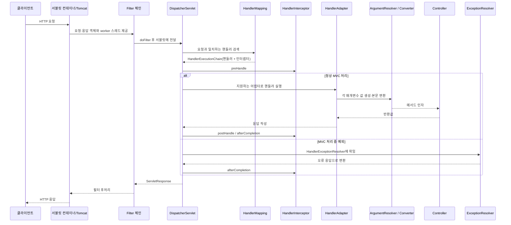

# S05. Spring MVC 요청 처리 흐름

> 요청은 서블릿 컨테이너가 받고 `DispatcherServlet`이 MVC 구성요소에 위임해 처리한다.
> 매핑, 인자 해석, 메시지 변환, 검증, 예외 처리는 서로 다른 단계이므로 실패 지점을 구분해야 한다.
> 기본 선택은 동기 Spring MVC + 내장 Tomcat이며, 병목을 계측한 뒤 스레드와 비동기 방식을 조정한다.

## 1. 왜 알아야 하나

JSON 415, CORS 오류, 업로드 500은 각각 converter, `HandlerMapping`, 서블릿 multipart 설정에서 생길 수 있다. 계층을 모르면 원인을 찾기 어렵다.

느린 외부 호출은 Tomcat worker를 점유해 정상 요청까지 밀어낼 수 있다. 스레드 최대치만 올리면 DB 커넥션 대기자가 늘어 고갈이 빨라질 수도 있다. 필터·인터셉터·AOP의 적용 경계와 응답 작성 시점을 알아야 코드 위치와 장애 원인을 맞출 수 있다.

## 2. 핵심 개념

| 용어 | 역할 | 눈여겨볼 경계 |
|---|---|---|
| 서블릿 컨테이너 | HTTP 연결을 받아 서블릿·필터·리스너를 실행한다. Boot는 기본 설정에서 내장 Tomcat을 띄운다. | 컨테이너가 먼저 요청 스레드와 서블릿 요청/응답 객체를 제공한다. |
| `DispatcherServlet` | Spring MVC의 Front Controller. 요청을 MVC 전략 객체에 위임한다. | 라우팅부터 컨트롤러 호출까지 직접 하드코딩하지 않는다. |
| `HandlerMapping` | 요청 조건에 맞는 핸들러를 찾아 인터셉터가 포함된 `HandlerExecutionChain`을 반환한다. | `@RequestMapping`의 경로뿐 아니라 메서드, 헤더, `consumes`, `produces` 조건도 후보를 좁힌다. |
| `HandlerAdapter` | 찾은 핸들러 타입을 실제 실행한다. | DispatcherServlet이 특정 컨트롤러 인터페이스나 어노테이션에 종속되지 않도록 하는 확장 지점이다. |
| `HandlerMethodArgumentResolver` | 컨트롤러 매개변수를 요청·세션·모델 등에서 만든다. | `@RequestParam`, `@PathVariable`, `@RequestBody`, `@ModelAttribute`가 대표 사례다. |
| `HttpMessageConverter` | HTTP 본문 바이트를 객체로 읽거나 객체를 응답 본문 바이트로 쓴다. | 요청의 `Content-Type`과 응답 협상의 `Accept`가 변환기 선택에 관여한다. |
| `HandlerExceptionResolver` | MVC 처리 중 발생한 예외를 HTTP 응답, 다른 핸들러 또는 뷰로 바꾼다. | `@ExceptionHandler`/`@ControllerAdvice`도 MVC 예외 해석 흐름 안에 있다. |
| 필터 / 인터셉터 / AOP | 각각 서블릿 체인 / MVC 핸들러 체인 / Spring 빈 호출 경계를 가로챈다. | 실행 단계와 적용 대상이 다르다. |
| 요청 검증 | 바인딩된 값과 Bean Validation 제약을 검사한다. | 개별 인자 검증 예외와 메서드 검증 예외를 나눠 처리한다. |
| CORS / 멀티파트 | 출처가 다른 브라우저 요청의 정책 검사 / 요청의 여러 파트와 파일 파싱이다. | 컨트롤러보다 앞선 매핑 및 컨테이너 설정이 필요할 수 있다. |

### 필터, 인터셉터, AOP 비교

| 구분 | 필터 (`jakarta.servlet.Filter`) | `HandlerInterceptor` | Spring AOP |
|---|---|---|---|
| 호출 주체와 위치 | 서블릿 컨테이너, `DispatcherServlet` 바깥 | `HandlerMapping`이 고른 MVC 핸들러 체인 | Spring AOP 프록시를 거친 빈 메서드 호출 |
| 적용 대상 | URL에 매핑된 서블릿 요청. 정적 리소스나 다른 서블릿도 포함 가능 | MVC 핸들러가 매핑된 요청 | 포인트컷에 맞고 프록시를 통과하는 Spring 빈 호출 |
| 주 용도 | 요청 ID, 인코딩, 원시 요청/응답 처리, 필터 기반 보안 | 핸들러별 타이밍·감사·요청 메타데이터 | 서비스 메서드의 트랜잭션·권한·재시도 등 횡단 관심사 |
| 한계 | 순서와 `ASYNC`/`ERROR` 디스패치 등록을 고려해야 함 | 핸들러 매핑이 없거나 MVC 밖이면 적용되지 않음. 응답 본문이 이미 커밋된 뒤 `postHandle`이 올 수 있음 | 자기 호출은 프록시를 통하지 않아 advice를 건너뛸 수 있음 |

## 3. 내부 동작·원리



`DispatcherServlet`은 핸들러를 찾고 실행하는 과정의 예외를 `HandlerExceptionResolver` 목록에 위임한다. 예외가 필터나 컨테이너 처리 중 발생하면 MVC `@ControllerAdvice` 바깥일 수 있다.

### 단계별 처리

1. **컨테이너와 필터** — Tomcat이 worker 스레드와 Servlet 요청/응답을 만들고 URL 매핑에 맞는 필터를 실행한다. `FilterChain.doFilter`가 다음 필터와 서블릿으로 넘기는 연결점이다.
2. **DispatcherServlet 전처리** — MVC 요청 컨텍스트·로케일을 준비하고, 설정된 multipart resolver가 파일 요청을 `MultipartHttpServletRequest`로 감싼다.
3. **매핑과 인터셉터** — `HandlerMapping`이 경로·메서드·헤더·미디어 타입 조건으로 핸들러와 `HandlerExecutionChain`을 찾는다. `preHandle=false`면 핸들러를 건너뛴다. CORS 프리플라이트는 매핑 단계에서 바로 답할 수 있다.
4. **어댑터와 인자** — `HandlerAdapter`가 핸들러 형태에 맞춰 호출을 위임받는다. argument resolver는 `@PathVariable`, `@RequestParam`, `@ModelAttribute`, `@RequestBody` 등의 인자를 만들고, 본문은 타입·미디어 타입에 맞는 `HttpMessageConverter`가 읽는다. 바인딩된 입력에는 Bean Validation이 적용된다.
5. **반환값과 예외** — 뷰 반환은 렌더링 경로로, `@ResponseBody`/`ResponseEntity`는 converter 경로로 간다. 본문은 `postHandle`보다 먼저 커밋될 수 있다. MVC 예외는 `HandlerExceptionResolver`가 `@ExceptionHandler`, `@ControllerAdvice` 또는 기본 처리기로 응답화하고, 인터셉터·필터 후처리 뒤 컨테이너가 반환한다.

DispatcherServlet은 순서를 조율하고 실제 핸들러 실행은 `HandlerAdapter`에 맡기므로 서로 다른 핸들러 방식을 연결할 수 있다. resolver는 인자 출처를, converter는 HTTP 본문 표현을 맡아 각각 독립적으로 확장된다.

## 4. 코드로 확인

아래 예제는 Spring Boot 4.1 / Spring Framework 7 기준이며 미실행이다. import는 예제 전체에 공통이다.

```java
import jakarta.validation.Valid;
import jakarta.validation.constraints.*;
import java.net.URI;
import java.util.*;
import org.springframework.context.annotation.Configuration;
import org.springframework.http.*;
import org.springframework.web.bind.annotation.*;
import org.springframework.web.multipart.MultipartFile;
import org.springframework.web.server.ResponseStatusException;
import org.springframework.web.servlet.config.annotation.CorsRegistry;
import org.springframework.web.servlet.config.annotation.WebMvcConfigurer;
import org.springframework.web.servlet.mvc.method.annotation.ResponseEntityExceptionHandler;
```

### 예제 1 — 요청 본문 변환·검증 및 파일 파트 바인딩

`@RequestBody`는 JSON 본문을 DTO에 읽고, `@Valid`는 읽힌 객체를 검증한다. `@RequestPart`는 멀티파트 안의 JSON 메타데이터와 파일을 각각 바인딩한다.

```java
@RestController
@RequestMapping("/api")
class TicketController {
    @PostMapping("/tickets")
    ResponseEntity<Map<String, String>> create(
            @Valid @RequestBody CreateTicket request) {
        return ResponseEntity.status(HttpStatus.CREATED)
                .body(Map.of("title", request.title()));
    }

    @PostMapping(path = "/assets", consumes = MediaType.MULTIPART_FORM_DATA_VALUE)
    Map<String, Long> upload(@Valid @RequestPart("metadata") UploadMetadata metadata,
                             @RequestPart("file") MultipartFile file) {
        if (file.isEmpty()) {
            throw new ResponseStatusException(HttpStatus.BAD_REQUEST, "Empty file");
        }
        return Map.of("size", file.getSize());
    }

    record CreateTicket(@NotBlank String title, @Positive int priority) {}
    record UploadMetadata(@NotBlank String category) {}
}
```

### 예제 2 — ProblemDetail로 도메인 오류 응답

RFC 9457 표준 필드에는 `type`, `title`, `status`, `detail`, `instance`가 있다. 서비스 내부 예외를 무조건 500으로 노출하지 말고, 공개해도 되는 의미만 응답에 담는다.

```java
@RestControllerAdvice
class ApiExceptionHandler extends ResponseEntityExceptionHandler {
    @ExceptionHandler(TicketNotFoundException.class)
    ProblemDetail handleTicketMissing(TicketNotFoundException ex) {
        ProblemDetail problem = ProblemDetail.forStatusAndDetail(
                HttpStatus.NOT_FOUND, ex.getMessage());
        problem.setType(URI.create("https://api.example.com/problems/ticket-not-found"));
        problem.setTitle("Ticket not found");
        problem.setProperty("code", "TICKET_NOT_FOUND");
        return problem;
    }
}

class TicketNotFoundException extends RuntimeException {
    TicketNotFoundException(UUID id) {
        super("Ticket " + id + " was not found");
    }
}
```

`ResponseEntityExceptionHandler`를 상속하면 Spring MVC 기본 예외도 RFC 형식으로 맞춰 처리할 수 있다. 사용자 입력 문자열을 그대로 내부 예외 메시지에 넣기보다, 검증된 공개 메시지와 안정적인 오류 코드를 사용한다.

### 예제 3 — 출처를 제한한 CORS 설정

브라우저에서 필요한 출처와 메서드만 허용한다. 필터와 인터셉터는 앞 표의 적용 경계에 맞춰 별도 등록한다.

```java
@Configuration
class ApiWebConfig implements WebMvcConfigurer {
    @Override
    public void addCorsMappings(CorsRegistry registry) {
        registry.addMapping("/api/**")
                .allowedOrigins("https://app.example.com")
                .allowedMethods("GET", "POST", "PUT", "DELETE")
                .allowedHeaders("Content-Type", "Authorization")
                .allowCredentials(true)
                .maxAge(3600);
    }
}
```

인터셉터는 `addInterceptors`에서 추가하고, 필터 빈의 URL 패턴과 순서는 실제 등록 설정에서 확인한다. `postHandle`은 응답 본문이 이미 쓰였을 수 있다.

Boot에서는 서블릿 멀티파트 설정과 `MultipartResolver` 자동 구성을 사용한다. 순수 Spring MVC 설정이라면 이름이 `multipartResolver`인 resolver와 서블릿의 `MultipartConfigElement` 등록을 함께 확인한다. 업로드 용량 제한과 임시 파일 정책은 애플리케이션 및 앞단 프록시에도 설정한다.

## 5. 버전별 변화 — 왜 바뀌었나

| 시기 | 변화와 이유 |
|---|---|
| Spring Framework 6.0 (2022) | Java 17/Jakarta EE 9 기준으로 올라 Servlet·Validation 타입이 `javax.*`에서 `jakarta.*`로 이동했다. 같은 세대에 RFC 7807 `ProblemDetail`을 도입해 예외 응답 필드를 표준화했다. 근거: [6.0 릴리스 노트](https://github.com/spring-projects/spring-framework/wiki/Spring-Framework-6.0-Release-Notes), [ProblemDetail 6.0 API](https://docs.spring.io/spring-framework/docs/6.0.0/javadoc-api/org/springframework/http/ProblemDetail.html). |
| Java 21 (2023) | 가상 스레드가 JEP 444로 정식화됐다. 동기식 블로킹 요청 모델의 작성 방식을 유지하면서 대기 중인 작업의 동시성 비용을 줄이는 선택지가 생겼다. CPU 처리량이나 DB 연결 수를 늘려 주는 기능은 아니다. 근거: [JEP 444](https://openjdk.org/jeps/444). |
| Spring Framework 6.1 (2023) | MVC가 컨트롤러 메서드 파라미터의 내장 메서드 검증을 제공한다. 기존 AOP 프록시 기반 검증만으로는 컨트롤러 인자 검증과 `@Valid` 중첩 검증 경로가 갈라지고 중복 검증이 생길 수 있어, 제약 어노테이션을 직접 선언하는 MVC 경로가 추가됐다. 근거: [6.1 릴리스 노트](https://github.com/spring-projects/spring-framework/wiki/Spring-Framework-6.1-Release-Notes). |
| RFC 9457 (2023)와 현재 기준 | RFC 9457은 2023년 7월 RFC 7807을 대체했다. Spring Framework 7 문서는 현재 Problem Details 지원을 RFC 9457 기준으로 설명한다. 이 자료의 기준 조합은 Boot 4.1.1 / Framework 7.0.9이며, Boot가 관리하는 내장 Tomcat은 11.0.24다. 근거: [RFC 9457](https://www.rfc-editor.org/rfc/rfc9457.html), [MVC 오류 응답](https://docs.spring.io/spring-framework/reference/web/webmvc/mvc-ann-rest-exceptions.html), [관리 의존성 좌표](https://docs.spring.io/spring-boot/appendix/dependency-versions/coordinates.html). |

## 6. 실무 가이드

- 기본값은 **동기 Spring MVC + 내장 Tomcat + 명시적 DTO/검증 + 전역 ProblemDetail 처리**로 둔다. 대부분의 CRUD API에서 디버깅 경계가 분명하고 컨테이너·MVC 기본 통합을 활용한다.
- JSON은 `@RequestBody`, 폼/쿼리는 `@RequestParam`/`@ModelAttribute`, multipart 파트는 `@RequestPart`를 쓴다. 업로드 상한은 Servlet·애플리케이션·프록시를 맞추고 큰 파일은 스트리밍을 검토한다.
- 모든 서블릿 요청에 공통 처리를 하면 필터, 매핑된 핸들러 정보가 필요하면 인터셉터, 서비스 메서드 정책이면 AOP를 쓴다. 인증·인가 필터체인은 S12를 참조한다.
- 교차 출처 요청은 배포 출처·메서드·헤더를 제한한다. 쿠키가 필요하면 `allowCredentials(true)`와 와일드카드 출처를 함께 쓰지 않는다.
- Tomcat worker 대기가 보이면 스레드 수를 올리기 전에 CPU, 요청 시간, DB/HTTP 풀, 대기열을 함께 본다. Java 21+ 가상 스레드(JEP 444)도 DB 연결이나 CPU 한계를 없애지 않는다.
- 느린 I/O가 병목이면 먼저 호출 타임아웃과 풀을 점검한다. MVC 비동기 요청과 가상 스레드는 대기 비용을 줄이는 선택지이지 무제한 처리 보장이 아니다.
- API 리소스·상태 코드 등 REST 설계 원칙은 S06을 참조한다.

## 7. 함정·안티패턴

1. **필터를 만들었는데 특정 요청에서 빠짐** → 필터 빈 등록만으로 URL 패턴·순서·디스패치 종류가 자동으로 의도와 같아지는 것은 아니다 → Boot 필터 등록 및 URL 패턴, `REQUEST`/`ASYNC`/`ERROR` 적용을 확인하고 범위를 좁힌다.
2. **`postHandle`에서 JSON 응답 헤더·본문을 바꾸려 했지만 반영되지 않음** → `@ResponseBody`/`ResponseEntity` 본문은 어댑터 안에서 기록되거나 커밋될 수 있다 → 본문 변경은 응답 처리기·converter 단계, 원시 전후 처리는 필터처럼 맞는 확장 지점에서 수행한다.
3. **`@Valid`가 있는데 컨트롤러 제약 오류가 예상한 예외와 다름** → 단일 객체 검증은 `MethodArgumentNotValidException`, 직접 제약을 둔 메서드 검증은 `HandlerMethodValidationException`이 발생할 수 있다 → 두 예외 모두 전역 응답에 매핑하고 `@Valid`와 `@NotNull`의 역할을 구분한다.
4. **요청은 컨트롤러에 도달하지 않고 415 또는 406** → 415는 읽을 수 있는 요청 `Content-Type`/본문 조합이 없고, 406은 협상 가능한 응답 표현이 없는 경우다 → `consumes`, `produces`, `Content-Type`, `Accept`, 등록 converter를 함께 확인한다.
5. **CORS 설정을 했는데 브라우저가 응답을 차단** → 실제 요청 전에 보내는 프리플라이트가 허용되지 않거나, 자격 증명과 `*` 출처를 조합했을 수 있다 → 요청 출처·메서드·헤더를 보고 유한 출처 목록과 필요한 설정을 선언한다.
6. **멀티파트 컨트롤러 파라미터 바인딩 전에 실패** → resolver bean만 두고 컨테이너의 서블릿 multipart 설정을 빼먹었거나 크기 제한이 프록시와 다르다 → Boot/서블릿 등록, `MultipartConfigElement`, `MultipartResolver`, 애플리케이션 및 프록시 제한을 점검한다.
7. **Tomcat 스레드가 꽉 차며 API 전체 지연** → 동기 요청이 느린 DB·외부 I/O를 기다리는 동안 worker를 계속 점유한다 → 스레드만 늘리기 전에 해당 대기 원인을 줄이고 커넥션 풀/대기열/타임아웃을 함께 조정한다.
8. **필터에서 던진 예외가 `@ControllerAdvice`에 잡힐 것이라 기대** → 필터는 일반적으로 DispatcherServlet 진입 전이나 MVC 바깥에서 동작한다 → 필터에서 직접 오류 응답을 작성하거나 컨테이너 오류 처리 흐름을 구성한다.

## 8. 자가점검 Q&A (면접 대비)

### Q1. 필터와 인터셉터의 위치는 어디고, `HandlerMapping`과 `HandlerAdapter`는 왜 나뉘는가?

필터는 DispatcherServlet 바깥의 서블릿 체인이고 인터셉터는 매핑된 MVC 핸들러 체인이다. `HandlerMapping`은 요청과 핸들러를 연결하고 `HandlerAdapter`는 다양한 핸들러를 실행한다. 이 분리로 DispatcherServlet은 한 종류의 컨트롤러 형식에 고정되지 않는다.

**꼬리 질문 — `@RequestBody` 객체는 누가 만드는가?** `HandlerAdapter`의 argument resolver가 호출을 준비하며 `HttpMessageConverter`가 본문을 읽는다.

### Q2. ArgumentResolver와 MessageConverter는 어떻게 다른가?

Resolver는 인자 값의 출처를 고른다. `@PathVariable`은 URI에서, `@RequestParam`은 요청 파라미터에서 가져온다. Converter는 HTTP 본문과 Java 객체 사이를 읽고 쓴다.

**꼬리 질문 — `@RequestPart`는 왜 converter와 함께 언급되는가?** 멀티파트 중 해당 파트의 본문을 타입에 맞게 변환하기 때문이다. 파일 바이너리는 `MultipartFile`로 받고 JSON 메타데이터 파트는 converter로 DTO에 읽을 수 있다.

### Q3. `@Valid @RequestBody` 실패와 메서드 제약 검증 실패는 왜 나뉘는가?

단일 객체 검증은 `MethodArgumentNotValidException`이 주로 발생한다. 메서드 인자나 반환값에 제약을 직접 선언하면 Framework 6.1 이후 `HandlerMethodValidationException` 경로가 가능하다. 따라서 컨트롤러 시그니처에 따라 처리 예외를 구분해야 한다.

**꼬리 질문 — `@Valid`만으로 메서드 검증이 실행되는가?** 아니다. `@Valid`는 중첩 객체를 검증하라는 표시이지 제약 어노테이션 자체가 아니다. 파라미터 직접 제약은 메서드 검증을 촉발한다.

### Q4. CORS 프리플라이트가 일반 요청과 다른 점은?

브라우저는 일부 교차 출처 요청 전에 `OPTIONS`로 허용 여부를 확인한다. MVC는 `HandlerMapping` 단계에서 CORS 설정을 확인하고 핸들러 실행 없이 프리플라이트에 답할 수 있다. CORS는 인증 기능이 아니라 브라우저 정책이다.

**꼬리 질문 — `allowCredentials(true)`와 `allowedOrigins("*")`를 함께 쓰면 되는가?** 허용되지 않는다. 자격 증명이 필요한 경우 정확한 출처를 나열하거나 적절한 출처 패턴을 사용한다.

### Q5. RFC 9457 응답에 `ProblemDetail`과 전역 Advice를 어떻게 쓰는가?

MVC는 `ProblemDetail`, `ErrorResponse`, `ResponseEntityExceptionHandler`를 제공한다. 도메인 예외는 `@ExceptionHandler`, MVC 예외는 Advice 확장으로 일관되게 응답화한다. Framework 6.0 API의 RFC 7807은 현재 RFC 9457로 대체됐다.

**꼬리 질문 — 내부 예외 메시지를 그대로 `detail`에 넣어도 되는가?** 비밀·SQL·사용자 데이터가 노출될 수 있다. 외부 계약에 맞는 안전한 설명과 안정적인 오류 코드를 제공한다.

### Q6. `server.tomcat.threads.max`와 가상 스레드는 처리량을 어떻게 바꾸는가?

Boot 4.1 문서의 worker 최대 기본값은 200이다. 실제 처리량은 처리 시간과 DB·외부 풀 제한에 달려 있다. 가상 스레드를 켜면 이 worker 설정은 영향을 주지 않지만 CPU와 DB 연결 한계는 남는다.

**꼬리 질문 — 가상 스레드가 도입되면 WebFlux로 바꿔야 하는가?** 아니다. 기존 동기식 코드의 대기 비용을 줄이는 선택지다. 작업의 I/O 방식과 운영 지표에 맞춰 MVC를 유지할 수 있다.

## 9. 참고문헌

1. [MVC 개요](https://docs.spring.io/spring-framework/reference/web/webmvc.html), [처리 순서](https://docs.spring.io/spring-framework/reference/web/webmvc/mvc-servlet/sequence.html) — Servlet 흐름.
2. [HandlerMapping](https://docs.spring.io/spring-framework/docs/current/javadoc-api/org/springframework/web/servlet/HandlerMapping.html), [HandlerAdapter](https://docs.spring.io/spring-framework/docs/current/javadoc-api/org/springframework/web/servlet/HandlerAdapter.html) — MVC 계약.
3. [요청 매핑](https://docs.spring.io/spring-framework/reference/web/webmvc/mvc-controller/ann-requestmapping.html), [컨트롤러 인자](https://docs.spring.io/spring-framework/reference/web/webmvc/mvc-controller/ann-methods/arguments.html), [메시지 변환](https://docs.spring.io/spring-framework/reference/web/webmvc/message-converters.html) — 매핑 조건, 인자, 본문.
4. [필터](https://docs.spring.io/spring-framework/reference/web/webmvc/filters.html), [인터셉터](https://docs.spring.io/spring-framework/reference/web/webmvc/mvc-servlet/handlermapping-interceptor.html), [AOP 프록시](https://docs.spring.io/spring-framework/reference/core/aop/proxying.html) — 적용 경계.
5. [MVC 검증](https://docs.spring.io/spring-framework/reference/web/webmvc/mvc-controller/ann-validation.html), [오류 응답](https://docs.spring.io/spring-framework/reference/web/webmvc/mvc-ann-rest-exceptions.html), [RFC 9457](https://www.rfc-editor.org/rfc/rfc9457.html), [ProblemDetail 6.0 API](https://docs.spring.io/spring-framework/docs/6.0.0/javadoc-api/org/springframework/http/ProblemDetail.html).
6. [CORS](https://docs.spring.io/spring-framework/reference/web/webmvc-cors.html), [Multipart Resolver](https://docs.spring.io/spring-framework/reference/web/webmvc/mvc-servlet/multipart.html).
7. [Boot 서블릿](https://docs.spring.io/spring-boot/reference/web/servlet.html), [속성](https://docs.spring.io/spring-boot/appendix/application-properties/index.html), [관리 의존성](https://docs.spring.io/spring-boot/appendix/dependency-versions/coordinates.html) — 컨테이너와 버전.
8. [Boot 작업 실행](https://docs.spring.io/spring-boot/reference/features/task-execution-and-scheduling.html), [JEP 444](https://openjdk.org/jeps/444) — 가상 스레드.
9. [Framework 6.0 릴리스 노트](https://github.com/spring-projects/spring-framework/wiki/Spring-Framework-6.0-Release-Notes), [6.1 릴리스 노트](https://github.com/spring-projects/spring-framework/wiki/Spring-Framework-6.1-Release-Notes) — Jakarta, 메서드 검증.
