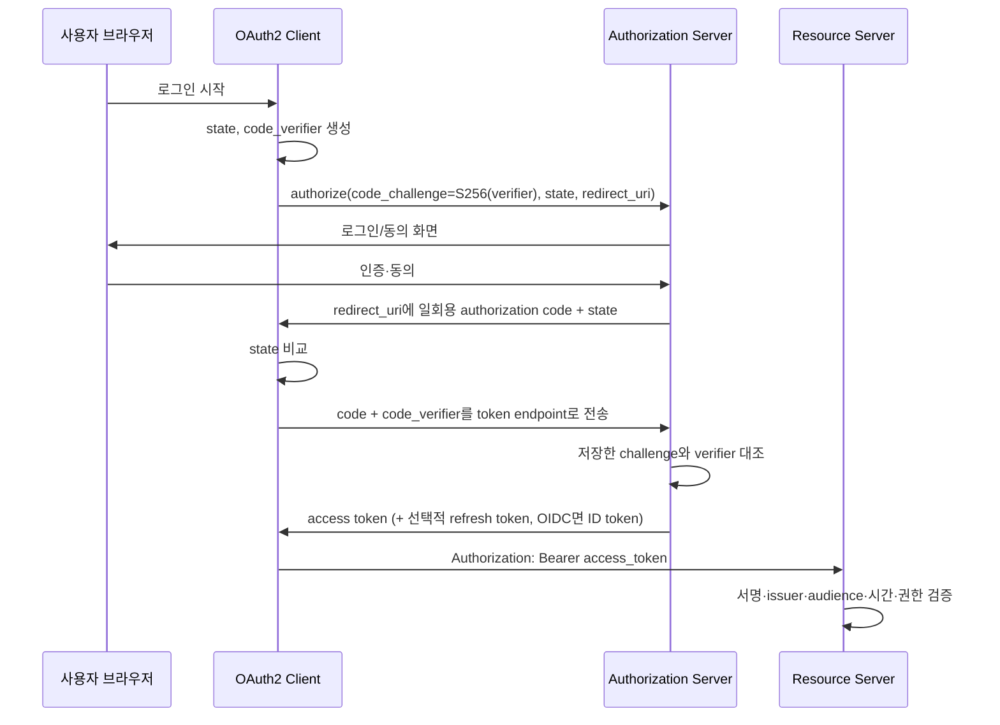

# S13. JWT·OAuth2·OIDC

> 3줄 요약 — JWT는 서명된 형식이지 암호화된 비밀 저장소가 아니며, OAuth2는 인가 위임, OIDC는 그 위에 얹힌 로그인 규약이다.
> API는 토큰의 서명만 보지 말고 `iss`, `aud`, 시간 조건, 허용 알고리즘과 권한을 함께 검증해야 한다.
> 사용자 로그인은 Authorization Code + PKCE가 기본이고, refresh token은 회전과 재사용 탐지를 포함해 수명주기를 관리한다.

## 1. 왜 알아야 하나

서명만 맞으면 “우리 API 토큰”이라고 믿는 구성이 장애로 이어진다. `aud`가 다른 서비스용 토큰을 받아들이면 서비스 간 권한 경계가 무너진다.

JWT는 서버 조회를 줄이는 대신 발급 뒤 폐기가 어렵다. 로그아웃 때 쿠키만 지우면 이미 복사된 access token은 만료까지 통할 수 있다. 수명을 길게 잡거나 refresh token을 무기한 재사용하면 탈취 피해도 길어진다.

OAuth2 access token은 리소스 권한이고 OIDC ID token은 특정 client의 인증 결과다. ID token을 API bearer token으로 받으면 `aud`와 토큰 목적을 무시한다. OAuth2만으로 사용자 인증까지 끝났다고 간주해도 신원 검증 규칙이 빠진다.

## 2. 핵심 개념

| 용어 | 의미 | 검증·사용 경계 |
|---|---|---|
| Resource Owner | 보호된 데이터의 권한 주체(대개 사용자) | 인증·동의할 수 있음 |
| Client | 토큰을 요청하는 앱 | 공개 client는 secret을 숨길 수 없음 |
| Authorization Server (AS) | client·사용자를 확인하고 토큰 발급·회전·폐기 | redirect URI, grant, scope 검증 |
| Resource Server (RS) | 토큰으로 보호된 API | 서명, issuer, audience, 시간, scope 검증 |
| Access token | API 권한 증표. opaque 또는 JWT | RS가 받음. OAuth2는 형식을 강제하지 않음 |
| Refresh token | AS에서 access token을 갱신하는 자격 | RS에는 보내지 않음. 안전 보관·회전 필요 |
| JWT / ID token | JWT는 token 형식, ID token은 OIDC 인증 결과 | API는 ID token을 access token으로 쓰지 않음 |
| Scope / Authority | API 권한 범위 / Spring 권한 표현 | `orders.read` → 기본 `SCOPE_orders.read` |

### 세션과 토큰은 같은 층의 대안이 아니다

| 항목 | 서버 세션 | bearer access token |
|---|---|---|
| 브라우저 보관값 | 추측하기 어려운 세션 식별자 쿠키 | 토큰 자체를 보관하거나 BFF가 서버에 보관 |
| 인증 상태 | 서버 세션 저장소에 존재 | 토큰 검증으로 claim을 확인. JWT는 보통 발급 뒤 상태 없음 |
| 즉시 로그아웃·차단 | 세션 삭제/폐기로 비교적 단순 | 이미 발급한 JWT는 만료까지 유효할 수 있어 별도 폐기 전략 필요 |
| 확장성 비용 | 공유 세션 저장소·복제 필요 | RS가 로컬 검증 가능하지만 키 배포·폐기·claim 일관성 부담 |
| 웹 위협 모델 | 쿠키 자동 전송에 따른 CSRF를 다룸 | 토큰 탈취와 브라우저 저장소 노출(XSS)을 다룸. URL 전달은 금지 |

서버 렌더링 앱은 세션 쿠키를, 독립 client의 API 위임은 access token을 우선 검토한다. JWT는 세션 저장소를 줄이지만 폐기와 권한 갱신을 어렵게 하므로 “stateless”만을 이유로 로그인 세션을 바꾸지 않는다.

## 3. 내부 동작·원리

### JWT를 읽는 것과 검증하는 것은 다르다

흔한 signed JWT(JWS Compact)는 `base64url(header).base64url(payload).base64url(signature)`다. header와 payload는 암호화되지 않아 누구나 읽을 수 있다. 서명은 무결성과 키 보유자를 확인할 뿐 claim의 진실성이나 수신 API의 적합성은 보장하지 않는다. JWE는 암호화 형식이므로 모든 JWT가 세 부분인 것도 아니다.

API용 signed access token 검증은 다음 순서다.

1. `Authorization: Bearer`에서 토큰을 추출한다. query string은 로그·브라우저 기록에 남을 수 있어 금지한다.
2. 설정한 issuer의 JWKS에서 `kid`에 맞는 키를 찾는다. header가 지정한 임의 URL은 따라가지 않는다.
3. 허용 알고리즘으로 서명을 검증한다. `alg=none` 또는 토큰 선택 알고리즘을 무조건 수용하지 않는다.
4. `iss`, API를 포함한 `aud`, 유효기간 `exp`·`nbf`를 확인한다.
5. 토큰 유형·scope 등 업무 조건을 검사하고 authority로 변환한다.

서명 검증은 claim 검증을 대체하지 않는다. `iss`가 발급자를, `aud`가 토큰의 소비자를 제한한다. audience가 빠지면 한 API용 토큰이 다른 API에서 재사용될 수 있다. claim이 선택 항목인 경우가 있으므로 서비스 계약에서 필수 claim을 정한다.

### OAuth2 인가 코드 + PKCE 흐름



PKCE는 요청별 난수 `code_verifier`(43~128자)로 `code_challenge = BASE64URL(SHA256(ASCII(code_verifier)))`를 만들어 보낸다. token endpoint에서 일치 여부를 확인하므로 탈취 code만으로는 교환할 수 없다. `S256`을 사용한다. `state`는 callback CSRF를, OIDC `nonce`는 ID token 재생을 막는다.

### Resource Server에서 Spring Security가 하는 일

```text
HTTP Authorization: Bearer ...
  -> BearerTokenAuthenticationFilter
  -> ProviderManager / AuthenticationManager
  -> JwtAuthenticationProvider
  -> JwtDecoder: 서명과 claim 검증
  -> JwtAuthenticationConverter: scope -> SCOPE_ authority
  -> JwtAuthenticationToken을 SecurityContext에 저장
  -> 인가 규칙 평가
```

Spring Security 7.1.1에서 `JwtAuthenticationProvider`는 `JwtDecoder`로 검증한 뒤 `JwtAuthenticationConverter`로 권한을 구성한다. `issuer-uri`는 metadata에서 JWKS를 찾고 기본 검증기는 서명, `exp`, `nbf`, `iss`를 확인한다. discovery 지연 초기화로 AS 가용성이 앱 시작과 결합되지 않을 수 있다. API별 `aud`는 따로 설정한다.

### OIDC와 Authorization Server

OIDC는 OAuth2 authorization code flow에 인증 결과를 더한다. `openid` 요청의 ID token에 대해 client는 서명, `iss`, 자기 `aud`, 만료, `nonce`를 검증한다. `sub`가 사용자 키이며 이메일은 안정된 식별자로 가정하지 않는다. API 인가에는 access token을 쓴다.

Authorization Server는 client·redirect URI·grant·scope, 동의, 토큰, 서명 키를 관리한다. Spring Security Authorization Server 7.1.1은 Boot starter와 `RegisteredClientRepository`, JWK source 구성을 제공한다. 예제용 in-memory 구현을 운영 저장소·키 관리로 쓰지 않는다.

## 4. 코드로 확인

### 예제 1 — JWT Resource Server

Spring Boot 4.1.1 / Spring Security 7.1.1 기준 API다. `issuer-uri`는 토큰의 `iss`와 일치해야 하고, `audiences`에는 이 API의 식별자를 넣는다. 요청 scope `orders.read`가 authority `SCOPE_orders.read`로 변환된다. (미실행)

```kotlin
// build.gradle.kts
dependencies {
    implementation("org.springframework.boot:spring-boot-starter-webmvc")
    implementation("org.springframework.boot:spring-boot-starter-security-oauth2-resource-server")
}
```

```yaml
# application.yml
spring:
  security:
    oauth2:
      resourceserver:
        jwt:
          issuer-uri: https://idp.example.com/issuer
          audiences:
            - https://api.example.com/orders
```

```java
package example.orders;

import org.springframework.boot.SpringApplication;
import org.springframework.boot.autoconfigure.SpringBootApplication;
import org.springframework.context.annotation.Bean;
import org.springframework.security.config.Customizer;
import org.springframework.security.config.annotation.web.builders.HttpSecurity;
import org.springframework.security.web.SecurityFilterChain;
import org.springframework.web.bind.annotation.GetMapping;
import org.springframework.web.bind.annotation.RestController;

@SpringBootApplication
public class OrdersApi {
    public static void main(String[] args) {
        SpringApplication.run(OrdersApi.class, args);
    }

    @Bean
    SecurityFilterChain apiSecurity(HttpSecurity http) throws Exception {
        http.authorizeHttpRequests(auth -> auth
                .requestMatchers("/orders").hasAuthority("SCOPE_orders.read")
                .anyRequest().authenticated())
            .oauth2ResourceServer(oauth -> oauth.jwt(Customizer.withDefaults()));
        return http.build();
    }
}

@RestController
class OrdersController {
    @GetMapping("/orders")
    String orders() {
        return "orders";
    }
}
```

Resource Server에는 `issuer-uri`와 API별 `audiences`를 함께 설정하고 scope 이름도 issuer와 맞춘다.

### 예제 2 — OIDC 로그인 client

Spring OAuth2 Login은 OAuth 2.0 Authorization Code Grant를 사용하고 OIDC provider도 지원한다. client secret은 소스 코드에 두지 않고 환경변수나 secret store에서 주입한다. (미실행)

```kotlin
// build.gradle.kts
dependencies {
    implementation("org.springframework.boot:spring-boot-starter-webmvc")
    implementation("org.springframework.boot:spring-boot-starter-security-oauth2-client")
}
```

```yaml
# application.yml
spring:
  security:
    oauth2:
      client:
        registration:
          corp:
            provider: corp
            client-id: ${OIDC_CLIENT_ID}
            client-secret: ${OIDC_CLIENT_SECRET}
            scope: [openid, profile, email]
        provider:
          corp:
            issuer-uri: https://idp.example.com
```

```java
package example.web;

import org.springframework.boot.SpringApplication;
import org.springframework.boot.autoconfigure.SpringBootApplication;
import org.springframework.context.annotation.Bean;
import org.springframework.security.config.Customizer;
import org.springframework.security.config.annotation.web.builders.HttpSecurity;
import org.springframework.security.web.SecurityFilterChain;

@SpringBootApplication
public class WebApplication {
    public static void main(String[] args) {
        SpringApplication.run(WebApplication.class, args);
    }

    @Bean
    SecurityFilterChain webSecurity(HttpSecurity http) throws Exception {
        http.authorizeHttpRequests(auth -> auth
                .requestMatchers("/", "/error").permitAll()
                .anyRequest().authenticated())
            .oauth2Login(Customizer.withDefaults());
        return http.build();
    }
}
```

기본 callback 경로는 `{baseUrl}/login/oauth2/code/{registrationId}`다. 인증 후 사용자 키는 provider의 안정적인 `sub`로 잡고, redirect URI를 provider에 정확히 등록한다. 실제 등록 ID(`corp`)와 provider 설정 키도 일치해야 한다.

백그라운드 서버 간 호출은 `authorization-grant-type: client_credentials` 등록과 Spring `OAuth2AuthorizedClientManager`로 토큰을 요청한다. 사용자를 대신하지 않으므로 필요한 scope만 부여한다. client secret을 브라우저에 두지 않고 access token은 로그에 남기지 않는다.

## 5. 버전별 변화 — 왜 바뀌었나

- **2012 — OAuth2 (RFC 6749).** Authorization Code·Client Credentials와 함께 implicit·password grant도 포함했다. [RFC 6749](https://datatracker.ietf.org/doc/html/rfc6749).
- **2014 — OIDC Core.** OAuth2에 ID token·표준 claim·discovery를 더해 로그인 상호운용성을 높였다. [OIDC Core](https://openid.net/specs/openid-connect-core-1_0.html).
- **2015 — PKCE / JWT.** 공개 client code 탈취에 PKCE가 verifier를 결합했고 JWT는 claim 형식을 정했다. [RFC 7636](https://datatracker.ietf.org/doc/html/rfc7636), [RFC 7519](https://www.rfc-editor.org/rfc/rfc7519.html).
- **2020 — JWT BCP.** 반복된 검증 오류에 algorithm allowlist와 용도 분리를 권고했다. [RFC 8725](https://www.rfc-editor.org/rfc/rfc8725.html).
- **2025 — OAuth2 Security BCP.** 변한 공격 모델에 맞춰 implicit/password grant를 폐기하고 공개 client refresh token 회전·재사용 탐지를 요구했다. [RFC 9700](https://datatracker.ietf.org/doc/html/rfc9700).
- **기준 버전 — Boot 4.1.1 / Spring Security 7.1.1.** Resource Server JWT, OAuth2 Login, Authorization Server starter를 제공하는 문서 기준이다. [Resource Server JWT](https://docs.spring.io/spring-security/reference/servlet/oauth2/resource-server/jwt.html), [Authorization Server](https://docs.spring.io/spring-security/reference/servlet/oauth2/authorization-server/getting-started.html).
- **Boot 4 starter 구성.** 4.x 모듈화에서 MVC와 Security OAuth2용 starter 이름을 분리했다. 예제는 `webmvc`, `security-oauth2-*` 이름을 사용한다. [Spring Boot 4 Migration Guide](https://github.com/spring-projects/spring-boot/wiki/Spring-Boot-4.0-Migration-Guide).

## 6. 실무 가이드

- **기본값 추천:** 웹은 세션 또는 OAuth2 Login, API 위임은 Authorization Code + PKCE. JWT는 짧게 살리고 `iss`·`aud`·scope를 고정하며 refresh token을 회전한다.
- 서버 렌더링은 세션 쿠키를 우선한다. CSRF를 방어하고 `Secure`, `HttpOnly`를 설정한다.
- SPA·모바일 등 공개 client가 redirect 기반 인증을 하면 Authorization Code + PKCE `S256`을 사용한다. token을 URL fragment/query로 받는 implicit flow를 새로 만들지 않는다.
- 외부 IdP 로그인은 Spring `oauth2Login()`으로 처리하고 ID token을 검증한다. API 권한 판단에는 access token을 쓴다.
- 서비스 A가 서비스 B의 API를 호출하고 사용자를 대신하지 않으면 Client Credentials를 쓴다. client마다 scope와 audience를 나누고 client secret 또는 private key를 secret manager에 둔다.
- API 서버라면 Boot Resource Server의 `issuer-uri`와 API audience를 모두 설정한다. 조직 규칙이 scope claim 이름·권한 변환을 다르게 정하면 `JwtAuthenticationConverter`를 명시적으로 맞춘다.
- 즉시 차단이 필요하면 짧은 만료 외에 denylist나 introspection을 검토한다.
- 여러 OIDC provider의 같은 이메일만으로 계정을 자동 결합하지 않는다. `(iss, sub)`를 외부 신원 키로 저장한다.
- refresh token을 발급한다면 공개 client에는 회전이나 sender-constraining을 적용하고 재사용 감지 시 해당 token family를 폐기한다. refresh token은 client, 허용 scope, resource와 묶고 TLS·안전 저장을 강제한다.
- Authorization Server 운영 시 client·인가 저장과 서명 키를 영속화·보호·회전한다. `RegisteredClientRepository`의 메모리 구현을 운영에 두지 않는다.

## 7. 함정·안티패턴

1. **JWT payload에 개인정보를 넣음** → Base64URL은 읽을 수 있고 서명은 암호화가 아님 → 민감 정보를 넣지 말고 필요한 경우 JWE 또는 서버 저장 식별자를 검토한다.
2. **서명만 확인하고 `iss`·`aud`·시간은 생략** → 타 issuer, 다른 API용, 만료·미활성 토큰까지 받아들임 → 신뢰 issuer와 audience를 고정하고 `exp`, `nbf`, 허용 오차를 검증한다.
3. **토큰 header의 `alg`를 그대로 믿거나 `none`을 허용** → 알고리즘 혼동·키 타입 혼용 공격 경로 → 서버 측 allowlist를 설정하고 라이브러리 검증기를 사용한다.
4. **ID token을 API access token으로 사용** → ID token의 `aud`는 로그인 client일 수 있어 API 대상이 아님 → API는 API audience의 access token만 허용한다.
5. **localStorage 또는 URL에 bearer token 저장·전달** → XSS가 장기 자격을 훔치거나 query·로그·referrer에 토큰이 남음 → BFF/보안 쿠키 구조를 검토하고 헤더로만 보내며 로그에서 마스킹한다.
6. **JWT 로그아웃이 즉시 폐기한다고 설명** → 서명 검증만 하는 RS는 AS의 로그아웃 상태를 모름 → 짧은 access token과 회전 refresh token, 필요 시 denylist/introspection을 조합한다.
7. **Refresh token을 계속 재사용** → 탈취된 원본과 정상 사용을 구분하기 어려워 재발급을 계속 받을 수 있음 → 매 교환마다 회전하고 이전 토큰 재사용 시 family를 폐기한다.
8. **authorization code에 PKCE 없이 의존** → 공개 client에는 숨길 client secret이 없어 code 가로채기 방어가 없음 → Authorization Code + PKCE `S256`을 사용하고 redirect URI를 정확히 등록한다.
9. **CSRF `state`와 OIDC `nonce`를 혼동** → 하나는 OAuth callback 상관관계, 다른 하나는 ID token 재생·요청 연결 검증 → 각각 생성·검증한다.
10. **JWKS 이전 키를 즉시 삭제** → 유효 기간 중인 토큰도 검증 실패 → 새 키를 먼저 공개하고 최대 token 수명·캐시 시간만큼 겹쳐 둔다.

필터체인 구성과 요청 매칭 자체는 → S12 참조.

## 8. 자가점검 Q&A (면접 대비)

**Q1. OAuth2와 OIDC의 차이는?**  
OAuth2는 client가 access token으로 보호 리소스에 접근하도록 위임하는 인가 프레임워크다. OAuth2만으로 표준화된 사용자 인증 결과를 정의하지 않는다. OIDC는 `openid` scope, ID token, discovery와 검증 규칙을 추가한 인증 계층이다.  
**꼬리질문: API가 사용자 이름이 필요하면 ID token을 받으면 되나?** 아니오. API용 audience와 권한이 있는 access token을 받고, 사용자 주체 claim을 API 계약에 맞춰 사용한다.

**Q2. 서명이 유효한 JWT를 다른 API가 받아도 되는가?**  
안 된다. 서명은 신뢰 키로 서명됐다는 것만 보이고 토큰의 대상 API를 보장하지 않는다. 각 RS는 자기 audience를 포함하는지 확인해야 한다. issuer와 만료, 활성 시점, 권한도 별도 검증한다.  
**꼬리질문: `iss`와 `aud`는 각각 무엇을 제한하나?** `iss`는 누가 발급했는지, `aud`는 누가 소비하도록 발급했는지를 제한한다.

**Q3. PKCE는 client secret과 같은가?**  
아니다. secret은 client의 장기 자격이고 PKCE verifier는 authorization 요청별 일회용 비밀이다. AS는 authorization 단계에서 challenge를 저장하고 token 단계의 verifier가 일치하는지 확인한다. 공개 client가 code를 가로채여도 verifier 없이는 교환할 수 없다.  
**꼬리질문: 왜 `S256`인가?** Authorization request에는 verifier 자체가 아닌 해시를 보내 challenge 유출로 verifier가 드러나지 않게 하며, RFC 7636은 지원 client가 `S256`을 사용하도록 한다.

**Q4. JWT를 쓰면 서버 세션이 필요 없고 로그아웃도 자동으로 되는가?**  
아니다. 서명형 JWT는 로컬 검증을 가능하게 해 세션 조회를 줄이지만, 이미 발급된 토큰의 유효성을 서버가 즉시 회수하지 못한다. 만료까지 허용하거나 별도의 폐기 상태를 조회해야 한다. 토큰 회전·키 교체 비용도 있다.  
**꼬리질문: 즉시 차단이 필수인 서비스는?** denylist/introspection 같은 상태 확인이나 짧은 세션 버전 검사를 추가하고 요청 지연·가용성 비용을 감수한다.

**Q5. Access token과 refresh token을 같은 API에 보내도 되나?**  
아니다. access token은 RS에서 권한 확인용이고 refresh token은 AS token endpoint에서 새 access token을 발급받기 위한 자격 증명이다. refresh token을 RS에 보내면 노출 영역을 불필요하게 넓힌다. refresh token은 client·resource·scope에 결속하고 안전하게 저장한다.  
**꼬리질문: 공개 client refresh token 탈취는 어떻게 감지하나?** 회전해 이전 토큰 재사용을 탐지하거나 sender-constraining으로 client 인스턴스에 결속한다.

**Q6. Client Credentials는 언제 쓰나?**  
사용자 대신이 아니라 서비스 client 자신의 권한으로 API를 호출하는 서버 간 통신에 쓴다. 사용자 로그인이나 동의 화면이 없다. 대상 API와 업무에 한정한 scope를 client에 등록한다. 장기 client secret은 유출될 수 있으므로 보관과 교체를 관리한다.  
**꼬리질문: 브라우저 SPA의 client credentials는 안전한가?** 안전하지 않다. 브라우저는 secret을 숨길 수 없으므로 서버 중계나 사용자 기반 Authorization Code + PKCE가 필요하다.

## 9. 참고문헌

- Spring Security OAuth 2.0 Resource Server JWT — https://docs.spring.io/spring-security/reference/servlet/oauth2/resource-server/jwt.html — Spring JWT 검증·JWKS 흐름.
- OAuth 2.0 Security Best Current Practice (RFC 9700) — https://datatracker.ietf.org/doc/html/rfc9700 — OAuth 보안 권고와 refresh token 보호.
- Spring Security Authorization Server Getting Started — https://docs.spring.io/spring-security/reference/servlet/oauth2/authorization-server/getting-started.html — Security 7.1.1 구성.
- Spring Boot OAuth2 Properties — https://docs.spring.io/spring-boot/reference/security/oauth2.html — JWT resource server `audiences` 설정.
- Spring Boot 4.0 Migration Guide — https://github.com/spring-projects/spring-boot/wiki/Spring-Boot-4.0-Migration-Guide — Boot 4 모듈화 starter 이름.
- OAuth 2.0 Authorization Framework (RFC 6749) — https://datatracker.ietf.org/doc/html/rfc6749 — grant와 역할.
- Proof Key for Code Exchange (RFC 7636) — https://datatracker.ietf.org/doc/html/rfc7636 — PKCE verifier/challenge 규격.
- OpenID Connect Core 1.0 — https://openid.net/specs/openid-connect-core-1_0.html — ID token 검증.
- Spring Security OAuth 2.0 Login — https://docs.spring.io/spring-security/reference/servlet/oauth2/login/index.html — OAuth2/OIDC provider 로그인과 authorization code grant.
- JSON Web Token (RFC 7519) — https://www.rfc-editor.org/rfc/rfc7519.html — JWT claim 형식.
- JSON Web Token Best Current Practices (RFC 8725) — https://www.rfc-editor.org/rfc/rfc8725.html — JWT 검증 권고.
- OAuth 2.0 Bearer Token Usage (RFC 6750) — https://www.rfc-editor.org/rfc/rfc6750.html — bearer 전달 방식.
