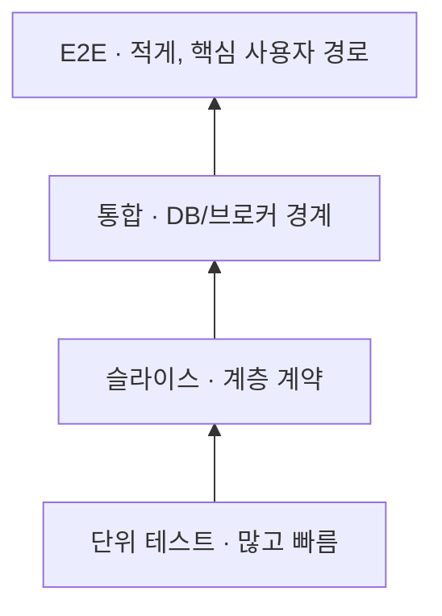

# S18. Spring Boot 테스트

> 3줄 요약 — 테스트 범위에 맞는 컨텍스트만 띄워라: 기본은 단위 테스트, MVC/JPA는 슬라이스, 설정·빈 조립까지 검증할 때만 `@SpringBootTest`다.
> Spring 테스트 컨텍스트는 같은 설정 키를 재사용하지만, 프로파일·속성·mock 구성 차이는 캐시를 쪼갠다. 프로세스를 포크하거나 `@DirtiesContext`를 남용하면 시작 비용이 반복된다.
> DB·메시지 브로커 호환성은 Testcontainers로 실제 엔진을 검증하고, `@ServiceConnection`으로 접속 정보를 자동 연결한다. 이 비용이 큰 검증은 전체 테스트 중 소수로 유지한다.

## 1. 왜 알아야 하나

컨텍스트 초기화가 반복되면 CI가 느려지고, 팀은 통합 테스트를 끄기 쉽다. 반대로 `@SpringBootTest` 하나에 모든 검증을 몰면 실패 원인이 넓어지고 계층별 보증 범위가 흐려진다.

`RANDOM_PORT`에서 테스트에 `@Transactional`을 붙여도 실제 서버 요청은 별도 스레드와 트랜잭션에서 실행된다. 테스트 메서드 롤백 후 서버가 커밋한 데이터가 남아 다음 실행을 오염시킬 수 있다.

테스트는 “코드가 실행됐다”보다 **어떤 경계와 설정을 검증했는지**가 중요하다. MVC 슬라이스는 HTTP 계약을, JPA 슬라이스는 저장소를 확인하지만 서로의 범위까지 보증하지 않는다. 전체 컨텍스트에 mock을 많이 넣으면 빈 조립 검증도 우회한다.

## 2. 핵심 개념

| 유형 | 범위 | 적합한 검증 |
|---|---|---|
| 단위 테스트 | Spring 없이 객체/규칙 | 분기, 계산, 도메인 조건 |
| 슬라이스 | `@WebMvcTest`, `@DataJpaTest` 등 한 계층 | MVC 계약, JPA 매핑·쿼리 |
| 통합 테스트 | 여러 구성요소 연결 | Boot 빈 조립, 실제 DB·브로커 호환성 |
| E2E | 배포된 경로에 가까운 실행 | 소수 핵심 사용자 여정 |

| 도구 | 요청 방식 | 선택 기준 |
|---|---|---|
| `@SpringBootTest` | `SpringApplication`으로 Boot 컨텍스트 구성 | 프로파일, 자동 설정, 빈 연결 자체 검증 |
| `MockMvc` | 서버 포트 없이 Servlet MVC 처리 체인 호출 | MVC 라우팅·필터·응답 계약 |
| `MockMvcTester` | MockMvc 위에 AssertJ형 검증 제공 | 같은 MVC 범위를 fluent하게 검증 |
| `WebTestClient` | MVC/WebFlux mock 바인딩 또는 실제 서버 연결 | Reactive API 또는 바인딩을 바꿔도 같은 client 사용 |
| `@MockitoBean` | 테스트 컨텍스트 빈을 mock으로 대체 | 컨트롤러 등 특정 경계 아래 협력자 격리 |
| `@ServiceConnection` | 컨테이너에서 Boot `ConnectionDetails` 생성 | Testcontainers 서비스 연결 설정 |

`@WebMvcTest`는 MVC 설정과 controller·advice·filter를 제한적으로 올리고 협력자는 `@MockitoBean`이나 `@Import`로 제공한다. `@DataJpaTest`는 entity/repository 중심이며 기본 transaction rollback과 내장 DB를 쓴다. 운영 DB 동작은 Testcontainers로 확인하고 내장 DB 교체를 끈다.

| 범위 선택 | `@SpringBootTest` | 슬라이스 |
|---|---|---|
| 구성 | 전체 또는 지정된 Boot 구성 | 대상 계층 자동 설정 위주 |
| 이점 | 실제 빈 조립 검증 | 로딩이 작고 실패 지점이 좁음 |
| 비용/맹점 | 느리고 원인 범위가 넓음 | 제외 계층 간 연결 오류는 미검출 |

`MockMvc`와 `WebTestClient`라는 이름만으로 서버 시작 여부를 판단하지 않는다. MockMvc는 서버 없이 servlet 체인을 실행하며, WebTestClient도 mock 인프라에 바인딩할 수 있다. 실제 포트와 별도 서버 스레드가 필요한지는 바인딩 방식과 `webEnvironment`로 결정한다.

## 3. 내부 동작·원리

### `@SpringBootTest`의 시작 흐름

```text
JUnit 발견 → Spring TestContext 부트스트랩 → Boot 구성 탐색
→ SpringApplication으로 ApplicationContext 생성
→ 웹 환경 반영 → 테스트 객체 주입 → 같은 키의 캐시 재사용
```

일반 `@ContextConfiguration`은 Boot `SpringApplication` 경로를 보장하지 않는다. Boot 설정, 외부 속성, 로깅 같은 애플리케이션 구성을 검증할 때 `@SpringBootTest`를 쓴다. 웹 환경 기본값 `MOCK`은 모의 웹 인프라만 만들며 포트를 열지 않는다.

`@AutoConfigureMockMvc`를 함께 쓰면 전체 Boot 구성을 올린 채 서버 없이 요청할 수 있다. `RANDOM_PORT`·`DEFINED_PORT`는 서버를 시작하며 클라이언트와 서버가 별도 스레드에서 동작한다.

따라서 테스트 메서드의 `@Transactional` 롤백이 서버가 커밋한 요청 데이터까지 되돌리지 않는다. `NONE`은 웹 환경이 없는 컨텍스트다.

### 컨텍스트 캐시 키

Spring TestContext는 설정 키가 같은 컨텍스트를 JVM 정적 캐시에 재사용한다. 구성 클래스/위치, initializer, context hierarchy, profile, 테스트 properties와 context customizer 등이 키에 들어간다. Boot 테스트 자동 설정, `@DynamicPropertySource`, `@MockitoBean`도 customizer 구성을 바꿀 수 있다.

```text
Test A: App + profile=test + mock=paymentClient
         ├─ 키 일치 → cache hit, 기존 컨텍스트 사용
         └─ 키 차이 → cache miss, 새 컨텍스트 초기화
```

필드의 `@MockitoBean`은 타입으로 대상을 찾고 qualifier가 없으면 필드명을 fallback으로 쓸 수 있다. 같은 bean을 여러 클래스에서 mock하더라도 이름이 들쭉날쭉하면 오버라이드 설정과 캐시 키가 달라질 수 있다. 공통 profile·속성·mock 이름을 정렬하되 서로 다른 테스트 구성을 억지로 합치지 않는다.

캐시는 기본 최대 32개이며 초과하면 LRU로 오래된 컨텍스트를 제거한다. `@DirtiesContext`도 컨텍스트를 제거한다. 테스트를 포크한 별도 JVM에서 실행하면 정적 캐시가 공유되지 않는다.

### 슬라이스와 Testcontainers

슬라이스는 전체 자동 설정 대신 대상 계층 필터와 관련 자동 설정을 골라 컨텍스트를 작게 만든다. 그래서 MVC 요청 체인은 보존하면서 service/repository 그래프를 생략할 수 있다. JPA 슬라이스의 기본 rollback은 테스트 트랜잭션을 격리하지만, 다른 DB 엔진의 dialect·타입·collation·잠금 동작까지 증명하지 않는다.

Testcontainers는 Docker에서 일회용 DB나 브로커를 실행한다. JUnit 확장은 `@Testcontainers`와 `@Container` 필드의 수명주기를 관리한다. `@ServiceConnection`은 컨테이너의 종류로 Boot `ConnectionDetails`를 만들어 datasource 등 자동 설정에 전달하므로 URL·사용자명·동적 포트를 수작업으로 속성에 복사할 필요가 줄어든다.

Boot가 컨테이너 종류를 추론하지 못하면 `name` 또는 `type`을 명시한다. 컨테이너를 `@Bean` 메서드로 선언하면 인스턴스보다 먼저 서비스 이름을 알아야 할 수 있다.

```text
컨테이너 시작 → @ServiceConnection → ConnectionDetails
→ datasource 자동 설정 → 애플리케이션 경로로 실제 쿼리
```

### 테스트 피라미드



고정 비율을 맞추는 도표가 아니다. 자주 바뀌는 도메인 규칙은 단위 테스트로 넓게, framework 설정은 슬라이스로, 실제 DB 호환성은 적은 컨테이너 테스트로 보증한다. 상위 테스트는 실제 구성 오류를 더 많이 잡는 대신 시작 비용과 실패 원인 범위도 커진다.

## 4. 코드로 확인

기준: Boot 4.1.1, Framework 7.0.9, JUnit 6.0.3, Testcontainers 2.0.5. `spring-boot-starter-test`, `spring-boot-testcontainers`, Testcontainers `junit-jupiter`·`postgresql`, PostgreSQL JDBC 및 Docker가 필요하다. 예제는 미실행이다.

### 예제 1: MVC 계약만 `@WebMvcTest`로 확인 (미실행)

```java
package example.mvc;

import java.util.Optional;

import org.junit.jupiter.api.Test;
import org.springframework.beans.factory.annotation.Autowired;
import org.springframework.boot.SpringBootConfiguration;
import org.springframework.boot.autoconfigure.EnableAutoConfiguration;
import org.springframework.boot.webmvc.test.autoconfigure.WebMvcTest;
import org.springframework.http.ResponseEntity;
import org.springframework.test.context.bean.override.mockito.MockitoBean;
import org.springframework.test.web.servlet.MockMvc;
import org.springframework.web.bind.annotation.GetMapping;
import org.springframework.web.bind.annotation.PathVariable;
import org.springframework.web.bind.annotation.RestController;

import static org.mockito.BDDMockito.given;
import static org.springframework.test.web.servlet.request.MockMvcRequestBuilders.get;
import static org.springframework.test.web.servlet.result.MockMvcResultMatchers.jsonPath;
import static org.springframework.test.web.servlet.result.MockMvcResultMatchers.status;

@WebMvcTest(OrderController.class)
class OrderControllerTest {
    @Autowired
    MockMvc mockMvc;

    @MockitoBean
    OrderQuery orderQuery;

    @Test
    void returnsOrderAsJson() throws Exception {
        given(orderQuery.find(42L)).willReturn(Optional.of(new OrderView(42L, "PAID")));

        mockMvc.perform(get("/orders/{id}", 42L))
                .andExpect(status().isOk())
                .andExpect(jsonPath("$.id").value(42))
                .andExpect(jsonPath("$.status").value("PAID"));
    }
}

interface OrderQuery {
    Optional<OrderView> find(long id);
}

record OrderView(long id, String status) {}

@SpringBootConfiguration(proxyBeanMethods = false)
@EnableAutoConfiguration
class OrderControllerTestApplication {}

@RestController
class OrderController {
    private final OrderQuery orderQuery;

    OrderController(OrderQuery orderQuery) {
        this.orderQuery = orderQuery;
    }

    @GetMapping("/orders/{id}")
    ResponseEntity<OrderView> find(@PathVariable long id) {
        return orderQuery.find(id)
                .map(ResponseEntity::ok)
                .orElseGet(() -> ResponseEntity.<OrderView>notFound().build());
    }
}
```

`@WebMvcTest`에는 지정한 컨트롤러와 MVC 인프라가 올라오며 `OrderQuery`는 mock으로 대체된다. 따라서 JSON 필드와 HTTP 상태는 확인하지만, 실제 주문 조회 구현이나 DB 매핑은 전혀 실행되지 않는다.

`MockMvcTester`를 쓰는 프로젝트는 Boot가 구성한 `MockMvc`에서 생성하거나 Spring MVC 설정에 바인딩해 AssertJ 방식으로 같은 요청·응답 경계를 검증할 수 있다. 응답 내용 검증은 직렬화 설정에 맞는 converter가 등록되어 있어야 한다.

### 예제 2: 실제 PostgreSQL을 `@ServiceConnection`으로 연결 (미실행)

```java
package example.database;

import org.junit.jupiter.api.Test;
import org.springframework.beans.factory.annotation.Autowired;
import org.springframework.boot.SpringBootConfiguration;
import org.springframework.boot.autoconfigure.EnableAutoConfiguration;
import org.springframework.boot.test.context.SpringBootTest;
import org.springframework.boot.testcontainers.service.connection.ServiceConnection;
import org.springframework.jdbc.core.JdbcTemplate;
import org.testcontainers.junit.jupiter.Container;
import org.testcontainers.junit.jupiter.Testcontainers;
import org.testcontainers.postgresql.PostgreSQLContainer;

import static org.assertj.core.api.Assertions.assertThat;

@SpringBootTest(classes = PostgreSqlConnectionTest.TestApplication.class)
@Testcontainers
class PostgreSqlConnectionTest {
    @Container
    @ServiceConnection
    static final PostgreSQLContainer<?> postgres =
            new PostgreSQLContainer<>("postgres:16-alpine");

    @Autowired
    JdbcTemplate jdbcTemplate;

    @Test
    void applicationConnectsThroughItsConfiguredDataSource() {
        Integer result = jdbcTemplate.queryForObject("select 1", Integer.class);
        assertThat(result).isEqualTo(1);
    }

    @SpringBootConfiguration(proxyBeanMethods = false)
    @EnableAutoConfiguration
    static class TestApplication {}
}
```

이 검사는 애플리케이션 자동 설정의 `DataSource`가 컨테이너 연결 정보를 사용해 질의하는지 확인한다. 테이블 생성·마이그레이션이 준비된 프로젝트에서는 운영 SQL, 제약 조건, 잠금 같은 업무 관련 동작을 검증한다.

단지 `select 1`이 성공했다고 운영 스키마나 마이그레이션 전체가 맞다고 결론내리지는 않는다. 기본 슬라이스 DB를 사용하지 않도록 `@DataJpaTest`에 적용할 경우 `@AutoConfigureTestDatabase(replace = Replace.NONE)` 설정을 검토한다.

## 5. 버전별 변화 — 왜 바뀌었나

| 시기 | 변화 | 이전 한계와 바뀐 이유 |
|---|---|---|
| Spring Boot 3.1 | `@ServiceConnection` 제공 (`Since: 3.1.0`) | 동적 포트를 테스트 환경 속성에 수동 복사하는 방식은 컨테이너 정보와 접속 설정을 중복시켰다. Boot가 컨테이너 유형으로 `ConnectionDetails`를 구성하도록 연결했다. |
| Spring Framework의 bean override 방식 | `@MockitoBean` / `@MockitoSpyBean`을 TestContext 수준에서 사용 | 테스트가 Boot 컨텍스트에서 협력 빈을 대체할 때 Boot 전용 annotation에만 의존하면 Spring 테스트 구성 재사용이 어렵다. 현재 API는 타입·qualifier·이름으로 대상을 결정하고, 빈 교체 설정이 컨텍스트 구성 및 캐시에도 영향을 준다. |
| Spring Boot 4.0 이상 API | Boot 4.1 문서의 `@WebMvcTest`, `@DataJpaTest`는 새 API 패키지에서 제공되며 Javadoc의 도입 표시는 4.0.0이다. | 메이저 버전 업그레이드 때 구버전 예제의 import를 그대로 복사하면 의존성과 API 패키지가 어긋날 수 있다. 컴파일이 안 되면 annotation 이름만 바꾸지 말고 Boot 4.1 API의 패키지와 모듈 구성을 확인한다. |

## 6. 실무 가이드

**기본값 추천:** 도메인 규칙은 Spring 없는 단위 테스트, HTTP와 persistence는 해당 슬라이스, 애플리케이션 설정·외부 시스템 호환성만 `@SpringBootTest`와 Testcontainers로 검증한다. 각 테스트가 검증하는 경계를 작게 유지하면 실패 원인이 분명하고 캐시 재사용도 높아진다.

- 컨트롤러의 상태 코드, JSON, validation, 예외 변환을 확인하면 `@WebMvcTest`를 써라. 서비스는 `@MockitoBean` 또는 명시적 테스트 설정으로 격리하고, 그 mock 응답 자체를 다시 검증하지 마라.
- Spring Security filter chain이나 여러 MVC 설정이 실제로 함께 구성되는지 확인하면 `@WebMvcTest`의 필터를 무조건 제외하지 말고 필요한 설정을 포함해라. 인증 성공 한 경로만 확인하지 말고 무인증·권한 부족 응답도 계약에 넣어라.
- entity 매핑, repository 쿼리, JPA dirty checking을 확인하면 `@DataJpaTest`를 써라. 운영 DB 고유 기능까지 필요하면 Testcontainers로 같은 엔진 계열을 실행하고 테스트 DB 자동 교체를 끄고 데이터 격리 전략을 정해라.
- Boot 조건부 bean, configuration properties, 프로파일별 wiring, 전체 자동 설정 조합을 확인하면 `@SpringBootTest`를 써라. 전체 애플리케이션에 외부 호출까지 허용하기보다 대체할 경계를 좁히고, 구성 자체가 목적이면 불필요한 mock을 추가하지 마라.
- `MockMvc`에서 확인할 수 있는 servlet 요청이라면 `MOCK` 웹 환경을 기본으로 선택해라. 포트 바인딩·서버 스레드·실제 HTTP client 설정까지 검증해야 `RANDOM_PORT`를 쓴다.
- Spring MVC와 WebFlux 양쪽에서 fluent client를 공유하거나 reactive 응답 체인을 검증하면 `WebTestClient`를 고려해라. mock 바인딩인지 실제 서버 연결인지 테스트 이름과 구성에서 명확히 드러내라.
- CI에서 컨텍스트 초기화가 반복되면 우선 테스트 JVM fork, `@DirtiesContext`, 서로 다른 `@ActiveProfiles`·properties·mock qualifier가 캐시 키를 쪼개는지 확인해라. 캐시 최대치만 올리는 것으로 초기 설정 불일치를 덮지 마라.
- 테스트 클래스 수가 많고 느리면 계층별 실행 시간을 측정하고, 공통 테스트 프로파일·속성·mock 이름을 정리해 동일 컨텍스트 구성을 늘려라. 상태 공유 문제를 피하려고 매 클래스마다 context를 닫는 방식은 마지막 수단이다.

### Fixture와 외부 입력을 고정한다 (보강)

간헐 실패는 테스트가 읽는 입력이 매번 같지 않거나 테스트 사이에 상태가 새어 나올 때 생긴다. fixture는 각 테스트가 직접 만들고, 테스트가 소유한 데이터만 종료 시 정리한다. 정적 컬렉션·싱글턴 객체를 여러 테스트가 수정하지 않게 하고, fixture factory도 매 호출마다 새 객체 그래프를 반환하게 한다.

DB에는 테스트 실행별 식별자를 붙여 이름 공간을 나눈다. `@AfterEach`의 삭제는 정상적인 테스트 종료를 돕지만 JVM 강제 종료나 다른 프로세스의 실행까지 정리해 주지는 않는다. CI에서는 worker별 schema/database나 테스트별 고유 key를 쓰고, 폐기 가능한 DB라면 작업 종료 시 통째로 버릴 수 있게 한다.

```java
@SpringBootTest
class InvoiceFlowTest {
    @Autowired JdbcTemplate jdbc;
    private String runId;

    @BeforeEach
    void createFixture() {
        runId = UUID.randomUUID().toString();
        jdbc.update("insert into test_invoice(run_id, status) values (?, ?)",
                runId, "OPEN");
    }

    @AfterEach
    void removeFixture() {
        jdbc.update("delete from test_invoice where run_id = ?", runId);
    }
}
```

위 예제의 테이블은 테스트 schema에 있다고 가정한다. 삭제 조건을 업무 키 전체나 테이블 전체로 넓히지 말고 테스트가 만든 행에 한정한다. 테스트 메서드 트랜잭션 롤백은 같은 트랜잭션 안의 fixture에 유용하지만, 실제 서버 스레드·비동기 작업·별도 worker에서 쓴 데이터의 정리를 대신하지 않는다. 공용 테이블을 쓰는 두 테스트가 동시에 전체 테이블을 비우면 각각의 setup/cleanup이 서로의 데이터를 지울 수 있다.

시계는 `Instant.now()`를 로직 안에서 직접 읽지 말고 `Clock`으로 전달한다. 경계 시각, 자정, 시간대/DST를 재현하기 위해 테스트는 `Clock.fixed(...)`와 명시적 UTC 또는 대상 시간대를 사용한다. 난수도 `new Random()`을 업무 로직이 직접 만들지 않게 주입한다.

실패 로그에 seed를 남겨 같은 입력열을 되풀이할 수 있게 하고, 테스트끼리 같은 가변 `Random`을 공유하지 않는다. 테스트 순서는 준비 데이터·시퀀스 값·정적 캐시가 암묵적으로 공유되는지 찾는 신호다. 순서를 바꿨을 때 실패하면 실패 테스트의 실행 전후 상태를 비교하고 각 테스트를 단독 실행해 먼저 만든 오염원을 좁힌다.

```java
import java.time.Clock;
import java.time.Instant;
import java.time.ZoneOffset;
import java.util.Random;

public class FixtureInputs {
    static String fixture(Clock clock, Random random) {
        return "createdAt=" + clock.instant() + ", token=" + random.nextInt(1000);
    }

    public static void main(String[] args) {
        Clock fixed = Clock.fixed(Instant.parse("2026-10-04T00:00:00Z"), ZoneOffset.UTC);
        Random firstFixtureRandom = new Random(41L);
        Random secondFixtureRandom = new Random(41L);
        System.out.println("fixture A: " + fixture(fixed, firstFixtureRandom));
        System.out.println("fixture B: " + fixture(fixed, secondFixtureRandom));
        System.out.println("shared RNG next: " + firstFixtureRandom.nextInt(1000));
    }
}
```

JDK 21로 실행한 결과다. 같은 시각과 seed로 만든 두 fixture는 동일한 값을 내지만, 한 테스트가 난수 객체를 공유해 소비하면 다음 테스트의 입력은 `627`로 달라진다. 즉 seed를 고정하는 것만으로는 충분하지 않고 난수 생성기의 소유 범위도 격리해야 한다.

```text
fixture A: createdAt=2026-10-04T00:00:00Z, token=7
fixture B: createdAt=2026-10-04T00:00:00Z, token=7
shared RNG next: 627
```

### 격리해 재현하고 병렬성의 경계를 확인한다 (보강)

실패하면 우선 실패한 테스트 이름, 입력 fixture ID, 난수 seed, 기준 시각과 시간대, locale, DB schema, 테스트 worker/fork를 로그에 남긴다. 동일 클래스·메서드를 단독 실행해도 실패하는지 확인한 다음 같은 JVM에서 반복 실행하고, 실행 순서를 섞거나 병렬도를 낮춰 비교한다. 단독 실행은 통과하지만 반복/전체 실행에서 실패하면 테스트 간 상태 공유 가능성이 높다.

시각이 특정 경계에 가까울 때만 재현되면 `Clock.fixed`로 그 순간을 고정한다. 재현 가능한 최소 테스트가 생기면 cleanup 누락, 공유 mock/static state, 전역 timezone/property 변경, DB unique key 충돌을 한 항목씩 제거한다. 재시도로 녹색이 됐다는 사실은 원인 해결의 증거가 아니다.

JUnit Jupiter는 기본적으로 순차 실행한다. 병렬 실행을 켜더라도 기본 노드는 `SAME_THREAD`이며, 병렬 실행 설정만 추가했다고 모든 테스트가 동시에 실행되는 것은 아니다. 병렬을 실제로 켜면 공유 전역 자원 사용 테스트를 같은 lock 이름으로 선언한다.

```java
@ResourceLock(value = Resources.TIME_ZONE)
class SeoulDateBoundaryTest {
    @Test void convertsUsingConfiguredZone() { /* 시간대 의존 검증 */ }
}
```

`@ResourceLock`은 그 lock을 선언한 테스트와 생명주기 메서드를 같은 JUnit 실행 안에서 직렬화한다. 같은 전역 자원을 건드리는 모든 테스트가 같은 이름을 공유해야 한다. DB lock 문자열 하나를 붙여도 별도 JVM fork, CI worker, 다른 빌드 프로세스는 서로 조정되지 않는다.

프로세스 간 공유 DB는 실행별 schema/database나 분리된 key 범위를 쓰고, 그 자원을 안전하게 분리할 수 없는 테스트만 순차 그룹에 둔다. 전체 테스트를 직렬화하거나 `@DirtiesContext`로 매번 초기화하면 원인 대신 비용만 키울 수 있다.

### 테스트 시간은 계층별로 측정한다 (보강)

전체 `test` 작업의 한 숫자만 보면 느린 컨텍스트 초기화와 많은 단위 테스트를 구분하기 어렵다. 빌드에서 단위, MVC/JPA slice, 실제 DB 통합, E2E를 별도 task/tag로 집계하고 각 계층의 테스트 수와 총 시간, 테스트별 상위 지연(p95 또는 느린 상위 10개)을 함께 기록한다. 반복 CI 실행에서는 중앙값과 변동 폭도 비교한다.

테스트별 시간은 벽시계 변경의 영향을 받지 않는 `System.nanoTime()` 기반으로 재고, 컨테이너 시작/종료와 애플리케이션 context 시작 시간도 분리해 적는다. context 초기화가 느리면 캐시 hit/miss와 JVM fork를 같이 살펴보고, DB 통합이 느리면 컨테이너 기동·migration·fixture 정리 비용을 나눈다.

평균 하나만 개선하면 소수의 매우 느린 테스트가 가려질 수 있다. 측정 결과에 따라 빠른 계층을 자주 실행하고 실제 인프라 검증은 CI 단계에 배치하되, 느린 테스트를 끄거나 실패를 재시도로 감추지 않는다.

**함정:** 테스트 실행 순서를 고정하는 것은 오염원을 감출 뿐 격리를 보장하지 않는다. 공유 DB의 테스트 ID를 고정하거나 `deleteAll()`로 정리하면 병렬 worker가 서로 지울 수 있다.

`@ResourceLock`은 JVM 밖의 DB/파일을 잠그지 않으며, 고정 시각만 도입하고 시스템 timezone을 전역 변경하면 다른 테스트와 경합한다. 원인을 찾을 때는 한 번에 fixture·시계·난수·순서·병렬도를 모두 바꾸지 말고, 기록된 환경과 최소 재현을 유지하며 하나씩 격리한다.

참고: Parallel Execution — https://docs.junit.org/6.0.3/writing-tests/parallel-execution.html
참고: Clock (Java SE 25) — https://docs.oracle.com/en/java/javase/25/docs/api/java.base/java/time/Clock.html

## 7. 함정·안티패턴

1. **모든 테스트에 `@SpringBootTest`** — 작은 분기 변경에도 전체 자동 설정과 모든 빈을 띄워 느리다 → 단위 테스트·슬라이스로 아래 계층을 넓게 두고, 전체 컨텍스트는 wiring 통합에 한정한다.
2. **`@Transactional`이면 실제 포트 테스트도 롤백될 것이라고 기대** — 테스트 메서드와 서버 HTTP 요청은 서로 다른 스레드의 트랜잭션이다 → 테스트 정리 SQL, 격리된 DB/schema, 테스트별 고유 key 등 명시적 정리 방식을 둔다.
3. **`@DataJpaTest`의 H2 통과를 운영 DB 호환성으로 해석** — 내장 DB와 운영 엔진의 SQL·타입·collation·잠금 동작이 다르다 → 운영 계열 DB 컨테이너로 위험 쿼리와 스키마 제약을 확인한다.
4. **`@MockitoBean` 필드명을 테스트마다 다르게 작성** — 필드명 fallback qualifier가 달라져 빈 오버라이드와 컨텍스트 캐시 키가 달라질 수 있다 → 동일한 bean을 같은 방식으로 대체한다면 필드명과 qualifier를 통일한다.
5. **`@DirtiesContext`를 테스트 격리의 기본 해법으로 사용** — 컨텍스트를 제거하므로 다음 클래스마다 초기화 비용을 다시 지불한다 → mutable singleton 상태가 남지 않도록 설계하고, 실제 컨텍스트 오염이 발생한 테스트에만 붙인다.
6. **`@ServiceConnection`이 어떤 컨테이너든 알아서 인식한다고 기대** — 지원되는 connection factory가 없거나 bean 메서드에서 이미지명을 미리 알 수 없으면 서비스 판별이 모호하다 → 모듈과 컨테이너 유형을 맞추고 필요한 경우 `name` 또는 `type`을 명시한다.
7. **MockMvc 통과를 실제 네트워크 검증으로 착각** — MockMvc는 서버 포트와 네트워크 스택을 띄우지 않는다 → 소켓·포트·실제 HTTP 설정이 요구사항일 때 소수의 `RANDOM_PORT` 테스트를 둔다.
8. **공유 컨테이너가 남긴 데이터를 순서에 의존** — 클래스 간 데이터와 시퀀스 값이 실행 순서에 따라 달라져 재시도·병렬 실행에서 간헐 실패한다 → 테스트마다 정리하거나 독립 schema/database를 사용하고 테스트 데이터 식별자를 격리한다.

## 8. 자가점검 Q&A (면접 대비)

### Q1. `@SpringBootTest`와 `@WebMvcTest` 중 컨트롤러 테스트에 무엇을 고르나?

HTTP 계약은 `@WebMvcTest`로 확인한다. 필요한 MVC bean만 구성해 빠르고 실패 지점이 좁다. 서비스·저장소까지 조립된 경로는 `@SpringBootTest`로 추가 검증한다.

**꼬리질문:** `@WebMvcTest`에서 controller service가 없다는 오류가 난다면? → `@MockitoBean`으로 협력자를 대체하거나 테스트용 bean을 `@Import`한다. 단, 그 검증은 mock 경계 아래 서비스 로직을 포함하지 않는다.

### Q2. `@SpringBootTest`의 기본 웹 환경은 실제 서버인가?

아니다. 기본값은 `MOCK`이며 모의 웹 환경을 구성하고 서버 포트를 열지 않는다. 실제 서버가 필요하면 `RANDOM_PORT`나 `DEFINED_PORT`를 지정한다. 웹 환경이 필요 없으면 `NONE`으로 명시할 수 있다.

**꼬리질문:** MockMvc는 `MOCK`에서만 쓸 수 있나? → `@SpringBootTest`와 `@AutoConfigureMockMvc`를 조합하면 전체 Spring 구성 위에서 서버 없이 MockMvc 요청을 수행할 수 있다.

### Q3. 컨텍스트 캐시가 있는데 왜 테스트 클래스를 늘리면 느려지나?

캐시는 클래스 수가 아니라 설정 키가 같은지로 재사용 여부를 정한다. 프로파일, 테스트 속성, 구성 클래스, `@MockitoBean` 같은 customizer가 달라지면 다른 컨텍스트가 필요하다. 빌드가 테스트별 포크 JVM을 만들면 정적 캐시가 프로세스 사이에서 공유되지 않는다.

**꼬리질문:** 캐시 miss의 원인을 어디서 찾나? → Spring TestContext cache 통계·시작 로그를 확인하고 fork, `@DirtiesContext`, properties/profile, mock qualifier 차이를 비교한다.

### Q4. `@DataJpaTest`의 트랜잭션 롤백이 보장하는 것은?

테스트 메서드의 DB 트랜잭션을 종료 시 롤백한다. 외부 HTTP 호출, 별도 스레드, `REQUIRES_NEW`의 부수 효과까지 되돌리지는 않는다. 랜덤 포트 요청은 실제 서버 스레드에서 실행되므로 서버 측 커밋이 살아남을 수 있다.

**꼬리질문:** 테스트에서 `REQUIRES_NEW` 데이터를 남기지 않으려면? → 격리 DB를 쓰거나 실행 후 명시적으로 정리하고, 테스트가 사용하는 트랜잭션 경계를 직접 검증한다.

### Q5. H2 기반 JPA 테스트가 통과했는데 PostgreSQL에서도 안전한가?

그 사실만으로는 알 수 없다. dialect별 SQL, null 정렬, 제약 조건, json 연산, collation, 잠금 의미가 달라질 수 있다. H2 테스트는 빠른 JPA 계층 검증에 두고 운영 엔진 고유 기능이 걸린 쿼리는 같은 엔진의 Testcontainers로 검증한다.

**꼬리질문:** 모든 repository 테스트를 컨테이너로 바꾸는가? → 반드시 그럴 필요는 없다. 엔진 차이가 결함을 만들 가능성이 있는 쿼리와 마이그레이션을 대표하는 소수의 통합 테스트를 선별한다.

### Q6. `@ServiceConnection`은 `@DynamicPropertySource`와 무엇이 다른가?

`@ServiceConnection`은 컨테이너 종류에서 Boot `ConnectionDetails`를 만들고 자동 설정이 이를 사용하도록 연결한다. DB URL, 사용자명, 임의 포트를 property로 직접 이어 붙이는 반복이 줄어든다. 커스텀 컨테이너처럼 서비스 판별이 어렵다면 이름이나 connection type을 지정해야 한다.

**꼬리질문:** Spring bean으로 만든 컨테이너에도 이미지명 추론이 되나? → bean 메서드 결과 인스턴스는 연결 판단 시점에 아직 준비되지 않을 수 있으므로 필요하면 `@ServiceConnection(name="...")`을 지정한다.

### Q7. `@MockitoBean`이 테스트 클래스의 필드명과 관련 있는 이유는?

필드에 애노테이션을 붙이면 타입으로 대상을 찾고, 여러 후보 중 고를 때 `@Qualifier`가 우선 쓰인다. qualifier가 없으면 필드명이 fallback qualifier로 작동할 수 있다. 이 구성이 TestContext customizer와 캐시 키에도 영향을 주므로 공통 mock을 여러 클래스에서 다른 이름으로 선언하면 캐시 재사용이 줄 수 있다.

**꼬리질문:** 대체하려던 bean이 실제 구성에 없는데 테스트가 조용히 성공하면? → 기본 동작은 없을 때 생성하는 것이다. 기존 bean 교체를 강제하려면 `enforceOverride=true`를 써서 구성 누락을 실패로 만든다.

JUnit·Mockito 기초는 이 문서의 범위 밖이다 → J19 참조.

## 9. 참고문헌

- Spring Boot Testing — 테스트 모듈 개요 — https://docs.spring.io/spring-boot/reference/testing/index.html
- Boot Applications Testing — `@SpringBootTest` 웹 환경 — https://docs.spring.io/spring-boot/reference/testing/spring-boot-applications.html
- Boot Testcontainers — Boot 연결 방식 — https://docs.spring.io/spring-boot/reference/testing/testcontainers.html
- Context Caching — 캐시 키·JVM 범위·LRU — https://docs.spring.io/spring-framework/reference/testing/testcontext-framework/ctx-management/caching.html
- `@MockitoBean` — 빈 대체와 qualifier — https://docs.spring.io/spring-framework/reference/testing/annotations/integration-spring/annotation-mockitobean.html
- MockMvcTester Setup — 설정과 생성 — https://docs.spring.io/spring-framework/reference/testing/mockmvc/assertj/setup.html
- WebMvcTest — MVC 슬라이스 (Boot 4.1.1 API) — https://docs.spring.io/spring-boot/api/java/org/springframework/boot/webmvc/test/autoconfigure/WebMvcTest.html
- DataJpaTest — JPA 슬라이스 (Boot 4.1.1 API) — https://docs.spring.io/spring-boot/api/java/org/springframework/boot/data/jpa/test/autoconfigure/DataJpaTest.html
- ServiceConnection — 연결 정보와 since 버전 — https://docs.spring.io/spring-boot/api/java/org/springframework/boot/testcontainers/service/connection/ServiceConnection.html
- WebTestClient — mock/실서버 바인딩 — https://docs.spring.io/spring-framework/reference/testing/webtestclient.html
- Testcontainers Jupiter — 확장 수명주기 — https://java.testcontainers.org/test_framework_integration/junit_5/
- Testcontainers for Java — 컨테이너 테스트 개요 — https://java.testcontainers.org/
