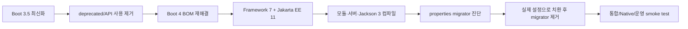

# S21. Spring Boot 3→4·Framework 7 변화와 마이그레이션

> Boot 4는 단순한 버전 교체가 아니라 Framework 7·Jakarta EE 11·Jackson 3·재편된 모듈 경계를 함께 올리는 메이저 업그레이드다.
> 가장 안전한 순서는 3.5 최신화 → deprecated 제거 → 의존성·Java·서버 기준선 점검 → properties migrator/OpenRewrite 적용 → 테스트와 운영 검증이다.
> 기준일(2026-09-28)의 기본 추천은 Java 25 + Spring Boot 4.1.1이며, 애플리케이션의 Java 최소 버전은 여전히 17이다.

## 1. 왜 알아야 하나

Boot 3 애플리케이션을 `4.1.1`로 바꾸고 배포했는데 기동 직후 `ClassNotFoundException: javax...`가 나거나, Undertow starter가 해석되지 않거나, JSON 직렬화 커스텀 모듈이 컴파일되지 않는 상황이 실제 마이그레이션의 첫 장애다. Boot 4는 Spring Framework 7과 Jakarta EE 11을 기준으로 하므로 `javax.*` 잔재, Servlet 6.1 미지원 서버, Boot가 관리하지 않는 Spring Cloud·Hibernate 버전이 한꺼번에 드러난다.

더 위험한 문제는 컴파일되지 않는 변화보다 조용한 의미 변화다. `spring-boot-properties-migrator`가 옛 프로퍼티를 임시로 읽어 주면 개발 환경은 정상처럼 보이지만, 제거한 운영 이미지에서 설정이 사라질 수 있다. Framework 7의 `HttpHeaders`는 `MultiValueMap` 계약을 상속하지 않으며, 7.0.8부터 SpEL 평가 연산 상한은 기본 10,000회다.

면접에서 “Boot 4는 Java 25가 필수”라고 답하면 틀리다. 최소 기준선은 17이고 Java 25는 권장 실행 환경이다. GraalVM native-image는 25 이상, Kotlin은 2.2 이상으로 올라간다.

## 2. 핵심 개념

| 용어 | 의미 | 마이그레이션에서의 판단 |
|---|---|---|
| Boot 4 | 의존성 관리, auto-configuration, starter, 실행 플러그인 세대 | Framework 7·Jakarta EE 11과 같은 선으로 올린다 |
| Framework 7 | IoC, MVC/WebFlux, HTTP client 등 Spring 핵심 런타임 | Java 17 기준선, JSpecify nullness, API 제거를 확인한다 |
| Jakarta EE 11 | `jakarta.*` 네임스페이스와 Servlet 6.1 등의 플랫폼 기준 | `javax.*` import와 컨테이너 호환성을 전수 검사한다 |
| Jackson 3 | Jackson의 새 세대. Boot 4에서는 `tools.jackson` 계열과 새 BOM/모듈 구성이 문제의 중심이다 | `com.fasterxml.jackson` 전용 customizer·모듈을 그대로 두지 않는다 |
| properties migrator | 옛 설정 키를 진단하고 기동 중 임시 변환하는 runtime 모듈 | 진단용으로만 잠깐 넣고 최종 설정 변경 후 제거한다 |
| OpenRewrite | 소스·빌드 파일·프로퍼티를 recipe로 일괄 변환하는 도구 | 반복 가능한 대규모 변경에 사용하고 diff·테스트로 검증한다 |
| OSS 지원 | 공개 릴리스 라인의 일반 지원 종료일 | Boot 4.0은 2026-12-31, 4.1은 2027-07-31, Framework 7.0은 2027-07-31이다. 상용 extended support는 별도 계약이다 |

### 헷갈리는 변화의 비교

| 구분 | Boot 3.5 | Boot 4.0/4.1 | 깨지는 이유 |
|---|---|---|---|
| Java | 17 이상 | 17 이상, Java 25 권장 | Java 25는 필수가 아니지만 하위 생태계 버전 요구가 올라간다 |
| 플랫폼 | Jakarta EE 10 계열 | Jakarta EE 11, Servlet 6.1 | Servlet 컨테이너·JPA·Validation 구현체의 기준이 바뀐다 |
| 로그 | `spring-jcl`이 전이 의존성 | Spring JCL 제거, Commons Logging 1.3.0 선호 | 직접 참조하던 내부 모듈이 사라진다 |
| 헤더 | `HttpHeaders`가 `MultiValueMap` | 컬렉션형 헤더 API로 재설계, `asMultiValueMap()` 등은 deprecated fallback | 헤더는 대소문자 무시 쌍이지 일반 Map이 아니다 |
| HTTP 호출 | 직접 `RestTemplate`/client 조립 또는 HTTP interface 수동 설정 | HTTP Service Client auto-configuration·프로퍼티 제공 | interface proxy 생성을 Boot 설정으로 표준화한다 |
| API 버전 | 애플리케이션별 resolver 구현 | MVC/WebFlux API Versioning auto-configuration | 버전 전달 위치·파싱·deprecation 처리를 공통화한다 |
| 서버 | Tomcat/Jetty/Undertow 선택 폭 | Servlet 6.1 미지원으로 Undertow Boot 지원 제거 | 컨테이너가 새 Servlet 기준선을 만족해야 한다 |
| 테스트 목 | `@MockBean`, `@SpyBean` 중심 | Boot 4 recipe가 대체 API로 변환 | 테스트 context 조작 방식이 바뀐다 |

## 3. 내부 동작·원리

### 3.1 업그레이드는 하나의 dependency graph 재해결이다

Boot starter는 단순한 편의 dependency가 아니라 관리되는 버전 집합의 진입점이다. 4.0은 큰 jar 몇 개 대신 더 작은 focused module을 제공하고 starter 구성을 정리했다. 따라서 직접 `spring-boot-autoconfigure`나 제3자 라이브러리만 추가하던 애플리케이션은 “예전에는 전이 의존성으로 우연히 되던 기능”을 잃는다. 직접 관리하는 프로젝트라면 `spring-framework 7.x`, Servlet 6.1, JPA 3.2, Hibernate ORM 7.1/7.2, Validation 3.1, Netty 4.2, JUnit 6 호환성을 함께 맞춘다.



메이저 버전에서 이 순서를 지키는 이유는 실패 원인을 분리하기 위해서다. 3.5에서 deprecated를 없애지 않고 4.0으로 올리면 “이번 변경”과 “예정된 제거”가 한 로그에 섞인다. 직접 고정한 Spring Cloud나 Hibernate 버전을 조사하지 않으면 외부 플랫폼 조합 문제를 Boot 탓으로 오인한다.

### 3.2 JSpecify null-safety는 runtime 검사가 아니라 계약의 이동이다

Framework 7 소스는 JSpecify annotation으로 API·필드·type usage의 nullability를 표시하고 빌드에서 NullAway로 일관성을 검사한다. Java 컴파일러 자체가 null을 타입으로 표현하지는 않으므로 annotation만 붙였다고 런타임 NPE가 자동으로 사라지는 것은 아니다. IDE 또는 NullAway 같은 checker가 호출자 코드를 분석해 경고/실패를 내는 구조다. Kotlin에서는 JSpecify가 Kotlin null-safety로 번역된다.

기본은 `@NullMarked` 범위 안에서 non-null이고, 실제 null 가능 값만 `@Nullable`로 표시한다. 이 변화는 애플리케이션 API를 즉시 전부 annotate하라는 뜻이 아니다. 우선 Framework 7로 바꾼 뒤 IDE 경고가 늘어난 지점을 계약 위반으로 분류하고, 공용 라이브러리부터 `package-info.java`와 checker를 도입한다.

### 3.3 HttpHeaders와 HTTP interface의 설계 차이

헤더 이름은 대소문자를 무시하고 같은 이름에 여러 값이 올 수 있다. 일반 Map의 `equals`, `put`, key iteration을 그대로 적용하면 서버의 의미와 맞지 않는다. Framework 7은 이 현실을 반영해 `HttpHeaders`가 `MultiValueMap` 계약을 상속하지 않게 했고, 기존 map-style 접근을 위한 일부 fallback을 deprecated로 남겼다. 헤더 유틸리티는 `set`, `add`, `getFirst`, `headerNames` 같은 헤더 전용 연산으로 옮긴다.

HTTP interface는 `@HttpExchange`가 붙은 Java interface를 읽고 Spring이 proxy를 만든다. 메서드의 `@GetExchange`, `@PostExchange`, `@RequestBody` 메타데이터가 요청 method·URL·body로 변환되고, 실제 transport는 동기/비동기 client 설정에 위임된다. Boot 4는 여기에 auto-configuration과 properties를 제공하므로 client마다 수동 proxy factory를 중복 생성하지 않아도 된다. 다만 interface가 곧 resilience 계층은 아니다. timeout, retry, circuit breaker, idempotency는 별도로 설계한다.

### 3.4 API Versioning의 분리된 책임

요청에 버전을 전달하는 위치는 header, query parameter, media type, URL 등 여러 가지다. Framework의 API Versioning은 “어느 위치에서 읽을지”와 “문자열을 어떤 버전으로 해석할지”를 `ApiVersionResolver`, `ApiVersionParser`, `ApiVersionDeprecationHandler`로 나눈다. Boot 4는 MVC와 WebFlux에 각각 `spring.mvc.apiversion.*`, `spring.webflux.apiversion.*` 설정과 auto-configuration을 제공한다.

controller가 `if (version == ...)`로 프로토콜 parsing까지 떠안지 않는 것이 핵심이다. resolver는 후보를 찾고 parser는 정규화하며 deprecation handler는 sunset 경고·거부 정책을 담당한다. 버전 전략을 정한 뒤 두 stack을 별도로 검증한다.

## 4. 코드로 확인

### 예제 1 — properties migrator를 진단 단계에만 추가

Maven 기준이다. Boot 4.0 migration guide가 안내하는 모듈은 runtime classpath에만 넣는다. 기동 로그의 renamed/removed 진단을 기록한 뒤 실제 `application.yml`을 고치고 dependency를 제거한다.

```xml
<dependency>
  <groupId>org.springframework.boot</groupId>
  <artifactId>spring-boot-properties-migrator</artifactId>
  <scope>runtime</scope>
</dependency>
```

예를 들어 OpenRewrite recipe에는 `management.health.mongo.enabled`를 `management.health.mongodb.enabled`로 바꾸는 규칙이 포함되어 있다. migrator는 임시 호환층이므로 이 dependency가 남은 상태를 “마이그레이션 완료”로 판단하면 안 된다. (Spring Boot 4.1 / Framework 7 기준, 애플리케이션 미실행)

### 예제 2 — HTTP Service Client

```java
package example.client;

import java.util.Map;
import org.springframework.web.bind.annotation.RequestBody;
import org.springframework.web.service.annotation.HttpExchange;
import org.springframework.web.service.annotation.PostExchange;

@HttpExchange("https://echo.example.test")
public interface EchoClient {
    @PostExchange("/echo")
    Map<String, Object> echo(@RequestBody Map<String, String> body);
}
```

실제 애플리케이션에서는 `spring.http.serviceclient.*` 계열 설정과 transport별 builder로 base URL·timeout·관찰성 정책을 고정한다. interface만 선언했다고 재시도나 인증이 자동으로 해결되지는 않는다. (Spring Boot 4.1 / Framework 7 기준, 애플리케이션 미실행)

### 예제 3 — API Versioning 설정의 출발점

```yaml
spring:
  mvc:
    apiversion:
      use:
        - HEADER
      default-version: "1.0"
      supported: "1.0,2.0"
```

세부 키와 값은 사용하는 Boot 4.1 maintenance release의 reference로 검증해야 한다. controller마다 header parsing을 넣지 말고 resolver/parser 정책을 한 번 등록한다. WebFlux라면 `spring.webflux.apiversion.*`를 사용한다. (Spring Boot 4.1 / Framework 7 기준, 설정 예시 미실행)

### 예제 4 — 순수 Java로 property rename을 검증

다음은 migrator 자체가 아니라, CI에서 금지된 옛 키를 새 키로 치환하는 최소한의 순수 Java 모델이다.

```java
import java.util.LinkedHashMap;
import java.util.Map;

public class MigrationPropertiesDemo {
    public static void main(String[] args) {
        Map<String, String> input = new LinkedHashMap<>();
        input.put("management.health.mongo.enabled", "true");
        input.put("server.port", "8080");
        Map<String, String> renamed = Map.of(
                "management.health.mongo.enabled", "management.health.mongodb.enabled");
        input.replaceAll((key, value) -> value);
        input.entrySet().stream()
                .map(e -> Map.entry(renamed.getOrDefault(e.getKey(), e.getKey()), e.getValue()))
                .forEach(e -> System.out.println(e.getKey() + "=" + e.getValue()));
    }
}
```

JDK 21 경로로 실제 실행했다.

```text
management.health.mongodb.enabled=true
server.port=8080
```

운영에서는 Boot configuration changelog와 OpenRewrite recipe를 기준으로 삼고, 치환 뒤 옛 key가 남지 않았는지 테스트한다.

## 5. 버전별 변화 — 왜 바뀌었나

| 시점 | 변화 | 이전 방식의 한계와 근거 |
|---|---|---|
| Spring Boot 3.5 → 4.0 | Java 17 유지, Java 25 권장; Jakarta EE 11·Servlet 6.1; Framework 7로 상향 | 이전 세대의 Jakarta EE/Servlet 기준으로는 새 컨테이너·구현체의 API 계약을 표현할 수 없었다. 근거: Boot 4.0 Migration Guide, Framework 7.0 Release Notes |
| Boot 4.0 | focused module, HTTP Service Client auto-config, MVC/WebFlux API Versioning, OpenTelemetry starter | 큰 jar와 전이 의존성은 어떤 기능이 실제로 필요한지 불명확하고 client/version 정책이 애플리케이션마다 중복됐다. 근거: Boot 4.0 Release Notes |
| Boot 4.0 | Undertow, embedded executable uber-jar launch script, 일부 Spring Session 통합, Spock integration 제거 | Servlet 6.1 미지원 또는 유지 주체가 프로젝트 밖으로 이동한 기능을 Boot가 계속 보장할 수 없었다. 근거: Boot 4.0 Migration Guide |
| Framework 7.0 | JSpecify 기반 nullness, `HttpHeaders`의 Map 계약 제거, `ListenableFuture` 제거 | 암묵적 nullable과 헤더의 일반 Map 모델이 정적 검사·프로토콜 의미를 약화시켰다. 근거: Framework 7.0 Release Notes, Null-safety reference |
| Boot 4.1 | 4.0 deprecated class/method/property 제거, gRPC 지원, Jackson read/write/factory 설정 확장 | 4.0에서 경고만 하던 호환층을 계속 유지하면 다음 minor의 API 표면이 누적된다. 근거: Boot 4.1 Release Notes |

지원 기간은 OSS 기준으로 Boot 4.0 EOL 2026-12-31, 4.1·Framework 7.0 EOL 2027-07-31이다. `extendedSupport`는 상용 지원 계약과 혼동하지 않는다. Java LTS 로드맵은 J17을 참조한다.

## 6. 실무 가이드

- **상황이 3.0~3.4라면** 먼저 최신 3.5.x로 올려라. Boot 4 공식 가이드가 3.5를 중간 기준선으로 삼기 때문에 dependency 차이와 제거 예정 API를 한 단계씩 줄일 수 있다.
- **상황이 팀의 표준 JDK를 결정하는 단계라면** Java 25를 기본값으로 추천한다. Boot/Framework 최소선은 17이지만 최신 LTS의 장기 패치·도구 호환성을 활용하고, 라이브러리 지원 범위를 CI에서 검증한다.
- **상황이 직접 dependency를 버전 고정한다면** Boot BOM을 우선 적용하고 Spring Cloud·Hibernate·JPA provider·database driver를 호환 매트릭스로 따로 확인하라. 이유는 Boot가 관리하지 않는 버전이 전체 graph를 깨뜨릴 수 있기 때문이다.
- **상황이 `application.properties`에 옛 키가 많다면** migrator를 runtime으로 넣고 기동 로그를 수집한 뒤 파일 자체를 수정하라. 이유는 migrator가 런타임 임시 변환이지 영구 계약이 아니기 때문이다.
- **상황이 여러 서비스에서 같은 3→4 변경을 반복한다면** OpenRewrite recipe를 dry-run하고 commit별 diff를 리뷰하라. recipe는 build file, API, property까지 일관되게 바꾸지만 업무 의미나 custom reflection까지 보장하지 않는다.
- **상황이 Undertow라면** Tomcat 11 또는 Jetty 12.1 같은 Servlet 6.1 호환 선택지를 성능·운영 표준과 함께 검증하라. 단순히 starter 이름만 바꾸지 말고 graceful shutdown, compression, access log, native image를 다시 테스트한다.
- **상황이 Jackson custom module을 직접 만들었다면** `tools.jackson` 기반 API와 4.1의 factory/customizer를 먼저 확인하고, `com.fasterxml.jackson` 타입이 public API·설정·테스트 fixture에 남았는지 검색하라.
- **상황이 API versioning을 도입한다면** header/query/media type 중 하나를 정하고 resolver/parser/deprecation 정책을 먼저 고정하라. controller 안에서 문자열을 직접 분기하면 WebMVC/WebFlux·문서·폐기 응답이 다시 갈라진다.
- **상황이 native-image라면** GraalVM 25 이상과 exact reachability metadata를 별도 pipeline에서 검증하라. JVM 테스트 통과만으로 reflection/resource 문제를 증명할 수 없다.

## 7. 함정·안티패턴

1. **기동은 되지만 운영에서 설정이 사라진다 →** migrator가 옛 property를 임시 변환 중이다 → **대처:** 로그의 모든 rename을 실제 YAML로 반영하고 migrator dependency를 제거한 이미지로 재기동한다.
2. **`javax.annotation.*` 또는 `javax.inject.*`에서 컴파일 실패 →** Framework 7이 해당 패키지를 지원하지 않는다 → **대처:** `jakarta.annotation.*`, `jakarta.inject.*`로 import와 직접 dependency를 함께 교체하고 생성된 소스·테스트도 검색한다.
3. **Undertow starter가 해석되지 않거나 Servlet 오류 →** Servlet 6.1 기준을 Undertow가 만족하지 못해 Boot 지원이 제거됐다 → **대처:** Tomcat/Jetty로 전환하거나 호환 Undertow 릴리스가 기준을 만족하는지 확인할 때까지 Boot 3.5에 머문다.
4. **헤더 공통 코드가 컴파일되지 않거나 중복 header를 놓친다 →** `HttpHeaders`를 `MultiValueMap`처럼 캐스팅·순회했다 → **대처:** 헤더 전용 API로 바꾸고 `getFirst`와 다중 값 보존 여부를 테스트한다.
5. **Jackson serializer가 컴파일되지만 런타임에 mapper가 달라진다 →** Jackson 2 타입과 Jackson 3 factory/customizer를 혼용했다 → **대처:** public DTO·module·ObjectMapper 주입 지점을 한 세대로 통일하고 JSON golden test를 비교한다.
6. **4.0에서 경고만 보던 코드가 4.1에서 갑자기 실패한다 →** Boot 4.0 deprecated가 4.1에서 제거됐다 → **대처:** `-Xlint`만 믿지 말고 Boot 3.5/4.0의 deprecation 로그와 migration guide를 릴리스마다 소거한다.
7. **`-DskipTests`인데 AOT 테스트 처리가 실행된다 →** Boot 4.1 Maven plugin은 AOT skip에 `maven.test.skip`을 사용하도록 바뀌었다 → **대처:** CI profile의 skip 목적을 분리하고 AOT를 끄는 이유를 명시한다.

## 8. 자가점검 Q&A (면접 대비)

### Q1. Boot 4에서 Java 25가 필수인가?

아니다. Boot 4.0과 Framework 7은 JDK 17 baseline을 유지한다. Java 25는 기준일 현재 최신 LTS이므로 권장 실행 환경이고, GraalVM native-image는 별도로 25 이상 요구된다.

꼬리질문: 그렇다면 Java 17을 계속 써도 되는가? → 지원 범위 안에서는 가능하지만, Kotlin 2.2·jOOQ 3.20 등 하위 프로젝트가 더 높은 Java를 요구할 수 있어 전체 graph를 확인해야 한다.

### Q2. Boot 3.5를 거쳐야 하는 이유는?

공식 가이드가 3.5 최신화 후 4.0 전환을 권장한다. 3.5에서 deprecated 호출과 dependency를 먼저 정리하면 4.0에서 제거된 API와 새 변경을 구분할 수 있고, 3.5의 최신 보안·버그 수정도 확보한다.

꼬리질문: 3.4에서 바로 올리면 절대 안 되는가? → 불가능한 것은 아니지만 실패 원인이 섞이므로, 특별한 긴급 사유가 없다면 중간 기준선을 거치는 편이 진단 비용이 낮다.

### Q3. properties migrator를 계속 운영 dependency로 두면 어떤가?

옛 키를 runtime에서 임시 변환하므로 전환 초기에 유용하지만, 영구 호환 계약이 아니다. 새 키로 파일을 고친 뒤 dependency를 제거하지 않으면 누락된 설정을 계속 숨기고 향후 제거 시 장애가 된다.

꼬리질문: OpenRewrite와 migrator 중 하나만 쓰면 되는가? → migrator는 실행 환경 진단, OpenRewrite는 소스·빌드·파일의 반복 변환이므로 함께 쓰되 최종 source를 새 형식으로 만든다.

### Q4. Framework 7의 JSpecify는 `@NonNull`과 같은가?

목적은 nullability 계약이지만, Java 타입 시스템이 직접 강제하는 키워드는 아니다. `@NullMarked` 범위에서 기본 non-null, 예외적으로 nullable을 표시하고 IDE/NullAway/Kotlin compiler가 호출자 위반을 잡는다.

꼬리질문: annotation만 붙이면 NPE가 사라지는가? → 아니다. 정적 검사 경고를 오류로 운영하고 경계 입력 검증까지 해야 runtime NPE를 줄일 수 있다.

### Q5. `HttpHeaders`가 `MultiValueMap`을 상속하지 않게 된 이유는?

HTTP header는 case-insensitive한 이름과 여러 값을 가진 pair 집합인데, 일반 Map 연산의 equality·put·성능 의미와 맞지 않는다. Framework 7은 그 불일치를 API에 반영하고 일부 map-style fallback을 deprecated로 남겼다.

꼬리질문: 그럼 header 하나에 값 하나만 저장하면 Map으로 바꿔도 되는가? → 안 된다. 프로토콜은 다중 값을 허용하므로 `getFirst`를 의도적으로 선택했는지, 모든 값을 보존해야 하는지 코드에 드러내야 한다.

### Q6. Boot 4의 API Versioning auto-configuration이 controller 버전 분기를 없애 주는가?

버전의 전달 위치를 읽고 해석하는 공통 기반을 제공할 뿐, 모든 business representation을 자동 생성하지는 않는다. resolver, parser, deprecation handler를 정책으로 만들고 controller 매핑과 response schema는 애플리케이션이 설계해야 한다.

꼬리질문: MVC 설정을 WebFlux에도 그대로 쓰면 되는가? → 아니다. `spring.mvc.apiversion.*`와 `spring.webflux.apiversion.*`는 stack별 설정이며 각각의 integration test가 필요하다.

### Q7. Jackson 2 코드를 import만 바꾸면 Jackson 3로 갈 수 있는가?

대개 그렇지 않다. Boot 4의 BOM·artifact·package와 mapper/factory customization 표면을 확인해야 하고, custom module·serializer·public method signature까지 영향을 받는다. JSON golden test로 실제 wire format도 비교해야 한다.

꼬리질문: JSON 문자열이 같으면 완료인가? → 아니다. null 처리, 날짜/숫자 coercion, unknown property, polymorphic type, content negotiation도 회귀 검증 대상이다.

### Q8. 4.0 deprecated는 언제 고쳐야 하는가?

즉시 고친다. Boot 4.1 release notes는 4.0 deprecated 클래스·메서드·프로퍼티가 제거됐다고 명시한다. 소거하지 않으면 다음 minor가 다시 마이그레이션이 된다.

꼬리질문: 컴파일이 되면 deprecated가 없는 것인가? → 아니다. property와 reflection 호출은 startup diagnostics와 문자열 검색도 사용한다.

## 9. 참고문헌

- Spring Boot 4.0 Release Notes — https://github.com/spring-projects/spring-boot/wiki/Spring-Boot-4.0-Release-Notes — HTTP Service Client, API Versioning, 모듈·starter 등 4.0 변화.
- Spring Boot 4.0 Migration Guide — https://github.com/spring-projects/spring-boot/wiki/Spring-Boot-4.0-Migration-Guide — 3.5 선행, Java/Jakarta 기준, properties migrator와 제거 기능.
- Spring Boot 4.1 Release Notes — https://github.com/spring-projects/spring-boot/wiki/Spring-Boot-4.1-Release-Notes — 4.0 deprecated 제거, Jackson·gRPC·skip 설정 변화.
- Spring Framework 7.0 Release Notes — https://github.com/spring-projects/spring-framework/wiki/Spring-Framework-7.0-Release-Notes — 기준선, 제거 API, HttpHeaders, Undertow 변화.
- Spring Framework Null-safety — https://docs.spring.io/spring-framework/reference/7.0/core/null-safety.html — JSpecify·`@NullMarked`·정적 검사 모델.
- HTTP Interface Client — https://docs.spring.io/spring-framework/reference/6.2.9/web/webflux-http-interface-client.html — interface proxy와 동기/반응형 HTTP client 개념; 페이지가 Framework 7.0.9 stable 문서로 연결됨.
- Migrate to Spring Boot 4.0 (Community Edition) — https://docs.openrewrite.org/recipes/java/spring/boot4/upgradespringboot_4_0-community-edition — Boot·Framework·Security·Batch·Jackson·property recipe 구성.
- Migrate Spring Boot properties to 4.0 — https://docs.openrewrite.org/recipes/java/spring/boot4/springbootproperties_4_0 — 실제 property rename recipe 예시.
- Spring Boot lifecycle data — https://endoflife.date/api/spring-boot.json — Boot 4.0/4.1 OSS EOL·최신 릴리스·extended support 구분.
- Spring Framework lifecycle data — https://endoflife.date/api/spring-framework.json — Framework 7.0 OSS EOL·지원 Java/Jakarta 범위.
