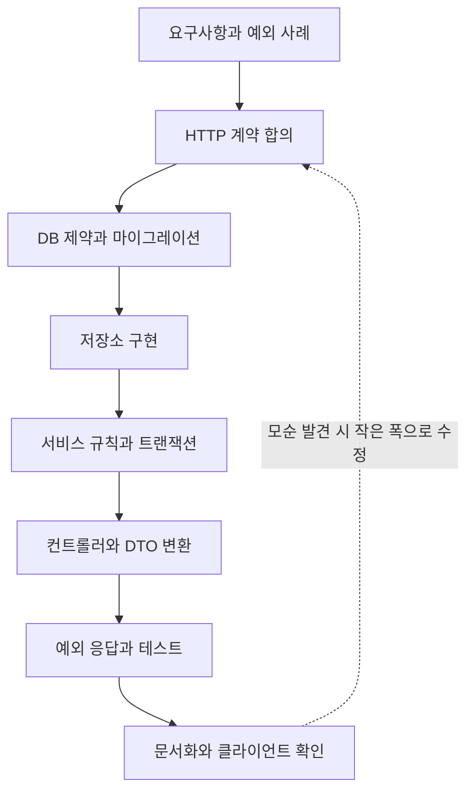

# W01. API 하나 만들 때 실제 작업 순서 — DB부터? 컨트롤러부터?

> API 개발은 DB나 컨트롤러 중 하나를 먼저 만드는 경주가 아니다. 먼저 사용자 요구와 HTTP 계약을 합의하고, 데이터 제약을 설계한 뒤 한 기능을 저장소부터 응답까지 작은 단위로 연결한다.
> 기본값은 `요구사항 → API 계약 → DB 설계 → 저장소·서비스·컨트롤러 수직 구현 → 예외·테스트·문서`다.
> 이미 존재하는 DB가 있거나 화면 계약이 강하게 고정된 경우에는 시작점을 바꾸되, 계층 경계와 데이터 무결성은 유지한다.

## 1. 질문

**신입이 게시글 좋아요 API를 맡았다고 하자. 어디서 시작해야 할까?** 데이터베이스 담당자는 `post_like` 테이블부터 만들라고 하고, 프론트엔드 개발자는 `PUT /posts/{id}/likes/me`와 응답을 먼저 알려 달라고 한다. 백엔드 선배는 “컨트롤러부터 만들어 보면 감이 와”라고 한다. 다 그럴듯하지만 서로 다른 위험을 줄이려는 말이다.

첫 장면은 `PostLike`를 먼저 만들고 그대로 반환한 경우다. 뒤늦게 회원 ID는 본문 대신 인증 정보에서 얻어야 한다는 요구가 나와도 여러 클라이언트가 엔티티 모양에 의존한다.

둘째는 Controller부터 만든 경우다. 경로와 DTO는 빨리 나오지만 동시 클릭에서 중복 행을 허용하는지, 재요청을 성공으로 볼지 정하지 않았다. 화면은 성공인데 DB에는 중복이 생길 수 있다.

DB부터 시작해도 프론트 응답이나 인증 방식이 뒤늦게 달라지면 배포된 스키마를 바꿔야 할 수 있다. 어느 시작점이든 다음 결정을 고정시키면 변경 비용이 커진다.

## 2. 짧은 답

- 요청 주체·성공·실패 조건부터 합의한다.
- API 계약에는 경로·메서드·요청/응답·상태 코드·인증·중복 의미를 적는다.
- 계약에 맞춰 DB 제약과 인덱스를 설계한다. 좋아요 유일 키는 `(회원, 게시글)`이다.
- 저장소부터 Controller까지 API 하나를 연결한다.
- 기본값은 **명세 우선 + 수직 슬라이스**다. API 하나를 DB부터 HTTP까지 통과시킨다.
- 레거시는 스키마를 먼저 읽고 계약을 맞춘다. 병렬 작업은 계약 초안을 공유한다.
- Controller 우선은 HTTP 확인에, DB 우선은 기존 모델·제약 확인에 유리하다.

## 3. 왜 그런가 — 원리

작업 순서는 파일을 무엇부터 만들지보다 **불확실성을 어디서 싸게 발견할지**의 문제다. 요구가 불명확하면 구현자가 정책을 임의로 정하고, 계약이 없으면 클라이언트와 서버가 요청 형식을 따로 상상한다. DB 불변식이 빠지면 동시 요청에 데이터가 깨질 수 있고, DB를 과하게 먼저 고정하면 사용 사례가 스키마에 끌려간다.

권장 순서의 각 단계는 다음 결정의 입력을 만든다.

1. **요구를 사례와 규칙으로 바꾼다.** 작성자도 좋아요를 누르는가, 삭제된 글은 어떤가, 회원 ID는 본문인가 인증 주체인가? 경계 사례가 있어야 상태 코드와 제약을 정한다.
2. **HTTP 계약을 합의한다.** 클라이언트는 엔티티가 아니라 URL·메서드·헤더·JSON·상태 코드에 의존한다. 계약을 정하면 DTO와 영속 모델을 독립적으로 바꿀 수 있다.
3. **저장 무결성을 설계한다.** DB 제약·조회 인덱스·마이그레이션을 정한다. 애플리케이션의 `exists` 검사만으로 동시 요청 유일성을 보장할 수 없다.
4. **한 요청을 끝까지 구현한다.** 저장소는 DB 작업, 서비스는 규칙·트랜잭션, 컨트롤러는 HTTP 경계를 맡는다. 수직 슬라이스가 계층 간 계약을 일찍 검증한다.
5. **실패 응답과 테스트를 정한다.** 검증 오류·없는 게시글·인증 실패·DB 제약 위반을 구분하고, 실제 DB 제약이 동작하는지 확인한다.



이 흐름은 워터폴이 아니다. 설계는 앞에서 하되 코드는 기능별로 연결한다. Spring MVC는 요청을 라우팅하고, `@RequestBody`는 `HttpMessageConverter`로 변환되며 `@Valid` 오류는 기본 400이 된다. Controller는 HTTP 경계이므로 데이터 모델과 정책의 유일한 출발점일 필요가 없다. ([MVC](https://docs.spring.io/spring-framework/reference/web/webmvc.html), [요청 본문](https://docs.spring.io/spring-framework/reference/web/webmvc/mvc-controller/ann-methods/requestbody.html), [검증](https://docs.spring.io/spring-framework/reference/web/webmvc/mvc-controller/ann-validation.html))

서비스 계층은 여러 인터페이스가 같은 업무 동작을 호출할 때 규칙·응답 조정을 중복하지 않게 한다. `@Transactional`은 Spring의 선언적 경계이므로 HTTP 메서드보다 업무 동작을 수행하는 서비스에 두면 의도가 명확하다. 여러 HTTP 요청이나 외부 시스템까지 자동 원자화하지는 않는다. ([Service Layer](https://martinfowler.com/eaaCatalog/serviceLayer.html), [@Transactional](https://docs.spring.io/spring-framework/reference/data-access/transaction/declarative/annotations.html))

## 4. 선택지 비교

| 선택지 | 어떻게 동작 | 장점 | 단점 | 언제 쓰나 | 국내 실무에서 흔한가 |
|---|---|---|---|---|---|
| 계약 우선 + 수직 슬라이스 | 계약 합의 후 API 한 개를 저장부터 응답까지 연결 | 병렬 작업·계층 연결 확인에 유리 | 초기에 사례·계약을 생각해야 함 | 신규 API 기본값, 여러 클라이언트 | 국내 채택 비율 근거는 확인하지 못함. OpenAPI 같은 공유 도구는 존재 |
| 컨트롤러 우선 | 경로·DTO부터 만들고 아래 계층을 채움 | 라우팅·JSON을 빨리 시연 | DB 제약·트랜잭션 검증이 밀릴 수 있음 | 화면 연동 프로토타입 | 비율 근거 없음 |
| DB 우선 | 테이블·제약·쿼리부터 상위 계층으로 구현 | 기존 DB·쿼리 위험을 조기 확인 | API가 테이블 구조에 종속될 수 있음 | 레거시·이관·성능 중심 요구 | 비율 근거 없음 |
| 계층별 수평 완성 | 여러 API의 Entity·Repository 후 전체 Service·Controller 구현 | 계층 공통 작업과 분담이 쉬움 | 한 기능 통합이 늦고 계약 불일치가 늦게 드러남 | 계약이 안정적이고 공통 기반이 분명할 때 | 비율 근거 없음 |
| 명세·스키마 동시 설계 | 요구·API·데이터 모델을 함께 검토 후 구현 | 계약과 저장 요구 모순을 일찍 발견 | 초기 설계·승인에 시간이 듦 | 외부 연동, 승인·버전 관리 요구 | 비율 근거 없음 |

“어디부터 코딩하나”와 “무엇을 먼저 결정하나”를 구분해야 한다. **결정은 요구와 계약부터**, 실제 구현은 상황에 맞게 Controller부터 또는 Repository부터 착수할 수 있다. 신규 기능에선 계약과 데이터 제약을 정한 다음 작은 수직 슬라이스로 검증하는 편이 정보 흐름을 짧게 만든다. 이미 배포된 DB 스키마가 있으면 이를 무시한 채 이상적인 새 테이블부터 만드는 것이 아니라, 현재 제약을 확인해 API와의 간격을 다룬다.

## 5. 코드로 보기

아래는 모두 같은 좋아요 등록·취소 기능이다. 첫 산출물이 다른 선택지와 권장 흐름을 나란히 보인다. Spring 코드는 Boot 4.1 / Framework 7 기준이며 실행하지 않았다. **(미실행)**

### 5.1 계약 우선: 호출자가 먼저 이해하는 API를 정한다

회원 ID를 본문에서 받으면 다른 사람을 대신해 좋아요를 누르는 취약점으로 이어질 수 있으므로, 인증 주체를 `me`로 표현한다. `PUT`과 `DELETE`는 원하는 상태를 설정·해제하는 의미를 명확히 하며, 같은 `PUT` 반복은 최종 상태가 같아야 한다.

```yaml
openapi: 3.1.0
info:
  title: Post Likes API
  version: 1.0.0
paths:
  /api/posts/{postId}/likes/me:
    put:
      summary: 현재 회원의 좋아요 설정
      parameters:
        - in: path
          name: postId
          required: true
          schema: { type: integer, format: int64, minimum: 1 }
      responses:
        '204': { description: 좋아요 상태 설정 완료 }
        '401': { description: 인증 필요 }
        '404': { description: 게시글 없음 }
    delete:
      summary: 현재 회원의 좋아요 해제
      parameters:
        - in: path
          name: postId
          required: true
          schema: { type: integer, format: int64, minimum: 1 }
      responses:
        '204': { description: 좋아요 상태 해제 완료 }
        '401': { description: 인증 필요 }
        '404': { description: 게시글 없음 }
```

본문 없는 `204 No Content` 응답이다. 인증 실패·없는 게시글·중복 `PUT` 의미를 미리 합의한다. 계약 우선은 모든 응답을 고정한다는 뜻이 아니라 실제 사용 사례에 필요한 약속을 공유한다는 뜻이다.

### 5.2 DB 우선: 데이터 불변식을 먼저 드러낸다

두 번의 동시 요청도 같은 회원·게시글 쌍을 두 행으로 만들지 않도록 유일 제약을 둔다. 애플리케이션에서 조회한 뒤 저장하는 두 단계만으로는 동시성 경쟁을 막을 수 없다.

```sql
-- PostgreSQL 예시. post(id), member(id)는 이미 존재한다고 가정한다.
CREATE TABLE post_like (
    id         bigint GENERATED BY DEFAULT AS IDENTITY PRIMARY KEY,
    post_id    bigint NOT NULL REFERENCES post(id),
    member_id  bigint NOT NULL REFERENCES member(id),
    created_at timestamptz NOT NULL DEFAULT current_timestamp,
    CONSTRAINT uk_post_like_post_member UNIQUE (post_id, member_id)
);

-- 회원이 좋아요한 글을 찾는 조회 경로가 필요할 때 추가 여부를 검토한다.
CREATE INDEX ix_post_like_member_post ON post_like (member_id, post_id);
```

유일 제약은 중복을 막는다. 회원별 목록 조회가 있다면 `(member_id, post_id)` 인덱스를 검토한다. 인덱스는 조회 패턴과 실행 계획에 맞추며, PostgreSQL `ON CONFLICT` 구현은 다른 DB에서 그대로 동작하지 않는다.

### 5.3 컨트롤러 우선: HTTP 경계를 빠르게 확인한다

라우팅·인증 주체 전달·상태 코드를 먼저 시연할 수 있다. 아래 코드는 첫 화면 연동용 경계의 형태다. 서비스가 비어 있거나 DB 규칙이 빠진 채 끝나면 완성된 API가 아니다.

```java
import org.springframework.http.ResponseEntity;
import org.springframework.security.core.annotation.AuthenticationPrincipal;
import org.springframework.web.bind.annotation.DeleteMapping;
import org.springframework.web.bind.annotation.PathVariable;
import org.springframework.web.bind.annotation.PutMapping;
import org.springframework.web.bind.annotation.RequestMapping;
import org.springframework.web.bind.annotation.RestController;

@RestController
@RequestMapping("/api/posts/{postId}/likes/me")
class PostLikeController {
    private final PostLikeService service;

    PostLikeController(PostLikeService service) {
        this.service = service;
    }

    @PutMapping
    ResponseEntity<Void> like(
            @PathVariable long postId,
            @AuthenticationPrincipal MemberPrincipal principal) {
        service.like(postId, principal.memberId());
        return ResponseEntity.noContent().build();
    }

    @DeleteMapping
    ResponseEntity<Void> unlike(
            @PathVariable long postId,
            @AuthenticationPrincipal MemberPrincipal principal) {
        service.unlike(postId, principal.memberId());
        return ResponseEntity.noContent().build();
    }
}
```

`MemberPrincipal`은 인증 과정에서 설정하는 고유 principal이며, 인증 설정이 이 타입을 제공해야 한다.

```java
record MemberPrincipal(long memberId) {}
```

Controller는 업무 규칙을 수행하지 않는다. 본문이 없어 DTO 변환·검증도 없으며, 게시글별 허용 정책은 Service에서 확인한다.

### 5.4 권장 기본 흐름: 계약을 지키는 한 기능을 끝까지 연결한다

구조를 위한 예시다. 테이블은 앞의 PostgreSQL 마이그레이션으로 만들고, `Post`는 존재 확인용 최소 Entity다.

```java
import jakarta.persistence.Entity;
import jakarta.persistence.GeneratedValue;
import jakarta.persistence.GenerationType;
import jakarta.persistence.Id;
import jakarta.persistence.Table;

@Entity
@Table(name = "post")
class Post {
    @Id
    @GeneratedValue(strategy = GenerationType.IDENTITY)
    private Long id;

    protected Post() {}
}
```

영속 모델은 API 응답과 분리한다. 좋아요 Entity는 다음과 같다.

```java
import jakarta.persistence.Column;
import jakarta.persistence.Entity;
import jakarta.persistence.GeneratedValue;
import jakarta.persistence.GenerationType;
import jakarta.persistence.Id;
import jakarta.persistence.Table;
import java.time.Instant;

@Entity
@Table(name = "post_like")
class PostLike {
    @Id
    @GeneratedValue(strategy = GenerationType.IDENTITY)
    private Long id;

    @Column(name = "post_id", nullable = false)
    private Long postId;

    @Column(name = "member_id", nullable = false)
    private Long memberId;

    @Column(name = "created_at", nullable = false)
    private Instant createdAt;

    protected PostLike() {}
}
```

운영 스키마는 마이그레이션으로 관리한다. Repository가 존재 확인과 원자적 생성을 맡는다.

```java
import org.springframework.data.jpa.repository.JpaRepository;
import org.springframework.data.jpa.repository.Modifying;
import org.springframework.data.jpa.repository.Query;
import org.springframework.data.repository.query.Param;

interface PostRepository extends JpaRepository<Post, Long> {}

interface PostLikeRepository extends JpaRepository<PostLike, Long> {
    @Modifying
    @Query(value = """
            INSERT INTO post_like (post_id, member_id, created_at)
            VALUES (:postId, :memberId, current_timestamp)
            ON CONFLICT (post_id, member_id) DO NOTHING
            """, nativeQuery = true)
    int insertIfAbsent(@Param("postId") long postId,
                       @Param("memberId") long memberId);

    @Modifying
    @Query(value = """
            DELETE FROM post_like
            WHERE post_id = :postId AND member_id = :memberId
            """, nativeQuery = true)
    int deleteIfPresent(@Param("postId") long postId,
                        @Param("memberId") long memberId);
}
```

`ON CONFLICT`와 유일 제약이 함께 중복 `PUT`을 안전하게 만든다. 다른 DB에서는 원자적 upsert나 별도 전략을 택한다. 조회 후 `save`만으로는 경쟁 요청을 막지 못한다.

```java
import org.springframework.stereotype.Service;
import org.springframework.transaction.annotation.Transactional;

@Service
class PostLikeService {
    private final PostRepository posts;
    private final PostLikeRepository likes;

    PostLikeService(PostRepository posts, PostLikeRepository likes) {
        this.posts = posts;
        this.likes = likes;
    }

    @Transactional
    public void like(long postId, long memberId) {
        if (!posts.existsById(postId)) {
            throw new PostNotFoundException(postId);
        }
        likes.insertIfAbsent(postId, memberId);
    }

    @Transactional
    public void unlike(long postId, long memberId) {
        if (!posts.existsById(postId)) {
            throw new PostNotFoundException(postId);
        }
        likes.deleteIfPresent(postId, memberId);
    }
}
```

각 Service 메서드가 업무 동작 한 번의 트랜잭션이다. 글 삭제와 생성이 경합해도 FK가 고아 행을 막지만, 이 경우의 오류 응답은 삭제 정책과 함께 정의한다.

```java
import org.springframework.http.HttpStatus;
import org.springframework.web.bind.annotation.ResponseStatus;

@ResponseStatus(HttpStatus.NOT_FOUND)
class PostNotFoundException extends RuntimeException {
    PostNotFoundException(long postId) {
        super("게시글을 찾을 수 없습니다: " + postId);
    }
}
```

정상 등록·해제, 미인증, 없는 게시글, 동시 중복 요청을 실제 HTTP 경로에서 확인한다. 규칙은 단위 테스트, 제약·upsert는 실제 DB 통합 테스트로 검증하고 문서의 상태 코드와 응답을 맞춘다. 테스트 코드는 생략했다.

## 6. 실무에서는 실제로

- **신규 서비스**는 사례·계약을 합의하고 DB 제약을 정한 뒤 API 하나를 끝까지 연결한다. OpenAPI를 프론트와 공유하고 구현과 함께 갱신한다.
- **레거시**는 스키마·FK·유일 제약·기존 데이터를 먼저 읽고 호환 구현이나 단계적 마이그레이션을 고른다. 구버전 호환을 확인하지 않은 운영 테이블 변경은 피한다.
- **SI·금융·외부 연동**은 명세와 DB 모델을 함께 검토해 승인 필드·오류 코드·권한 누락을 줄인다. 승인 후 첫 수직 슬라이스에서 실제 매핑을 검증한다.
- **스타트업·작은 팀**은 요청·응답·결정 기록을 짧게 공유하되 DTO·제약·인증 주체는 생략하지 않는다.
- **병렬 작업**은 계약·오류 규약을 먼저 맞추고 계층을 나눠 맡긴다. 인터페이스만 두고 통합을 미루지 말고 실제 요청과 DB를 일찍 연결한다.
- **기존 데이터 모델**은 API DTO와 분리하고 변환을 Controller나 mapper에 둔다.

좋아요 예에서 각 관심사의 기본 위치는 다음과 같다. 표는 계층 이름을 기계적으로 외우라는 뜻이 아니라 변경 이유가 같은 코드를 가까이 두라는 기준이다.

| 관심사 | 기본 위치 | 이유·예외 |
|---|---|---|
| 경로, HTTP 메서드, 상태 코드 | Controller | HTTP와 애플리케이션 호출 사이 경계 |
| JSON/요청 DTO 검증 | Controller 입력 경계 | 타입·필수값·범위 검증. MVC `@Valid`는 요청 객체 검증에 사용 |
| 업무 규칙·상태 전이 | Service 또는 도메인 객체 | 화면·스케줄러 등 호출자가 달라도 같아야 함 |
| 트랜잭션 시작·범위 | Service의 유스케이스 메서드 | 여러 저장 작업을 하나의 업무 단위로 묶음 |
| API DTO와 도메인 값 변환 | Controller 또는 전용 mapper | API 구조가 엔티티 변경을 따라가지 않게 함 |
| 인증 여부·요청 경로 접근 통제 | Spring Security 설정/필터 체인 | 인증은 컨트롤러 도착 전 공통 처리 |
| 객체별 권한·좋아요 허용 조건 | Service/도메인 규칙 | 대상 게시글·현재 상태를 알아야 판단 가능 |
| SQL·DB 제약·잠금/원자적 갱신 | Repository와 DB | 데이터 저장 기술과 무결성 책임 |
| 요청 상관관계 ID·접근 로그 | Servlet Filter 또는 관측 계층 | 요청 전후 공통 정보. 토큰·개인정보·본문 전체를 무조건 기록하지 않음 |
| 오류를 HTTP 오류 형식으로 변환 | `@RestControllerAdvice` 등 웹 경계 | 내부 예외와 외부 오류 표현을 분리 |

입력 검증과 업무 규칙은 같은 검사가 아니다. `postId`가 양수인지, JSON 필드가 비어 있지 않은지는 요청 경계에서 빠르게 거를 수 있다. “탈퇴 회원은 좋아요를 할 수 없다”나 “비공개 게시글은 작성자만 볼 수 있다”는 현재 데이터와 정책에 의존하므로 서비스/도메인에서 다시 판단한다. DB의 FK·유일 제약은 앞의 검사와 별도로 최종 무결성을 지킨다. 같은 규칙을 여러 층에서 반복하더라도 각 층의 목적을 구분한다.

## 7. 흔한 오해와 실수

1. **“엔티티를 먼저 만들면 요구도 보인다” → 저장 모양이 API를 결정한다.** 불필요한 노출과 내부 키 결합을 막도록 요청·응답을 정하고 DTO와 Entity를 분리한다.
2. **“Controller부터 만들면 API가 끝난다” → 라우팅은 경계의 일부다.** 권한·트랜잭션·DB 제약을 검증하고 프로토타입과 완성을 구분한다.
3. **“DB 제약은 코드 검사로 대체된다” → 조회와 저장 사이에 경쟁 조건이 있다.** 유일성·참조 무결성을 DB에 선언하고 충돌을 계약에 맞게 처리한다.
4. **“Service는 나중에 넣어도 된다” → Controller가 정책·DB 작업까지 가지면 재사용과 트랜잭션 경계가 모호하다.** 서비스가 유스케이스를 수행하게 둔다.
5. **“레이어 파일을 다 만든 뒤 통합하면 빠르다” → 계약·예외 규약 충돌이 늦게 드러난다.** 얇은 기능을 일찍 연결한다.
6. **“트랜잭션이면 동시성도 해결된다” → 원자성이 유일성을 선언하지는 않는다.** DB 제약과 원자적 연산을 함께 쓴다.
7. **“요청 전체를 로그에 남기자” → 토큰·개인정보가 저장될 수 있다.** 요청 ID와 안전한 요약만 남기고 민감값은 제외·마스킹한다.

## 8. 자가점검 Q&A (면접 대비)

**Q1. API를 만들 때 DB와 Controller 중 무엇을 먼저 만들겠습니까?**

요구와 API 계약을 먼저 합의하고 데이터 제약을 정하겠습니다. 구현은 API 하나를 저장부터 응답까지 연결합니다. 기존 DB가 있으면 시작점만 바꾸고 계약은 확인합니다.

꼬리질문: 계약을 먼저 정하는 이유는?

답: 프론트는 테이블이 아니라 HTTP에 의존합니다. 계약을 공유하면 병렬 개발과 변경 검토가 쉬워집니다.

**Q2. DB 테이블의 모양과 JSON 응답 모양은 왜 분리합니까?**

DB 모델은 저장·조회, DTO는 API 약속에 맞춥니다. 분리하면 컬럼·관계 변경이 클라이언트에 전파되지 않고 내부 필드 노출도 막습니다.

꼬리질문: 작은 내부 서비스도 항상 별도 DTO가 필요합니까?

답: 위험이 낮으면 단순화할 수 있습니다. 단, 외부 계약이 엔티티를 무심코 따라가게 두지는 않습니다.

**Q3. 좋아요 중복 검사는 Service에서 `exists`를 호출하면 충분합니까?**

두 요청이 동시에 “없음”을 읽고 삽입할 수 있어 충분하지 않습니다. DB 유일 제약과 원자적 upsert로 idempotent `PUT` 의미를 지킵니다.

꼬리질문: DB unique 오류를 모두 409로 바꾸면 되나요?

답: 다른 제약 오류는 같은 의미가 아닙니다. 의도한 충돌만 409 또는 성공으로 매핑합니다.

**Q4. 트랜잭션은 Controller와 Service 중 어디에 둡니까?**

보통 서비스 유스케이스에 둡니다. 여러 진입점이 같은 동작을 호출해도 업무 경계가 같습니다. 전파·롤백은 프록시와 예외 규칙에 따릅니다.

꼬리질문: 두 번의 HTTP 요청을 하나의 트랜잭션으로 묶을 수 있나요?

답: DB 트랜잭션은 보통 한 서버 호출 범위입니다. 여러 요청·외부 서비스에는 보상이나 분산 프로토콜이 필요합니다.

**Q5. 입력 검증은 Controller에서만 하면 됩니까?**

형식·필수값은 웹 경계, 업무 상태와 권한은 Service/도메인에서 검증합니다. DB 제약은 동시성에서도 무결성을 지킵니다.

꼬리질문: 프론트에서도 같은 검증을 하는데 서버에서 또 해야 합니까?

답: 네. 클라이언트는 신뢰할 수 없고 다른 호출자가 검증을 우회할 수 있습니다.

**Q6. Controller부터 시작해도 된다고 말할 수 있는 상황은 무엇입니까?**

프론트 연동 전 URL·직렬화·상태 코드를 확인할 때입니다. 프로토타입을 완성 기능과 구분하고 권한·규칙·DB 제약을 곧 통합합니다.

꼬리질문: DB부터 시작하는 편이 나은 때는?

답: 운영 스키마·마이그레이션·쿼리 성능이 주 위험일 때입니다. API 계약도 함께 확인합니다.

**Q7. 팀이 Controller·Service·Repository를 나눠 병렬 구현할 때 무엇을 먼저 맞춥니까?**

DTO·오류 규약·트랜잭션·DB 제약을 먼저 맞춥니다. 실제 DB와 요청을 일찍 붙여 가정 차이를 찾습니다.

꼬리질문: API 문서는 언제 갱신합니까?

답: 계약 변경과 함께 갱신합니다. 문서·응답의 불일치는 테스트와 리뷰에서 확인합니다.

## 9. 참고문헌

- Spring Web MVC — https://docs.spring.io/spring-framework/reference/web/webmvc.html — `DispatcherServlet`, MVC 기능 영역과 요청 처리 구조를 확인했다.
- Building REST services with Spring — https://spring.io/guides/tutorials/rest — HTTP가 제공하는 메서드·캐시·보안 등 REST API 설계의 배경과 Spring REST 구현 예를 읽었다.
- Service Layer — https://martinfowler.com/eaaCatalog/serviceLayer.html — 서비스 계층이 애플리케이션 경계, 업무 로직, 트랜잭션 조정 역할을 맡는 이유를 확인했다.
- Using `@Transactional` — https://docs.spring.io/spring-framework/reference/data-access/transaction/declarative/annotations.html — Spring 선언적 트랜잭션 애노테이션의 적용 원리를 확인했다.
- Validation — https://docs.spring.io/spring-framework/reference/web/webmvc/mvc-controller/ann-validation.html — Spring MVC의 요청 객체·메서드 검증 및 예외 종류를 확인했다.
- `@RequestBody` — https://docs.spring.io/spring-framework/reference/web/webmvc/mvc-controller/ann-methods/requestbody.html — HTTP 메시지 변환과 요청 본문 검증 동작을 확인했다.

다른 주제: 계층 구조 기초 → P02 참조, 첫 CRUD 따라 하기 → P06 참조, 개발 전 과정 → D03 참조.
