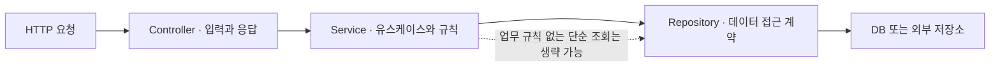

# W02. 왜 Controller·Service·Repository로 나누나 — 안 나누면 생기는 일

> Controller·Service·Repository는 관습적으로 파일을 세 개 만드는 규칙이 아니라, 서로 다른 변경 이유와 실행 경계를 분리하는 방법이다.
> 단순 조회·저장 한 번이면 Controller에서 Repository를 바로 호출해도 된다. 업무 규칙, 여러 저장소 조율, 트랜잭션, 복수 진입점이 생기면 Service를 둔다.
> 기본값은 “Controller는 HTTP, Service는 유스케이스와 업무 조율, Repository는 저장소 접근”이다. Service 인터페이스+Impl은 별도 이점이 있을 때만 추가한다.

## 1. 질문

Spring 튜토리얼마다 Controller, Service, Repository를 모두 만들라는 예제가 나온다. 작은 API는 Controller에서 `repository.findById()` 한 줄이면 끝나는데 꼭 Service를 추가해야 할까? 단순 조회에 Service를 강제하면 이동 경로만 늘고, 모든 일을 Controller에 두면 변화가 한곳에 몰린다.

이런 장면에서 질문이 나온다.

1. 쿠폰 견적 API 하나를 만들었는데, 최소 주문액·할인율·최대 할인액 계산이 Controller 메서드에 들어간다. 다음 달 배치가 같은 할인 규칙을 써야 하는데 Controller를 호출할 수 없어 계산식을 복사한다. 규칙이 바뀌자 API와 배치 결과가 달라진다.
2. 주문 생성에서 주문 저장, 재고 차감, 쿠폰 사용 처리를 각각 Repository에 직접 호출한다. 중간 단계에서 예외가 나면 일부 데이터만 반영될까 걱정된다. 어디까지가 한 작업인지 정할 자리가 필요해진다.
3. 화면 응답 필드 하나를 바꾸려다 DB 엔티티 조회·계산·상태 코드 변환이 섞인 큰 Controller를 건드린다. HTTP 테스트로 계산 규칙까지 확인해야 하므로 테스트가 느리고 실패 원인도 불분명하다.

핵심은 서로 다른 변경 이유를 어디서 나누면 총비용이 낮아지는가다.

## 2. 짧은 답

- Controller는 HTTP 입력을 검증·변환하고 응답을 만들며, Service는 호출 가능한 업무 작업 하나를 표현하고 규칙과 작업 순서를 조율한다.
- Repository는 데이터의 조회·저장 경계를 제공한다. Spring Data Repository는 도메인 타입과 식별자를 중심으로 저장소 작업을 노출한다.
- 규칙이 없고 저장소 호출 하나로 끝나는 단순 CRUD·내부 조회라면 Controller→Repository도 합리적이다. 불필요한 추상화 비용을 만들지 않는다.
- 같은 규칙을 여러 진입점에서 쓰거나, 여러 Repository를 묶거나, 한 트랜잭션 작업을 표현한다면 Controller→Service→Repository를 기본값으로 삼는다.
- 의존 방향은 바깥의 HTTP 표현이 업무 규칙을 호출하고, 업무 작업이 저장소 경계를 사용하게 둔다. Repository가 Controller나 HTTP DTO를 알게 하지 않는다.
- 모든 Service에 인터페이스와 `Impl`을 쌍으로 만드는 규칙은 없다. 다중 구현·외부 포트·공개 계약 같은 구체적 이유가 있을 때 인터페이스를 만든다.
- 작은 앱도 처음부터 필요 이상으로 분리하지 말고, 두 번째 진입점이나 업무 규칙이 등장하는 순간 분리한다. 이미 커진 코드에서는 한 유스케이스씩 옮긴다.

## 3. 왜 그런가 — 원리

세 계층은 코드 위치보다 **변경 이유**를 분리한다. 경로·상태 코드·JSON은 HTTP 계약, 할인 한도·가입 자격은 업무 규칙, ORM·SQL·외부 API는 데이터 접근의 변경이다. 이를 한 메서드가 맡으면 수정이 다른 세부사항까지 건드린다. Fowler는 영역을 나누면 비교적 독립적으로 다룰 수 있다고 설명한다.



### 실행 경계와 책임

Controller는 경로·쿼리·본문을 내부 값으로 바꾸고 HTTP 응답을 만든다. `@PathVariable`, `@RequestBody`, `ResponseEntity`는 웹 관심사다. 여기에 할인 계산까지 두면 스케줄러나 메시지 소비자는 웹 계층을 끌고 오거나 계산을 복제한다.

Service는 “할인 견적”, “주문 취소”처럼 호출 가능한 업무 작업을 표현한다. 복잡한 계산을 직접 할 필요 없이 여러 도메인 객체나 Repository를 조율하고 트랜잭션 경계를 표시할 수 있다. Fowler의 Service Layer도 클라이언트에 작업 경계를 제공하고 응답과 트랜잭션을 조정한다.

Repository는 필요한 데이터를 제공·변경하는 추상화다. 모든 DB 메서드를 감싸기보다 저장소 세부사항을 숨기고 필요한 작업을 드러낸다. Spring Data의 `Repository<T, ID>`는 도메인·식별자 타입을 받고, `CrudRepository`는 기본 CRUD를 제공한다. 구현이나 쿼리 전략을 바꿔도 호출부를 유지하도록 돕는다.

### 의존 방향이 파급을 바꾸는 방식

응답 타입을 Service까지 전달하면 업무 코드가 HTTP 표현에 묶인다. ORM 엔티티를 그대로 노출하면 DB 변경이 API 변경으로 번질 수 있다. 요청·응답을 유스케이스 입력·결과로 변환하고 저장소 세부사항을 Service 뒤에 두면 각 계약이 독립적으로 바뀔 여지가 생긴다. 변환 비용은 있지만 파급 감소가 이를 상쇄하는 경우에 둔다.

분리는 공짜가 아니다. 파일과 호출 경로가 늘어난다. 단순 유스케이스에 계층·Facade·Manager를 겹치면 탐색 비용이 이득을 앞선다. 재사용·조율·트랜잭션·독립 테스트 중 얻는 이득이 분명할 때 둔다.

### 트랜잭션과 프록시

여러 Repository 호출을 하나의 업무 작업으로 묶을 때 Service 메서드는 자연스러운 트랜잭션 경계가 된다. 예를 들어 주문을 저장하고 쿠폰 사용을 기록하는 흐름을 Service에 모으면 “둘 다 성공하거나 실패해야 한다”는 의도를 코드 위치와 함께 표현할 수 있다. Spring의 선언적 트랜잭션은 `@Transactional`로 선언하며, Spring AOP는 대상 객체 앞에 프록시를 둬 호출을 가로채는 방식으로 AOP를 적용한다. 그러므로 어노테이션이 붙은 곳만 보는 것으로 끝내지 말고 실제 호출이 Spring 빈 경계를 통과하는지도 생각해야 한다.

인터페이스는 JDK 동적 프록시의 자연스러운 계약이었다. Java `Proxy`는 지정한 인터페이스를 구현하는 객체를 만들고 호출을 `InvocationHandler`에 전달한다. Spring은 인터페이스가 있으면 JDK 프록시를, 없으면 CGLIB 서브클래스를 쓸 수 있다. 그러므로 모든 Service에 인터페이스가 필요하다는 주장은 현재 Spring에는 맞지 않는다. 과거 프록시 제약은 인터페이스 선호의 한 배경일 수 있지만, 계약·원격 호출·테스트 경계도 작용했으므로 관행의 단일 기원으로 단정하지 않는다.

### 무엇을 테스트하기 쉬워지는가

경계를 나누면 테스트 목적도 나뉜다. Controller는 HTTP 입출력, Service는 규칙과 작업 조합, Repository는 쿼리·매핑을 확인한다. Spring Boot는 `@SpringBootTest` 외에 특정 계층을 위한 애너테이션을 제공한다. `MockMvc`는 실제 서버 없이 Spring MVC 요청 처리를 시험하므로 실패를 좁은 범위에서 재현할 수 있다.

## 4. 선택지 비교

| 선택지 | 어떻게 동작 | 장점 | 단점 | 언제 쓰나 | 국내 실무에서 흔한가(근거 있으면) |
|---|---|---|---|---|---|
| Controller 한 곳에 전부 작성 | HTTP 바인딩, 조회, 규칙 계산, 응답 변환을 한 클래스에서 처리 | 파일·이동 경로가 적어 첫 구현이 빠름 | 재사용·단위 테스트·변경 분리가 어렵고 메서드가 커지면 HTTP 코드와 업무 규칙이 얽힘 | 일회성 PoC, 버릴 관리 도구, 규칙 없는 극소형 엔드포인트 | 시작 단계에서 흔히 보일 수 있으나 국내 빈도 통계는 확인하지 못함 |
| Controller→Repository 직접 호출 | Controller는 HTTP를 맡고 단순 조회·저장을 Repository에 바로 위임 | CRUD 한 건에 얇고 직관적이며 의미 없는 Service를 피함 | 여러 호출·규칙·트랜잭션이 생기면 Controller가 조율자가 됨 | 규칙 없는 읽기 전용 API, 단순 내부 CRUD | 단순 패턴으로 널리 소개되지만 국내 프로젝트 빈도는 미확인 |
| Controller→Service→Repository | Service가 유스케이스를 만들고 규칙·저장소 호출 순서·트랜잭션을 조율 | 규칙 재사용, 집중된 변경 위치, 계층별 테스트가 가능 | 얇은 전달 Service가 너무 많으면 탐색 비용 증가 | 기본 선택. 업무 규칙·복수 저장소·다중 진입점이 하나라도 생길 때 | Spring의 일반적인 계층 예시와 맞지만 국내 비율은 확인할 공개 근거 없음 |
| 헥사고날/포트·어댑터 | 유스케이스가 Port에 의존하고 웹·DB가 어댑터로 연결 | 외부 기술 교체와 도메인 격리를 더 강하게 표현 | 인터페이스·모듈·조립 지점이 늘고 작은 CRUD에는 과함 | 여러 외부 연동, 복수 어댑터, 핵심 도메인의 장기 독립성이 중요한 경우 | 업계 보급률은 미확인; 팀별 설계 선택 |

3계층은 디렉터리 규칙이 아니다. 책임을 먼저 나누고 변경·팀 경계가 커질 때 클래스·패키지·모듈로 분리할 수 있다.

헥사고날은 레이어드와 대립하지 않는다. 핵심 유스케이스가 외부 어댑터를 모르게 Port 경계를 명시하며 상세는 S22 참조.

## 5. 코드로 보기

할인 견적은 Controller 중심(A)과 Service 분리(C)로 같은 기능을 구현한다. B는 Service가 불필요한 단순 조회 사례다. 최소 주문액과 할인 한도를 적용한다. 코드는 Boot 4.1 / Framework 7 API 기준이며 (미실행)이다. public 타입은 각 파일로 분리한다.

### 공통 모델과 저장소

```java
package example.quote;

import java.util.Map;
import java.util.Optional;
import org.springframework.stereotype.Repository;

public record DiscountRule(
        String code, int minimumSubtotal, int percent, int cap) {}

public record Quote(int subtotal, int discount, int payable) {}

public interface DiscountRuleRepository {
    Optional<DiscountRule> findByCode(String code);
}

@Repository
class InMemoryDiscountRuleRepository implements DiscountRuleRepository {
    private final Map<String, DiscountRule> rules = Map.of(
            "WELCOME", new DiscountRule("WELCOME", 10_000, 10, 3_000));

    @Override
    public Optional<DiscountRule> findByCode(String code) {
        return Optional.ofNullable(rules.get(code));
    }
}
```

실서비스는 Map 대신 Spring Data나 외부 저장소 어댑터를 쓴다.

### 선택지 A — Controller가 업무까지 수행

```java
package example.quote;

import org.springframework.http.HttpStatus;
import org.springframework.web.bind.annotation.GetMapping;
import org.springframework.web.bind.annotation.RequestMapping;
import org.springframework.web.bind.annotation.RequestParam;
import org.springframework.web.bind.annotation.RestController;
import org.springframework.web.server.ResponseStatusException;

@RestController
@RequestMapping("/quotes")
public class MonolithicQuoteController {
    private final DiscountRuleRepository rules;

    public MonolithicQuoteController(DiscountRuleRepository rules) {
        this.rules = rules;
    }

    @GetMapping
    public Quote quote(@RequestParam String code, @RequestParam int subtotal) {
        if (subtotal < 0) {
            throw new ResponseStatusException(HttpStatus.BAD_REQUEST, "subtotal must be non-negative");
        }
        DiscountRule rule = rules.findByCode(code).orElseThrow(
                () -> new ResponseStatusException(HttpStatus.NOT_FOUND, "coupon not found"));
        int discount = subtotal < rule.minimumSubtotal()
                ? 0
                : (int) Math.min((long) subtotal * rule.percent() / 100, rule.cap());
        return new Quote(subtotal, discount, subtotal - discount);
    }
}
```

작은 읽기 기능이면 충분하다. 하지만 같은 할인 규칙을 주문 확정·관리자 미리보기·배치에서도 쓰면 Controller를 재사용할 수 없어 계산을 복사한다. 구체적 비용은 **규칙 변경 때 수정 위치가 늘어나는 것**이다.

### 선택지 B — 단순 Repository 읽기는 Controller에서 바로 호출

```java
package example.quote;

import org.springframework.http.HttpStatus;
import org.springframework.web.bind.annotation.GetMapping;
import org.springframework.web.bind.annotation.PathVariable;
import org.springframework.web.bind.annotation.RequestMapping;
import org.springframework.web.bind.annotation.RestController;
import org.springframework.web.server.ResponseStatusException;

@RestController
@RequestMapping("/discount-rules")
public class DiscountRuleController {
    private final DiscountRuleRepository rules;

    public DiscountRuleController(DiscountRuleRepository rules) {
        this.rules = rules;
    }

    @GetMapping("/{code}")
    public DiscountRule find(@PathVariable String code) {
        return rules.findByCode(code).orElseThrow(
                () -> new ResponseStatusException(HttpStatus.NOT_FOUND, "coupon not found"));
    }
}
```

별도 규칙 없이 저장소 결과만 읽으므로 합리적이다. Controller→Repository를 금지한다며 빈 Service를 추가할 이유가 없다. 권한 확인·복수 조회·데이터 보정이 생기면 Service를 검토한다.

### 선택지 C — Service가 유스케이스와 할인 규칙을 소유

```java
package example.quote;

import org.springframework.http.HttpStatus;
import org.springframework.web.bind.annotation.GetMapping;
import org.springframework.web.bind.annotation.RequestMapping;
import org.springframework.web.bind.annotation.RequestParam;
import org.springframework.web.bind.annotation.RestController;
import org.springframework.web.server.ResponseStatusException;

@RestController
@RequestMapping("/quotes")
public class QuoteController {
    private final QuoteService service;

    public QuoteController(QuoteService service) {
        this.service = service;
    }

    @GetMapping
    public Quote quote(@RequestParam String code, @RequestParam int subtotal) {
        return service.quote(code, subtotal);
    }
}
```

```java
package example.quote;

import org.springframework.http.HttpStatus;
import org.springframework.stereotype.Service;
import org.springframework.web.server.ResponseStatusException;

@Service
public class QuoteService {
    private final DiscountRuleRepository rules;

    public QuoteService(DiscountRuleRepository rules) {
        this.rules = rules;
    }

    public Quote quote(String code, int subtotal) {
        if (subtotal < 0) {
            throw new ResponseStatusException(HttpStatus.BAD_REQUEST, "subtotal must be non-negative");
        }
        DiscountRule rule = rules.findByCode(code).orElseThrow(
                () -> new ResponseStatusException(HttpStatus.NOT_FOUND, "coupon not found"));
        int discount = subtotal < rule.minimumSubtotal()
                ? 0
                : (int) Math.min((long) subtotal * rule.percent() / 100, rule.cap());
        return new Quote(subtotal, discount, subtotal - discount);
    }
}
```

Controller는 HTTP 입출력, Service는 견적 유스케이스, Repository는 규칙 조회를 맡는다. 다른 진입점도 `QuoteService.quote()`를 호출한다. 예제는 단순화를 위해 Service가 HTTP 상태 예외를 던진다. 규모가 커지면 도메인 예외를 `@RestControllerAdvice`에서 HTTP 상태로 변환해 웹 의존을 더 줄일 수 있다.

### Service 인터페이스와 `Impl`을 추가할 조건

기본형 C는 `QuoteService` 구현 하나로 동작한다. 모든 유스케이스에 `QuoteService`와 `DefaultQuoteService`를 한 쌍으로 추가해도 구현을 교체할 소비자나 계약 경계가 없다면 이름만 늘어난다. Spring DI는 구체 클래스도 주입할 수 있고 AOP는 인터페이스 없는 대상에도 서브클래스 프록시를 적용할 수 있다. 인터페이스는 구현 교체, 외부 Port, 공개 계약 같은 이유가 있을 때 추가한다.

## 6. 실무에서는 실제로

### 신규 서비스

Controller는 입력·응답 변환을 맡고 Service 또는 도메인 객체가 규칙·작업 순서를 맡는다. 단순 조회는 직접 Repository로 보내도 된다. 복수 저장소 조율이나 다른 채널의 규칙 재사용이 생기면 그 기능을 Service로 옮긴다.

### 레거시

거대 Controller를 한 번에 재작성하지 않는다. 변경이 잦은 유스케이스 하나의 입출력 계약을 고정하고 계산과 저장소 호출 순서를 Service로 옮긴다. 기존 동작·오류 코드를 유지하며 다음 변경 때 반복한다.

### SI·금융·복잡한 도메인

큰 코드베이스에는 패키지 규칙과 테스트 관행이 정해져 있을 수 있다. 팀 표준이나 감사·트랜잭션 요구가 있으면 정해진 Service 경로가 리뷰와 인수인계에 유리하다. 다만 “큰 회사는 인터페이스를 무조건 쓴다”고 가정하지 않는다. 국내 조직별 사용 비율 통계는 확인하지 못했다.

### 스타트업·소규모 도구

짧게 검증할 도구라면 Controller→Repository로 시작해도 된다. 규칙 중복, 복수 데이터 변경, 부분 성공 문제가 나타나면 Service를 추가한다. 처음부터 모든 엔드포인트에 인터페이스·Facade·Manager를 두지는 않는다.

### 섞어 쓰기와 이동 경로

복잡한 변경은 Service, 단순 조회는 Controller→Repository로 섞어도 된다. 팀이 허용 조건을 합의하고 예외가 단순한지 리뷰한다. 기능 단위 패키지에서 시작해 독립 배포나 외부 연동이 필요할 때 모듈로 넓힌다.

기본값: **유스케이스가 조회·저장 한 번의 위임으로 끝나지 않으면 Service를 두고, 데이터 접근은 Repository 뒤에 둔다.**

계층의 기초 책임은 P02 참조. 헥사고날·레이어드 상세 비교는 S22 참조. 프록시 내부 동작과 자기 호출 주의점은 S02 참조.

## 7. 흔한 오해와 실수

1. **오해: 모든 Controller는 반드시 Service만 호출해야 한다.** 단순 조회까지 전달용 Service를 만들면 경로만 늘어난다. **대처:** 규칙·조율·트랜잭션·재사용이 없으면 직접 Repository를 호출하고 복잡성이 생길 때 옮긴다.
2. **증상: API와 배치가 할인 계산을 각각 구현해 결과가 다르다.** Controller에 규칙을 두어 다른 진입점이 재사용하지 못했다. **대처:** 규칙을 Service나 도메인 객체에 모은다.
3. **오해: `@Transactional`을 붙이면 호출 방식과 관계없이 적용된다.** 선언적 AOP는 프록시 호출 경계를 이용한다. **대처:** Spring 빈이며 실제 호출이 프록시를 통과하는지 점검한다. 세부 함정은 S02 참조.
4. **오해: 모든 Service에 `Service` 인터페이스와 `ServiceImpl`이 필요하다.** 구현·소비자가 하나면 이름만 늘 수 있다. **대처:** 다중 구현, 외부 포트, 안정된 모듈 계약이 있을 때 추가한다.
5. **오해: Controller에서 Repository를 직접 호출하면 나쁘다.** 위험은 직접 호출이 아니라 업무 조율이 쌓이는 데 있다. **대처:** 단순 위임인지 규칙·복수 작업 조율인지 구분한다.
6. **증상: Service→Manager→Facade→Helper 뒤에도 업무 작업이 안 보인다.** 경계의 의미가 겹친다. **대처:** 단순 전달 클래스를 합친다.
7. **오해: Repository 엔티티를 그대로 JSON으로 보내면 단순해진다.** DB 매핑과 API 계약이 묶인다. **대처:** 두 모델의 생명주기가 다르면 DTO로 변환한다.

## 8. 자가점검 Q&A (면접 대비)

### Q1. Controller, Service, Repository로 나누는 가장 실질적인 이유는?

HTTP 프로토콜, 업무 규칙, 저장 기술은 서로 다른 이유로 바뀐다. 각 관심을 경계에 두면 할인 규칙 변경이 URL·상태 코드나 DB 쿼리 변경까지 끌고 가지 않는다. 같은 유스케이스를 API와 배치가 사용할 때도 업무 처리를 재사용할 수 있다.

**꼬리질문:** 계층을 나누면 언제나 코드가 좋아지나?

아니다. 단순 위임마다 타입만 추가하면 탐색 비용이 커진다. 분리로 재사용·조율·테스트·교체 중 어떤 이득을 얻는지 설명할 수 있어야 한다.

### Q2. Controller에서 Repository를 바로 호출해도 되나?

규칙 없는 단순 조회나 CRUD 위임이면 가능하다. 모든 저장소 사용 앞에 Service를 강제하는 것은 Spring의 기술 요구사항이 아니다. 한 요청이 여러 저장소를 조율하거나 규칙·권한·트랜잭션을 표현해야 하면 Service를 두는 편이 적절하다.

**꼬리질문:** 직접 호출을 리뷰할 때 어떤 신호를 보면 Service를 추가하나?

Controller 메서드에 분기 계산이 늘거나, 두 번째 진입점이 생기거나, 실패 시 함께 되돌려야 할 쓰기 작업이 나타나는지를 본다. 그중 하나가 분명하면 유스케이스를 추출한다.

### Q3. Service는 반드시 업무 규칙을 직접 계산해야 하나?

아니다. Service는 하나의 애플리케이션 작업 경계이며 여러 도메인 객체와 Repository 작업을 조율할 수 있다. 규칙 자체가 값 객체나 도메인 객체에 자연스럽다면 거기에 두고, Service는 그 규칙을 호출해 유스케이스를 완성하면 된다.

**꼬리질문:** Service와 도메인 객체 중 규칙을 어디에 놓나?

특정 도메인 개념의 불변조건이면 그 도메인 객체에, 여러 객체·저장소·시스템의 작업 순서면 Service에 둔다. 업무 용어로 자연스럽게 설명되는 위치를 선택한다.

### Q4. Service 경계가 트랜잭션에 유리한 이유는?

트랜잭션은 보통 사용자나 호출자가 보는 하나의 업무 작업을 원자적으로 만들기 위해 필요하다. 주문·쿠폰·재고를 함께 처리한다면 Service 메서드에 해당 작업과 `@Transactional`을 두는 것이 의도를 드러낸다. 각 Repository 호출마다 트랜잭션을 따로 열면 전체 흐름을 묶기 어렵다.

**꼬리질문:** `@Transactional`을 Controller에 두어도 되나?

기술적으로 가능한 설정도 있지만 Controller는 HTTP 어댑터라 업무 작업의 재사용과 테스트 경계에 부적절하다. 도메인 작업 호출이 다른 진입점에서도 같은 트랜잭션 의미를 가져야 하므로 일반적으로 Service 쪽이 자연스럽다.

### Q5. Service 인터페이스와 구현 클래스는 항상 필요한가?

아니다. JDK 동적 프록시는 인터페이스를 구현하는 프록시를 만들지만, Spring은 인터페이스가 없는 클래스에도 CGLIB 서브클래스 프록시를 사용할 수 있다. 인터페이스는 계약·대체 구현·포트 경계를 나타낼 때 유용하고, 프록시가 필요하다는 이유 하나로 모든 클래스에 강제할 필요는 없다.

**꼬리질문:** 구현이 한 개여도 인터페이스가 유용한 경우는?

다른 모듈이 구현 세부사항과 분리된 안정 계약에 의존해야 하거나, 외부 시스템 포트로 교체 지점을 명시할 때다. 구현 개수가 아니라 의존 경계의 의미를 기준으로 한다.

### Q6. 헥사고날 아키텍처를 쓰면 Controller·Service·Repository가 사라지나?

아니다. 같은 역할이 인바운드 어댑터, 유스케이스, 아웃바운드 Port와 어댑터 같은 이름으로 더 명시적으로 나뉠 수 있다. 핵심 차이는 계층 수가 아니라 유스케이스가 외부 프레임워크·저장소에 의존하지 않도록 경계를 어디에 그리는가다.

**꼬리질문:** 어떤 때 레이어드보다 헥사고날 경계의 비용을 감수하나?

여러 입력 채널·저장소 구현이 실제로 있거나, 핵심 도메인을 프레임워크 교체와 독립적으로 오래 유지해야 할 때다. 단일 CRUD 서비스에 형식적으로 적용하면 포트·어댑터 조립 코드만 늘 수 있다.

## 9. 참고문헌

- Martin Fowler, “Presentation Domain Data Layering” — https://martinfowler.com/bliki/PresentationDomainDataLayering.html — UI·도메인·데이터 계층을 분리하는 이유와 주의점을 설명한다.
- Martin Fowler, “Service Layer” — https://martinfowler.com/eaaCatalog/serviceLayer.html — 서비스 계층을 애플리케이션 경계와 작업 조정자로 정의한다.
- Spring Framework Reference, “Proxying Mechanisms” — https://docs.spring.io/spring-framework/reference/core/aop/proxying.html — Spring AOP의 JDK 동적 프록시와 CGLIB 선택 및 제약을 설명한다.
- Spring Framework Reference, “Using @Transactional” — https://docs.spring.io/spring-framework/reference/data-access/transaction/declarative/annotations.html — 애너테이션 기반 선언적 트랜잭션 설정을 설명한다.
- Spring Data Commons Reference, “Core concepts” — https://docs.spring.io/spring-data/commons/reference/repositories/core-concepts.html — Repository와 도메인 타입·식별자 추상화를 설명한다.
- Spring Boot Reference, “Testing Spring Boot Applications” — https://docs.spring.io/spring-boot/reference/testing/spring-boot-applications.html — `@SpringBootTest`와 계층별 테스트 슬라이스를 안내한다.
- Spring Framework Reference, “MockMvc” — https://docs.spring.io/spring-framework/reference/testing/mockmvc.html — 실제 서버 없이 Spring MVC 요청·응답을 테스트하는 방법을 설명한다.
- Java SE 25 API, “Proxy” — https://docs.oracle.com/en/java/javase/25/docs/api/java.base/java/lang/reflect/Proxy.html — 인터페이스 기반 런타임 프록시와 `InvocationHandler` 호출 구조를 정의한다.
