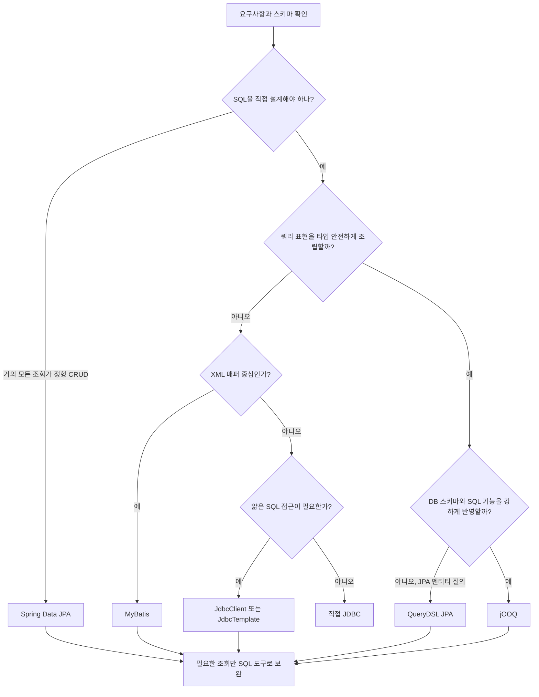

# W03. DB 접근 방식 총비교 — JDBC부터 JPA·MyBatis·QueryDSL·jOOQ까지

> JDBC는 SQL 실행의 기반이고, 각 도구는 SQL 작성·결과 매핑·반복 CRUD 가운데 다른 불편을 줄인다.
> 기본값은 Spring Data JPA이며, 조회 SQL이 복잡하거나 DB 기능 통제가 중요하면 MyBatis·JdbcClient·jOOQ를 선택하거나 섞는다.
> “빠른 도구” 하나를 고르는 문제가 아니다. 쿼리를 읽고 고칠 주체와 스키마 변경을 감당할 방법이 선택 기준이다.

## 1. 질문

- 회원 목록 검색을 맡았는데 `findAll()` 뒤 Java에서 자를지, DB 쿼리에 페이징을 넣을지 모른다.
- 주문과 재고를 각각 `save()` 했는데 중간 실패가 나면 둘 다 취소되는지 궁금하다.
- 레거시 SQL은 길고 새 기능은 JPA로 짰다. 모두 한 도구로 바꿔야 하는지 판단이 어렵다.

## 2. 짧은 답

JDBC는 DB 명령을 내리는 표준 기반이고, 나머지는 SQL 작성·결과 변환·객체 상태 관리를 다르게 추상화한다.
일반 신규 CRUD라면 **Spring Data JPA를 기본값으로 추천**한다. SQL 중심 조회는 JdbcClient/MyBatis, JPA 동적 질의는 QueryDSL, 스키마 타입과 DB SQL 통제는 jOOQ를 검토한다.
JdbcTemplate/JdbcClient는 SQL은 남기고 연결·예외·매핑 반복을 줄인다. 순수 JDBC는 통제가 최우선인 경계 사례다.
QueryDSL은 ORM이나 저장소가 아니라 보통 JPA와 결합하는 쿼리 표현 계층이다. 기존 팀 관례와 운영 역량은 기본값보다 우선한다.

## 3. 왜 그런가 — 원리

### 서로 다른 불편을 줄이는 계보

JDBC는 연결·바인딩·행 변환을 제어하지만 자원·예외 처리를 반복한다. JdbcTemplate은 이를 맡고, Framework 6.1 JdbcClient는 fluent API를 제공한다. MyBatis는 SQL을 XML에 두고 매핑을 줄인다.

JPA는 객체 상태를 추적해 트랜잭션에서 SQL로 반영한다. CRUD는 간결하지만 쿼리·로딩이 덜 보인다. Data JPA는 Repository, QueryDSL은 Q타입, jOOQ는 스키마 타입 SQL을 제공한다.

### 요청 한 건의 경계



어떤 도구든 페이징은 DB에서 정렬·슬라이스해야 전체 행을 메모리로 읽지 않는다. 전체 건수를 보여주는 `Page`는 count 비용이 들며, 중복 없는 정렬(PK tie-breaker)이 페이지 경계 이동을 줄인다.

원자성은 도구가 아니라 같은 transaction manager가 같은 DB 연결을 묶는지에 달렸다. Spring `@Transactional`은 JDBC/JPA/MyBatis 및 연동된 jOOQ에서 경계를 제공한다. 직접 새 연결을 열면 경계에서 빠질 수 있고, 순수 JDBC는 commit/rollback을 직접 책임져야 한다.

## 4. 선택지 비교

| 선택지 | 동작·장점 | 비용·위험 | 주 용도 |
|---|---|---|---|
| JDBC | 연결·SQL·행을 직접 제어 | 자원·예외·매핑 반복 | 저수준 통합·학습 |
| JdbcTemplate | Spring 자원 관리, SQL 가시 | SQL·매핑 직접 작성 | 배치·간단 SQL |
| JdbcClient | Template 위 fluent 바인딩 | ORM 상태 관리 없음 | 짧은 SQL 접근 |
| MyBatis XML | SQL과 결과를 명시 | XML·Java 동기화 | 복잡·레거시 쿼리 |
| JPA `EntityManager` | 표준 API, 영속성 직접 제어 | flush·로딩 학습 | JPA 질의·상태 제어 |
| Spring Data JPA | CRUD·파생쿼리·페이지 | 쿼리 가시성 저하 | 신규 CRUD 기본값 |
| QueryDSL | Q타입 동적 조건 | 생성 설정, JPA 비용 잔존 | 필터 조합이 많은 JPA 검색 |
| jOOQ | 스키마 타입·SQL 통제 | 생성·지원 조건 관리 | 복잡·DB 특화 SQL |

국내 대표성 있는 채용·설문 통계는 확인하지 못했다. 정성적 경향만 제시하며 점유율로 해석하지 않는다.

| 축 | JDBC / Spring JDBC | MyBatis | JPA / Data JPA | QueryDSL | jOOQ |
|---|---|---|---|---|---|
| SQL 통제·타입 | 직접·문자열 | 높음·매퍼 | JPQL·엔티티 | JPQL·Q타입 | 높음·생성 타입 |
| CRUD·동적 질의 | 반복·보조 코드 | 매퍼·XML 조건 | 자동·Criteria | JPA CRUD 없음·표현 조합 | SQL·DSL 조건 |
| N+1·학습 곡선 | 자동 로딩 없음·낮음 | 없음·중간 | 로딩 위험·높음 | JPA 위험 승계·높음 | 없음·SQL/생성 이해 |
| 성능 예측·레거시 DB | SQL 가시·높음 | 가시·매우 높음 | fetch 확인·매핑 적합 | JPA SQL·매핑 범위 | 가시·스키마 밀착 |
| 트랜잭션 연동 | Spring 연결 연동 | Spring 연동 | Spring manager | JPA manager | Spring 연동 |

## 5. 코드로 보기

스키마는 `member(id, name, created_at)`, `orders(id, member_id, amount)`다. 회원 이름을 최신순·id 순으로 페이지 조회하고 count를 반환한다. Spring 코드는 미실행이다. 예제 클래스는 `example` 패키지 기준이다.

공통 DTO 순수 Java 코드 (JDK 21 실행):

```java
package example;
import java.math.BigDecimal;

class W03DtoDemo {
  public static void main(String[] args) {
    System.out.println(new MemberRow(7, "민지"));
    System.out.println(new OrderCommand(7, new BigDecimal("12500.00")));
  }
}

record MemberRow(long id, String name) {}
record OrderCommand(long memberId, BigDecimal amount) {}
```

실행 출력:

```text
MemberRow[id=7, name=민지]
OrderCommand[memberId=7, amount=12500.00]
```

**① JDBC 직접 사용** — Spring template 없이 연결·SQL·행을 직접 다룬다. SQL 예외는 호출자에 전달한다.

```java
import java.sql.*;
import java.util.*;
import javax.sql.DataSource;
import org.springframework.data.domain.*;

class DirectJdbcMembers {
  private final DataSource dataSource;
  DirectJdbcMembers(DataSource dataSource) { this.dataSource = dataSource; }

  Page<MemberRow> search(String q, Pageable page) throws SQLException {
    String pattern = "%" + q + "%";
    try (Connection c = dataSource.getConnection()) {
      List<MemberRow> rows = new ArrayList<>();
      try (PreparedStatement ps = c.prepareStatement(
          "select id, name from member where name like ? " +
          "order by created_at desc, id desc limit ? offset ?")) {
        ps.setString(1, pattern);
        ps.setInt(2, page.getPageSize());
        ps.setLong(3, page.getOffset());
        try (ResultSet rs = ps.executeQuery()) {
          while (rs.next()) rows.add(new MemberRow(rs.getLong("id"), rs.getString("name")));
        }
      }
      long total;
      try (PreparedStatement ps = c.prepareStatement(
          "select count(*) from member where name like ?")) {
        ps.setString(1, pattern);
        try (ResultSet rs = ps.executeQuery()) { rs.next(); total = rs.getLong(1); }
      }
      return new PageImpl<>(rows, page, total);
    }
  }

}
```

`?`는 값을 바인딩한다. `%`와 `_`는 LIKE 와일드카드로 남으므로 문자 그대로 검색할 경우 escape한다. 자동 Spring 트랜잭션 통합은 없고 count/목록도 별도 스냅샷일 수 있다.

**② JdbcTemplate** — SQL을 남기고 자원·예외 처리를 위임한다.

```java
import java.util.List;
import org.springframework.jdbc.core.JdbcTemplate;
import org.springframework.data.domain.*;

class TemplateMembers {
  private final JdbcTemplate jdbc;
  TemplateMembers(JdbcTemplate jdbc) { this.jdbc = jdbc; }

  Page<MemberRow> search(String q, Pageable page) {
    String pattern = "%" + q + "%";
    List<MemberRow> rows = jdbc.query(
      "select id, name from member where name like ? order by created_at desc, id desc limit ? offset ?",
      (rs, n) -> new MemberRow(rs.getLong("id"), rs.getString("name")),
      pattern, page.getPageSize(), page.getOffset());
    Long total = jdbc.queryForObject("select count(*) from member where name like ?", Long.class, pattern);
    return new PageImpl<>(rows, page, total == null ? 0 : total);
  }

}
```

**③ JdbcClient** — Framework 6.1 fluent API, JdbcTemplate 계열에 위임.

```java
import java.util.List;
import org.springframework.jdbc.core.simple.JdbcClient;
import org.springframework.data.domain.*;

class ClientMembers {
  private final JdbcClient jdbc;
  ClientMembers(JdbcClient jdbc) { this.jdbc = jdbc; }

  Page<MemberRow> search(String q, Pageable page) {
    String pattern = "%" + q + "%";
    List<MemberRow> rows = jdbc.sql(
        "select id, name from member where name like :q order by created_at desc, id desc limit :size offset :offset")
      .param("q", pattern).param("size", page.getPageSize()).param("offset", page.getOffset())
      .query((rs, n) -> new MemberRow(rs.getLong("id"), rs.getString("name"))).list();
    Long total = jdbc.sql("select count(*) from member where name like :q")
      .param("q", pattern).query(Long.class).single();
    return new PageImpl<>(rows, page, total);
  }

}
```

**④ MyBatis XML** — Mapper 선언과 SQL/resultMap을 분리한다.

```java
import java.util.List;
import org.apache.ibatis.annotations.Mapper;
import org.apache.ibatis.annotations.Param;

@Mapper
interface MemberMapper {
  List<MemberRow> search(@Param("pattern") String pattern,
             @Param("limit") int limit, @Param("offset") long offset);
  long count(@Param("pattern") String pattern);
  int save(@Param("order") OrderCommand order);
}
```

```xml
<?xml version="1.0" encoding="UTF-8" ?>
<!DOCTYPE mapper PUBLIC "-//mybatis.org//DTD Mapper 3.0//EN"
  "https://mybatis.org/dtd/mybatis-3-mapper.dtd">
<mapper namespace="example.MemberMapper">
  <resultMap id="memberRow" type="example.MemberRow">
    <constructor>
      <idArg column="id" javaType="long"/>
      <arg column="name" javaType="string"/>
    </constructor>
  </resultMap>
  <select id="search" resultMap="memberRow">
    select id, name from member where name like #{pattern}
    order by created_at desc, id desc limit #{limit} offset #{offset}
  </select>
  <select id="count" resultType="long">
    select count(*) from member where name like #{pattern}
  </select>
  <insert id="save">
    insert into orders(member_id, amount) values (#{order.memberId}, #{order.amount})
  </insert>
</mapper>
```

`#{}`는 값 바인딩, `${}`는 문자열 치환이다. 동적 식별자는 허용 목록으로 제한한다. 매퍼 namespace를 실제 패키지에 맞추고 count와 목록을 `PageImpl`로 묶는다.

**⑤ JPA `EntityManager`** — JPQL과 엔티티 생명주기를 사용한다.

```java
import java.util.List;
import jakarta.persistence.EntityManager;
import org.springframework.data.domain.*;

class JpaMembers {
  private final EntityManager em;
  JpaMembers(EntityManager em) { this.em = em; }

  Page<Member> search(String q, Pageable page) {
    String pattern = "%" + q + "%";
    List<Member> rows = em.createQuery(
        "select m from Member m where m.name like :q order by m.createdAt desc, m.id desc", Member.class)
      .setParameter("q", pattern).setFirstResult(Math.toIntExact(page.getOffset()))
      .setMaxResults(page.getPageSize()).getResultList();
    long total = em.createQuery("select count(m) from Member m where m.name like :q", Long.class)
      .setParameter("q", pattern).getSingleResult();
    return new PageImpl<>(rows, page, total);
  }

}
```

**⑥ Spring Data JPA** — 파생쿼리와 `Pageable`을 사용한다.

```java
import org.springframework.data.jpa.repository.JpaRepository;
import org.springframework.data.domain.*;

interface MemberRepository extends JpaRepository<Member, Long> {
  Page<Member> findByNameContainingIgnoreCaseOrderByCreatedAtDescIdDesc(String name, Pageable pageable);
}
interface OrderRepository extends JpaRepository<PurchaseOrder, Long> {}

class DataJpaMembers {
  private final MemberRepository members;
  private final OrderRepository orders;
  DataJpaMembers(MemberRepository members, OrderRepository orders) {
    this.members = members; this.orders = orders;
  }
  Page<Member> search(String q, Pageable p) {
    return members.findByNameContainingIgnoreCaseOrderByCreatedAtDescIdDesc(q, p);
  }
}
```

파생 메서드가 길어지면 `@Query`나 QueryDSL을 고려한다. 대소문자 검색 의미는 DB collation과 생성 SQL을 확인한다.

**⑦ QueryDSL JPA** — Q타입으로 JPA 조건을 조립한다.

```java
import com.querydsl.core.BooleanBuilder;
import com.querydsl.jpa.impl.JPAQueryFactory;
import jakarta.persistence.EntityManager;
import org.springframework.data.domain.*;

class QuerydslMembers {
  private final JPAQueryFactory queryFactory;
  private final EntityManager em;
  QuerydslMembers(JPAQueryFactory queryFactory, EntityManager em) {
    this.queryFactory = queryFactory; this.em = em;
  }

  Page<Member> search(String q, Pageable page) {
    QMember m = QMember.member;
    BooleanBuilder where = new BooleanBuilder();
    if (q != null && !q.isBlank()) where.and(m.name.containsIgnoreCase(q));
    List<Member> rows = queryFactory.selectFrom(m).where(where)
      .orderBy(m.createdAt.desc(), m.id.desc())
      .offset(page.getOffset()).limit(page.getPageSize()).fetch();
    Long count = queryFactory.select(m.count()).from(m).where(where).fetchOne();
    return new PageImpl<>(rows, page, count == null ? 0 : count);
  }

}
```

**⑧ jOOQ** — 생성 테이블·필드로 SQL DSL을 쓴다.

```java
import java.util.List;
import org.jooq.DSLContext;
import org.jooq.Condition;
import org.springframework.data.domain.*;
import static example.jooq.tables.Member.MEMBER;
import static example.jooq.tables.Orders.ORDERS;

class JooqMembers {
  private final DSLContext dsl;
  JooqMembers(DSLContext dsl) { this.dsl = dsl; }

  Page<MemberRow> search(String q, Pageable page) {
    Condition where = MEMBER.NAME.likeIgnoreCase("%" + q + "%");
    List<MemberRow> rows = dsl.select(MEMBER.ID, MEMBER.NAME).from(MEMBER).where(where)
      .orderBy(MEMBER.CREATED_AT.desc(), MEMBER.ID.desc())
      .limit(page.getPageSize()).offset(Math.toIntExact(page.getOffset()))
      .fetch(r -> new MemberRow(r.get(MEMBER.ID), r.get(MEMBER.NAME)));
    Long count = dsl.selectCount().from(MEMBER).where(where).fetchOne(0, Long.class);
    return new PageImpl<>(rows, page, count == null ? 0 : count);
  }

}
```

주문 저장 호출은 다음과 같다.

| 방식 | `OrderCommand o`를 저장하는 호출 |
|---|---|
| JDBC | `ps.setLong(1, o.memberId()); ps.setBigDecimal(2, o.amount()); ps.executeUpdate();` |
| JdbcTemplate | `jdbc.update("insert into orders(member_id, amount) values (?, ?)", o.memberId(), o.amount());` |
| JdbcClient | `jdbc.sql("insert into orders(member_id, amount) values (:m, :a)").param("m", o.memberId()).param("a", o.amount()).update();` |
| MyBatis XML | `mapper.save(o)` → XML의 `<insert id="save">` |
| `EntityManager` | `em.persist(new PurchaseOrder(o.memberId(), o.amount()));` |
| Spring Data JPA | `orders.save(new PurchaseOrder(o.memberId(), o.amount()));` |
| QueryDSL JPA | JPA의 `em.persist(...)` — 자체 저장 API 없음 |
| jOOQ | `dsl.insertInto(ORDERS).set(ORDERS.MEMBER_ID, o.memberId()).set(ORDERS.AMOUNT, o.amount()).execute();` |

기준은 Boot 4.1.1 / Framework 7이며 Spring 코드는 미실행이다. JPA 엔티티와 jOOQ 생성 테이블은 기존 프로젝트에 둔다. QueryDSL 7.1은 JDK 23+ annotation processing이 필요하다.

주문·재고는 같은 서비스 `@Transactional`과 transaction manager에 둔다. 외부 결제는 DB rollback으로 취소되지 않는다.

## 6. 실무에서는 실제로

| 상황 | 선택 |
|---|---|
| 신규 CRUD | Data JPA, 생성 SQL·count·fetch 관측 |
| 다양한 SQL 조회 | JPA 쓰기 + JdbcClient/MyBatis/jOOQ 읽기 가능 |
| SI·금융·레거시 | 기존 매퍼·운영 관례 유지, 전환 비용 검토 |
| 소수 인원 / DB 특화 | 하나로 시작 / jOOQ는 생성·지원 조건 확인 |

기능 단위로 점진 이행하고 혼용 시 일관성과 공통 트랜잭션을 확인한다. 성능은 동일 SQL·인덱스·데이터에서 쿼리 수와 계획으로 비교하며 ORM은 flush·로딩도 관찰한다.

### 다루는 범위

MyBatis XML 세부 문법은 → W04 참조. JPA와 MyBatis 도입 전략은 → W05 참조. QueryDSL 설정과 생성 코드는 → P21 참조. JPA 영속성·flush 원리는 → S09 참조.

## 7. 흔한 오해와 실수

1. **“JPA면 SQL 불필요” →** count·flush·fetch·N+1로 예상 밖 호출이 난다. → SQL 로그와 실행 계획을 본다.
2. **“save 두 번은 원자적” →** 공통 트랜잭션 경계가 없으면 한쪽만 반영된다. → 서비스 `@Transactional` 안에서 실패 rollback을 확인한다.
3. **“LIMIT이면 페이징 완료” →** count와 결정적 정렬이 없으면 총 페이지·경계가 흔들린다. → 유일 키로 정렬하고 깊은 페이지는 커서를 검토한다(→ W15).
4. **“바인드가 식별자도 보호” →** `?`/`#{}`는 값만 바인딩한다. → 동적 컬럼·정렬은 허용 목록으로 고른다.
5. **“Q타입이면 쿼리 오류 전부 컴파일 검증” →** DB 방언·실행 계획은 검증하지 않는다. → DB 통합 실행과 계획 확인을 병행한다.

## 8. 자가점검 Q&A (면접 대비)

**Q1. JDBC와 JdbcTemplate은 다른 프로토콜인가?**

아니다. 둘 다 JDBC 드라이버를 쓰며, Template은 자원 정리와 예외 변환을 맡는다. SQL·행 매핑은 여전히 애플리케이션이 작성한다.

꼬리질문: JdbcClient가 Template을 없애나? 아니다. 내부 위임하며 배치에는 Template을 쓸 수 있다.

**Q2. QueryDSL과 Spring Data JPA 중 무엇이 상위인가?**

역할이 다르다. Data JPA는 Repository CRUD·페이징, QueryDSL은 타입 안전한 동적 질의를 제공한다. QueryDSL JPA의 영속성·트랜잭션은 JPA 몫이다.

꼬리질문: QueryDSL로 저장도 하나? 저장은 JPA가 맡는다.

**Q3. MyBatis와 jOOQ는 SQL을 어떻게 다르게 다루나?**

MyBatis는 SQL 문장을 XML/애노테이션에 두고 결과를 매핑한다. jOOQ는 스키마에서 생성한 Java 타입으로 SQL DSL을 구성한다. 어느 쪽이 빠른지는 같은 쿼리와 계획으로 재야 한다.

꼬리질문: 선택 기준은? SQL 파일은 MyBatis, 생성 타입은 jOOQ가 강하다.

**Q4. `Page` 조회는 왜 `List`보다 비쌀 수 있나?**

전체 건수를 주려고 `COUNT`를 추가 실행하는 경우가 많다. 복잡 조인은 count 자체가 비싸다. 다음 페이지 존재 여부만 필요하면 `Slice`나 커서를 고려한다.

꼬리질문: 커서가 항상 낫나? 임의 페이지 이동엔 offset이 단순하다.

**Q5. Repository로 감싸면 구현 교체가 쉬운가?**

기술 타입은 감추지만 쿼리 의미, 정렬, 잠금, 트랜잭션 동작이 같아지진 않는다. 교체 요구가 실재할 때 계약을 정하고 추상화한다.

꼬리질문: InMemory DB가 운영 DB를 대체하나? 실제 엔진 검증이 필요하다.

**Q6. 국내 채용에서 하나의 정답은?**

대표성 있는 점유율 자료를 확인하지 못했다. 신규 CRUD는 Data JPA, 기존 SQL 중심 조직은 MyBatis/JDBC를 만나는 경향 정도로 말할 수 있다. 도구보다 SQL·트랜잭션·인덱스 선택 이유를 설명해야 한다.

꼬리질문: 무엇을 익힐까? 하나를 구현하고 SQL·트랜잭션을 관찰한다.

## 9. 참고문헌

- Spring JDBC Core / JdbcClient — https://docs.spring.io/spring-framework/reference/data-access/jdbc/core.html · https://docs.spring.io/spring-framework/docs/current/javadoc-api/org/springframework/jdbc/core/simple/JdbcClient.html — 템플릿·클라이언트 역할.
- MyBatis Mapper XML — https://mybatis.org/mybatis-3/sqlmap-xml.html — SQL과 결과 매핑.
- Spring Data JPA — https://docs.spring.io/spring-data/jpa/reference/ · https://docs.spring.io/spring-data/jpa/reference/jpa/query-methods.html — Repository·파생쿼리(4.1.1).
- Querydsl JPA — https://openfeign.github.io/querydsl/tutorials/jpa/ — 타입 안전 질의(튜토리얼 7.1).
- jOOQ Manual — https://www.jooq.org/doc/latest/manual/ — SQL DSL·codegen 개요(최신 3.21).
- PreparedStatement Java 25 — https://docs.oracle.com/en/java/javase/25/docs/api/java.sql/java/sql/PreparedStatement.html — 파라미터 바인딩.
- Spring Transactions — https://docs.spring.io/spring-framework/reference/data-access/transaction/strategies.html — 트랜잭션 관리자.
