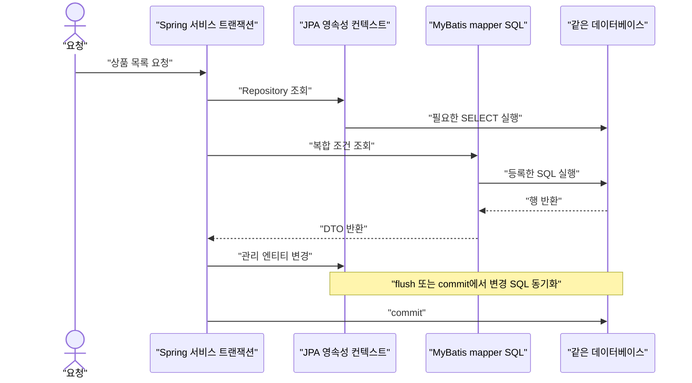

# W05. JPA vs MyBatis — 언제 무엇을, 섞어 쓰는 전략

> JPA는 객체와 도메인 상태를 다루고, MyBatis는 SQL과 결과 매핑을 다룬다.  
> 선택 기준은 “어느 쪽이 더 빠른가”가 아니라 도메인 규칙과 조회 SQL 중 무엇이 더 자주 변하는가다.  
> 기본 추천은 신규 도메인 쓰기는 JPA로 시작하고, 실제로 복잡한 조회만 MyBatis/JdbcClient로 좁혀 분리하는 것이다.

## 1. 질문

- 입사 첫 달, 상품 상태를 바꾸는 코드에 `repository.save()`가 없는데 DB 값은 바뀐다. 반대로 `save()`를 호출했는데 SQL 로그에는 아직 `UPDATE`가 없다. JPA가 언제 DB에 쓰는지 감이 안 온다.
- 화면에 뿌릴 목록 하나 만들려는데 필터가 여섯 개, 집계와 페이징까지 있다. 팀은 MyBatis SQL을 직접 쓰자고 하고, 새 기능은 JPA로 하자는 의견도 나온다. 같은 테이블을 두 방식으로 건드려도 되는지 걱정된다.
- 기존 서비스의 mapper XML이 수백 개다. “요즘은 JPA”라는 말만 믿고 갈아엎어야 하는지, 새 기능만 JPA로 만들어도 되는지 판단이 서지 않는다.

## 2. 짧은 답

JPA는 엔티티를 영속성 컨텍스트가 추적하고, 변경을 트랜잭션의 flush 시점에 SQL로 동기화한다.  
MyBatis는 개발자가 SQL을 작성하고 그 결과 행을 지정한 객체로 매핑한다. 객체 변경을 추적하지 않는다.  
도메인 규칙과 연관 객체 변경이 중심이면 JPA를 기본값으로 삼아라.  
집계·통계·검색 화면처럼 SQL 모양과 실행 계획이 중심이면 MyBatis 또는 `JdbcClient`를 써라.  
둘을 섞을 때는 같은 DB 연결과 Spring 트랜잭션 안에서도 flush 순서와 영속성 컨텍스트 캐시를 관리해야 한다.  
새 프로젝트라면 JPA로 핵심 쓰기를 시작하고, 관측된 복잡한 조회만 별도 mapper로 옮기는 방식을 추천한다.  
전 팀이 JPA여야 한다거나 MyBatis가 본질적으로 빠르다는 규칙은 없다.

## 3. 왜 그런가 — 원리

### 두 추상화가 보관하는 정보

JPA는 Jakarta Persistence 표준이다. Spring Data JPA는 그 위에서 `Repository` 인터페이스와 쿼리 메서드 같은 접근법을 제공하고, Boot 4.1의 일반적인 구성은 Hibernate ORM을 JPA provider로 사용한다. 그러므로 “JPA와 Hibernate”는 독립된 두 선택지라기보다 표준 계약과 구현체의 관계다. 예제 기준은 Spring Boot 4.1.1, Spring Data JPA 4.1.1, Spring Framework 7.0.x다. Hibernate ORM은 공통 기준표의 7.4.5.Final이다.

JPA의 중심에는 현재 트랜잭션에서 관리되는 엔티티 집합, 즉 영속성 컨텍스트가 있다. `find()`로 가져온 엔티티는 그 컨텍스트 안에서 관리된다. 코드가 필드를 바꾸면 provider는 변경 전후 상태를 추적하고 flush 때 SQL을 낸다. 새 엔티티는 `persist()`로 관리 대상에 넣으며, Spring Data의 `save()`는 새 엔티티인지 판단해 `persist()` 또는 `merge()`를 호출한다. 이미 관리 중인 객체는 트랜잭션 안에서 변경하면 되므로, `save()`를 다시 부르는 것이 JPA의 변경 감지에 필수는 아니다. 그렇다고 팀의 Repository 규약에서 save 호출을 요구하는지까지 무시하라는 뜻은 아니다.

MyBatis의 중심에는 statement ID와 SQL, 입력 파라미터, 결과 매핑이 있다. mapper 메서드를 호출하면 등록된 statement가 실행되고 행이 DTO나 POJO로 만들어져 돌아온다. 반환 DTO의 필드를 바꿔도 데이터베이스에 반영되지 않는다. 변경하려면 `UPDATE` mapper를 다시 호출해야 한다. `#{value}`는 PreparedStatement 파라미터 바인딩이고, `${value}`는 SQL 문자열 치환이므로 사용자 입력에 문자열 치환을 적용하면 SQL injection을 만들 수 있다.

### 요청이 DB에 닿는 순서



`@Transactional` 메서드가 시작될 때 트랜잭션이 열리고, JPA 엔티티는 이 범위의 영속성 컨텍스트에서 관리된다. 메서드가 끝날 때 provider는 보통 commit 전에 flush한다. flush는 commit과 다르다. flush는 현재 변경을 SQL로 DB에 전달하고 제약조건 오류가 그 시점에 날 수 있게 하지만, 아직 트랜잭션은 rollback 가능하다. Hibernate `AUTO` flush 모드는 commit 시뿐 아니라 쿼리가 변경 상태를 stale하게 볼 수 있는 경우에도 쿼리 전에 flush할 수 있다. `save()` 호출 즉시 SQL이 실행된다고 가정하면 디버깅 로그와 장애 시점이 어긋난다.

반대로 MyBatis 호출은 호출한 시점에 mapper SQL이 실행된다. 다만 SQL 실행과 트랜잭션 commit은 별개다. Spring이 관리하는 MyBatis mapper는 Spring 트랜잭션에 참여할 수 있으며, transaction manager가 사용하는 `DataSource`와 `SqlSessionFactory`에 연결된 `DataSource`가 같아야 한다. JPA와 MyBatis를 한 트랜잭션으로 섞을 때도 두 접근이 동일한 DB 리소스와 호환되는 Spring transaction manager에 묶였는지 설정으로 확인해야 한다. 메서드에 `@Transactional`만 붙이면 서로 다른 DB나 서로 다른 transaction manager까지 원자적으로 묶이는 것은 아니다.

JPA와 MyBatis가 한 DB 트랜잭션을 공유해도 메모리 상태가 하나가 되지는 않는다. JPA로 엔티티를 수정했지만 아직 flush하지 않았다면 MyBatis SELECT는 DB에 전달되지 않은 값을 보지 못한다. 반대로 MyBatis UPDATE는 DB를 바꿔도 JPA 영속성 컨텍스트에 이미 들어 있는 같은 엔티티 객체는 오래된 값을 유지할 수 있다. JPA가 나중에 flush하면서 오래된 값으로 덮어쓸 수도 있다. 순서가 필요한 읽기 전에는 `EntityManager.flush()`를 고려하고, mapper가 관리 엔티티의 같은 행을 수정한 뒤에는 상황에 따라 `refresh()` 또는 `clear()`로 컨텍스트를 동기화해야 한다. 더 안전한 기본선은 한 aggregate의 쓰기 소유자를 하나로 두는 것이다.

JPA는 상태 추적을, MyBatis는 SQL 통제를 제공한다. 양쪽 모두 인덱스·조인·round trip·잠금이 성능을 좌우하므로 어느 쪽이 본질적으로 빠르다고 할 수 없다.

## 4. 선택지 비교

| 선택지 | 어떻게 동작 | 장점 | 단점 | 언제 쓰나 | 국내 실무에서 흔한가 |
|---|---|---|---|---|---|
| Spring Data JPA | 엔티티를 영속성 컨텍스트에서 추적하고 flush 때 상태를 SQL로 동기화 | 연관 객체와 변경 규칙을 객체 모델로 표현, 반복 CRUD 감소 | 지연 로딩·flush·상태 동기화 이해 필요, 복잡 조회의 SQL을 확인해야 함 | 도메인 규칙이 많고 쓰기 모델이 중요한 신규 기능 | 업종별 비교 통계를 확인하지 못함. 보급률 단정 불가 |
| MyBatis | XML/애노테이션 SQL을 실행하고 행을 결과 타입으로 매핑 | SQL과 projection을 정확히 통제, 기존 SQL 자산 활용 | 변경 감지·연관관계 관리 없음, statement와 매핑을 직접 유지 | 복잡 검색·리포트·DB별 SQL 의존이 큰 화면 | 업종별 비교 통계를 확인하지 못함. 보급률 단정 불가 |
| JPA + MyBatis | 같은 애플리케이션에서 쓰기와 조회를 다른 접근 도구로 구현 | 쓰기 도메인 모델과 읽기 전용 projection을 각자 맞는 형태로 구성 | 관리 상태와 DB 상태 불일치, 설정·관측 경계 증가 | 한쪽 도구로 품질이 떨어지는 기능이 실제로 생겼을 때 | 정량 자료 확인 못함. 혼용 비율을 사실처럼 말하지 않음 |
| JPA + QueryDSL | JPA 엔티티 쿼리를 타입 안전한 DSL로 구성 | 조립식 동적 조건과 타입 검사, JPA 관리 모델을 유지 | SQL projection을 완전히 대신하지 않음, 별도 라이브러리·학습 필요 | 동적 조건이 많지만 JPA 모델 안에서 풀고 싶을 때 | 조직·프로젝트별 차이. 정량 자료 미확인 |
| `JdbcClient` | Spring의 fluent JDBC API로 SQL을 바인딩하고 결과를 매핑 | 작은 SQL 조회에 mapper XML 없이 사용, JDBC 기반 트랜잭션 참여 | 엔티티 상태 추적과 복잡한 매핑은 직접 설계 | 단순 조회·쓰기, 소수 SQL, MyBatis 도입이 과한 경우 | 정량 자료 미확인 |

국내 실무의 업종별 사용률을 비교할 신뢰 자료는 확인하지 못했다. SI·금융·공공에서 SQL 통제가, 제품 팀에서 도메인 모델 투자가 유리하다는 말은 선택 논리이지 보급률 통계가 아니다. 발주 표준·기존 코드·DB 운영권을 확인하라.

기준 이름도 구분하자. JPA는 표준, Spring Data JPA는 Repository 편의 계층, Hibernate는 provider, MyBatis는 SQL mapper다. SQL을 직접 쓰는 선택지는 MyBatis만 있는 것도 아니다. Spring Framework 7.0.9의 `JdbcClient`는 named/positional parameter를 지원하는 JDBC facade이며, 복잡한 처리는 `JdbcTemplate` 계열로 내려갈 수 있다. Spring Data JPA 4.1.1과 MyBatis 3 문서는 현재 공식 사이트에서 확인했다. MyBatis Spring Boot starter 사이트는 4.0.0을 표시한다. starter 릴리스가 Boot 버전과 어떻게 호환되는지는 실제 프로젝트의 공식 호환표와 의존성 BOM으로 확인해야 한다.

## 5. 코드로 보기

아래 두 코드는 같은 기능, 즉 “카테고리 상품을 선택적으로 상태 필터링해 목록으로 반환”한다. 첫 코드는 JPQL이 엔티티 모델을 기준으로 projection을 만든다. 둘째는 MyBatis SQL이 테이블과 결과 열을 직접 지정한다. Boot 4.1.1 / Framework 7 기준 API이며 Spring 애플리케이션과 DB 설정이 필요해 여기서는 미실행이다.

### JPA — projection 쿼리

`ProductStatus.java`

```java
package example.catalog;

public enum ProductStatus {
    ACTIVE, DISCONTINUED
}
```

`ProductRow.java`

```java
package example.catalog;

import java.math.BigDecimal;

public record ProductRow(Long id, String name, BigDecimal price, ProductStatus status) {}
```

`Product.java`

```java
package example.catalog;

import jakarta.persistence.Column;
import jakarta.persistence.Entity;
import jakarta.persistence.EnumType;
import jakarta.persistence.Enumerated;
import jakarta.persistence.GeneratedValue;
import jakarta.persistence.GenerationType;
import jakarta.persistence.Id;
import jakarta.persistence.Table;
import java.math.BigDecimal;

@Entity
@Table(name = "product")
public class Product {
    @Id
    @GeneratedValue(strategy = GenerationType.IDENTITY)
    private Long id;

    @Column(name = "category_id", nullable = false)
    private Long categoryId;

    @Column(nullable = false)
    private String name;

    @Column(nullable = false)
    private BigDecimal price;

    @Enumerated(EnumType.STRING)
    @Column(nullable = false)
    private ProductStatus status;

    protected Product() {}
}
```

`ProductJpaRepository.java`

```java
package example.catalog;

import java.util.List;
import org.springframework.data.jpa.repository.JpaRepository;
import org.springframework.data.jpa.repository.Query;
import org.springframework.data.repository.query.Param;
import org.springframework.transaction.annotation.Transactional;

public interface ProductJpaRepository extends JpaRepository<Product, Long> {
    @Transactional(readOnly = true)
    @Query("""
        select new example.catalog.ProductRow(p.id, p.name, p.price, p.status)
        from Product p
        where p.categoryId = :categoryId
          and (:status is null or p.status = :status)
        order by p.name
        """)
    List<ProductRow> findCatalog(
            @Param("categoryId") Long categoryId,
            @Param("status") ProductStatus status);
}
```

JPA가 여기서 반환하는 건 관리 엔티티가 아니라 `ProductRow` projection이다. 읽기 목록에 엔티티 전체를 올리지 않아도 된다. 조건을 JPQL 한 문장으로 표현할 수 있지만, null 검사식이 DB별 계획에 불리한지 대량 데이터에서 실행 계획을 확인해야 한다. 트랜잭션이 필요한 custom query 메서드는 명시적으로 읽기 전용 범위를 둔다.

### MyBatis — 같은 목록을 명시적 SQL로 조회

`ProductMapper.java`

```java
package example.catalog;

import java.util.List;
import org.apache.ibatis.annotations.Mapper;
import org.apache.ibatis.annotations.Param;

@Mapper
public interface ProductMapper {
    List<ProductRow> findCatalog(
            @Param("categoryId") Long categoryId,
            @Param("status") ProductStatus status);
}
```

`src/main/resources/example/catalog/ProductMapper.xml`

```xml
<?xml version="1.0" encoding="UTF-8" ?>
<!DOCTYPE mapper
  PUBLIC "-//mybatis.org//DTD Mapper 3.0//EN"
  "https://mybatis.org/dtd/mybatis-3-mapper.dtd">
<mapper namespace="example.catalog.ProductMapper">
  <resultMap id="productRow" type="example.catalog.ProductRow">
    <constructor>
      <idArg column="id" javaType="java.lang.Long"/>
      <arg column="name" javaType="java.lang.String"/>
      <arg column="price" javaType="java.math.BigDecimal"/>
      <arg column="status" javaType="example.catalog.ProductStatus"/>
    </constructor>
  </resultMap>

  <select id="findCatalog" resultMap="productRow">
    SELECT id, name, price, status
    FROM product
    WHERE category_id = #{categoryId}
    <if test="status != null">
      AND status = #{status}
    </if>
    ORDER BY name
  </select>
</mapper>
```

`#{value}` 값은 SQL에 바인딩된다. 조건부 조립은 MyBatis `<if>`가 담당하고, 쿼리의 테이블·열·정렬을 읽는 사람이 그대로 확인한다. 반면 컬럼명을 `${column}` 같은 문자열 치환으로 만들면 파라미터 바인딩의 보호를 받지 못한다. 정렬 열처럼 값 바인딩할 수 없는 조각은 사용자 입력을 직접 넣지 말고 허용 목록으로 변환한다.

두 구현 모두 SQL 로그와 실행 계획을 확인한다. 모델 필드 변경은 JPA 매핑·JPQL과 MyBatis SQL·resultMap을 각각 수정하게 한다. 조인·집계가 많은 리포트는 MyBatis가, 객체 규칙과 단순 CRUD는 JPA가 편할 수 있다.

혼용은 “쓰기 JPA, 화면 읽기 MyBatis”로 정할 수 있다. 다만 쓰기 서비스 안에서 JPA 변경 직후 mapper 조회가 그 값을 읽어야 한다면 조회 전에 flush해야 하고, MyBatis가 같은 행을 수정하면 기존 JPA 엔티티를 재사용하지 않도록 refresh/clear 전략을 정한다. 먼저 별도 read-only DTO와 소유권 규칙을 만들고, 혼용을 실제 코드 리뷰에서 드러내라.

## 6. 실무에서는 실제로

아래는 시장 점유율 주장이 아니라 팀의 제약을 입력으로 삼는 선택 절차다.

### 신규 서비스

핵심 개념과 불변식이 계속 바뀌고 여러 연관 객체를 한 규칙으로 갱신한다면 JPA를 기본으로 둔다. Repository에는 aggregate 단위 조회와 변경을 두고, API 응답용 목록 DTO가 필요한 경우 처음에는 JPQL projection으로 풀어 본다. 복잡한 보고서 SQL이 생겼다고 모든 접근을 MyBatis로 바꾸지 말고 그 조회 한두 개를 분리한다. 팀이 SQL 중심이고 도메인 규칙이 단순한 CRUD 위주라면 신규 서비스라도 MyBatis를 기본으로 선택하는 것이 더 단순할 수 있다.

### 레거시 전환

이미 MyBatis가 있고 스키마 변경 권한이 제한적이면 mapper를 유지하는 편이 대개 변경 위험을 줄인다. 모든 SQL을 JPA로 옮기는 프로젝트를 목표로 삼지 말고 다음 기능 또는 독립 aggregate 하나를 시범 전환한다. 테이블·트랜잭션 경계를 기록하고, 어떤 애플리케이션 경로가 쓰기를 소유하는지 정한 뒤 전환한다. 옛 mapper와 새 JPA가 동일 row를 계속 양방향 쓰지 않게 한다. 결과 비교가 필요하면 일정 기간 읽기 결과를 shadow 비교하되, 요청마다 양쪽에 쓰는 dual-write를 기본 방식으로 삼지 않는다.

### SI·금융·공공 성격의 프로젝트

SQL 승인, DB 객체 통제, 벤더 고유 함수, 표준 산출물이 요구되면 MyBatis나 JDBC가 검토하기 쉬운 선택일 수 있다. 하지만 “그 업종은 무조건 MyBatis”라고 일반화할 근거는 여기서 확인하지 못했다. 고객 표준과 기존 모듈, 운영자에게 필요한 SQL 가시성, ORM 허용 여부를 질문으로 확인하라. JPA를 택해도 migration으로 스키마 변경을 관리하고 생성 SQL을 검토하는 절차는 필요하다.

### 스타트업·제품 팀

초기 인원이 적다면 도구 하나로 시작한다. 도메인 규칙 변경이 잦으면 JPA를, 조회·리포트 중심이고 SQL 숙련 팀이면 MyBatis를 고른다. “command=JPA, query=MyBatis”만으로 완전한 CQRS가 되지는 않는다. Fowler도 CQRS의 추가 복잡성을 경고한다.

### 선택 후 마이그레이션 순서

1. 애플리케이션의 mapper와 Repository를 쓰기/조회로 나누고, 트랜잭션 경계·핵심 테이블·복잡 SQL·대량 작업을 목록화한다.
2. 새 JPA 쓰기를 시작할 때 테이블 소유 aggregate 하나를 고른다. 엔티티 관계를 설계하고 스키마 변경은 Flyway/Liquibase 등 명시적인 migration으로 관리한다.
3. mapper 조회는 우선 기존 화면 요구를 유지한다. JPA가 불편한 조회를 실제 근거 없이 선제 변환하지 않는다.
4. 전환 전후 SQL 결과, 잠금, 제약조건, 동시 수정, rollback 동작을 검증한다. 한 요청 안에서 두 구현이 같은 row를 갱신하는지 검색한다.
5. 새 경로가 안정되면 옛 경로를 읽기 전용으로 제한하고 제거한다.

구현 W03·W04, JPA 원리 S09, 트랜잭션 S08 참조.

## 7. 흔한 오해와 실수

1. **“JPA 쓰면 SQL은 몰라도 된다” →** N+1, 의도치 않은 전체 컬럼 조회, flush로 인한 예상 밖 UPDATE가 실제 장애 원인이 된다. → SQL 로그와 바인딩 값, DB 실행 계획을 확인하고 조회 전용 projection과 fetch 전략을 사용한다.
2. **“`save()`가 호출되는 순간 INSERT/UPDATE된다” →** Spring Data `save()`는 새 상태면 `persist()`, 기존 상태면 `merge()`를 호출한다. SQL은 provider flush 시점까지 미뤄질 수 있고 `merge()`는 전달 객체 자체가 관리 객체가 아닐 수 있다. → 반환 객체를 일관되게 사용하고 생성 시점과 commit 전후 로그를 확인한다.
3. **“MyBatis는 늘 더 빠르다” →** MyBatis는 SQL을 통제하지만 조회 계획, round trip, lock 경쟁을 자동 개선하지 않는다. → 두 구현을 동일 데이터·동일 인덱스·동일 페이지 크기로 비교하고 실제 DB 실행 계획을 본다.
4. **“같은 `@Transactional`이면 혼용 결과도 자동 일치한다” →** JPA 메모리 상태와 MyBatis의 DB 상태는 다른 캐시 경계다. flush 전 mapper 조회는 이전 값을 보고, mapper UPDATE 후 JPA flush는 값을 덮을 수 있다. → 같은 DB/DataSource 및 manager 참여를 확인하고 읽기 전 flush, 쓰기 후 refresh/clear를 경계별로 적용한다.
5. **“SQL에 값을 붙여 넣어도 괜찮다” →** MyBatis `#{value}`는 준비된 문장의 값 바인딩이지만 `${value}`는 문자열 치환이라 사용자 값으로 SQL 문법을 바꿀 수 있다. → 값은 `#{value}`로 바인딩하고 동적 열 이름·정렬은 서버의 허용 목록으로 결정한다.
6. **“읽기 전용 선언을 붙이면 모든 쿼리가 안전해진다” →** Spring Data 문서는 `readOnly=true`가 쓰기를 금지하는 검증 장치가 아니라고 설명한다. 선언된 query method에 트랜잭션 설정이 자동 적용되지 않는 경우도 있다. → 조회 경계를 명시하고 실제 DB가 readonly를 어떻게 처리하는지 확인한다.
7. **“JPA와 MyBatis를 같이 쓰면 CQRS다” →** 라이브러리 두 개를 사용한 것만으로 별도 command/query model이나 비동기 read model이 생기지 않는다. → 단순 SQL 분리인지 모델 분리인지 말로 구분하고 복잡성에 맞는 이름을 붙인다.
8. **“목록도 엔티티를 전부 조회하면 된다” →** 응답에 필요 없는 연관 필드를 따라가며 추가 쿼리가 나가거나 영속성 컨텍스트가 커질 수 있다. MyBatis도 `SELECT *`와 무제한 결과를 쓰면 같은 운영 문제를 겪는다. → 필요한 열만 projection하고 정렬·페이지·최대 결과 수를 제한한다.

## 8. 자가점검 Q&A (면접 대비)

### Q1. JPA와 MyBatis는 가장 근본적으로 무엇이 다른가?

JPA는 엔티티 상태와 관계를 관리하는 영속성 모델이고, MyBatis는 SQL 실행과 행-객체 매핑을 제공하는 SQL mapper다.  
JPA는 변경을 추적해 flush 때 SQL로 만들며, MyBatis는 명시한 statement를 호출할 때 실행한다.  
그러므로 핵심 차이는 애노테이션 수나 SQL 작성량보다 상태 추적의 유무다.  
**꼬리 질문: JPA를 써도 SQL을 공부해야 하나?** 그렇다. 실제 SQL과 실행 계획이 성능과 잠금 동작을 결정한다.

### Q2. 엔티티 필드를 바꿨는데 `save()`가 없어도 DB에 저장되는 이유는?

엔티티가 현재 영속성 컨텍스트에서 관리 중이면 provider가 변경을 추적한다.  
트랜잭션 flush 시점에 변경 SQL을 내므로 `save()` 재호출이 필수는 아니다.  
다만 트랜잭션 밖의 detached 객체를 바꾼 것이라면 자동 반영되지 않는다.  
**꼬리 질문: flush는 commit과 같은가?** 아니다. SQL을 동기화하지만 트랜잭션은 아직 rollback 가능하다.

### Q3. 통계 화면은 왜 MyBatis가 더 편할 수 있나?

보고서 쿼리는 여러 테이블 집계, vendor 함수, 윈도 함수, 조건별 projection처럼 SQL 형태 자체가 요구사항일 수 있다.  
MyBatis는 SQL과 반환 열을 직접 보여 주므로 DBA와 쿼리 단위 리뷰를 하기 쉽다.  
JPA native query나 JPQL projection도 가능하므로 복잡해졌다는 이유만으로 전체 도구를 바꿀 필요는 없다.  
**꼬리 질문: JPA가 통계에 부적합한가?** 아니다. 요구 SQL과 유지보수 비용에 따라 query별로 판단한다.

### Q4. JPA와 MyBatis를 같은 서비스에서 호출하면 한 트랜잭션인가?

두 접근이 같은 DB 리소스와 같은 Spring 트랜잭션 관리에 참여하도록 설정되면 가능하다.  
MyBatis-Spring은 Spring 관리 트랜잭션을 지원하지만 manager가 쓰는 DataSource와 mapper factory의 DataSource가 같아야 한다.  
서로 다른 DB나 manager를 단순한 `@Transactional` 하나가 자동으로 묶어 주지는 않는다.  
**꼬리 질문: 그럼 JPA 변경 직후 mapper 조회 결과는?** 조회 전에 flush하지 않았다면 아직 이전 DB 값을 볼 수 있다.

### Q5. MyBatis로 수정한 row를 JPA 엔티티에서 다시 읽으면 어떻게 되나?

같은 영속성 컨텍스트에 엔티티가 이미 있다면 `find()`가 그 메모리 객체를 반환할 수 있다.  
따라서 DB에 반영된 mapper 변경을 보지 못하는 1차 캐시 불일치가 생긴다.  
`refresh()`나 적절한 `clear()`로 다시 읽거나, 같은 aggregate의 쓰기를 한 쪽에만 맡긴다.  
**꼬리 질문: JPA flush가 나중에 실행되면?** 관리 객체의 예전 값이 DB 변경을 덮을 수 있다.

### Q6. 기존 MyBatis 프로젝트는 JPA로 전면 전환해야 하나?

아니다. 전환은 반복 코드 절감과 도메인 모델 개선이 기존 SQL 자산·리스크보다 이득인지 따져야 한다.  
다음 기능 또는 독립 aggregate를 골라 쓰기 소유권을 정하고 작은 경로부터 옮긴다.  
복잡 보고서는 MyBatis에 남겨도 되며 두 기술의 혼용은 소유권과 트랜잭션 경계를 명시해야 한다.  
**꼬리 질문: 어떻게 전후를 비교하나?** 대표 트래픽과 결과, SQL 수, 실행 계획, 동시성·rollback 동작을 확인한다.

## 9. 참고문헌

- Spring Data JPA Reference — https://docs.spring.io/spring-data/jpa/reference/ — Spring Data JPA의 범위와 공식 버전 표기.
- Persisting Entities — https://docs.spring.io/spring-data/jpa/reference/jpa/entity-persistence.html — `save()`의 `persist()`/`merge()` 선택.
- Transactionality — https://docs.spring.io/spring-data/jpa/reference/jpa/transactions.html — Repository·서비스 트랜잭션과 readonly 의미.
- MyBatis 3 Introduction — https://mybatis.org/mybatis-3/ — MyBatis의 SQL·저장 프로시저·결과 매핑 소개.
- Mapper XML Files — https://mybatis.org/mybatis-3/sqlmap-xml.html — statement·파라미터·결과 매핑 설명.
- Dynamic SQL — https://mybatis.org/mybatis-3/dynamic-sql.html — 동적 SQL 구성 요소 설명.
- MyBatis Spring Transactions — https://mybatis.org/spring/transactions.html — Spring 트랜잭션 참여와 `DataSource` 조건.
- MyBatis Spring Boot Starter — https://mybatis.org/spring-boot-starter/mybatis-spring-boot-starter/ — Boot 지원과 표시 버전.
- CQRS — https://martinfowler.com/bliki/CQRS.html — CQRS의 의미와 복잡성 경고.
- Hibernate `FlushMode` Javadoc — https://docs.hibernate.org/stable/orm/javadocs/org/hibernate/FlushMode.html — flush 시점과 `AUTO`의 쿼리 전 flush 조건.
- Spring Framework `JdbcClient` Javadoc — https://docs.spring.io/spring-framework/docs/current/javadoc-api/org/springframework/jdbc/core/simple/JdbcClient.html — named/positional parameter용 JDBC facade.
- Spring Boot Managed Dependency Coordinates — https://docs.spring.io/spring-boot/appendix/dependency-versions/coordinates.html — Boot가 버전 생략 의존성을 관리하는 기준.
