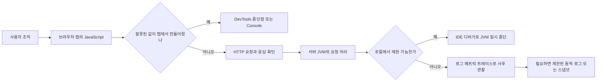

# W06. 디버깅은 왜 서버에선 브레이크포인트·로그로, 프론트에선 console.log로 하나

> 서버 코드는 내 컴퓨터 밖의 JVM에서 여러 사용자의 요청을 함께 처리한다. 브라우저 코드는 개발자 도구가 붙어 있는 내 탭에서 실행되므로 즉시 멈춰 값을 볼 수 있다.
> 그래서 로컬 개발은 브레이크포인트, 운영은 로그·메트릭·트레이스처럼 실행을 멈추지 않는 사후 관찰이 기본이다.
> 프론트에서도 브레이크포인트를 쓰고 서버에서도 `println`을 쓰며, 선택 기준은 언어가 아니라 실행 위치·재현성·중단 영향·접근 권한이다.

## 1. 질문

Spring으로 API를 만들고 브라우저에서 확인하던 신입 개발자에게 이런 장면이 생긴다.

1. 화면 이름이 이상해 프론트엔드는 Console에 값을 찍고, 백엔드는 IntelliJ에서 API 메서드에 중단점을 건다. 둘 다 값을 보는데 왜 도구가 다를까?
2. 로컬에서는 정상인데 운영에서만 요청이 실패한다. 여러 사용자의 요청을 받는 서버를 멈추면 다른 요청에는 어떤 영향이 생길까?
3. 서버 JVM은 개발자 노트북 밖 컨테이너에서 돈다. 내 브라우저처럼 화면에 DevTools를 열 수 없다면 어떻게 관찰할까?

이 질문의 전제부터 바로잡자. 프론트엔드는 `console.log`만 쓰지 않는다. Chrome DevTools Sources에는 줄·조건·예외·이벤트 리스너 중단점과 Logpoint가 있다. 서버도 임시 `System.out.println`이나 `logger.debug`를 쓸 수 있다. 차이는 “프론트 언어 대 백엔드 언어”가 아니라 “어느 프로세스에서 누가 실행하고, 그 프로세스에 멈춤을 걸어도 되는가”다.

## 2. 짧은 답

- 브라우저 코드가 내 탭에서 잘못 동작하고 재현 가능하면 DevTools Sources의 중단점으로 멈춰 Scope와 Call stack을 본다. 작은 값 확인은 Console이나 Logpoint가 빠르다.
- 서버 코드를 로컬에서 재현할 수 있으면 IntelliJ가 JVM을 Debug 모드로 실행하게 하고 서비스 메서드에 중단점을 건다. 호출 스택·지역 변수·스레드 상태를 한 시점에 볼 수 있다.
- 서버가 원격 운영 환경에서 실행 중이면 기본값은 요청을 멈추지 않는 로그·메트릭·분산 트레이스다. 운영 중단점은 요청 지연·타임아웃·스레드 고갈과 접근 보안 위험을 만든다.
- `println`은 짧은 로컬 실험에 쓸 수 있지만, 여러 인스턴스·요청을 조사하는 기록으로는 로그 수준·시각·요청 식별자·수집 경로를 갖춘 로거가 낫다.
- JDWP 원격 디버깅은 IntelliJ에서 로컬이 아닌 JVM에 붙는 기능이지 운영 관측성의 대체재가 아니다. 기본적으로 운영에서 켜 두지 말고, 꼭 필요하면 격리된 복제 환경과 제한된 네트워크 경로를 쓴다.
- 간헐적 운영 문제는 APM/트레이스, 동적 로그, 스냅샷 디버깅으로 원인을 좁힌다. 제품 기능과 데이터 보존·민감정보 정책은 별도로 확인한다.
- **기본값 추천: 로컬은 중단점, 운영은 요청 상관관계를 갖춘 로그와 트레이스, 빠른 단일 값 확인은 임시 출력.**

## 3. 왜 그런가 — 원리

### 코드가 실행되는 위치가 도구의 모양을 결정한다

브라우저 프런트엔드의 JavaScript는 페이지가 열린 브라우저 탭의 렌더러 프로세스에서 실행된다. 개발자는 그 브라우저를 직접 보고 있고, 해당 탭에 DevTools를 열어 소스와 실행 상태를 연결할 수 있다. 버튼 클릭이나 네트워크 응답을 같은 탭에서 반복하며 버그를 재현한 뒤, 실행을 멈추거나 값을 찍어볼 수 있다. 한 탭의 메인 스레드가 중단되어 UI가 멈춰도 영향은 주로 그 탭 사용자에게 머문다.

서버의 Java 코드는 JVM 프로세스에서 실행된다. JVM은 대개 개발자 노트북 밖에서 여러 요청을 처리하며, 브라우저 새로고침처럼 쉽게 초기화되지 않는다. 컨테이너의 표준 출력은 로그 수집기로 전달되기도 하므로, 서버 로그는 원격 환경의 수집 경로에서 찾는다.



### 중단점은 순간을 정지시켜 상태를 깊게 보는 도구다

디버거는 소스 줄 또는 조건에 도달했을 때 실행을 멈추고 현재 프레임, 변수, 호출 경로를 보여준다. IntelliJ 문서도 디버깅 세션을 프로그램 실행에 개입해 상태를 조사하는 과정으로 설명하며, 정지된 프로그램을 suspended 상태라고 부른다. 이 방식은 “이 값이 언제, 어떤 호출 경로에서 이 값이 되었나?”를 알아내기 좋다. 로그 문장을 새로 심지 않아도 해당 시점에 보이는 여러 값을 한꺼번에 확인할 수 있고, 한 단계씩 진행하면서 조건 분기 전후를 비교할 수 있다.

중단되는 동안 브라우저 탭의 이벤트 처리는 멎는다. 서버에서는 요청 스레드 하나 또는 IDE 설정에 따라 모든 스레드가 멈출 수 있다. 중단 스레드가 잠금·트랜잭션을 쥐면 다른 요청과 헬스체크도 지연될 수 있다.

### 로그와 텔레메트리는 실행을 계속하면서 사후에 조사한다

로그는 특정 시각에 프로세스가 남긴 메시지다. 레벨·요청 식별자·사용자나 주문 같은 도메인 식별자(민감정보는 제외)와 함께 기록하면, 이미 끝난 요청을 나중에 검색할 수 있다. 메트릭은 요청 수·오류율·지연 시간처럼 숫자를 일정 기간 집계해 “얼마나 자주, 얼마나 느린가”를 보여준다. 트레이스는 한 요청이 여러 서비스와 작업을 통과한 경로를 span으로 연결해 “어느 구간에서 지연·오류가 났나”를 보여준다. OpenTelemetry의 관측성 자료는 로그·메트릭·트레이스를 애플리케이션이 내보내는 텔레메트리 신호로 구분하고, 분산 트레이스가 로컬에서 재현하기 어려운 문제를 추적하는 데 유용하다고 설명한다.

이 도구들은 모든 지역 변수를 자동으로 보여주지 않아 필요한 문맥을 미리 계측해야 한다. 대신 요청을 멈추지 않으므로 이미 끝난 요청과 재현이 어려운 사건에 적합하다. 로컬 가설은 중단점으로, 과거 실행과 간헐 현상은 텔레메트리로 조사한다.

### JDWP는 JVM에 디버거를 연결하는 통로다

Java Platform Debugger Architecture(JPDA)는 디버거 애플리케이션과 대상 VM 사이에 연결을 만든다. JDI와 Connector가 디버거 쪽 연결을 다루고, 대상 VM에서는 JDWP를 지원하는 에이전트가 통신을 맡는다. Java 25의 JPDA 연결 문서는 TCP/IP 소켓 전송과 주소 형식 `<host>:<port>`를 설명한다. 대상 VM과 디버거가 같은 호스트일 수도, 다른 호스트일 수도 있다. 즉 IntelliJ의 원격 디버그는 “로그 파일을 가져오는 기능”이 아니라 네트워크를 통해 실행 중인 JVM에 디버거 권한을 연결하는 방식이다.

Oracle 문서에서 대기 중 주소의 `*`는 모든 네트워크 인터페이스 연결을 받는 와일드카드다. 디버거는 실행을 멈추고 내부 상태를 조사하며 IDE에서 코드를 평가할 수도 있다. JDWP를 넓은 네트워크에 상시 노출하는 것은 프로세스 제어 경로를 여는 일이다.

운영에서 요청 스레드가 멈추면 타임아웃과 재시도가 생기고, 전체 스레드 정지나 lock 점유는 다른 요청까지 늦출 수 있다. 운영 인스턴스의 중단점을 기본 조사법으로 삼지 말고, 불가피하면 트래픽을 분리한 복제본과 제한된 접근 경로·작업 시간으로 영향을 격리한다.

### 사후 관찰은 문제 발생 전에 일부 문맥을 준비한다

사건 때 아무 신호도 기록하지 않았다면 로그·트레이스가 호출 스택과 지역 변수를 되살려주지는 않는다. 요청 ID로 로그를 연결하고 메트릭으로 오류율·지연 변화를 보며, APM 트레이스로 외부 호출을 추적한다. 비즈니스 조건과 변수값은 별도 계측이 필요하다.

동적 로그·스냅샷 도구는 특정 지점과 조건에서 실행 문맥을 수집한다. Lightrun 예시는 조건·횟수 제한과 여러 실행 결과 비교를 제공한다. 정식 계측을 대체하지 않으며 수집 범위·접근권한·비용을 검토해야 한다.

## 4. 선택지 비교

| 선택지 | 어떻게 동작 | 장점 | 단점 | 언제 쓰나 | 국내 실무에서 흔한가 |
|---|---|---|---|---|---|
| 브레이크포인트 | 브라우저 Sources 또는 IDE가 지정 위치에서 실행을 멈추고 스택·변수를 보여준다. | 값이 만들어지는 순서와 호출 경로를 깊게 확인한다. 조건부 중단점으로 특정 입력만 잡을 수 있다. | 실행이 멈춘다. 운영 서버에 적용하면 요청 영향이 생기고, 재현 시점에 접근할 수 있어야 한다. | 프론트는 재현 가능한 탭 동작, 서버는 로컬·테스트 환경의 분기 버그. | 로컬 개발의 일반 도구다. 운영 적용 빈도에 대한 국내 정량 자료는 확인하지 못했다. |
| `println` / `console.log` / Logpoint | 실행 중 선택한 값이나 메시지를 출력한다. Chrome Logpoint는 소스 코드를 수정하지 않고 Console에 메시지를 보낼 수 있다. | 빠르고 배우기 쉽다. 중단 없이 여러 번 실행되는 값의 흐름을 볼 수 있다. | 출력 위치가 분산되고 요청 맥락이 약하다. 임시 출력이 커밋되거나 민감한 값이 노출될 수 있다. | 단일 로컬 값 확인, 브라우저에서 이벤트 순서 확인, 임시 가설 검증. | 프론트의 Console과 임시 출력은 흔하다. 팀별 코딩 규칙·운영 사용은 다르며 정량 근거는 미확인. |
| 애플리케이션 로그 | 레벨과 문맥을 붙여 서비스가 이벤트를 출력하고 수집 시스템에서 검색한다. | 재현 후에도 확인 가능하고 여러 인스턴스·시간대의 기록을 비교한다. 요청 ID로 연결하기 쉽다. | 기록하지 않은 값은 볼 수 없고, 과다 로그는 비용·노이즈·정보 노출을 낳는다. | 운영 오류, 배포 후 회귀, 특정 요청의 처리 경로 확인. | 장기 실행 서버의 표준적인 운영 신호다. 수집 인프라와 규칙은 팀마다 다르다. |
| JDWP 원격 디버깅 | IDE가 대상 JVM의 디버그 에이전트에 네트워크로 연결해 중단점과 VM 상태 조사를 수행한다. | 실행 중 원격 프로세스를 소스 수준으로 자세히 살펴볼 수 있다. | 포트와 권한 관리가 어렵고 실행 정지·데이터 노출 위험이 크다. 네트워크 접근이 필요한 상태로 유지된다. | 로컬이 아닌 개발·격리된 테스트 인스턴스에서 재현할 때. | 개발·스테이징에서 제한적으로 쓸 수 있다. 국내 운영 관행의 통계는 미확인. |
| APM·메트릭·분산 트레이스 | 라이브러리·에이전트·수동 계측이 지표와 span을 수집해 시스템 외부에서 요청 흐름을 보여준다. | 여러 서비스의 지연·오류를 요청 단위와 집계 추세로 파악하며 실행을 멈추지 않는다. | 사전 계측과 저장·수집 비용이 든다. 원시 지역 변수까지 보여주지는 않는다. | 간헐적 장애, 서비스 간 지연, 운영 오류율과 영향 범위 확인. | 규모와 운영 성숙도에 따라 다르다. ‘모든 국내 팀이 쓴다’는 공개 근거는 확인하지 못했다. |
| 동적 로그·스냅샷 디버깅 | 운영 코드의 특정 지점에 조건부 관찰을 요청하고 실행 문맥을 수집한다. 제품마다 수집·제한 방식이 다르다. | 재배포 전에 희귀 조건의 값을 얻거나 여러 실행을 비교할 수 있다. 인터랙티브 중단보다 서비스 흐름을 유지하도록 설계된다. | 별도 제품·에이전트·권한·비용이 필요할 수 있고, 데이터 수집의 안전성을 검토해야 한다. | 로그를 추가 배포하기 어렵고 문제 조건이 드문 경우, 승인된 환경의 제한 조사. | 제품 도입 여부에 따라 달라진다. 국내 보급률을 확인할 근거는 미확인. |

### 고르는 순서

1. 브라우저 Network에서 요청과 응답을 보고 잘못된 값의 경계를 확인한다. 프론트 렌더링 전 이미 응답이 잘못됐으면 서버로 이동한다.
2. 동일 입력으로 로컬 재현이 되고 코드 줄이 좁혀졌으면 중단점을 둔다. 한두 값만 보면 Console·Logpoint·임시 출력으로 더 빨리 답을 얻을 수 있다.
3. 운영에서 이미 발생했고 재현이 어렵다면 기존 로그와 trace ID를 찾고, 오류율·지연 메트릭으로 영향 범위를 정한다. 기록이 비어 있을 때는 안전한 배포 로그나 승인된 동적 계측을 추가한다.
4. 원격 디버깅은 운영 인스턴스의 첫 선택지로 쓰지 않는다. 인스턴스 격리와 네트워크 제한으로 정지·접근 위험을 감당할 수 있는지 먼저 판단한다.

## 5. 코드로 보기

아래 예제는 브라우저와 서버에서 같은 합계 계산을 확인한다. 서버의 `int` 곱셈에 오버플로우를 남겨 계층별 값 비교를 보여준다. 금액 모델 설계 예제는 아니다. (Java 25 / Spring Boot 4.1 기준)

### 브라우저 탭에서 확인하기

```html
<label>단가 <input id="price" type="number" value="100000"></label>
<label>수량 <input id="quantity" type="number" value="30000"></label>
<button id="calculate">계산</button>
<output id="total"></output>
<script>
  const price = document.querySelector("#price");
  const quantity = document.querySelector("#quantity");
  const total = document.querySelector("#total");

  function calculate(unitPrice, count) {
    const result = unitPrice * count;
    return result;
  }

  document.querySelector("#calculate").addEventListener("click", () => {
    const result = calculate(Number(price.value), Number(quantity.value));
    total.value = String(result);
    console.log({ unitPrice: price.value, count: quantity.value, result });
  });
</script>
```

DevTools Sources에서 곱셈 줄에 중단점을 놓고 버튼을 누른다. Scope의 입력값과 Step over 후 결과를 본다. Console은 단일 값, 중단점은 주변 변수·호출 경로 확인에 적합하다. Logpoint는 코드 수정 없이 Console에 값을 남긴다.

### Spring Boot 서버에서 확인하기

아래 세 파일을 Spring Boot 4.1 애플리케이션이 컴포넌트를 검색하는 패키지 아래 둔다. `GET /debug/total?unitPrice=100000&quantity=30000`을 호출하면 서비스 계산을 거쳐 JSON 응답을 만든다. Maven/Gradle 프로젝트에 Spring Web이 포함되어 있다고 가정한다. (미실행)

`src/main/java/com/example/demo/Quote.java`

```java
package com.example.demo;

public record Quote(long unitPrice, int quantity, long total) {
}
```

`src/main/java/com/example/demo/QuoteService.java`

```java
package com.example.demo;

import org.springframework.stereotype.Service;

@Service
public class QuoteService {
    public Quote calculate(long unitPrice, int quantity) {
        int intermediate = (int) unitPrice * quantity;
        long total = intermediate;
        return new Quote(unitPrice, quantity, total);
    }
}
```

`src/main/java/com/example/demo/QuoteController.java`

```java
package com.example.demo;

import org.springframework.web.bind.annotation.GetMapping;
import org.springframework.web.bind.annotation.RequestMapping;
import org.springframework.web.bind.annotation.RequestParam;
import org.springframework.web.bind.annotation.RestController;

@RestController
@RequestMapping("/debug")
public class QuoteController {
    private final QuoteService quoteService;

    public QuoteController(QuoteService quoteService) {
        this.quoteService = quoteService;
    }

    @GetMapping("/total")
    public Quote total(@RequestParam("unitPrice") long unitPrice,
                       @RequestParam("quantity") int quantity) {
        return quoteService.calculate(unitPrice, quantity);
    }
}
```

IntelliJ에서 앱을 Debug로 실행하고 서비스의 곱셈 줄에 중단점을 둔다. 위 URL을 요청해 파라미터와 `intermediate`를 확인하고, Network 응답과 비교한다. 이렇게 브라우저 입력·요청·Controller 인자·계산 결과 경계를 나눈다.

### 같은 서버 위치를 출력으로 관찰하기

중단점을 넣기에는 흐름이 단순하고 계산값만 확인하면 될 때는 아래처럼 출력으로 충분할 수 있다. 두 코드 중 하나를 메서드 본문에 넣는다.

```java
// 임시 로컬 확인
System.out.printf("unitPrice=%d quantity=%d intermediate=%d%n",
        unitPrice, quantity, intermediate);
```

임시 stdout은 동시 요청에서 출처를 구분하기 어렵다. 반복 조사에는 로거를 쓴다. 다음은 앞의 `QuoteService`를 대체하는 구현이다. (미실행)

```java
package com.example.demo;

import org.slf4j.Logger;
import org.slf4j.LoggerFactory;
import org.springframework.stereotype.Service;

@Service
public class QuoteService {
    private static final Logger log = LoggerFactory.getLogger(QuoteService.class);

    public Quote calculate(long unitPrice, int quantity) {
        int intermediate = (int) unitPrice * quantity;
        log.debug("quote calculated unitPrice={} quantity={} intermediate={}",
                unitPrice, quantity, intermediate);
        return new Quote(unitPrice, quantity, intermediate);
    }
}
```

`debug`는 운영에서 꺼져 있을 수 있어 지난 실행을 되살리지 못한다. 반복 조사라면 필요한 비민감 문맥을 팀 정책에 따라 남긴다. 로거 상세는 W07을 참조한다.

### 원격 JVM에 붙는 설정은 관측 설정과 다르다

Java 디버그 에이전트는 JVM 실행 옵션으로 시작한다. 로컬 실습에서는 애플리케이션 VM 옵션에 다음 값을 두고 IntelliJ Remote JVM Debug 구성을 같은 호스트와 포트에 맞춘다.

```text
-agentlib:jdwp=transport=dt_socket,server=y,suspend=n,address=127.0.0.1:5005
```

`server=y`는 JVM이 연결을 기다리고 `suspend=n`은 연결 전에도 실행을 계속한다. 루프백 주소는 같은 호스트에서만 접근한다. 원격 실습은 포트 포워딩·터널로 제한하며, `*:5005`처럼 모든 인터페이스에 열지 않는다.

운영에서 JDWP 대신 로컬 재현, 로그·트레이스, 승인된 스냅샷을 먼저 검토한다. 예외적으로 붙을 때는 트래픽을 분리하고 접근 경로와 작업 시간을 제한한다.

## 6. 실무에서는 실제로

### 신규 서비스

로컬은 IDE Debug, 운영은 구조화 로그와 오류율·지연 메트릭을 기본으로 둔다. 브라우저와 API를 함께 볼 때는 Network 응답부터 비교한다. 임시 출력은 문제 해결 뒤 제거한다.

### 레거시 서비스

레거시는 기존 로그의 인스턴스·요청 식별부터 확인한다. 재현 입력을 로컬로 옮겨 중단점을 쓰고, 기록이 부족하면 승인된 배포로 필요한 로그를 추가한다. 로그 공백을 JDWP로 메우지 않는다.

### SI·금융·규제 환경

SI·금융 등 통제 환경에서는 로그·스냅샷의 민감정보, 권한, 보존기간, 감사 경로를 확인하고 비운영 복제 환경을 우선한다. 실제 정책은 조직별로 다르며 업계 빈도 통계는 확인하지 못했다.

### 스타트업·작은 팀

작은 팀은 로컬 중단점과 배포 로그로 시작하고, 서비스 간 호출이 늘면 trace ID·외부 호출 지연·오류율을 추가한다. APM만으로 비즈니스 조건이 자동 설명되지는 않는다.

### 혼합 사용과 전환 경로

브라우저 Network, 같은 trace ID의 서버 로그, 로컬 중단점을 이어 쓴다. 반복되는 `println`은 검색 가능한 로그로 바꾸고, 여러 서비스의 질문은 트레이스·메트릭으로 확장한다.

기본 결정 규칙은 단순하게 둘 수 있다.

- 로컬에서 반복 재현되는 값·분기 문제면 IDE/DevTools 중단점을 쓴다.
- 재현되지만 한두 값만 궁금하면 Console·Logpoint·임시 출력으로 확인한다.
- 운영에서 끝난 요청·간헐 문제면 로그와 trace ID를 먼저 검색한다.
- 여러 서비스의 지연·오류 경계를 모르면 트레이스를 본다.
- 운영에서만 나타나며 배포가 곤란한 드문 조건은 승인된 동적 로그·스냅샷을 검토한다.
- 운영 JDWP는 기본 도구가 아니다. 영향 격리와 접근 통제를 증명할 수 있는 특수 조사에 한해 고려한다.

관련 범위: 디버깅 방법론은 D05, IntelliJ는 P15, 로거는 W07, 운영 관측성은 D09를 참조한다.

## 7. 흔한 오해와 실수

1. **오해: 프론트는 Console, 서버는 브레이크포인트를 쓴다.** 증상 → 프론트 코드를 찍어보다가 재현 경로를 놓치거나, 서버 로그가 쌓여도 값을 읽기 어렵다. 실제 → 양쪽 모두 중단점과 출력이 있고 실행 위치·접근성에 따라 유리한 방식이 달라진다. 대처 → Network와 실제 응답을 기준으로 오류가 생기는 계층을 가른 다음 도구를 고른다.

2. **오해: 운영 중단점은 해당 사용자 한 명만 기다리게 한다.** 증상 → 한 건을 조사하다 다른 요청의 지연과 타임아웃이 같이 증가한다. 실제 → IDE가 한 스레드 또는 모든 스레드를 멈출 수 있고, 정지 대상이 공유 자원이나 트랜잭션을 쥘 수 있다. 대처 → 운영 요청을 직접 멈추기보다 로그·트레이스를 찾고, 디버깅이 불가피하면 트래픽을 분리한 인스턴스에서 범위를 제한한다.

3. **오해: `System.out.println`은 서버에서 쓸 수 없다.** 증상 → “컨테이너라서 출력은 못 본다”며 관찰을 포기한다. 실제 → 플랫폼이 stdout을 수집할 수 있지만, 줄마다 레벨·요청 문맥·검색 정책이 보장되지는 않는다. 대처 → 짧은 로컬 확인과 운영용 기록을 구분하고, 반복 조사에는 팀의 로거와 중앙 수집 경로를 사용한다.

4. **오해: 로그를 많이 남기면 사후 디버깅이 쉬워진다.** 증상 → 핵심 오류가 잡음에 묻히고 저장 비용이나 민감정보 노출이 늘어난다. 실제 → 로그 양보다 사건을 연결할 시각·요청 식별자·단계·오류 문맥이 중요하다. 대처 → 질문에 답할 최소 필드만 기록하고 요청 본문·토큰·개인정보는 제거하거나 마스킹한다.

5. **오해: 원격 디버깅 포트는 잠깐 열면 무해하다.** 증상 → 배포 설정이나 보안 그룹에 포트가 남아 예상보다 오래 외부 연결을 받는다. 실제 → JDWP 연결은 실행 중인 JVM의 강한 관찰·제어 경로다. 대처 → 평소 비활성화하고, 필요한 경우 루프백·터널·방화벽·짧은 만료 시간을 함께 적용한 뒤 작업 완료 시 제거를 확인한다.

6. **오해: APM을 설치하면 지역 변수까지 자동으로 보인다.** 증상 → 대시보드에서 요청 지연은 보이지만 특정 조건의 잘못된 값은 찾지 못한다. 실제 → 자동 계측은 보통 프레임워크 경계·HTTP·DB 호출처럼 정해진 정보를 수집한다. 대처 → 비즈니스 단계와 결과를 필요한 수준으로 계측하고, 조건 값이 필요하면 로컬 중단점이나 승인된 스냅샷 관찰을 추가한다.

## 8. 자가점검 Q&A (면접 대비)

### Q1. 브라우저에도 브레이크포인트가 있는데 왜 `console.log`가 자주 보이나?

브라우저 코드가 개발자에게 가까워 버튼을 누르고 Console을 보는 과정이 빠르다. 한 값이나 이벤트 순서만 확인할 때는 출력이 간단하다. 조건 분기와 호출 경로, 예상 밖 변수까지 살펴야 하면 Sources 중단점이나 조건부 중단점이 더 적합하다.

**꼬리질문: Chrome Logpoint는 일반 `console.log`와 어떻게 다른가?**

Logpoint는 DevTools UI에서 실행 위치를 지정해 메시지를 Console에 남기므로, 디버깅 목적으로 소스 코드를 수정·재배포할 필요가 없다. 단, DevTools가 연결된 브라우저의 실행을 조사하는 기능이다.

### Q2. 로컬 Spring 서버에서 장애가 재현되면 왜 로그보다 중단점이 빠를 수 있나?

중단점은 특정 실행 시점의 지역 변수와 호출 스택을 바로 보여준다. 로그는 필요한 값을 미리 기록하도록 코드를 바꾸거나 기존 로그를 찾아야 한다. 다만 병렬 처리나 시간에 민감한 버그는 중단으로 타이밍이 달라질 수 있으므로, 그런 경우 비중단 로그나 테스트 계측을 함께 쓴다.

**꼬리질문: 중단점을 걸었는데 버그가 사라지면?**

스레드 스케줄링이나 외부 시스템 타이밍에 민감할 수 있다. 재현을 반복해 멈추는 방식만 고집하지 말고 상관관계가 있는 로그·트레이스·메트릭으로 실행 시간대의 패턴을 비교한다.

### Q3. 운영 JVM에 JDWP를 열어 두면 어떤 위험이 있나?

JPDA 소켓은 네트워크 연결로 IDE와 대상 JVM을 잇는다. 연결된 디버거는 실행을 정지하고 내부 실행 상태를 조사하므로, 노출된 포트는 로그 열람 권한과 같은 수준으로 취급하면 안 된다. 요청 지연·대기열 증가와 내부 데이터 접근 가능성을 함께 고려해야 한다.

**꼬리질문: 원격 디버깅이 꼭 필요하면 어떻게 제한하나?**

가능하면 비운영 복제 인스턴스로 옮기고, 루프백 바인딩과 SSH 터널·방화벽 등 접근 경로를 제한한다. 운영 트래픽을 받는 인스턴스를 써야 하는 예외라면 작업 승인, 시간 제한, 영향 감시, 종료 후 옵션 제거를 함께 둔다.

### Q4. 운영에서 로그와 트레이스는 각각 어떤 질문에 답하나?

로그는 특정 사건과 메시지를 시각·요청 문맥과 함께 설명한다. 트레이스는 한 요청이 서비스와 외부 호출을 통과한 순서와 각 구간의 시간을 보여준다. 오류율이나 지연이 전체적으로 얼마나 변했는지는 메트릭으로 확인한다.

**꼬리질문: 오류 로그만 있는데 여러 서비스의 지연 원인을 모르면?**

요청의 trace ID와 span 연결을 확인해 서비스 간 경계와 느린 호출을 찾는다. 트레이스가 없으면 다음 배포에서 상관관계 ID와 필요한 호출 계측을 보완한다.

### Q5. 운영 이슈의 기본 선택지를 하나만 추천한다면?

요청 식별자로 연결할 수 있는 로그와 기본 오류율·지연 메트릭, 분산 호출이 있다면 트레이스를 추천한다. 이 정보는 프로세스를 멈추지 않고 이미 끝난 요청의 상태와 서비스 전체 영향을 함께 조사하게 한다. 지역 변수의 완전한 대체는 아니므로 로컬 재현과 좁은 추가 계측으로 이어 간다.

**꼬리질문: 로그만 잘 남기면 APM이 필요 없나?**

서비스 수와 호출 관계가 단순하면 로그·메트릭으로 충분할 수 있다. 요청이 여러 서비스와 큐를 통과하면서 연결이 어려워지면 분산 트레이스가 더 적은 수작업으로 흐름을 보여준다.

### Q6. `println`은 왜 운영 조사에 기본 권장되지 않나?

서버 런타임이 stdout을 수집할 수는 있지만 `println` 자체는 레벨, 구조화 필드, 요청 상관관계, 마스킹 규칙을 제공하지 않는다. 동시 요청과 여러 인스턴스가 있으면 어느 실행의 출력인지 찾기 어려워진다. 한 번 확인하는 임시 용도와 지속적인 운영 기록을 구분한다.

**꼬리질문: 임시 `println`이 급한 장애를 해결했다면 바로 지워야 하나?**

그 값이 반복해서 필요한 운영 문맥인지 판단한다. 필요하다면 안전한 필드와 적절한 레벨을 가진 로그로 정식화하고, 일회성 출력이라면 제거한다.

## 9. 참고문헌

- Debug JavaScript — https://developer.chrome.com/docs/devtools/javascript — Console 출력과 Sources 패널, 브레이크포인트를 이용한 브라우저 디버깅 흐름을 확인했다.
- Pause your code with breakpoints — https://developer.chrome.com/docs/devtools/javascript/breakpoints — 줄·조건부 중단점, Logpoint 등 DevTools 중단점 유형과 사용 목적을 확인했다.
- Debug code — https://www.jetbrains.com/help/idea/debugging-code.html — IDE 디버거의 실행 중단·suspended 상태·변수 및 스레드 조사 기능을 확인했다.
- Connection and Invocation Details — https://docs.oracle.com/en/java/javase/25/docs/specs/jpda/conninv.html — JPDA의 디버거와 대상 VM 연결, 소켓 전송 및 주소 형식을 확인했다.
- The java Command — https://docs.oracle.com/en/java/javase/25/docs/specs/man/java.html — Java 25 명령행 문서에서 JDWP 에이전트 로딩과 소켓 연결 옵션 예시를 확인했다.
- Java Debug Wire Protocol — https://docs.oracle.com/en/java/javase/25/docs/specs/jdwp/jdwp-protocol.html — JDWP 명령이 대상 VM의 버전과 실행 중 스레드 같은 상태 정보를 다루는 것을 확인했다.
- Observability primer — https://opentelemetry.io/docs/concepts/observability-primer/ — 로그·메트릭·트레이스의 역할과 분산 요청 추적의 목적을 확인했다.
- Production Code Snapshots — https://lightrun.com/platform/telemetry/snapshots/ — 제품 예시로 조건·횟수 제한 및 실행별 스냅샷 비교 방식을 확인했다.
