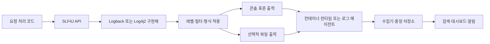

# W07. 왜 System.out.println 대신 로거(SLF4J)를 쓰나

> 서버에서 로그는 문자열을 화면에 찍는 일이 아니라, 운영 중 켜고 끄고 분류해 수집할 사건을 남기는 일이다.
> `System.out.println`은 빠른 확인에는 충분하지만, 레벨·출력 경로·요청 맥락을 애플리케이션이 제어하지 못한다.
> 신규 Spring Boot 서비스의 기본값은 SLF4J API로 기록하고 Boot 기본 Logback 구현에 맡기는 것이다.

## 1. 질문

신입 개발자가 `System.out.println("여기 들어옴")`을 넣고 배포한 뒤 특정 요청을 찾으려 전체 로그를 뒤진다. 결제 실패와 정상 처리 문구가 섞이고, 요청 ID나 스레드 이름이 없어 어느 요청의 줄인지도 모른다.

두 번째는 `logger.debug("order=" + order)`를 넣고 DEBUG를 껐는데도 `order.toString()`이 매 요청 실행되는 경우다. 로그 줄은 없어도 문자열 조립 비용은 든다.

세 번째는 `System.out.println(e.getMessage())`만 남겨 스택을 잃거나, 토큰·개인정보가 중앙 로그 저장소에 남는 경우다. 로거는 레벨·형식·목적지·요청 맥락을 제어할 자리를 준다.

## 2. 짧은 답

- `println`은 표준 출력에 텍스트를 쓰는 함수다. 로그 레벨이나 logger 이름, 예외 구조, 요청 문맥을 기본 제공하지 않는다.
- SLF4J는 로깅 파사드(API)다. 애플리케이션은 SLF4J에 기록하고 Logback이나 Log4j2 같은 구현체가 형식과 출력 대상을 결정한다.
- Spring Boot 4.1.x starter의 기본 구현은 Logback이다. 특별한 성능·운영 요구가 없다면 이 기본 조합을 유지한다.
- 레벨은 사건의 운영상 심각도에 맞춘다. 보통 ERROR/WARN/INFO는 운영에 필요한 요약, DEBUG/TRACE는 켜서 조사할 상세 정보다.
- 동적 값은 `{}` 자리표시자로 넘기고, 예외 객체는 마지막 인자로 넘겨 스택 추적을 보존한다.
- 요청 ID는 MDC 같은 문맥 저장소에 넣고 요청 경계에서 반드시 제거한다. 스레드가 바뀌는 작업은 문맥 전달을 별도로 처리한다.
- 구조화 로그(JSON)는 수집기가 필드를 파싱할 수 있게 하지만, 비밀정보를 안전하게 만들지는 않는다. 기록할 필드부터 최소화한다.

## 3. 왜 그런가 — 원리

### `println`은 쓰기만 하고 운영 정책은 모른다

`System.out`은 JVM의 표준 출력 스트림이고, `println`은 호출 스레드에서 `PrintStream`으로 쓴다. 콘솔·컨테이너 stdout에서 즉시 볼 수 있지만 ERROR/INFO 구분, 클래스별 임계값, 요청 ID, 파일 회전, JSON 같은 기능은 호출에 없다. 느린 출력은 요청을 지연시킬 수 있고, 문자열을 미리 조립하면 출력 여부와 무관하게 비용이 든다.

로거 호출은 이벤트를 만들고, 구현체가 logger 이름과 레벨로 필터링한 뒤 appender로 출력한다. 콘솔·파일·원격 전송을 설정하고 코드와 운영 설정을 나누면 배포 설정으로 특정 패키지 DEBUG를 켜고 끌 수 있다. 활성 로그도 포맷·직렬화·I/O 비용이 있으며 동기 appender는 느린 목적지를 기다릴 수 있다.

### 파사드와 구현체가 분리되는 이유

SLF4J API는 `Logger`와 `LoggerFactory`를 제공하고, 실제 구현체가 이벤트 처리와 출력을 맡는다. 라이브러리 작성자가 특정 구현체에 직접 묶이지 않도록 한 경계다. Logback은 SLF4J를 네이티브 지원하며, 그 내부에는 Logger, Appender, Layout이 있다. Logger는 이름 계층과 레벨, Appender는 어디로 보낼지, Layout은 어떻게 표현할지를 맡는다.

Spring Boot는 자체 내부 로깅에 Commons Logging을 쓰면서 구현체 선택은 열어 둔다. starter를 사용하면 기본적으로 Logback이 선택되고, JUL·Commons Logging·Log4j·SLF4J를 사용하는 의존 라이브러리의 로깅도 적절한 경로로 연결된다.

따라서 Boot 앱에서 보통 필요한 의존성은 starter가 고른 기본값이며, 프로젝트 코드에서는 SLF4J API만 사용한다. SLF4J API jar만 있고 provider가 없거나 1.x용 binding과 2.x API가 뒤섞이면 정상 출력 대신 NOP 경고가 날 수 있다.

### 로그 레벨은 운영 시점의 선택 스위치다

각 logger에는 유효 레벨이 있다. 임계값이 INFO라면 ERROR·WARN·INFO 이벤트는 통과하고 DEBUG·TRACE는 걸러진다. 패키지별 레벨을 상속시키는 이름 계층 덕분에 애플리케이션 전체는 INFO로 둔 채 한 모듈만 DEBUG로 관찰할 수 있다. println 문자열에는 이 정책이 없으므로 배포 후 코드를 바꾸지 않고 일부 내용을 켜거나 끌 수 없다.

레벨 기준은 팀이 합의한다. ERROR는 조치가 필요한 최종 실패, WARN은 재시도·대체 경로 등 확인할 이상 상태, INFO는 주요 시작·종료·상태 전환, DEBUG는 진단 정보, TRACE는 세밀한 단계 정보다. 모든 요청 본문을 INFO로 남기면 비용과 개인정보 위험이 커진다.

### 출력에서 검색까지는 별도의 파이프라인이다



Spring Boot의 기본 로그 형식 예에는 시각, 레벨, 프로세스 ID, 애플리케이션 이름(설정했을 때), 스레드, logger 이름이 포함된다. 파일 출력도 설정할 수 있지만, 애플리케이션이 로그를 중앙에서 검색 가능하게 만드는 일까지 자동 수행하지는 않는다.

운영 환경에서 표준 출력은 런타임이 수집할 수 있게 하고, 에이전트나 플랫폼이 이를 수집·보관·인덱싱해야 검색과 알림이 된다. 애플리케이션, 컨테이너, 수집기 중 어디서 중복 수집·회전을 담당하는지 정하지 않으면 로그가 중복되거나 사라진다.

### 자리표시자와 예외는 이벤트의 비용·정보를 바꾼다

`logger.debug("order=" + order)`는 DEBUG가 꺼져도 연결 연산과 `toString()`이 먼저 일어난다. `logger.debug("order={}", order)`는 레벨이 비활성일 때 메시지 조립을 피할 수 있다.

다만 `logger.debug("order={}", expensiveSnapshot(order))`의 메서드 호출은 여전히 먼저 실행된다. 비싼 진단 값을 만드는 코드는 레벨을 확인하거나 SLF4J 2의 지연 argument 기능을 고려하되, 로그 때문에 더 복잡한 본 경로를 만들지 않는다.

예외 객체를 `logger.error("결제 승인 실패 orderId={}", orderId, ex)`처럼 전달해야 구현체가 타입·메시지·원인 체인의 스택 추적을 출력할 수 있다. `ex.getMessage()` 문자열만 남기면 호출 경로가 사라진다. 같은 예외를 컨트롤러·서비스·리포지토리마다 각각 ERROR로 남기면 한 실패가 여러 번 기록되어 알림과 검색이 오염된다. 예외를 처리해 의미를 더하는 경계 한 곳에서 기록하는 편이 낫다.

### MDC와 JSON은 검색 문맥을 만든다

MDC(Mapped Diagnostic Context)는 현재 실행 흐름의 문맥 키·값을 logger가 이벤트에 붙이도록 하는 SLF4J API다. 웹 요청 입구에서 requestId를 넣으면 그 요청에서 나온 여러 줄을 같은 키로 찾을 수 있다.

Logback의 MDC는 스레드별 문맥이므로 요청이 끝날 때 `remove`하지 않으면 재사용 스레드에서 다음 요청 로그에 값이 새어 나갈 수 있다. 비동기 실행·스레드 풀·리액티브 전환은 자동으로 전달된다고 가정하지 말고 복사/복원하거나 프레임워크의 관측성 문맥 전파 기능을 사용한다.

구조화 로그는 `"level":"WARN"`, `"orderId":"A-1042"`, `"requestId":"..."` 같은 필드를 가진 JSON 이벤트다. 자유 문장만 남기는 것보다 수집기가 필드별 검색과 집계를 하기 쉽다. Spring Boot는 콘솔·파일의 구조화 출력 형식을 설정할 수 있다.

단, 값이 JSON으로 잘 escape된다고 로그 내용이 안전해지는 것은 아니다. 비밀번호, 인증 토큰, 세션 ID, 카드 보안정보, 필요 이상의 개인정보는 처음부터 넣지 않는다. CWE-532는 로그 파일에 민감정보를 삽입하는 문제를 별도 취약점으로 분류한다.

## 4. 선택지 비교

| 선택지 | 어떻게 동작 | 장점 | 단점 | 언제 쓰나 | 국내 실무에서 흔한가 |
|---|---|---|---|---|---|
| `System.out.println` | 표준 출력에 문자열을 바로 기록 | 의존성·설정이 없고 즉시 확인 가능 | 레벨·logger 분류·문맥·출력 정책이 없고 문자열이 미리 만들어짐 | 짧은 로컬 실험, 로거 초기화 전 임시 진단 | 운영 관행으로 권하지 않음. Boot 공식 기본 로그는 시각·레벨·스레드 등을 포함 |
| `System.Logger` / JUL | JDK 플랫폼 API 또는 표준 `java.util.logging`이 레벨과 handler로 처리 | JDK 내장, 외부 라이브러리 없이 레벨과 handler 사용 | 팀별 설정과 생태계가 SLF4J 기반이면 어댑터·브리지가 필요할 수 있음 | 일반 Java 도구, 외부 구현체를 원하지 않는 작은 프로그램, JDK/플랫폼 로그 | JUL은 JDK 표준이며 의존 라이브러리에서 만날 수 있음. Boot 앱의 기본 코드 API라고 단정할 근거는 없음 |
| SLF4J + Logback | 코드가 파사드에 기록, Logback이 필터·appender·layout을 수행 | 구현체와 코드가 분리되고 Boot starter 기본값으로 바로 사용 가능 | provider·브리지 충돌이나 설정 이해가 필요 | 대부분의 신규 Spring Boot 서비스 기본 선택 | Boot starter 기본이므로 기본 조합이라는 근거가 명확 |
| SLF4J + Log4j2 | 같은 SLF4J 코드에 Log4j2 provider와 설정을 연결 | 기존 Log4j2 운영 환경과 통합, async 등 선택 가능한 구성 | 의존성 교체·충돌·큐와 종료 시 유실 등 구현체별 운영 이해 필요 | 팀 표준이 Log4j2이거나 측정 결과로 특정 기능이 필요한 경우 | 선택하는 팀은 있지만 국내 점유율 수치는 확인하지 않음 |
| Log4j2 API 직접 사용 | 코드가 Log4j2 전용 API에 직접 결합 | Log4j2 전용 기능과 타입을 직접 사용할 수 있음 | 구현체 교체 시 코드 변경, 라이브러리 재사용성이 낮음 | 애플리케이션 자체가 Log4j2 전용 기능에 의존하는 경우 | Boot 기본 방식은 아님. 프로젝트 표준·기존 코드에 따라 판단 |

동기식 I/O가 문제일 것으로 느껴져도 곧바로 비동기 로거를 고를 이유는 없다. Log4j 공식 문서는 로그 성능이 애플리케이션 구조에 좌우되며 실제 애플리케이션으로 측정하라고 한다. 큐가 가득 차면 결국 느린 appender 속도에 묶이고, 종료 전 큐의 이벤트를 처리하지 못하면 로그 유실 가능성도 고려해야 한다. 프로파일링에서 유의미한 차이가 안 보이면 더 단순한 동기 방식을 권한다.

## 5. 코드로 보기

세 선택지는 모두 “결제 거절 사건에 주문 ID와 사유를 남긴다”는 동작이다. 첫 코드는 JDK 내장 API의 차이를 실제 실행해 비교한다. `System.Logger`의 기본 소비자는 JDK가 제공하는 구현에 따라 JUL 출력과 같은 기본 포맷으로 보일 수 있다.

```java
import java.util.logging.Level;
import java.util.logging.Logger;

public class LoggerChoices {
    private static final System.Logger platform = System.getLogger("demo.payment");
    private static final Logger jul = Logger.getLogger("demo.payment");

    public static void main(String[] args) {
        String orderId = "A-1042";
        String reason = "issuer unavailable";

        System.out.println("[WARN] Payment rejected. orderId=" + orderId + ", reason=" + reason);
        platform.log(System.Logger.Level.WARNING,
                "Payment rejected. orderId={0}, reason={1}", orderId, reason);
        jul.log(Level.WARNING, "Payment rejected. orderId={0}, reason={1}",
                new Object[] { orderId, reason });
    }
}
```

JDK 21 실행 출력(시각·지역화 표기는 실행 환경에 따라 다름):

```text
[WARN] Payment rejected. orderId=A-1042, reason=issuer unavailable
10월 04, 2026 4:45:47 오후 LoggerChoices main
경고: Payment rejected. orderId=A-1042, reason=issuer unavailable
10월 04, 2026 4:45:47 오후 LoggerChoices main
경고: Payment rejected. orderId=A-1042, reason=issuer unavailable
```

첫 줄은 단순 텍스트이고 경고 레벨처럼 보이는 `[WARN]`조차 직접 붙인 문자열이다. 뒤의 두 줄은 기본 handler가 레벨과 시각을 표시했다. 구현체나 handler의 설정에 따라 형식은 달라질 수 있다.

아래 클래스는 Boot 4.1.x 서비스 코드에서 SLF4J API를 쓰는 예다. `spring-boot-starter-logging`은 starter 사용 시 기본으로 포함되며 Logback이 provider가 된다. 같은 클래스는 적절히 구성된 SLF4J Log4j2 provider로 바꾸어도 호출부를 바꾸지 않는다. Spring 컨텍스트와 의존성이 필요해 이 문서에서 미실행이다.

```java
package com.example.payment;

import org.slf4j.Logger;
import org.slf4j.LoggerFactory;
import org.springframework.stereotype.Service;

@Service
public class PaymentLog {
    private static final Logger log = LoggerFactory.getLogger(PaymentLog.class);

    public void rejected(String orderId, String reason, RuntimeException cause) {
        log.warn("Payment rejected. orderId={}, reason={}", orderId, reason);
        if (cause != null) {
            log.error("Payment authorization failed. orderId={}", orderId, cause);
        }
    }

    public void inspect(String orderId) {
        log.debug("Inspecting payment. orderId={}", orderId);
    }
}
```

```properties
# application.properties — Boot에서 logger 레벨을 패키지 단위로 조정
logging.level.root=INFO
logging.level.com.example.payment=DEBUG

# 중앙 수집기가 JSON을 받도록 구성한 환경에서 선택
logging.structured.format.console=logstash
```

아래 Servlet 필터는 요청 경계에서 MDC 값을 세팅하고 예외·정상 여부와 무관하게 제거한다. 실제 수신 헤더를 request ID로 채택할 때는 허용 형식과 신뢰할 프록시를 검증해야 한다. 필터 API와 MDC를 조합한 Boot 예제이며 의존성이 없어 미실행이다.

```java
package com.example.web;

import java.io.IOException;
import java.util.UUID;
import jakarta.servlet.FilterChain;
import jakarta.servlet.ServletException;
import jakarta.servlet.http.HttpServletRequest;
import jakarta.servlet.http.HttpServletResponse;
import org.slf4j.MDC;
import org.springframework.stereotype.Component;
import org.springframework.web.filter.OncePerRequestFilter;

@Component
public class RequestIdFilter extends OncePerRequestFilter {
    @Override
    protected void doFilterInternal(HttpServletRequest request,
                                    HttpServletResponse response,
                                    FilterChain chain)
            throws ServletException, IOException {
        String requestId = UUID.randomUUID().toString();
        MDC.put("requestId", requestId);
        try {
            chain.doFilter(request, response);
        } finally {
            MDC.remove("requestId");
        }
    }
}
```

## 6. 실무에서는 실제로

- 신규 Spring Boot 서비스면 SLF4J 호출부와 기본 Logback을 기본값으로 둔다. 필요가 확인되지 않은 구현체 교체는 운영팀의 설정·수집 경로만 늘린다.
- 로그 수집 플랫폼이 JSON을 요구하면 Boot의 구조화 console/file 형식을 선택하고, 필드 이름과 민감정보 제거 기준을 수집기 담당자와 맞춘다. 로컬에서는 사람이 읽기 쉬운 기본 콘솔 형식, 운영에서는 수집기가 파싱하기 쉬운 JSON으로 나누는 팀도 많다.
- 레거시가 JUL이나 Log4j2에 정착했다면 라이브러리까지 한꺼번에 교체하지 않는다. 먼저 새 코드와 새 라이브러리의 API 경계를 정하고 중복 bridge/provider가 없는지 의존성 트리로 확인한다.
- SI·금융처럼 보안감사와 보존기간 통제가 강한 조직이면 “무엇을 기록할 수 있나”, 마스킹 위치, 접근권한, 보존·삭제를 먼저 표준화한다. 출력 API 선택만으로 감사 적합성을 충족하지 않는다.
- 스타트업은 우선 Boot 기본 구현과 플랫폼의 stdout 수집 경로를 단순하게 붙인다. 운영량이 커져 로그 비용이나 검색 품질이 문제로 측정되면 INFO 이벤트·샘플링·JSON 필드·보관 기간을 조정한다.
- println에서 옮길 때는 문자열을 사건 단위로 분류하고, 심각도 선택 → `{}` 치환 → 예외 객체 전달 → requestId 부여 → 출력 형식·수집 경로 확인 순으로 점진 전환한다.
- 비동기 appender/async logger는 지연이나 처리량 문제가 프로파일링으로 확인됐을 때만 선택한다. 이벤트 큐 포화 시 backpressure/드롭 동작과 정상 종료 시 flush를 함께 검증한다.

기본 설정과 운영 파일 형식의 상세 설정은 S16 참조. 서버 로그와 브레이크포인트 선택 기준은 W06 참조.

## 7. 흔한 오해와 실수

1. **“`println`도 콘솔에 나오니 운영 로그다” →** 컨테이너가 stdout을 수집할 수는 있지만 문장에 레벨·logger·requestId·필드를 직접 만들지 않으면 선택·집계가 어렵다. **대처:** 운영 코드에서는 SLF4J 이벤트를 쓰고 로컬 임시 출력은 커밋 전에 제거한다.
2. **“SLF4J가 로그를 파일에 쓴다” →** SLF4J는 API 경계이고 파일·콘솔 쓰기는 Logback/Log4j2의 appender가 담당한다. provider가 없으면 NOP 경고가 나고 로그가 안 보일 수 있다. **대처:** starter 의존성과 런타임 provider를 확인하고 provider는 하나의 일관된 조합으로 둔다.
3. **“`{}`는 인수 계산도 늦춰 준다” →** 자리표시자는 포맷 비용을 줄일 뿐 메서드 인수는 Java 호출 시점에 평가된다. **대처:** 비싼 객체 덤프는 `isDebugEnabled()` 안에서 만들거나 필요하면 SLF4J 2 fluent API의 지연 인수를 사용한다.
4. **“예외 메시지만 있으면 장애 원인을 알 수 있다” →** `getMessage()`는 스택·원인 예외·호출 경로를 버린다. **대처:** 예외 객체를 로거에 전달하고 사건 한 경계에서 한 번 기록한다.
5. **“요청 ID를 MDC에 넣으면 비동기 코드에서도 따라온다” →** Logback MDC는 스레드별이고 executor가 바뀌면 문맥이 비어 있거나 재사용 스레드의 값이 남을 수 있다. **대처:** 요청 경계에서 finally 제거하고 스레드 전환 시 문맥 복사·복원 또는 관측성 전파 기능을 쓴다.
6. **“JSON 로그는 안전하고 검색 가능하다” →** JSON은 형식일 뿐 토큰이나 개인정보를 가려주지 않으며, 중앙 인덱싱도 수집 파이프라인이 있어야 된다. **대처:** allowlist 필드만 출력하고 인증정보는 기록하지 않는다. 필요한 값은 일부 마스킹하고 접근·보존을 제한한다.
7. **“ERROR가 많을수록 장애 대응에 좋다” →** 정상적인 대체 경로와 예상 가능한 사용 오류까지 ERROR로 남기면 경보 피로와 중복 이벤트가 늘어난다. **대처:** 요청 실패, 재시도, 최종 포기, 복구 가능성을 기준으로 ERROR/WARN/INFO를 합의한다.
8. **“운영은 무조건 비동기 로깅이어야 한다” →** async는 호출 스레드의 대기를 줄일 수 있지만 큐가 차면 이점이 사라지고 종료·유실 정책이 더 복잡해진다. **대처:** 먼저 출력량과 지연을 측정하고, 유의미한 개선과 큐 포화·종료 동작을 함께 확인한다.

## 8. 자가점검 Q&A (면접 대비)

### Q1. Spring Boot에서 `println` 대신 SLF4J를 쓰는 운영상 이유는?

로거는 레벨과 이름으로 이벤트를 분류해 런타임 설정으로 일부 패키지 로그를 켜고 끌 수 있다. 구현체 설정으로 시각·스레드·요청 ID와 출력 대상을 일관되게 붙이고 수집기로 보낼 수 있다. `println`은 출력 문자열과 표준 출력만 알기 때문에 이 정책을 직접 구현해야 한다.

**꼬리질문: `println`도 컨테이너가 stdout을 수집하면 충분한 것 아닌가?**

수집은 되더라도 메시지의 구조·레벨·문맥은 코드가 만들어야 하고 필터·JSON·예외 처리를 공통화하기 어렵다. stdout 수집은 로거가 만든 이벤트를 전달하는 경로로 쓰는 편이 낫다.

### Q2. SLF4J와 Logback은 각각 무엇인가?

SLF4J는 애플리케이션이 호출하는 파사드 API다. Logback은 그 API를 구현해 레벨·이벤트 포맷·출력(appender)을 수행하는 백엔드다. Boot starter는 기본 백엔드로 Logback을 포함하므로 일반적인 코드는 SLF4J 타입만 직접 참조한다.

**꼬리질문: 구현체 jar 없이 `slf4j-api`만 넣으면?**

SLF4J 2.x에서는 provider가 발견되지 않았다는 안내 후 NOP 구현체가 선택되어 앱 로그가 기록되지 않을 수 있다. API와 provider의 메이저 세대도 맞춰야 한다.

### Q3. DEBUG 레벨을 INFO로 바꾸면 어떤 코드 비용이 없어지나?

SLF4J placeholder 호출에서 메시지 문자열 포맷과 출력 작업은 피할 수 있다. 그러나 `expensiveSnapshot(order)` 같은 인수 표현식은 메서드 호출 전에 실행되므로 비용이 남는다. 고비용 계산을 감싸거나 지연 인수를 써야 한다.

**꼬리질문: 모든 로그를 `isDebugEnabled()`로 감싸야 하나?**

아니다. 단순한 placeholder 값은 그냥 넘기면 충분하다. 객체 전체 직렬화나 비싼 계산처럼 비용이 눈에 띄는 경우에만 조건문 또는 lazy argument를 고려한다.

### Q4. 예외를 로깅할 때 스택 추적을 어떻게 보존하나?

`logger.error("작업 실패 id={}", id, exception)`처럼 Throwable 객체를 넘긴다. `exception.getMessage()`를 문자열에 이어 붙이면 스택과 cause가 빠진다. catch해서 복구하거나 경계를 넘길 때 맥락을 더하는 지점에서 한 번 기록한다.

**꼬리질문: 예외를 잡는 모든 계층에서 ERROR로 찍으면?**

같은 실패가 여러 줄과 여러 알림으로 중복되고 원인 사건의 빈도가 부풀려진다. 처리 계층은 예외를 전달하고, 최종 실패를 책임지는 경계가 필요한 문맥과 함께 기록한다.

### Q5. MDC에 requestId를 넣고도 값이 사라지거나 다른 요청 값이 보이는 이유는?

MDC의 기본 동작은 스레드에 묶여 있다. 비동기 작업이 다른 스레드로 이동하면 문맥이 자동 복사되지 않을 수 있고, 제거하지 않으면 풀 스레드에 값이 남을 수 있다. 요청 끝에 `finally`로 제거하고 스레드 전환 경로는 문맥 전파를 설정한다.

**꼬리질문: requestId 헤더를 그대로 MDC에 넣어도 되나?**

신뢰된 프록시가 덮어쓰는지, 형식과 길이를 검증하는지 확인해야 한다. 신뢰할 수 없다면 내부에서 생성하거나 검증 후 채택한다.

### Q6. 운영 로그 레벨을 어떻게 고르나?

ERROR는 요청이나 작업의 최종 실패처럼 조치가 필요한 사건, WARN은 재시도·대체 성공 등 이상 상태, INFO는 배포·상태 전환 같은 주요 사건에 쓴다. DEBUG/TRACE는 진단 세부사항이며 기본 운영 레벨로 켜두면 비용과 민감정보 위험이 커진다. 예상 가능한 사용자 입력 오류는 무조건 ERROR로 기록하지 않는다.

**꼬리질문: 일시적으로 특정 패키지만 자세히 보고 싶다면?**

전역 로그량을 늘리지 말고 해당 logger 패키지의 레벨만 DEBUG로 조정한 뒤 조사 후 원복한다. Boot에서는 `logging.level.com.example.payment=DEBUG` 같은 프로퍼티를 쓸 수 있다.

### Q7. 구조화 로그와 일반 문자열 로그의 차이는?

일반 문자열은 사람이 읽기 쉽지만 검색기는 주문 번호나 requestId를 매번 문장 안에서 파싱해야 한다. 구조화 로그는 키·값 JSON 이벤트로 필드를 직접 검색·집계하기 쉽다. 단, JSON 선택만으로 수집기 연결·민감정보 제거·보존정책이 생기지는 않는다.

**꼬리질문: 모든 DTO를 JSON으로 로그에 남기면 편하지 않나?**

불필요한 필드·비밀정보·대용량 본문이 쌓이고 로그 비용과 유출 면적이 커진다. 사건 분석에 필요한 필드를 명시적으로 선택하고 민감 값은 제외하거나 최소화한다.

### Q8. 비동기 로깅을 언제 도입해야 하나?

느린 로그 I/O가 요청 지연이나 처리량 병목이라는 측정 근거가 있을 때 후보가 된다. 큐가 가득 찼을 때의 동작, 종료 시 flush, 장애 시 유실 허용 범위를 정해야 한다. 측정된 차이가 없으면 구성과 운영이 더 단순한 동기 로깅이 낫다.

**꼬리질문: 비동기 logger를 쓰면 지속 처리량도 항상 높아지나?**

아니다. 앱이 appender의 지속 처리량보다 빨리 이벤트를 만들면 큐가 차고 결국 느린 appender 속도에 제한된다. 로그량을 줄이거나 appender를 개선하는 선택도 함께 측정한다.

## 9. 참고문헌

- SLF4J User Manual — https://www.slf4j.org/manual.html — 파사드/provider 구조, 기본 API, 2.x fluent logging과 provider 부재 동작.
- SLF4J FAQ — https://www.slf4j.org/faq.html — 비활성 로그에서 문자열 연결과 `{}` 파라미터 로깅의 비용 차이.
- SLF4J MDC Javadoc — https://www.slf4j.org/api/org/slf4j/MDC.html — MDC의 백엔드 위임 및 문맥 API.
- SLF4J News — https://www.slf4j.org/news.html — SLF4J 2.0의 Java 8 기준, fluent API, ServiceLoader provider 변경 및 2.0.20 릴리스.
- Spring Boot Logging Reference — https://docs.spring.io/spring-boot/reference/features/logging.html — Boot의 기본 Logback, 로그 필드 형식, 콘솔·파일 로깅 동작.
- Spring Boot Common Application Properties — https://docs.spring.io/spring-boot/appendix/application-properties/index.html — `logging.level.*` 레벨 매핑 프로퍼티.
- Logback Architecture — https://logback.qos.ch/manual/architecture.html — logger 계층과 Logger·Appender·Layout 역할, 레벨 제어.
- Logback MDC — https://logback.qos.ch/manual/mdc.html — MDC가 스레드별 문맥이며 요청별 식별값을 붙이는 방식.
- Apache Log4j Asynchronous Loggers — https://logging.apache.org/log4j/2.x/manual/async.html — 비동기 로깅의 큐·지연·처리량 trade-off와 측정 권고.
- JEP 264: Platform Logging API and Service — https://openjdk.org/jeps/264 — Java 9의 `System.Logger` 목적과 외부 로깅 프레임워크 연결 의도.
- CWE-532: Insertion of Sensitive Information into Log File — https://cwe.mitre.org/data/definitions/532.html — 로그 파일에 민감정보를 기록하는 취약점 분류.
