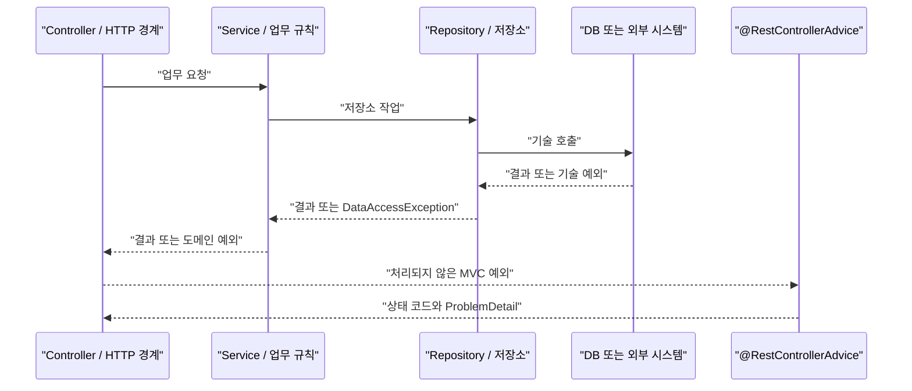

# W08. 예외는 어디서 잡나 — 계층별 처리와 전역 핸들러

> 예외는 실제로 복구하거나 더 적절한 의미로 바꿀 책임이 있는 곳에서 잡는다.
> Repository는 저장 오류를 숨기지 않고, Service는 업무 의미를 정하며, HTTP 경계는 이를 응답으로 표현한다.
> 기본값은 구체적 런타임 도메인 예외를 던지고 `@RestControllerAdvice`에서 RFC 9457 형식으로 한 번 변환하는 것이다.

## 1. 질문

신입 개발자가 예외 처리를 고민하는 장면은 익숙하다. `repository.save()`가 DB 제약조건 위반으로 실패했는데 Controller에서 `try-catch`해 문자열을 돌려주면 되는가? Service에서 `Exception`을 잡고 `null`을 반환해도 되는가? 같은 404 처리 코드를 컨트롤러마다 복사해야 하는가?

잘못된 위치에 둔 catch는 실제 버그가 된다. 주문 저장 오류를 Service가 잡고 성공처럼 반환하면 호출자는 주문이 만들어진 줄 안다. 체크 예외가 트랜잭션 메서드 밖으로 나왔는데 기본 롤백 규칙에 맞지 않아 데이터 변경이 커밋될 수 있다.

로그를 Controller·Service·Repository에서 모두 찍으면 세 줄의 `ERROR`에 원래 원인이 묻힌다. 반대로 SQL과 내부 클래스 이름을 응답에 넣으면 DB 구조와 경로가 노출된다.

따라서 핵심 질문은 “어느 계층에 catch 문을 쓸까?”가 아니다. **어느 코드가 원인을 판별하고 복구할 정보와 권한을 갖는가? 어디서 업무 의미나 HTTP 표현으로 변환할 것인가?** 잡아서 출력하거나 실패를 감추는 것은 처리가 아니다.

## 2. 짧은 답

- 실제 복구(재시도·대체 경로·보상)하거나 기술 오류를 도메인 의미로 바꿀 책임이 있는 경계에서 잡는다. 둘 다 아니라면 원인을 보존해 올린다.
- Repository는 보통 예외를 올린다. Spring DAO는 기술별 오류를 `DataAccessException` 계층으로 번역한다.
- Service는 업무 규칙을 소유한다. 기술 오류가 업무 의미가 될 때 구체적인 도메인 예외로 변환한다.
- Controller는 업무 규칙을 처리하지 않는다. 한 엔드포인트만 다른 표현이 필요할 때 로컬 핸들러를 쓴다.
- 여러 API가 공유하는 응답은 `@RestControllerAdvice`의 `ProblemDetail`로 만든다. 안정적인 클라이언트 분기 코드는 별도 `code`로 준다.
- 예외를 트랜잭션 안에서 잡아 정상 반환하면 인터셉터가 실패를 관찰하지 못할 수 있다. 체크 예외 롤백은 `rollbackFor`로 표시한다.
- 기본 추천: 알려진 도메인 예외는 구체적으로 매핑하고, 내부 원인은 한 경계에서만 로그에 남기며, 외부에는 안전한 오류 코드와 문구를 보낸다.

## 3. 왜 그런가 — 원리

각 계층은 다른 질문에 답한다. Repository는 “저장소 작업이 성공했는가?”, Service는 “업무상 이 요청을 받아들일 수 있는가?”, MVC 어댑터는 “실패를 HTTP 클라이언트가 이해할 응답으로 어떻게 표현하는가?”를 안다. DB 예외를 Controller가 분석하면 저장소 구현이 웹 코드로 새고, Repository가 HTTP 상태를 고르면 도메인과 전송 계층이 결합한다.



### 어디서 잡나: 판단 기준

1. **원인을 구분할 정보를 가졌나?** `DataAccessException` 전부를 “중복 이메일”로 바꾸면 연결 실패나 디스크 오류까지 409가 된다. 특정 제약조건 위반임을 확인할 수 있는 곳에서만 중복 오류로 바꾼다.
2. **잡은 뒤 실제 행동이 있나?** 재시도·보상·대체 결과가 없다면 catch할 이유가 없다. 로그만 남기고 성공값을 반환하면 실패를 감춘다.
3. **이 정보가 어느 경계까지 유효한가?** SQL 예외는 저장소 내부 세부사항이다. 안정된 도메인 오류로 바꾸면 API가 저장 기술에서 독립한다. HTTP 상태와 JSON은 웹 경계의 책임이다.

Spring MVC의 `@ExceptionHandler`는 `DispatcherServlet`의 `HandlerExceptionResolver` 흐름에서 동작한다. Controller/핸들러 실행 중 예외를 HTTP 응답으로 바꾸는 곳이지, 모든 애플리케이션 예외를 잡는 전역 `catch`는 아니다. Security 필터 등 MVC 앞단에서 난 예외는 Advice에 도달하지 않을 수 있어 해당 실행 체인의 처리가 따로 필요하다.

컨트롤러 내부 핸들러는 해당 컨트롤러 범위에 국한되고, `@ControllerAdvice`는 여러 컨트롤러에 적용된다. `@RestControllerAdvice`는 Advice에 응답 본문 작성을 결합한 형태다. 로컬 핸들러가 전역 처리보다 우선한다. 예외 원인 체인도 매칭할 수 있지만 Advice 우선순위가 함께 작용한다. 그래서 여러 `Exception.class` 핸들러를 순서 없이 두기보다 구체적인 타입을 명시한다.

### 트랜잭션이 예외를 보는 방식

선언적 트랜잭션은 프록시 경계에서 대상 메서드가 예외로 끝났는지 보고 롤백 규칙을 판단한다. Spring 기본값은 `RuntimeException`과 `Error`에서 롤백하고 체크 예외에서는 자동 롤백하지 않는다. 체크 예외도 롤백하려면 `rollbackFor`를 선언한다.

Service 내부에서 예외를 잡아 정상 반환하면 인터셉터는 성공으로 볼 수 있다. 단, 내부 트랜잭션 프록시가 이미 rollback-only로 표시했다면 바깥에서 예외를 삼켜도 커밋 시 `UnexpectedRollbackException`이 날 수 있다.

## 4. 선택지 비교

| 선택지 | 동작 | 장점 | 단점 | 언제 쓰나 | 국내 실무 빈도 |
|---|---|---|---|---|---|
| Repository catch/복구 | 저장 오류를 잡고 저장소에서 보정 | 기술 원인과 가까움 | 업무 분기나 넓은 재시도는 계층을 오염시킴 | 멱등 읽기 재시도 등 저장소가 복구를 소유할 때 | 채택률 조사 근거 없음. Spring DAO는 공통 예외 계층을 제공 |
| Service 변환/복구 | 기술·포트 오류를 업무 의미로 바꾸거나 보상 | 업무 규칙과 트랜잭션 정책을 함께 판단 | 외부 기술 세부사항이 무분별하게 들어올 수 있음 | 재고 부족, 중복 업무 키, 결제 거절 | 계층형 설계에서 흔한 선택이나 국내 빈도 통계는 확인하지 못함 |
| Controller 로컬 핸들러 | 한 컨트롤러의 예외를 HTTP 응답으로 변환 | 범위가 분명함 | 중복과 응답 불일치 | 한 컨트롤러만 다른 HTML/API 표현이 필요할 때 | 공통 기본으로 부적합. MVC 공식 지원 기능 |
| `@RestControllerAdvice` | 여러 컨트롤러의 오류를 공통 응답으로 매핑 | API 계약의 일관성, 단일 수정 지점 | 넓은 핸들러가 Spring 기본 400/404 의미를 덮을 수 있음 | 대부분의 REST API 공통 오류 처리 | 공식 지원 기능. 국내 채택률 수치는 확인하지 못함 |
| `ResponseEntityExceptionHandler` | MVC 내장 예외와 `ErrorResponse`를 바탕 클래스로 처리 | 파싱·바인딩 등 프레임워크 오류의 상태 의미 보존 | Boot 자동 구성과 Advice 순서를 알아야 함 | MVC 기본 오류까지 RFC 9457로 통일할 때 | 공식 대안. 현장 빈도 통계는 확인하지 못함 |

## 5. 코드로 보기

예제 API는 공통 브리프 기준 Spring Boot 4.1.1 / Framework 7.0.9다. 아래 코드는 각 파일의 핵심이 보이도록 나눈 Spring 예제이며 모두 **(미실행)**이다. 로컬 처리와 전역 처리는 같은 예외를 같은 RFC 9457 응답으로 만든다.

### 도메인 오류와 서비스

```java
// OrderErrorCode.java
package example.orders;

import java.net.URI;
import org.springframework.http.HttpStatus;

public enum OrderErrorCode {
    ORDER_NOT_FOUND(HttpStatus.NOT_FOUND,
            URI.create("https://api.example.com/problems/order-not-found"),
            "주문을 찾을 수 없음", "요청한 주문을 찾을 수 없습니다.");

    private final HttpStatus status;
    private final URI type;
    private final String title;
    private final String publicDetail;

    OrderErrorCode(HttpStatus status, URI type, String title, String publicDetail) {
        this.status = status;
        this.type = type;
        this.title = title;
        this.publicDetail = publicDetail;
    }

    public HttpStatus status() { return status; }
    public URI type() { return type; }
    public String title() { return title; }
    public String publicDetail() { return publicDetail; }
}
```

```java
// OrderNotFoundException.java
package example.orders;

import java.util.UUID;

public final class OrderNotFoundException extends RuntimeException {
    private final OrderErrorCode code = OrderErrorCode.ORDER_NOT_FOUND;

    public OrderNotFoundException(UUID id) {
        super("주문을 찾을 수 없음: " + id);
    }

    public OrderErrorCode code() { return code; }
}
```

```java
// OrderQueryService.java
package example.orders;

import java.util.Optional;
import java.util.UUID;
import org.springframework.stereotype.Service;
import org.springframework.transaction.annotation.Transactional;

@Service
public class OrderQueryService {
    private final OrderRepository orders;

    public OrderQueryService(OrderRepository orders) { this.orders = orders; }

    @Transactional(readOnly = true)
    public OrderView get(UUID id) {
        return orders.findViewById(id).orElseThrow(() -> new OrderNotFoundException(id));
    }
}

interface OrderRepository {
    Optional<OrderView> findViewById(UUID id);
}
record OrderView(UUID id, String status) {}
```

코드에는 내부 진단용 ID가 들어간 예외 메시지와, 외부용 문구가 분리돼 있다. 실제로 여러 도메인 모듈이 공유하는 에러 타입이라면 enum을 `HttpStatus`에 묶지 말고 웹 어댑터에서 HTTP 상태로 매핑한다.

### 선택 A: 그 컨트롤러에서만 처리

```java
// OrderController.java
package example.orders;

import example.api.ApiProblems;
import org.springframework.http.ProblemDetail;
import org.springframework.web.bind.annotation.ExceptionHandler;
import org.springframework.web.bind.annotation.GetMapping;
import org.springframework.web.bind.annotation.PathVariable;
import org.springframework.web.bind.annotation.RestController;
import java.util.UUID;

@RestController
public class OrderController {
    private final OrderQueryService orders;
    public OrderController(OrderQueryService orders) { this.orders = orders; }

    @GetMapping("/orders/{id}")
    public OrderView get(@PathVariable UUID id) { return orders.get(id); }

    @ExceptionHandler(OrderNotFoundException.class)
    ProblemDetail handle(OrderNotFoundException ex) {
        return ApiProblems.from(ex.code());
    }
}
```

### 선택 B: API 공통 Advice

```java
// ApiExceptionAdvice.java
package example.api;

import example.orders.OrderNotFoundException;
import example.api.ApiProblems;
import org.springframework.http.ProblemDetail;
import org.springframework.web.bind.annotation.ExceptionHandler;
import org.springframework.web.bind.annotation.RestControllerAdvice;

@RestControllerAdvice
public class ApiExceptionAdvice {
    @ExceptionHandler(OrderNotFoundException.class)
    ProblemDetail handle(OrderNotFoundException ex) {
        return ApiProblems.from(ex.code());
    }
}
```

```java
// ApiProblems.java
package example.api;

import example.orders.OrderErrorCode;
import org.springframework.http.ProblemDetail;

public final class ApiProblems {
    private ApiProblems() {}

    public static ProblemDetail from(OrderErrorCode code) {
        ProblemDetail problem = ProblemDetail.forStatusAndDetail(
                code.status(), code.publicDetail());
        problem.setType(code.type());
        problem.setTitle(code.title());
        problem.setProperty("code", code.name());
        return problem;
    }
}
```

`ProblemDetail.status`가 HTTP 상태를 정하고, `instance`가 비어 있으면 현재 URL 경로가 설정된다. `properties`의 `code`는 JSON의 추가 최상위 필드가 된다. 클라이언트는 문구 대신 `ORDER_NOT_FOUND`로 분기한다.

예외 메시지, SQL, 스택, 파일 경로, 토큰은 응답에 복사하지 않는다. Spring MVC 내장 파싱 오류까지 같은 형식으로 바꾸려면 `ResponseEntityExceptionHandler` 확장을 검토한다. Boot의 `spring.mvc.problemdetails.enabled` 자동 처리와 직접 정의한 Advice가 겹치면 `@Order`를 확인한다.

### 기술 예외를 도메인 예외로 변환

```java
// PaymentService.java (Spring 예제, 미실행)
package example.payment;

import org.springframework.stereotype.Service;

@Service
public class PaymentService {
    private final PaymentGateway gateway;
    public PaymentService(PaymentGateway gateway) { this.gateway = gateway; }

    public PaymentReceipt charge(PaymentCommand command) {
        try {
            return gateway.charge(command);
        } catch (GatewayUnavailableException ex) {
            throw new PaymentUnavailableException(ex);
        }
    }
}

interface PaymentGateway { PaymentReceipt charge(PaymentCommand command); }
record PaymentCommand(String orderId, long amount) {}
record PaymentReceipt(String transactionId) {}

final class GatewayUnavailableException extends RuntimeException {
    GatewayUnavailableException(Throwable cause) { super(cause); }
}
final class PaymentUnavailableException extends RuntimeException {
    PaymentUnavailableException(Throwable cause) {
        super("결제 서비스를 사용할 수 없습니다", cause);
    }
}
```

catch는 실패를 성공으로 숨기는 대신 외부 SDK 오류를 애플리케이션 의미로 번역하고 원인 체인을 보존한다. Advice는 `PaymentUnavailableException`을 안전한 503 응답으로 매핑하고 내부 원인은 로그에 남길 수 있다. 재시도는 중복 결제를 막는 idempotency 보장이 있을 때만 선택한다.

### 체크 예외를 롤백해야 할 때

```java
// SettlementService.java (Spring 예제, 미실행)
package example.settlement;

import org.springframework.stereotype.Service;
import org.springframework.transaction.annotation.Transactional;

@Service
public class SettlementService {
    private final SettlementRepository repository;
    public SettlementService(SettlementRepository repository) {
        this.repository = repository;
    }

    @Transactional(rollbackFor = SettlementRejectedException.class)
    public void settle(Settlement value) throws SettlementRejectedException {
        repository.save(value);
        if (!value.accepted()) throw new SettlementRejectedException();
    }
}

interface SettlementRepository { void save(Settlement value); }
record Settlement(boolean accepted) {}
final class SettlementRejectedException extends Exception {}
```

클래스 타입 `rollbackFor`가 이름 부분 일치 패턴보다 안전하다. 너무 넓은 `"Exception"` 패턴은 의도하지 않은 예외까지 매칭할 수 있다. 정상 업무 결과여서 커밋해야 한다면 예외와 롤백에 기대기보다 결과 타입으로 표현한다.

## 6. 실무에서는 실제로

- **신규 서비스:** 처음부터 안정적인 `code`와 공통 Advice를 둔다. 코드별 상태·공개 문구·문제 유형 URI를 한 곳에 관리하고, 프런트가 오류 코드를 기준으로 분기하도록 한다. 오류 응답 계약도 일반 응답과 함께 검증한다.
- **레거시:** 예외 응답을 한 번에 바꾸지 않는다. 기존 필드에 의존하는 클라이언트를 파악하고 코드와 새 `ProblemDetail`을 대응시켜 점진적으로 옮긴다. 기존 `Exception.class` 처리기가 400을 500으로 바꾸거나 `getMessage()`를 노출하는지 먼저 확인한다.
- **SI·금융·규제:** 조직 에러 코드, 감사 규칙, 변경 승인 절차를 우선한다. 벤더·DB 원인은 내부 코드로 변환하되 원문 SQL·스택을 응답하지 않는다. 업무 거절과 시스템 장애를 구분해야 프런트 재시도와 사용자 안내가 맞는다.
- **스타트업·소규모 팀:** 도메인 오류 코드, 공통 Advice, 안전한 5xx 응답, 요청 추적 ID는 초기에 둔다. 모든 예외를 400으로 만드는 단순화는 피한다.
- **로그:** 복구되지 않은 예외의 스택 트레이스는 한 경계에서만 기록한다. 서비스·컨트롤러가 먼저 `ERROR`를 찍고 재던지지 않는다. 4xx 업무 거절은 정상 흐름일 수 있으므로 매번 오류 스택으로 남기지 않고, 5xx 진단 로그에는 요청 추적 정보를 연결한다.

버전 변화도 선택에 영향을 준다. Spring 5.3은 원인 체인 매칭을 임의 깊이로 넓혔다. Framework 6.0은 RFC 7807 Problem Details를 지원했고, RFC 9457(2023)이 이를 대체했다. Framework 6.1은 예외 완료된 `Future`/`CompletableFuture`의 롤백 처리를 추가했다.

## 7. 흔한 오해와 실수

1. **“잡았으니 처리했다” →** 빈 catch 또는 성공값 반환은 실패를 감춘다 → 실제 복구가 없으면 원인을 보존해 다시 던진다.
2. **“Controller가 모든 예외를 잡는다” →** MVC 앞단 예외는 Advice에 오지 않을 수 있고, 검증·파싱은 프레임워크가 만든다 → 업무 규칙은 Service, 공통 HTTP 응답은 Advice에서 다룬다.
3. **“DB 예외는 전부 업무 예외” →** `DataAccessException`은 중복뿐 아니라 연결·잠금 등 여러 실패를 포괄한다 → 구체적인 제약 위반만 도메인 의미로 변환한다.
4. **“체크 예외도 기본 롤백” →** 기본 규칙은 런타임 예외와 `Error`다 → 체크 예외는 `rollbackFor`로 명시한다.
5. **“catch 후 정상 반환해도 트랜잭션은 실패를 안다” →** 인터셉터는 정상 종료로 볼 수 있다 → 예외를 밖으로 던지거나 롤백 전용 규칙을 명시한다.
6. **“`@ExceptionHandler(Exception.class)` 하나로 충분” →** 내장 400 의미나 다른 Advice 선택이 바뀔 수 있다 → 구체 타입을 우선하고 Advice 순서와 `ResponseEntityExceptionHandler`를 확인한다.
7. **“예외 메시지가 곧 사용자 안내” →** 메시지에 SQL·경로·개인정보가 포함될 수 있다 → 안전한 공개 문구와 내부 원인을 분리한다.
8. **“계층마다 로그를 남기면 안전” →** 한 사건이 여러 `ERROR`가 되어 원인과 빈도가 왜곡된다 → 미처리 스택은 한 번만 남기고 복구 재시도는 별도 메트릭으로 센다.
9. **“상태 코드만으로 오류를 구분” →** 같은 409에도 중복·상태 충돌이 다르다 → 안정적인 `code` 확장 필드로 분기한다.

## 8. 자가점검 Q&A (면접 대비)

### Q1. 어떤 경우에 예외를 잡나?

원인을 구분할 정보와 복구를 결정할 책임이 있을 때 잡는다. 아무 대체 행동 없이 로그만 남기거나 `null`로 바꾸는 것은 처리가 아니다. 복구하지 못하면 위로 전달한다.

**꼬리질문: 기술 예외를 도메인 예외로 바꾸는 것도 복구인가?**

아니다. 계층 간 의미 변환이다. 저장소 타입을 API 계층에 노출하지 않으려면 적절한 경계에서 변환하고 원인을 보존한다.

### Q2. Repository, Service, Controller의 책임을 비교하라.

Repository는 저장소 추상화, Service는 업무 결과·복구·도메인 실패, Controller는 HTTP 요청과 응답 표현을 맡는다. 공통 API 오류는 Advice가 변환한다. Controller가 업무 규칙을 다시 판정하지 않도록 한다.

**꼬리질문: DB 유니크 오류는 어디서 “중복 이메일”로 바꾸나?**

해당 제약조건과 업무 의미를 아는 어댑터 또는 Service다. 다른 `DataAccessException`까지 같은 코드로 바꾸지 않게 구체적으로 확인한다.

### Q3. Spring에서 런타임 예외가 많은 이유와 체크 예외의 용도는?

프록시·계층 호출마다 체크 예외 선언을 전파할 부담이 없고, 트랜잭션 기본 롤백 규칙도 런타임 예외를 따른다. 그렇다고 체크 예외가 잘못된 것은 아니다. 호출자에게 명시적인 복구 선택을 요구하는 라이브러리 계약에 쓸 수 있다.

**꼬리질문: 체크 예외로 롤백하려면?**

`@Transactional(rollbackFor = MyCheckedException.class)`로 설정한다. 타입 규칙은 문자열 패턴보다 안전하다.

### Q4. 컨트롤러 로컬 처리와 전역 Advice는 어떻게 고르나?

여러 API가 응답 계약을 공유하면 전역 Advice, 해당 컨트롤러만 다른 표현이 필요하면 로컬 핸들러를 쓴다. 로컬 처리가 전역보다 먼저 적용되므로 동일 예외를 양쪽에 두면 선택 결과를 확인한다.

**꼬리질문: Advice가 모든 오류를 잡나?**

아니다. MVC 처리 흐름 밖에서 난 예외는 도달하지 않을 수 있다. Security 필터 오류처럼 다른 실행 경계는 그 경계의 처리기를 쓴다.

### Q5. 트랜잭션 메서드에서 예외를 catch하면 롤백되나?

잡고 정상 반환하면 인터셉터가 실패를 관찰하지 못할 수 있다. 내부 호출에서 이미 rollback-only가 설정되면 바깥 catch에도 최종 롤백될 수 있다. catch 위치가 아니라 트랜잭션 경계와 규칙이 결정한다.

**꼬리질문: 계속 진행해야 하지만 롤백도 필요하면?**

가능하면 선언적 규칙과 반환 결과를 먼저 설계한다. 코드에서 `setRollbackOnly()`를 쓰면 Spring 트랜잭션에 강하게 결합된다.

### Q6. Problem Details에서 클라이언트가 무엇으로 분기해야 하나?

`status`는 일반적인 HTTP 오류 의미, `type`은 문제 유형, `title`·`detail`은 사람이 읽을 문구다. 서비스 전용 `code` 확장 속성은 `ORDER_NOT_FOUND` 같은 안정 식별자로 사용한다. 문구 변경이 클라이언트 계약 변경이 되지 않게 한다.

**꼬리질문: 왜 `ex.getMessage()`를 그대로 보내면 안 되나?**

내부 경로·SQL·개인 데이터가 노출될 수 있고 문구가 안정 계약도 아니다. 안전한 외부 안내와 제한된 서버 로그를 분리한다.

### Q7. 같은 예외를 여러 계층에서 로깅하면 어떤 문제가 있나?

로그와 경보가 중복되고 한 실패의 발생 건수를 과장한다. 복구 재시도는 횟수·결과 중심으로 관측하고, 미처리 예외의 스택은 경계에서 한 번 기록한다. 요청 ID로 관련 이벤트를 연결한다.

**꼬리질문: 예상 가능한 4xx도 오류 로그로 남기나?**

항상 그럴 필요는 없다. 업무 거절은 정상적인 사용자 흐름일 수 있다. 감사·공격 탐지 등 목적에 맞춰 이벤트나 지표로 따로 기록한다.

## 9. 참고문헌

- Exceptions — Spring Framework MVC — https://docs.spring.io/spring-framework/reference/web/webmvc/mvc-controller/ann-exceptionhandler.html — 예외 매칭, 원인 체인과 MVC 해석 흐름을 확인했다.
- Controller Advice — Spring Framework MVC — https://docs.spring.io/spring-framework/reference/web/webmvc/mvc-controller/ann-advice.html — `@RestControllerAdvice` 적용 범위와 우선순위를 확인했다.
- Error Responses — Spring Framework MVC — https://docs.spring.io/spring-framework/reference/web/webmvc/mvc-ann-rest-exceptions.html — `ProblemDetail`, `ErrorResponse`, Boot 자동 처리 정보를 확인했다.
- DAO Support — Spring Framework — https://docs.spring.io/spring-framework/reference/data-access/dao.html — `DataAccessException`의 기술 독립 예외 계층을 확인했다.
- Rolling Back a Declarative Transaction — Spring Framework — https://docs.spring.io/spring-framework/reference/data-access/transaction/declarative/rolling-back.html — 기본 롤백과 체크 예외 규칙을 확인했다.
- RFC 9457: Problem Details for HTTP APIs — IETF — https://www.rfc-editor.org/rfc/rfc9457.html — HTTP API 오류 형식과 RFC 7807 대체 관계를 확인했다.
- Spring Framework 6.0 Release Notes — Spring Framework Wiki — https://github.com/spring-projects/spring-framework/wiki/Spring-Framework-6.0-Release-Notes — Framework 6.0의 RFC 7807 지원을 확인했다.

예외 문법은 J04, MVC 요청 처리 전반은 S05, 트랜잭션 원리는 S08 참조.
