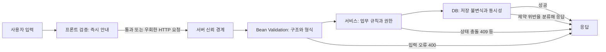

# W10. 검증은 어디서 하나 — 프론트·서버·DB, 왜 둘 다 하나

> 프론트 검증은 사용자가 빨리 고칠 수 있게 돕고, 서버 검증은 위조된 요청을 포함한 모든 입력을 신뢰 경계에서 걸러낸다.
> DB 제약은 애플리케이션 바깥의 쓰기 경로와 동시 요청까지 포함해 데이터 불변식을 지키는 마지막 방어선이다.
> 기본값은 프론트·서버·DB에 목적을 나눠 검증하는 것: 같은 규칙을 무작정 복사하지 말고, 데이터 무결성은 DB에서 최종 보장한다.

## 1. 질문

회원가입 화면에서 이메일을 비워 두고 제출하자 브라우저가 막았다. 그런데 API 담당자는 같은 `@NotBlank`를 DTO에도 붙이고, DBA는 컬럼에 `NOT NULL`과 `UNIQUE`까지 둔다고 한다. “셋 다 같은 검증 아닌가요?”라는 질문이 생긴다.

개발자 도구에서 화면 검증을 지우고 `curl`로 잘못된 이메일을 보냈더니 저장까지 됐다. 브라우저 검사를 왜 서버에서도 해야 하는지 드러난다.

재고 있음 확인을 통과한 두 요청이 동시에 주문되어 초과 판매가 났다. 서비스에 재고 검사를 썼다는 사실만으로 동시 요청의 안전성이 보장되지는 않는다.

## 2. 짧은 답

- 프론트 검증은 입력 즉시 오류를 보여 주고 불필요한 요청을 줄인다.
- 서버는 위조·직접 호출을 포함한 모든 HTTP 요청을 받는 신뢰 경계다.
- Bean Validation은 필수값·형식·길이 같은 선언적 DTO 제약을 검사한다.
- 서비스는 재고·권한·상태 전이처럼 업무 규칙을 판단한다.
- DB 제약은 앱·배치·관리 도구가 공통으로 지켜야 할 `NOT NULL`, `UNIQUE`, `CHECK`, 외래 키를 보장한다.
- 기본 추천은 **프론트는 빠른 안내, 서버는 모든 요청의 판단, DB는 영속 데이터 불변식**으로 역할을 나누는 것이다.
- 중복 사전 조회는 친절한 오류를 위한 최적화일 수 있지만 동시성 보장이 아니다. 고유성의 최종 판정은 DB `UNIQUE` 제약에 맡긴다.

## 3. 왜 그런가 — 원리

검증 위치마다 보는 시점과 가진 정보가 다르다. 브라우저는 입력 필드와 사용자의 현재 상호작용을 안다. 서버는 요청 전체와 인증 주체, 업무 흐름을 안다. DB는 실제로 저장되는 상태와 동시 트랜잭션을 안다. 뒤쪽 계층으로 갈수록 더 많은 신뢰를 받는다는 뜻이 아니라, 더 권위 있는 상태를 확인할 수 있다는 뜻이다.



### 각 층에서 확인할 것

| 층 | 잘 맞는 검증 | 그 층만으로 보장하지 못하는 것 |
|---|---|---|
| 프론트 | 빈 칸, 형식, 길이, 화면 간 상호작용, 제출 전 안내 | 직접 호출한 API, 조작된 브라우저, 다른 클라이언트, 최신 서버 상태 |
| 서버 DTO / Bean Validation | 필수 필드, 문자열 길이, 기본 형식, 중첩 객체 구조, 요청 간 공통 계약 | 재고·중복·권한처럼 다른 데이터나 현재 상태를 읽어야 하는 판단 |
| 서비스 계층 | 재고·예약 가능 여부, 상태 전이, 소유권·역할, 교차 필드 업무 규칙 | 동시에 들어온 요청 사이의 원자적 데이터 무결성만으로는 부족 |
| DB | `NOT NULL`, `UNIQUE`, `CHECK`, `FOREIGN KEY`, 컬럼 길이 등 저장 규칙 | 사용자가 읽을 메시지, UI 동작, 호출자별 업무 흐름 |

Bean Validation은 어노테이션 기반 제약 메타데이터와 검증 API를 제공한다. Spring의 `LocalValidatorFactoryBean`은 Jakarta Validator를 Spring Validator에 연결하고, 사용자 정의 `ConstraintValidator`도 Spring 의존성 주입을 이용하게 한다. 그래서 `@NotBlank`, `@Size`처럼 필드 자체에 붙는 반복 규칙을 컨트롤러마다 수동 `if`로 복제하지 않아도 된다. 그래도 “허용된 상태 전이인가?”는 DTO의 문자열 제약만으로 결정되지 않는다. [Spring Framework Reference](https://docs.spring.io/spring-framework/reference/core/validation/beanvalidation.html)

규칙의 위치는 **판단에 필요한 정보**로 정한다. 값 모양은 DTO, 다른 레코드·현재 시각·업무 상태는 서비스, 모든 쓰기 경로에서 유지할 데이터 조건은 DB에 둔다. OWASP는 문법(syntax)과 의미(semantics)를 구분하며, 입력 검증은 SQL 파라미터화·출력 인코딩·권한 확인을 대신하지 않는다고 설명한다. 유효한 계정 번호가 접근 권한을 뜻하지는 않는다. [OWASP Input Validation Cheat Sheet](https://cheatsheetseries.owasp.org/cheatsheets/Input_Validation_Cheat_Sheet.html)

### 중복 검사와 경쟁 조건

“먼저 조회하고 없으면 저장”은 중복을 막는 것처럼 보이지만 조회와 저장은 하나의 원자 연산이 아니다. 다음 순서에서 두 요청 모두 검사를 통과할 수 있다.

```text
요청 A: SELECT email → 없음
요청 B: SELECT email → 없음
요청 A: INSERT → 성공
요청 B: INSERT → 성공 또는 UNIQUE 위반
```

고유성이 필수라면 DB에 `UNIQUE`가 없을 때 두 INSERT가 모두 성공할 수 있다. 애플리케이션 인스턴스를 두 개 띄우면 각 인스턴스의 메모리 잠금도 서로를 막지 않는다. PostgreSQL 문서는 제약을 위반하는 값을 저장하려 하면 오류가 발생하며, `UNIQUE`는 중복 행을 막는다고 설명한다. DB 제약을 최종 수문장으로 두면 트랜잭션 경쟁에서도 잘못된 상태가 영속화되지 않는다. [PostgreSQL Constraints](https://www.postgresql.org/docs/current/ddl-constraints.html)

서비스의 `existsByEmail`은 흔한 중복을 미리 안내하는 데 쓸 수 있다. 빠른 실패일 뿐 무결성 보장은 아니다. DB가 거절한 결과도 일관된 HTTP 오류로 변환한다.

## 4. 선택지 비교

| 선택지 | 어떻게 동작 | 장점 | 단점 | 언제 쓰나 | 국내 실무에서 흔한가(근거 있으면) |
|---|---|---|---|---|---|
| 프론트 검증 | HTML 제약, JavaScript, UI 라이브러리가 서버 전 제출을 검사 | 입력 직후 안내, 왕복 감소, 필드 강조가 쉬움 | 클라이언트가 규칙을 바꿀 수 있고 오래된 상태일 수 있음 | 사용자 편의, 값 형식·필수 여부 즉시 표시 | 웹 폼에서 널리 쓰이는 형태지만 국내 도입률을 뒷받침하는 공식 통계는 확인하지 못함 |
| Bean Validation | Jakarta 제약을 DTO에 선언하고 Spring MVC가 요청 바인딩 후 실행 | 반복되는 구조 규칙을 표준 API로 묶고 위반 목록을 얻음 | DB 상태를 조회하는 검증기로 만들면 비용·레이스·계층 결합 발생 | 필수값, 길이, 형식, 요청 객체 구조 | Spring 공식 기능으로 지원. 국내 빈도 통계는 미확인 |
| 서비스 업무 검증 | 서비스가 저장소나 현재 사용자·업무 상태를 조회해 판정 | 도메인 맥락이 있어 교차 필드·상태 규칙 표현에 적합 | 조회 후 변경 사이에 상태가 달라질 수 있음. 과도하면 서비스가 거대해짐 | 재고, 중복 사전 안내, 예약 상태, 권한·소유권 검사 | 계층형 Spring 애플리케이션의 일반적 설계 선택. 국내 정량 근거는 미확인 |
| DB 제약 | 스키마의 제약·인덱스가 실제 저장 연산을 거부 | 여러 앱 인스턴스·배치·수동 SQL 쓰기에 동일한 불변식 적용 | 사용자 메시지와 업무 흐름을 표현하기 어렵고 변경은 마이그레이션 필요 | `UNIQUE`, `NOT NULL`, 범위 `CHECK`, 참조 무결성 | 관계형 DB를 쓰는 서비스에서 데이터 무결성에 사용. 국내 빈도 통계는 미확인 |
| 계약 스키마 공유·생성 | OpenAPI/JSON Schema 등으로 서버 계약에서 클라이언트 검증 규칙을 생성하거나 공유 | 수동 복사 차이를 줄이고 여러 클라이언트가 같은 형식 규칙을 참조 | 모든 업무 상태 검증을 스키마로 옮길 수 없고 계약 배포·하위호환 관리가 필요 | 웹·모바일·외부 소비자가 여럿이고 필드 규칙 변경이 잦을 때 | 프로젝트별 편차 큼. 국내 사용 빈도 통계 미확인 |

최소 길이 규칙은 화면 안내와 서버 강제 적용을 위해 양쪽에 둘 수 있다. 하지만 서버가 프론트의 `isAdmin`, `available` 플래그를 믿으면 안 된다. 계약 생성은 형식 중복만 줄인다.

## 5. 코드로 보기

같은 회원 이메일 등록 흐름을 세 층에 놓아 보자. 화면은 입력자가 수정할 수 있게 하고, 서버는 직접 보낸 요청까지 검사하며, DB는 동시 요청으로 중복 행이 생기는 것을 막는다. 예제의 Spring 코드는 Boot 4.1.1 / Framework 7.0.9 기준 API 형태이며 실제 프로젝트에서 실행하지 않았다. `(미실행)`

### 5.1 프론트: 제출 전 피드백

```html
<form id="signup">
  <label for="email">이메일</label>
  <input id="email" name="email" type="email" required maxlength="254">
  <button type="submit">가입</button>
</form>
```

브라우저는 빈 값, 입력 타입, 길이 일부를 제출 전에 안내한다. `type="email"`은 제품의 업무 이메일 정책을 완전히 정의하지 않는다. 특정 도메인만 허용한다면 화면에서 안내를 개선할 수 있지만, 서버에서도 동일한 정책을 확정해야 한다. 개발자 도구에서 `required`를 제거하거나 요청을 직접 만들면 브라우저 검사는 실행되지 않는다.

```bash
curl -i http://localhost:8080/users \
  -H 'Content-Type: application/json' \
  --data '{"email":"not-an-email"}'
```

이 요청은 폼을 거치지 않는다. 서버가 올바른 요청 DTO 검증을 하지 않으면 잘못된 값이 서비스로 넘어간다. curl 예시가 보여 주는 건 브라우저 검증의 편의 기능이라는 점이다. 검증을 우회한 요청은 인증이 필요할 수 있는 API에서도 서버가 직접 확인해야 한다.

### 5.2 서버: DTO 제약과 검증 오류 응답

```java
import jakarta.validation.constraints.Email;
import jakarta.validation.constraints.NotBlank;
import jakarta.validation.constraints.Size;

public record SignupRequest(
        @NotBlank @Email @Size(max = 254) String email
) {}
```

```java
import jakarta.validation.Valid;
import org.springframework.http.HttpStatus;
import org.springframework.http.ResponseEntity;
import org.springframework.web.bind.annotation.PostMapping;
import org.springframework.web.bind.annotation.RequestBody;
import org.springframework.web.bind.annotation.RestController;

@RestController
class SignupController {
    private final UserService userService;

    SignupController(UserService userService) {
        this.userService = userService;
    }

    @PostMapping("/users")
    ResponseEntity<Void> signup(@Valid @RequestBody SignupRequest request) {
        userService.register(request);
        return ResponseEntity.status(HttpStatus.CREATED).build();
    }
}
```

요청 DTO는 `@Valid`로 검사한다. Jakarta Validation 그룹은 제약의 부분집합이며 기본 그룹은 `Default`다. 등록·수정 규칙이 다르면 대개 DTO를 분리한다. 같은 모델을 공유하면서 일부 제약만 선택할 때 그룹을 고려한다. [Jakarta Validation 3.1 Groups API](https://jakarta.ee/specifications/bean-validation/3.1/apidocs/jakarta/validation/groups/package-summary)

오류 응답은 구현 예외나 Java 클래스명을 외부에 그대로 내보내지 말고, 클라이언트가 필드별 오류를 처리할 안정된 계약으로 만든다. Spring MVC는 RFC 9457 형식의 `ProblemDetail`을 지원한다. 아래 핸들러는 필드명과 메시지만 노출하고 거절한 입력값은 응답에 넣지 않는다. `(미실행)`

```java
import java.util.LinkedHashMap;
import java.util.List;
import java.util.Map;
import java.util.stream.Collectors;

import org.springframework.http.HttpStatus;
import org.springframework.http.ProblemDetail;
import org.springframework.web.bind.MethodArgumentNotValidException;
import org.springframework.web.bind.annotation.ExceptionHandler;
import org.springframework.web.bind.annotation.RestControllerAdvice;

@RestControllerAdvice
class ValidationAdvice {
    @ExceptionHandler(MethodArgumentNotValidException.class)
    ProblemDetail invalidRequest(MethodArgumentNotValidException ex) {
        Map<String, List<String>> errors = ex.getBindingResult().getFieldErrors().stream()
                .collect(Collectors.groupingBy(
                        error -> error.getField(),
                        LinkedHashMap::new,
                        Collectors.mapping(error -> error.getDefaultMessage(), Collectors.toList())));
        ProblemDetail problem = ProblemDetail.forStatusAndDetail(
                HttpStatus.BAD_REQUEST, "요청 값이 규칙을 만족하지 않습니다.");
        problem.setTitle("입력값 검증 실패");
        problem.setProperty("errors", errors);
        return problem;
    }
}
```

Spring의 `ProblemDetail`에는 표준 `type`, `title`, `status`, `detail`, `instance` 필드가 있고 `setProperty`로 확장 필드를 제공할 수 있다. 예시 응답은 다음과 같다. 클라이언트는 `errors.email`처럼 필드 오류를 연결하되 `detail` 문구 자체를 프로그램 분기 키로 사용하지 않는다.

```json
{
  "type": "about:blank",
  "title": "입력값 검증 실패",
  "status": 400,
  "detail": "요청 값이 규칙을 만족하지 않습니다.",
  "instance": "/users",
  "errors": {
    "email": ["올바른 형식의 이메일이어야 합니다."]
  }
}
```

Spring Framework 문서에 따르면 MVC 예외는 `ErrorResponse` 계약을 구현하며 `ResponseEntityExceptionHandler`를 `@ControllerAdvice`에 사용할 수 있다. Spring Boot의 `spring.mvc.problemdetails.enabled` 설정으로 내장 예외에 Problem Details 응답을 자동 구성할 수도 있다. 팀이 정한 응답 형식을 한 곳에서 일관되게 유지한다. [Spring Framework Error Responses](https://docs.spring.io/spring-framework/reference/web/webmvc/mvc-ann-rest-exceptions.html)

### 5.3 서비스와 DB: 안내 검사와 최종 고유성

서비스의 선행 중복 검사는 친절한 오류를 먼저 줄 수 있다. 아래 `existsByEmail`만으로는 동시 요청을 막을 수 없다. 둘 다 중복 없음 응답을 받은 뒤 INSERT하는 상황이 가능하기 때문이다. `(미실행)`

```java
import org.springframework.stereotype.Service;
import org.springframework.transaction.annotation.Transactional;

@Service
class UserService {
    private final UserRepository users;

    UserService(UserRepository users) {
        this.users = users;
    }

    @Transactional
    public void register(SignupRequest request) {
        String email = request.email().strip();
        if (users.existsByEmail(email)) {
            throw new EmailAlreadyRegisteredException();
        }
        users.save(new User(email));
    }
}
```

아래 타입은 위 서비스 예제에서 사용한 최소 JPA 저장 모델이다. 각 클래스는 같은 패키지에 둔다. `(미실행)`

```java
import jakarta.persistence.Column;
import jakarta.persistence.Entity;
import jakarta.persistence.GeneratedValue;
import jakarta.persistence.GenerationType;
import jakarta.persistence.Id;
import jakarta.persistence.Table;

@Entity
@Table(name = "users")
class User {
    @Id
    @GeneratedValue(strategy = GenerationType.IDENTITY)
    private Long id;

    @Column(nullable = false, length = 254)
    private String email;

    protected User() {}

    User(String email) {
        this.email = email;
    }
}
```

```java
import org.springframework.data.jpa.repository.JpaRepository;

interface UserRepository extends JpaRepository<User, Long> {
    boolean existsByEmail(String email);
}

class EmailAlreadyRegisteredException extends RuntimeException {}
```

최종 보장은 DB 스키마에 둔다. 실제 운영에서는 마이그레이션으로 제약을 관리한다. `@Column(unique = true)`는 JPA 스키마 생성 기능을 쓸 때 DDL 생성을 돕지만 운영 DB에 제약이 배포됐음을 보장하지 않는다. 마이그레이션 파일과 스키마를 확인한다.

```sql
ALTER TABLE users
    ALTER COLUMN email SET NOT NULL;

ALTER TABLE users
    ADD CONSTRAINT uk_users_email UNIQUE (email);
```

기존 중복은 제약 추가 전에 정리한다. 특정 UNIQUE 위반만 분류해 `409 Conflict`로 바꾼다. 모든 무결성 예외를 이메일 중복으로 매핑하면 `NOT NULL`이나 외래 키 오류를 숨긴다.

재고는 `SELECT stock > 0` 이후 차감하면 경쟁 조건이 생길 수 있다. DB에서 `UPDATE inventory SET stock = stock - 1 WHERE id = ? AND stock > 0`처럼 조건과 차감을 한 문장으로 수행하고 영향받은 행 수가 0이면 품절로 판단하면 검사와 쓰기의 간격을 좁힐 수 있다. 복잡한 예약은 락·버전 컬럼 등 전략이 필요하다. DTO나 `CHECK (stock >= 0)`만으로 상태 변경 경쟁을 해결하지 못한다.

## 6. 실무에서는 실제로

- **신규 서비스**라면 API 계약과 서버 DTO에 필수·길이·형식 규칙을 두고, 프론트는 즉시 안내한다. 필수값·고유성·참조 관계는 마이그레이션으로 DB에도 둔다. 서비스는 현재 상태 판단을 맡는다.
- **레거시 서비스**라면 기존 DB 제약과 오류 변환, 배치·관리자 쓰기 경로를 조사한다. 데이터 오류를 정리한 뒤 서버 검증과 DB 제약을 보강하고, 기존 데이터가 새 규칙에 걸리는지 먼저 집계한다.
- **SI·금융 등 통제·감사 요구가 큰 프로젝트**라면 API 스펙·서버 규칙·DB 마이그레이션·오류 코드를 추적하고 내부 연계와 배치도 검증한다. 이는 설계 권고이지 업종별 통계가 아니다.
- **스타트업·소규모 팀**이라면 우선순위는 서버 DTO + 핵심 서비스 규칙 + DB 제약이다. 프론트 검증은 오류 표시가 사용자 경험을 개선하는 곳부터 추가한다. 회원가입 중복처럼 자주 예상되는 오류는 서비스 선조회로 안내하고, 낮은 빈도의 충돌은 DB에서 포착해 일관된 응답으로 변환한다.
- **규칙이 어긋나면** 서버 계약을 기준으로 OpenAPI 등에서 형식·길이 제약을 공유하고 함께 변경한다. DB 상태·권한·재고 판단은 정적 스키마로 옮기지 않는다.
- **DB 제약을 추가한다면** 기존 중복 데이터를 정리한 뒤 제약과 서버 오류 변환을 배포한다. 데이터 정리와 스키마 변경의 순서 및 롤백을 준비한다.

기본값은 **필드 규칙은 DTO, 현재 업무 상태는 서비스, 영속 데이터 불변식은 DB**다. 프론트는 이를 사용자에게 빠르게 안내한다. 제약을 여러 층에 두면 각 위치가 일찍 안내하는지, 다른 쓰기 경로까지 보장하는지 목적을 분명히 한다.

## 7. 흔한 오해와 실수

1. **“required를 붙였으니 값이 비지 않는다” →** HTML 속성은 브라우저를 거치는 입력만 돕는다. API 직접 호출, 다른 클라이언트, 조작된 요청은 이를 실행하지 않는다. 서버 요청 DTO에서 필수 여부를 검사한다.
2. **“`@Valid`를 붙이면 업무 검증도 끝난다” →** `@Valid`는 선언된 제약을 평가한다. 예약 가능 여부처럼 DB 상태와 시점에 의존하는 규칙은 표현하지 못한다. 형식 제약과 서비스 판단을 나눈다.
3. **“exists 조회가 false였으니 UNIQUE 없이도 안전하다” →** 여러 요청이 동시에 같은 결과를 볼 수 있다. 조회 후 INSERT 사이에는 경쟁 구간이 있다. UNIQUE로 경합을 판정하고, 제약 위반만 도메인 충돌로 번역한다.
4. **“DB가 막아 주니 예외를 그대로 보내도 된다” →** 제약 이름, SQL, 내부 클래스명이 응답에 노출되거나 클라이언트가 DB 오류에 결합된다. 안정된 `400`/`409` 계약과 안전한 메시지로 변환하고 내부 원인은 로그에 남긴다.
5. **“Bean Validation의 `@Email`이 모든 이메일 정책을 판단한다” →** 형식 어노테이션은 서비스의 허용 도메인 정책, 인증된 주소 여부, 중복 여부를 판정하지 않는다. 실제 제품 정책은 명시적으로 검증하고 소유 확인 절차는 별도로 둔다.
6. **“모든 검증 실패는 400 하나면 충분하다” →** 잘못된 요청 문법/필드와 현재 상태 충돌은 클라이언트 조치가 다를 수 있다. 필드 오류는 팀 규약에 따라 400(또는 합의한 422), 현재 데이터와의 충돌은 409 등으로 일관되게 분류한다.
7. **“검증 실패 응답에 받은 값 전체를 넣어야 디버깅이 쉽다” →** 이메일·토큰·비밀번호 등 민감하거나 큰 입력이 로그·응답으로 퍼질 수 있다. 필드명, 안정된 오류 코드, 안전한 메시지를 노출하고 거절값은 출력하지 않는다.
8. **“서버와 프론트 규칙을 각자 복사해도 계속 맞는다” →** 길이 제한이나 허용 형식을 한쪽만 바꾸면 사용자에게 보인 결과와 API 응답이 달라진다. 계약 생성·공유 또는 변경 체크리스트를 쓰고 서버 규칙을 최종 기준으로 유지한다.
9. **“서비스에서 체크했으니 권한도 확인됐다” →** 유효한 리소스 ID는 호출자의 접근 허가를 뜻하지 않는다. 인가 판단을 입력 형식 검증과 분리하고 매 요청의 서버 측 권한 경계에서 확인한다. 보안 기초는 → D11 참조.

## 8. 자가점검 Q&A (면접 대비)

### Q1. 브라우저에서 검증했는데 서버에서 또 검사하는 이유는?

브라우저는 필수 호출 경로가 아니다. 사용자는 JavaScript를 끄거나 요청을 직접 만들 수 있고 모바일·배치도 API를 호출하므로 서버가 다시 검증한다.

**꼬리질문: 프론트 검증은 제거해도 되나?**

제거할 이유는 없다. 프론트 검증은 오류를 빠르게 보여 주고 왕복을 줄이는 UX 기능이며, 보안 판단을 대신하지 않는다.

### Q2. `@NotBlank`와 서비스의 `if (name.isBlank())`를 둘 다 쓰나?

같은 요청 필드의 단순 공백 규칙이라면 DTO 제약을 기본으로 삼으면 중복 구현을 줄일 수 있다. 서비스는 필드 형식보다는 여러 값의 관계나 현재 업무 상태를 판단한다. Validator에서 DB 중복을 검사해도 경쟁 조건은 남는다.

**꼬리질문: 별도 서비스 호출 없이 만들 수 있는 복합 제약은?**

시작일이 종료일보다 앞서야 하는 것처럼 요청 객체 안 값의 관계는 클래스 수준 Bean Validation 제약으로 표현할 수 있다. 다른 사용자나 DB의 현재 상태를 확인하는 일은 서비스에 둔다.

### Q3. Bean Validation 그룹은 언제 필요한가?

그룹은 선언된 제약 중 특정 부분집합만 실행하는 표준 기능이다. 등록과 수정에서 공유할 객체 제약을 제한적으로 고를 때 쓸 수 있다. 작업별 DTO를 따로 두는 편이 요청 계약을 분명하게 하는 경우가 많으므로 그룹을 기본 해결책으로 삼지 않는다.

**꼬리질문: 그룹을 지정하지 않은 제약은 어느 그룹인가?**

Jakarta Validation 명세에서 별도 지정이 없으면 `Default` 그룹에 속한다. `Validator` 호출에 그룹을 생략해도 `Default`가 적용된다.

### Q4. 가입 이메일 중복을 `existsByEmail`로 검사했는데 왜 UNIQUE가 필요한가?

동시 조회 둘 다 “없음”을 볼 수 있어 조회와 INSERT 사이에 경쟁이 있다. UNIQUE 제약이 최종 INSERT에서 이를 판정한다.

**꼬리질문: 그럼 `existsByEmail`은 지워야 하나?**

꼭 그렇지는 않다. 중복이 흔하면 더 이해하기 쉬운 오류를 먼저 제공하는 데 쓸 수 있다. 그 결과를 보장으로 착각하지 말고 DB 충돌 처리도 유지한다.

### Q5. 재고 수량이 0 이상이어야 한다면 DTO, 서비스, DB 중 어디가 맞나?

요청 수량이 양수인지는 DTO에서 검사할 수 있다. 실제 재고와 비교하는 판단은 서비스 규칙이며, 경쟁 상황에서는 조회 후 차감이 안전하지 않다. 저장 데이터가 음수가 되지 않아야 한다면 DB `CHECK`도 두고 원자적 갱신이나 잠금 전략을 사용한다.

**꼬리질문: `CHECK (stock >= 0)`만 있으면 초과 판매가 방지되나?**

음수 저장은 막지만, 비즈니스상 재고 1개를 두 주문 중 하나에만 배정하는 원자적 흐름을 대신하지 않는다. 조건부 UPDATE나 적절한 락으로 성공한 요청 수를 통제해야 한다.

### Q6. 모든 검증 오류를 HTTP 400으로 반환해도 되나?

팀 계약으로 일관되게 운영할 수는 있지만, 필드 형식 오류와 이미 점유된 이메일 같은 상태 충돌은 클라이언트가 취할 조치가 다르다. 예를 들어 잘못된 요청을 400, 현재 상태와의 충돌을 409로 구분하고 RFC 9457 응답에 안정된 필드 오류를 담는다.

**꼬리질문: 응답에 어떤 정보를 넣나?**

`title`, `status`, 일반화된 `detail`, 필드별 메시지나 오류 코드 정도가 유용하다. 스택 트레이스·SQL·거절한 민감값은 응답에 노출하지 않는다.

보안 검증의 전체 경계와 Spring MVC의 요청 처리 단계는 각각 → D11, → S05 참조.

## 9. 참고문헌

- Spring Framework, Java Bean Validation — https://docs.spring.io/spring-framework/reference/core/validation/beanvalidation.html — Spring Validator 연결, 기본 제약, 사용자 정의 제약과 검증기 구성 근거.
- Jakarta Validation 3.1 — https://jakarta.ee/specifications/bean-validation/3.1/ — 명세 버전, Java 17 이상 기준, Record 지원 설명 확인.
- Jakarta Validation API 3.1, Groups — https://jakarta.ee/specifications/bean-validation/3.1/apidocs/jakarta/validation/groups/package-summary — 그룹, 기본 그룹, 전파 변환의 의미.
- OWASP Input Validation Cheat Sheet — https://cheatsheetseries.owasp.org/cheatsheets/Input_Validation_Cheat_Sheet.html — 문법/의미 검증, 파싱 이후 검증, 인가·SQL 방어와의 구분.
- PostgreSQL 18, Constraints — https://www.postgresql.org/docs/current/ddl-constraints.html — `CHECK`, `NOT NULL`, `UNIQUE`, 외래 키의 저장 제약 역할.
- Spring Framework, Error Responses — https://docs.spring.io/spring-framework/reference/web/webmvc/mvc-ann-rest-exceptions.html — RFC 9457, `ProblemDetail`, MVC 예외 응답 구성.
