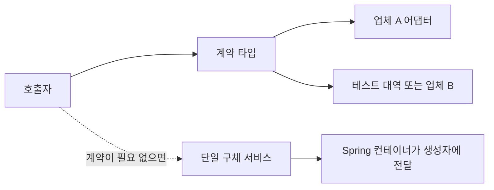

# W12. 인터페이스는 왜 만드나 — DI·테스트, 그리고 과잉 추상화

> 인터페이스는 Spring DI를 켜기 위한 문법이 아니라, 호출자와 구현 사이에 교체 가능한 계약을 둔다.
> 구현이 하나여도 외부 연동·전략·모듈 경계가 바뀐다면 유용하고, 변할 이유가 없는 단순 서비스에는 대개 불필요하다.
> 테스트는 인터페이스가 없어도 가능하다. 먼저 생성자 주입과 Mockito의 클래스 목을 쓰고, 실제로 필요한 경계만 추상화하라.

## 1. 질문

첫 Spring 프로젝트에서 `OrderService`를 만들자 팀원이 `OrderService` 인터페이스와 `OrderServiceImpl`을 한 쌍으로 추가한다. 메서드는 둘 다 하나뿐이고 구현체도 하나다. “Spring이 인터페이스를 요구하나, 우리 팀 규칙인가?”라는 의문이 생긴다.

테스트를 쓰려는데 `CheckoutService`가 `TaxPolicy` 클래스를 생성자에서 받는다. 인터페이스를 빼먹어 목을 못 만드는 것은 아닌지 걱정한다. 반대로 인터페이스를 만든 뒤 `@Autowired` 모호성이나 `Impl` 파일만 늘어나는 일도 겪는다.

세 번째 장면은 외부 결제사 연동이다. 지금은 업체 A만 쓰지만 계약·장애 대응·샌드박스 테스트 때문에 업체 B나 가짜 구현으로 바꿔야 한다. 이때 인터페이스는 의미 있는 경계인가, 앞서 만든 서비스 인터페이스와 같은 관성적 형식인가?

## 2. 짧은 답

- Spring의 DI는 인터페이스가 아니라 생성자에 선언된 의존성을 컨테이너가 연결하는 기능이다. 구체 클래스 하나도 주입할 수 있다.
- 구현 하나인 `Service` 인터페이스는 기본값으로 만들지 않는다. 인터페이스가 표현할 독립 계약이나 현실적인 교체 이유가 있는지 먼저 묻는다.
- 외부 시스템, 복수 전략, 별도 모듈·팀의 경계처럼 변경 방향이 다른 곳에는 포트 인터페이스를 둔다.
- 테스트 더블은 인터페이스뿐 아니라 Mockito로 일반 구현 클래스도 만들 수 있다. 단, 목은 구현 세부에 결합되거나 실제 동작을 검증하지 못할 수 있다.
- 인터페이스는 메서드 호출 비용을 줄이는 성능 기능이 아니다. 추상화는 유지보수 선택지를 사고, 파일·이름·선택 설정이라는 비용도 만든다.
- **기본 추천:** 내부의 단일 구현 서비스는 구체 타입으로 생성자 주입한다. 교체·계약·모듈 경계가 생긴 지점에만 인터페이스를 추가한다.

## 3. 왜 그런가 — 원리

### 인터페이스는 무엇을 분리하나

호출자는 “어떻게 계산하는지” 대신 “어떤 요청을 받을 수 있는지”에 의존한다. 구현은 그 계약에 맞춰 SQL, HTTP, 파일, 메모리, 알고리즘 중 하나를 제공한다. 이 분리는 의존성 방향을 바꿔 호출자가 구현 세부를 몰라도 되게 한다. 다만 인터페이스가 생겼다는 사실만으로 모듈이 독립되지는 않는다. 호출자가 구현 이름을 직접 만들거나 구현 전용 메서드를 기대하면 결합은 남아 있다.

의존성 주입(DI)은 이 객체 그래프를 조립하는 방식이다. Fowler의 설명에서 핵심은 구성(configuration)과 사용(use)을 분리하는 것이며, 추상 타입만을 강제하는 규칙은 아니다. 생성자 매개변수 타입이 구체 클래스여도 컨테이너는 해당 타입의 빈을 찾아 전달할 수 있다. 인터페이스가 주는 것은 DI 가능성이 아니라 구현을 바꿀 수 있는 호출 경계다.

구현이 하나여도 인터페이스가 유용할 수 있다. 예컨대 서비스 도메인은 외부 결제 SDK를 직접 알지 않고 `PaymentPort`만 호출한다. 공급자 교체, 오류 매핑, 재시도 정책, 테스트 대역을 애플리케이션 코드 바깥 어댑터로 격리한다. 반대로 `OrderService`의 인터페이스가 구현 클래스 이름만 지우고 메서드·수명주기·변경 이유를 똑같이 공유한다면 실질적 경계가 아니다.

### Spring의 프록시와 인터페이스는 별개

Spring AOP는 호출을 가로채는 프록시를 사용한다. Framework 문서는 대상이 인터페이스를 구현하면 JDK 동적 프록시를, 구현 인터페이스가 없으면 대상 클래스를 상속한 CGLIB 프록시를 사용할 수 있다고 설명한다. Spring Boot를 포함한 전체 설정의 기본 프록시 종류는 환경·설정에 따라 달라질 수 있다. Framework 7 문서에는 전역 기본값을 재정의하는 `@Proxyable(INTERFACES)`와 `@Proxyable(TARGET_CLASS)`도 나온다.



JDK 프록시는 인터페이스 메서드로 노출된다. 애플리케이션이 구체 클래스만 주입받도록 짰는데 실제 빈이 JDK 프록시라면 타입 할당이 맞지 않아 주입 오류가 날 수 있다. CGLIB는 하위 클래스로 메서드를 가로채므로 `final` 클래스는 상속할 수 없고, `final`·`private` 메서드는 재정의할 수 없다. 따라서 인터페이스를 AOP 편의만을 위해 무조건 늘리는 것도, 모든 프록시가 클래스 기반이라고 가정하는 것도 틀리다. 어떤 빈이 프록시되는지와 프로젝트의 설정을 함께 확인해야 한다. 자기 호출이 프록시를 우회하는 문제는 → S02 참조.

테스트에서는 한 단계 더 분리해서 생각한다. 순수 단위 테스트는 생성자로 필요한 협력 객체를 직접 전달한다. Mockito의 `mock(SomeClass.class)`도 사용할 수 있어 테스트 가능성은 인터페이스 보유 여부에 달리지 않는다. Spring 컨텍스트 테스트는 `@MockitoBean`으로 해당 타입의 빈을 목으로 교체한다. 목을 만들 수 있다는 것과 그 테스트가 유용하다는 것은 다르다. 실제 DB·HTTP 직렬화·트랜잭션이 중요한 동작이면 목 테스트만으로 검증되지 않는다.

인터페이스를 하나 추가할 때 생기는 비용도 구체적이다. 호출 경로가 한 단계 늘고, 계약과 구현을 오가며 읽어야 한다. 여러 구현체가 생기면 `@Primary`, `@Qualifier` 또는 명시적 설정이 필요하고 선택 누락은 컨텍스트 시작 오류가 된다. 의미 없는 `FooService`/`FooServiceImpl`은 교체 능력을 주지 않으면서 탐색·리네임 비용을 만든다. 추상화는 무료 옵션이 아니라, 바뀔 가능성과 경계의 안정성에 투자하는 결정이다.

## 4. 선택지 비교

| 선택지 | 어떻게 동작 | 장점 | 단점 | 언제 쓰나 | 국내 실무에서 흔한가 |
|---|---|---|---|---|---|
| 구체 클래스 생성자 주입 | 호출자가 서비스 구현 타입을 생성자에 선언하고 Spring이 해당 빈을 넣는다 | 파일과 선택 설정이 적고 읽는 흐름이 직접적이다 | 구현 타입에 컴파일 의존한다. 다른 구현으로 바꾸려면 호출자 변경이 필요하다 | 단일 구현 내부 서비스, 안정적인 정책·계산기 | 기본 패턴으로 사용 가능하나 국내 빈도 통계는 확인하지 않음 |
| 포트 인터페이스와 어댑터 | 애플리케이션은 포트에 의존하고 외부 연동 구현이 포트를 구현한다 | 공급자 교체, 경계 테스트, 도메인과 SDK 분리가 명확하다 | 인터페이스·어댑터·구성 코드가 추가된다. 추상화 방향이 어색하면 오히려 복잡하다 | 결제·메일·외부 API, 저장소 경계, 독립 모듈 계약 | 아키텍처·팀 관행에 따라 차이가 커 빈도 근거 미확인 |
| 전략 인터페이스와 복수 구현 | 같은 연산 계약에 여러 정책을 두고 설정·조건으로 선택한다 | 알고리즘 교체를 호출 코드의 `if` 연쇄와 분리한다 | 구현 선택 기준과 후보가 늘어 모호성이 생길 수 있다 | 운송료·가격 정책, 결제 수단, 지역별 규칙 | 상황별로 쓰이며 일률적 빈도 근거 미확인 |
| 추상 클래스 | 부모 클래스가 공통 상태·기본 동작을 구현하고 하위 클래스가 일부를 재정의한다 | 공통 구현을 한곳에 둘 수 있다 | 단일 상속 제약과 부모 구현 결합이 강하고 계약만 분리하기 어렵다 | 구현 간 공유 상태·불변식과 골격 알고리즘이 실제로 있을 때 | 레거시·프레임워크 확장 지점에서 볼 수 있음; 빈도 미확인 |
| 구체 클래스 목 / `@MockitoBean` | Mockito가 클래스를 목으로 만들거나 Spring 테스트 컨텍스트의 빈을 목으로 바꾼다 | 인터페이스 없이 협력자 격리가 가능하다 | 구현 세부·상호작용에 결합하기 쉽고 실제 인프라 동작은 검증하지 않는다 | 단위 테스트 경계, Spring 통합 테스트에서 외부 빈 대체 | Mockito 사용은 공식 프로젝트가 안내하지만 국내 팀별 빈도 미확인 |

## 5. 코드로 보기

아래 첫 예제는 같은 배송료 계산을 인터페이스 전략으로 바꿔 끼우는 순수 Java 코드다. 가상 구현이지만 전체 코드를 JDK 21에서 실행했다.

```java
import java.util.Objects;

public class InterfaceChoiceDemo {
    public static void main(String[] args) {
        Checkout standard = new Checkout(new StandardShippingQuote());
        Checkout express = new Checkout(new ExpressShippingQuote());
        System.out.println("standard=" + standard.shippingFee(2));
        System.out.println("express=" + express.shippingFee(2));
    }
}

interface ShippingQuote {
    int quote(int weightKg);
}

final class StandardShippingQuote implements ShippingQuote {
    @Override
    public int quote(int weightKg) {
        return 3000 + Math.max(0, weightKg - 1) * 1000;
    }
}

final class ExpressShippingQuote implements ShippingQuote {
    @Override
    public int quote(int weightKg) {
        return 6000 + Math.max(0, weightKg - 1) * 1500;
    }
}

final class Checkout {
    private final ShippingQuote shippingQuote;

    Checkout(ShippingQuote shippingQuote) {
        this.shippingQuote = Objects.requireNonNull(shippingQuote);
    }

    int shippingFee(int weightKg) {
        return shippingQuote.quote(weightKg);
    }
}
```

```text
standard=4000
express=7500
```

여기서 교체 지점은 `Checkout`이 아니라 조립하는 코드다. Spring에서는 컨테이너가 조립을 맡는다. 외부 어댑터 예제는 값이 고정된 단순 구현을 사용해 경계와 주입 형태만 보인다. Spring Boot 4.1 / Framework 7 기준 문법이며 **미실행**이다.

```java
import java.math.BigDecimal;
import org.springframework.stereotype.Component;
import org.springframework.stereotype.Service;

interface ShippingQuotePort {
    BigDecimal quote(String zone, int weightKg);
}

@Component
class DomesticShippingAdapter implements ShippingQuotePort {
    @Override
    public BigDecimal quote(String zone, int weightKg) {
        return new BigDecimal("3000").add(
                new BigDecimal(Math.max(0, weightKg - 1) * 1000L));
    }
}

@Service
class CheckoutService {
    private final ShippingQuotePort shippingQuote;

    CheckoutService(ShippingQuotePort shippingQuote) {
        this.shippingQuote = shippingQuote;
    }

    BigDecimal shippingFee(String zone, int weightKg) {
        return shippingQuote.quote(zone, weightKg);
    }
}
```

업체 어댑터를 하나 더 `@Component`로 등록하면 자동 선택이 아니라 주입 모호성이 생긴다. 실제 선택이 필요할 때만 `@Qualifier`로 생성자 매개변수에 이름을 지정하거나 `@Primary`·조건부 설정을 둔다. 복수 구현이 없고 공급자 경계도 없다면 구체 클래스로 받아도 Spring DI는 동작한다. 이 구체 협력자도 Mockito로 목 처리할 수 있다. 기준 의존성표의 Mockito는 5.23.0이며, 아래 코드는 JUnit Jupiter와 Mockito가 테스트 의존성에 있다는 전제에서 **미실행**이다.

```java
import java.math.BigDecimal;
import org.junit.jupiter.api.Test;
import org.springframework.stereotype.Component;
import org.springframework.stereotype.Service;
import static org.junit.jupiter.api.Assertions.assertEquals;
import static org.mockito.Mockito.mock;
import static org.mockito.Mockito.when;

@Component
class TaxPolicy {
    BigDecimal rate() {
        return new BigDecimal("0.10");
    }
}

@Service
class OrderTotalService {
    private final TaxPolicy taxPolicy;

    OrderTotalService(TaxPolicy taxPolicy) {
        this.taxPolicy = taxPolicy;
    }

    BigDecimal total(BigDecimal net) {
        return net.add(net.multiply(taxPolicy.rate()));
    }
}

class OrderTotalServiceTest {
    @Test
    void addsTaxFromInjectedPolicy() {
        TaxPolicy taxPolicy = mock(TaxPolicy.class);
        when(taxPolicy.rate()).thenReturn(new BigDecimal("0.10"));

        OrderTotalService service = new OrderTotalService(taxPolicy);

        assertEquals(0, service.total(new BigDecimal("10.00"))
                .compareTo(new BigDecimal("11.00")));
    }
}
```

단위 테스트 대신 Spring 컨텍스트까지 올려 실제 빈 연결을 확인할 때는 `@MockitoBean`으로 포트 또는 구체 빈을 교체할 수 있다. 필드 타입으로 대상 빈을 찾으므로 동형 후보가 여럿이면 `@Qualifier`나 명시적 이름이 필요하다. **미실행**이다.

```java
import java.math.BigDecimal;
import org.junit.jupiter.api.Test;
import org.springframework.beans.factory.annotation.Autowired;
import org.springframework.boot.test.context.SpringBootTest;
import org.springframework.test.context.bean.override.mockito.MockitoBean;
import static org.junit.jupiter.api.Assertions.assertEquals;
import static org.mockito.Mockito.when;

@SpringBootTest
class CheckoutServiceTest {
    @MockitoBean
    ShippingQuotePort shippingQuote;

    @Autowired
    CheckoutService checkoutService;

    @Test
    void delegatesToShippingPort() {
        when(shippingQuote.quote("SEOUL", 2)).thenReturn(new BigDecimal("4000"));

        assertEquals(0, checkoutService.shippingFee("SEOUL", 2)
                .compareTo(new BigDecimal("4000")));
    }
}
```

포트 목은 호출자의 계산·분기 검증에는 편하지만, 실제 업체 API가 요청을 받아주는지나 세금 규칙이 맞는지는 증명하지 않는다. 목 테스트에 더해 어댑터 계약 테스트·인프라 통합 테스트를 경계에 맞게 고른다. 테스트 전략의 상세는 → J19·S18 참조.

## 6. 실무에서는 실제로

- **신규 서비스:** `Controller → Service → Repository` 내부의 단일 구현 서비스는 구체 클래스를 생성자 주입하는 것을 시작점으로 삼는다. 결제사·메일·배송사처럼 우리 코드 밖 변화가 전달되는 통로는 포트와 어댑터로 감싼다. 모든 Service마다 `IService`를 만들면 얻는 변경 독립성이 무엇인지 설명하기 어렵다.
- **레거시:** 이미 `XxxService`/`XxxServiceImpl` 규칙이 널리 적용된 코드는 한 번에 없애지 않는다. 안정된 계약과 테스트·기능 변경이 만나는 곳에서만 호출자가 구현을 직접 참조하는지, 포트가 실제 선택 경계인지 확인한다. 기계적인 추출은 코드리뷰의 초점을 흐리고 대규모 리네임을 만든다.
- **SI·금융·대형 조직:** 납품 규칙이나 팀 표준으로 서비스 인터페이스 쌍이 존재할 수 있다. 그 표준을 따르되 변경이 별도 모듈·조직·벤더를 가르는 지점에는 공개할 메서드만 둔 명시적 계약을 만든다. 단지 “금융은 모두 이렇게 한다”는 식의 일반화는 하지 않는다. 이 유형별 국내 사용 빈도를 뒷받침하는 통계 자료는 확인하지 않았다.
- **스타트업·소규모 팀:** 초기에는 구체 클래스로 직선적인 코드를 유지하고, 테스트에서 실제 외부 호출이 부담되거나 두 정책이 생길 때 추출한다. 다만 외부 API 연동은 기능 출시 전부터 실패·속도 제한·계약 변경이 잦으므로 처음부터 포트로 격리하는 편이 비용이 적을 수 있다.
- **혼합 사용:** 내부 애플리케이션 서비스는 구체 클래스, 외부 서비스 포트는 인터페이스, 상태와 알고리즘을 공유하는 여러 파생 구현은 추상 클래스로 둘 수 있다. 같은 프로젝트에서 세 방식이 공존해도 일관성 위반이 아니다. 일관성은 “모두 인터페이스”보다 경계별 이유를 설명하고 반복 가능한 규칙을 갖는 데 있다.

마이그레이션은 사용처부터 작게 진행한다. ① 교체 이유 또는 독립 계약이 있는 소비자를 찾는다. ② 그 소비자가 실제 쓰는 메서드만 포트로 옮긴다. ③ 기존 구현을 어댑터로 바꿔 Spring 빈을 연결한다. ④ 목 테스트로 소비자 동작을, 계약·통합 테스트로 어댑터를 검증한다. ⑤ 두 번째 구현이 생기기 전까지 추상화가 호출자를 단순하게 하는지 재평가한다. 이미 쓸모 없는 인터페이스는 안전한 리네임·삭제가 가능한 변경 범위에서만 걷어낸다.

## 7. 흔한 오해와 실수

1. **“Spring은 인터페이스로만 주입한다” →** 생성자에 적힌 클래스 타입도 빈 후보가 하나면 주입된다. **대처:** 인터페이스 대신 생성자 주입을 기본으로 쓰고, 실제 빈이 AOP 프록시라면 프록시 타입 설정을 확인한다.
2. **“구현이 하나면 인터페이스는 언제나 쓸모없다” →** 현재 구현 수와 계약의 변경 방향은 별개다. 외부 결제사 하나뿐이어도 우리 도메인과 SDK 사이 계약이 필요할 수 있다. **대처:** 개수보다 누가 어떤 이유로 바뀌는지를 기준으로 둔다.
3. **“테스트하려면 인터페이스를 만들어야 한다” →** Mockito는 클래스를 목으로 만들고 `@MockitoBean`은 컨텍스트의 빈을 재정의한다. **대처:** 생성자로 협력자를 받게 하고 필요한 경계를 목·가짜 구현으로 전달한다.
4. **“목을 만들었으니 테스트하기 좋은 설계다” →** 인터랙션을 과하게 검증하면 구현 호출 순서만 고정해 리팩터링에 취약해진다. 목은 SQL·네트워크·직렬화 결과도 검사하지 않는다. **대처:** 소비자의 결과·상태를 먼저 검증하고, 인프라는 경계 테스트로 확인한다.
5. **“Spring 프록시는 항상 인터페이스를 요구한다” →** CGLIB는 하위 클래스를 만들어 프록시하므로 인터페이스 없이도 가능하다. 단 `final` 타입·메서드와 `private` 메서드 제약이 있다. **대처:** Framework/Boot 설정과 프록시되는 빈의 메서드 조건을 확인한다.
6. **“`@Primary`가 있으면 모든 구현이 자동으로 잘 선택된다” →** 우선 후보를 정할 뿐 정책상 어느 공급자를 쓸지 설계해주지 않는다. **대처:** 호출 맥락별 선택이 명확하면 `@Qualifier` 또는 구성 코드에 의도를 남기고 중복 빈을 줄인다.
7. **“인터페이스를 둬야 미래에 대비할 수 있다” →** 사용처가 구현 전용 타입·메서드에 다시 결합되면 교체 지점은 가짜다. **대처:** 현재 소비자 관점의 최소 계약을 공개하고 두 번째 구현이 생기면 계약을 검토한다.

## 8. 자가점검 Q&A (면접 대비)

### Q1. Spring DI를 쓰면 서비스 인터페이스가 필수인가?

아니다. 컨테이너가 생성자 매개변수 타입과 빈 후보를 보고 연결하므로 단일 구체 클래스도 주입할 수 있다. 인터페이스는 구현을 바꿀 계약이 있을 때 호출자와 구현의 의존을 분리한다. 따라서 “Spring 관례라서”가 아니라 경계의 이유로 선택한다.

**꼬리질문:** 생성자에 인터페이스를 받는데 구현 빈이 둘이면? **답:** 후보가 모호하므로 `@Qualifier`, `@Primary` 또는 명시적 구성을 통해 선택 기준을 제공한다.

### Q2. 구현이 하나뿐인 `UserService` 인터페이스는 언제 남길까?

인터페이스 계약이 다른 모듈에 공개됐거나 구현과 독립적으로 버전·변경되는 경우, 교체 가능한 공급자 경계인 경우에는 하나뿐이어도 의미가 있다. 반대로 인터페이스와 구현이 같은 팀·이유로 바뀌며 모든 사용처가 구현을 그대로 호출한다면 추상화 비용만 낼 가능성이 크다. 구현 수보다 변경 경계를 본다.

**꼬리질문:** 나중에 두 번째 구현이 필요하면? **답:** 그 요구가 생긴 소비자부터 계약을 추출하고 기존 구현을 어댑터로 옮길 수 있다.

### Q3. 테스트 목을 만들려고 인터페이스를 따로 만들어야 하나?

꼭 그렇지 않다. Mockito는 인터페이스와 구체 클래스를 모두 목 대상으로 삼을 수 있고, 단위 테스트는 생성자에 목을 전달하면 된다. 다만 클래스 목은 구현 타입에 결합되며 final 타입·메서드나 목 설정의 제약을 확인해야 한다. Spring 컨텍스트 테스트에는 `@MockitoBean`도 있다.

**꼬리질문:** 클래스 목이 동작하면 항상 괜찮은가? **답:** 아니다. 내부 호출까지 세세히 검증하거나 데이터베이스 동작을 대체하면 테스트가 실제 계약을 확인하지 못할 수 있다.

### Q4. 인터페이스 프록시와 CGLIB 프록시는 무엇이 다른가?

JDK 동적 프록시는 구현한 인터페이스를 통해 프록시 타입을 제공한다. CGLIB는 대상 타입의 하위 클래스로 동작해 인터페이스가 없어도 메서드를 가로챌 수 있지만 재정의할 수 없는 `final`·`private` 메서드에는 제약이 있다. 실제 기본 종류는 Framework·Boot의 설정을 확인한다.

**꼬리질문:** 인터페이스가 있으면 항상 JDK 프록시인가? **답:** 아니다. 설정에 따라 클래스 기반 프록시를 강제할 수 있고 Spring Framework 7은 빈별 `@Proxyable` 설정도 제공한다.

### Q5. 외부 연동을 포트 인터페이스로 감싸는 실익은 무엇인가?

애플리케이션 도메인이 업체 SDK 타입과 오류 모델을 알지 않게 한다. 어댑터에서 HTTP 요청·응답과 실패를 애플리케이션 계약에 맞게 변환하면 공급자 교체와 테스트가 쉬워진다. 다만 SDK 타입을 그대로 인터페이스에 노출하면 경계가 분리되지 않는다.

**꼬리질문:** 업체가 바뀌지 않으면 추상화는 낭비인가? **답:** 장애 격리·독립적인 테스트·모듈 소유권 등 지금 필요한 이유가 있으면 단일 업체여도 유효하다. 아무 이유도 없으면 단순 구현을 유지한다.

### Q6. 인터페이스와 추상 클래스는 어떤 기준으로 고르나?

서로 다른 구현에 공통 기능을 강제하고 싶다면 인터페이스가 먼저다. 공통 상태·생성 규칙·재사용 구현이 불변식의 일부라면 추상 클래스가 적절할 수 있다. 추상 클래스는 Java 단일 상속과 부모 구현 결합을 감수하므로 단지 코드를 조금 재사용하려고 도입하지 않는다.

**꼬리질문:** 여러 정책이 데이터 몇 줄만 다르게 계산하면? **답:** 먼저 전략 인터페이스로 호출 계약을 두고, 실제 공통 알고리즘이 안정적으로 반복될 때 공유 구현을 추출한다.

### Q7. 인터페이스를 너무 많이 만들면 어떤 문제가 생기나?

단순한 호출 흐름에 파일·이름·빈 선택 설정이 붙고, 정의와 구현을 번갈아 읽게 된다. 장기적으로 호출자가 구현 상세를 계속 알아야 한다면 교체성도 확보하지 못한다. 인터페이스마다 독립 변경, 다중 구현, 소유권 경계 중 무엇을 표현하는지 설명할 수 있어야 한다.

**꼬리질문:** 인터페이스 남발을 리팩터링할 때 전부 지워도 되나? **답:** 공개 계약·테스트 대역·다른 모듈의 의존 여부를 확인하고 내부 단순 래퍼부터 점진적으로 정리한다.

## 9. 참고문헌

- Proxying Mechanisms — https://docs.spring.io/spring-framework/reference/core/aop/proxying.html — JDK 동적 프록시와 CGLIB의 생성 조건, 제약, Framework 7의 `@Proxyable` 설명.
- Inversion of Control Containers and the Dependency Injection pattern — https://martinfowler.com/articles/injection.html — DI의 요점이 구성과 사용의 분리이며 DI와 Service Locator는 선택지가 될 수 있음을 설명.
- Mockito framework site — https://site.mockito.org/ — Mockito가 Java 테스트에서 모의 객체 생성·검증·스텁을 제공하는 프로젝트임을 소개.
- Mockito 5.23.0 API — https://javadoc.io/static/org.mockito/mockito-core/5.23.0/org.mockito/org/mockito/Mockito.html — 기준 버전 API 설명; 클래스·인터페이스 목 기능과 인라인 목 구현 문서.
- `@MockitoBean` and `@MockitoSpyBean` — https://docs.spring.io/spring-framework/reference/testing/annotations/integration-spring/annotation-mockitobean.html — 테스트 컨텍스트에서 타입·한정자로 빈을 목/스파이로 대체하는 규칙.
- JEP 126: Lambda Expressions & Virtual Extension Methods — https://openjdk.org/jeps/126 — Java 8에서 인터페이스의 가상 확장 메서드(기본 메서드)를 통해 라이브러리 진화를 지원한 이유.
- JEP 213: Milling Project Coin — https://openjdk.org/jeps/213 — Java 9에서 인터페이스의 private 메서드를 허용한 변경을 설명.
- JEP 409: Sealed Classes — https://openjdk.org/jeps/409 — Java 17에서 sealed class와 interface로 허용 구현자를 제한한 목적과 프리뷰 이력.

패턴·SOLID는 → J21, DI·IoC는 → P11·P12, 프록시 세부와 자기 호출은 → S02 참조.
