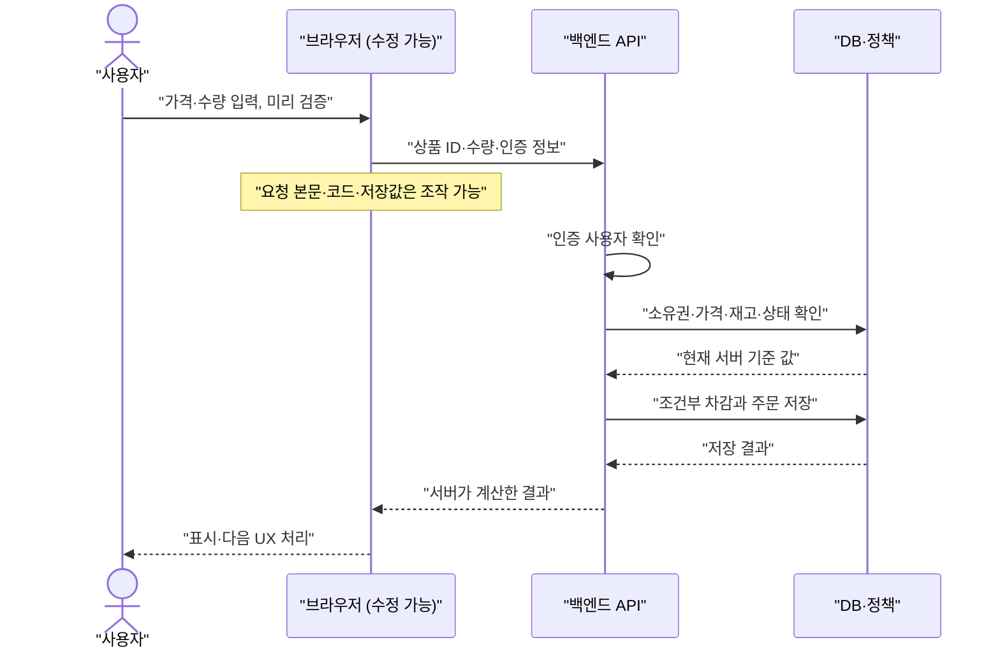

# W13. 프론트와 백엔드의 경계 — 무엇을 서버에서만 해야 하나

> 브라우저 코드와 요청은 사용자가 바꿀 수 있으므로, 화면의 결과를 서버가 사실로 믿으면 안 된다.
> 권한·가격·재고·업무 규칙의 최종 판정은 서버에서 하고, 프론트는 빠른 안내와 임시 표시를 맡는다.
> 기본값은 브라우저를 신뢰하지 않는 서버 중심 규칙, 필요한 곳에만 CSR·SSR·BFF를 섞는 구조다.

## 1. 질문

- 상품 페이지에서 `수량 1~5` 입력 검사를 넣고 출시했는데, 개발자 도구에서 요청 JSON의 `quantity`를 `500`으로 바꿔 대량 주문이 들어왔다. 프론트 검증을 했는데 왜 막히지 않았을까?
- 관리자 화면에서 버튼을 숨겼는데 일반 계정이 `/api/admin/users/42`를 직접 호출해 데이터를 읽었다. 버튼이 안 보인다는 사실은 접근 권한을 뜻하지 않는다.
- SPA로 만든 뒤 최초 진입은 느리고, 화면마다 비슷한 API를 여러 번 불러 네트워크가 낭비된다. 서버 렌더링으로 바꿔야 하나, BFF를 추가해야 하나?

셋 다 “누가 값을 정하고, 결정을 강제하는가?”라는 질문이다. 경계는 코드 파일이나 팀이 아니라 데이터와 행위를 통제할 수 있는 위치로 정한다.

## 2. 짧은 답

- 사용자는 브라우저의 HTML·JavaScript·저장값·전송 요청을 읽고 수정할 수 있다고 가정한다.
- 권한 확인, 소유권, 가격·할인, 재고 차감, 결제 상태, 비밀 키, 입력의 최종 허용 여부는 서버가 계산하고 강제한다.
- 프론트는 표시, 즉각적인 폼 피드백, 사용자가 아직 저장하지 않은 임시 상태, 보기 좋게 만든 오류 메시지를 맡는다.
- 같은 규칙을 양쪽에 두어도 된다. 프론트 검증은 사용성, 서버 검증은 신뢰 경계라는 서로 다른 목적이다.
- 페이지 최초 HTML이나 검색 노출이 중요하면 SSR을, 앱 내부의 풍부한 상호작용에는 CSR을 검토하고, 혼합도 가능하다.
- 서버 세션이나 토큰 중 하나가 무조건 정답은 아니다. 브라우저에 장기 권한 토큰을 보관해야 하는지부터 따진다.
- **기본값 추천:** 브라우저 입력을 모두 비신뢰값으로 받고, 인증된 사용자와 서버 데이터로 매 요청마다 권한·업무 규칙을 판정한다.

## 3. 왜 그런가 — 원리

### 브라우저는 사용자 영역이다

브라우저가 내려받은 JavaScript는 사용자의 기기에서 실행된다. 사용자는 개발자 도구에서 코드를 바꾸거나 실행을 멈출 수 있고, DOM의 `disabled`를 지울 수 있으며, `localStorage` 값을 고칠 수 있다. Network 패널에서 요청을 복사해 경로·헤더·본문을 바꾸고 다시 보낼 수도 있다. `curl`, API 클라이언트, 다른 프로그램에서 서버를 직접 호출할 수도 있다. HTTPS는 전송 중 도청·변조를 줄일 뿐, 요청을 만든 사용자나 브라우저 내부 코드를 신뢰할 근거가 되지 않는다.

로컬 또는 허가된 테스트 계정으로 주문을 한 번 보내고, 개발자 도구 → Network에서 요청을 복제해 `quantity`, `price`, `role`, `userId`를 바꿔 보라. 서버가 바뀐 값으로 상태를 저장하면 규칙을 프론트에만 둔 것이다. 권한 없는 계정에서 다른 리소스 ID를 넣어도 같은 원리로 확인할 수 있다.

서버가 받아야 할 값은 “사용자가 원하는 작업”에 필요한 최소한의 명령이다. 주문 요청은 상품 ID와 수량을 받을 수 있지만, 브라우저가 보낸 가격이나 `isAdmin`을 진실로 취급해서는 안 된다. 서버는 세션 또는 검증된 인증 정보에서 사용자를 알아내고, 데이터베이스의 상품 가격·판매 가능 여부·주문 소유권과 현재 정책을 조회한다. 사용자가 준 ID는 조회의 단서이지 권한 증명이 아니다. 매 요청에 권한 판정을 적용하지 않으면 URL의 숫자 하나를 바꾼 수평 권한 상승(IDOR)이 발생한다.

### 검증을 중복하는 이유

클라이언트 검증은 왕복 전에 “수량은 1 이상이어야 합니다”라고 알려 사용자가 고치는 비용을 줄인다. HTML `required`, `min`, JavaScript 검사는 지워지거나 건너뛸 수 있으므로 보안 검증을 대체하지 못한다. MDN도 서버가 폼 데이터에 대해 보안 검사를 포함한 검증을 다시 수행해야 한다고 명시한다. 서버는 타입·범위·형식뿐 아니라 로그인, 리소스 소유권, 현재 상태, 업무 규칙, 동시 변경 가능성까지 확인해야 한다.

특히 단가를 클라이언트에서 계산해 전송하는 구조는 위험하다. 가격은 서버의 현재 상품·쿠폰·세금 규칙으로 다시 계산한다. 재고도 화면에 표시했던 수량을 믿지 말고 차감 시점에 원자적으로 확인해야 한다. “조회할 때 1개 남음”과 “주문 저장 때 1개 남음” 사이에 다른 주문이 들어올 수 있기 때문이다. 검증 후 저장까지 하나의 트랜잭션이나 조건부 갱신으로 묶지 않으면 TOCTOU 경쟁 조건이 남는다. 프론트의 예상 합계는 안내용이고, 서버가 계산한 결제 금액이 최종값이다.

### 렌더링 위치와 API 경계

SSR(Server-Side Rendering)은 서버가 요청 시 HTML을 만들어 내려준다. CSR(Client-Side Rendering)은 브라우저 JavaScript가 받은 데이터로 화면을 구성한다. 렌더링 위치가 바뀌어도 권한 원칙은 바뀌지 않는다. SSR로 그린 관리자 메뉴를 사용자별로 감추더라도 API는 매번 권한을 확인해야 한다. CSR 앱 역시 비밀키를 번들에 넣을 수 없다. 브라우저로 전송한 값은 결국 사용자가 볼 수 있다.

SSR은 첫 HTML·검색 유입에 유리할 수 있지만 렌더링 비용과 개인화 캐시 관리가 생긴다. CSR은 상호작용과 부분 갱신에 편리할 수 있지만 초기 JavaScript와 API 의존성이 커진다. MDN은 둘을 함께 쓸 수 있다고 설명한다. 공개 상품 설명은 SSR/정적 캐시, 개인 주문은 인증 API로 제공하는 식이다.



### CORS가 생긴 자리

동일 출처 정책은 한 출처의 스크립트가 다른 출처 응답을 읽지 못하게 한다. 출처는 scheme·host·port 조합이다. `shop.example.com`의 프론트에서 `api.example.com`을 호출하면 교차 출처 요청이다. CORS는 응답 허용 출처를 보고 브라우저가 프론트 코드에 결과를 공개할지 정하며, 필요한 경우 preflight `OPTIONS`로 메서드·헤더를 확인한다.

CORS는 로그인·권한 검사가 아니다. 응답을 읽지 못해도 요청은 서버에 도달할 수 있고, 단순 요청은 전송될 수 있다. 따라서 CORS 허용만으로 CSRF를 막았다고 착각하지 말고 서버에서 인증·권한·CSRF 정책을 적용한다. 세부 내용은 D11 참조.

### 상태와 비밀값의 위치

화면에서만 필요한 모달 열림 여부·입력 중 폼 값·정렬 선택은 프론트 상태다. 브라우저 재시작 뒤에도 남길 사용자 선호는 `localStorage`가 편하지만, 같은 출처의 JavaScript가 읽을 수 있으므로 세션 식별자·비밀번호·장기 bearer token·결제 비밀값을 넣지 않는다. XSS가 발생하면 공격 스크립트가 이런 저장값을 읽을 수 있다. OWASP는 브라우저 저장소도 신뢰하지 않는 입력으로 다루라고 권한다.

서버 세션은 브라우저가 불투명한 세션 ID 쿠키를 보내고, 실제 로그인 상태와 권한은 서버가 보관한다. 쿠키에 `HttpOnly`를 설정하면 JavaScript의 `document.cookie`에서 값을 읽을 수 없고, `Secure`는 HTTPS 전송을 제한하며, `SameSite`는 교차 사이트 요청에 쿠키를 붙일 조건을 좁힌다. `HttpOnly`는 쿠키 값 탈취를 어렵게 할 뿐, XSS 스크립트가 로그인된 사용자의 요청을 대신 보내는 것까지 막지는 않는다. 자동 첨부되는 쿠키 인증에는 CSRF 방어도 고려해야 한다.

브라우저 저장 토큰 방식은 서버 세션 저장소 없이 확장하기 쉬운 경우가 있지만, 토큰을 브라우저에 노출하는 설계 위험과 만료·회수·저장 위치를 다뤄야 한다. BFF(Backend for Frontend)는 SPA와 OAuth 제공자/API 사이에 프론트 전용 서버를 두고 토큰을 대신 관리하며, 브라우저에는 서버 세션 쿠키만 노출하는 구조다. 토큰을 JavaScript에서 감출 수 있는 대신 서버 한 홉, 세션 운영, CSRF 방어, 배포·가용성 비용이 늘어난다. 모든 앱에 BFF가 필요한 것은 아니며, 민감한 토큰 보관과 여러 백엔드 조합 문제가 실제로 있을 때 선택한다.

## 4. 선택지 비교

| 선택지 | 어떻게 동작 | 장점 | 단점 | 언제 쓰나 | 국내 실무에서 흔한가(근거 있으면) |
|---|---|---|---|---|---|
| CSR + API 직접 호출 | 브라우저가 SPA를 실행하고 API를 요청 | 화면 상호작용·부분 갱신이 단순하고 프론트 배포를 분리하기 쉽다 | 초기 JS/API 의존, 브라우저 토큰 관리, CORS 설정 부담 | 로그인 뒤 앱, 관리 화면, 상호작용 중심 화면 | SPA/API 조합은 흔하지만 국내 빈도를 뒷받침할 이 문서 범위의 통계는 없음 |
| SSR | 서버가 요청 시 HTML을 만들어 보낸다 | 첫 화면에 내용을 담고 초기 JS 실패에도 읽을 수 있는 영역을 제공 | 렌더 서버 비용, 개인화 응답 캐시 주의, 프론트 런타임이 서버에도 필요 | 공개 콘텐츠·검색 유입·첫 화면 속도가 중요한 페이지 | 공식 통계 근거 미확인 |
| 하이브리드 | 공개 화면은 SSR/정적 생성, 상호작용은 CSR/API | 첫 응답과 앱 경험을 절충하고 페이지별 선택이 가능 | 캐시·데이터 로딩·수화 오류 등 경계가 늘어남 | 공개 상품/콘텐츠와 로그인 후 기능이 함께 있는 서비스 | 공식 통계 근거 미확인 |
| BFF | 프론트 전용 서버가 토큰·세션을 관리하고 API를 조합 | 토큰을 브라우저 JS에서 분리하고 프론트별 응답 구성 가능 | 서버 홉·운영 컴포넌트·세션/CSRF 관리가 추가됨 | SPA에서 민감한 OAuth 토큰을 숨겨야 하거나 여러 API 조합이 복잡할 때 | 보편성 수치는 미확인; 필요에 따라 채택하는 패턴 |
| 서버 세션 + HttpOnly 쿠키 | 브라우저는 세션 ID를 자동 전송하고 서버가 상태를 조회 | 권한·로그아웃·세션 회수를 서버에서 관리, JS의 쿠키 읽기 제한 | 세션 저장소와 다중 인스턴스 공유, CSRF 고려 필요 | 동일 사이트 웹 서비스나 BFF의 브라우저 인증 | 한국 특정 산업의 점유 통계는 미확인 |

SSR·CSR는 “권한 판단을 어디서 하느냐”의 선택지가 아니다. HTML을 어느 곳에서 생성할지 선택할 뿐, 서버 API는 여전히 권한을 집행한다. 세션·토큰도 렌더링 방식과 별개로 선택한다. 반대로 BFF는 렌더러라기보다 브라우저와 여러 API 사이의 전용 중개 서버이므로 CSR과 함께 사용할 수 있다.

## 5. 코드로 보기

같은 구매 기능을 기준으로 보면 경계가 선명하다. 아래 첫 구현은 보기 편해도 서버가 금액을 믿으면 안 되는 잘못된 계약이다. 이어지는 Spring 코드는 요청에 가격을 받지 않고 인증 사용자와 서버 상품 데이터로 금액을 계산한다. 저장소 인터페이스의 실제 구현은 프로젝트의 DB에 맞춘다. Spring 예제는 Spring Boot 4.1 / Spring Framework 7 기준이며 미실행이다.

### 잘못된 나눔: 브라우저가 계산한 금액을 서버가 믿음

```javascript
// 브라우저에 전달된 가격은 수정 가능하다.
const unitPrice = 10_000;
const quantity = Number(document.querySelector("#quantity").value);
const total = unitPrice * quantity;

await fetch("https://api.example.com/api/orders", {
  method: "POST",
  headers: { "Content-Type": "application/json" },
  body: JSON.stringify({ productId: 17, quantity, totalAmount: total })
});
```

Network에서 본문을 `{ "productId": 17, "quantity": 1, "totalAmount": 1 }`로 바꿔 재전송해도 서버가 결제 금액으로 저장한다면, 클라이언트 계산이 업무 규칙이 된 것이다. “화면에서 가격 필드를 숨겼다”거나 “React 상태에 가격이 있다”는 방어가 아니다.

### 바로잡기: 요청은 명령, 값은 서버 데이터로 재계산

```java
import java.math.BigDecimal;
import java.security.Principal;
import java.util.Optional;

import org.springframework.http.HttpStatus;
import org.springframework.stereotype.Service;
import org.springframework.transaction.annotation.Transactional;
import org.springframework.web.bind.annotation.PostMapping;
import org.springframework.web.bind.annotation.RequestBody;
import org.springframework.web.bind.annotation.RequestMapping;
import org.springframework.web.bind.annotation.RestController;
import org.springframework.web.server.ResponseStatusException;

record CreateOrderRequest(long productId, int quantity) {}
record Product(long id, BigDecimal unitPrice) {}
record OrderReceipt(long id, String buyer, long productId,
                    int quantity, BigDecimal total) {}

interface ProductCatalog {
    Optional<Product> findPurchasable(long productId);
}

interface OrderStore {
    OrderReceipt save(String buyer, Product product, int quantity, BigDecimal total);
}

@Service
class OrderService {
    private final ProductCatalog products;
    private final OrderStore orders;

    OrderService(ProductCatalog products, OrderStore orders) {
        this.products = products;
        this.orders = orders;
    }

    @Transactional
    OrderReceipt create(String buyer, CreateOrderRequest request) {
        if (request.quantity() < 1 || request.quantity() > 20) {
            throw new ResponseStatusException(HttpStatus.BAD_REQUEST, "수량 오류");
        }
        Product product = products.findPurchasable(request.productId())
            .orElseThrow(() -> new ResponseStatusException(
                HttpStatus.NOT_FOUND, "상품을 찾을 수 없음"));
        BigDecimal total = product.unitPrice()
            .multiply(BigDecimal.valueOf(request.quantity()));
        return orders.save(buyer, product, request.quantity(), total);
    }
}

@RestController
@RequestMapping("/api/orders")
class OrderController {
    private final OrderService service;

    OrderController(OrderService service) {
        this.service = service;
    }

    @PostMapping
    OrderReceipt create(Principal principal, @RequestBody CreateOrderRequest request) {
        if (principal == null) {
            throw new ResponseStatusException(HttpStatus.UNAUTHORIZED, "로그인 필요");
        }
        return service.create(principal.getName(), request);
    }
}
```

`ProductCatalog`와 `OrderStore`는 프로젝트의 JPA/JDBC 어댑터를 Spring Bean으로 연결하는 포트다. 인증 사용자의 `Principal`을 기준으로 저장하고 본문에 `buyer`를 받지 않아 다른 사용자를 사칭할 필드를 없앴다. 실제 주문에서는 판매 가능 여부뿐 아니라 사용자별 구매 권한·쿠폰·세금·재고를 서버에서 확인한다. 재고는 `SELECT` 후 단순 차감만 해서는 동시 주문을 막지 못한다. DB 조건부 갱신(예: `stock >= :quantity`일 때만 차감)이나 적절한 잠금과 주문 저장을 트랜잭션으로 묶고, 영향 행 수가 0이면 품절로 처리한다. 가격 변경과 결제 시점 규칙은 도메인에 맞게 스냅샷·재검증 정책을 정한다.

### 빠른 UX와 최종 검증은 역할이 다르다

프론트도 같은 수량 범위와 필수 입력을 검사해 즉시 안내한다. API 서버도 같은 조건을 검증하고, 그보다 큰 권한·상태 조건을 판정한다. 프론트 문구를 고치려고 서버 규칙을 약하게 만들지 않는다. 서버는 오류 코드와 구조화된 필드 오류를 반환하고, 프론트는 사용자가 수정할 위치에 메시지를 표시한다. 검증 계층의 상세 비교는 W10 참조.

### 출처 제한 CORS 설정 예

```java
import org.springframework.context.annotation.Configuration;
import org.springframework.web.servlet.config.annotation.CorsRegistry;
import org.springframework.web.servlet.config.annotation.WebMvcConfigurer;

@Configuration
class ApiCorsConfiguration implements WebMvcConfigurer {
    @Override
    public void addCorsMappings(CorsRegistry registry) {
        registry.addMapping("/api/**")
            .allowedOrigins("https://shop.example.com")
            .allowedMethods("GET", "POST", "PUT", "DELETE")
            .allowedHeaders("Content-Type", "X-CSRF-TOKEN")
            .allowCredentials(true)
            .maxAge(3600);
    }
}
```

이는 브라우저가 지정된 프론트 출처에서 응답을 읽도록 허용하는 예다. 자격 증명을 허용할 때 `*`를 출처로 열어 두지 말고 실제 출처를 명시한다. Spring Security를 함께 쓰면 CORS 설정이 보안 필터 앞에서 처리되도록 Security 설정과 연동해야 한다. 위 설정만으로 인증·인가·CSRF가 해결되지는 않는다. REST 경로와 리소스 표현 자체는 S06 참조.

## 6. 실무에서는 실제로

- **신규 서비스:** 공개 랜딩·상품 설명은 SSR 또는 정적 제공, 로그인 후 조작이 많은 주문·관리 화면은 CSR로 시작해도 된다. 공통 기준은 모든 쓰기 API에서 인증, 역할, 리소스 소유권, 현재 상태를 확인하는 것이다. 서버 가격과 재고를 기준값으로 두고 프론트에는 필요한 표시 데이터를 내려준다.
- **레거시:** 버튼 숨김, 화면별 권한 분기, 요청 가격 수용부터 검색한다. API마다 로그인만 검사하고 리소스 주인을 검사하지 않는 경로도 확인한다. 우선 금전·개인정보·관리 작업의 서버 판정을 바로잡고, 다음에 응답 DTO와 렌더링을 바꾼다. 프론트 전체 재작성 없이도 서버에서 안전한 경계를 회복할 수 있다.
- **SI·금융:** 기존 세션·게이트웨이·사내 인증과 감사 로그를 존중하고 각 API에서 서버 간 권한도 확인한다. BFF를 넣으면 인증 전파, 로그 마스킹, 세션 저장소 장애 복구까지 설계한다. 업계 보편성 수치는 확인하지 않았다.
- **스타트업:** 작은 서비스는 하나의 백엔드가 API와 업무 규칙을 맡는 편이 운영 요소가 적다. 웹·모바일 API가 갈라지거나 OAuth 토큰 노출 문제가 커지면 추가 서버를 운영할 이유가 있는지 따져 BFF를 검토한다.
- **혼합과 이전:** API의 가격·권한 판정을 먼저 서버로 옮긴 뒤, 공개 페이지를 SSR로 전환하거나 민감 토큰을 BFF/세션으로 단계 이전한다. 프론트·백엔드를 한 번에 재작성할 필요는 없다.

국내에서 SSR·CSR·BFF 중 무엇이 다수인지는 출처로 확인하지 못했으므로 단정하지 않는다. 회사의 인증·배포·프론트 인력 구성이 패턴 선택에 더 직접적인 제약이다.

## 7. 흔한 오해와 실수

1. **“버튼을 숨겼으니 접근할 수 없다” →** 숨김은 표시 규칙이다. API ID를 직접 바꾸면 호출될 수 있다. **대처:** 서버에서 역할과 대상 리소스의 소유권을 모든 경로마다 확인하고, 허용하지 않으면 거부한다.
2. **“프론트 검증을 했으니 안전하다” →** HTML 검증 속성을 끄거나 JSON을 직접 보내면 우회한다. **대처:** 프론트는 안내, 서버는 보안 포함 최종 검증으로 역할을 나눈다.
3. **“가격·할인은 화면이 계산한 대로 저장하면 된다” →** 번들 상수, 쿠폰 ID, 할인율을 조작할 수 있고 가격은 서버 데이터다. **대처:** 요청에는 상품·쿠폰 식별자와 수량만 받고 현재 서버 정책으로 합계를 재계산한다.
4. **“리소스 ID를 알기 어렵게 만들면 권한이 보호된다” →** 순차 ID가 UUID가 되어도 다른 사람 데이터에 대한 권한 검사는 별개다. **대처:** 조회 조건에 인증 사용자/테넌트를 포함하거나 소유권 정책을 검증한다. 필요하면 존재 여부 노출을 줄이는 응답 정책을 쓴다.
5. **“CORS가 막았으니 서버는 공격 요청을 안 받는다” →** CORS는 브라우저의 응답 공개를 통제한다. 다른 클라이언트는 CORS를 적용받지 않고, 단순 교차 출처 요청은 전송될 수 있다. **대처:** 서버 인증·인가와 CSRF 방어를 따로 적용한다.
6. **“localStorage는 내 도메인이니 비밀 보관소다” →** 동일 출처 JavaScript와 XSS가 읽을 수 있고 사용자가 직접 수정할 수 있다. **대처:** 민감 토큰을 두지 않는다. 세션 쿠키를 쓰면 `HttpOnly`, `Secure`, 적절한 `SameSite`를 설정하고 CSRF 위험도 검토한다.
7. **“SSR이면 HTML을 서버가 만들었으니 안전하다” →** HTML 응답은 사용자 화면의 초기 표현이다. API 호출 권한을 대신하지 않는다. **대처:** SSR 데이터 로더와 실제 변경 API 모두 사용자별 접근 정책을 확인한다. 개인화 응답의 CDN 캐시 키·`Cache-Control`도 점검한다.
8. **“JWT를 쓰면 서버 권한 검사는 필요 없다” →** 서명된 토큰은 발급 시점의 주장과 유효성 정보를 담을 뿐, 대상 리소스의 현재 소유자·상태를 자동 확인하지 않는다. **대처:** 토큰 검증 후에도 업무 API에서 대상 리소스와 현재 정책을 확인한다. 토큰에 비밀을 넣지 않는다.

## 8. 자가점검 Q&A (면접 대비)

### Q1. 프론트 검증과 서버 검증을 둘 다 하는 이유는?

프론트는 오류를 빠르게 알려 입력 왕복을 줄이고, 서버는 조작된 클라이언트 요청을 거부한다. 목적이 달라 중복은 낭비가 아니다. 서버가 마지막 신뢰 경계다.

**꼬리질문:** 프론트 규칙만 업데이트가 늦으면? **답:** 서버는 오래된 클라이언트도 안전하게 거부하고, 프론트는 서버의 구조화된 오류를 표시한다.

### Q2. 관리자 메뉴를 숨긴 것과 API 권한 검사의 차이는?

숨김은 사용자가 보는 UI만 바꾼다. API 권한 검사는 서버가 요청의 인증 사용자와 행위·대상 리소스를 확인해 실제 데이터 반환이나 변경을 허용한다. 클라이언트 화면은 복사·수정·우회할 수 있다.

**꼬리질문:** URL ID를 UUID로 바꾸면 충분한가? **답:** 아니다. 추측이 어려워질 뿐 소유권 검증을 대체하지 않는다.

### Q3. 프론트가 보낸 `totalAmount`를 서버가 그대로 써도 되는 경우가 있는가?

결제·주문처럼 돈에 영향을 주는 최종 금액은 서버 기준 상품과 정책으로 다시 계산해야 한다. 클라이언트 금액은 미리보기나 견적 표시로만 쓴다. 일회용 견적 토큰을 쓴다면 서버가 발급·서명하고 만료와 대상 주문을 검증해야 한다.

**꼬리질문:** 프론트 계산은 그럼 왜 하는가? **답:** 즉시 합계를 보여 UX를 높이되, 저장·결제 직전 최종값은 서버와 맞춘다.

### Q4. CORS는 인증인가, 방화벽인가?

아니다. 브라우저가 교차 출처 응답을 스크립트에 공개할지 결정하는 정책이다. CORS를 거치지 않는 API 클라이언트도 있고, 허용된 출처가 곧 로그인 사용자를 뜻하지 않는다.

**꼬리질문:** 쿠키를 쓰는 API면 무엇을 더 보나? **답:** 허용 출처와 자격 증명 설정 외에 CSRF 방어, SameSite, 인증·인가를 각각 확인한다.

### Q5. SSR이면 백엔드 API 권한 판정을 줄일 수 있는가?

아니다. SSR은 HTML 생성 위치를 정한다. 화면에서 링크나 데이터를 감추더라도 직접 API를 호출할 수 있으므로 각 API가 동일한 사용자·리소스 권한을 확인해야 한다.

**꼬리질문:** SSR을 선택할 실익은? **답:** 공개 또는 초기 콘텐츠를 첫 HTML에 담아 초기 표시·크롤링에 유리한 경우가 있다. 서버 렌더 비용과 캐시 설계를 함께 비교한다.

### Q6. `HttpOnly` 쿠키가 XSS를 완전히 막는가?

쿠키 값을 JavaScript가 읽는 것을 제한해 세션 ID 탈취를 어렵게 한다. 그러나 XSS가 발생하면 스크립트가 사용자를 대신해 요청을 보내는 것은 가능하다. 따라서 출력 인코딩·CSP 등 XSS 대책도 필요하다.

**꼬리질문:** 쿠키에 `SameSite`가 있으면 CSRF 방어는 끝인가? **답:** 방어 심층으로 도움은 되지만 서비스의 교차 사이트 흐름·브라우저 동작을 고려해 CSRF 토큰이나 Origin 검증 등 정책도 평가한다.

### Q7. BFF는 모든 SPA에 도입해야 하나?

아니다. 토큰을 브라우저에서 다뤄야 하는 위험이나 웹·모바일별 API 조합 요구가 운영 비용보다 클 때 검토한다. BFF는 서버 홉과 세션 관리, CSRF 대응을 추가하므로 단일 API를 호출하는 작은 앱에는 과할 수 있다.

**꼬리질문:** BFF를 두면 API 권한 검사는 어디서 하나? **답:** BFF가 인증을 전달하거나 자체 정책을 적용해도 최종 데이터 API는 자신의 권한 경계를 지켜야 한다.

### Q8. 서버에서 권한을 확인하고 재고를 읽은 뒤 차감하면 충분한가?

두 작업 사이에 다른 요청이 같은 재고를 차감할 수 있다. 조회 시점 검증만으로 경쟁 조건을 막지 못한다. 조건부 원자 갱신이나 적절한 잠금·트랜잭션으로 재고 차감과 주문 기록을 일관되게 처리한다.

**꼬리질문:** 실패 응답을 프론트가 보냈던 화면 상태에 적용하면? **답:** 오래된 표시를 믿지 말고 서버의 현재 재고·주문 상태를 다시 읽어 사용자에게 알려야 한다.

## 9. 참고문헌

- Security — https://developer.mozilla.org/en-US/docs/Web/Security — 브라우저 보안의 기본 실천, 쿠키 제한, 교차 출처 요청 통제를 확인했다.
- Cross-Origin Resource Sharing (CORS) — https://developer.mozilla.org/en-US/docs/Web/HTTP/Guides/CORS — 동일 출처 정책, preflight, 허용 출처 헤더의 동작을 확인했다.
- Client-side form validation — https://developer.mozilla.org/en-US/docs/Learn_web_development/Extensions/Forms/Form_validation — 클라이언트 검증 우회 가능성과 서버 재검증 필요성을 확인했다.
- Web Frontend Security — https://cheatsheetseries.owasp.org/cheatsheets/Web_Frontend_Security_Cheat_Sheet.html — 브라우저 저장소를 포함한 클라이언트 데이터를 비신뢰 입력으로 다루는 원칙을 확인했다.
- Session Management — https://cheatsheetseries.owasp.org/cheatsheets/Session_Management_Cheat_Sheet.html — `HttpOnly`의 한계와 `SameSite` 쿠키 동작을 확인했다.
- Set-Cookie header — https://developer.mozilla.org/en-US/docs/Web/HTTP/Headers/Set-Cookie — `HttpOnly`, `Secure`, `SameSite` 속성을 확인했다.
- Server-side rendering (SSR) — https://developer.mozilla.org/en-US/docs/Glossary/SSR — SSR의 정의와 초기 콘텐츠 장점을 확인했다.
- Client-side rendering (CSR) — https://developer.mozilla.org/en-US/docs/Glossary/CSR — CSR의 정의와 SSR과 혼합 가능한 점을 확인했다.
- REST Security — https://cheatsheetseries.owasp.org/cheatsheets/REST_Security_Cheat_Sheet.html — 비공개 REST 엔드포인트마다 접근 통제를 수행해야 함을 확인했다.
- The Backend for Frontend Pattern (BFF) — https://auth0.com/blog/the-backend-for-frontend-pattern-bff/ — BFF에서 백엔드가 SPA를 대신해 OAuth 토큰을 관리하는 흐름을 확인했다.

보안 기초→D11, 검증 계층 비교→W10, REST API 설계→S06 참조.
