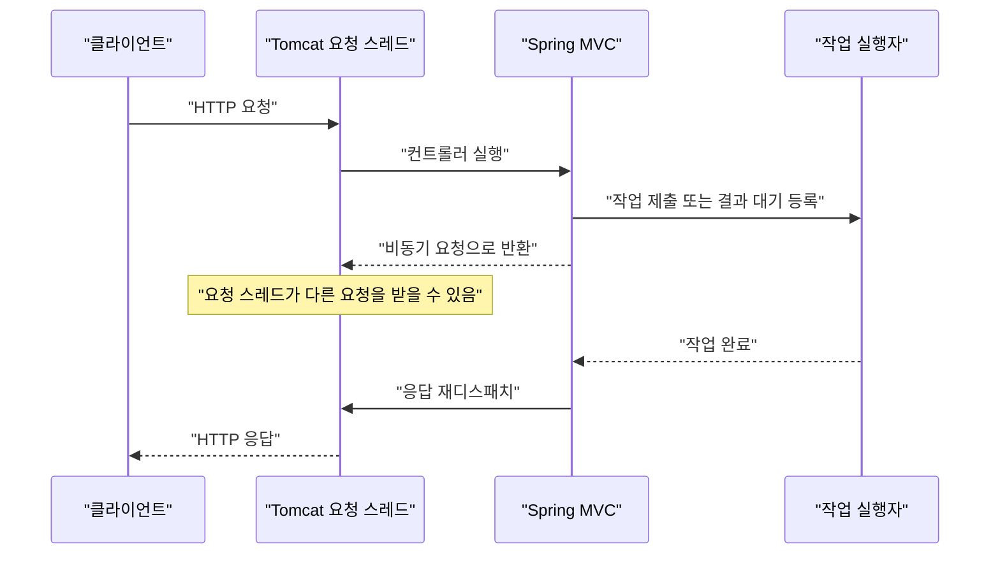
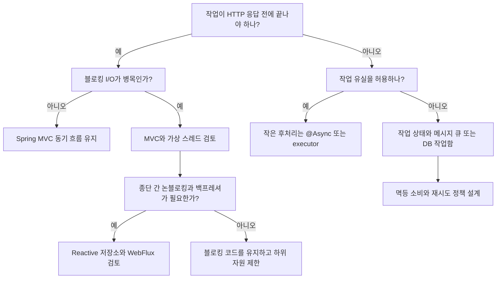

# W14. 동기 vs 비동기, 블로킹 vs 논블로킹 — 백엔드에서 언제

> 동기/비동기는 결과를 누가 어떻게 이어 받는지, 블로킹/논블로킹은 호출한 스레드가 기다리는지를 가리킨다.
> 비동기로 바꾸면 응답 지연은 줄 수 있지만 작업 실패·순서·재시도·관측 문제를 직접 설계해야 한다.
> 기본 추천은 익숙한 Spring MVC의 동기 흐름이다. I/O 대기 스레드가 병목이면 가상 스레드, 응답을 먼저 끝내야 하면 작업 큐를 검토한다.

## 1. 질문

1. 신입이 만든 `POST /report`가 DB 조회와 외부 API 호출을 순서대로 한 뒤 결과를 준다. 사용자는 8초를 기다리고, 동시 요청이 늘자 Tomcat 요청 스레드가 모두 바빠진다. “WebFlux로 바꾸면 8초가 사라질까?”라는 질문이 나온다. 비차단은 기다리는 스레드의 점유를 줄이지, 외부 서비스의 8초 처리 시간을 없애지 않는다.
2. 메일 발송에 `@Async`를 붙이자 API는 빨라졌지만, DB 트랜잭션이 롤백된 사용자에게 메일이 가거나 발송 오류가 로그에만 남는다. HTTP 응답의 완료와 실제 작업의 완료가 분리된 결과다.
3. 같은 상황에서 팀원이 `CompletableFuture`, Kafka, 가상 스레드, `@Scheduled`를 각각 추천한다. 이름은 모두 “비동기”처럼 들리지만, 작업을 다른 스레드로 옮기는 도구, 네트워크 대기를 겹치는 모델, 프로세스가 죽어도 남는 큐, 정해진 시각에 시작하는 스케줄러는 서로 대체재가 아니다.

## 2. 짧은 답

- **동기/비동기**는 작업 결과를 현재 흐름에서 바로 받는지, 나중에 완료 통지·콜백·Future로 이어 받는지다.
- **블로킹/논블로킹**은 호출한 스레드가 결과가 준비될 때까지 멈추는지, 즉시 제어권을 돌려받는지다.
- 두 축은 독립이다. `Future.get()`은 비동기 작업 결과를 동기적으로 기다리며 호출 스레드를 블로킹한다.
- “API가 빨라야 한다”만으로 `@Async`를 붙이지 않는다. 응답 완료를 늦추는 계산인지, 연결·스레드 고갈인지 먼저 잰다.
- 일반 CRUD는 Spring MVC의 직선적인 동기 코드부터 시작한다. 높은 동시성의 블로킹 I/O가 실제 병목이면 Java 21+ 가상 스레드를 우선 검토한다.
- 응답을 작업 완료 전에 보내야 하면 작업 상태와 실패 처리가 필요하다. 유실돼도 되는 짧은 후처리는 `@Async`, 유실되면 안 되는 작업은 DB 작업함/아웃박스와 메시지 브로커를 선택한다.
- WebFlux는 종단 간 논블로킹 I/O와 백프레셔가 필요한 경우에 고른다. MVC에 블로킹 JPA를 끼워 넣으면 목적을 잃는다.

## 3. 왜 그런가 — 원리

### 네 용어는 호출자 관점에서 나눈다

동기 호출은 현재 흐름에서 결과를 받고, 비동기는 완료 신호를 나중에 처리한다. 블로킹 호출은 결과를 기다리며 스레드를 점유하고, 논블로킹 호출은 준비되지 않아도 곧 돌아온다. “비동기”라는 이름만으로 내부 I/O가 논블로킹이라 단정할 수 없다.

| 조합 | 의미 | 예 |
|---|---|---|
| 동기 + 블로킹 | 결과가 올 때까지 현재 스레드가 기다린다 | MVC 컨트롤러에서 JDBC `query()` 호출 |
| 동기 + 논블로킹 | 호출은 즉시 돌아오고 현재 흐름이 준비 여부를 확인한다 | `SocketChannel` 논블로킹 모드의 `read()`가 데이터가 없을 때 반환; 반복 확인은 바쁜 대기가 될 수 있다 |
| 비동기 + 블로킹 | 작업은 다른 흐름에서 진행되지만, 현재 호출은 별도로 기다릴 수 있다 | `CompletableFuture.supplyAsync(...).get()`; 작업은 executor에서, `get()`을 부른 요청 스레드는 완료까지 대기 |
| 비동기 + 논블로킹 | 준비된 I/O 이벤트를 통지받아 이어서 처리하며 호출 스레드를 점유하지 않는다 | Reactor 기반 WebFlux와 논블로킹 드라이버 |

`CompletableFuture` 안의 JDBC도 작업 스레드를 블로킹한다. API 이름이 아니라 완료 흐름과 호출 스레드의 동작으로 구분한다.

### MVC 요청 스레드가 막히는 순간

Spring MVC의 동기 요청은 컨테이너 스레드에서 `DispatcherServlet`과 컨트롤러를 실행한다. JDBC·동기 HTTP·파일 I/O가 블로킹되면 결과까지 요청 스레드를 점유한다. Tomcat 작업 스레드가 모두 대기하면 신규 요청 처리량이 줄고, 스레드를 늘려도 DB 풀·원격 서비스 제한이 먼저 병목일 수 있다.

`DeferredResult`는 Servlet `startAsync()`로 요청 스레드를 반환하고, 결과 설정 후 재디스패치한다. **작업 스레드를 만들지는 않으므로** 외부 이벤트 등에서 결과를 설정해야 한다. `Callable`은 Spring executor에 맡긴다. [4]



위 흐름은 HTTP 응답을 작업 완료 후 보내는 요청 비동기 처리다. `@Async` 작업을 시작하고 곧바로 202를 보내는 “요청 수락 후 나중에 처리”와는 의미가 다르다. 뒤의 패턴은 작업 결과를 현재 HTTP 응답에서 기다리지 않으므로 별도의 상태 조회나 완료 알림 API가 필요하다.

### 논블로킹과 가상 스레드가 해결하는 비용

블로킹 MVC는 순차 코드와 자연스러운 예외 흐름을 주지만 I/O 대기 중 요청 스레드를 점유한다. WebFlux는 이벤트 루프와 Reactor가 I/O 완료 시 이어서 처리하므로, DB·HTTP 클라이언트도 논블로킹이어야 이점을 얻는다. 이벤트 루프에서 동기 JPA를 실행하면 다른 연결도 지연된다. 빠른 생산자가 느린 소비자를 압도하지 않도록 백프레셔·버퍼·거부 정책도 필요하다. [2]

가상 스레드는 동기·블로킹 코드로 대기 작업을 많이 표현한다. JDK가 가상 스레드를 플랫폼 스레드 위에서 스케줄하고, 지원되는 블로킹에서 대기 중이면 carrier를 다른 작업에 내어 줄 수 있다. thread-per-request 흐름과 I/O 동시성을 유지하지만 CPU 계산량은 줄지 않고 DB·원격 API 제한도 그대로다. Java 21 정식 기능이며, Java 24 JEP 491은 `synchronized` 대기 시 pinning을 대부분 개선했다. [3][8]



## 4. 선택지 비교

| 선택지 | 어떻게 동작 | 장점 | 단점 | 언제 쓰나 | 국내 실무에서 흔한가 |
|---|---|---|---|---|---|
| MVC 동기 + 블로킹 I/O | 요청 스레드가 DB·원격 호출을 기다림 | 코드·트랜잭션 흐름이 단순 | 대기 중 스레드 점유 | 일반 CRUD | Spring MVC의 기본 명령형 모델; 국내 비율 미확인 |
| MVC 비동기 응답 (`Callable`, `DeferredResult`, `CompletableFuture`) | Servlet 요청을 중단하고 완료 때 재디스패치 | 요청 스레드를 반환하면서 같은 응답을 기다림 | executor·timeout·문맥 관리 | 응답은 최종 결과를 기다리는 느린 합성 호출 | 공식 지원; 국내 빈도 미확인 |
| `@Async` / `CompletableFuture` | executor에 제출해 Future나 즉시 반환 | 비동기 작업을 간단히 분리 | 메모리 작업 유실, 예외·트랜잭션 분리 | 메일·알림 등 짧은 후처리 | 공식 기능; 국내 빈도 미확인 |
| 메시지 큐 + 소비자 | 브로커에 저장 후 다른 프로세스가 소비 | 서비스 분리·재시도·완충 | 중복·순서·스키마·운영 비용 | 유실 곤란한 장시간 작업 | 사용 사례 존재; 보편성 통계 미확인 |
| WebFlux / Reactor | 이벤트 루프와 비동기 논블로킹 I/O | 적은 스레드, backpressure | 논블로킹 종단 경로 필요 | 고동시성·스트리밍 | 공식 선택지; 국내 빈도 미확인 |
| 가상 스레드 | 블로킹 대기 중 carrier를 반납 | 동기 코드 유지, I/O 동시성 향상 | CPU 병렬성은 그대로, 하위 제한 별도 | Java 21+의 블로킹 I/O 동시성 | 국내 빈도 미확인 |
| 스케줄러 (`@Scheduled`) | 시각·주기대로 작업 시작 | 반복 작업 예약이 간단 | 큐·분산·복구를 제공하지 않음 | 정기 작업·작업함 폴링 | 공식 기능; 국내 빈도 미확인 |

가상 스레드 내부 구조는 J12, WebFlux와 가상 스레드의 선택은 S07, `@Async` 설정 세부는 S15, 메시징·아웃박스는 S14를 참조한다.

## 5. 코드로 보기

아래 코드는 같은 리포트 생성 기능을 두 가지 계약으로 나눈다. 첫 계약은 생성 완료 후 응답하고, 두 번째는 처리를 맡긴 뒤 202를 돌려준다. 마지막 큐 예제는 202 전에 브로커 전송 확인까지 비동기로 기다리는 예다. Spring 코드는 Boot 4.1 / Framework 7 API이며 별도 Kafka broker·serializer 설정이 필요해 (미실행).

### 예제 1 — Future를 기다리면 호출자도 기다린다

아래 순수 Java 예제는 가상 스레드에서 작업을 실행하고 `get()`으로 받는다. 비동기로 실행한 작업을 호출자가 기다릴 수 있다.

```java
// Java 21+ (JEP 444)
import java.util.concurrent.*;

public class W14Axes {
    public static void main(String[] args) throws Exception {
        var release = new CountDownLatch(1);
        try (var executor = Executors.newVirtualThreadPerTaskExecutor()) {
            var task = CompletableFuture.supplyAsync(() -> {
                try {
                    release.await();
                } catch (InterruptedException e) {
                    Thread.currentThread().interrupt();
                    throw new CompletionException(e);
                }
                return Thread.currentThread().isVirtual();
            }, executor);
            Thread.ofPlatform().start(release::countDown);
            System.out.println("worker virtual=" + task.get());
        }
    }
}
```

실행: `java _scratch/W14/W14Axes.java`

```text
worker virtual=true
```

### 예제 2 — 동기 MVC와 비차단 WebFlux

동기 MVC 구현은 `ReportGenerator` 안에서 JPA·동기 HTTP 클라이언트를 호출해도 된다. 단, 요청 스레드는 그 호출이 끝날 때까지 점유된다. 아래 반환 타입 `Report`는 Spring MVC가 직렬화해 보낸다.

```java
import java.util.UUID;
import org.springframework.http.*;
import org.springframework.web.bind.annotation.*;

record Report(UUID id, String body) {}
interface ReportGenerator { Report generate(UUID id); }

@RestController
record MvcReportController(ReportGenerator reports) {
    @GetMapping("/reports/{id}")
    ResponseEntity<Report> get(@PathVariable UUID id) {
        return ResponseEntity.ok(reports.generate(id));
    }
}
```

같은 조회를 WebFlux로 만들려면 아래의 `ReactiveReportGenerator`가 내부적으로 `ReactiveCrudRepository`와 `WebClient`처럼 비차단 의존성만 사용해야 한다. `ReportGenerator.generate()`처럼 블로킹 함수를 `map` 안에서 바로 호출하면 이벤트 루프를 막는다.

```java
import java.util.UUID;
import org.springframework.web.bind.annotation.*;
import reactor.core.publisher.Mono;

interface ReactiveReportGenerator { Mono<Report> generate(UUID id); }

@RestController
record WebFluxReportController(ReactiveReportGenerator reports) {
    @GetMapping("/reports/{id}")
    Mono<Report> get(@PathVariable UUID id) {
        return reports.generate(id);
    }
}
```

둘 다 HTTP 결과를 클라이언트에게 돌려준다. 차이는 MVC에서는 요청 스레드가 블로킹 호출에 묶이는 반면, WebFlux는 `Mono`가 결과를 나중에 통지하고 이벤트 루프가 다른 연결을 처리한다는 점이다. 지연 시간 자체가 개선된다고 보장하지 않는다.

### 예제 3 — `@Async`로 best-effort 후처리

요청 수락만 빠르게 끝내는 예다. Boot 자동 executor를 사용하며, 대상은 별도 bean으로 두어 프록시를 거친다.

```java
import java.util.UUID;
import org.springframework.context.annotation.*;
import org.springframework.http.ResponseEntity;
import org.springframework.scheduling.annotation.*;
import org.springframework.stereotype.Service;
import org.springframework.web.bind.annotation.*;

interface ReportGenerator { void generate(UUID id); }

@Configuration
@EnableAsync
class AsyncConfig {}

@Service
class ReportWorker {
    private final ReportGenerator reports;
    ReportWorker(ReportGenerator reports) {
        this.reports = reports;
    }
    @Async public void generate(UUID id) { reports.generate(id); }
}

@RestController
record SubmitReportController(ReportWorker worker) {
    @PostMapping("/reports")
    ResponseEntity<String> submit() {
        UUID id = UUID.randomUUID();
        worker.generate(id);
        return ResponseEntity.accepted().body(id.toString());
    }
}
```

프로세스 종료 시 일감이 사라지고, `void` 예외가 HTTP 호출자에게 돌아가지 않는다. 업무 리포트에는 작업 상태와 재시도가 필요하다. Boot 4.1은 Java 21+에서 `spring.threads.virtual.enabled=true`면 자동 구성 executor·scheduler에 가상 스레드를 쓴다. 사용자 정의 executor는 별도 설정 대상이다. [1][6]

### 예제 4 — Kafka에 맡기고 완료 응답 받기

생산 API는 메시지 전송 Future를 반환해 Spring MVC가 HTTP 처리를 비동기로 마칠 수 있다. 응답은 브로커 확인 뒤 `202 Accepted`로 완료하고, 별도 consumer가 리포트를 만든다. `acks`, 토픽 복제·보존과 serializer 설정이 내구성을 좌우하므로 아래 코드만으로 유실 방지가 완성되지는 않는다.

```java
import java.net.URI;
import java.util.UUID;
import java.util.concurrent.CompletionStage;
import org.springframework.http.ResponseEntity;
import org.springframework.kafka.annotation.*;
import org.springframework.kafka.core.KafkaTemplate;
import org.springframework.stereotype.Component;
import org.springframework.web.bind.annotation.*;

record ReportRequested(UUID reportId) {}
interface ReportGenerator { void generate(UUID id); }

@RestController
record QueueReportController(KafkaTemplate<String, ReportRequested> kafka) {
    @PostMapping("/report-jobs")
    CompletionStage<ResponseEntity<Void>> submit() {
        UUID id = UUID.randomUUID();
        ReportRequested event = new ReportRequested(id);
        return kafka.send("report-requested", id.toString(), event)
            .thenApply(ignored -> ResponseEntity.accepted()
                .location(URI.create("/report-jobs/" + id))
                .<Void>build());
    }
}

@Component
record ReportConsumer(ReportGenerator reports) {
    @KafkaListener(topics = "report-requested", groupId = "report-worker")
    public void consume(ReportRequested event) {
        reports.generate(event.reportId());
    }
}
```

DB 트랜잭션에서 작업 상태를 저장하고 Kafka로 직접 보내면 DB 커밋과 발행 사이에 한쪽만 성공하는 구간이 남는다. 실제로는 트랜잭션 아웃박스 또는 동등한 조정 방식을 택하고, consumer는 같은 이벤트를 두 번 받아도 안전한 멱등 처리를 해야 한다. `@Scheduled`는 아웃박스/작업 테이블을 정해진 주기로 깨우는 데 쓸 수 있지만 큐의 보존·분배·재시도를 대신하지 않는다.

## 6. 실무에서는 실제로

- **신규 일반 웹 서비스:** MVC 동기 코드와 DB/HTTP timeout부터 둔다. 요청 스레드가 I/O 대기로 고갈되면 Java 21+ 가상 스레드를 부하 검증하되 DB 풀과 동시 호출 수는 별도로 제한한다.
- **이미 MVC/JPA가 자리 잡은 레거시:** 통째로 WebFlux로 바꾸지 않는다. 파일 생성·긴 외부 호출 등 응답 계약이 맞지 않는 경계만 비동기 처리하고, 단순 I/O 대기는 가상 스레드부터 검증한다.
- **SI·금융·규제 시스템:** 트랜잭션·감사 로그·중복 방지·재처리 요구사항을 먼저 정한다. “응답은 수락, 결과는 나중”이면 작업 ID, 상태 전이, 재처리 권한, 중복 처리 키가 있어야 한다. WAS/JDBC/모니터링 라이브러리의 가상 스레드 호환성을 실제 운영과 유사한 부하에서 확인한다.
- **스타트업·작은 팀:** 메일 같은 실패 허용 후처리는 `@Async`와 제한된 executor로 시작할 수 있다. 작업이 매출·정산·계약에 영향을 주거나 재시작 후에도 살아야 하면 브로커 또는 DB 작업함으로 옮긴다. 초기에 상태 API와 멱등성 키를 넣어 두면 나중에 큐로 분리하기 쉽다.
- **혼합 패턴:** HTTP 요청은 인증·검증·작업 레코드 생성까지만 하고 `202 + jobId`를 반환한다. worker는 별도 트랜잭션에서 상태를 `RUNNING`으로 바꾸고 처리 후 `SUCCEEDED`/`FAILED`로 마친다. 클라이언트는 조회 API 또는 SSE/WebSocket으로 진행 상태를 본다. 순서가 필요하면 같은 aggregate key로 직렬 처리하고, 재시도는 횟수·간격·최종 실패 격리까지 정의한다.

HTTP 동시 요청, DB 커넥션, 원격 동시 호출, 대기 작업을 각각 계측한다. 반복 배치에는 scheduler를 쓰고, 여러 인스턴스의 중복 방지는 별도로 설계한다.

## 7. 흔한 오해와 실수

1. **“비동기면 요청이 빨라진다” →** CPU 계산과 외부 지연은 그대로다. 스레드를 먼저 반환하거나 독립 I/O를 겹칠 때만 응답 대기가 준다. **대처:** 처리·DB·외부 지연과 스레드 점유를 나눠 잰다.
2. **“`@Async`는 같은 객체 안에서도 적용된다” →** 기본 프록시 방식은 `this.otherAsync()` 자기 호출을 가로채지 않는다. **대처:** 작업 bean을 나눠 주입한다. [7]
3. **“요청 트랜잭션이 worker에 이어진다” →** JDBC/Hibernate 자원과 트랜잭션 동기화는 스레드별이어서 worker는 요청의 트랜잭션에 참여하지 않는다. [9] **대처:** worker에서 별도 `@Transactional`로 데이터를 다시 읽는다.
4. **“`void @Async` 예외가 호출자에게 전파된다” →** 호출자는 반환했고 Future도 없다. 로그만으로 재시도·알림이 보장되지 않으며 MDC/추적 문맥도 끊길 수 있다. **대처:** 오류 상태와 상관 ID를 남기고, 결과가 중요하면 Future나 영속 작업 상태를 둔다.
5. **“CompletableFuture는 기본 executor가 안전하다” →** executor를 생략한 async 단계는 보통 `ForkJoinPool.commonPool()`에서 실행된다. 블로킹 네트워크·DB 작업을 넣으면 CPU 병렬 작업과 공용 자원을 공유한다. [5] **대처:** I/O용·CPU용 executor를 목적에 맞게 나누고 큐 크기와 거부 정책을 정한다.
6. **“WebFlux 컨트롤러만 만들면 논블로킹이다” →** 호출 스택에서 JPA, 동기 HTTP, 파일 API가 실행되면 이벤트 루프가 막힌다. `subscribeOn`만 붙이는 것은 블로킹을 적절히 격리할 수는 있어도 종단 간 논블로킹을 만들지는 않는다. **대처:** 전부 reactive로 유지하거나 MVC/가상 스레드를 쓴다.
7. **“메시지는 딱 한 번만 처리된다” →** 발행 성공 후 응답 전에 연결이 끊기거나 consumer가 완료 직후 ack 전에 죽으면 재전달이 생길 수 있다. **대처:** 처리 키를 저장해 중복을 멱등 처리하고, 순서가 필요한 범위와 재시도·격리 큐를 설계한다.
8. **“가상 스레드는 무제한 DB 연결을 만든다” →** 가벼운 스레드 수와 DB 연결 한도는 별개다. pool 앞에 가상 스레드가 쌓이면 메모리와 지연이 커진다. **대처:** semaphore나 제한된 executor로 하위 자원 동시성을 제한한다.

## 8. 자가점검 Q&A (면접 대비)

### Q1. 동기/비동기와 블로킹/논블로킹은 왜 같은 구분이 아닌가?

동기/비동기는 결과를 현재 호출 흐름에서 받는지, 나중에 완료 신호로 이어 받는지다. 블로킹/논블로킹은 결과가 준비되지 않았을 때 호출 스레드가 멈추는지다. Future 작업은 비동기로 시작해도 `get()`에서 호출 스레드를 블로킹할 수 있다.

**꼬리질문:** WebFlux가 비동기인 이유만으로 더 빠른가?

아니다. 스레드 대기 비용을 줄일 수 있지만 외부 호출 지연·DB 실행 시간은 남는다. 종단 간 논블로킹과 높은 I/O 동시성 요구가 있을 때 이점이 크다.

### Q2. MVC에서 외부 HTTP 호출이 5초 걸릴 때 무엇이 블로킹되는가?

동기 HTTP 클라이언트를 호출한 요청 처리 스레드가 소켓 응답을 기다린다. 컨테이너의 요청 작업 스레드가 모두 기다리면 새 요청의 처리 가능량이 감소한다. 가상 스레드는 기다리는 코드의 동시성 비용을 줄일 수 있지만 외부 API 한도와 응답 지연은 해결하지 않는다.

**꼬리질문:** 요청 스레드를 2배 늘리면 충분한가?

아니다. DB 풀, 원격 API 동시성, 메모리가 먼저 한계에 닿을 수 있다. 각 자원의 한도와 timeout을 함께 조정해야 한다.

### Q3. 왜 JPA를 쓰는 서비스에 WebFlux 도입이 간단한 해법이 아닌가?

JPA/JDBC 호출은 블로킹이라 이벤트 루프를 점유한다. 일부만 `boundedElastic` 같은 scheduler로 옮길 수는 있지만 스레드 전환·문맥·제한 관리를 추가하고 블로킹 비용도 남는다. MVC를 유지하거나 데이터 접근까지 논블로킹 드라이버로 전환할지 비교한다.

**꼬리질문:** API 한두 개에만 WebFlux를 쓸 수 있나?

가능하지만 그 경로의 모든 동기 의존성·필터·관측 문맥을 확인해야 한다. 적은 범위 때문에 얻는 이득보다 운영 복잡성이 크면 MVC가 단순하다.

### Q4. `@Async` worker에서 `@Transactional`을 다시 선언하는 이유는?

Spring 트랜잭션 자원은 스레드에 묶인다. 다른 executor 스레드에서 실행되는 worker에 요청 스레드의 커넥션·트랜잭션은 자동 전달되지 않는다. worker가 필요한 데이터를 다시 읽고 자신만의 트랜잭션으로 처리해야 한다.

**꼬리질문:** 요청 DB 커밋과 비동기 작업 발행을 어떻게 일치시키나?

DB 기록과 브로커 발행을 직접 연속 실행하면 부분 성공이 가능하다. 같은 DB 트랜잭션의 아웃박스에 의도를 적고 별도 발행자가 전달하도록 하는 방법을 검토한다.

### Q5. `CompletableFuture.thenApply`와 `thenApplyAsync`에서 주의할 점은?

비동기 suffix가 없는 `thenApply`는 완료 스레드에서 이어 실행될 수 있어, 완료를 처리하는 스레드에서 오래 블로킹하면 안 된다. `thenApplyAsync`는 executor를 지정하지 않으면 기본 common pool을 사용할 수 있다. 단계의 비용과 executor를 명시한다.

**꼬리질문:** CPU 변환과 JDBC 호출을 같은 pool에 넣어도 되나?

권장하지 않는다. CPU 작업은 병렬도와 코어 수에 맞추고, 블로킹 I/O는 동시성·연결 제한에 맞춘 별도 실행 자원으로 격리한다.

### Q6. `@Async`와 메시지 큐는 언제 갈라지는가?

작업 유실을 감수할 수 있고 하나의 인스턴스 안에서 짧게 끝나면 제한된 `@Async`가 단순하다. 재시작 후 복구·다른 서비스로의 분리·재전달·속도 완충이 필요하면 브로커가 맞다. 둘 다 예외·중복·작업 상태 정책이 필요하다.

**꼬리질문:** 브로커를 쓰면 중복 처리가 없어지는가?

아니다. 재전달을 정상 상황으로 보고 consumer를 멱등하게 만든다. 이벤트 ID나 업무 키별 처리 기록과 상태 전이를 둔다.

## 9. 참고문헌

1. Spring Framework — Task Execution and Scheduling — https://docs.spring.io/spring-framework/reference/integration/scheduling.html — `TaskExecutor`, `@Async`, scheduler.
2. Spring Framework — Overview of Spring WebFlux — https://docs.spring.io/spring-framework/reference/web/webflux/new-framework.html — 논블로킹과 backpressure를 택한 이유.
3. JEP 444: Virtual Threads — https://openjdk.org/jeps/444 — Java 21 정식화와 thread-per-request.
4. Spring Framework — Asynchronous Requests — https://docs.spring.io/spring-framework/reference/web/webmvc/mvc-ann-async.html — `Callable`, `DeferredResult`, Servlet 재디스패치.
5. Java SE 25 `CompletableFuture` — https://docs.oracle.com/en/java/javase/25/docs/api/java.base/java/util/concurrent/CompletableFuture.html — 기본 executor와 완료 조합.
6. Spring Boot 4.1 Task Execution and Scheduling — https://docs.spring.io/spring-boot/reference/features/task-execution-and-scheduling.html — executor·scheduler 가상 스레드 설정.
7. Spring Framework — Proxying Mechanisms — https://docs.spring.io/spring-framework/reference/core/aop/proxying.html — 프록시 자기 호출.
8. JEP 491: Synchronize Virtual Threads without Pinning — https://openjdk.org/jeps/491 — Java 24 pinning 개선.
9. Spring Framework 7.0.9 `TransactionSynchronizationManager` API — https://docs.spring.io/spring-framework/docs/7.0.9/javadoc-api/org/springframework/transaction/support/TransactionSynchronizationManager.html — 트랜잭션 자원은 스레드별 관리.
