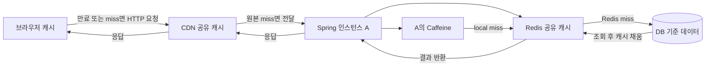

# W17. 캐시는 어디에 — 브라우저·CDN·서버 로컬·Redis·DB

> 캐시는 요청이 자주 읽히고 원본 계산이 비싸며, 정해진 시간 동안 오래된 값을 허용할 때 둔다.
> 브라우저·CDN은 HTTP 응답을 네트워크 가까이서 재사용하고, Caffeine·Redis는 애플리케이션 조회 결과를 재사용한다.
> 기본 추천은 DB를 기준 데이터로 두고 공개·변경 드문 응답에 HTTP 캐시부터 적용하는 것; 서버 캐시는 측정으로 병목이 확인된 뒤 추가하는 것이다.

## 1. 질문

Spring으로 목록 API를 만들었더니 같은 `GET /products/42` 요청마다 DB와 조인 쿼리가 다시 실행된다. 서버에 `@Cacheable`을 붙였더니 한 대에서는 빨라졌지만, 두 번째 인스턴스에는 수정 전 상품명이 보인다. 첫 번째 노드의 JVM 메모리에만 결과가 남았기 때문이다.

정적 이미지와 카테고리 목록은 매번 서버까지 오는데, CDN이나 브라우저 캐시를 쓰면 Redis 없이도 왕복을 줄일 수 있을까? 반대로 사용자별 추천 목록을 CDN에 얹으면 다른 사용자에게 응답이 섞여 나갈 수도 있다. “캐시를 넣으면 빠르다”만으로 위치를 정하면 속도 개선과 함께 데이터 노출·오래된 재고·무효화 장애를 살 수 있다.

배포 뒤 DB 값은 바뀌었는데 화면이 그대로일 수 있다. 브라우저 `max-age`, CDN, 인스턴스별 Caffeine, Redis 중 어느 계층이 응답했는지 추적해야 쓸데없는 재배포나 전체 캐시 삭제를 피한다.

## 2. 짧은 답

요청과 응답 사이에서 가장 가까운 안전한 계층에 캐시한다. 공개 정적 콘텐츠는 브라우저·CDN, 한 인스턴스 안에서만 재사용하면 되는 조회는 크기와 TTL을 제한한 Caffeine, 여러 인스턴스가 같은 사본을 써야 하면 Redis가 후보다.

사용자별 응답·권한 결과·결제 상태·실시간 재고처럼 사용자 격리나 최신성이 강한 데이터는 공유 캐시에 넣지 않거나, 명확한 키와 매우 짧은 만료·무효화 설계가 없으면 캐시하지 않는다. DB는 일반적으로 기준 데이터 저장소다. DB의 버퍼 풀 같은 내부 캐시는 DB 엔진이 관리하는 최적화이지, 애플리케이션의 상품 응답 캐시를 대체하는 층이 아니다.

**기본 추천:** 측정 전에는 애플리케이션 캐시를 추가하지 않는다. 먼저 공개·변경 드문 콘텐츠에 올바른 HTTP 캐시 헤더를 설정하고, 프로파일링에서 반복 조회 비용이 확인되면 단일 노드에는 bounded Caffeine, 다중 노드 간 공유가 필요할 때 Redis를 고른다.

## 3. 왜 그런가 — 원리

캐시는 복사본을 재사용해 비싼 단계를 건너뛴다. 브라우저는 네트워크 요청을 생략하고 CDN은 원본 왕복을 줄인다. Caffeine은 프로세스 안에서 빠르게 조회하고, Redis는 인스턴스 간 공유를 위해 네트워크·직렬화 비용을 낸다. hit rate와 miss 비용을 함께 재야 한다.



앞 계층에서 fresh hit가 나면 뒤 계층에는 요청이 도달하지 않는다. 브라우저가 `max-age=60` 응답을 재사용하는 60초 동안은 Caffeine·Redis 최신 여부와 무관하게 서버를 찾지 않는다. CDN도 TTL에 따라 원본을 건너뛴다. 층이 늘수록 원본 부하와 함께 stale 위치를 추적할 경로도 늘어난다.

HTTP 캐시는 응답 표현을 요청과 연결해 저장한다. `Cache-Control`은 저장·재사용 정책을 전하고, `ETag`는 특정 표현의 검증자다. `max-age`가 끝난 뒤 브라우저가 `If-None-Match`를 보내면 서버는 표현이 그대로일 때 `304 Not Modified`로 본문 전송을 줄인다. 이 경우 재검증 요청은 원본까지 도달하므로 완전한 cache hit와 다르다. `no-cache`는 저장 금지가 아니라 재사용 전 검증 요구이고, `no-store`가 저장 금지다. `private`는 사용자 전용 캐시만 허용하고 `public`은 공유 캐시가 저장할 수 있게 한다. 쿠키가 있다는 사실만으로 응답이 자동으로 private 처리되지는 않는다.

Spring의 `@Cacheable`은 HTTP 캐시와 다른 층이다. Spring Cache 추상화가 프록시를 통해 메서드 호출 전 키를 조회하고, hit면 메서드를 건너뛴다. miss면 메서드 실행 결과를 저장한다. 메서드 내부에서 같은 객체의 다른 `@Cacheable` 메서드를 직접 부르는 self-invocation은 프록시를 통하지 않아 예상한 캐시가 적용되지 않는다. 저장소 구현은 `CacheManager`가 고르므로 애노테이션을 그대로 두고 Caffeine과 Redis 저장소를 교체할 수 있지만, 로컬 캐시의 일관성을 Redis와 같다고 볼 수는 없다.

각 층은 일관성 비용이 다르다. TTL은 stale 상한일 뿐 즉시 제거가 아니다. stale을 허용할 수 없으면 해당 조회에서 캐시를 빼거나 매번 원본을 검증해야 한다. 일반적인 캐시는 DB commit 뒤 관련 키를 지워 eventual consistency를 얻는다. commit 전 제거는 옛 DB 값을 다시 채울 수 있고, commit 후 이벤트가 늦으면 잠시 stale이 남는다.

캐시 키는 값의 의미를 결정하는 모든 입력을 포함해야 한다. 상품 ID만으로 충분한 공개 상품 요약과 달리, 테넌트·언어·통화·사용자 권한·응답 필드가 결과를 바꾸면 키에도 각각 반영해야 한다. 비밀번호, 세션 토큰 같은 비밀값을 키로 넣지 않는다. 키에 버전이나 네임스페이스를 붙이면 배포 시 오래된 형식의 값을 구분하고 점진적으로 교체하기 쉽다. 무효화 대상은 개별 상품 키뿐 아니라 그 상품이 들어간 검색 결과·카테고리 목록일 수도 있다.

## 4. 선택지 비교

| 선택지 | 어떻게 동작 | 장점 | 단점·일관성 비용 | 언제 쓰나 | 국내 실무에서 흔한가 (근거 범위) |
|---|---|---|---|---|---|
| 브라우저 HTTP 캐시 | 응답 헤더에 따라 브라우저가 개인 사본을 저장하거나 ETag로 재검증 | 네트워크와 서버 부하를 가장 먼저 줄임. 별도 캐시 서버 불필요 | 클라이언트별 사본이라 서버가 즉시 지우기 어렵다. 과한 TTL은 화면을 오래 낡게 함 | 버전이 붙은 정적 파일, 공개·저빈도 변경 콘텐츠. 사용자 응답은 `private` 또는 `no-store` 검토 | HTTP 표준과 브라우저 구현은 보편적. 국내 서비스별 사용률 통계는 여기서 확인하지 못함 |
| CDN | 엣지의 공유 HTTP 캐시가 다수 사용자 응답을 원본 대신 반환 | 원본과 가까운 외부 구간의 지연·대역폭·요청 수를 줄임 | 캐시 키와 인증 헤더 설정 오류는 사용자 간 정보 노출로 이어질 수 있음. purge 권한·전파를 운영해야 함 | 이미지, 정적 번들, 공개 API 중 캐시 안전한 응답. CDN 제품별 동작은 설정 확인 | 정적 리소스 전송에서 널리 쓰이는 구조. 국내 도입률 수치는 확인하지 못함 |
| 서버 로컬 Caffeine | 각 JVM 힙에 키·값을 보관하고 크기·시간 정책으로 제거 | 빠른 조회, 네트워크·별도 인프라 없음, Java 앱에 붙이기 쉬움 | 노드마다 값이 다르고 재시작 시 사라짐. 무효화도 노드별 전파가 필요 | 단일 노드, 계산 결과, 약간의 노드 간 stale을 허용하는 조회 | Spring/JVM 서비스의 선택지로 일반적이나 국내 빈도 통계는 확인하지 못함 |
| Redis 공유 캐시 | 별도 Redis의 키·값을 여러 앱 인스턴스가 조회·갱신 | 노드 간 값 공유, TTL과 중앙 무효화, 앱 메모리와 수명 분리 | 네트워크·직렬화·운영 장애가 추가됨. Redis가 느리거나 끊기면 fallback/부하 대책 필요 | 여러 인스턴스가 같은 캐시를 공유하거나 이미 운영 중인 Redis를 활용할 때 | 다중 인스턴스에서 흔히 검토되는 구성. 국내 사용률 수치는 확인하지 못함 |
| DB 내부 캐시 | DB 엔진의 버퍼 풀·페이지 캐시 등이 디스크 I/O를 줄임 | 애플리케이션 변경 없이 DB가 자체 관리 | 임의의 API 응답 캐시로 직접 제어하기 어렵다. DB 쿼리·커넥션 부하는 여전히 발생 | DB 튜닝과 쿼리 계획·인덱스 최적화. 기준 데이터는 DB에 유지 | 관계형 DB 사용 시 엔진 내부에 존재하는 기본 구조. 앱 캐시와 비교 대상은 아님 |

브라우저는 짧은 TTL·재검증·버전 URL, CDN은 purge와 키 설정, Caffeine은 모든 JVM의 키 제거, Redis는 공용 키 제거로 무효화한다. 브라우저와 CDN의 사본을 원자적으로 지우기 어렵기 때문에 즉시성이 필요하면 짧은 fresh 기간과 버전 URL, CDN purge를 조합한다.

정적 파일은 이름에 해시를 넣고 긴 `max-age, immutable`을 줄 수 있다. 갱신되면 URL이 달라져 구 사본을 재사용하지 않는다. 사용자별·권한별 응답은 CDN이 쿠키를 무시해 공유하지 않는지 검토하고 `private` 또는 민감 정보면 `no-store`로 제한한다.

재고·좌석·쿠폰처럼 오류가 주문 성공 여부를 바꾸는 값은 화면 응답의 긴 캐시를 피한다. 화면용 근사값을 캐시해도 최종 구매 가능 여부는 주문 직전 DB 트랜잭션에서 검증한다.

## 5. 코드로 보기

아래 예제는 같은 공개 카탈로그·상품 조회의 저장 위치를 바꾼다. HTTP 예제는 응답 표현을 브라우저/CDN이 보관하고, Caffeine/Redis 예제는 동일한 Spring 조회 메서드의 결과를 캐시한다. 실제 배포 전에는 응답의 사용자별 여부, 갱신 주기, 캐시 키 범위를 확인한다. 예제는 Spring Boot 4.1 / Framework 7 API 기준이며 프로젝트에서 실행하지 않았다.

### A. 공개 HTTP 응답을 ETag로 재검증 (미실행)

카탈로그 버전을 저렴하게 조회할 수 있다는 전제다. 새 버전이 없으면 본문 목록을 만들지 않고 `304`를 돌려줄 수 있다. 변경 직후 반영이 필요하므로 fresh 기간은 짧게 두었다.

```java
package com.example.catalog;

import java.time.Duration;
import java.util.List;
import org.springframework.http.CacheControl;
import org.springframework.http.HttpStatus;
import org.springframework.http.ResponseEntity;
import org.springframework.web.bind.annotation.GetMapping;
import org.springframework.web.bind.annotation.RequestMapping;
import org.springframework.web.bind.annotation.RestController;
import org.springframework.web.context.request.ServletWebRequest;

@RestController
@RequestMapping("/public/categories")
class CategoryController {
    private final CategoryService service;

    CategoryController(CategoryService service) {
        this.service = service;
    }

    @GetMapping
    ResponseEntity<List<String>> list(ServletWebRequest request) {
        String etag = "\"categories-v" + service.currentRevision() + "\"";
        CacheControl policy = CacheControl.maxAge(Duration.ofSeconds(30)).cachePublic();
        if (request.checkNotModified(etag)) {
            return ResponseEntity.status(HttpStatus.NOT_MODIFIED)
                    .cacheControl(policy).eTag(etag).build();
        }
        return ResponseEntity.ok().cacheControl(policy).eTag(etag)
                .body(service.loadNames());
    }
}

interface CategoryService {
    long currentRevision();
    List<String> loadNames();
}
```

이 헤더가 사용자별 데이터에 적합하다는 뜻은 아니다. CDN이 공유 캐시하므로 공개 카테고리처럼 누구에게나 같은 응답에만 `public`을 쓴다. 사용자별 페이지에 그대로 복사하지 않는다. 또한 ETag 값은 데이터 수정 시 반드시 바뀌는 revision/hash로 만들어야 한다. 상수 ETag는 변경을 영원히 감추는 버그다.

### B. 한 JVM에서 Caffeine (미실행)

`@Cacheable` 메서드는 그대로 두고 CacheManager 구현을 로컬로 선택한다. 크기와 쓰기 후 만료를 둘 다 설정해 메모리 사용과 최대 stale 시간을 제한한다.

```java
package com.example.product;

import java.time.Duration;
import org.springframework.cache.CacheManager;
import org.springframework.cache.annotation.Cacheable;
import org.springframework.cache.annotation.EnableCaching;
import org.springframework.cache.caffeine.CaffeineCacheManager;
import org.springframework.context.annotation.Bean;
import org.springframework.context.annotation.Configuration;
import org.springframework.stereotype.Service;
import com.github.benmanes.caffeine.cache.Caffeine;

@Configuration
@EnableCaching
class LocalCacheConfiguration {
    @Bean
    CacheManager cacheManager() {
        var manager = new CaffeineCacheManager("productById");
        manager.setCaffeine(Caffeine.newBuilder()
                .maximumSize(10_000)
                .expireAfterWrite(Duration.ofMinutes(2)));
        return manager;
    }
}

@Service
class ProductQueryService {
    private final ProductRepository repository;

    ProductQueryService(ProductRepository repository) {
        this.repository = repository;
    }

    @Cacheable(cacheNames = "productById", key = "#p0", unless = "#result == null")
    ProductView find(long id) {
        return repository.findView(id);
    }
}

interface ProductRepository {
    ProductView findView(long id);
}

record ProductView(long id, String name, long price) { }
```

두 번째 인스턴스의 Caffeine은 별도 저장소다. 수정 시 `productById`의 ID 키만 지워도 목록·검색 캐시는 남을 수 있으므로 조회 경로별 의존 키를 함께 설계해야 한다. `@CacheEvict(cacheNames="productById", key="#p0")` 같은 무효화를 수정 메서드에 둘 수 있지만, DB commit 전후의 순서를 트랜잭션과 맞춘다.

### C. 여러 인스턴스가 Redis를 공유 (미실행)

서비스 메서드의 `@Cacheable` 선언은 B와 같고, 저장소 설정만 Redis용으로 바꾼다. Redis는 네트워크 경유이므로 로컬 Caffeine보다 항상 빠른 것은 아니다. 모든 인스턴스가 같은 결과를 봐야 하거나 기존 Redis 운영 기반을 재사용할 때 선택한다.

```java
package com.example.product;

import java.time.Duration;
import org.springframework.cache.CacheManager;
import org.springframework.cache.annotation.EnableCaching;
import org.springframework.context.annotation.Bean;
import org.springframework.context.annotation.Configuration;
import org.springframework.data.redis.cache.RedisCacheConfiguration;
import org.springframework.data.redis.cache.RedisCacheManager;
import org.springframework.data.redis.connection.RedisConnectionFactory;

@Configuration
@EnableCaching
class RedisCacheConfigurationBean {
    @Bean
    CacheManager cacheManager(RedisConnectionFactory connectionFactory) {
        var defaults = RedisCacheConfiguration.defaultCacheConfig()
                .entryTtl(Duration.ofMinutes(2))
                .disableCachingNullValues();
        return RedisCacheManager.builder(connectionFactory)
                .cacheDefaults(defaults)
                .build();
    }
}
```

예제는 (미실행)이다. Redis 직렬화 형식·키 prefix·연결 타임아웃·장애 시 동작은 서비스 데이터 형식과 인프라에 맞춰 추가 설정한다. TTL만으로 수정 직후 일관성이 생기는 것은 아니다. 성공한 DB 변경 이후 해당 ID 캐시를 지우고, 이벤트 기반 무효화가 필요하면 이벤트 재시도와 중복 처리도 둔다. Spring Cache 추상화와 Redis 연동은 P23의 Redis 운영 상세를 참조한다.

## 6. 실무에서는 실제로

**신규 서비스:** DB 조회 수, p95/p99 지연, 응답 크기와 갱신 빈도를 잰다. 정적 파일에는 HTTP 캐시를, 병목인 단일 노드 조회에는 `maximumSize`와 TTL이 있는 Caffeine을 적용한다. 모든 응답을 곧바로 Redis에 넣으면 홉과 장애 지점이 늘 수 있다.

**레거시:** `CacheManager`, `@Cacheable`, Redis key prefix, CDN key, `Cache-Control`, 서비스 워커를 확인한다. 브라우저 개발자 도구에서 `Age`, `ETag`, 캐시 헤더와 원본 로그를 따라가 오래된 값이 만들어진 층과 빠진 무효화를 찾고, 한 계층씩 수정한다.

**SI·금융:** 개인정보·계좌·권한 응답은 공유 캐시에서 제외하고 `private` 또는 `no-store`를 명시한다. 잔액·한도·결제 여부는 최종 판단을 DB 트랜잭션에서 한다. 저빈도 코드표는 짧은 TTL과 무효화 경로를 정해 캐시할 수 있다. 기준은 업종 이름이 아니라 데이터 분류와 허용 stale 시간이다.

**스타트업·다중 인스턴스:** 기존 Redis를 공유 캐시로 쓸 수 있지만 hit/miss·eviction·메모리·지연과 장애 fallback을 관측한다. 노드가 여럿이어도 값이 잠시 달라도 되는 집계는 로컬 캐시가 단순하다. 수정 직후 같은 값이 보여야 하면 공유 캐시나 이벤트 무효화를 검토한다.

마이그레이션은 `DB 기준 데이터 → 공개 HTTP 캐시 → 병목 메서드의 Caffeine → 공유가 필요한 결과의 Redis` 순으로 좁게 진행한다. 로컬 캐시에서 Redis로 옮길 때 키 의미·TTL·null 처리·직렬화 형식이 바뀌는지 검사하고, 이중 읽기 기간에는 어느 결과가 권위 있는지 정한다. 더 복잡한 TTL·무효화 전략이나 DB-캐시 갱신 패턴은 S11 참조.

## 7. 흔한 오해와 실수

1. **“TTL을 뒀으니 수정하면 바로 새 값이다”** → TTL은 만료 상한이지 즉시 무효화가 아니다. → 최대 stale 허용시간을 정하고, 수정 직후 반영이 필요하면 DB commit 뒤 명시적 무효화 또는 버전 키를 설계한다.
2. **“서버에 Caffeine을 붙였으니 모든 서버가 공유한다”** → Caffeine은 JVM마다 따로 살아서 노드 A의 eviction이 B에 전달되지 않는다. → 단일 노드 허용 여부를 확인하고 공유가 필요하면 Redis나 노드 간 무효화 이벤트를 사용한다.
3. **“쿠키가 있는 응답은 CDN이 알아서 사용자별로 나눈다”** → HTTP 캐시 정책과 CDN cache key 설정에 따라 공유될 수 있다. `private` 응답이어도 CDN 설정으로 정책을 덮으면 위험하다. → 개인 응답을 공유 캐시에 저장하지 말고, 인증 헤더·쿠키를 키에서 제외하는 규칙을 검토한다.
4. **“`no-cache`면 아무 데도 저장하지 않는다”** → 재사용 전에 재검증하라는 뜻이다. 저장 자체를 막으려면 `no-store`를 쓴다. → 개인정보·민감 응답의 저장 금지와, 공개 응답의 재검증 요구를 구분한다.
5. **“@Cacheable이 붙은 메서드는 내부에서 호출해도 cache hit다”** → 기본 프록시 모드에서는 같은 객체 안의 직접 호출이 프록시를 거치지 않는다. → 캐시 경계 메서드를 별도 Spring bean으로 분리하거나 프록시 경계를 거치는 공개 호출로 구성한다.
6. **“키는 상품 ID면 항상 충분하다”** → 언어·테넌트·통화·권한에 따라 결과가 다른데 일부 조건이 빠지면 다른 사용자 값이 반환될 수 있다. → 결과를 바꾸는 입력을 정규화해 키에 넣고, 민감한 토큰·개인정보는 키로 사용하지 않는다.
7. **“장애 때 DB로 fallback하면 캐시 장애도 안전하다”** → 캐시가 한꺼번에 비거나 느려지면 동시 miss가 DB로 쏠려 원본 장애를 확대한다. 만료가 같은 시각에 몰리는 눈사태도 생긴다. → TTL jitter, 키별 single-flight/요청 합치기, stale 응답, 제한된 재시도·DB 보호를 조합한다.
8. **“캐시가 오래된 값을 주면 DB 업데이트 실패다”** → 브라우저/CDN이 요청을 막았거나 304 재검증, 로컬 캐시, Redis 키 중 하나가 원인일 수 있다. → 네트워크 응답 헤더와 `Age`/CDN hit 표시부터 보고, 요청이 원본에 도달했는지 로그로 확인한다. 이어서 Spring cache name·key·TTL·무효화와 프론트 상태 갱신을 점검한다.

캐시 장애 패턴도 구분한다. 스탬피드는 인기 키가 만료되자 동시 요청이 한꺼번에 원본을 계산하는 현상이다. 키별 한 요청만 계산하고 나머지가 결과를 기다리게 하거나, 갱신 중 stale 값을 주면 완화된다. 관통은 존재하지 않는 키를 반복 요청해 매번 DB miss가 나는 경우다. 입력 검증, 짧은 negative caching, 높은 규모에서 Bloom filter가 후보지만 존재하지 않는 결과를 오래 캐시하지 않는다. 눈사태는 다수 키가 같은 TTL에 만료되거나 캐시 장애로 한꺼번에 사라지는 상황이다. TTL에 무작위 편차를 주고 원본 보호 한도와 warm-up을 둔다. 이 대책들은 정확한 무효화 대신 쓰는 것이 아니라, miss 폭주를 제어하는 보완책이다.

## 8. 자가점검 Q&A (면접 대비)

**Q1. 브라우저 캐시와 Redis 캐시는 무엇이 다른가?**  
브라우저 캐시는 HTTP 응답 표현을 사용자 단말에 저장해 네트워크 요청을 생략할 수 있다. Redis 캐시는 서버가 명시한 키와 값으로 여러 인스턴스의 애플리케이션 조회 결과를 공유한다. 전자는 HTTP freshness/validator, 후자는 앱 키·TTL·무효화 정책이 중심이다.  
**꼬리질문: ETag hit면 서버가 호출되지 않는가?** ETag 재검증은 요청이 서버까지 도달하고, 변경이 없을 때 본문 대신 304를 받는다.

**Q2. 서버가 3대면 Caffeine 대신 Redis를 무조건 골라야 하나?**  
아니다. Caffeine 값은 노드마다 달라지지만, 값이 잠시 다르더라도 허용되는 집계·계산 결과에 유용할 수 있다. 수정 직후 같은 값을 공유해야 하거나 메모리 사용을 노드별로 중복하지 않으려면 Redis가 적합할 수 있다. 일관성 요구와 Redis 홉 비용을 함께 비교한다.  
**꼬리질문: 로컬 캐시 변경을 다른 노드에 전달하려면?** 변경 이벤트로 키를 무효화하거나 TTL로 stale 상한을 두되, 이벤트 유실·재시도도 설계한다.

**Q3. `no-cache`와 `no-store`의 차이를 설명하라.**  
`no-cache`는 저장될 수 있지만 재사용 전에 서버 검증을 요구한다. `no-store`는 캐시가 응답을 저장하지 않도록 지시한다. 개인 정보를 새 사용자에게 노출할 위험이 있으면 `private`만으로 충분한지 평가하고 저장 자체가 불필요하면 `no-store`를 쓴다.  
**꼬리질문: ETag 재검증이 줄이는 비용은?** 본문 재전송을 피하지만 요청과 검증 처리는 여전히 발생한다.

**Q4. 캐시 무효화를 DB 수정 전과 후 중 언제 해야 하는가?**  
commit 전에 지우면 그 사이 읽기가 구버전 DB 값을 다시 캐시할 수 있다. commit 뒤 지우면 그 전까지는 이전 캐시가 보일 수 있지만, 새 DB 값이 재충전되는 순서가 명확해진다. 장애가 나도 무효화가 전달되도록 outbox나 재시도를 고려한다.  
**꼬리질문: TTL이 있으면 이벤트 무효화는 필요 없는가?** 즉시성 요구가 TTL 상한보다 작다면 필요할 수 있고, TTL은 이벤트 유실 시 복구 상한으로 둘 수 있다.

**Q5. 개인화된 API 응답을 CDN에 넣기 전 점검할 것은?**  
응답이 사용자·권한·테넌트에 따라 다른지 확인한다. 공유 cache key가 쿠키나 Authorization에 따라 올바르게 분리되지 않으면 정보가 섞인다. 사용자 전용 응답은 `private`, 저장 금지가 필요하면 `no-store`를 보내고 CDN 설정도 함께 검토한다.  
**꼬리질문: 쿠키가 있으면 자동으로 private인가?** 아니다. 명시적 캐시 정책을 확인해야 한다.

**Q6. 캐시를 넣었는데 DB 부하가 늘었다. 가능한 원인과 조치는?**  
hit rate가 낮거나 TTL·키 cardinality가 부적절할 수 있다. 동시에 인기 키가 만료돼 stampede가 일어났거나 캐시 오류 fallback이 DB를 압박할 수 있다. hit/miss, eviction, cache latency, DB query 수를 함께 보고 키별 요청 합치기와 TTL jitter, DB 보호를 적용한다.  
**꼬리질문: 전체 요청 비율의 hit rate만 보면 충분한가?** 아니다. 비싼 쿼리·핫키별 hit와 tail latency도 확인한다.

**Q7. `@Cacheable`이 동작하지 않을 때 어디부터 볼까?**  
호출이 Spring 프록시를 통하는지, `@EnableCaching`과 `CacheManager`가 활성화됐는지 확인한다. 실제 cache name/key가 기대값과 일치하는지, 결과가 `null` 제외 조건이나 오류 경로에 걸렸는지도 본다. 마지막으로 앱 로컬과 Redis 중 어떤 구현이 선택됐고 TTL이 얼마인지 확인한다.  
**꼬리질문: 같은 클래스의 다른 메서드 호출은 왜 문제인가?** 자기 자신에 대한 직접 호출은 기본 프록시 경계를 건너뛰기 때문이다.

## 9. 참고문헌

- HTTP caching — https://developer.mozilla.org/en-US/docs/Web/HTTP/Guides/Caching — private/shared 캐시와 HTTP 캐시의 기본 동작.
- Cache-Control header — https://developer.mozilla.org/en-US/docs/Web/HTTP/Reference/Headers/Cache-Control — `max-age`, `private`, `public`, `no-cache`, `no-store` 지시어.
- ETag header — https://developer.mozilla.org/en-US/docs/Web/HTTP/Reference/Headers/ETag — 강한·약한 validator와 조건부 요청.
- RFC 9111: HTTP Caching — https://www.rfc-editor.org/rfc/rfc9111 — 현행 HTTP 캐시 표준과 캐시 지시어 규칙.
- RFC 5861: HTTP Cache-Control Extensions for Stale Content — https://www.rfc-editor.org/rfc/rfc5861 — stale-while-revalidate 및 stale-if-error 확장.
- Cache Abstraction — https://docs.spring.io/spring-framework/reference/integration/cache.html — Spring Cache 추상화와 저장소 연결 구조.
- Declarative Annotation-based Caching — https://docs.spring.io/spring-framework/reference/integration/cache/annotations.html — `@Cacheable`, `@CacheEvict` 등 선언형 캐시 동작.
- Caching — https://docs.spring.io/spring-boot/reference/io/caching.html — Boot의 캐시 활성화와 메서드 캐시 사용.
- HTTP Caching — https://docs.spring.io/spring-framework/reference/web/webmvc/mvc-caching.html — MVC의 `CacheControl`, ETag와 조건부 요청 지원.
- Caffeine Wiki — https://github.com/ben-manes/caffeine/wiki — Caffeine 기능과 캐시 정책 개요.
- Eviction — https://github.com/ben-manes/caffeine/wiki/Eviction — 크기·시간 기반 제거 정책.
- Use Redis with the Spring cache abstraction — https://redis.io/docs/latest/integrate/spring-framework-cache/cache/ — Spring Cache 추상화를 Redis 저장소에 연결하는 방식.

Redis 접속·운영 상세는 P23, 캐시 전략과 마이그레이션 상세는 S11 참조.
