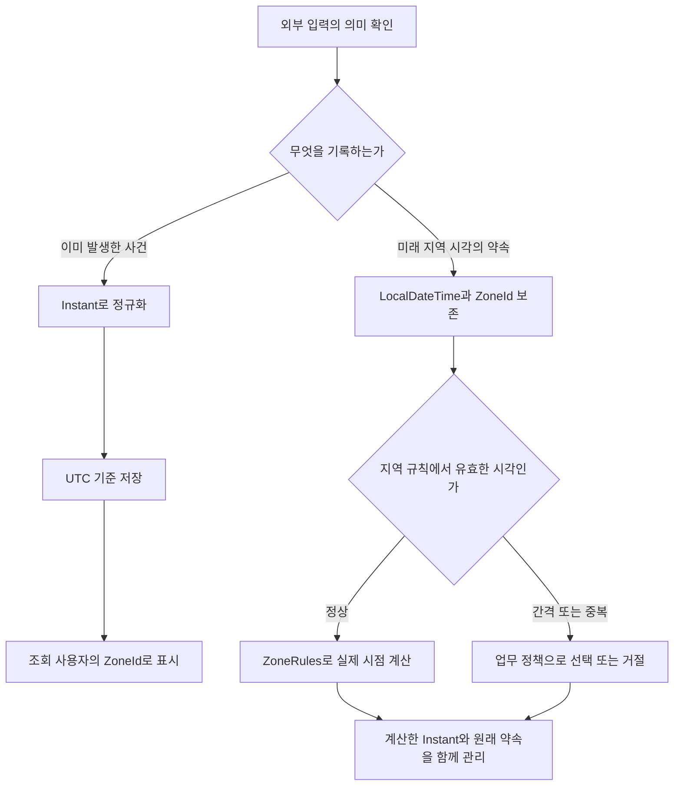

# W20. 시간·타임존은 왜 매번 문제인가

> 시간 문제의 대부분은 “언제 발생했나”와 “어느 지역 시계로 몇 시였나”를 같은 값으로 취급하면서 시작한다.
> 과거 사건·로그·만료 시점은 `Instant`로 표현하고 저장은 UTC로 정규화한 뒤, 사용자 타임존으로 표시한다.
> 미래의 현지 약속은 예외다. `LocalDateTime`만 저장하지 말고 `ZoneId`와 함께 정책을 정하며, 기본값은 `Instant` + UTC다.

## 1. 질문

“시간을 UTC로 저장하라”는 말을 따라 `LocalDateTime.now()`를 DB에 넣었는데, 서버를 서울에서 미국 리전으로 옮기자 예약 시각이 16시간 밀린다. 코드는 그대로인데 JVM 기본 타임존이 달라졌기 때문이다.

다른 팀은 API에서 `2026-07-01T09:00:00`을 받고 이를 “한국 오전 9시”라고 가정한다. 해외 고객이 같은 값을 보내면 어느 지역의 오전 9시인지 정보가 없다. 반대로 `Z`가 붙은 값을 받으면서 이를 한국 시간으로 다시 해석하면 같은 시간대 변환을 두 번 적용한다.

세 번째 장면은 서머타임이 적용되는 지역의 예약이다. 새벽 2시 30분이 건너뛰어 존재하지 않거나, 가을에는 2시 30분이 두 번 온다. 달력에는 한 번만 보이는 시각인데 어느 실제 순간을 예약했는지 정하지 않으면 배치·알림이 한 시간씩 어긋난다.

## 2. 짧은 답

- 이미 발생한 사건, 감사 로그, 토큰 만료, 결제 승인 시각은 `Instant`로 표현한다.
- 날짜만 의미하면 `LocalDate`, 지역 시계의 미래 약속이면 `LocalDateTime` + IANA `ZoneId`를 저장한다.
- 클라이언트 경계를 넘는 시점 값은 ISO-8601로 보내고, UTC 순간은 `Z`가 있는 `Instant`를 기본 계약으로 삼는다.
- 저장 기본값은 UTC 정규화다. 단, 미래 현지 약속의 원래 지역·벽시계 의미는 함께 보존한다.
- MySQL `DATETIME`은 타임존 변환 없는 벽시계 값, `TIMESTAMP`는 연결 타임존에 따라 UTC 변환되는 값이다. 둘 중 하나를 명시하고 연결 타임존을 맞춘다.
- 테스트에서는 `Clock`을 주입한다. `now()`를 흩뿌리지 않으면 경계 시각을 고정해 검증할 수 있다.
- 기본 추천: **사건은 `Instant` + UTC 저장 + 화면에서 사용자 `ZoneId`로 변환**. 반복 일정과 현지 약속은 별도 도메인 모델로 다룬다.

## 3. 왜 그런가 — 원리

### “언제”와 “몇 시”는 다른 질문이다

타임라인의 한 지점은 표준 시계에서 하나의 값이다. `Instant`는 UTC 기준 에포크 초와 나노초로 그 지점을 표현한다. 같은 `Instant`는 JVM의 기본 타임존·서버 위치·접속한 사용자와 관계없이 같은 사건이다.

반면 `LocalDateTime`은 연-월-일과 시-분-초만 가진다. 값 `2026-07-01T09:00`만으로는 그 순간이 UTC인지, 서울인지, LA인지 알 수 없다. 이를 `Instant`로 바꾸려면 외부에서 `ZoneId` 또는 `ZoneOffset`을 공급해야 한다. 누락된 정보는 변환 함수가 추측할 수 없으며, `ZoneId.systemDefault()`를 대신 넣으면 서버 설정이 도메인 규칙이 된다.

`OffsetDateTime`은 벽시계 값과 고정 UTC 오프셋을 함께 가진다. `+09:00`은 그 순간과의 관계를 알려주지만 “서울” 같은 지역 규칙은 담지 않는다. 오프셋만으로는 다음 해에 그 지역의 서머타임 규칙이 바뀌어도 따라갈 수 없다. `ZonedDateTime`은 `ZoneId`와 해당 규칙 데이터까지 함께 쓴다. 같은 지역은 역사와 미래 규칙에 따라 오프셋이 달라질 수 있다. Java API 문서는 `Instant`를 타임스탬프와 로그·저장에, `LocalDateTime`을 타임존 없는 날짜·시간에, `ZonedDateTime`을 지역 규칙을 고려한 계산에 대응시킨다.[1]



### 서버·JVM·DB·클라이언트는 서로 다른 기본 시계를 가질 수 있다

`ZoneId.systemDefault()`는 OS/JVM 설정을 따르므로 개발 PC, 컨테이너, 클라우드 리전이 다르면 결과가 달라질 수 있다. SQL 연결 존도 DB 서버 존과 같다고 보장되지 않는다. 계층의 “기본값”을 상속하지 말고 경계에서 의미를 정한다.

### 서머타임은 변환 함수가 실제로 만나는 모호성이다

지역 타임존 규칙은 로컬 시각당 유효 오프셋을 결정한다. 보통 하나, 봄 gap에는 0개, 가을 overlap에는 2개다. `LocalDateTime.atZone(zone)`은 gap을 앞으로 보정하고 overlap에는 직전 오프셋 또는 기본적으로 이른 오프셋을 선택한다. 청구·예약처럼 조용한 보정이 위험하면 시각을 거절하거나 어느 오프셋을 쓸지 명시한다.[5][6]

“내일 같은 시각”은 `plusDays(1)`, “24시간 뒤”는 `plusHours(24)`다. DST 경계에서는 결과가 한 시간 차이 날 수 있으므로 배치가 달력 주기인지 경과 시간 주기인지 정한다.

### API는 어떤 한계를 해결하며 발전했나

Java 8 이전의 `Date`/`Calendar` 계열은 가변적이고 사용 의도를 드러내기 어려웠다. JEP 150은 이 한계를 줄이려고 JSR 310 기반의 불변 날짜·시간 API를 Java 8에 넣었다.[4] 같은 릴리스의 JEP 170(JDBC 4.2)은 새 타입을 DB로 전달할 일반 setter/update API를 추가해, 애플리케이션 타입과 JDBC 사이의 수동 변환 부담을 낮췄다.[8] Hibernate 문서는 `hibernate.jdbc.time_zone`이 5.2.3부터 제공되며, 값이 없으면 JVM 기본 존을 쓴다고 기록한다. 암묵적인 기본 존에서 오는 환경별 차이를 설정으로 고정할 수 있게 된 변화다.[3]

## 4. 선택지 비교

| 선택지 | 어떻게 동작 | 장점 | 단점 | 언제 쓰나 | 국내 실무에서 흔한가(근거 있으면) |
|---|---|---|---|---|---|
| `Instant` | UTC 타임라인의 한 순간 | 시스템 간 비교·정렬이 단순하고 서버 기본 타임존에 영향받지 않음 | 사용자에게 바로 보여주기 불편하고 원래 지역/벽시계 의미를 복원할 수 없음 | 생성·수정 시각, 로그, 만료, 결제·이벤트 시각 | 실무 권장 기본값. 국내 빈도 통계는 미확인 |
| `LocalDateTime` | 날짜와 시계만 저장 | 생일·영업시간·벽시계 값 표현에 자연스러움 | 존/오프셋이 없어 단독 변환하면 서버 설정이나 추측에 의존 | 사용자 지역 약속의 원시 입력, 지역 개점 시간 | 레거시 DB `DATETIME`과 함께 쓰이지만 관행 빈도는 미확인 |
| `OffsetDateTime` | 로컬 날짜·시간 + 고정 오프셋 | JSON 경계에서 오프셋을 명시하며 순간 비교 가능 | `+09:00`만으로 `Asia/Seoul` 규칙을 보존하지 못함 | 외부 시스템이 오프셋 포함 시각을 보냈고 그 값의 오프셋도 계약상 보존할 때 | 빈도 통계 미확인 |
| `ZonedDateTime` | 날짜·시간 + 지역 `ZoneId` 규칙과 현재 오프셋 | DST·지역 달력 계산 가능 | DB/JSON이 지역 ID를 보존하지 않을 수 있고 규칙 변경·중복 정책을 다뤄야 함 | 예약 시각 계산, 지역 반복 일정 | 빈도 통계 미확인 |

Java 타입이 DB 컬럼 타입을 그대로 결정하지는 않는다. JDBC 드라이버와 Hibernate Dialect가 Java 타입을 JDBC/SQL 타입으로 매핑한다. Hibernate 7.0 가이드에서 `Instant`는 `TIMESTAMP_UTC`, `LocalDateTime`은 `TIMESTAMP`, `OffsetDateTime`은 Dialect에 따라 `TIMESTAMP` 또는 `TIMESTAMP_WITH_TIMEZONE`에 대응한다. 실제 컬럼과 오프셋 보존은 DB 기능 및 Hibernate 저장 전략에 달려 있다.[3]

| MySQL 타입 | 저장·조회 시 타임존 처리 | 장점 | 단점 | 선택 기준 |
|---|---|---|---|---|
| `DATETIME(fsp)` | 입력 필드를 그대로 저장·조회. 타임존을 붙이거나 UTC 변환하지 않음 | 1000~9999년 범위, 지역 벽시계 표현에 적합 | 값 자체에 존이 없어 저장 인코딩 규칙을 앱이 책임짐 | 현지 일정 또는 UTC로 정규화한 값을 저장하는 규칙을 명시한 경우 |
| `TIMESTAMP(fsp)` | 연결의 현재 타임존에서 UTC로 바꿔 저장하고 조회 시 다시 연결 타임존으로 바꿈 | 세션 타임존이 통일되면 절대 시점처럼 다루기 쉬움 | 세션 타임존이 달라지면 표시가 바뀌고, 범위가 1970~2038로 제한 | 짧은 범위의 시점 컬럼이며 모든 연결 세션의 존을 통제하는 경우 |

MySQL 8.4 매뉴얼은 `DATETIME`과 `TIMESTAMP` 모두 초 이하 최대 6자리 정밀도를 지원한다고 설명한다. `TIMESTAMP`는 UTC 저장과 연결 타임존 기준 입출력 변환을 하고, `DATETIME`에는 그 변환이 없다.[2] Java `Instant`의 나노초 정밀도와 컬럼 마이크로초 정밀도가 다르면 저장 과정에서 정밀도가 줄 수 있으므로 비교·재조회 테스트는 실제 스키마 정밀도까지 맞춰야 한다.

## 5. 코드로 보기

### 같은 입력을 타입별로 해석하기 — 순수 Java

첫 번째 프로그램은 같은 절대 시점의 서울/LA 표시를 비교하고, 오프셋이 빠진 입력을 서버 기본 존으로 바꿨을 때 결과가 달라지는 버그를 재현한다. JDK 21에서 실행했다.

```java
import java.time.Instant;
import java.time.LocalDateTime;
import java.time.OffsetDateTime;
import java.time.ZoneId;

public class TimeZoneChoiceDemo {
    public static void main(String[] args) {
        Instant event = Instant.parse("2026-07-01T00:00:00Z");
        ZoneId seoul = ZoneId.of("Asia/Seoul");
        ZoneId losAngeles = ZoneId.of("America/Los_Angeles");

        System.out.println("instant=" + event);
        System.out.println("seoul=" + event.atZone(seoul));
        System.out.println("los-angeles=" + event.atZone(losAngeles));
        System.out.println("offset-api=" + OffsetDateTime.ofInstant(event, seoul));

        LocalDateTime inputWithoutOffset = LocalDateTime.parse("2026-07-01T09:00:00");
        System.out.println("same-local-with-system-zone="
                + inputWithoutOffset.atZone(ZoneId.systemDefault()).toInstant());
    }
}
```

```text
$ java -Duser.timezone=UTC TimeZoneChoiceDemo.java
instant=2026-07-01T00:00:00Z
seoul=2026-07-01T09:00+09:00[Asia/Seoul]
los-angeles=2026-06-30T17:00-07:00[America/Los_Angeles]
offset-api=2026-07-01T09:00+09:00
same-local-with-system-zone=2026-07-01T09:00:00Z

$ java -Duser.timezone=America/Los_Angeles TimeZoneChoiceDemo.java
instant=2026-07-01T00:00:00Z
seoul=2026-07-01T09:00+09:00[Asia/Seoul]
los-angeles=2026-06-30T17:00-07:00[America/Los_Angeles]
offset-api=2026-07-01T09:00+09:00
same-local-with-system-zone=2026-07-01T16:00:00Z
```

같은 `2026-07-01T09:00:00` 입력도 서버 존에 따라 UTC 순간이 7시간 다르다. 지역 약속이면 사용자 `ZoneId`로 해석하고, 사건 시각 API는 오프셋 포함 값을 요구해 `Instant`로 바꾼다.

### DST의 빈 시각과 중복 시각 — 순수 Java

두 번째 프로그램은 베를린의 2026년 봄/가을 전환을 확인한다. `atZone`의 자동 보정과 명시 오프셋 사용 결과가 서로 다르다. JDK 21 실행 출력이다.

```java
import java.time.DateTimeException;
import java.time.LocalDateTime;
import java.time.ZoneId;
import java.time.ZoneOffset;
import java.time.ZonedDateTime;
import java.time.zone.ZoneRules;
import java.util.List;

public class DstBoundaryDemo {
    public static void main(String[] args) {
        ZoneId berlin = ZoneId.of("Europe/Berlin");
        ZoneRules rules = berlin.getRules();

        LocalDateTime gap = LocalDateTime.of(2026, 3, 29, 2, 30);
        System.out.println("gap-valid-offsets=" + rules.getValidOffsets(gap));
        System.out.println("gap-at-zone=" + gap.atZone(berlin));
        try {
            ZonedDateTime.ofStrict(gap, ZoneOffset.ofHours(1), berlin);
            System.out.println("gap-strict=unexpectedly accepted");
        } catch (DateTimeException expected) {
            System.out.println("gap-strict=rejected");
        }

        LocalDateTime overlap = LocalDateTime.of(2026, 10, 25, 2, 30);
        List<ZoneOffset> offsets = rules.getValidOffsets(overlap);
        ZonedDateTime earlier = overlap.atZone(berlin);
        ZonedDateTime later = earlier.withLaterOffsetAtOverlap();
        System.out.println("overlap-valid-offsets=" + offsets);
        System.out.println("overlap-default=" + earlier + " -> " + earlier.toInstant());
        System.out.println("overlap-later=" + later + " -> " + later.toInstant());
    }
}
```

```text
gap-valid-offsets=[]
gap-at-zone=2026-03-29T03:30+02:00[Europe/Berlin]
gap-strict=rejected
overlap-valid-offsets=[+02:00, +01:00]
overlap-default=2026-10-25T02:30+02:00[Europe/Berlin] -> 2026-10-25T00:30:00Z
overlap-later=2026-10-25T02:30+01:00[Europe/Berlin] -> 2026-10-25T01:30:00Z
```

예약 입력에서 유효 오프셋이 0개면 대체 시각을 제안하거나 거절하고, 2개면 첫 번째/두 번째 시각을 선택받는다. 기본 보정을 숨기면 한 시간 다른 순간이 예약된다.

### `Clock`으로 현재 시각을 주입하기 — Spring Boot 4.1 / Framework 7 기준 (미실행)

```java
import java.time.Clock;
import java.time.Instant;

import org.springframework.context.annotation.Bean;
import org.springframework.context.annotation.Configuration;
import org.springframework.stereotype.Service;

@Configuration
class TimeConfiguration {
    @Bean
    Clock applicationClock() {
        return Clock.systemUTC();
    }
}

@Service
class ExpirationService {
    private final Clock clock;

    ExpirationService(Clock clock) {
        this.clock = clock;
    }

    boolean isExpired(Instant expiresAt) {
        return !expiresAt.isAfter(clock.instant());
    }
}
```

테스트에서는 `Clock.fixed(Instant.parse("2026-07-01T00:00:00Z"), ZoneOffset.UTC)`를 만들어 생성자에 전달하면 만료 직전·정각·직후를 재현할 수 있다. `Instant.now()`를 직접 호출하는 코드가 여러 곳에 흩어지면 테스트 실행 시각이 바뀌면서 경계가 흔들린다. `Clock`은 현재 시각이 필요한 메서드에 전달하도록 설계됐고, JDK 문서도 DI와 고정 시계를 테스트 용도로 설명한다.[7]

### JPA 저장 기본값과 MySQL 연결 계약 (Spring 예시, 미실행)

```java
import java.time.Instant;

import jakarta.persistence.Column;
import jakarta.persistence.Entity;
import jakarta.persistence.GeneratedValue;
import jakarta.persistence.GenerationType;
import jakarta.persistence.Id;
import jakarta.persistence.Table;

@Entity
@Table(name = "audit_event")
class AuditEvent {
    @Id
    @GeneratedValue(strategy = GenerationType.IDENTITY)
    private Long id;

    @Column(name = "occurred_at", nullable = false)
    private Instant occurredAt;

    protected AuditEvent() {}

    AuditEvent(Instant occurredAt) {
        this.occurredAt = occurredAt;
    }
}
```

```yaml
spring:
  jpa:
    properties:
      hibernate.jdbc.time_zone: UTC
```

`hibernate.jdbc.time_zone`은 JDBC `Timestamp`/`Time` 바인딩·조회용 `Calendar` 존이며 기본은 JVM 존이다. 이것만으로 MySQL 세션 `time_zone`을 바꾸지는 않는다.[3] `TIMESTAMP`는 매 연결을 UTC로 고정하고, UTC 인코딩 `DATETIME(6)`은 앱 전체가 그 규칙을 지킨다. Dialect와 마이그레이션의 SQL 타입·정밀도도 통합 환경에서 맞춘다.

JSON 경계에서는 `Instant`를 ISO 문자열 `2026-07-01T00:00:00Z`로, 오프셋 의미가 필요한 `OffsetDateTime`은 `2026-07-01T09:00:00+09:00`처럼 표현할 수 있다. `LocalDateTime`의 `2026-07-01T09:00:00`에는 타임존 정보가 없다는 점을 API 명세에 적어야 한다. Jackson 설정은 문자열/숫자 표현, 정밀도, 존 ID 포함에 영향을 주므로 DTO 필드 타입만 정하고 계약을 생략하지 않는다. 직렬화 상세는 P16 참조.

## 6. 실무에서는 실제로

| 프로젝트 상황 | 보통 정하는 방식 | 이유와 주의점 |
|---|---|---|
| 신규 서비스 | 사건 시각은 `Instant`, UTC를 명시해 저장. 날짜 전용 값은 `LocalDate`, 예약은 현지 값과 `ZoneId`를 분리 | 타입이 데이터 의미를 드러내고 서버 이동과 외부 연동 때 기본 타임존 의존을 줄임 |
| 레거시 서비스 | 스키마·연결 설정·기존 행을 먼저 조사하고 읽기 경로에서 실제 존을 확정. 이후 새 컬럼 또는 배치 변환으로 단계 이행 | 기존 `DATETIME` 값만 보고 과거 행의 존을 복원할 수 없는 경우가 많음. 전부 UTC로 간주해 한 번에 변환하면 데이터가 더 틀어질 수 있음 |
| SI·금융·감사 요구 | DB 컬럼, 세션 존, 앱 존, 소수 초 정밀도, 원본 입력 오프셋을 인터페이스 계약에 기록 | 증적 재현에는 “타임라인 순간” 외에 입력 당시 지역 시각/오프셋이 필요할 수 있음. 법적 의미가 있으면 원문과 정규화 값을 병행 보존 |
| 스타트업·외부 고객 서비스 | API 시각은 오프셋 포함, 내부 사건 값은 `Instant`, 사용자 화면은 프로필의 `ZoneId`로 변환 | 서버나 인프라가 UTC라는 사실은 고객의 달력·영업일 규칙과 별개임 |

운영에서는 JVM 존, DB `@@session.time_zone`, Hibernate 옵션, API 원문을 함께 본다. 세션 존 변경 뒤 `TIMESTAMP` 문자열은 같은 순간이어도 달라질 수 있다.

미래 지역 일정은 규칙 데이터가 바뀔 수 있다. 확정 순간이 중요한 법률·항공 업무는 계산된 `Instant`를 보존하고, 사용자의 벽시계 약속이 기준이면 `LocalDateTime` + `ZoneId`를 원본으로 둔다. 알림 순간 재계산과 사용자 통지를 정책으로 정한다.

지역 날짜 조회는 `date.atStartOfDay(zone)`부터 다음 날짜 시작까지의 반열림 구간(`[start, nextStart)`)을 쓴다. DST 날은 23/25시간일 수 있어 하루를 24시간으로 더하거나 나노초 끝값을 만들지 않는다.

마이그레이션은 컬럼 의미·원천 존을 확인하고 UTC 새 컬럼과 대조한 뒤 구버전 쓰기를 제거한다. 원천 존을 모르는 과거 `LocalDateTime`은 `Instant`로 복구할 수 없으므로 임의 변환하지 않는다.

## 7. 흔한 오해와 실수

1. **오해: “서버가 UTC면 `LocalDateTime.now()`도 안전하다.”** 증상 → 다른 서버/개발 환경에서 저장 시각이 다르다. 실제 → 타입에 존이 없고 시스템 기본 존을 변환에 넣은 것뿐이다. 대처 → 사건 시각은 `Instant.now(clock)`를 사용하고 JDBC 존과 DB 연결 존도 따로 설정한다.
2. **오해: “ISO 문자열이면 타임존이 있다.”** 증상 → `2026-07-01T09:00:00`을 클라이언트와 서버가 다르게 해석한다. 실제 → ISO-8601에서 이 문자열의 `LocalDateTime`은 오프셋 없는 값이다. 대처 → 절대 시점 계약은 `Z` 또는 명시 오프셋 필수로 검증한다.
4. **오해: “MySQL `DATETIME`과 `TIMESTAMP`는 이름만 다르다.”** 증상 → 같은 값이 세션 변경 전후 다르게 조회되거나 2038년 이후 입력이 실패한다. 실제 → `TIMESTAMP`는 연결 존을 통해 UTC 왕복 변환하고 범위가 제한되며 `DATETIME`은 존 변환이 없다.[2] 대처 → 스키마 타입, 연결 세션 존, 앱 인코딩을 하나의 계약으로 정한다.
5. **오해: “`atZone()`은 존재하지 않는 시각을 오류로 알려준다.”** 증상 → 예약이 사용자가 고른 시각보다 앞으로 조용히 이동한다. 실제 → DST gap은 기본 API에서 간격 길이만큼 앞으로 보정한다. 대처 → `ZoneRules.getValidOffsets()`로 0/1/2개를 확인하고 업무상 자동 보정이 안 되면 명시 검증·선택을 받는다.[5][6]
7. **오해: “DB 저장은 UTC 옵션 하나면 끝난다.”** 증상 → JVM을 UTC로 고정하고도 읽기/쓰기 변환에서 차이가 난다. 실제 → `hibernate.jdbc.time_zone`, JDBC 드라이버, MySQL 세션 존, SQL 컬럼 변환은 서로 다른 층이다. 대처 → 실제 DB 연결에서 bind/read 왕복, `@@session.time_zone`, 컬럼 타입과 정밀도를 함께 검증한다.

## 8. 자가점검 Q&A (면접 대비)

### Q1. `LocalDateTime`과 `Instant`는 어떤 기준으로 고르나?

`Instant`는 서버/사용자 존과 무관한 사건 시각이다. `LocalDateTime`은 지역 예약이나 영업시간처럼 벽시계 필드만 필요할 때 쓴다. 이를 `Instant`로 바꾸려면 지역 규칙을 추가한다.

**꼬리질문: `LocalDateTime`을 바로 DB `TIMESTAMP`에 쓰면 안 되나?** 시스템 존에 따라 다르게 해석될 수 있으므로 바인딩 존을 명시한다.

### Q2. UTC로 저장하면 사용자 시간대 버그가 모두 사라지나?

사건의 비교·정렬은 일관돼지만 “매주 현지 오전 9시” 같은 약속의 지역 규칙은 `Instant`에 담기지 않는다. 표시에는 사용자 `ZoneId`를 적용한다.

**꼬리질문: 미래 예약도 무조건 UTC로 저장해야 하나?** 원래 벽시계 약속이 기준이면 `LocalDateTime`과 지역 `ZoneId`를 기준 데이터로 두고, 계산된 `Instant`를 보조 값으로 둘 수 있다.

### Q3. `OffsetDateTime`과 `ZonedDateTime`은 어떻게 다른가?

`OffsetDateTime`은 고정 오프셋, `ZonedDateTime`은 지역 `ZoneId` 규칙을 쓴다. 순간과 입력 오프셋 보존에는 전자, 지역 규칙에 따른 반복 계산에는 후자나 지역 ID가 필요하다.

**꼬리질문: `ZoneId` 이름만 저장하면 나중에도 동일한 현지 시각인가?** 타임존 규칙 데이터가 바뀔 수 있어 같은 지역 ID도 미래 변환이 달라질 수 있다. 확정된 법적 순간이 중요하면 계산 시점의 `Instant`와 원래 지역 약속을 같이 남긴다.

### Q4. MySQL `DATETIME`과 `TIMESTAMP` 중 무엇을 쓰나?

`DATETIME`은 존 변환 없는 벽시계 값이고, `TIMESTAMP`는 연결 존을 통해 UTC 왕복 변환하며 2038년 범위 제한이 있다. MySQL 8.4에서 둘 다 초 이하 정밀도는 최대 6자리다.[2]

**꼬리질문: `TIMESTAMP` 컬럼인데 연결 세션 존을 바꿔도 값은 같은가?** 같은 순간의 로컬 표시가 바뀌며, 서로 다른 존으로 쓰고 읽으면 왕복 문자열이 달라질 수 있다. 모든 세션을 고정하거나 변환 계약을 명시해야 한다.

### Q5. DST의 중복 시각은 `ZonedDateTime`이 알아서 처리하나?

API 기본값은 중복 시각의 오프셋을 선택하고 gap을 앞으로 보정한다. 예약에서 조용한 변경이 위험하면 유효 오프셋 개수를 보고 거절하거나 사용자가 선택하게 한다.

**꼬리질문: 배치가 매일 24시간 간격이면 `plusDays(1)`인가?** 실제 경과 시간이면 `Duration.ofHours(24)`, 지역 달력의 같은 시각이면 날짜를 늘려 존 규칙으로 다시 해석한다.

### Q6. 테스트에서 현재 시간을 고정하는 가장 작은 변경은?

프로덕션 `Clock.systemUTC()`를 주입하고 테스트는 `Clock.fixed()`로 경계 시각을 고정한다. `Instant.now()` 직접 호출보다 실행 시점과 기본 존에 덜 흔들린다. JDK도 테스트 가능한 대체 시계를 용도로 든다.[7]

**꼬리질문: 고정 시계를 써도 DST 테스트는 필요한가?** 필요하다. 고정 순간 테스트와 지역 규칙의 gap/overlap 테스트는 다른 동작을 검증한다.


## 9. 참고문헌

1. `java.time` 패키지 요약 — https://docs.oracle.com/en/java/javase/25/docs/api/java.base/java/time/package-summary.html — 각 타입의 의미와 시스템 경계에서 ISO-8601 사용 권고를 확인했다.
2. MySQL 8.4 `DATE`, `DATETIME`, `TIMESTAMP` — https://dev.mysql.com/doc/refman/8.4/en/datetime.html — 두 컬럼의 변환 차이, 범위, 최대 소수 초 정밀도를 확인했다. 본문은 Chrome으로 읽었다.
3. Hibernate ORM 7.0 User Guide — https://docs.jboss.org/hibernate/orm/7.0/userguide/html_single/Hibernate_User_Guide.html#basic-datetime — Java 시간 타입 매핑, `hibernate.jdbc.time_zone`, 기본 타임존 저장 전략을 확인했다.
4. JEP 150: Date & Time API — https://openjdk.org/jeps/150 — Java 8에서 새 API를 도입한 이유와 불변 타입 설계 목표를 확인했다.
5. `ZonedDateTime` API — https://docs.oracle.com/en/java/javase/25/docs/api/java.base/java/time/ZonedDateTime.html — DST gap/overlap의 유효 오프셋과 기본 해결 방식을 확인했다.
6. `ZoneRules` API — https://docs.oracle.com/en/java/javase/25/docs/api/java.base/java/time/zone/ZoneRules.html — 지역 규칙이 타임존 오프셋 변화의 과거·미래 전이를 모델링함을 확인했다.
7. `Clock` API — https://docs.oracle.com/en/java/javase/25/docs/api/java.base/java/time/Clock.html — 시간 주입, 의존성 주입, 테스트용 고정 시계를 확인했다.
8. JEP 170: JDBC 4.2 — https://openjdk.org/jeps/170 — Java 8 JDBC가 JSR 310 새 타입을 다루도록 일반 setter/update API를 확장한 근거다.

Jackson 날짜 직렬화 설정 → P16 참조. JPA 엔티티·연관관계 매핑 → P20 참조.
