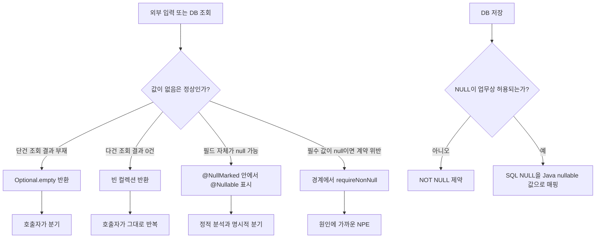

# W21. null 처리 전략 — Optional·JSpecify·DB NULL

> `null`은 값이 비어 있다는 정보이면서, 호출자가 예상하지 못한 결함일 수도 있다. 그래서 경계마다 뜻을 정하고 타입과 제약으로 드러낸다.
> 조회 결과가 없으면 반환 타입에서 표현하고, 참조 자체가 허용되지 않는 곳은 계약과 조기 검증으로 막는다.
> 기본 추천은 “단건 부재는 `Optional<T>`, 여러 건 없음은 빈 컬렉션, nullable 필드는 `@NullMarked` 안의 `@Nullable`, 저장 규칙은 DB 제약”이다.

## 1. 질문

`user.getName()` 호출에서 운영 NPE가 났는데 `user`를 만든 Repository와 호출한 Controller 사이에 여러 계층이 끼어 있다. 메서드 선언만 봐서는 null 가능성을 알 수 없다.

조회 결과가 없을 때 Repository는 null과 `Optional<User>` 중 뭘 반환할까? 0건 목록은 null일까 빈 목록일까? DB nullable과 JSON 생략은 같은 뜻일까?

DB의 `= NULL` 조회 누락이나 PATCH의 필드 생략=삭제도 의미 혼동에서 난다.

## 2. 짧은 답

- 단건 조회의 “없음”처럼 정상적인 결과 부재는 `Optional<T>` 반환으로 표현한다.
- 컬렉션 조회는 `null` 대신 빈 컬렉션을 반환한다. 빈 결과가 정상적인 0건을 뜻해야 한다.
- 일반 참조의 null 계약은 패키지의 `@NullMarked`를 기본으로 하고, 예외적인 nullable 타입 사용에 `@Nullable`을 붙인다.
- 주입 객체나 필수 인자가 null이면 경계에서 `Objects.requireNonNull`로 즉시 실패시켜 원인을 가까이 둔다.
- DB에서 허용되지 않는 상태는 `NOT NULL` 등 제약으로 막고, 실제 허용되는 SQL `NULL`은 Java의 nullable 타입 사용으로 보존한다.
- JSON에서 생략은 “변경하지 않음”, 명시적 `null`은 “지움”이 될 수 있다. PATCH 계약에서 두 동작을 구분한다.
- 기본값 추천: **새 Java 서비스는 nullable 일반 참조를 기본으로 금지하고, 부재는 타입별로 표현한다.** 즉 단건은 `Optional`, 다건은 빈 컬렉션, nullable 필드는 JSpecify, 저장 불변식은 DB 제약이다.

## 3. 왜 그런가 — 원리

### null의 비용은 값보다 정보 손실과 거리에서 생긴다

Java 참조형은 null일 수 있어도 `String name` 선언만으로 `name.length()`의 안전성을 알 수 없다. Controller → Service → Repository처럼 경로가 길면 생성 지점과 NPE 사이에 여러 메서드가 끼고, 스택 트레이스는 실패 위치만 알려준다.

정적 계약은 작성 시점에 null 허용 여부를 알리고, 런타임 검증은 외부 입력이 계약을 깨면 가까이서 실패시킨다. DB 제약은 모든 writer가 지킬 저장 규칙을 강제한다. 각 층이 다른 경계를 보호한다.



### `Optional`은 존재 여부를 반환 경계로 옮긴다

`Optional<T>`는 정상적인 단건 부재를 empty로 표현하는 반환 컨테이너다. 변수 자체가 null이면 상태가 다시 세 개(null, empty, 값 있음)가 되므로 항상 non-null 인스턴스를 반환한다. 호출자는 `orElse`, `orElseThrow`, `map` 등으로 부재를 처리한다.

모든 null을 empty로 바꾸지는 않는다. 사용자 미존재는 정상일 수 있지만 필수 설정 누락은 결함이다. 이를 empty로 감추면 “검색 결과 없음”으로 오진한다. `ofNullable`은 nullable 레거시 반환을 감쌀 때 쓰고, 불변식 위반은 `of`나 `requireNonNull`로 드러낸다.

필드나 Entity 속성의 Optional은 ORM·직렬화와 충돌할 수 있고, 파라미터 Optional은 호출자에게 불필요한 래핑을 요구한다. `Optional<List<T>>`도 보통 빈 목록과 중복 상태이므로 다건은 `List<T>`로 충분하다.

### JSpecify는 주석보다 계약과 도구 생태계를 제공한다

`@NullMarked` 범위의 타입은 기본 non-null이고 예외만 `@Nullable`로 표시한다. 보통 패키지 `package-info.java`에서 선언하며, 레거시 일부는 `@NullUnmarked`로 점진 전환한다.

이 애노테이션이 런타임이나 Java 컴파일러에서 자동 검사를 하지는 않는다. IDE, NullAway 같은 정적 분석기, Kotlin 등 계약을 이해하는 도구가 경고를 내야 효과가 있다. Spring Framework 7은 자사 API에 JSpecify를 적용하고 빌드에서 NullAway로 일관성을 확인한다. 외부 호출은 여전히 계약을 깰 수 있다.

override에 계약 애노테이션이 자동 복사된다고 가정하지 않는다. 제네릭의 `List<String>`과 `List<@Nullable String>`, 배열 참조와 배열 원소의 nullness도 각각 구별한다.

### DB의 NULL은 Java null과 비슷해 보여도 실행 규칙이 다르다

SQL `NULL` 비교 결과는 `UNKNOWN`이다. `WHERE`는 `TRUE`인 행만 통과시키므로 `nickname = NULL` 대신 `IS NULL`을 쓴다. `NOT (x = 10)`도 x가 null이면 unknown이라 누락된다.

`COUNT(*)`는 행 수, `COUNT(nickname)`은 null이 아닌 값의 수다. 필수값은 `NOT NULL` 제약으로 다른 앱·배치까지 강제하고, 실제 미상/미입력이 허용되는 컬럼만 nullable로 둔다.

JDBC 결과에서 SQL NULL은 Java 참조형 값에서는 Java null로 관찰된다. 이때 “행 자체가 없음”은 조회 결과가 없다는 뜻이고, “행은 있지만 컬럼이 NULL”은 그 행의 속성이 비었다는 뜻이다. Repository 결과를 `Optional.empty()`로 표현하는 것과, 존재하는 Entity의 nullable 필드를 표현하는 것은 서로 다른 층이다.

### JSON은 필드의 부재와 null을 따로 보존해야 할 때가 있다

JSON `{}`의 키 누락과 `{"nickname":null}`은 다르다. PATCH에서 누락=유지, null=지움, 문자열=설정이라면 DTO의 Java null 하나로 합치면 의도가 사라진다. Jackson 트리의 `get("nickname")`은 키 누락에 Java null, 명시적 JSON null에 `NullNode`를 준다. 응답에서 null 키를 생략하는 설정도 공개 계약으로 정한다.

### 버전 변화

- **Java 8:** `Optional`이 표준 API가 되어, null을 그대로 반환하던 단건 부재를 명시적으로 표현할 수 있게 됐다. JDK API는 이를 결과가 없을 수 있는 메서드의 반환 타입으로 규정한다.
- **JSpecify 1.0.0:** 도구·라이브러리마다 달랐던 nullness 표시를 공통 애노테이션과 의미로 맞추기 시작했다.
- **Spring Framework 7:** Spring API가 JSpecify 계약을 채택하고 빌드에서 NullAway로 일관성을 검사한다. 애노테이션을 공유해야 라이브러리·IDE·Kotlin이 같은 계약을 읽을 수 있다.

## 4. 선택지 비교

| 선택지 | 어떻게 동작 | 장점 | 단점 | 언제 쓰나 | 국내 실무에서 흔한가(근거 있으면) |
|---|---|---|---|---|---|
| nullable 반환(`@Nullable T`) | 값 또는 Java null을 직접 반환 | 기존 API와 단순 DTO에 자연스럽고 래퍼가 없다 | 호출 지점마다 분기 누락 가능, 주석 없는 레거시 API는 의미 불명 | 외부/레거시 시그니처 호환, 필드가 실제로 nullable일 때 | 기존 코드에서 자주 만나지만 팀·도메인별 분포 통계는 미확인 |
| `Optional<T>` 반환 | `empty()` 또는 값 든 컨테이너 반환 | 부재 처리가 호출자에게 보이고 체이닝 가능 | 필드·파라미터·중첩에 남용하면 불편, null Optional은 금지 | 단건 조회처럼 “없음”이 정상 결과인 반환값 | Spring Data `findById`가 이 형태를 사용. 그 밖의 국내 보편성 비율은 미확인 |
| JSpecify 계약 | `@NullMarked` 기본 non-null, 예외만 `@Nullable`; 도구가 검사 | API 계약을 IDE/빌드/언어 도구가 공유, 점진 적용 가능 | 정적 분석 도구 설정이 필요하고 런타임 강제 아님 | 새 서비스와 라이브러리 API, 특히 Kotlin 소비자가 있는 코드 | Spring Framework 7이 채택. 개별 조직 채택률은 미확인 |
| 빈 컬렉션 | 0건이면 non-null `List.of()` 등 반환 | 반복·스트림 호출이 간단하고 null 분기 제거 | 실패/미조회 상태까지 빈 결과로 숨기면 의미 오류 | 다건 조회의 정상적인 0건 | Spring Data `findAll` 계열도 iterable 반환. 관행 통계는 미확인 |
| DB `NOT NULL` / nullable 컬럼 | 제약이 저장 상태를 거부하거나 SQL NULL을 허용 | 모든 writer에 같은 저장 불변식 적용 | `NOT NULL`은 업무 규칙을 잘못 정하면 데이터 모델을 왜곡 | 필수값은 `NOT NULL`, 미상/미입력이 허용된 값은 nullable | 관계형 DB에서 제약 사용은 표준적이나 국내 통계는 미확인 |
| JSON 생략/null 명시 | 키 존재 여부와 값 종류로 PATCH 동작을 나눈다 | 변경 안 함과 지우기를 구별 | DTO 한 필드로 받으면 구분을 잃기 쉽고 계약 문서화 필요 | PATCH, 부분 수정, 응답에서 필드 생략이 의미 있을 때 | 프레임워크/팀 설정 편차가 커 보편성 수치는 미확인 |

## 5. 코드로 보기

### 예제 1 — 순수 Java: 부재는 `Optional`, 다건 0건은 빈 목록, 필수 인자는 조기 실패

아래 예제를 JDK 21에서 실행했다. `Optional`은 조회 결과의 부재를 나타내고, 빈 목록은 반복 가능한 정상 0건을 나타낸다. `requireNonNull`은 필수 인자가 null이면 이후의 모호한 NPE 대신 원인 경계에서 실패시킨다.

```java
import java.util.List;
import java.util.Locale;
import java.util.Objects;
import java.util.Optional;

public class NullHandlingDemo {
    record User(long id, String nickname) {}

    static Optional<User> findUser(long id) {
        return id == 42
                ? Optional.of(new User(42, "Min"))
                : Optional.empty();
    }

    static String displayName(Optional<User> candidate) {
        return candidate
                .map(User::nickname)
                .filter(name -> !name.isBlank())
                .orElse("(이름 없음)");
    }

    static String requiredEmail(String email) {
        return Objects.requireNonNull(email, "email is required")
                .strip()
                .toLowerCase(Locale.ROOT);
    }

    static List<User> findTeamMembers(long teamId) {
        return teamId == 7
                ? List.of(new User(42, "Min"), new User(43, "Jin"))
                : List.of();
    }

    public static void main(String[] args) {
        System.out.println("existing: " + findUser(42).map(User::id).orElse(-1L));
        System.out.println("missing: " + displayName(findUser(404)));
        System.out.println("normalized email: " + requiredEmail("  A@EXAMPLE.COM "));
        System.out.println("unknown team members: " + findTeamMembers(99).size());
        try {
            requiredEmail(null);
        } catch (NullPointerException e) {
            System.out.println("early failure: " + e.getMessage());
        }
    }
}
```

실제 출력:

```text
existing: 42
missing: (이름 없음)
normalized email: a@example.com
unknown team members: 0
early failure: email is required
```

실무에서 `orElse(expensiveCall())`은 값이 있어도 인자가 먼저 계산된다. 대체값 계산이 비싸거나 부작용이 있으면 `orElseGet(() -> expensiveCall())`을 선택한다. 그리고 이 예제의 `displayName`처럼 화면용 기본 문구를 만드는 일과, 이메일이 없어도 되는 비즈니스 규칙은 구별한다. 기본 문자열 표시를 했다고 도메인 값이 생긴 것은 아니다.

### 예제 2 — Spring Framework 7: 패키지 기본값과 명시적 nullable 예외 (미실행)

Spring API에 맞춰 JSpecify 계약을 선언하는 형태다. Spring 애플리케이션 전체를 자동으로 검사하는 것은 아니므로 IDE 또는 빌드 검사기 설정이 필요하다. 생성자 검증은 정적 검사 바깥에서 호출되는 경계도 방어한다.

```java
// package-info.java
@NullMarked
package com.example.user;

import org.jspecify.annotations.NullMarked;
```

```java
package com.example.user;

import java.util.Objects;
import java.util.Optional;
import org.jspecify.annotations.Nullable;
import org.springframework.stereotype.Service;

record User(long id, @Nullable String nickname) {}

interface UserRepository {
    Optional<User> findById(long id);
}

@Service
public class UserService {
    private final UserRepository users;

    public UserService(UserRepository users) {
        this.users = Objects.requireNonNull(users, "users");
    }

    public Optional<User> findById(long id) {
        return users.findById(id);
    }

    public String greeting(User user) {
        String name = user.nickname();
        return name == null ? "안녕하세요" : name + "님, 안녕하세요";
    }
}
```

`User`가 없으면 `Optional.empty()`, 행은 있지만 별명이 없으면 `nickname == null`이다. 서로 다른 상태를 서로 다른 타입 위치에 보존한다.

### 예제 3 — SQL NULL, 행 부재, Java nullable 컬럼 구분 (미실행)

```sql
-- nickname 값이 NULL인 행 찾기
SELECT id, nickname
FROM user_profile
WHERE nickname IS NULL;

-- 행 수와 nickname 값이 알려진 행 수는 다를 수 있다
SELECT COUNT(*) AS row_count,
       COUNT(nickname) AS known_nickname_count
FROM user_profile;

-- 필수 컬럼은 저장 경계에서 제약
CREATE TABLE user_account (
    id BIGINT PRIMARY KEY,
    email VARCHAR(320) NOT NULL,
    nickname VARCHAR(80)
);
```

JDBC에서 `rows.next()`가 false면 단건 조회 결과가 없고, 행이 있으면 `getObject("nickname", String.class)`의 결과를 `@Nullable String` 필드로 매핑한다. 참조형 컬럼 값이 SQL NULL이면 Java null로 표현된다. DB가 Postgres라면 `nickname = NULL` 대신 `nickname IS NULL`을 쓴다.

### 예제 4 — PATCH JSON에서 키 누락과 null 보존 (Jackson 3.1.5 API, 미실행)

Jackson 트리에서 누락 키는 Java null 참조, JSON 명시적 null은 null 노드다. 세 상태를 따로 표현한 뒤 서비스에서 각 상태의 변경 규칙을 적용한다.

```java
package com.example.user;

import tools.jackson.core.JacksonException;
import tools.jackson.databind.JsonNode;
import tools.jackson.databind.ObjectMapper;

final class NicknamePatchParser {
    private static final ObjectMapper JSON = new ObjectMapper();

    enum Kind { UNCHANGED, CLEAR, SET }
    record NicknamePatch(Kind kind, String value) {}

    static NicknamePatch parse(String body) throws JacksonException {
        JsonNode root = JSON.readTree(body);
        if (root == null || !root.isObject()) {
            throw new IllegalArgumentException("JSON object required");
        }
        JsonNode nickname = root.get("nickname");
        if (nickname == null) {
            return new NicknamePatch(Kind.UNCHANGED, null);
        }
        if (nickname.isNull()) {
            return new NicknamePatch(Kind.CLEAR, null);
        }
        if (nickname.isTextual()) {
            return new NicknamePatch(Kind.SET, nickname.asText());
        }
        throw new IllegalArgumentException("nickname must be a string or null");
    }
}
```

`value`가 null인지로 상태를 판정하지 않고 `kind`가 동작을 결정한다. 실제 API에서는 `UNCHANGED`이면 필드를 건드리지 않고, `CLEAR`이면 도메인 허용 여부를 검증한 뒤 null로 바꾸며, `SET`이면 입력값을 검증해 저장한다. nullable 응답 필드를 생략하도록 설정한다면 응답 계약에도 같은 차이가 보존되는지 확인한다.

## 6. 실무에서는 실제로

**신규 서비스**라면 `@NullMarked`를 신규 패키지 단위로 켜고 NullAway나 JSpecify 지원 IDE 분석을 CI에 포함한다. 외부 라이브러리·생성 코드 경고를 처리할 수 있는 모듈부터 시작한다. 단건 조회는 `Optional`, 다건은 빈 리스트, 필수 필드는 DB `NOT NULL`을 기본으로 합의한다.

**레거시 시스템**은 먼저 `@Nullable`로 실제 계약을 밝히고 새 API부터 명확한 타입을 쓴다. 구 API 앞 어댑터에서 `Optional.ofNullable(legacy.find(...))`로 감싸고 호출자를 점진 전환한다. `@NullUnmarked`는 임시 경계로 둔다.

**SI·금융처럼 스키마 계약이 중요한 프로젝트**는 DB·DTO·업무 정의서의 필수 여부를 맞춘다. “공란=미상”인 외부 전문을 0이나 빈 문자열로 바꾸지 않는다. 과거 데이터 때문에 `NOT NULL` 전환이 어렵다면 데이터 보정과 제약 검증 순서를 계획한다.

**빠른 API 팀**은 `Optional`을 JSON으로 내보내기보다 서비스 반환 경계에서 부재를 처리한다. 404·null·빈 배열 중 계약에 맞는 응답을 고르고, PATCH에서 키 누락과 명시적 null이 구별되는지 확인한다.

## 7. 흔한 오해와 실수

1. **“`Optional`이면 null을 완전히 제거한다” →** `Optional` 변수 자체는 null일 수 있고, 그 상태는 empty와 별개로 잘못된 계약이다. **대처:** 반환할 때 `Optional.empty()` 또는 `of(...)`를 쓰고 Optional 자체의 null을 만들지 않는다.

2. **“`Optional`은 필드나 파라미터에도 안전하다” →** 프레임워크 바인딩·ORM·직렬화가 Optional을 필드 값 타입으로 기대하지 않을 수 있고, 파라미터에서는 호출자를 번거롭게 만든다. **대처:** 반환에서 우선 사용하고 필드에는 값 타입 + JSpecify nullness, 파라미터에는 nullable 계약이나 오버로드를 고려한다.

3. **“`@Nullable`을 붙이면 런타임 NPE가 차단된다” →** JSpecify 표시는 계약이고 도구가 읽어야 경고가 된다. 일반 Java 실행 중 모든 대입을 검사하는 장치가 아니다. **대처:** 정적 분석을 빌드에 연결하고, 외부/신뢰할 수 없는 경계는 검증한다.

4. **“결과 없음은 null 컬렉션으로 반환하면 된다” →** 모든 호출자가 null 분기를 반복하고 한 곳이라도 빠지면 NPE가 난다. **대처:** 정상 0건은 빈 컬렉션으로 반환한다. 조회 실패를 빈 컬렉션으로 숨기지는 않는다.

5. **“SQL에서 NULL은 `= NULL`로 비교한다” →** 비교 결과가 unknown이라 `WHERE`를 통과하지 않는다. **대처:** `IS NULL`을 쓰고, 반대 조건도 NULL 행을 포함해야 하는지 업무 규칙으로 적는다.

6. **“PATCH에서 누락과 null은 둘 다 비어 있으니 같다” →** 누락은 변경 없음, explicit null은 삭제일 수 있다. DTO 역직렬화 때 둘이 하나의 Java null로 합쳐지면 삭제 불가 또는 의도치 않은 삭제가 된다. **대처:** 트리/명시 상태 타입으로 세 경우를 유지한다.

## 8. 자가점검 Q&A (면접 대비)

### Q1. 단건 조회에서 `null` 대신 `Optional<T>`를 반환하는 이유는?

반환 타입이 “값이 없을 수 있다”는 정상 결과를 드러내므로 호출자가 분기를 빼먹기 어렵다. `Optional`은 API 문서만이 아니라 코드 흐름에 부재 처리를 표현한다. 단, 예외 상황이나 필수 데이터 결함까지 empty로 바꾸면 장애를 감춘다.

**꼬리질문:** 필드도 `Optional`로 선언하면 더 안전한가? **답:** 보통 아니다. 프레임워크 매핑과 직렬화에서 일반 값 타입보다 불편하고, 값의 nullability를 JSpecify 등으로 표현하는 편이 낫다.

### Q2. `@NullMarked`가 있으면 null 인자를 전달할 때 무조건 런타임 예외가 나는가?

아니다. 이는 기본 nullness 범위를 선언하는 애노테이션이고, 일반 Java 런타임의 자동 검사 장치가 아니다. JSpecify를 이해하는 IDE·정적 분석기·Kotlin 등이 계약 위반을 찾아낸다. 빌드 도구가 빠졌거나 분석 범위 밖인 호출은 통과할 수 있다.

**꼬리질문:** 그러면 왜 `Objects.requireNonNull`도 쓰나? **답:** 런타임 경계에서 들어오는 값도 검증하고, NPE 위치를 계약이 깨진 곳에 가깝게 만들기 위해서다.

### Q3. DB에서 행이 없고, 행은 있지만 컬럼이 NULL인 경우를 어떻게 다르게 표현하나?

조회 결과 자체가 없으면 `Optional.empty()`로 나타낸다. 행은 존재하면 `Optional.of(row)`이고, nullable 컬럼은 row 필드의 `@Nullable` 값으로 나타낸다. 둘을 하나의 Java null로 합치면 “레코드 미존재”와 “속성 미상”을 구별할 수 없다.

**꼬리질문:** 그러면 DB의 필수 필드는 어디서 강제하나? **답:** 입력 검증에 더해 `NOT NULL` 제약을 둬 다른 앱·배치도 같은 규칙을 지키게 한다.

### Q4. SQL의 `WHERE value <> 5`는 value가 NULL인 행도 반환하는가?

아니다. `NULL <> 5`는 false가 아니라 unknown이고, `WHERE`는 true인 행만 반환한다. null 행을 포함하려면 `value <> 5 OR value IS NULL`처럼 조건을 추가한다.

**꼬리질문:** `value = NULL`은 어떤가? **답:** 역시 unknown이므로 `value IS NULL`을 써야 한다.

### Q5. `COUNT(*)`와 `COUNT(nickname)` 차이를 설명해 보라.

`COUNT(*)`는 선택된 행을 센다. `COUNT(nickname)`은 nickname이 SQL NULL이 아닌 행만 센다. 따라서 두 값의 차이는 이름이 없는 행 수를 나타낼 수 있지만, 실제 업무 의미는 쿼리 조건과 스키마에 따라 확인해야 한다.

**꼬리질문:** nullable 값의 평균이나 합계에서 null은 0으로 처리되는가? **답:** 자동으로 0이라는 뜻이 아니다. NULL은 미상/부재이므로 집계별 규칙을 확인하고 업무상 0으로 간주할 때만 명시적으로 보정한다.

### Q6. PATCH JSON에서 `{}`와 `{"nickname": null}`을 왜 구별하나?

전자는 필드를 전달하지 않아 변경하지 않겠다는 요청, 후자는 명시적으로 기존 값을 비우겠다는 요청으로 정의할 수 있다. DTO가 둘을 같은 Java null로 역직렬화하면 이 의도를 잃는다. Jackson 트리 모델이나 `UNCHANGED/CLEAR/SET` 같은 상태 타입으로 보존한다.

**꼬리질문:** 모든 API에서 둘을 반드시 다르게 취급해야 하나? **답:** 아니다. 전체 교체인지 부분 수정인지 API 계약에 맞춰 정하고 문서와 구현이 같아야 한다.

## 9. 참고문헌

- JSpecify Start Here — https://jspecify.dev/docs/start-here/ — 표준화 목적, Spring 7 안내.
- JSpecify User Guide — https://jspecify.dev/docs/user-guide/ — nullness 애노테이션, 제네릭·배열 규칙.
- Spring Framework Null-safety — https://docs.spring.io/spring-framework/reference/core/null-safety.html — Framework 7 도입과 도구 연동.
- Java SE 25 `Optional` — https://docs.oracle.com/en/java/javase/25/docs/api/java.base/java/util/Optional.html — 반환 용도와 API.
- Java SE 25 `Objects` — https://docs.oracle.com/en/java/javase/25/docs/api/java.base/java/util/Objects.html — `requireNonNull` API.
- Spring Data Core 4.1 `CrudRepository` — https://docs.spring.io/spring-data/commons/docs/current/api/org/springframework/data/repository/CrudRepository.html — `findById`의 Optional 계약.
- Java SE 25 `ResultSet` — https://docs.oracle.com/en/java/javase/25/docs/api/java.sql/java/sql/ResultSet.html — 참조형 컬럼 읽기 API.
- PostgreSQL 18 Logical Operators — https://www.postgresql.org/docs/current/functions-logical.html — SQL 3값 논리.
- PostgreSQL 18 Comparison Functions — https://www.postgresql.org/docs/current/functions-comparison.html — NULL 비교.
- PostgreSQL 18 Aggregate Functions — https://www.postgresql.org/docs/current/functions-aggregate.html — `COUNT` 차이.
- PostgreSQL 18 Constraints — https://www.postgresql.org/docs/current/ddl-constraints.html — `NOT NULL` 제약.
- Jackson 3.1.5 `JsonNode` — https://javadoc.io/static/tools.jackson.core/jackson-databind/3.1.5/tools.jackson.databind/tools/jackson/databind/JsonNode.html — 트리 노드 API.
- Jackson 3.1.5 `ObjectMapper` — https://javadoc.io/static/tools.jackson.core/jackson-databind/3.1.5/tools.jackson.databind/tools/jackson/databind/ObjectMapper.html — JSON tree 읽기 API.

Optional의 람다·함수형 API 상세 → J08 참조. Boot 4 마이그레이션 전체 → S21 참조.
