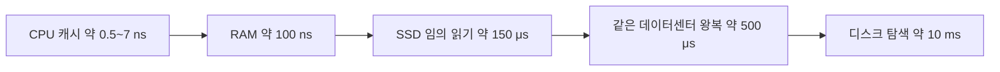
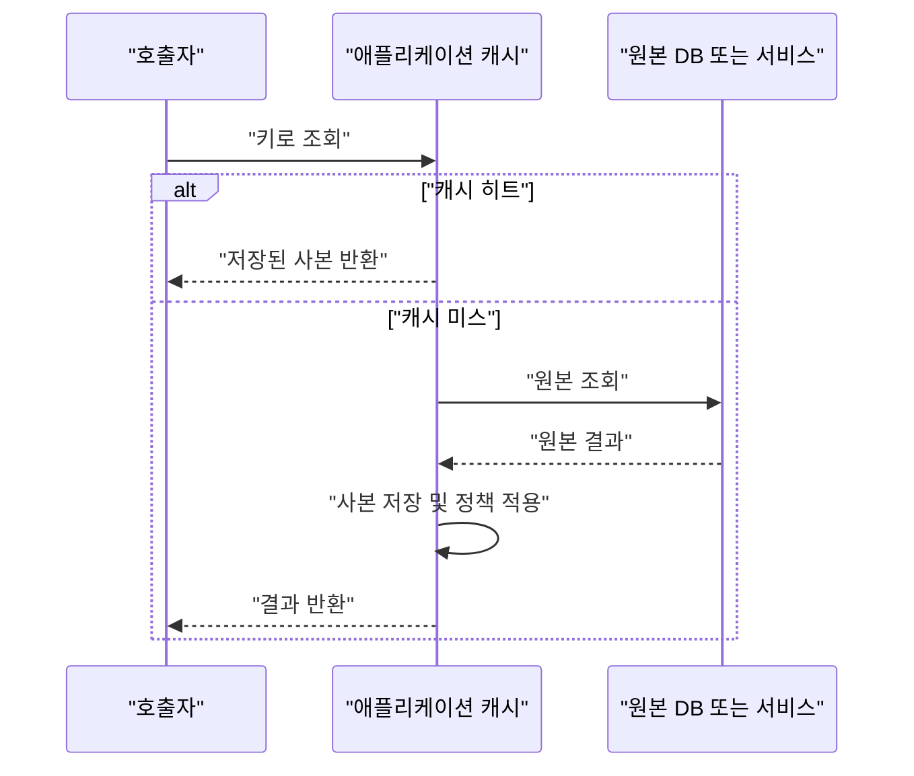

# W23. 캐시와 인메모리 — 무엇이고, 왜 빠르고, 왜 쓰나

> 캐시는 느린 원본 데이터의 사본을 더 가까운 곳에 두어, 반복 조회의 지연과 원본 부하를 줄이는 기법이다.
> 인메모리는 데이터를 RAM에 두고 처리한다는 말이며, 기본적으로 프로세스·서버 장애 뒤에도 남는다는 뜻은 아니다.
> 반복 읽기와 제한된 최신성 오차가 허용되면 캐시를 검토하되, 기본 선택은 크기와 수명을 제한한 Caffeine 로컬 캐시다.

## 1. 질문

신입 개발자가 상품 상세 API를 만들었는데 응답이 80ms 안팎이다. 같은 상품을 조회해도 DB 쿼리는 매번 반복된다. “서버 메모리에 담으면 빨라지지 않을까?”라는 생각이 든다.

`static Map<Long, Product>`를 추가해 테스트는 빨라졌지만, 배포를 두 대로 늘리자 한 서버에서 바꾼 상품명이 다른 서버에 반영되지 않는다. 재배포 뒤에는 캐시가 비어 DB 요청이 몰린다.

팀원이 Redis를 쓰자고 하는데 데이터베이스도 이미 있다. RAM의 H2와 무엇이 다른지, 서버가 늘면 캐시를 공유할 수 있는지도 궁금하다.

## 2. 짧은 답

- 인메모리는 RAM에서 읽고 쓴다는 뜻이다. 캐시는 원본을 대체하기보다 자주 읽는 결과를 가까운 곳에 복사한다.
- CPU 캐시부터 CDN까지 계층이 있다. 앱 캐시는 개발자가 키·수명·무효화를 정한다.
- 재사용되는 읽기가 많고 원본 조회가 비싸면 캐시가 지연과 DB 부하를 낮춘다. 반복성이 낮으면 메모리 비용과 복잡도만 늘 수 있다.
- 단일 JVM 안에서 공유 가능한 최신성이 조금 늦어도 되는 데이터라면, 기본 선택은 최대 크기와 만료 시간을 정한 Caffeine이다.
- 여러 서버가 같은 값을 봐야 하거나 인스턴스 간 캐시 공유가 필요하면 Redis 같은 외부 캐시를 검토한다. 네트워크 홉과 운영 의존성이 추가된다.
- `static Map`은 자동 만료·용량 제한·서버 간 공유를 제공하지 않는다. `ConcurrentHashMap`은 동시 접근의 일부 문제를 해결하지만 그 나머지는 해결하지 않는다.
- 캐시된 값은 사본이므로 최신성, 무효화, 메모리 제한은 캐시 도입 시 함께 설계한다. 캐시가 권위 있는 원본 데이터가 되면 안 된다.

## 3. 왜 그런가 — 원리

### 인메모리와 메모리 계층

인메모리(in-memory)는 데이터가 RAM에서 처리된다는 뜻이다. DB 버퍼 풀은 디스크 페이지의 사본을 RAM에 두며, 디스크가 영속 원본이다. Redis도 설정에 따라 디스크에 스냅샷이나 쓰기 로그를 남길 수 있다. “인메모리”와 “장애 뒤 사라짐”은 구분해야 한다.

메모리 계층은 더 빠르고 작고 가까운 저장소에서 느리고 크고 먼 저장소로 내려간다. 아래 수치는 2012년 무렵 프로그래머용 지연 시간 표에 정리된 대략값이다. CPU 모델, 접근 패턴, 운영체제, 네트워크, 큐 길이에 따라 달라지므로 오늘날 모든 서버의 보장값으로 읽으면 안 된다.

| 계층 또는 작업 | 대략 지연 | 해석 |
|---|---:|---|
| CPU L1 캐시 참조 | 0.5 ns | 연산기 가까이에 있는 극소량의 하드웨어 캐시 |
| CPU L2 캐시 참조 | 7 ns | L1보다 크지만 더 느린 하드웨어 계층 |
| 메인 메모리(RAM) 참조 | 100 ns | 메모리 계층에서 CPU 캐시보다 아래 |
| SSD 임의 4KB 읽기 | 150 μs | RAM보다 지연이 큰 저장 장치 접근 |
| 같은 데이터센터 왕복 | 500 μs | 원격 서버 왕복은 RAM 접근만으로 끝나지 않음 |
| 디스크 탐색 | 10 ms | 저장 장치와 접근 방식에 크게 좌우되는 역사적 대략값 |

수치는 출처의 연식과 조건을 고려한다. DB 지연은 네트워크 왕복 외에 큐잉·SQL·잠금·직렬화를 포함하므로 고정값으로 정할 수 없다. 실제 서비스의 p50·p95·p99를 계측한다.



CPU 캐시는 하드웨어가 자동 관리한다. OS 페이지 캐시는 파일 블록을, DB 버퍼 풀은 테이블·인덱스 페이지를 메모리에 둔다. HTTP 캐시는 헤더와 URL 규칙을 따르고, 앱 캐시는 코드가 키·수명·무효화를 정한다. 상세 비교는 W17을 참조한다.

### 캐시가 빠른 이유와 효과 계산

캐시(cache)는 원본보다 가까운 곳에 둔 사본이다. 먼저 캐시를 확인하고, 값이 없으면 원본을 읽어 캐시에 채운다. 원본은 DB·다른 서비스·계산 결과일 수 있다.



캐시 히트(hit)는 키가 있어 원본을 다시 조회하지 않은 경우고, 미스(miss)는 값이 없어 원본을 읽은 경우다. 히트율은 `히트 수 ÷ 전체 조회 수`다. 높아도 히트 경로의 캐시·직렬화 비용이 크거나 원본이 가벼우면 이득은 작다.

예를 들어 단순한 교육용 가정으로 원본 호출이 10ms, 앱 캐시 히트가 0.1ms이고 히트율이 90%라 하자. 미스가 원본 호출 시간을 전부 포함할 때 평균 지연의 근삿값은 `0.9 × 0.1ms + 0.1 × 10ms = 1.09ms`다. 같은 가정 아래 캐시가 없을 때 10ms이므로 약 9.2배 낮다. 원본 호출 수는 이상적으로 조회 100회당 약 10회로 줄어든다. 이는 설명을 위한 가정값이지 벤치마크 결과가 아니다. 실제로는 부하에 따른 DB 지연, 캐시 미스의 부가 비용, 만료와 퇴거, 동시 요청이 이득을 바꾼다.

인기 상품이나 공통 설정처럼 일부 키가 반복되면 최근성·빈도 지역성이 생긴다. 캐시는 그 구간의 원본 왕복과 계산을 줄인다. 매번 다른 키를 한 번만 읽는다면 저장·퇴거 비용이 이득보다 클 수 있다.

### 생명주기와 정합성

JVM 내부 `Map`과 Caffeine은 프로세스 힙에 있다. 두 인스턴스는 힙을 공유하지 않으며, 프로세스가 내려가면 캐시도 사라진다. 재시작 직후에는 DB 부하가 일시적으로 늘 수 있다.

Redis는 앱 밖의 서버에 데이터를 두므로 같은 서버를 바라보는 인스턴스가 공유할 수 있다. 네트워크 요청과 Redis의 장애·용량·보안·운영이 추가된다. Redis는 RDB, AOF, 둘 다 또는 무영속성으로 운영할 수 있으므로 재시작 후 데이터 유지 여부를 확인한다.

사본은 원본 변경과 동시에 저절로 바뀌지 않는다. 만료 전까지 오래된 값을 주거나 앱 서버마다 값이 다를 수 있다. TTL을 짧게 하면 원본 부하와 미스가 늘 수 있다. 쓰기 때 제거·갱신하거나 캐시하지 않을지는 최신성 요구에 맞춘다. 전략·스탬피드는 S11, Redis 사용법은 P23, JVM 메모리 구조는 J14를 참조한다.

## 4. 선택지 비교

| 선택지 | 어떻게 동작 | 장점 | 단점 | 언제 쓰나 | 국내 실무에서 흔한가 |
|---|---|---|---|---|---|
| `HashMap` / `ConcurrentHashMap` | JVM 힙 안에 키와 객체 참조를 둔다. 인스턴스마다 별도 사본이다. | 외부 인프라가 없고 조회 비용이 낮다. 임시·작은 단순 데이터에 쉽다. | 기본 `HashMap`은 동시성 보장이 없고, 둘 다 자동 만료·상한·분산 공유를 제공하지 않는다. | 단일 스레드 처리, 제한된 생명주기의 내부 임시 상태, 교육 예제 | 사용 사례는 있으나 국내 점유율이나 팀별 관행을 뒷받침할 통계는 확인하지 못했다. |
| Caffeine 로컬 캐시 | JVM 내부 캐시에 값을 적재하고 크기·시간·빈도 정책으로 퇴거시킨다. | 동기식 조회 경로에 간단히 붙이고 크기를 제한할 수 있다. 로컬이라 네트워크 홉이 없다. | 인스턴스별 복사본이라 갱신 전파가 자동으로 되지 않고, 재시작하면 비워진다. | 반복 조회가 있고 약간의 지연된 최신성이 허용되는 앱 내부 조회 | Java 캐시 라이브러리이며 실제 국내 보급률 자료는 확인하지 못했다. |
| Redis 등 인메모리 서버 | 별도 서버의 자료 구조를 네트워크로 읽고 쓴다. 연결된 앱 인스턴스가 같은 키 공간을 쓴다. | 여러 서버가 공유하고, 앱 재시작과 캐시 생명주기를 분리할 수 있다. | 네트워크 지연, 별도 장애 지점, 운영·메모리·직렬화 비용이 생긴다. 영속성은 설정에 따라 다르다. | 여러 인스턴스에서 공유할 값, 중앙집중형 캐시가 필요한 조회 | 널리 알려진 선택지이나 국내 사용률의 근거 수치는 확인하지 못했다. |
| H2 인메모리 DB | SQL·JDBC DB를 메모리 기반 모드로 실행한다. | 테스트와 로컬 개발에서 별도 DB 설치 없이 SQL을 실행할 수 있다. | 일반적인 캐시 자료 구조보다 DB 기능·스키마가 중심이다. 프로세스 메모리를 차지하며 인스턴스 간 자동 공유를 뜻하지 않는다. | 테스트 픽스처, 개발용 DB, 휘발돼도 되는 관계형 데이터 | 개발·테스트에서 쓰이는 선택지이나 국내 실무 빈도 자료는 확인하지 못했다. |

H2는 “Redis보다 작은 캐시”로 분류하면 안 된다. 관계형 테이블·SQL이 필요한 메모리 DB이며, 조회 결과를 원본 앞에서 임시 보관하는 캐시와 목적이 다르다. 원본 DB 대신 H2를 쓰기로 했다면 테스트·프로세스 종료 시 데이터가 사라져도 되는지부터 확인한다. 각 방식의 서버 수, 재시작, 메모리 한도에서의 동작은 Caffeine 퇴거 정책과 Redis 영속성 설정처럼 실제 구성을 확인해야 한다.

## 5. 코드로 보기

같은 기능을 “책 ID로 조회하고, 반복 요청에서는 저장된 사본을 반환”으로 맞춰 본다. `HashMap`/`ConcurrentHashMap`은 직접 관리하는 로컬 저장소, Caffeine은 로컬 캐시 정책을 제공하는 라이브러리, Spring Cache는 캐시 구현을 감싸는 추상화다. Redis는 그 추상화 뒤에 놓일 수 있는 원격 구현이다. H2는 이 캐시 계층과 역할이 다르다.

### 순수 Java: Map에 계산 결과를 저장하고 반복 계산과 비교

다음 예제는 피보나치 값을 매번 재귀 계산하거나, `Map`에 메모이제이션하는 경우를 비교한다. 실제 실행 가능한 JDK 21 단일 파일 코드이며, Map에 `fib(35)`를 먼저 넣어 둔 뒤 반복 조회를 측정한다.

```java
import java.util.HashMap;
import java.util.Map;

public class CacheComparison {
    private static long fib(int n) {
        if (n < 2) return n;
        return fib(n - 1) + fib(n - 2);
    }

    private static long memoizedFib(int n, Map<Integer, Long> cache) {
        Long saved = cache.get(n);
        if (saved != null) return saved;
        long value = memoizedFib(n - 1, cache) + memoizedFib(n - 2, cache);
        cache.put(n, value);
        return value;
    }

    public static void main(String[] args) {
        int n = 35;
        int repetitions = 30;
        fib(30); // 예열

        long plainSum = 0;
        long startPlain = System.nanoTime();
        for (int i = 0; i < repetitions; i++) plainSum += fib(n);
        long plainNanos = System.nanoTime() - startPlain;

        Map<Integer, Long> cache = new HashMap<>();
        cache.put(0, 0L);
        cache.put(1, 1L);
        memoizedFib(n, cache); // 최초 계산과 적재는 측정에서 제외
        long cachedSum = 0;
        long startCached = System.nanoTime();
        for (int i = 0; i < repetitions; i++) cachedSum += memoizedFib(n, cache);
        long cachedNanos = System.nanoTime() - startCached;

        System.out.printf("n=%d, repetitions=%d%n", n, repetitions);
        System.out.printf("매번 계산: fib=%d, 합=%d, %.3f ms%n",
                fib(n), plainSum, plainNanos / 1_000_000.0);
        System.out.printf("Map 캐시: fib=%d, 합=%d, %.3f ms, 저장 항목=%d%n",
                memoizedFib(n, cache), cachedSum, cachedNanos / 1_000_000.0, cache.size());
    }
}
```

JDK 21 Corretto로 실행한 실제 출력:

```text
n=35, repetitions=30
매번 계산: fib=9227465, 합=276823950, 752.804 ms
Map 캐시: fib=9227465, 합=276823950, 0.003 ms, 저장 항목=36
```

여기서 읽을 점은 “캐시가 언제나 250,000배 빠르다”가 아니다. 재귀 피보나치는 같은 입력의 중간 결과를 기하급수적으로 다시 계산하는 의도적으로 비싼 예이고, 측정도 이미 채운 단일 키를 읽는 구간만 포함한다. 실제 애플리케이션은 원본 호출, 키 계산, 직렬화, 경쟁 상태, 만료, JVM 워밍업까지 측정해야 한다. 이 출력은 같은 값이 나오는지와 반복 계산을 피하는 원리를 보이는 시연이다.

### 같은 키 조회: 동시성 맵과 Caffeine

`ConcurrentHashMap`은 여러 스레드의 맵 접근을 안전하게 다루는 구현이다. 값이 없을 때 계산해 넣는 코드는 다음처럼 쓸 수 있다. `Book`은 애플리케이션의 불변 도메인 객체, `loadBookFromDatabase`는 기존 저장소 조회라고 가정하며, 아래는 서비스 안에 둘 전체 메서드 형태다.

```java
import java.util.concurrent.ConcurrentHashMap;
import java.util.concurrent.ConcurrentMap;
import java.util.concurrent.atomic.AtomicInteger;

public final class LocalBookLookup {
    private final ConcurrentMap<Long, Book> cache = new ConcurrentHashMap<>();
    private final AtomicInteger loads = new AtomicInteger();

    Book find(long id) {
        return cache.computeIfAbsent(id, this::loadBookFromDatabase);
    }

    private Book loadBookFromDatabase(long id) {
        loads.incrementAndGet();
        return new Book(id, "책 " + id); // 실제 서비스에서는 저장소 호출
    }

    public static void main(String[] args) {
        LocalBookLookup lookup = new LocalBookLookup();
        System.out.println(lookup.find(1));
        System.out.println(lookup.find(1));
        System.out.println("원본 호출=" + lookup.loads.get());
    }
}

record Book(long id, String title) {}
```

JDK 21에서 이 예제를 실행한 출력:

```text
Book[id=1, title=책 1]
Book[id=1, title=책 1]
원본 호출=1
```

실제 예제의 로더는 대체 가능한 데이터 소스 구현이라 DB 드라이버에 의존하지 않도록 했다. 이 패턴을 운영용 캐시로 쓰려면 `cache`에 상한과 만료가 없다는 점을 직접 해결해야 한다. 원본에서 없는 키를 `null`로 반환하면 값이 저장되지 않아 매번 로더가 실행될 수 있고, 맵에 넣은 가변 객체를 다른 코드가 수정하면 사본의 의미도 깨진다. 맵 API의 동시성 기본 보장은 구현체마다 다르며 `ConcurrentHashMap`의 `computeIfAbsent` 동작을 모든 `Map` 구현으로 일반화하면 안 된다.

Caffeine을 쓰면 로컬 저장소를 유지하면서 용량과 수명을 정책으로 지정할 수 있다.

```java
import com.github.benmanes.caffeine.cache.Cache;
import com.github.benmanes.caffeine.cache.Caffeine;
import java.time.Duration;

final class CaffeineBookLookup {
    private final Cache<Long, CaffeineBook> cache = Caffeine.newBuilder()
            .maximumSize(10_000)
            .expireAfterWrite(Duration.ofMinutes(5))
            .recordStats()
            .build();

    CaffeineBook find(long id) {
        return cache.get(id, this::loadBookFromDatabase);
    }

    private CaffeineBook loadBookFromDatabase(long id) {
        return new CaffeineBook(id, "책 " + id);
    }
}

record CaffeineBook(long id, String title) {}
```

위 코드는 Caffeine 라이브러리 사용 예제이며 `(미실행)`이다.

`maximumSize`와 `expireAfterWrite`는 예시 정책값이지 모든 서비스의 권장 TTL이 아니다. 실제 도메인에서 변경 주기와 허용 가능한 오래된 값의 시간을 정해 조정한다. Caffeine 문서는 크기 기반 퇴거를 빈도와 최근성에 기반해 수행하고, 시간 기반 만료·통계·자동 로딩을 선택 기능으로 제공한다고 설명한다.

### Spring Cache로 구현을 분리

Spring Cache는 `@Cacheable`로 메서드 호출을 캐시 추상화에 연결한다. Framework 7 / Boot 4.1 앱의 서비스 코드는 다음과 같이 쓸 수 있다. 캐시 이름을 가진 `CacheManager`와 실제 provider 의존성을 애플리케이션 설정에 등록해야 하며, 어노테이션만으로 Redis 서버나 캐시 저장소가 생기는 것은 아니다.

```java
import org.springframework.cache.annotation.Cacheable;
import org.springframework.stereotype.Service;

record Book(long id, String title) {}

@Service
class BookService {
    private final BookRepository books;

    BookService(BookRepository books) {
        this.books = books;
    }

    @Cacheable(cacheNames = "books", key = "#id")
    Book find(long id) {
        return books.findById(id);
    }
}

interface BookRepository {
    Book findById(long id);
}
```

이 코드는 저장소 빈과 `CacheManager`가 주입되는 기존 Spring 애플리케이션 예제이며 `(미실행)`이다. `CacheManager`를 Caffeine 기반으로 구성하면 프로세스 로컬 캐시가 되고, Redis 기반으로 구성하면 여러 앱 인스턴스가 공유 가능한 캐시가 된다. provider 변경 시 직렬화 형식, 키 규칙, TTL, 장애 시 동작을 정해야 한다. Spring은 `@Cacheable`로 저장하고, `@CacheEvict`로 제거하고, `@CachePut`으로 갱신하는 선언 방식을 제공한다.

H2를 선택할 때는 `jdbc:h2:mem:books`처럼 JDBC URL이 메모리 DB를 만드는지 본다. 이는 관계형 DB이지 캐시 provider가 아니며, 여러 앱 노드가 자동 공유하지 않는다. 테스트 DB인지 원본 앞의 캐시인지 역할을 구분한다.

## 6. 실무에서는 실제로

먼저 지연 원인과 반복 조회의 키 분포를 측정한다. 키가 매번 다르거나 쓰기가 잦으면 캐시가 맞지 않을 수 있다.

| 팀·프로젝트 유형 | 현실적인 시작점 | 다음 판단 |
|---|---|---|
| 신규 서비스 | 원본 저장소를 기준 데이터로 두고, 캐시 없이 실제 지연을 측정한다. 반복되는 비싼 읽기부터 후보로 올린다. | 단일 인스턴스 로컬 반복 조회면 제한된 Caffeine, 노드 간 공유가 필요하면 Redis를 검토한다. |
| 레거시 | 기존 응답·갱신 흐름과 캐시된 데이터가 어긋나는 지점을 먼저 추적한다. 무제한 `static Map`부터 추가하지 않는다. | 키와 데이터 소유자, 갱신 경로를 정한 뒤 한 엔드포인트·한 데이터로 적용하고 히트·만료·원본 부하를 비교한다. |
| SI·금융 | 원장·잔액·권한처럼 최신성이 정확성에 연결되는 값은 저장소를 권위 있는 원본으로 유지한다. | 불변 코드표·설정 등 후보를 분리하고, 오래된 값의 허용시간과 무효화 실패 시 안전한 동작을 명시한다. |
| 스타트업 | 인프라 한 개를 더 운영하는 비용과 지연 개선을 함께 본다. 단일 인스턴스여도 배포 때 로컬 캐시는 사라진다. | 로컬 캐시에서 시작할 때 인스턴스별 차이를 감당할 수 있는지 확인하고, 공유가 필요해질 때 외부 캐시로 옮긴다. |

앱 안 Caffeine이 뜨거운 키를 잡고 Redis가 공통 사본을 제공하며 DB가 원본인 2단 캐시도 가능하다. 이때 Caffeine이 Redis보다 오래된 값을 가질 수 있어 Redis만 무효화해선 부족하다. 두 계층의 무효화 경로를 함께 설계한다.

기본 경로는 “무캐시 측정 → 후보 키를 제한된 로컬 캐시에 적재 → 노드 간 공유 요구가 생기면 외부 캐시 검토”다. 분산 캐시는 장애·용량·직렬화 관리를 추가한다.

히트율, 원본 호출량·지연, 캐시 지연·실패·퇴거·메모리를 함께 본다. 만료 직후 미스와 p95·p99도 비교한다.

## 7. 흔한 오해와 실수

1. **“RAM에 넣으면 재시작 뒤에도 남는다” →** JVM 로컬 객체는 프로세스 종료와 함께 사라진다. Redis도 무영속성 모드가 가능하다. → 지속성이 요구되면 DB를 원본으로 두고, Redis를 쓸 경우 실제 RDB/AOF 설정과 복구 정책을 확인한다.

2. **“`static Map` 하나면 모든 서버가 공유한다” →** `static`은 해당 클래스와 JVM 안에서 공유될 뿐이다. 각 서버 프로세스에는 서로 다른 맵이 생겨 값이 어긋날 수 있다. → 같은 상태가 모든 노드에 필요하면 공용 저장소를 쓰거나, 로컬 캐시의 불일치를 허용할 수 있는 값만 보관한다.

3. **“`ConcurrentHashMap`이면 캐시 운영 문제도 해결된다” →** 동시 접근에서 맵을 안전하게 다룰 수 있을 뿐, 크기 상한·만료·분산 무효화는 생기지 않는다. 키가 계속 늘면 힙을 차지하고 GC 부담이나 OOM으로 이어진다. → 크기·수명 정책을 제공하는 Caffeine을 쓰거나 필요한 퇴거 정책을 별도로 구현한다.

4. **“히트율이 95%면 무조건 빠르다” →** 히트 경로에 직렬화나 원격 왕복이 있거나 미스 때 원본을 두 번 부르면 이득이 작을 수 있다. → 캐시 경로와 원본 경로의 실제 지연 및 원본 부하를 함께 측정하고, 기대 수식과 관측값을 비교한다.

5. **“TTL만 짧게 하면 정합성 문제가 사라진다” →** TTL은 오래된 값의 최대 체류 시간을 제한할 뿐, 그 시간 동안 오래된 응답을 허용한다. 만료 시점에 많은 요청이 동시에 들어오면 원본 요청이 몰릴 수도 있다. → 데이터별 허용 최신성을 정하고 갱신 시 제거·갱신 등 무효화 방법을 더한다. 스탬피드 완화 기법은 S11을 참조한다.

6. **“캐시 객체를 반환해도 읽기 전용이니 괜찮다” →** 호출자가 캐시 안의 가변 객체를 수정하면 다음 호출자가 수정된 값을 볼 수 있다. → 불변 객체를 저장하거나, 경계에서 복사하고, 값 변경 소유권을 명확히 한다.

## 8. 자가점검 Q&A (면접 대비)

### Q1. 인메모리 DB와 애플리케이션 캐시는 어떻게 다른가?

인메모리 DB는 SQL, 스키마, 트랜잭션 등 데이터베이스 기능을 RAM 기반으로 제공한다. 애플리케이션 캐시는 원본 데이터나 계산 결과의 사본을 빠르게 제공하려고 저장한다. 저장 위치가 RAM이라는 공통점만으로 같은 용도는 아니다. H2 인메모리는 테스트 데이터베이스로 쓸 수 있고, Caffeine은 앱 캐시로 쓸 수 있다.

**꼬리질문: H2에 상품을 저장하면 DB 없이 운영 가능한가?** 요구사항이 휘발성·단일 프로세스 메모리 DB로 충분한 테스트 환경이면 가능하다. 영속성과 다중 노드 공유가 필요하다면 별도 구성을 검토해야 한다.

### Q2. 히트율이 높을수록 왜 좋은가? 히트율만으로 판단해도 되는가?

히트한 요청은 원본 왕복이나 반복 계산을 피할 수 있어 원본 부하와 응답 지연을 줄인다. 그러나 원격 캐시의 요청 비용이 높거나 원본 호출 자체가 가볍다면 순이익이 작다. 원본 지연, 캐시 경로 지연, 미스 후 비용과 함께 평가한다.

**꼬리질문: 원본이 10ms이고 캐시가 1ms라면 50% 히트 시 평균은?** 단순 모델에선 `0.5×1 + 0.5×10 = 5.5ms`다. 네트워크·큐잉 등 추가 비용이 없다 가정한 계산이며 실제 관측을 대신하지 않는다.

### Q3. `ConcurrentHashMap` 대신 Caffeine을 고르는 기준은?

공유 맵이면서 항목의 수명이 짧고 크기가 제한되어야 한다면 Caffeine이 퇴거·만료 정책을 제공해 수명 관리를 단순화한다. 단지 동시 접근 가능한 키-값 상태가 필요한 경우엔 `ConcurrentHashMap`이 맞을 수 있다. 맵은 자동 퇴거를 제공하지 않으므로 캐시 요구가 있다면 그 정책 차이를 설계에 반영한다.

**꼬리질문: Caffeine도 서버가 재시작하면 값이 남는가?** 기본 로컬 캐시는 JVM 힙에 있으므로 프로세스가 끝나면 사라진다. 지속 복구가 필요하면 별도 저장소를 고려한다.

### Q4. 서버 두 대가 `static Map`을 쓰면 공유되는가?

아니다. `static`은 한 JVM 안에서 클래스 단위로 공유된다는 의미다. 서버 두 대는 서로 다른 힙을 가지므로 변경 시점에 각 값이 갈라질 수 있다. 공유가 필요하면 Redis 같은 외부 캐시, 원본 DB 재조회, 명시적인 갱신 전파 중 요구에 맞는 방식을 고른다.

**꼬리질문: 공유 Redis를 두면 정합성이 자동으로 보장되는가?** 같은 키 공간을 공유할 뿐 데이터 소스 변경과 캐시 사본을 동기화하는 정책은 별도로 필요하다.

### Q5. 캐시에 TTL을 지정했으면 무효화 로직은 필요 없는가?

TTL은 사본이 살아 있을 시간을 제한하지만 허용하는 지연 시간 동안 오래된 값을 반환할 수 있다. 즉시 반영이 필요한 변경이라면 TTL만으로는 요구를 만족하지 못할 수 있다. 업데이트 시 제거·갱신하거나 캐시 대상에서 제외하는 등 최신성 요구에 맞춘다.

**꼬리질문: 모든 항목에 TTL을 아주 짧게 두면 되는가?** 미스와 원본 부하가 늘고 만료 시 요청이 집중될 수 있다. 갱신 패턴과 부하를 보고 데이터별로 정한다.

### Q6. Redis는 메모리 서버니까 재시작하면 무조건 데이터가 유지되는가?

그렇지 않다. Redis는 스냅샷, AOF, 둘 다, 무영속성 선택지를 제공한다. 재시작 후 복원이 필요한지와 허용 가능한 데이터 손실 범위를 보고 설정해야 한다. 캐시라면 원본에서 다시 채우도록 무영속성으로 운영하는 경우도 있다.

**꼬리질문: 무영속성 캐시가 비면 무슨 장애가 생길 수 있나?** 여러 앱 인스턴스가 한꺼번에 원본으로 몰릴 수 있다. 재채움 부하와 실패 시 폴백 동작을 함께 계획한다.

## 9. 참고문헌

- Caffeine Wiki — https://github.com/ben-manes/caffeine/wiki — Caffeine의 캐시와 `ConcurrentMap` 차이, 크기·시간 기반 퇴거, 로딩 및 통계 기능을 확인했다.
- Spring Framework Cache Abstraction — https://docs.spring.io/spring-framework/reference/integration/cache.html — Spring 캐시 추상화의 목적과 구현체 연동 개요를 확인했다.
- Spring Framework Declarative Annotation-based Caching — https://docs.spring.io/spring-framework/reference/integration/cache/annotations.html — `@Cacheable`, `@CacheEvict`, `@CachePut`의 선언적 사용을 확인했다.
- Redis Quick Starts — https://redis.io/docs/latest/develop/get-started/ — Redis가 인메모리 자료 구조 저장소이자 캐시 등으로 쓰인다는 개요를 확인했다.
- Redis Persistence — https://redis.io/docs/latest/operate/oss_and_stack/management/persistence/ — RDB, AOF, 무영속성 구성과 재시작 복원 차이를 확인했다.
- H2 Features — https://www.h2database.com/html/features.html#in_memory_databases — H2가 디스크 기반 또는 인메모리 DB를 지원한다는 기능 개요를 확인했다.
- Latency Numbers Every Programmer Should Know — https://gist.github.com/jboner/2841832 — 약 2012년 기준의 CPU 캐시, RAM, SSD, 데이터센터 왕복 등 지연 규모 표를 확인했다. 현재 하드웨어의 보장 수치가 아니다.
- Java SE 21 `Map` API — https://docs.oracle.com/en/java/javase/21/docs/api/java.base/java/util/Map.html — `Map` 기본 메서드가 일반적으로 동기화나 원자성을 보장하지 않음을 확인했다.
- Java SE 21 `ConcurrentHashMap` API — https://docs.oracle.com/en/java/javase/21/docs/api/java.base/java/util/concurrent/ConcurrentHashMap.html — 동시 조회·갱신 지원과 `computeIfAbsent` 사용 형태를 확인했다.
