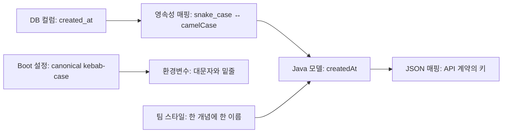

# W26. 네이밍 컨벤션 — camelCase부터 Controller·Impl까지, 왜 그렇게 짓나

> 이름은 실행 규칙이라기보다 사람이 의도를 읽고 도구가 대상을 찾게 하는 약속이다.
> 경계마다 이름 표기법은 달라질 수 있으므로 Java 내부, DB, JSON, 설정 키를 한 규칙으로 밀어붙이지 않는다.
> 기본값은 Java 표준 관례를 따르고, 역할 접미사는 검색에 도움이 될 때만 붙이며, 외부 이름은 계약에 맞춰 명시적으로 매핑한다.

## 1. 질문

- 첫 Spring API를 만들면서 `OrderController`, `OrderService`, `OrderRepository`, `OrderServiceImpl`을 한꺼번에 만들라는 리뷰를 받는다. 그런데 인터페이스와 구현이 하나뿐이면 `Impl`은 무슨 정보를 더 주는지, 나중에 구현이 늘면 이름을 어떻게 바꿀지 막막하다.
- `findOrder`, `getOrder`, `fetchOrder` 중 무엇을 써야 할지 고민한다. 이름은 다 비슷한데 어떤 것은 DB를 조회하고 어떤 것은 원격 API를 호출한다. 리뷰어는 이름만 보고 동작 비용과 결과가 없을 때의 처리를 짐작하기를 기대한다.
- DB에는 `created_at`, JSON에는 `createdAt` 또는 `created_at`, Java 필드에는 `createdAt`, Boot 설정에는 `spring.datasource.hikari.maximum-pool-size`가 보인다. 서로 다르게 쓰면 실수인지, 프레임워크가 바꿔 주는지 알 수 없다.

이 문제는 이름을 외우는 문제가 아니다. 언어 문법이 강제하는 이름, 프레임워크가 파싱하는 이름, 사람이 읽기 쉽게 팀이 정한 이름을 구별해야 한다. 한 범주의 규칙을 다른 경계에 적용하면 컴파일은 성공해도 쿼리가 만들어지지 않거나, API 계약이 바뀌거나, 코드 검색이 어려워진다.

## 2. 짧은 답

- 타입 이름은 `PascalCase`, 변수·필드·메서드는 `camelCase`, 상수와 enum 값은 `UPPER_SNAKE_CASE`, 패키지는 소문자 점 구분을 기본으로 삼는다.
- 클래스에는 `OrderController`처럼 역할을 드러내는 접미사를 붙이면 파일 탐색과 코드 검색이 쉽다. 접미사 자체가 Spring의 동작을 만들지는 않는다.
- 인터페이스 구현이 하나이고 이름만 보아도 역할이 충분하면 `Impl`을 생략하거나 의미 있는 이름(`KakaoPaymentClient`)을 쓴다. 일반 구현을 지칭할 때 `OrderServiceImpl`은 합리적인 팀 관례다.
- 메서드는 동사로 시작한다. `find`는 부재 가능한 조회, `get`은 접근자·필수 값, `fetch`는 원격/비용이 있는 로드를 구분하는 식으로 팀 계약을 정한다. 이것은 Java의 강제 규칙이 아니다.
- Java 내부 이름을 DB/API 이름에 그대로 복사하지 말고 매핑을 선언한다. Boot 설정은 canonical kebab-case를 기준으로 두고 환경 변수 표기는 별도 규칙에 맡긴다.
- 기본값 추천: 기존 코드와의 일관성을 우선하고, 신규 코드에는 표준 Java 표기와 도메인 역할 이름을 사용한다. 선택지를 늘리기 전에 한 코드베이스 안에서 한 개념을 한 이름으로 부른다.

## 3. 왜 그런가 — 원리

문법, 프레임워크 파싱 규칙, 팀 스타일을 구분한다. `customerId`와 `customer_id`는 Java에서 의미가 같지만 프레임워크가 이름을 해석하면 동작이 달라질 수 있다.

| 표기 | 대표 사용처 | 예 | 이름이 주는 단서 |
|---|---|---|---|
| `camelCase` | 지역 변수, 필드, 매개변수, 메서드 | `customerId`, `findById` | 첫 단어를 소문자로 두고 다음 단어의 첫 글자를 대문자로 구분 |
| `PascalCase` | 클래스, 인터페이스, enum, record, 애노테이션 | `OrderService`, `PaymentStatus` | 타입 선언이라는 것을 눈에 띄게 구분 |
| `UPPER_SNAKE_CASE` | `static final` 상수, enum 상수 | `DEFAULT_TIMEOUT_MS`, `PAYMENT_FAILED` | 일반 가변 상태와 구별하고 단어 경계를 표시 |
| 소문자 점 구분 | 패키지 | `com.example.order` | 파일 경로·도메인 역순과 맞춰 이름 충돌을 줄임 |
| `snake_case` | 관계형 DB 테이블·컬럼에서 흔한 선택 | `purchase_order`, `created_at` | SQL에서 단어 경계가 뚜렷하고 Java 식별자와 구별됨 |
| `kebab-case` | URL 경로, Spring Boot 속성, 파일명에서 자주 쓰임 | `/order-items`, `server.port`, `application-local.yml` | 단어를 하이픈으로 분리. Java 식별자로는 쓸 수 없음 |
| JSON 키 | 외부 API 계약에 따름 | `createdAt` 또는 `created_at` | 어느 한 표기가 정답이 아니며 소비자와 합의가 기준 |

Oracle 문서는 1999년 개정·비유지 상태이므로 역사적 관례로 인용하고, 현재 스타일은 Google Java Style Guide와 함께 판단한다.

### 역할 이름은 검색용 표지다

| 이름 | 보통 드러내는 책임 | 붙이면 좋은 경우 | 주의점 |
|---|---|---|---|
| `XxxController` | HTTP 요청·응답 경계 | MVC 컨트롤러를 파일명만으로 찾고 싶을 때 | 도메인 로직을 몰아 넣는 허가증이 아니다 |
| `XxxService` | 유스케이스·응용 작업 | 여러 저장소/외부 호출을 조합할 때 | 접미사만으로 트랜잭션·빈 등록이 되지 않는다. 동작은 애노테이션·설정이 정한다 |
| `XxxRepository` | 저장소 추상화 또는 Spring Data 저장소 | 영속성 접근 코드를 모을 때 | DB 테이블 하나와 반드시 일대일일 필요는 없다 |
| `XxxEntity` | 영속 모델임을 타입명에서 강조 | DTO·도메인 객체와 같은 이름이 겹칠 때 | `@Entity`가 이미 역할을 표시하므로 중복이 될 수 있다. 엔티티마다 무조건 붙일 규칙은 아니다 |
| `XxxDto`, `XxxRequest`, `XxxResponse` | 데이터 전달 또는 입출력 방향 | 외부 API 계약과 내부 모델을 분리할 때 | `Dto`만 붙이면 어느 방향의 어떤 계약인지 모호하다. 가능한 경우 `CreateOrderRequest`처럼 구체화한다 |
| `XxxMapper` | 두 모델 사이의 변환 | 엔티티↔DTO 등 변환 코드가 독립 책임일 때 | MyBatis에서는 SQL 매퍼 인터페이스를 뜻할 수 있어 같은 단어가 다른 의미를 갖는다 |
| `XxxConfig`, `XxxException`, `XxxTest` | 구성, 오류 유형, 테스트 | 여러 구현에서 파일 역할을 빠르게 찾을 때 | `Config`, `Exception`만 반복하지 말고 대상/원인을 앞에 둔다 |

접미사는 사람이 역할을 찾게 돕는 표지다. 클래스명만으로 HTTP 라우트나 DB 연결이 생기지는 않는다. Spring 동작은 stereotype 애노테이션·타입·설정이 결정하지만, Spring Data repository 메서드는 이름을 파싱해 쿼리를 만들 수 있다.

### 이름을 경계에서 바꾸는 이유

저장 방식과 전송 형식은 표기가 다르다. MyBatis의 `mapUnderscoreToCamelCase`는 `A_COLUMN`을 `aColumn`으로 자동 매핑하며 기본값은 `false`다. Spring Boot는 여러 설정 소스를 받으므로 canonical kebab-case와 환경 변수 표기를 구분한다.

Jackson 3의 `PropertyNamingStrategies`에는 `LOWER_CAMEL_CASE`, `SNAKE_CASE`가 있다. 변환은 경계에서 선언하고 외부 계약은 임의 변경하지 않는다.



## 4. 선택지 비교

인터페이스 `OrderService`의 구현 이름 선택지다. `Impl`·`Default`는 Spring 요구사항이 아니며 검색·변경 비용에 차이가 있다.

| 선택지 | 어떻게 동작 | 장점 | 단점 | 언제 쓰나 | 국내 실무에서 흔한가 (근거) |
|---|---|---|---|---|---|
| `OrderService` 단일 구체 클래스 | 인터페이스 없이 서비스 타입을 직접 주입 | 중복 파일이 없고 가장 단순 | 교체 경계가 꼭 필요한데 클래스에 직접 의존하게 될 수 있음 | 구현이 하나이고 별도 추상화의 소비자가 없을 때 | 선택 여부는 설계 맥락에 따름. 국내 빈도 통계는 미확인 |
| `OrderService` + `OrderServiceImpl` | 인터페이스 계약과 일반 구현을 접미사로 대응 | 파일을 이름순으로 찾기 쉽고 구현이 하나일 때 직관적 | 구현이 여러 개면 `Impl2` 같은 나쁜 이름으로 번지기 쉬움. `Impl`만으로 차이를 설명 못 함 | 기존 팀 규칙이 있거나 실제 교체 지점은 있지만 대표 구현이 하나일 때 | Spring 프로젝트에서 보이는 관례. 국내 비율을 확인한 조사 근거는 없음 |
| `OrderService` + `DefaultOrderService` | 기본 구현임을 클래스명에 표기 | 대체 구현·테스트 구현이 함께 있을 때 기본값을 알 수 있음 | “기본”의 의미가 영속적이지 않음. Spring의 `@Primary`·프로파일과 이름만으로 일치하지 않음 | 실제로 기본/대체 구현 구분이 코드에서 유효할 때 | 팀별 편차, 통계 미확인 |
| `PaymentGateway` + `KakaoPaymentClient` | 공급자·전송수단·도메인 역할을 구현명에 표현 | 구현의 차이가 이름에 드러나고 `Impl`보다 탐색이 빠름 | 공급자 이름이 서비스 계약에 새어 나올 수 있음. 공급자 교체 때 이름과 역할을 함께 정리해야 함 | 구현이 실제로 Kakao API 호출기처럼 의미 있는 구체 역할일 때 | Spring에서 사용 가능한 명명 방식. 국내 빈도 통계는 미확인 |
| 인터페이스 없이 `KakaoPaymentClient` | 구체 타입을 직접 주입 | 간접 계층 없이 코드 양이 적음 | 계약 분리/복수 구현이 필요한 시점에 호출부 변경 범위가 커짐 | 애초에 교체 경계가 없고 추상화 비용이 이익보다 클 때 | 프로젝트 성격에 따라 다름, 통계 미확인 |

한 코드베이스에서 `OrderServiceImpl`, `PaymentServiceDefault`, `UserServiceV2`를 섞으면 이름으로 구현을 찾기 어렵다. 새 구현에는 `Jpa`, `Remote`, `Cached`처럼 차이를 드러내고 주입 대상도 명시한다.

`find/get/fetch`에는 Java 표준 의미가 없다. 팀 규약으로 `find`는 부재 가능한 조회, `get`은 접근자·필수 값, `fetch`는 비용 있는 로드에 쓰도록 정할 수 있다. 합의하지 않았다면 기존 코드와 맞춘다.

메서드는 동사로 시작하고, `is/has/can`은 boolean 질의, `create/save/update/delete`는 작업 이름으로 쓴다. 반환값과 부재 시 정책은 이름만으로 정해지지 않으므로 계약을 함께 고정한다.

## 5. 코드로 보기

### 순수 Java: 반환 계약, 동사, 단위

예제는 부재 가능한 결과를 `Optional`로, 컬렉션을 복수형으로, 시간 단위를 `requestTimeoutMs`로 드러낸다.

```java
import java.util.List;
import java.util.Optional;

public class NamingDemo {
    record Order(long id, String status) {}

    static final class OrderCatalog {
        private final List<Order> orders = List.of(
                new Order(101, "PAID"),
                new Order(102, "PENDING"));
        private final long requestTimeoutMs = 800;

        Optional<Order> findOrderById(long orderId) {
            return orders.stream().filter(order -> order.id() == orderId).findFirst();
        }

        List<Order> findAllOrdersByStatus(String status) {
            return orders.stream().filter(order -> order.status().equals(status)).toList();
        }

        boolean hasPendingOrders() {
            return orders.stream().anyMatch(order -> order.status().equals("PENDING"));
        }

        long requestTimeoutMs() {
            return requestTimeoutMs;
        }
    }

    public static void main(String[] args) {
        var catalog = new OrderCatalog();
        System.out.println("findOrderById(101) = " + catalog.findOrderById(101));
        System.out.println("findOrderById(999) = " + catalog.findOrderById(999));
        System.out.println("findAllOrdersByStatus(PAID) = " + catalog.findAllOrdersByStatus("PAID"));
        System.out.println("hasPendingOrders() = " + catalog.hasPendingOrders());
        System.out.println("requestTimeoutMs() = " + catalog.requestTimeoutMs());
    }
}
```

실행 환경: 지정 JDK 21.0.6, 단일 소스 파일 실행.

```text
findOrderById(101) = Optional[Order[id=101, status=PAID]]
findOrderById(999) = Optional.empty
findAllOrdersByStatus(PAID) = [Order[id=101, status=PAID]]
hasPendingOrders() = true
requestTimeoutMs() = 800
```

지역 검색과 저장소 검색은 같은 `find`라도 비용이 다르다. 비용은 구현을 확인한다. 업무 변수는 구체적으로, 반복 변수 `i`는 국소적으로 쓴다.

### 같은 결제 기능: 일반 구현명과 의미 있는 구현명

두 예제는 대안이다. 프로젝트에서 둘을 동시에 컴포넌트로 등록하면 같은 인터페이스 빈이 둘 생기므로 실제 Spring 애플리케이션에서는 하나를 선택하거나 주입 대상을 명시해야 한다. 아래는 코드 형태를 보여 주는 Spring 예제로, **미실행**이다.

**대안 A — 범용 구현이 하나인 팀에서 `Impl` 사용**

```java
import org.springframework.stereotype.Service;

record PaymentCommand(String orderId, long amountWon) {}
record PaymentReceipt(String approvalId) {}

interface PaymentGateway {
    PaymentReceipt authorize(PaymentCommand command);
}

@Service
class PaymentGatewayImpl implements PaymentGateway {
    @Override
    public PaymentReceipt authorize(PaymentCommand command) {
        return new PaymentReceipt("approved-" + command.orderId());
    }
}
```

**대안 B — 구현의 외부 역할이 이름에 중요한 경우**

```java
import org.springframework.stereotype.Service;

record PaymentCommand(String orderId, long amountWon) {}
record PaymentReceipt(String approvalId) {}

interface PaymentGateway {
    PaymentReceipt authorize(PaymentCommand command);
}

@Service
class KakaoPaymentClient implements PaymentGateway {
    @Override
    public PaymentReceipt authorize(PaymentCommand command) {
        return new PaymentReceipt("approved-" + command.orderId());
    }
}
```

실제 결제 연동에서 `KakaoPaymentClient`는 인증·직렬화·타임아웃·오류 변환을 맡는 클라이언트여야 이름과 책임이 맞는다. 추상화를 소비하는 코드나 교체 경계가 없다면 인터페이스 쌍부터 만들 필요는 없다(→ W12, 계층은 → W02 참조).

### Spring Data: 이름의 일부가 실제 파서 입력이다

Spring Data 저장소는 메서드 이름을 파싱해 쿼리를 유도하므로 접두부와 엔티티 속성명이 중요하다. 다음은 Boot 4.1 / Spring Data JPA 4.1 형태이며, **미실행**이다.

```java
import jakarta.persistence.Column;
import jakarta.persistence.Entity;
import jakarta.persistence.GeneratedValue;
import jakarta.persistence.Id;
import java.time.Instant;
import java.util.List;
import java.util.Optional;
import org.springframework.data.jpa.repository.JpaRepository;

@Entity
class PurchaseOrder {
    @Id
    @GeneratedValue
    private Long id;

    @Column(nullable = false)
    private Long customerId;

    @Column(nullable = false)
    private String status;

    @Column(nullable = false)
    private String email;

    @Column(nullable = false)
    private Instant createdAt;

    protected PurchaseOrder() {}
}

interface PurchaseOrderRepository extends JpaRepository<PurchaseOrder, Long> {
    Optional<PurchaseOrder> findByCustomerIdAndStatus(long customerId, String status);
    List<PurchaseOrder> findAllByStatusOrderByCreatedAtDesc(String status);
    boolean existsByEmail(String email);
}
```

임의 약어는 속성 파싱을 깨뜨릴 수 있다. 조건이 복잡해 이름이 길어지면 `@Query` 등 선언 쿼리나 별도 구현을 비교한다.

### 경계 이름은 설정으로 연결

MyBatis 문서 기준 `mapUnderscoreToCamelCase` 기본값은 `false`다. 켜면 이름 변환을 자동화하지만, 예외 컬럼에는 alias나 result map을 명시하는 편이 분명하다.

```xml
<configuration>
  <settings>
    <setting name="mapUnderscoreToCamelCase" value="true" />
  </settings>
</configuration>
```

Boot 설정은 canonical kebab-case로 적고 환경 변수 표기는 relaxed binding에 맡긴다. JSON 키는 계약대로 두고 Jackson `PropertyNamingStrategies.SNAKE_CASE` 등으로 변환한다. 상세 설정은 DB → P19·P20, Jackson → P16 참조.

```properties
spring.datasource.hikari.maximum-pool-size=20
```

## 6. 실무에서는 실제로

- **신규 서비스**: 도메인 용어와 API 계약부터 정한다. 역할이 검색에 도움이 될 때 `CreateOrderRequest`, `OrderRepository`처럼 suffix를 붙인다. 인터페이스는 복수 구현이나 분명한 교체 경계가 있을 때 만들고 구현 이름은 팀 규칙에 맞춘다.
- **레거시**: 일관된 기존 규칙을 따른다. 미관만을 위한 일괄 rename은 import·설정·리뷰 비용을 만든다. 수정하는 주변 코드부터 점진적으로 통일한다.
- **SI·금융 등 규격이 있는 프로젝트**: 설계서·사내 규칙과 외부 스키마를 우선한다. Java 관례와 다르면 매핑에 차이를 모은다. 업계 전체의 스타일 통계는 확인하지 않았다.
- **스타트업·작은 팀**: 자동 생성된 `Impl`과 인터페이스 없는 구체 클래스 중 단순한 쪽을 고른다. 팀이 커지면 역할 이름과 Checkstyle 규칙을 합의한다.
- **마이그레이션**: Java 내부 이름과 DB/API 이름을 분리하고 매핑을 먼저 둔 뒤 내부를 rename한다. 외부 필드·컬럼 변경은 호환성 작업으로 다룬다. Checkstyle의 `MethodName`, `MemberName`, `PackageName`, `TypeName` 검사와 IDE inspection을 같은 규칙으로 맞춘다.

테스트 이름은 실패 보고서에서 시나리오가 보이게 짓는다. `given_when_then`은 조건·행동·기대를 나누는 한 방식이다. 한글 메서드명 또는 영문 이름+JUnit Jupiter `@DisplayName(...)` 중 팀 방식을 고르고 관찰 가능한 결과를 담는다.

한 코드베이스에서 일관성을 지키고 경계 변환은 명시한다. 다른 주제는 W02·W12·P02·P19·P20·P16을 참조한다.

## 7. 흔한 오해와 실수

1. **오해: `Impl`은 Spring이 찾는 특수 이름이다.** `OrderServiceImpl`을 만들지 않으면 주입이 안 될 것처럼 보인다 → Spring은 클래스 접미사 자체를 DI 지시자로 해석하지 않는다 → 컴포넌트 등록·타입·qualifier를 확인하고, 이름은 사람이 이해하기 쉬운 것으로 짓는다.
2. **증상: `getCustomer()` 한 번 호출했는데 수백 건의 SQL 또는 원격 호출이 발생한다.** 접근자처럼 보이는 이름이 I/O를 숨긴다 → `fetchCustomer` 등 비용을 드러내거나 메서드 설명과 트레이싱에서 비용 경계를 노출한다. `get`에 비용 금지라는 언어 규칙은 없으므로 팀 계약이 필요하다.
3. **증상: `created_at` 컬럼이 `createdAt` 필드에 자동으로 들어올 거라 기대했는데 null이다.** MyBatis 매핑 옵션 기본이 꺼져 있거나 별칭/결과 매핑이 다르다 → 실제 설정을 확인하고 옵션 또는 명시 alias/result map을 선택한다.
4. **증상: Java 필드를 `order_id`로 바꾸거나 JSON에 `orderId`를 내보내 API 호환성이 깨진다.** 내부 이름을 외부 계약과 같은 것으로 착각했다 → JSON 이름은 naming strategy나 `@JsonProperty`로 고정하고 API 계약 테스트를 둔다.
5. **증상: `findByCustomerID`가 속성을 찾지 못하거나 의도하지 않은 속성 조합으로 파싱된다.** DB 컬럼 표기나 임의 약어를 Java property 파서 이름에 섞었다 → 엔티티 속성 이름과 공식 query method 표현을 맞추고, 복잡한 쿼리는 선언 쿼리로 옮긴다.
6. **증상: `usr`, `ord`, `tmp`, `val`이 여러 계층에 반복돼 같은 개념인지 알기 어렵다.** 약어가 팀마다 다르고 검색어가 되지 않는다 → `user`, `order`, `paymentAmount`처럼 검색 가능한 단어를 쓴다. `id`, `URL`, `HTTP`처럼 널리 공유되는 약어는 일관되게 대문자화·철자화 규칙을 정한다.
7. **증상: 같은 리스트를 `orders`, `orderList`, `orderCollection`, `orderData`로 부른다.** 같은 개념을 여러 단어로 부르면 검색 결과와 코드 리뷰 맥락이 나뉜다 → 도메인 용어를 하나 고르고 특별한 의미 차이가 있을 때만 다른 이름을 쓴다.

## 8. 자가점검 Q&A (면접 대비)

### Q1. Java에서 `camelCase`를 쓰는 것은 컴파일러 규칙인가?
식별자는 문법상 허용 범위와 키워드 여부를 검사하지만, 일반 필드를 camelCase로 쓰라고 강제하지 않는다.  
스타일 가이드는 소스 가독성과 도구 호환을 위해 이를 합의한다.  
컴파일 성공은 그 이름이 프로젝트 관례에 맞는다는 보장이 아니다.  
**꼬리질문:** 왜 스타일 가이드를 빌드에서 검사하나?  
**답:** 개인별 취향 리뷰를 줄이고, 팀이 합의한 위반을 일찍 일관되게 잡기 위해서다.

### Q2. 인터페이스가 하나일 때 `OrderServiceImpl`을 써야 하나?
필수는 아니다. 접미사가 일반 구현이라는 정보를 주고 팀이 같은 패턴을 쓰면 실용적이다.  
구체 구현의 중요한 차이가 있다면 `Impl` 대신 `JpaOrderService`, `KakaoPaymentClient`처럼 그 차이를 이름에 담는다.  
인터페이스 자체가 필요하지 않다면 구현 클래스만 두는 선택도 가능하다.  
**꼬리질문:** 구현 두 개면 `Impl1`, `Impl2`가 괜찮나?  
**답:** 안 된다. 저장소/원격/캐시처럼 실제 구분 기준을 이름으로 사용한다.

### Q3. `get`, `find`, `fetch` 중 무엇이 표준인가?
세 동사에 대한 Java 언어 차원의 의미 표준은 없다.  
팀은 부재 가능성, 실패 정책, 원격 I/O·비용 여부를 기준으로 약속을 만들 수 있다.  
그 약속을 만들지 않았다면 자의적으로 세밀한 구분을 흉내 내지 말고 기존 코드와 맞춘다.  
**꼬리질문:** 메서드 이름만으로 비용을 보장할 수 있나?  
**답:** 없다. 이름은 기대를 전달하고 실제 보장은 구현·프로파일링·문서로 확인한다.

### Q4. DB `snake_case`와 Java `camelCase`는 어느 쪽으로 통일해야 하나?
경계마다 표기법을 달리하고 매핑한다. Java 식별자는 Java 생태계 관례, DB는 스키마 규약, 외부 API는 계약을 따른다.  
MyBatis 옵션은 변환을 자동화할 수 있지만 읽은 문서의 기본값은 꺼짐이며, 옵션이 프로젝트에 적용됐는지 확인해야 한다.  
**꼬리질문:** 자동 변환과 명시 매핑 중 언제 명시 매핑을 택하나?  
**답:** 예외 컬럼, legacy schema, 이름 충돌처럼 추측이 위험하거나 규칙성이 약할 때다.

### Q5. JSON 키는 무조건 camelCase여야 하나?
아니다. JSON은 API 소비자와 합의한 계약이다. 기존 API가 `snake_case`라면 내부 Java 필드만 camelCase로 두고 Jackson 전략이나 속성별 설정으로 매핑한다.  
새 API라면 팀 규칙을 정해 일관성을 유지하되 호환성 없이 키를 바꾸지 않는다.  
**꼬리질문:** 전역 snake_case와 필드별 이름 지정을 언제 고르나?  
**답:** API 전체 규칙이 일정하면 전략, 예외가 있거나 계약을 명시적으로 고정해야 하면 필드별 선언이 적합하다.

### Q6. Spring Data의 `findByStatus`와 `findByStatusOrderByCreatedAtDesc`는 그냥 메서드 이름 취향인가?
아니다. Spring Data repository proxy는 이름에서 쿼리를 만들 수 있고, 문서상 쿼리 생성 전략은 이름의 알려진 접두부를 떼고 나머지를 해석한다.  
따라서 엔티티 속성명과 이름 파싱 규칙이 실제 실행 동작에 영향을 준다.  
**꼬리질문:** 메서드 이름이 지나치게 길어지면?  
**답:** 조건이 복잡해진 신호다. `@Query` 또는 별도 쿼리 구현으로 의도를 표현한다.


## 9. 참고문헌

- Oracle Code Conventions for the Java Programming Language: Naming Conventions — https://www.oracle.com/java/technologies/javase/codeconventions-namingconventions.html — 전통적 Java 이름 규칙. 1999년 비유지 문서임을 확인했다.
- Google Java Style Guide, Section 5 Naming — https://google.github.io/styleguide/javaguide.html — 현재 Naming 절의 식별자·타입·메서드 규칙을 확인했다.
- Defining Query Methods, Spring Data JPA — https://docs.spring.io/spring-data/jpa/reference/repositories/query-methods-details.html — repository 메서드 파싱과 query lookup 전략을 확인했다.
- Externalized Configuration, Spring Boot — https://docs.spring.io/spring-boot/reference/features/external-config.html — 설정 소스, 환경변수 이름과 relaxed binding을 확인했다.
- MyBatis Configuration — https://mybatis.org/mybatis-3/configuration.html — camel case 자동 변환 옵션과 기본값을 확인했다.
- `PropertyNamingStrategies.java`, FasterXML Jackson 3.x source — https://raw.githubusercontent.com/FasterXML/jackson-databind/3.x/src/main/java/tools/jackson/databind/PropertyNamingStrategies.java — Jackson 3의 `LOWER_CAMEL_CASE`, `SNAKE_CASE` 표준 전략과 예시를 확인했다.
- Checkstyle Naming Conventions — https://checkstyle.org/checks/naming/index.html — 이름 유형별 검사 모듈을 확인했다.
- DisplayName, JUnit 6.0.3 API — https://docs.junit.org/6.0.3/api/org.junit.jupiter.api/org/junit/jupiter/api/DisplayName.html — 테스트 클래스·메서드에 사용자 표시명을 붙이는 애노테이션을 확인했다.

