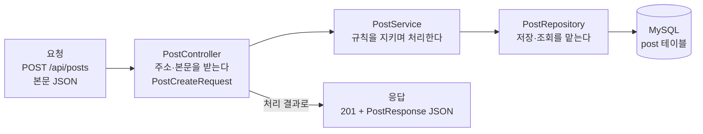

# A0. API 개발이 뭔가 — API 하나를 띄우고 직접 고쳐 보기

> 실습 · 40분

## API 개발이 하는 일

API 개발은 **요청을 받아 → 처리하고 → 필요하면 DB에 저장·조회하고 → 응답을 돌려주는 프로그램**을 만드는 일이다.

- 요청은 "어떤 주소로, 어떤 방법(`GET`·`POST` …)으로, 무엇을 담아" 보낸 글 한 통이다.
- 서버는 그 주소를 맡은 코드를 찾아 실행한다. 글을 저장하라는 요청이면 DB에 한 줄을 넣고, 목록을 달라는 요청이면 DB에서 읽는다.
- 결과를 상태 코드(`200`·`404` …)와 본문(대개 JSON)으로 돌려준다.

이번 레슨은 설명보다 손이 먼저다. 실습 레포를 띄워 API에 요청을 보내 보고, 응답을 고쳐 보고, API 하나를 새로 만든다. 마지막에 요청 하나가 서버 안에서 지나가는 길을 그림 한 장으로 본다.

## ① 띄우고 요청 보내기

실습 레포 **javaExperience**를 [시작하기](../README.md)대로 받고 DB 설정을 맞춘다. IntelliJ에서 `org.example.Main`을 실행하거나, 레포 폴더에서 아래를 실행한다.

```bash
./gradlew bootRun
```

로그 맨 아래에 이 두 줄이 나오면 서버가 뜬 것이다. 서버는 이제 8080번 포트에서 요청을 기다린다. 터미널이 붙잡혀 있는 게 정상이다.

```text
... o.s.boot.tomcat.TomcatWebServer          : Tomcat started on port 8080 (http) with context path '/'
... org.example.Main                         : Started Main in 1.537 seconds (process running for 1.765)
```

다른 터미널을 열고, 레포에 이미 있는 API `GET /hello`에 요청을 보낸다. `-i`는 응답의 머리글까지 보여 달라는 옵션이다.

```bash
curl -i http://localhost:8080/hello
```

```text
HTTP/1.1 200
Content-Type: text/plain;charset=UTF-8
Content-Length: 5
Date: Sat, 10 Oct 2026 05:06:46 GMT

hello
```

| 줄 | 뜻 |
|---|---|
| `HTTP/1.1 200` | 상태 코드 `200` — 성공 |
| `Content-Type: text/plain;charset=UTF-8` | 본문은 그냥 글자다(JSON이 아니다) |
| `Content-Length: 5` | 본문이 5바이트 — `hello` 다섯 글자 |
| 빈 줄 다음 `hello` | 본문. 서버 코드가 돌려준 값이 그대로 왔다 |

## ② 응답 한 줄 고치기

이 응답을 만든 코드는 `src/main/java/org/example/controller/HelloController.java`에 있다. 파일을 열어 `hello()` 메서드를 찾는다.

```java
    @GetMapping("/hello")
    public String hello() {
        return "hello";
    }
```

- `@GetMapping("/hello")` — "`GET /hello` 요청이 오면 이 메서드를 실행하라"는 표시다.
- `return "hello";` — 돌려준 값이 응답 본문이 된다.

`return` 줄을 바꾼다.

```java
        return "안녕, 백엔드";
```

저장하고 같은 요청을 다시 보내면 **여전히 `hello`다.** 실행 중인 서버는 시작할 때 읽어 둔 코드로 돈다. 서버를 멈추고(IntelliJ ■ 또는 터미널에서 `Ctrl+C`) 다시 실행한 뒤 보낸다.

```bash
curl -i http://localhost:8080/hello
```

```text
HTTP/1.1 200
Content-Type: text/plain;charset=UTF-8
Content-Length: 17
Date: Sat, 10 Oct 2026 05:07:03 GMT

안녕, 백엔드
```

`Content-Length`가 `17`이 됐다. 한글은 UTF-8에서 한 글자가 3바이트라 `안녕`·`백엔드` 다섯 글자가 15바이트, 쉼표와 띄어쓰기가 2바이트다.

다 봤으면 `"hello"`로 되돌린다. 레포의 테스트(`HelloControllerTest`)가 응답이 `hello`인지 확인한다.

## ③ API 하나 새로 만들기

`GET /api/first/ping`을 부르면 JSON `{"message":"pong"}`을 돌려주는 API를 만든다. `HelloController.java`와 같은 폴더에 파일을 하나 더 만든다. IntelliJ에서 `controller` 폴더를 오른쪽 클릭 → New → Java Class → `FirstController`.

`src/main/java/org/example/controller/FirstController.java`

```java
package org.example.controller;

import org.springframework.web.bind.annotation.GetMapping;
import org.springframework.web.bind.annotation.RestController;

import java.util.Map;

@RestController
public class FirstController {

    @GetMapping("/api/first/ping")
    public Map<String, String> ping() {
        return Map.of("message", "pong");
    }
}
```

지금은 **이렇게 쓴다**고만 알면 된다. 뜻은 뒤에서 하나씩 연다.

| 코드 | 지금 알 것 | 자세히는 |
|---|---|---|
| `package ...;` · `import ...;` | 파일이 사는 폴더 이름, 다른 곳의 클래스를 가져다 쓴다는 선언 | [0-1](../scenario/ch0-first-steps/0-1-ts-to-java.md) |
| `@RestController` | "이 클래스는 HTTP 요청을 받고, 반환값을 응답 본문으로 쓴다" | [0-2](../scenario/ch0-first-steps/0-2-annotations.md) · [B8](B8-annotations.md) |
| `@GetMapping("/api/first/ping")` | 이 메서드가 맡을 메서드·주소 | [0-2](../scenario/ch0-first-steps/0-2-annotations.md) |
| `Map.of("message", "pong")` | 키 `message`, 값 `pong`인 묶음. Spring이 JSON으로 바꿔 보낸다. 실무에서는 응답 모양을 정한 클래스(record)를 쓴다 | [0-1](../scenario/ch0-first-steps/0-1-ts-to-java.md) · [D1](D1-json-jackson.md) |

서버를 다시 띄우기 **전에** 먼저 보내 본다.

```bash
curl -i http://localhost:8080/api/first/ping
```

```text
HTTP/1.1 404
Content-Type: application/json
Transfer-Encoding: chunked
Date: Sat, 10 Oct 2026 05:07:13 GMT

{"timestamp":"2026-10-10T05:07:13.297Z","status":404,"error":"Not Found","path":"/api/first/ping"}
```

`404` — 그 주소를 맡은 코드가 없다. 서버는 아직 새 파일을 모른다. 다시 띄운 뒤 같은 요청을 보낸다.

```text
HTTP/1.1 200
Content-Type: application/json
Content-Length: 18
Date: Sat, 10 Oct 2026 05:07:20 GMT

{"message":"pong"}
```

이번에는 `Content-Type`이 `application/json`이다. `String`을 돌려준 `/hello`는 글자로, `Map`을 돌려준 `/api/first/ping`은 JSON으로 나갔다.

같은 주소에 방법만 `POST`로 바꿔 보면:

```bash
curl -i -X POST http://localhost:8080/api/first/ping
```

```text
HTTP/1.1 405
Allow: GET
Content-Type: application/json
Transfer-Encoding: chunked
Date: Sat, 10 Oct 2026 05:07:20 GMT

{"timestamp":"2026-10-10T05:07:20.157Z","status":405,"error":"Method Not Allowed","path":"/api/first/ping"}
```

주소는 맞는데 그 **방법**은 받지 않는다는 `405`다. `Allow: GET`이 받는 방법을 알려 준다. 서버 로그에도 한 줄이 남는다.

```text
WARN ... .w.s.m.s.DefaultHandlerExceptionResolver : Resolved [org.springframework.web.HttpRequestMethodNotSupportedException: Request method 'POST' is not supported]
```

`FirstController`는 지워도 되고 남겨 둬도 된다. 0장 이후 단계가 쓰는 주소와 겹치지 않는다.

## ④ 요청 하나가 지나가는 길

`/hello`와 `/api/first/ping`은 컨트롤러에서 바로 답했다. 실제 API는 대개 서비스·저장소를 거쳐 DB까지 갔다 온다. 아래는 1장에서 만들 "게시글 작성" API `POST /api/posts`가 지나가는 길이다. 상자 안은 1장이 끝나면 레포에 생길 파일 이름이다.



| 자리 | 하는 일 | 어디서 만드나 |
|---|---|---|
| 컨트롤러 `PostController` | 주소·메서드를 맡고, 요청 본문을 객체(`PostCreateRequest`)로 받고, 응답을 만든다 | [1-1](../scenario/ch1-create-post/1-1-receive-request.md) · [1-2](../scenario/ch1-create-post/1-2-dto-response.md) |
| 서비스 `PostService` | "글을 쓸 게시판이 실제로 있어야 한다" 같은 업무 규칙을 지키며 일을 처리한다 | [1-3](../scenario/ch1-create-post/1-3-service-layer.md) |
| 저장소 `PostRepository` + `Post` | DB에 넣고 꺼내는 일만 맡는다. `Post` 객체 하나가 `post` 테이블 한 줄이 된다 | [1-2](../scenario/ch1-create-post/1-2-dto-response.md)(처음 저장) · [1-4](../scenario/ch1-create-post/1-4-save-to-db.md)(테이블에 정확히 맞추기) |
| DB `post` 테이블 | 서버가 꺼져도 남는 데이터 | [E2](E2-db-sql-basics.md) |

DB에는 이미 시나리오용 글이 들어 있다. 저장된 모습을 SQL로 직접 본다.

```bash
docker compose exec -T mysql mysql --default-character-set=utf8mb4 -ucommunity -pcommunity community -e "SELECT id, title, author_id FROM post ORDER BY id LIMIT 3;"
```

```text
id	title	author_id
1	[공지] 실습 게시판 이용 안내	1
2	JPA 연관관계 매핑 정리	3
3	인덱스는 언제 타나요?	4
```

1장을 마치면 `POST /api/posts` 요청 하나가 이 표의 새 줄 하나가 된다.

## ⑤ 앞으로 어디서 깊어지나

| 오늘 한 것 | 깊어지는 곳 |
|---|---|
| 서버를 띄우고 포트에서 기다리게 하기 | [A3](A3-server-process-port.md) · [A4](A4-what-spring-boot-does.md) · [C1](C1-intellij-run-debug.md) |
| curl로 요청 보내고 응답 읽기 | [A1](A1-client-server-http.md) · [A2](A2-http-anatomy.md) |
| 컨트롤러·`@GetMapping`·응답 객체 | 0장 [0-1](../scenario/ch0-first-steps/0-1-ts-to-java.md)~[0-4](../scenario/ch0-first-steps/0-4-dto-rules.md) · [B8](B8-annotations.md) |
| 에러 응답(404·405)과 로그 읽기 | [0-5](../scenario/ch0-first-steps/0-5-read-stack-trace.md) · [C4](C4-logs-and-stack-traces.md) |
| 컨트롤러 → 서비스 → 저장소 → DB | 1장 [1-1](../scenario/ch1-create-post/1-1-receive-request.md)~[1-4](../scenario/ch1-create-post/1-4-save-to-db.md) · [E1](E1-why-layers.md) · [E3](E3-what-is-jpa.md) |

## 확인 문제

**1.** `HelloController`의 `return` 값을 바꾸고 저장했는데 curl 응답이 그대로다. 왜이고, 어떻게 하나?

<details>
<summary>정답</summary>

실행 중인 서버는 **시작할 때** 컴파일된 코드로 돈다. 파일을 저장해도 이미 떠 있는 서버에는 반영되지 않는다. 서버를 멈추고 다시 실행한 뒤 요청을 보낸다.
</details>

**2.** `/hello`의 `Content-Type`은 `text/plain`, `/api/first/ping`은 `application/json`이었다. 무엇이 달라서인가?

<details>
<summary>정답</summary>

메서드가 돌려준 값의 타입이다. `String`을 돌려주면 그 글자가 그대로 본문이 되고, `Map`이나 객체를 돌려주면 Spring이 JSON으로 바꿔 `application/json`으로 보낸다.
</details>

**3.** 새 파일을 만든 뒤 서버를 다시 띄우지 않고 `GET /api/first/ping`을 보냈더니 `404`가 왔다. 다시 띄운 뒤 `POST`로 보냈더니 `405`가 왔다. 두 코드는 각각 무엇을 말하나?

<details>
<summary>정답</summary>

`404`는 "그 주소를 맡은 코드가 없다", `405`는 "주소는 있지만 그 방법(메서드)은 받지 않는다"이다. `405` 응답의 `Allow: GET` 머리글이 받는 방법을 알려 준다.
</details>

**4.** 요청이 `PostController → PostService → PostRepository → DB` 순으로 간다. "글을 쓸 게시판이 실제로 있어야 한다" 같은 규칙과 "`post` 테이블에 한 줄 넣기"는 각각 어디에 두나?

<details>
<summary>정답</summary>

규칙은 **서비스**(`PostService`), DB에 넣는 일은 **저장소**(`PostRepository`)다. 컨트롤러는 요청을 받고 응답을 만드는 일만 한다. 이렇게 나눠 두면 저장 방식이 바뀌어도 규칙 코드는 그대로 둘 수 있다(1-3·E1).
</details>

## 다음

[0-1. Java로 첫 API — 타입·변수·클래스·생성자·record](../scenario/ch0-first-steps/0-1-ts-to-java.md) — 오늘 따라 친 코드의 문법(타입·변수·클래스·생성자)을 한 줄씩 읽으며, 응답 모양을 record로 정한 API를 만든다.
