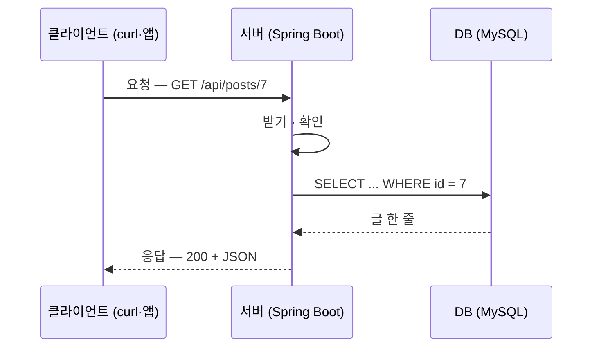

# A1. 클라이언트와 서버 — 요청 한 번이 오가는 길

> 개념 레슨 · 30분

## 이게 뭐냐

A0과 0-1~0-3에서 API를 띄우고 `curl`로 요청을 보냈다. 터미널에 명령 한 줄을 치면 JSON이 돌아왔다. 이번 레슨은 그 한 번의 왕복을 멈춰 놓고 본다. 무엇이 오갔고, 받는 쪽 서버는 그 사이에 무엇을 했나. 백엔드 개발자가 만드는 것이 이 받는 쪽 프로그램이다.

먼저 이번 레슨에서 쓸 낱말 다섯 개를 정리한다.

| 낱말 | 뜻 | 방금 한 실습에서 |
|---|---|---|
| **클라이언트**(client) | 요청을 **보내는** 쪽. 브라우저·모바일 앱·다른 서버·터미널의 `curl` | 내가 친 `curl` |
| **서버**(server) | 요청이 오기를 **기다렸다가 답하는** 프로그램 | 실행해 둔 실습 레포의 Spring Boot 앱 |
| **요청**(request) / **응답**(response) | 클라이언트가 보내는 글 한 통과 서버가 돌려주는 글 한 통. 늘 한 쌍이다 | `curl` 한 번 = 요청 하나 + 응답 하나 |
| **HTTP** | 요청과 응답을 **어떤 모양의 글로 쓸지** 정한 약속. "첫 줄에는 메서드와 주소, 다음 줄부터 머리글, 빈 줄 뒤에 본문" 같은 규칙이다 | `curl -v`가 찍는 `>`·`<` 줄 |
| **API** | 서버가 "이 주소로 이렇게 보내면 이렇게 답한다"고 정해 둔 목록 | `GET /api/start/hello`, `POST /api/start/echo/{id}` |

### 서버는 무슨 일을 하나

요청 하나가 들어오면 서버는 대략 네 가지를 한다.

1. **받는다** — 요청 글을 읽어 "누가, 어느 주소로, 무엇을 보냈나"를 꺼낸다.
2. **확인한다** — 값이 올바른지, 이 사람이 해도 되는 일인지 본다.
3. **일한다** — DB에서 글을 찾거나 저장한다.
4. **답한다** — 결과를 JSON으로 만들고, 잘됐는지를 **상태 코드**(200, 404 같은 숫자)로 붙여 돌려준다.

2번은 클라이언트가 이미 검사했어도 서버가 **다시** 한다. 서버는 요청을 누가 어떻게 만들었는지 알 수 없다. 앱 화면의 입력 검사는 사용자 손에 있는 코드라 고치거나 건너뛸 수 있고, `curl` 한 줄이면 화면을 거치지 않고 아무 값이나 보낼 수 있다. 그래서 "진짜 데이터를 지키는 마지막 문"은 서버다. 이 이야기는 공부자료 W13에서 더 다룬다.

### 서버 프로그램의 성질 세 가지

| | 서버(Spring Boot) |
|---|---|
| 언제 돈다 | 서버 컴퓨터에서 **계속 켜져 있으며** 요청을 기다린다(A3) |
| 누구를 상대하나 | 동시에 여러 클라이언트. 같은 코드가 여러 요청을 한꺼번에 처리한다 |
| 기억 | 기본적으로 **요청끼리 서로 모른다**. 앞 요청에서 로그인했다는 사실도 요청마다 다시 알려 줘야 한다(토큰, F2에서 본다) |

## 예시

요청 하나가 오가는 길이다. 화살표 하나가 HTTP 글 한 통이다.



`curl -v`를 붙이면(verbose) 주고받은 글을 그대로 찍는다. 아래는 0-1에서 만든 인사 API에 보낸 요청이다(실측, Spring Boot 4.1.1. 실측 포트는 8189였고, 여러분 서버는 기본 8080이다. `*` 줄과 진행 표시는 일부 뺐다).

```bash
curl -v -G "http://localhost:8080/api/start/hello" --data-urlencode 'name=김자바'
```

```text
* Connected to localhost (::1) port 8189
> GET /api/start/hello?name=%ea%b9%80%ec%9e%90%eb%b0%94 HTTP/1.1
> Host: localhost:8189
> User-Agent: curl/8.7.1
> Accept: */*
>
< HTTP/1.1 200
< Vary: Origin
< Vary: Access-Control-Request-Method
< Vary: Access-Control-Request-Headers
< Content-Type: application/json
< Content-Length: 74
< Date: Fri, 09 Oct 2026 15:00:09 GMT
<
{"name":"김자바","message":"김자바님, 반가워요","nameLength":3}
```

읽는 법:

- `>`로 시작하는 줄이 **내가 보낸 요청**, `<`로 시작하는 줄이 **서버가 보낸 응답**이다. `*` 줄은 curl이 혼잣말로 남긴 연결 정보다.
- 요청 첫 줄 `GET /api/start/hello?name=... HTTP/1.1` — "무엇을(GET) 어디에(경로) 어떤 약속으로(HTTP/1.1)". 한글 이름은 `%ea%b9%80...`처럼 바뀌어 간다. 주소에는 영문·숫자만 쓸 수 있어서 바이트를 `%`로 적는다(URL 인코딩). 어떤 클라이언트든 똑같이 한다.
- 응답 첫 줄 `HTTP/1.1 200` — 상태 코드 200(성공). 스프링 안의 웹 서버(Tomcat)는 `200` 뒤의 `OK` 글자를 생략한다. 다른 서버는 `200 OK`로 쓰기도 한다.
- 빈 줄 다음이 **본문**이다. 컨트롤러가 돌려준 `Greeting` record가 Jackson을 거쳐 이 한 줄이 됐다.

브라우저든 모바일 앱이든 서버에 닿는 것은 이 글이다. 서버는 보낸 쪽이 무엇인지 몰라도 이 글만 읽고 답한다.

## 따라 해 보기

10분. ①은 내 서버에, ②는 **받은 요청을 그대로 돌려주는** 공개 테스트 서버 `httpbin.org`에 보낸다. 0-3의 echo API는 내가 고른 네 칸만 돌려줬지만, httpbin은 curl이 알아서 붙인 머리글까지 전부 돌려준다.

**① 내 서버에 `-v`로 보내기 (3분)**

실습 레포 서버를 띄운 채로 위 [예시](#예시)의 `curl -v` 명령을 보낸다. `>` 줄 몇 개가 요청이고, 어디서 응답이 시작되고, 본문이 어느 줄인지 짚는다.

**② 공개 서버에 같은 일을 하기 (7분)**

```bash
curl -i "http://httpbin.org/get?name=kim"
```

`-i`는 응답의 머리글까지 보여 준다. 기대 결과(실측, 일부 줄 생략):

```text
HTTP/1.1 200 OK
Content-Type: application/json
...

{
  "args": {
    "name": "kim"
  },
  "headers": {
    "Accept": "*/*",
    "Host": "httpbin.org",
    "User-Agent": "curl/8.7.1",
    ...
  },
  "url": "http://httpbin.org/get?name=kim"
}
```

httpbin은 "네가 보낸 요청은 이랬다"를 JSON으로 돌려준다. `args`에 내가 붙인 `?name=kim`이, `headers`에 curl이 알아서 붙인 머리글이 보인다.

이번에는 `-v`로 보낸 글까지 본다.

```bash
curl -v "http://httpbin.org/get?name=kim"
```

`>` 줄 다섯 개(요청)와 `<` 줄(응답)을 찾는다. `-i` 결과의 `headers`에 있던 항목이 각각 어느 `>` 줄인지 짝지어 본다.

- httpbin이 응답하지 않으면 `postman-echo.com`으로 바꿔도 된다: `curl -i "https://postman-echo.com/get?name=kim"`.

## 확인 문제

**1.** 앱 화면에서 "제목은 50자 이하"를 이미 검사한다. 서버에서 같은 검사를 또 해야 할까?

<details>
<summary>정답</summary>

해야 한다. 화면의 검사는 사용자 쪽 코드라 건너뛸 수 있다. 예를 들어 `curl`로 서버에 직접 51자짜리 제목을 보낼 수 있다. 화면 검사는 사용자를 돕는 것이고, 데이터를 지키는 검사는 서버에서 한다.
</details>

**2.** `curl -v` 출력에서 `>`로 시작하는 줄과 `<`로 시작하는 줄은 각각 무엇인가?

<details>
<summary>정답</summary>

`>`는 클라이언트(curl)가 서버로 **보낸 요청**, `<`는 서버가 **돌려준 응답**이다. `*`로 시작하는 줄은 연결 과정에 대한 curl의 메모라 HTTP 글이 아니다.
</details>

**3.** 서버가 "요청끼리 서로 모른다"는 말은 무슨 뜻인가? 로그인한 사용자가 글 목록과 글 쓰기 요청을 차례로 보낼 때 무엇이 필요한가?

<details>
<summary>정답</summary>

서버는 요청이 올 때마다 그 요청 글만 보고 처리한다. 앞 요청에서 누가 로그인했는지 저절로 기억하지 않는다. 그래서 로그인이 필요한 요청**마다** 로그인 정보(토큰)를 머리글에 실어 보내야 한다. 앞 요청에 토큰을 실었다고 글 쓰기 요청에서 빼면 서버는 누군지 모른다(401).
</details>

**4.** 응답 첫 줄이 `HTTP/1.1 200`이다. `200`은 무엇이고, 응답의 본문은 어디서부터인가?

<details>
<summary>정답</summary>

`200`은 **상태 코드**로 "성공"이라는 뜻이다. 본문은 머리글이 끝나는 **빈 줄 다음**부터다. 컨트롤러가 돌려준 객체를 Jackson이 JSON으로 바꾼 것이 이 자리에 실린다.
</details>

## 더 깊이

- [D02 서버·네트워크 기초](../docs/knowledge/D02-server-network-basics.md#1-큰-그림) — 요청이 DNS·TCP를 거쳐 서버에 닿기까지
- [W13 프론트와 백엔드의 경계](../docs/knowledge/W13-frontend-backend-boundary.md#2-짧은-답) — 무엇을 서버에서만 해야 하나
- [D13 백엔드 용어 사전](../docs/knowledge/D13-backend-glossary.md) — 회의에서 들리는 낱말
- [D03 REST API 개발 과정](../docs/knowledge/D03-rest-api-dev-process.md#1-큰-그림) — API 하나가 만들어지는 순서

## 다음
[A2. HTTP 해부](A2-http-anatomy.md) — 방금 본 요청·응답 글을 한 칸씩 뜯어 본다. 메서드·경로·쿼리·헤더·본문이 글의 어느 자리에 있고, Spring이 각각을 어떻게 받는지 맞춘다.
