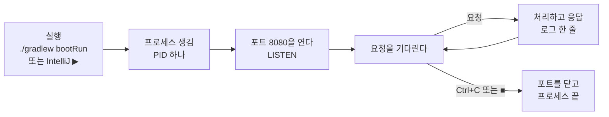

# A3. 서버 프로그램 — 포트·프로세스·localhost·로그

> 개념 레슨 · 30분

## 이게 뭐냐

실습 레포를 실행하면 터미널이 끝나지 않고 붙잡혀 있다. 그 상태에서 다른 터미널의 `curl`이 `http://localhost:8080`으로 요청을 보내면 답이 온다. 그 터미널에서 돌고 있는 것이 **서버 프로그램**이다. 이번 레슨은 "켜져 있다"·"8080"·"localhost"가 각각 무엇인지 운영체제 쪽에서 확인한다.

이번 레슨의 낱말 다섯 개:

| 낱말 | 뜻 | 이 레포에서 |
|---|---|---|
| **프로그램** | 디스크에 있는 실행 파일. 가만히 있다 | 빌드한 `.jar` 파일, `./gradlew` 스크립트 |
| **프로세스** | 프로그램을 **실행해서 메모리에 올라와 돌고 있는 것**. 운영체제가 번호(**PID**)를 붙인다 | `bootRun`이나 IntelliJ ▶로 띄운 뒤 떠 있는 `java` |
| **포트**(port) | 한 컴퓨터 안에서 프로세스를 구분하는 **문 번호**(0~65535). 서버는 문 하나를 열고 그 앞에서 기다린다(**LISTEN**). 문 하나에는 프로세스 하나만 설 수 있다 | Spring Boot `8080`, MySQL `3306` |
| **localhost** | "**지금 이 컴퓨터 자신**"을 가리키는 이름. 숫자 주소로는 `127.0.0.1`(IPv4)이나 `::1`(IPv6)이다 | `http://localhost:8080` |
| **로그**(log) | 서버가 자기 터미널(또는 파일)에 남기는 기록. **요청을 보낸 클라이언트 쪽에는 안 나온다** | 뜰 때 찍히는 `Started Main in ... seconds` |

그래서 `http://localhost:8080/hello`는 "**이 컴퓨터**(localhost)의 **8080번 문**에서 기다리는 프로세스에게 `/hello`를 달라"는 뜻이다. Spring Boot는 따로 정하지 않으면 8080번 문을 연다.

### 서버의 한살이



- 서버는 요청을 처리한 뒤 **끝나지 않는다.** 다음 요청을 기다리러 돌아간다. 그래서 터미널이 붙잡혀 있다.
- 프로세스가 끝나면 문도 닫힌다. 그때 보낸 요청은 "그 문 앞에 아무도 없다"는 에러를 받는다.

### 자주 만나는 두 에러

| 상황 | 서버 쪽에서 보이는 것 | 클라이언트 쪽에서 보이는 것 |
|---|---|---|
| 같은 포트에 서버를 **두 번** 띄웠다 | 두 번째 서버가 `Port 8080 was already in use`를 찍고 꺼진다 | (첫 번째 서버가 계속 답하니 이상한 점이 안 보일 수 있다) |
| 서버가 **꺼져 있다** | 아무것도 없다 | curl: `Failed to connect ... Couldn't connect to server` |

두 번째 경우는 서버 로그가 **조용하다.** 요청이 서버에 닿지도 못했기 때문이다. "로그에 아무것도 없다 = 요청이 안 왔다"이다. 이때는 코드를 볼 게 아니라 서버가 떠 있는지, 포트가 맞는지부터 본다.

## 예시

아래는 모두 실제 출력이다(Spring Boot 4.1.1, macOS). 실측은 포트 8189로 했다. 여러분 화면에서는 `8189` 자리가 `8080`이다.

**① 서버가 뜰 때 로그** — 볼 줄은 세 개다.

```text
INFO 6336 --- [javaExperience] [           main] org.example.Main                         : Starting Main v1.0-SNAPSHOT using Java 21.0.6 with PID 6336 (...)
INFO 6336 --- [javaExperience] [           main] o.s.boot.tomcat.TomcatWebServer          : Tomcat initialized with port 8189 (http)
...
INFO 6336 --- [javaExperience] [           main] o.s.boot.tomcat.TomcatWebServer          : Tomcat started on port 8189 (http) with context path '/'
INFO 6336 --- [javaExperience] [           main] org.example.Main                         : Started Main in 0.823 seconds (process running for 1.052)
```

- `with PID 6336` — 운영체제가 붙인 프로세스 번호. 줄마다 앞쪽에 찍힌 `6336`도 같은 번호다.
- `Tomcat started on port 8189` — **8189번 문을 열었다.** 이 줄이 나오기 전에는 요청을 받을 수 없다.
- `Started Main in 0.823 seconds` — 준비 끝. 이제 요청을 기다린다.

(시각 칸은 줄였다. 로그 한 줄의 칸 구조는 C4에서 본다.)

**② 누가 그 포트를 쓰고 있나** — 다른 터미널에서(아래 출력의 사용자 이름은 `me`로 바꿨다):

```bash
lsof -nP -iTCP:8189 -sTCP:LISTEN
```

```text
COMMAND  PID USER   FD   TYPE             DEVICE SIZE/OFF NODE NAME
java    6336   me    9u  IPv6 0x22122aa900e5c9e2      0t0  TCP *:8189 (LISTEN)
```

- `lsof`는 "열린 파일·연결 목록"을 보여 주는 macOS·리눅스 명령이다. `-iTCP:8189`는 8189번 TCP 포트만, `-sTCP:LISTEN`은 기다리는 중인 것만 고른다. `-nP`는 숫자를 이름으로 바꾸지 말라는 뜻이다. 빼면 8080이 `http-alt`처럼 이름으로 나와 헷갈린다.
- `COMMAND java`, `PID 6336` — 로그의 PID와 같다. Spring Boot 서버는 **java 프로세스**다.
- `*:8189` — `*`는 "이 컴퓨터의 모든 주소에서 받는다"는 뜻이다. 그래서 `localhost`로도 `127.0.0.1`로도 닿는다.

**③ 두 번 띄우면** — 이미 떠 있는데 같은 포트로 하나 더 띄운 두 번째 프로세스의 로그:

```text
***************************
APPLICATION FAILED TO START
***************************

Description:

Web server failed to start. Port 8189 was already in use.

Action:

Identify and stop the process that's listening on port 8189 or configure this application to listen on another port.
```

`./gradlew bootRun`으로 띄웠다면 그 뒤에 `BUILD FAILED`가 따라온다. 첫 번째 서버는 아무 일 없이 계속 돈다.

**④ 서버를 끄고 요청을 보내면**

```bash
curl http://localhost:8189/api/start/hello
```

```text
curl: (7) Failed to connect to localhost port 8189 after 0 ms: Couldn't connect to server
```

`(7)`은 curl의 종료 코드로 "연결 실패"다. 서버 쪽 로그에는 아무것도 남지 않는다.

**⑤ 서버가 정상으로 꺼질 때**(`Ctrl+C`나 `kill PID`)

```text
INFO 6336 --- [javaExperience] [ionShutdownHook] o.s.boot.tomcat.GracefulShutdown         : Commencing graceful shutdown. Waiting for active requests to complete
INFO 6336 --- [javaExperience] [tomcat-shutdown] o.s.boot.tomcat.GracefulShutdown         : Graceful shutdown complete
```

"처리 중인 요청은 마저 끝내고 끈다"는 뜻이다.

## 따라 해 보기

15분. 실습 레포(javaExperience) 폴더에서 한다. 터미널 창을 **두 개** 연다.

**① 터미널 1 — 서버 띄우기**

```bash
docker compose ps mysql   # DB(이 저장소 compose의 MySQL)가 healthy인지 본다(DB가 없으면 앱이 안 뜬다 — 이유는 0-6)
./gradlew bootRun
```

로그에서 `Tomcat started on port 8080`과 `Started Main`을 찾는다. 찾았으면 터미널 1은 그대로 둔다(붙잡혀 있는 것이 정상).

**② 터미널 2 — 요청 보내기와 프로세스 보기**

```bash
curl -i http://localhost:8080/hello
lsof -nP -iTCP:8080 -sTCP:LISTEN
```

기대: 첫 줄은 `HTTP/1.1 200`과 본문 `hello`. 둘째 줄은 `java  <PID> ... TCP *:8080 (LISTEN)`. 그 PID가 터미널 1 로그의 `with PID ...`와 같은지 본다.

```bash
curl -i http://127.0.0.1:8080/hello
```

`localhost` 대신 `127.0.0.1`로 보내도 같은 답이 온다.

**③ 터미널 2 — 하나 더 띄워 보기**

```bash
./gradlew bootRun
```

기대: `Port 8080 was already in use`와 `BUILD FAILED`. 터미널 1의 서버는 그대로다. 터미널 2에서 `curl http://localhost:8080/hello`를 다시 보내면 여전히 `hello`가 온다.

**④ 터미널 1에서 `Ctrl+C`로 끈 뒤**, 터미널 2에서:

```bash
curl http://localhost:8080/hello
lsof -nP -iTCP:8080 -sTCP:LISTEN
```

기대: curl은 `(7) Failed to connect`, lsof는 아무것도 찍지 않는다(문을 연 프로세스가 없다).

**⑤ (참고) 누가 8080을 잡고 있는지 모를 때** — IntelliJ에서 띄운 걸 잊었거나 터미널을 닫아 버렸을 때다.

```bash
lsof -nP -iTCP:8080 -sTCP:LISTEN    # PID 확인
kill <PID>                           # 그 프로세스에 "꺼져라"를 보낸다
```

`kill` 전에 COMMAND가 `java`인지, 내가 띄운 서버가 맞는지 본다. 다른 프로그램(예: 다른 프로젝트의 서버)을 끄면 안 된다. 포트를 비울 수 없으면 서버의 포트를 바꾼다: `./gradlew bootRun --args='--server.port=8081'`.

## 확인 문제

**1.** `./gradlew bootRun`을 쳤더니 터미널이 끝나지 않는다. 고장인가?

<details>
<summary>정답</summary>

정상이다. 서버는 요청을 기다리며 **계속 도는** 프로세스라 끝나지 않는다. 로그에 `Started Main`이 찍혔으면 준비가 끝난 것이다. 끌 때는 `Ctrl+C`를 누른다.
</details>

**2.** `curl http://localhost:8080/api/start/hello`가 `Couldn't connect to server`로 실패했는데, 서버 로그에는 아무 줄도 없다. 무엇부터 확인해야 하나?

<details>
<summary>정답</summary>

요청이 서버에 **닿지 못했다**는 뜻이다. 코드보다 먼저 ① 서버가 떠 있는지(`lsof -nP -iTCP:8080 -sTCP:LISTEN`), ② curl 주소의 포트가 서버가 연 포트(로그의 `Tomcat started on port ...`)와 같은지를 본다. 서버 코드에서 난 에러라면 로그에 무언가 남는다. 덧붙여, 브라우저에서 부르는 API는 CORS로 막혀도 브라우저 쪽에서 "연결 실패"처럼 보인다. curl은 되는데 브라우저만 실패하면 CORS를 의심한다(F3).
</details>

**3.** `Port 8080 was already in use`가 났다. 원인과 고치는 법 두 가지를 말하라.

<details>
<summary>정답</summary>

8080번 문을 **이미 다른 프로세스가 열고 있다.** 문 하나에는 프로세스 하나만 설 수 있다. 대부분 같은 앱을 이미 띄워 놓은 것이다(IntelliJ ▶ 두 번, 터미널에 남은 `bootRun`). 고치는 법: ① `lsof`로 PID를 찾아 그 프로세스를 끈다. ② 이 앱의 포트를 바꾼다(`--server.port=8081` 또는 yml의 `server.port`).
</details>

**4.** 내 노트북에서 띄운 서버에 같은 와이파이의 동료가 `http://localhost:8080`으로 접속하려 한다. 왜 안 되나?

<details>
<summary>정답</summary>

`localhost`는 "**지금 이 주소를 입력한 그 컴퓨터 자신**"이다. 동료가 치면 동료의 컴퓨터를 가리킨다. 동료는 내 노트북의 네트워크 주소(예: `192.168.0.12:8080`)로 접속해야 한다. lsof의 `*:8080`은 그런 바깥 주소로 오는 요청도 받는다는 뜻이다(방화벽이 막지 않는다면).
</details>

## 더 깊이

- [D02 서버·네트워크 기초](../docs/knowledge/D02-server-network-basics.md#4-직접-해보기) — 포트·LISTEN 확인을 직접 해 본다
- [D12 리눅스·터미널 기본](../docs/knowledge/D12-linux-terminal-basics.md) — 프로세스·`ps`·`kill`·로그 보기
- [D14 백엔드를 위한 OS 기초](../docs/knowledge/D14-os-basics-backend.md) — 프로세스와 스레드
- [W22 로컬에선 되는데 서버에선 안 될 때](../docs/knowledge/W22-works-locally-not-on-server.md) — 포트·주소 차이로 생기는 일

## 다음

[A4. Spring Boot가 해 주는 것](A4-what-spring-boot-does.md) — 방금 로그에 나온 `Tomcat`은 누가 띄웠고, 왜 나는 `main` 한 줄만 썼는데 8080이 열렸는지 본다.
