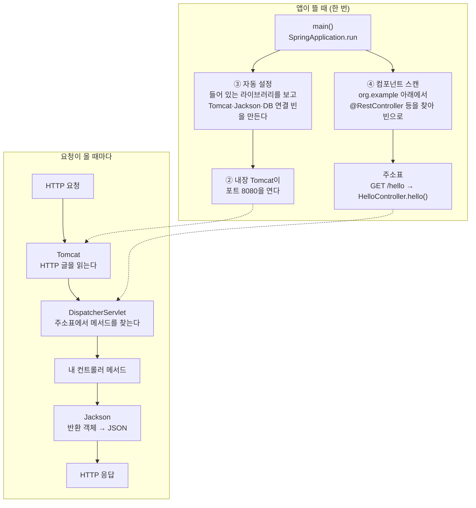

# A4. Spring Boot가 해 주는 것 — main 한 줄 뒤의 큰 그림

> 개념 레슨 · 40분

## 이게 뭐냐

실습 레포의 `Main.java`는 이게 전부다.

```java
@SpringBootApplication
public class Main {
    public static void main(String[] args) {
        SpringApplication.run(Main.class, args);
    }
}
```

그런데 이걸 실행하면 A3에서 본 것처럼 8080번 문이 열리고, JSON을 주고받고, `@GetMapping`을 붙인 메서드가 요청을 받는다. 웹 서버를 설치한 적도, JSON 변환 코드를 쓴 적도 없다. 그 일을 **Spring Boot**가 대신 한다.

### Spring과 Spring Boot

- **Spring**(스프링 프레임워크): Java로 서버를 짤 때 쓰는 부품 모음이다. 요청을 메서드에 연결하는 부품(Spring MVC), 객체를 만들어 서로 이어 주는 부품, DB 부품 등이 있다. 부품이라 조립은 내가 해야 했다.
- **Spring Boot**: 그 부품들을 **흔히 쓰는 방식대로 미리 조립해 주는** 도구다. 내가 아무 말도 안 하면 기본값으로 조립하고, 다르게 하고 싶은 것만 설정 파일에 적는다.

### Boot가 해 주는 네 가지

먼저 낱말 하나. **빈**(bean)은 Spring이 **직접 만들어서 들고 있는 객체**다. 내가 `new`로 만들지 않는다. 컨트롤러 객체도, JSON 변환기 객체도, 웹 서버 객체도 다 빈이다(0-2에서 이미 만났고, 1-3에서 자세히 본다).

| | 하는 일 | 없었다면 |
|---|---|---|
| ① **스타터**(starter) | 같이 쓰는 라이브러리를 **한 줄로 묶어** 가져온다. `spring-boot-starter-webmvc` 한 줄에 Spring MVC·Tomcat·Jackson이 다 따라온다. 버전도 서로 맞는 것으로 고른다 | 라이브러리 수십 개를 버전 맞춰 하나씩 적는다 |
| ② **내장 톰캣**(embedded Tomcat) | 웹 서버(Tomcat)를 **내 앱 안에 넣어** 같이 띄운다. 포트를 열고 HTTP 글을 읽고 쓰는 일을 Tomcat이 한다 | 서버 컴퓨터에 Tomcat을 따로 설치하고 내 앱을 거기에 올린다 |
| ③ **자동 설정**(auto-configuration) | 앱이 뜰 때 "어떤 라이브러리가 들어 있나"를 보고 **필요한 빈을 기본값으로 만든다.** Tomcat이 있으면 웹 서버 빈을, Jackson이 있으면 JSON 변환기 빈을, DB 드라이버가 있으면 DB 연결 빈을 만든다. 기본값은 `application.yml`로 바꾼다(`server.port` 등). 내가 같은 종류의 빈을 직접 만들면 Boot는 자기 것을 만들지 않는다 | 이 빈들을 설정 코드로 하나하나 만든다 |
| ④ **어노테이션 스캔**(component scan) | `@SpringBootApplication`이 붙은 클래스의 **패키지와 그 아래**를 훑어, `@RestController`·`@Service` 같은 표시가 붙은 클래스를 찾아 빈으로 만든다 | 컨트롤러를 하나 만들 때마다 "이것도 등록해 줘"를 적는다 |

0-6에서 "DB를 안 쓰는데도 DB가 꺼져 있으면 앱이 안 뜬다"를 겪는다. ③ 때문이다. JPA 스타터가 들어 있으니 Boot가 "DB를 쓰겠구나" 하고 DB 연결 빈을 만들려다 실패한다.

### 큰 그림



- 내가 쓰는 코드는 그림에서 **"내 컨트롤러 메서드" 한 칸**이다. 나머지는 ①이 가져온 라이브러리를 ③·④가 조립해 둔 것이다.
- `DispatcherServlet`은 Spring MVC의 "요청 배달원"이다. 모든 요청을 먼저 받아, 주소표를 보고 알맞은 메서드에 넘긴다. 0-5의 스택트레이스에 이 이름이 보인다.

## 예시

모두 실습 레포(0장 정답 코드)에서 실측했다(Boot 4.1.1). 실측할 때 DB를 띄우지 않으려고 DB 자동 설정 두 개를 꺼 두었다. 그래서 아래 보고서에는 DB 관련 줄을 뺐다. 여러분 화면에는 DB 줄이 더 있다.

**① 스타터 한 줄이 끌고 오는 것** — `./gradlew dependencies --configuration runtimeClasspath`의 일부. 들여쓰기가 "누가 누구를 데려왔나"다.

```text
+--- org.springframework.boot:spring-boot-starter-webmvc -> 4.1.1
|    +--- org.springframework.boot:spring-boot-starter:4.1.1
|    |    +--- org.springframework.boot:spring-boot-starter-logging:4.1.1
|    |    |    +--- ch.qos.logback:logback-classic:1.5.38
|    |    +--- org.springframework.boot:spring-boot-autoconfigure:4.1.1
|    |    \--- org.yaml:snakeyaml:2.6
|    +--- org.springframework.boot:spring-boot-starter-jackson:4.1.1
|    |    \--- org.springframework.boot:spring-boot-jackson:4.1.1
|    |         \--- tools.jackson.core:jackson-databind:3.1.5
|    +--- org.springframework.boot:spring-boot-starter-tomcat:4.1.1
|    |    +--- org.springframework.boot:spring-boot-starter-tomcat-runtime:4.1.1
|    |    |    +--- org.apache.tomcat.embed:tomcat-embed-core:11.0.24
...
|    \--- org.springframework.boot:spring-boot-webmvc:4.1.1
|         \--- org.springframework:spring-webmvc:7.0.9
```

build.gradle에는 `spring-boot-starter-webmvc` 한 줄인데, 그 아래로 로그(logback), 자동 설정(autoconfigure), yml 읽기(snakeyaml), JSON(jackson-databind), 웹 서버(tomcat-embed-core), Spring MVC(spring-webmvc)가 따라왔다. 이렇게 **따라온 의존성**을 C2에서 자세히 본다.

**② 자동 설정이 판단한 기록** — 앱을 `--debug`로 띄우면 `CONDITIONS EVALUATION REPORT`(조건 평가 보고서)가 찍힌다. "이 설정을 켤까?"를 하나씩 따진 결과다.

```text
============================
CONDITIONS EVALUATION REPORT
============================


Positive matches:
-----------------
...
   TomcatServletWebServerAutoConfiguration matched:
      - @ConditionalOnClass found required classes 'jakarta.servlet.ServletRequest', 'org.apache.catalina.startup.Tomcat', 'org.apache.coyote.UpgradeProtocol', 'org.springframework.boot.tomcat.servlet.TomcatServletWebServerFactory' (OnClassCondition)
      - found 'session' scope (OnWebApplicationCondition)
...
   JacksonAutoConfiguration matched:
      - @ConditionalOnClass found required class 'tools.jackson.databind.json.JsonMapper' (OnClassCondition)
...
Negative matches:
-----------------
...
   GsonHttpMessageConvertersConfiguration:
      Did not match:
         - @ConditionalOnClass did not find required class 'com.google.gson.Gson' (OnClassCondition)
...
   WebMvcAutoConfiguration.ProblemDetailsErrorHandlingConfiguration:
      Did not match:
         - @ConditionalOnBooleanProperty (spring.mvc.problemdetails.enabled=true) did not find property 'spring.mvc.problemdetails.enabled' (OnPropertyCondition)
```

| 줄 | 읽는 법 |
|---|---|
| `TomcatServletWebServerAutoConfiguration matched` — `found required classes '...Tomcat'` | Tomcat 클래스가 **있어서** 웹 서버 설정을 켰다 |
| `JacksonAutoConfiguration matched` — `found required class '...JsonMapper'` | Jackson이 **있어서** JSON 변환기를 만들었다 |
| `GsonHttpMessageConvertersConfiguration` — `did not find required class '...Gson'` | Gson(다른 JSON 라이브러리)은 **없어서** 건너뛰었다 |
| `ProblemDetailsErrorHandlingConfiguration` — `did not find property 'spring.mvc.problemdetails.enabled'` | 설정 값이 **없어서** 건너뛰었다. yml에 `spring.mvc.problemdetails.enabled: true`를 넣으면 켜진다(F1) |

자동 설정은 마법이 아니라 이런 **"있으면 켠다" 규칙 수백 개**다. "있다"의 기준은 두 가지다. 라이브러리(클래스)가 들어 있나, 설정 값이 있나.

**③ 실행 파일 안을 열어 보면** — `./gradlew bootJar`가 만든 jar 하나에 무엇이 들었나.

```bash
unzip -l build/libs/javaExperience-1.0-SNAPSHOT.jar | grep -c 'BOOT-INF/lib/'
```

```text
71
```

```text
   3623633  02-01-1980 00:00   BOOT-INF/lib/tomcat-embed-core-11.0.24.jar
   1944003  02-01-1980 00:00   BOOT-INF/lib/jackson-databind-3.1.5.jar
   1107415  02-01-1980 00:00   BOOT-INF/lib/spring-webmvc-7.0.9.jar
       600  02-01-1980 00:00   BOOT-INF/classes/org/example/controller/HelloController.class
```

jar 전체는 약 54MB이고, 라이브러리 jar 71개가 `BOOT-INF/lib/`에 들어 있다. 내 코드(`BOOT-INF/classes/`)는 몇 KB다. **웹 서버(Tomcat)가 내 앱 파일 안에 들어 있다** — 이것이 "내장 톰캣"이다. 그래서 서버 컴퓨터에는 Java만 있으면 `java -jar 파일.jar` 한 줄로 서버가 뜬다.

## 따라 해 보기

15분. 실습 레포 폴더에서 한다. DB는 studymate MySQL(3306) — studymate가 떠 있으면 된다.

**① 스타터가 끌고 오는 것 보기**

```bash
./gradlew dependencies --configuration runtimeClasspath | grep -E 'starter-webmvc|tomcat-embed-core|jackson-databind|spring-webmvc'
```

기대: 네 이름이 다 보인다. build.gradle에 직접 적은 것은 `starter-webmvc` 하나뿐인지 build.gradle을 열어 확인한다.

**② 자동 설정 보고서 보기**

```bash
./gradlew bootRun --args='--debug' | tee debug.log
```

`Started Main`이 보이면 `Ctrl+C`로 끈다. 그다음:

```bash
grep -A3 'TomcatServletWebServerAutoConfiguration matched' debug.log
grep -A3 'GsonHttpMessageConvertersConfiguration:' debug.log
grep -A3 'DataSourceAutoConfiguration matched' debug.log
```

기대: 앞의 두 개는 위 [예시](#예시)와 같다. 세 번째는 DB 연결 설정이 **켜진** 기록이다. `found required classes`에 어떤 클래스가 있어서 켜졌는지 읽어 본다. 다 봤으면 `debug.log`는 지운다(`rm debug.log`).

**③ 기본값 바꿔 보기** — 자동 설정이 고른 포트 8080을 설정 값으로 덮는다.

```bash
./gradlew bootRun --args='--server.port=8081'
```

기대: 로그에 `Tomcat started on port 8081`. 다른 터미널에서 `curl -i http://localhost:8081/hello`가 `hello`를 돌려준다. 코드는 한 줄도 안 바꿨다. `Ctrl+C`로 끈다.

**④ 실행 파일 열어 보기**

```bash
./gradlew bootJar
unzip -l build/libs/javaExperience-1.0-SNAPSHOT.jar | grep -E 'tomcat-embed-core|HelloController'
```

기대: Tomcat jar와 내 `HelloController.class`가 **같은 파일 안에** 있다.

## 확인 문제

**1.** `spring-boot-starter-webmvc` 한 줄을 build.gradle에서 지우면, 앱이 웹 서버를 못 띄우는 것 말고 무엇이 같이 사라지나? 예시의 트리에서 세 가지를 찾아라.

<details>
<summary>정답</summary>

Tomcat(웹 서버)뿐 아니라 Spring MVC(`@RestController`·`@GetMapping`이 든 `spring-webmvc`), Jackson(JSON 변환, `jackson-databind`), 그리고 그 밑의 로그·자동 설정 라이브러리까지 이 줄을 통해 들어왔다. 그래서 0-6 ①에서 이 줄을 지우면 `@RestController`의 import부터 컴파일 에러가 수십 개 난다. (로그·자동 설정은 다른 스타터를 통해서도 들어와 남을 수 있다.)
</details>

**2.** 컨트롤러 클래스를 `org.example` 패키지 **밖**(예: `com.other`)에 만들었더니 404가 난다. Boot가 해 주는 네 가지 중 어느 것과 관련 있나?

<details>
<summary>정답</summary>

④ 컴포넌트 스캔이다. `@SpringBootApplication`이 붙은 `Main`이 `org.example`에 있으니, Spring은 `org.example`과 그 **아래** 패키지만 훑는다. 밖에 있는 클래스는 찾지 못해 빈도 안 만들고 주소표에도 안 올린다. 그래서 그 주소는 404다(0-2 망가뜨리기 ④).
</details>

**3.** "자동 설정"이 무엇을 보고 켤지 말지를 정하는지, 보고서의 두 가지 근거를 들어 설명하라.

<details>
<summary>정답</summary>

① **클래스가 있나**(`@ConditionalOnClass`) — 예: Tomcat 클래스가 있으면 웹 서버 설정을 켜고, Gson 클래스가 없으면 Gson 설정을 건너뛴다. 클래스가 있는지는 build.gradle에 넣은 의존성이 정한다. ② **설정 값이 있나**(`@ConditionalOnBooleanProperty` 등) — 예: `spring.mvc.problemdetails.enabled`가 없어서 ProblemDetail 설정을 건너뛰었다. 그 밖에 "같은 종류의 빈을 내가 이미 만들었나"(`@ConditionalOnMissingBean`)도 본다.
</details>

**4.** 서버 컴퓨터에 Tomcat을 따로 설치하지 않았는데 `java -jar app.jar`로 웹 서버가 뜬다. 왜 그런가?

<details>
<summary>정답</summary>

내장 톰캣이다. `tomcat-embed-core` 같은 Tomcat 라이브러리가 jar 안(`BOOT-INF/lib/`)에 같이 들어 있다. 앱이 뜰 때 자동 설정이 그 Tomcat을 만들어 포트를 연다. 서버 컴퓨터에는 Java(JDK·JRE)만 있으면 된다.
</details>

## 더 깊이

- [P01 Spring vs Spring Boot](../docs/knowledge/P01-spring-vs-boot.md#1-한-줄로-말하면) — 무엇이 다르고 프로젝트는 어떻게 시작하나
- [S03 Boot 자동 구성 원리](../docs/knowledge/S03-boot-autoconfig.md#3-내부-동작원리) — 조건 어노테이션과 보고서를 더 깊이
- [P12 왜 new 대신 빈으로 받나](../docs/knowledge/P12-why-beans-ioc-intro.md) — 빈과 의존성 주입 입문
- [S05 Spring MVC 요청 처리 흐름](../docs/knowledge/S05-mvc-request-flow.md#3-내부-동작원리) — DispatcherServlet이 하는 일
- [P05 jar와 war](../docs/knowledge/P05-jar-war-packaging.md) — 실행 파일 안에 무엇이 들어가나

## 다음

실습으로 돌아간다 — [시나리오 목차](../scenario/README.md)에서 지금 하던 단계를 이어서 한다.
