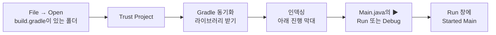

# C1. IntelliJ — 프로젝트 열기·실행·중단점 디버깅

> 개념 레슨 · 35분

## 이게 뭐냐

A0에서는 실습 레포를 실행했다. Java 백엔드 개발은 보통 **IntelliJ IDEA**에서 한다. 코드를 고치고, 실행하고, 요청 처리 도중에 멈춰서 값을 본다. 다만 IntelliJ는 폴더를 그냥 여는 게 아니라 **빌드 도구(Gradle)에게 프로젝트 구조를 물어서** 연다. 이 차이 때문에 처음에 막히는 일이 많다.

| 낱말 | 뜻 |
|---|---|
| **IDE** | 편집기 + 빌드 + 실행 + 디버거를 한데 묶은 프로그램 |
| **JDK** | Java 코드를 컴파일하고 실행하는 도구 묶음. 이 레포는 **Java 21**을 쓴다 |
| **Gradle 동기화**(sync) | IntelliJ가 `build.gradle`을 읽어 "어떤 라이브러리를, 어떤 JDK로"를 알아내고 라이브러리를 받아 오는 일. 이게 끝나야 import가 빨갛지 않다 |
| **인덱싱**(indexing) | IntelliJ가 모든 코드·라이브러리의 이름을 미리 훑어 두는 일. 끝나야 자동 완성·이동이 된다 |
| **실행 설정**(Run Configuration) | "무엇을, 어떤 인자로 실행할지"를 저장한 것. 오른쪽 위 ▶ 옆 목록에 이름이 뜬다 |
| **중단점**(breakpoint) | "이 줄에 오면 멈춰라" 표시. 줄 번호 옆의 빨간 점 |
| **디버그 모드** | 중단점이 동작하도록 실행하는 방식. ▶(Run)이 아니라 🐞(Debug)로 띄워야 멈춘다 |

### 서버를 디버깅할 때 알아 둘 것

- 중단점에 걸리면 **그 요청을 처리하던 서버 쪽 흐름이 멈춘다.** 요청을 보낸 curl은 응답을 못 받고 **기다린다.** 계속(Resume)을 누르면 그제야 응답이 간다.
- 멈춘 곳에서 **Frames**(지금까지 불려 온 메서드 목록)가 보인다. 0-5에서 읽을 스택트레이스와 같은 목록이다. 맨 위가 지금 줄이다.
- 로그 줄을 넣고 다시 띄우는 대신, 멈춘 채로 변수 값을 보고 식을 계산해 볼 수 있다(Evaluate). 서버는 코드를 바꾸면 **다시 띄워야** 하므로, 멈춰서 보는 편이 빠르다.

## 예시

### 열고 → 동기화 → 실행까지



### 자주 쓰는 단축키 (macOS 기본 키맵)

macOS 기본 키맵 기준이다(IntelliJ 2024.3). 버전이나 키맵 설정이 다르면 `Settings → Keymap`에서 동작 이름으로 검색한다. 단축키를 모르면 `⇧⌘A`(Find Action)에 동작 이름을 쳐도 된다.

| 하는 일 | 단축키 | 메뉴·아이콘 |
|---|---|---|
| 어디서든 찾기 | `⇧` 두 번 | 오른쪽 위 돋보기 |
| 클래스 열기 | `⌘O` | Navigate → Class |
| 파일 열기 | `⇧⌘O` | Navigate → File |
| 줄 번호로 가기 | `⌘L` | Navigate → Line/Column |
| 지금 파일의 `main` 실행 / 디버그 | `⌃⇧R` / `⌃⇧D` | 줄 번호 옆 초록 ▶ |
| 고른 실행 설정으로 실행 / 디버그 | `⌃R` / `⌃D` | 오른쪽 위 ▶ / 🐞 |
| 다시 실행 | `⌘R` | Run 창의 ↻ |
| 멈추기(서버 끄기) | `⌘F2` | 빨간 ■ |
| 중단점 켜고 끄기 | `⌘F8` | 줄 번호 옆 빈칸 클릭 |
| 다음 줄로(안으로 안 들어감) | `F8` | Step Over |
| 메서드 안으로 | `F7` | Step Into |
| 지금 메서드 밖으로 | `⇧F8` | Step Out |
| 계속 실행 | `⌥⌘R` | ▶ 모양 Resume |
| 식 계산해 보기 | `⌥F8` | Evaluate Expression |
| Run 창 / Debug 창 | `⌘4` / `⌘5` | 아래쪽 도구 창 |
| 터미널 | `⌥F12` | 아래쪽 Terminal |

### 중단점에 걸렸을 때 화면

실습 레포의 `HelloController`에 중단점을 걸고 `/hello`를 부르면 이렇게 된다.

```java
@RestController
public class HelloController {

    @GetMapping("/hello")
    public String hello() {
        return "hello";      // ← 14번 줄에 중단점(빨간 점)
    }
}
```

1. 14번 줄이 파랗게 칠해지고 Debug 창(`⌘5`)이 열린다.
2. **Frames** 맨 위가 `hello:14, HelloController (org.example.controller)`다. 그 아래로 Spring·Tomcat 메서드가 줄줄이 있다. 스레드 이름은 `http-nio-8080-exec-1`처럼 보인다. Tomcat이 요청 하나에 일꾼(스레드) 하나를 붙여 처리한다는 표시다.
3. 요청을 보낸 터미널의 curl은 **아무것도 찍지 않고 기다린다.**
4. `⌥⌘R`(Resume)을 누르면 curl에 `hello`가 찍힌다.

## 따라 해 보기

15분. JDK 21과 IntelliJ가 설치되어 있다고 가정한다.

**① 프로젝트 열기 (3분)**

1. IntelliJ 첫 화면 **Open**(또는 메뉴 File → Open) → 실습 레포 폴더(`build.gradle`이 있는 폴더)를 고른다. `src` 같은 하위 폴더를 고르면 안 된다.
2. "Trust and Open Project?"가 뜨면 **Trust Project**.
3. 오른쪽 아래 진행 막대(Gradle 동기화 → Indexing)가 끝날 때까지 기다린다. 처음에는 라이브러리를 받느라 몇 분 걸릴 수 있다.
4. 확인: `⌘O` → `HelloController` → 엔터. import 줄이 빨갛지 않으면 동기화가 된 것이다.

**② JDK 확인 (2분)** — import가 빨갛거나 동기화가 실패했을 때만.

- `⌘;`(File → Project Structure) → Project → **SDK**가 21인지.
- `⌘,`(Settings) → Build, Execution, Deployment → Build Tools → Gradle → **Gradle JVM**이 21인지.
- 둘을 맞춘 뒤 오른쪽 Gradle 창(코끼리 아이콘)의 ↻(Reload All Gradle Projects).

**③ 실행 (3분)**

1. `⌥F12`로 터미널을 열고 `docker compose ps mysql`로 DB(이 저장소 compose의 MySQL)가 `healthy`인지 본다.
2. `⌘O` → `Main` → 열린 파일의 `public static void main` 줄 옆 초록 ▶ → **Run 'Main.main()'**.
3. Run 창(`⌘4`)에 `Started Main`이 찍히면 터미널에서:

   ```bash
   curl -i http://localhost:8080/hello
   ```

   기대: `HTTP/1.1 200`, 본문 `hello`.
4. `⌘F2`로 멈춘다. Run 창 마지막에 `Process finished with exit code 130`처럼 끝났다는 줄이 나온다(숫자는 끄는 방법에 따라 다를 수 있다).

**④ 디버그 (7분)**

1. `⌘O` → `HelloController`. 14번 줄 `return "hello";`의 줄 번호 옆 빈칸을 클릭한다(또는 그 줄에서 `⌘F8`). 빨간 점이 생긴다.
2. 오른쪽 위 실행 설정이 `Main`인지 보고 🐞(`⌃D`)를 누른다. Debug 창에 `Started Main`이 찍힐 때까지 기다린다.
3. 터미널에서 `curl -i http://localhost:8080/hello`. **curl이 멈춰 있는 것**을 본다.
4. IntelliJ로 돌아가 Debug 창의 **Frames**에서 맨 위 줄(`hello:14`)과 그 아래 `org.springframework...`·`org.apache...` 줄들을 훑어본다.
5. `⌥F8`(Evaluate Expression)을 열고 `"hello".toUpperCase()`를 쳐서 Evaluate → `"HELLO"`가 나오는지 본다. 멈춘 자리에서 Java 식을 바로 계산해 볼 수 있다.
6. `⌥⌘R`(Resume). 터미널의 curl에 `hello`가 찍힌다.
7. 중단점을 다시 클릭해 지우고 `⌘F2`로 끈다.

막히면:

| 증상 | 볼 곳 |
|---|---|
| import·`@RestController`가 빨갛다 | 동기화가 안 됐다. ②의 JDK 확인 후 Gradle 창 ↻ |
| ▶가 안 보이거나 회색이다 | 아직 인덱싱 중이다. 진행 막대가 끝날 때까지 기다린다 |
| 중단점에서 안 멈춘다 | 🐞가 아니라 ▶로 띄웠다. 또는 코드를 고친 뒤 다시 띄우지 않았다 |
| `Port 8080 was already in use` | 이미 하나 떠 있다(A3). Run·Debug 창 탭을 보고 남은 것을 ■로 끈다 |
| `Communications link failure`·`Unable to determine Dialect` | DB가 꺼져 있다. 이 저장소 루트에서 `docker compose up -d`로 띄운다 |

## 확인 문제

**1.** IntelliJ로 레포의 `src/main/java` 폴더를 열었더니 모든 import가 빨갛다. 무엇이 잘못됐나?

<details>
<summary>정답</summary>

`build.gradle`이 있는 **레포 맨 위 폴더**를 열어야 한다. IntelliJ는 `build.gradle`을 읽고 Gradle 동기화를 해서 라이브러리 목록을 안다. 하위 폴더를 열면 빌드 파일이 없어 라이브러리를 모르니 Spring의 import가 전부 빨갛게 된다.
</details>

**2.** 중단점을 찍고 ▶(Run)으로 띄워 요청을 보냈는데 멈추지 않고 응답이 왔다. 왜인가?

<details>
<summary>정답</summary>

중단점은 **디버그 모드**(🐞, `⌃D`)로 띄웠을 때만 동작한다. ▶로 띄운 프로세스는 중단점을 모른다. 멈추고 🐞로 다시 띄운다.
</details>

**3.** 중단점에 걸려 있는 동안 curl이 아무것도 출력하지 않는다. 서버가 고장 난 것인가?

<details>
<summary>정답</summary>

아니다. 그 요청을 처리하던 서버 쪽 흐름이 중단점에서 **멈춰 있어서** 아직 응답을 보내지 않았을 뿐이다. Resume(`⌥⌘R`)을 누르면 나머지를 처리하고 응답이 간다. 오래 멈춰 두면 클라이언트 쪽에서 시간 초과가 날 수는 있다.
</details>

**4.** Debug 창의 Frames에 보이는 목록과 0-5에서 볼 스택트레이스는 어떤 관계인가?

<details>
<summary>정답</summary>

같은 것이다. 둘 다 "지금 메서드를 누가 불렀고, 그건 또 누가 불렀나"를 맨 위(지금 위치)부터 아래(출발점)로 늘어놓은 **호출 스택**이다. 디버거는 멈춘 순간의 스택을 보여 주고, 스택트레이스는 예외가 난 순간의 스택을 로그에 찍는다.
</details>

## 더 깊이

- [P15 IntelliJ 실무](../docs/knowledge/P15-intellij-practical.md#2-당장-알아야-할-것) — SDK·Gradle JVM·실행 설정·단축키
- [P15 자주 나는 에러와 해결](../docs/knowledge/P15-intellij-practical.md#5-자주-나는-에러와-해결) — 빨간 import, 멈추지 않는 중단점
- [W06 서버 디버깅은 왜 다른가](../docs/knowledge/W06-why-server-debugging.md#2-짧은-답) — 브레이크포인트와 로그로 서버를 들여다보는 법
- [D05 디버깅 방법론](../docs/knowledge/D05-debugging-methodology.md#1-큰-그림) — 재현 → 관찰 → 가설 → 검증

## 다음

[C2. Gradle](C2-gradle-dependencies.md) — 동기화 때 IntelliJ가 받아 온 "라이브러리"가 무엇이고 어디서 오는지 본다.
