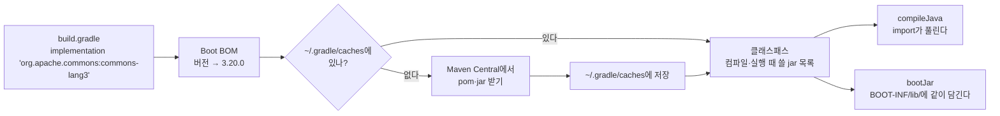

# C2. Gradle — 의존성은 무엇이고 어디서 오나

> 개념 레슨 · 35분

## 이게 뭐냐

남이 만든 라이브러리를 내 코드에서 `import` 하려면 먼저 그 코드를 받아 와야 한다. Java에서는 **Gradle**이 그 일을 한다. `build.gradle`의 `dependencies { ... }`에 한 줄을 적으면, Gradle이 그 라이브러리를 받아 와서 컴파일할 때와 실행할 때 쓸 수 있게 해 준다. 이렇게 "내 코드가 기대는 남의 코드"를 **의존성**(dependency)이라고 한다.

0-6에서 `build.gradle`을 한 줄씩 **읽는다.** 이 레슨은 그 한 줄이 **어디서 무엇을 가져오는지**를 본다.

### 무엇이 어디에 있나

| 무엇 | Gradle에서 | 메모 |
|---|---|---|
| 의존성 목록 | `build.gradle`의 `dependencies { implementation '...' }` | |
| 한 줄의 모양 | `'org.apache.commons:commons-lang3:3.20.0'` | 이름이 **세 칸**이다(아래 좌표) |
| 받아 오는 곳 | **Maven Central**(repo.maven.apache.org) — `repositories { mavenCentral() }` | |
| 받은 것이 놓이는 곳 | 컴퓨터에 하나, **`~/.gradle/caches/`** | 프로젝트 폴더에 라이브러리가 안 생긴다. 여러 프로젝트가 같이 쓴다 |
| 받기 명령 | 따로 없다. 빌드·실행·IntelliJ 동기화 때 Gradle이 알아서 받는다 | |
| 목록 보기 | `./gradlew dependencies` | |
| 테스트에서만 쓰기 | `testImplementation` | |
| 실행기 | `./gradlew` | 레포에 든 Gradle 실행기. PC에 Gradle을 설치하지 않아도 된다 |

### 좌표 — 라이브러리의 주소

Java 라이브러리는 **그룹:이름:버전** 세 칸으로 부른다. 이것을 **좌표**(coordinates)라고 한다.

```text
org.apache.commons : commons-lang3 : 3.20.0
└ 그룹(만든 곳)        └ 이름(artifact)  └ 버전
```

좌표는 그대로 저장소의 폴더 경로가 된다. 점(`.`)이 `/`로 바뀐다.

```text
https://repo.maven.apache.org/maven2/org/apache/commons/commons-lang3/3.20.0/commons-lang3-3.20.0.jar
```

### 받아 오는 것 두 가지 — jar와 pom

- **jar**: 컴파일된 Java 코드(`.class` 파일들)를 zip으로 묶은 파일이다. 라이브러리의 "본체"다.
- **pom**(또는 Gradle의 `.module`): "이 라이브러리는 또 무엇에 기대는가"를 적은 목록이다.

Gradle은 pom을 읽고, 거기 적힌 라이브러리도 받는다. 그것의 pom도 또 읽는다. 그래서 한 줄을 적어도 여러 개가 따라온다. 이렇게 **따라 들어온 의존성**을 **전이 의존성**(transitive dependency)이라고 한다. A4에서 `starter-webmvc` 한 줄이 Tomcat·Jackson을 데려온 것이 이것이다.

### 버전을 안 적어도 되는 이유

레포의 `build.gradle`에는 버전이 없는 줄이 많다(`implementation 'org.springframework.boot:spring-boot-starter-webmvc'`). Spring Boot 플러그인이 **"이 Boot 버전과 잘 맞는 라이브러리 버전 목록"**(**BOM**, Bill of Materials)을 갖고 있어서 대신 정한다. 단, 그 목록에 **없는** 라이브러리는 버전을 직접 적어야 한다. 안 적으면 받지 못한다(아래 예시 ③).

### 길 전체



**클래스패스**(classpath)는 "Java가 클래스를 찾을 jar·폴더 목록"이다. 의존성을 추가한다는 것은 결국 **이 목록에 jar 하나를 더하는 것**이다.

## 예시

실습 레포 복제본에서 실측했다(Gradle 9.8.0, Boot 4.1.1). 문자열 도구 라이브러리 `commons-lang3`을 넣어 본다. Boot BOM에 들어 있는 라이브러리다.

**① 한 줄 추가와 트리 변화**

```groovy
dependencies {
    // ...원래 있던 줄들...
    implementation 'org.apache.commons:commons-lang3'
}
```

```bash
./gradlew dependencies --configuration runtimeClasspath | grep lang3
```

```text
+--- org.apache.commons:commons-lang3 -> 3.20.0
```

`-> 3.20.0`은 "버전을 안 적었는데 3.20.0으로 정해졌다"는 뜻이다. 누가 정했는지는 `dependencyInsight`로 본다.

```bash
./gradlew dependencyInsight --dependency commons-lang3 --configuration runtimeClasspath
```

```text
org.apache.commons:commons-lang3:3.20.0 (selected by rule)
...
org.apache.commons:commons-lang3 -> 3.20.0
\--- runtimeClasspath
```

`selected by rule` — Boot BOM의 규칙으로 골랐다.

**② 받은 파일은 어디에** — 내 프로젝트 폴더가 아니라 컴퓨터 공용 캐시다(아래 출력의 사용자 이름은 `me`로 바꿨다).

```bash
find ~/.gradle/caches/modules-2/files-2.1/org.apache.commons/commons-lang3/3.20.0 -type f
```

```text
$USER_HOME/.gradle/caches/modules-2/files-2.1/org.apache.commons/commons-lang3/3.20.0/65897b3e5731220962e659e001904af3c3cbeba9/commons-lang3-3.20.0.jar
$USER_HOME/.gradle/caches/modules-2/files-2.1/org.apache.commons/commons-lang3/3.20.0/54f65c450509a0cc4723b8bfb3553d9c9eb44175/commons-lang3-3.20.0.pom
```

처음 받는 라이브러리라면 `--info`로 빌드할 때 받아 오는 주소가 보인다. 아래는 캐시에 없던 `commons-text:1.15.0`을 처음 넣었을 때다.

```text
Downloading https://repo.maven.apache.org/maven2/org/apache/commons/commons-text/1.15.0/commons-text-1.15.0.pom to $USER_HOME/.gradle/.tmp/gradle_download...bin
Downloading https://repo.maven.apache.org/maven2/org/apache/commons/commons-text/1.15.0/commons-text-1.15.0.jar to $USER_HOME/.gradle/.tmp/gradle_download...bin
```

pom을 먼저 받고(무엇에 기대는지 보려고), jar를 받는다. `commons-text`의 pom에는 `commons-lang3`이 적혀 있어서, 트리에 이렇게 따라 들어온다.

```text
+--- org.apache.commons:commons-text:1.15.0
|    \--- org.apache.commons:commons-lang3:3.20.0
```

**③ 의존성이 잘못됐을 때의 에러 세 가지**

BOM에 **없는** 라이브러리의 버전을 빼먹었을 때 (`implementation 'org.apache.commons:commons-text'`):

```text
* What went wrong:
Execution failed for task ':compileJava' (registered by plugin class 'org.gradle.api.plugins.JavaBasePlugin').
> Could not resolve all files for configuration ':compileClasspath'.
   > Could not find org.apache.commons:commons-text:.
     Required by:
         root project 'javaExperience'
```

`commons-text:.` — 버전 칸이 비어 있다. 버전을 적어 고친다.

없는 버전을 적었을 때 (`commons-text:1.99.0`):

```text
   > Could not find org.apache.commons:commons-text:1.99.0.
```

`Could not find 좌표`는 "저장소에 그런 파일이 없다"다. 그룹·이름·버전 오타를 본다. 있는 버전은 [Maven Central 검색](https://central.sonatype.com)에서 확인한다.

코드에서 쓰는데 의존성 줄이 **없을 때** — 아래 컨트롤러가 `StringUtils`를 import하는데 `commons-lang3` 줄을 지우면:

```text
> Task :compileJava FAILED
.../ShortTitleController.java:3: error: package org.apache.commons.lang3 does not exist
import org.apache.commons.lang3.StringUtils;
                               ^
.../ShortTitleController.java:14: error: cannot find symbol
        return StringUtils.abbreviate(title, max);
               ^
  symbol:   variable StringUtils
  location: class ShortTitleController
2 errors
```

`package ... does not exist`가 import 줄에 나오면 **내 코드 오타가 아니라 의존성이 없는 것**이다. 실행할 때만 필요한 `runtimeOnly` 의존성이 빠지면 컴파일은 되고 **앱이 뜰 때** `ClassNotFoundException`이 난다(0-6 [③](../scenario/ch0-first-steps/0-6-gradle-and-yml.md#③-mysql-드라이버를-뺀다--caused-by-여섯-겹)).

## 따라 해 보기

15분. 실습 레포에서 한다. 끝나면 되돌린다.

**① 의존성 한 줄 추가 (3분)**

`build.gradle`의 `dependencies { ... }` 안, `runtimeOnly 'com.mysql:mysql-connector-j'` 줄 아래에 넣는다.

```groovy
    implementation 'org.apache.commons:commons-lang3'
```

IntelliJ 오른쪽 위에 뜨는 코끼리 아이콘(**Load Gradle Changes**)을 누른다. 터미널에서:

```bash
./gradlew dependencies --configuration runtimeClasspath | grep lang3
```

기대: `+--- org.apache.commons:commons-lang3 -> 3.20.0`.

**② 받은 jar를 직접 써 보기 (4분)** — 의존성이 "jar 파일 하나"라는 것을 확인한다. `jshell`은 JDK에 든 Java 대화형 실행기다(한 줄씩 쳐서 바로 실행).

```bash
JAR=$(find ~/.gradle/caches/modules-2/files-2.1/org.apache.commons/commons-lang3/3.20.0 -name '*.jar')
echo $JAR
jshell --class-path "$JAR"
```

jshell 안에서:

```text
jshell> org.apache.commons.lang3.StringUtils.isBlank("   ")
$1 ==> true

jshell> org.apache.commons.lang3.StringUtils.abbreviate("백엔드 첫걸음을 시작합니다", 8)
$2 ==> "백엔드 첫..."

jshell> /exit
```

`--class-path` 없이 `jshell`을 열고 같은 줄을 치면 `package org.apache.commons.lang3 does not exist`가 난다. **클래스패스에 jar가 있느냐 없느냐**가 전부다. Gradle은 이 `--class-path`를 대신 만들어 주는 도구다.

**③ 앱에서 쓰기 (4분)**

`src/main/java/org/example/start/ShortTitleController.java`

```java
package org.example.start;

import org.apache.commons.lang3.StringUtils;
import org.springframework.web.bind.annotation.GetMapping;
import org.springframework.web.bind.annotation.RequestParam;
import org.springframework.web.bind.annotation.RestController;

@RestController
public class ShortTitleController {

    // 긴 제목을 max 글자로 줄인다 — 줄이는 일은 commons-lang3의 StringUtils가 한다
    @GetMapping("/api/start/short-title")
    public String shortTitle(@RequestParam String title, @RequestParam(defaultValue = "8") int max) {
        return StringUtils.abbreviate(title, max);
    }
}
```

앱을 다시 띄우고:

```bash
curl -G http://localhost:8080/api/start/short-title --data-urlencode 'title=백엔드 첫걸음을 시작합니다' --data-urlencode 'max=8'
```

기대: `백엔드 첫...`

**④ 망가뜨려 보기 (3분)** — 하나씩 하고 되돌린다.

| 바꾸기 | 명령 | 기대 |
|---|---|---|
| `commons-lang3` 줄을 지운다 | `./gradlew compileJava` | `package org.apache.commons.lang3 does not exist` |
| `commons-lang3:3.99.0`으로 바꾼다 | `./gradlew compileJava` | `Could not find org.apache.commons:commons-lang3:3.99.0.` |

**⑤ 되돌리기** — `ShortTitleController.java`를 지우고 `build.gradle`의 추가한 줄을 지운 뒤 Load Gradle Changes. `git status`에 아무것도 안 남았는지 본다.

## 확인 문제

**1.** `implementation 'org.springframework.boot:spring-boot-starter-webmvc'`처럼 버전 없이 써도 되는 이유는? `commons-text`는 왜 버전 없이 쓰면 안 됐나?

<details>
<summary>정답</summary>

Spring Boot 플러그인이 가진 **BOM**(버전 목록)이 그 라이브러리의 버전을 정해 주기 때문이다. `commons-text`는 Boot BOM에 **없는** 라이브러리라 정해 줄 사람이 없다. 그래서 `Could not find org.apache.commons:commons-text:.`(버전 칸이 빔)가 났다. BOM에 없는 것은 버전을 직접 적는다.
</details>

**2.** build.gradle에 `commons-text` 한 줄만 넣었는데 트리에 `commons-lang3`도 생겼다. 왜인가?

<details>
<summary>정답</summary>

**전이 의존성**이다. `commons-text`의 pom(자기 의존성 목록)에 `commons-lang3`이 적혀 있다. Gradle은 그것까지 받아 클래스패스에 넣는다.
</details>

**3.** 컴파일 에러가 import 줄마다 `package org.springframework.web.bind.annotation does not exist`로 수십 개 났다. 코드를 하나씩 고쳐야 할까?

<details>
<summary>정답</summary>

아니다. `package ... does not exist`는 그 패키지를 담은 **jar가 클래스패스에 없다**는 뜻이다. build.gradle에서 그 의존성(여기서는 `spring-boot-starter-webmvc`)이 빠졌거나 오타인지 본다. IntelliJ에서만 빨갛고 `./gradlew compileJava`는 통과하면 Load Gradle Changes를 안 누른 것이다.
</details>

**4.** 프로젝트 폴더를 뒤져도 받아 온 라이브러리 폴더가 없다. 받아 온 jar는 어디에 있나? 다른 프로젝트에서 같은 라이브러리를 쓰면 또 받나?

<details>
<summary>정답</summary>

컴퓨터 공용 캐시 `~/.gradle/caches/modules-2/files-2.1/<그룹>/<이름>/<버전>/`에 있다. 같은 좌표(그룹·이름·버전)면 다른 프로젝트도 이 캐시를 그대로 쓴다. 다시 받지 않는다.
</details>

**5.** `runtimeOnly`로 넣은 MySQL 드라이버를 지우면 `compileJava`는 통과하는데 앱이 뜰 때 실패한다. 왜 컴파일은 통과하나?

<details>
<summary>정답</summary>

`runtimeOnly`는 "코드에서 import하지 않고, **실행할 때만** 클래스패스에 있으면 된다"는 뜻이다. 내 코드 어디에도 MySQL 드라이버 클래스를 import하지 않으니 컴파일은 된다. 앱이 뜰 때 DB 연결을 만들며 그 클래스를 찾다가 `ClassNotFoundException: com.mysql.cj.jdbc.Driver`가 난다.
</details>

## 더 깊이

- [P08 Maven·Gradle 실무](../docs/knowledge/P08-maven-gradle-practical.md#2-당장-알아야-할-것) — 의존성 범위, 래퍼, 버전 충돌
- [P08 자주 나는 에러와 해결](../docs/knowledge/P08-maven-gradle-practical.md#5-자주-나는-에러와-해결) — `Could not find`, 버전 충돌
- [D04 빌드 파이프라인](../docs/knowledge/D04-build-pipeline-explained.md) — 컴파일·패키징이 어떻게 이어지나
- [S03 Boot 자동 구성 원리](../docs/knowledge/S03-boot-autoconfig.md#1-왜-알아야-하나) — 의존성을 넣으면 왜 동작이 바뀌나

## 다음

[C3. application.yml과 프로필](C3-application-yml-profiles.md) — 코드는 그대로 두고 설정 파일로 앱의 동작을 바꾼다. build.gradle 줄별 읽기는 [0-6](../scenario/ch0-first-steps/0-6-gradle-and-yml.md#buildgradle-한-줄씩)에서 한다.
