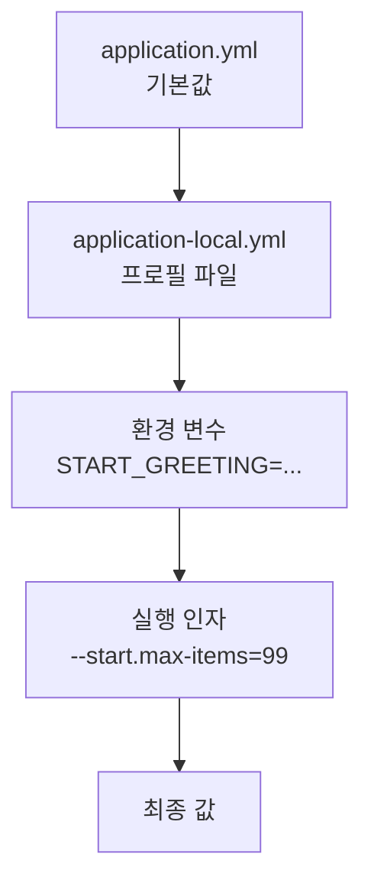

# C3. application.yml과 프로필 — 코드는 그대로, 설정만 바꾸기

> 개념 레슨 · 30분

## 이게 뭐냐

DB 주소는 내 노트북과 운영 서버에서 다르다. 그렇다고 코드를 환경마다 따로 둘 수는 없다. 코드는 하나로 두고 **값만 환경마다 바꾼다.** Spring Boot에서는 그 값을 `src/main/resources/application.yml`에 둔다. DB 주소·계정, 포트, 로그를 얼마나 자세히 찍을지 같은 값이 여기 있다.

### yml은 들여쓰기로 묶은 키 목록이다

**YAML**(yml)은 "키: 값"을 **들여쓰기로 묶어** 적는 형식이다. 들여쓰기가 곧 "~의 아래"라는 뜻이다.

```yaml
spring:
  application:
    name: javaExperience
server:
  port: 8080
```

이 다섯 줄은 키 두 개다. 위에서부터 이름을 점(`.`)으로 이으면 된다.

| yml 경로 | 점으로 이은 키 | 값 |
|---|---|---|
| `spring:` → `application:` → `name:` | `spring.application.name` | `javaExperience` |
| `server:` → `port:` | `server.port` | `8080` |

같은 내용을 `.properties` 형식으로 쓰면 `spring.application.name=javaExperience`처럼 한 줄에 하나다. yml은 앞부분이 같은 키를 들여쓰기로 묶어 줄였을 뿐이다. 그래서:

- 들여쓰기는 **스페이스**로 한다. 탭은 쓸 수 없다.
- 같은 묶음 안의 키는 **같은 칸**에서 시작한다. 한 칸만 어긋나도 구조가 바뀐다.
- 키를 누가 읽느냐: `spring.`·`server.`·`logging.`으로 시작하는 키는 **Spring Boot가** 읽는다(A4의 자동 설정이 이 값을 본다). 내가 지은 키(예: `start.greeting`)는 **내 코드가** `@Value("${start.greeting}")`로 읽는다(0-6에서 실습).
- 설정은 **앱이 뜰 때 한 번** 읽는다. 값을 바꿨으면 다시 띄운다.

### 프로필 — 환경별 덮어쓰기 파일

**프로필**(profile)은 "이번 실행은 어떤 환경인가"에 붙이는 이름이다(`local`, `dev`, `prod` 등). 규칙은 두 개뿐이다.

1. `application-<프로필이름>.yml` 파일을 만든다. 예: `application-local.yml`.
2. 실행할 때 `spring.profiles.active=<프로필이름>`을 준다.

그러면 Boot는 `application.yml`을 먼저 읽고, 그 **위에** `application-local.yml`을 겹친다. 프로필 파일에 **있는 키만** 바뀌고, 없는 키는 `application.yml` 값이 그대로 남는다.

| 파일 | 언제 읽나 |
|---|---|
| `application.yml` | 늘 먼저 |
| `application-local.yml`, `application-prod.yml` | `spring.profiles.active`로 고른 것만, 그 위에 겹쳐서 |

실습 레포에도 실제 예가 있다. `application-practice.yml`은 DB 주소의 끝만 `community` → `practice`로 바꾼다. 나머지(계정·JPA 설정·로그)는 `application.yml`을 그대로 쓴다.

```yaml
# 학습용 데이터(practice DB)에 붙는 프로파일 — practice/MISSIONS.md 미션용
# 실행: ./gradlew bootRun --args='--spring.profiles.active=practice'  (IntelliJ: Active profiles에 practice)
spring:
  datasource:
    url: jdbc:mysql://localhost:13308/practice?characterEncoding=UTF-8&serverTimezone=Asia/Seoul
```

### 누가 이기나 — 우선순위

같은 키가 여러 곳에 있으면 **아래쪽(나중)이 이긴다.**



- **환경 변수**는 키를 대문자로 바꾸고 점을 `_`로 바꿔 쓴다: `start.greeting` → `START_GREETING`, `spring.profiles.active` → `SPRING_PROFILES_ACTIVE`. 서버에 배포할 때 비밀번호처럼 파일에 두면 안 되는 값을 이렇게 넣는다.
- **실행 인자**는 `--키=값`이다. `./gradlew bootRun --args='--server.port=8081'`, IntelliJ는 Run 설정의 Program arguments.

## 예시

실습 레포 복제본에서 실측했다(Boot 4.1.1). 0-6에서 만들 `ConfigController`(`GET /api/start/config`가 `start.greeting`·`start.max-items`를 돌려준다)로 값이 어디서 왔는지 확인했다. 실측 포트는 8189다.

`application.yml`에는 `start.greeting: 반가워요, 백엔드!`, `start.max-items: 5`가 있고, `application-local.yml`을 이렇게 만들었다.

```yaml
# local 프로필에서만 덮어쓸 값 — 나머지는 application.yml 그대로
start:
  greeting: 로컬에서 반가워요
  max-items: 20
```

| 실행 방법 | 로그의 프로필 줄 | `/api/start/config` 응답 |
|---|---|---|
| 그냥 실행 | `No active profile set, falling back to 1 default profile: "default"` | `{"appName":"javaExperience","greeting":"반가워요, 백엔드!","maxItems":5}` |
| `--spring.profiles.active=local` | `The following 1 profile is active: "local"` | `{"appName":"javaExperience","greeting":"로컬에서 반가워요","maxItems":20}` |
| 위 + 환경 변수 `START_GREETING='환경 변수에서 반가워요'` + 인자 `--start.max-items=99` | `The following 1 profile is active: "local"` | `{"appName":"javaExperience","greeting":"환경 변수에서 반가워요","maxItems":99}` |

세 번째 줄: `greeting`은 환경 변수가 프로필 파일을 이겼고, `maxItems`는 실행 인자가 프로필 파일을 이겼다. `appName`은 아무도 덮지 않아 `application.yml` 값 그대로다.

### 조용한 함정 두 개

**① 프로필 이름 오타** — `--spring.profiles.active=locla`

```text
INFO ... [javaExperience] ... : The following 1 profile is active: "locla"
```

에러가 **안 난다.** `application-locla.yml`이 없으니 덮어쓸 것이 없을 뿐이다. 앱은 기본값으로 멀쩡히 뜬다. 응답도 `"greeting":"반가워요, 백엔드!"`다. "프로필을 줬는데 값이 안 바뀐다"면 로그의 이 줄에서 **이름 철자**부터 본다.

**② 들여쓰기를 빼먹음** — 프로필 파일을 이렇게 썼다.

```yaml
spring:
application:
name: javaExperience-local
```

이것도 에러가 **안 난다.** 들여쓰기가 없으니 `spring`·`application`·`name`이 모두 맨 위 키가 되었다. `spring.application.name`이라는 키는 생기지 않는다. 로그의 이름 칸은 그대로 `[javaExperience]`였다(실측). 반대로 들여쓰기가 **섞여서** 구조가 말이 안 되면 앱이 아예 안 뜬다. 그 에러는 0-6 [⑥](../scenario/ch0-first-steps/0-6-gradle-and-yml.md#⑥-들여쓰기-한-칸--로그-맨-위에서-바로-실패)에서 본다.

## 따라 해 보기

15분. 실습 레포에서 한다. 0-6 전이라 `ConfigController`가 없어도 된다. **로그만 보고** 확인한다.

**① 프로필 파일 만들기 (3분)**

`src/main/resources/application-local.yml`을 새로 만든다.

```yaml
# local 프로필 — 이 파일에 적은 키만 application.yml 위에 덮어쓴다
spring:
  application:
    name: javaExperience-local
server:
  port: 8081
```

**② 프로필 없이 / 있이 띄워 비교 (6분)**

```bash
./gradlew bootRun      # compose의 MySQL(호스트 13308)이 떠 있어야 한다
```

로그에서 세 곳을 본다: `No active profile set ... "default"`, 줄마다 찍히는 `[javaExperience]`, `Tomcat started on port 8080`. `Ctrl+C`로 끈다.

```bash
./gradlew bootRun --args='--spring.profiles.active=local'
```

기대(실측은 포트만 8189로 했다):

```text
INFO ... --- [javaExperience-local] [           main] org.example.Main                         : The following 1 profile is active: "local"
INFO ... --- [javaExperience-local] [           main] o.s.boot.tomcat.TomcatWebServer          : Tomcat started on port 8081 (http) with context path '/'
```

다른 터미널에서 `curl http://localhost:8081/hello` → `hello`. DB 주소·계정은 프로필 파일에 안 적었는데도 그대로 붙었다(`application.yml` 값이 남아 있다). `Ctrl+C`로 끈다.

IntelliJ로 띄울 때는 Run → Edit Configurations → `Main` → Program arguments에 `--spring.profiles.active=local`(Ultimate는 **Active profiles** 칸에 `local`만 적어도 된다).

**③ 실행 인자로 한 번 더 덮기 (2분)**

```bash
./gradlew bootRun --args='--spring.profiles.active=local --server.port=8082'
```

기대: `Tomcat started on port 8082`. 인자가 프로필 파일을 이겼다.

**④ 함정 재현 (4분)** — 하나씩 해 보고 되돌린다.

| 바꾸기 | 기대 |
|---|---|
| `--spring.profiles.active=locla`(오타)로 띄운다 | 에러 없이 뜬다. `"locla"`가 active인데 이름은 `[javaExperience]`, 포트는 8080 |
| 프로필 파일의 `application:`·`name:` 앞 스페이스를 모두 지운다 | 에러 없이 뜬다. 이름 칸이 `[javaExperience]` 그대로 |
| 맨 왼쪽의 `server:` 앞에 스페이스를 하나 넣는다 | 앱이 안 뜬다. Spring 배너도 찍히기 전에 `expected <block end>, but found '<block mapping start>'`와 `in 'reader', line 5, column 2:`(실측). 파일 이름은 안 나오니, 방금 고친 yml의 그 줄을 본다 |

**⑤ 정리** — 프로필 파일은 지워도 되고 남겨도 된다. 남길 거면 포트를 8080으로 되돌려 두는 편이 덜 헷갈린다.

## 확인 문제

**1.** 아래 yml에서 `password`의 키 이름(점으로 이은 것)은 무엇인가?

```yaml
spring:
  datasource:
    url: jdbc:mysql://localhost:13308/community
    username: community
    password: community
```

<details>
<summary>정답</summary>

`spring.datasource.password`다. `password:`는 `datasource:`보다 두 칸 안쪽이고, `datasource:`는 `spring:`보다 두 칸 안쪽이다. 들여쓰기를 따라 위로 올라가며 이름을 점으로 잇는다.
</details>

**2.** `application-local.yml`에 `server.port`만 적고 local 프로필로 띄웠다. DB 주소는 어디서 오나?

<details>
<summary>정답</summary>

`application.yml`에서 온다. 프로필 파일은 기본 파일을 **통째로 바꾸지 않고, 적은 키만 덮어쓴다.** 그래서 프로필 파일에는 환경마다 다른 값만 적는다.
</details>

**3.** 같은 키 `start.greeting`이 `application.yml`, `application-local.yml`, 환경 변수 `START_GREETING`, 실행 인자 `--start.greeting=...` 네 곳에 다 있다. local 프로필로 띄우면 어느 값이 쓰이나?

<details>
<summary>정답</summary>

**실행 인자** 값이다. 우선순위는 `application.yml` < 프로필 파일 < 환경 변수 < 실행 인자 순이라, 나중 것이 이긴다. 예시 표의 세 번째 줄에서 환경 변수가 프로필 파일을, 실행 인자가 프로필 파일을 이긴 것을 실측으로 봤다.
</details>

**4.** 동료가 "`--spring.profiles.active=prod`로 띄웠는데 운영 DB가 아니라 로컬 DB에 붙었다, 에러도 없다"고 한다. 무엇부터 확인하나?

<details>
<summary>정답</summary>

① 로그의 `The following 1 profile is active: "..."` 줄에서 프로필 이름 철자를 본다. ② `src/main/resources/application-prod.yml` 파일이 정말 있는지, 파일 이름 철자가 맞는지 본다. ③ 그 파일 안의 `datasource` 키가 들여쓰기로 `spring:` 아래에 제대로 묶였는지 본다. 셋 다 틀려도 **에러 없이** 기본값으로 뜨기 때문에, 값이 안 바뀌면 이 순서로 의심한다.
</details>

**5.** yml에서 `start.greeting` 값을 바꾸고 저장했는데 API가 여전히 옛 값을 준다. 왜인가?

<details>
<summary>정답</summary>

설정은 앱이 **뜰 때 한 번** 읽는다. 앱을 다시 띄워야 새 값이 들어간다. IntelliJ의 ▶를 다시 누르거나 `bootRun`을 다시 친다.
</details>

## 더 깊이

- [S04 외부 설정·프로파일](../docs/knowledge/S04-config-profiles.md#2-핵심-개념) — 설정 소스와 우선순위 전체 목록
- [S04 함정·안티패턴](../docs/knowledge/S04-config-profiles.md#7-함정안티패턴) — 비밀값·프로필 섞기
- [P07 Boot로 개발할 때 꼭 알아야 할 것](../docs/knowledge/P07-boot-dev-essentials.md#2-당장-알아야-할-것) — 로컬 설정 습관
- [W22 로컬에선 되는데 서버에선 안 될 때](../docs/knowledge/W22-works-locally-not-on-server.md) — 환경마다 다른 설정이 만드는 문제

## 다음

[C4. 로그와 스택트레이스](C4-logs-and-stack-traces.md) — 오늘 계속 본 로그 한 줄이 어떤 칸으로 되어 있는지, 에러가 나면 어디부터 읽는지 본다. yml을 한 줄씩 읽고 `@Value`로 값을 받는 실습은 [0-6](../scenario/ch0-first-steps/0-6-gradle-and-yml.md#applicationyml-한-줄씩)에서 한다.
