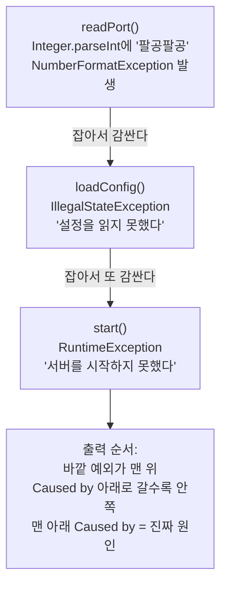

# C4. 로그와 스택트레이스 — 한 줄의 구조와 읽는 순서

> 개념 레슨 · 30분

## 이게 뭐냐

서버에서 무슨 일이 있었는지는 서버가 남기는 **로그**(log)에 있다. 로그의 특징은 두 가지다.

- 로그는 **서버의 터미널**(IntelliJ Run 창)에 찍힌다. 요청을 보낸 클라이언트에는 가지 않는다. curl에는 `500`만 보이고, 이유는 서버 로그에만 있다.
- 서버는 사용자 여럿의 요청을 동시에 처리한다. 그래서 줄마다 **언제, 얼마나 심각한, 어느 일꾼(스레드)이, 어느 코드에서** 남겼는지가 붙어 있다.

### 로그 레벨 — 얼마나 심각한가

| 레벨 | 뜻 | 기본 설정에서 보이나 |
|---|---|---|
| `TRACE` | 아주 자세한 흐름 | 안 보임 |
| `DEBUG` | 개발할 때만 보고 싶은 값 | 안 보임 |
| `INFO` | 정상 흐름의 큰 사건(앱 시작, 처리 완료) | **보임** |
| `WARN` | 이상하지만 처리는 했다(잘못된 요청 4xx 등) | 보임 |
| `ERROR` | 처리하지 못했다(500, 기동 실패) | 보임 |

Spring Boot는 기본으로 **INFO 이상만** 찍는다. 레벨은 패키지마다 따로 정할 수 있다. 예를 들어 `logging.level.org.example: debug`를 주면 내 코드(`org.example` 아래)만 DEBUG까지 찍힌다. 레포의 `application.yml`이 `org.hibernate.SQL: debug`로 SQL만 자세히 찍는 것도 같은 원리다.

### 코드에서 로그 남기기

`System.out.println`도 터미널에 찍히긴 한다. 하지만 시각·레벨·스레드가 안 붙고, 레벨로 껐다 켤 수도 없다. 서버 코드는 **로거**(logger)를 쓴다. Spring Boot에는 SLF4J라는 로거가 이미 들어 있다(A4의 트리에서 `spring-boot-starter-logging` → `logback`·`slf4j`).

```java
private static final Logger log = LoggerFactory.getLogger(LogController.class);

log.debug("요청 들어옴 n={}", n);   // {} 자리에 n 값이 들어간다
log.info("처리 시작 n={}", n);
log.warn("음수가 왔다 n={}", n);
```

`{}`는 템플릿 리터럴의 `${}`처럼 값이 들어갈 자리다. 문자열을 `+`로 잇지 않고 `{}`를 쓰면, 그 레벨이 꺼져 있을 때 문자열을 아예 만들지 않는다.

### 스택트레이스와 `Caused by`

**스택트레이스**(stack trace)는 예외가 났을 때 "그 순간 누가 누구를 불렀나"를 찍은 목록이다. 맨 위가 예외가 터진 곳, 아래로 갈수록 그것을 부른 곳이다.

Java에서는 예외를 잡아서 **더 큰 의미의 예외로 감싸 다시 던지는** 일이 많다. "숫자로 못 바꿨다"를 잡아 "설정을 못 읽었다"로 감싸고, 그걸 또 "서버를 못 띄웠다"로 감싼다. 감쌀 때 원래 예외를 같이 넘기면, 스택트레이스에 `Caused by:`로 줄줄이 찍힌다.



그래서 규칙은 하나다. **`Caused by`가 여러 개면 맨 아래 것이 처음 일어난 일(진짜 원인)이다.** 위의 것들은 "그래서 이것도 실패했다"는 전달이다.

## 예시

### 로그 한 줄 해부

0장 정답 코드에 위의 `LogController`를 더해 `GET /api/start/log?n=-3`을 보냈을 때 찍힌 줄이다(실측, Boot 4.1.1, 포트 8189).

```text
2026-10-10T00:02:52.743+09:00  WARN 10929 --- [javaExperience] [nio-8189-exec-4] org.example.start.LogController          : 음수가 왔다 n=-3
```

| 칸 | 값 | 뜻 |
|---|---|---|
| 시각 | `2026-10-10T00:02:52.743+09:00` | 밀리초까지. `+09:00`은 한국 시간 |
| 레벨 | `WARN` | 얼마나 심각한가 |
| PID | `10929` | 프로세스 번호(A3) |
| `---` | | 칸 구분 |
| 앱 이름 | `[javaExperience]` | `spring.application.name`(C3) |
| 스레드 | `[nio-8189-exec-4]` | 이 줄을 남긴 일꾼. 앱이 뜰 때는 `main`, 요청 처리 중에는 Tomcat의 `http-nio-포트-exec-번호`. 칸이 15자라 앞이 잘린다(`io-8189-exec-10`처럼) |
| 로거 이름 | `org.example.start.LogController` | 어느 클래스가 남겼나. 길면 패키지를 첫 글자로 줄인다: `o.s.boot.tomcat.TomcatWebServer` = `org.springframework.boot.tomcat.TomcatWebServer` |
| 메시지 | `음수가 왔다 n=-3` | `:` 뒤가 본문 |

같은 요청의 INFO 줄도 바로 위에 찍혔다. 스레드 칸이 같은 `nio-8189-exec-4`라서 **같은 요청에서 나온 줄**인 것을 안다. 요청이 여럿 섞여 찍힐 때 스레드 칸으로 줄을 묶어 읽는다.

```text
... INFO 10929 --- [javaExperience] [nio-8189-exec-4] org.example.start.LogController          : 처리 시작 n=-3
... WARN 10929 --- [javaExperience] [nio-8189-exec-4] org.example.start.LogController          : 음수가 왔다 n=-3
```

`log.debug(...)` 줄은 안 보인다. 기본 레벨이 INFO라서다. `--logging.level.org.example=debug`를 주고 다시 띄워 `?n=2`를 보내면 DEBUG 줄이 나타난다(실측).

```text
... DEBUG 11926 --- [javaExperience] [nio-8189-exec-2] org.example.start.LogController          : 요청 들어옴 n=2
...  INFO 11926 --- [javaExperience] [nio-8189-exec-2] org.example.start.LogController          : 처리 시작 n=2
```

### 감싼 예외의 스택트레이스

위 그림의 코드를 그대로 실행한 결과다(실측, Java 21).

`Wrap.java`

```java
public class Wrap {

    // 가장 안쪽 — 진짜 문제가 생기는 곳
    static int readPort(String text) {
        return Integer.parseInt(text);
    }

    // 가운데 — 받은 예외를 감싸서 다시 던진다
    static int loadConfig(String text) {
        try {
            return readPort(text);
        } catch (NumberFormatException e) {
            throw new IllegalStateException("설정을 읽지 못했다", e);
        }
    }

    // 바깥 — 또 감싼다
    static void start(String text) {
        try {
            loadConfig(text);
        } catch (IllegalStateException e) {
            throw new RuntimeException("서버를 시작하지 못했다", e);
        }
    }

    public static void main(String[] args) {
        start("팔공팔공");
    }
}
```

```text
Exception in thread "main" java.lang.RuntimeException: 서버를 시작하지 못했다
	at Wrap.start(Wrap.java:22)
	at Wrap.main(Wrap.java:27)
Caused by: java.lang.IllegalStateException: 설정을 읽지 못했다
	at Wrap.loadConfig(Wrap.java:13)
	at Wrap.start(Wrap.java:20)
	... 1 more
Caused by: java.lang.NumberFormatException: For input string: "팔공팔공"
	at java.base/java.lang.NumberFormatException.forInputString(NumberFormatException.java:67)
	at java.base/java.lang.Integer.parseInt(Integer.java:662)
	at java.base/java.lang.Integer.parseInt(Integer.java:778)
	at Wrap.readPort(Wrap.java:5)
	at Wrap.loadConfig(Wrap.java:11)
	... 2 more
```

| 읽는 순서 | 줄 | 얻는 것 |
|---|---|---|
| ① 맨 아래 `Caused by` | `NumberFormatException: For input string: "팔공팔공"` | **무엇이** 처음 터졌나 — 숫자가 아닌 글자를 숫자로 바꾸려 했다 |
| ② 그 아래 **처음 나오는 내 코드** `at` 줄 | `at Wrap.readPort(Wrap.java:5)` | **어디서** — 5번 줄. 그 위 `java.base/...` 세 줄은 Java 기본 라이브러리 안쪽이라 건너뛴다 |
| ③ 위의 `Caused by`·첫 줄 | `설정을 읽지 못했다`, `서버를 시작하지 못했다` | 그 결과 무엇이 연달아 실패했나(맥락) |
| 무시 | `... 1 more`, `... 2 more` | "나머지는 바로 위 예외의 스택과 같아 생략"이라는 뜻. 숨은 정보가 있는 게 아니다 |

실제 Spring 로그는 이 모양이 훨씬 길어서 `at` 줄이 수십 개다. 그래도 순서는 같다: **맨 아래 `Caused by` → 그 아래 처음 나오는 내 패키지(`org.example`) 줄 → 파일:줄.** 실제 Spring 로그에서 이 순서로 찾는 실습은 [0-5](../scenario/ch0-first-steps/0-5-read-stack-trace.md)에서 한다.

## 따라 해 보기

15분.

**① 감싼 예외 직접 만들기 (5분)** — 아무 폴더(예: `~/tmp`)에서.

위 `Wrap.java`를 그대로 저장하고:

```bash
javac Wrap.java
java Wrap
```

기대: 위 [예시](#감싼-예외의-스택트레이스)와 같은 출력. 그다음 `main`의 `"팔공팔공"`을 `"8080"`으로 바꿔 다시 `javac`·`java` → 아무것도 안 찍히고 끝난다(정상).

`loadConfig`의 `throw new IllegalStateException("설정을 읽지 못했다", e);`에서 **`, e`를 지우고** 다시 돌려 본다. 맨 아래 `Caused by: java.lang.NumberFormatException` 묶음이 **사라진다.** 감쌀 때 원래 예외를 넘기지 않으면 진짜 원인이 로그에서 없어진다. 예외를 감쌀 때는 꼭 원래 예외를 같이 넘긴다.

**② 서버에 로그 남기기 (7분)** — 실습 레포에서.

`src/main/java/org/example/start/LogController.java`(폴더가 없으면 만든다)

```java
package org.example.start;

import org.slf4j.Logger;
import org.slf4j.LoggerFactory;
import org.springframework.web.bind.annotation.GetMapping;
import org.springframework.web.bind.annotation.RequestParam;
import org.springframework.web.bind.annotation.RestController;

@RestController
public class LogController {

    // 이 클래스 이름(org.example.start.LogController)을 이름표로 쓰는 로거
    private static final Logger log = LoggerFactory.getLogger(LogController.class);

    @GetMapping("/api/start/log")
    public String write(@RequestParam(defaultValue = "1") int n) {
        log.debug("요청 들어옴 n={}", n);
        log.info("처리 시작 n={}", n);
        if (n < 0) {
            log.warn("음수가 왔다 n={}", n);
        }
        return "ok";
    }
}
```

앱을 띄우고 `curl "http://localhost:8080/api/start/log?n=-3"`. Run 창에서:

- INFO 줄과 WARN 줄을 찾는다. 두 줄의 **스레드 칸이 같은지** 본다.
- DEBUG 줄(`요청 들어옴`)은 **없는** 것을 확인한다.

앱을 끄고 DEBUG까지 켜서 다시 띄운다.

```bash
./gradlew bootRun --args='--logging.level.org.example=debug'
```

(IntelliJ는 Run 설정의 Program arguments에 `--logging.level.org.example=debug`.) 같은 요청을 다시 보내면 `DEBUG ... 요청 들어옴 n=-3`이 생긴다. Spring 자신의 줄(`o.s...`)은 늘지 않는다. `org.example` 아래만 DEBUG로 바꿨기 때문이다.

**③ 정리 (1분)** — `LogController.java`는 지워도 된다(0장 이후 코드와 겹치지 않으니 남겨도 된다).

## 확인 문제

**1.** 아래 줄에서 레벨, 스레드, 로그를 남긴 클래스를 각각 찾아라.

```text
2026-10-10T00:00:13.925+09:00  WARN 6336 --- [javaExperience] [nio-8189-exec-7] .w.s.m.s.DefaultHandlerExceptionResolver : Resolved [org.springframework.web.bind.MissingServletRequestParameterException: Required request parameter 'q' for method parameter type String is not present]
```

<details>
<summary>정답</summary>

레벨은 `WARN`, 스레드는 `nio-8189-exec-7`(요청을 처리한 Tomcat 일꾼), 클래스는 `.w.s.m.s.DefaultHandlerExceptionResolver`다. 앞의 `.w.s.m.s.`는 긴 패키지 이름을 줄인 것이다(`org.springframework.web.servlet.mvc.support`의 앞부분이 잘렸다). 내 클래스가 아니라 Spring이 남긴 줄이고, 메시지는 "필수 쿼리 `q`가 없어서 요청을 거절했다(400)"는 뜻이다. 4xx라 ERROR가 아니라 WARN이다.
</details>

**2.** 코드에 `log.debug("저장할 글 = {}", post);`를 넣었는데 로그에 아무것도 안 나온다. 코드가 실행되지 않은 것일까?

<details>
<summary>정답</summary>

꼭 그렇지는 않다. Spring Boot 기본 레벨은 **INFO**라 DEBUG 줄은 실행돼도 찍히지 않는다. `logging.level.org.example: debug`(yml) 또는 `--logging.level.org.example=debug`(실행 인자)로 내 패키지의 레벨을 낮추면 보인다. 정말 실행됐는지 바로 확인하고 싶으면 잠깐 `log.info`로 바꾸거나 중단점(C1)을 건다.
</details>

**3.** 기동 실패 로그에 `Caused by:`가 네 개 있다. 어느 것부터 읽나? 왜인가?

<details>
<summary>정답</summary>

**맨 아래** `Caused by`부터 읽는다. 예외는 안쪽에서 처음 터지고, 바깥 코드가 그것을 잡아 더 큰 의미의 예외로 감싸 다시 던진다. 출력은 바깥 예외가 맨 위, 안쪽으로 갈수록 아래다. 그래서 맨 아래가 처음 일어난 일(진짜 원인)이다. 위의 것들은 "그래서 이것도 못 했다"는 결과다.
</details>

**4.** 스택트레이스 끝에 `... 2 more`가 있다. 중요한 줄이 숨겨진 것인가?

<details>
<summary>정답</summary>

아니다. "이 예외의 나머지 호출 경로는 바로 위(감싼 쪽) 예외의 스택과 같아서 생략했다"는 뜻이다. 같은 줄을 반복해 찍지 않으려는 표시다. 볼 것은 생략되지 않은 위쪽 `at` 줄들이다.
</details>

**5.** 예외를 감싸 다시 던질 때 `throw new IllegalStateException("설정을 읽지 못했다");`처럼 원래 예외(`e`)를 빼면 무엇이 문제인가?

<details>
<summary>정답</summary>

`Caused by` 묶음이 사라져 **진짜 원인**(예: `NumberFormatException: For input string: "팔공팔공"`)과 그 줄 번호가 로그에 남지 않는다. "설정을 읽지 못했다"만 보고는 왜 실패했는지 알 수 없다. 따라 해 보기 ①에서 직접 확인했다. 감쌀 때는 `new XxxException("메시지", e)`처럼 원래 예외를 두 번째 인자로 넘긴다.
</details>

## 더 깊이

- [W07 왜 System.out.println 대신 로거를 쓰나](../docs/knowledge/W07-why-logger.md#3-왜-그런가--원리) — SLF4J·레벨·`{}`
- [J04 예외 처리](../docs/knowledge/J04-exceptions.md#3-내부-동작원리) — 예외 체이닝(`Caused by`)이 만들어지는 방식
- [D05 디버깅 방법론](../docs/knowledge/D05-debugging-methodology.md) — 재현 → 로그 → 가설 → 확인
- [D09 운영과 관측](../docs/knowledge/D09-operations-observability.md#1-큰-그림) — 배포한 서버의 로그는 어디서 보나

## 다음

실습으로 돌아간다 — 시나리오 [0-5](../scenario/ch0-first-steps/0-5-read-stack-trace.md#2단계--로그에서-원인-줄을-찾는다)로 간다. 실제 Spring 에러 로그에서 내 코드 줄을 찾는다.
