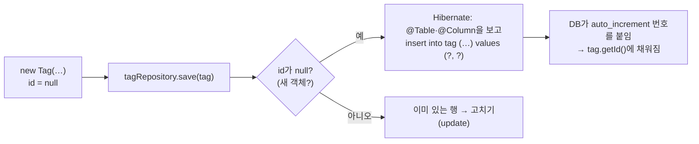

# E3. JPA는 무엇인가

> 개념 레슨 · 35분

## 이게 뭐냐

E2에서 `INSERT INTO tag (name, created_at) VALUES (…)`를 손으로 썼다. 앱 코드에서 매번 이렇게 하면 귀찮은 일이 많다. 열 이름을 문자열로 적어야 하고, 결과 행을 객체로 옮겨 담아야 하고, 열이 하나 늘면 SQL 여러 곳을 고쳐야 한다.

0장에서 본 Jackson을 떠올리면 쉽다. Jackson은 **JSON ↔ Java 객체**를 바꿔 준다. JPA는 **DB 행 ↔ Java 객체**를 바꿔 준다. 이런 도구를 ORM(Object-Relational Mapping)이라고 한다.

| | 바꿔 주는 것 | 무엇을 보고 바꾸나 |
|---|---|---|
| Jackson | 요청 JSON ↔ DTO | 필드 이름, `@JsonProperty` 등 |
| JPA | 테이블 행 ↔ **엔티티** 객체 | `@Entity`·`@Column` 등 어노테이션 |

### 이름 세 개

처음엔 이름이 많아서 헷갈린다. 셋은 층이 다르다.

| 이름 | 정체 | 코드에서 보이는 곳 |
|---|---|---|
| **JPA** (Jakarta Persistence) | 표준 **약속**. "엔티티는 이렇게 표시한다"는 규칙과 어노테이션 | `import jakarta.persistence.*` — `@Entity`, `@Id` |
| **Hibernate** | 그 약속의 **구현**. 실제로 SQL을 만들어 DB에 보낸다 | 로그의 `org.hibernate.SQL` |
| **Spring Data JPA** | 저장소(Repository)를 **인터페이스만 쓰면** 구현을 만들어 준다 | `extends JpaRepository<Tag, Long>` |

B5에서 본 "인터페이스와 구현"과 같은 관계다. JPA가 인터페이스, Hibernate가 구현체다. 셋 다 `build.gradle`의 `spring-boot-starter-data-jpa` 한 줄로 들어온다.

### 엔티티 — 테이블 한 행을 담는 클래스

| 어노테이션 | 뜻 | `tag` 테이블에서 |
|---|---|---|
| `@Entity` | "이 클래스는 테이블 행을 담는다"는 표시 | — |
| `@Table(name = "tag")` | 어느 테이블과 짝인지 | `tag` |
| `@Id` | 기본키 필드 | `id` |
| `@GeneratedValue(strategy = IDENTITY)` | 번호는 DB(`auto_increment`)가 붙인다 | `id bigint AUTO_INCREMENT` |
| `@Column(name = "created_at")` | 필드와 열 이름이 다를 때 짝 지어 준다 | `created_at` ↔ `createdAt` |
| `protected Tag() {}` | 인자 없는 생성자. JPA가 DB 행을 읽을 때 빈 객체부터 만들고 값을 채우기 때문에 필요하다 | — |

### `@ManyToOne` — 번호 대신 객체

E2에서 `post`에는 `author_id`라는 **번호**만 있었다. 닉네임을 보려면 `member`와 JOIN 해야 했다. 엔티티에서는 번호 대신 **객체**를 필드로 둔다.

```java
// Post 엔티티의 일부(1-2에서 처음 만들고, 1-4에서 테이블에 맞춰 완성한다)
@ManyToOne(fetch = FetchType.LAZY)          // 글 여러 개(Many)가 회원 하나(One)를 가리킨다
@JoinColumn(name = "author_id", nullable = false)   // 그 연결에 쓰는 외래키 열
private Member author;
```

- `post.getAuthor().getNickname()`처럼 객체를 따라가면, 필요한 SQL(`member`를 읽는 `SELECT`)은 Hibernate가 만든다.
- 저장할 때는 `author` 객체의 `id`를 꺼내 `author_id` 열에 넣는다.
- `LAZY`는 "글을 읽을 때 회원까지 바로 읽지 말고, 실제로 쓸 때 읽어라"다. 쓸데없는 SELECT를 줄인다. 그 대가로 DB 연결이 닫힌 뒤에 처음 쓰면 에러가 난다. 1-4에서 직접 본다. → [에러 도감: 지연 로딩 — no session](../errors.md#지연-로딩--no-session)

## 예시

`tag` 테이블(E2에서 본 `id`·`name`·`created_at`)에 맞춘 엔티티와 저장소다. 실습 레포의 1-3 정답 코드와 같다(import만 줄였다).

```java
package org.example.tag;

import jakarta.persistence.*;
import java.time.LocalDateTime;

@Entity
@Table(name = "tag")
public class Tag {

    @Id
    @GeneratedValue(strategy = GenerationType.IDENTITY)
    private Long id;

    @Column(nullable = false, unique = true)
    private String name;

    @Column(name = "created_at", nullable = false)
    private LocalDateTime createdAt;

    protected Tag() {
        // JPA가 행을 객체로 만들 때 쓴다
    }

    public Tag(String name, LocalDateTime createdAt) {
        this.name = name;
        this.createdAt = createdAt;
    }

    public Long getId() { return id; }
    public String getName() { return name; }
    public LocalDateTime getCreatedAt() { return createdAt; }
}
```

```java
package org.example.tag;

import org.springframework.data.jpa.repository.JpaRepository;
import java.util.Optional;

// 구현 클래스를 만들지 않는다 — Spring Data JPA가 서버를 켤 때 만들어 준다
public interface TagRepository extends JpaRepository<Tag, Long> {

    // 메서드 이름을 읽고 "where name = ?" 쿼리를 만든다
    Optional<Tag> findByName(String name);
}
```

### 인터페이스만 만들었는데 구현이 생기는 이유

`JpaRepository<Tag, Long>`은 "엔티티는 `Tag`, 기본키 타입은 `Long`"이라는 뜻이다. 이것만으로 아래 메서드가 생긴다.

| 메서드 | 하는 일 | 나가는 SQL(대략) |
|---|---|---|
| `save(tag)` | 새 객체면 넣고, 이미 있는 객체면 고친다 | `insert` 또는 `update` |
| `findById(id)` | 기본키로 하나 찾기(`Optional`) | `select … where id = ?` |
| `findAll()` | 전부 | `select … from tag` |
| `count()` | 개수 | `select count(*) …` |
| `delete(tag)` · `deleteById(id)` | 지우기 | `delete from tag where id = ?` |

`findByName`처럼 **이름 규칙**을 따르는 메서드는 직접 선언하면 된다. `findBy` + 필드 이름(`Name`)을 읽어 `where name = ?`를 만든다. `findBySlug`, `existsByName`, `findByTitleContaining`처럼 이어 붙일 수 있다.

서버를 켤 때 Spring Data JPA는 이 인터페이스를 구현한 **대리 객체(프록시)** 를 하나 만들어 빈으로 등록한다. 서비스는 생성자로 `TagRepository`를 받는데, 실제로 들어오는 건 이 대리 객체다. 실제로 찍어 보면 이렇다(따라 해 보기의 ①).

```text
① 저장소의 실제 클래스: jdk.proxy2.$Proxy120
```

내가 만든 클래스가 아니라 실행 중에 만들어진 클래스다(숫자는 실행마다 다르다). 이 대리 객체에 `count()`를 부르면, 대리 객체가 Spring Data JPA의 기본 구현에 일을 넘기고, 그 구현이 Hibernate를 통해 SQL을 보낸다. E1에서 "서비스는 인터페이스에만 기댄다"고 했던 것이 여기서 그대로 쓰인다.

### `save`가 `INSERT`가 되는 길



로그로 확인한 실제 순서다(따라 해 보기의 ④·⑤).

```text
④ save 전 id: null
DEBUG org.hibernate.SQL                        :
    insert
    into
        tag
        (created_at, name)
    values
        (?, ?)
TRACE org.hibernate.orm.jdbc.bind              : binding parameter (1:TIMESTAMP) <- [2026-10-10T00:06:51.492311]
TRACE org.hibernate.orm.jdbc.bind              : binding parameter (2:VARCHAR) <- [e3연습]
⑤ save 후 id: 12
```

- `insert`의 열 목록에 `id`가 없다. `IDENTITY`라 DB가 붙이기 때문이다. Hibernate는 넣은 직후 DB가 붙인 번호를 받아 객체의 `id`에 채운다.
- `?` 자리에 값이 따로 들어간다(`binding parameter`). SQL 문자열에 값을 이어 붙이지 않으니 SQL 주입 공격도 막힌다.
- 이 로그가 보이는 건 실습 레포의 `application.yml`에 `logging.level.org.hibernate.SQL: debug`와 `org.hibernate.orm.jdbc.bind: trace`가 있어서다. 각 줄의 뜻은 [1-4 단계의 SQL 로그 읽기](../scenario/ch1-create-post/1-4-save-to-db.md#sql-로그-읽기)에 있다.

## 따라 해 보기

15분. 실습 레포(javaExperience)에서 한다. 이 저장소 compose의 MySQL(`docker compose up -d`)이 떠 있어야 한다.

**1. 파일 세 개를 만든다.** 위 예시의 `Tag.java`, `TagRepository.java`를 `org.example.tag` 패키지에 만든다. 이 둘은 1-3에서 그대로 쓰니 지우지 않는다. 그리고 연습용 파일 하나를 더 만든다.

```java
package org.example.tag;

import org.springframework.boot.CommandLineRunner;
import org.springframework.stereotype.Component;

import java.time.LocalDateTime;

// 연습용 — 서버가 뜰 때 한 번 실행된다. 다 보고 나면 이 파일은 지운다
@Component
public class TagPlayground implements CommandLineRunner {

    private final TagRepository tagRepository;

    public TagPlayground(TagRepository tagRepository) {
        this.tagRepository = tagRepository;
    }

    @Override
    public void run(String... args) {
        System.out.println("① 저장소의 실제 클래스: " + tagRepository.getClass().getName());
        System.out.println("② 태그 수: " + tagRepository.count());
        System.out.println("③ spring 태그: " + tagRepository.findByName("spring").map(Tag::getId));

        Tag tag = new Tag("e3연습", LocalDateTime.now());
        System.out.println("④ save 전 id: " + tag.getId());
        Tag saved = tagRepository.save(tag);
        System.out.println("⑤ save 후 id: " + saved.getId());

        tagRepository.delete(saved);
        System.out.println("⑥ 지운 뒤 e3연습: " + tagRepository.findByName("e3연습"));
    }
}
```

`CommandLineRunner`를 구현한 빈은 서버가 다 뜬 직후 `run`이 한 번 실행된다. API를 만들지 않고 저장소를 시험해 보기 좋다.

**2. 서버를 켜고 콘솔을 읽는다.** ①~⑥ 사이사이에 SQL이 끼어 있다. 실제로 나온 것이다(② 8은 시드 기준, ⑤의 번호는 환경마다 다르다).

```text
① 저장소의 실제 클래스: jdk.proxy2.$Proxy120
    select count(*) from tag t1_0
② 태그 수: 8
    select t1_0.id, t1_0.created_at, t1_0.name from tag t1_0 where t1_0.name=?
    binding parameter (1:VARCHAR) <- [spring]
③ spring 태그: Optional[2]
④ save 전 id: null
    insert into tag (created_at, name) values (?, ?)
⑤ save 후 id: 12
    select t1_0.id, t1_0.created_at, t1_0.name from tag t1_0 where t1_0.id=?
    delete from tag where id=?
⑥ 지운 뒤 e3연습: Optional.empty
```

(읽기 쉽게 SQL을 한 줄로 줄였다. 실제 로그는 `format_sql` 때문에 여러 줄이다.)

| 번호 | 볼 것 |
|---|---|
| ① | 내가 만든 적 없는 클래스(프록시)가 들어왔다 |
| ② | `count()` 한 번 = `select count(*)` 한 번 |
| ③ | `findByName` → `where t1_0.name=?`. 메서드 이름에서 만든 쿼리다. `Optional[2]`는 "찾았고 id는 2" |
| ④⑤ | `save` 전엔 `null`, 후엔 DB가 붙인 번호 |
| ⑥ | `delete` 전에 `select … where id=?`가 한 번 더 나간다. 저장소 메서드는 하나하나가 따로 트랜잭션이라, 지우기 전에 "그 행이 아직 있나"를 다시 읽는다. 서비스 메서드 하나에 `@Transactional`을 걸면 이런 중복이 줄어든다(1-3) |

`t1_0`은 Hibernate가 붙인 테이블 별칭이다. E2에서 `post p`라고 쓴 것과 같다.

**3. SQL로 확인한다.** E2의 `sql` 함수로 `sql "SELECT COUNT(*) FROM tag WHERE name = 'e3연습'"` → `0`. 저장했다가 지웠으니 남지 않는다.

**4. `TagPlayground.java`를 지운다.** 그대로 두면 서버를 켤 때마다 저장·삭제가 반복된다.

## 일부러 틀려 보기

메시지는 Spring Boot 4.1.1 · Spring Data JPA 4.1.1 · Hibernate 7.4.5에서 재현한 원문이다. 둘 다 **서버가 뜨지 않는다.** 로그 맨 아래 `Caused by:`부터 본다.

**1. 메서드 이름에 오타를 낸다** — `findByName` → `findByNmae`(인터페이스와 `TagPlayground` 둘 다)

```text
Caused by: org.springframework.data.repository.query.QueryCreationException: Cannot create query for method [TagRepository.findByNmae(java.lang.String)]; No property 'nmae' found for type 'Tag'; Did you mean 'name'
…
Caused by: org.springframework.data.core.PropertyReferenceException: No property 'nmae' found for type 'Tag'; Did you mean 'name'
```

메서드 이름이 곧 쿼리라서, 엔티티에 없는 필드 이름이면 서버를 켤 때 바로 막힌다. 컴파일은 통과한다. `Did you mean 'name'`이 고칠 이름을 알려 준다. 기준은 **열 이름(`created_at`)이 아니라 엔티티의 필드 이름(`createdAt`)** 이다.

**2. `Tag`의 `@Entity`를 지운다**

```text
Caused by: org.springframework.beans.factory.BeanCreationException: Error creating bean with name 'tagRepository' defined in org.example.tag.TagRepository defined in @EnableJpaRepositories declared on DataJpaRepositoriesRegistrar.EnableJpaRepositoriesConfiguration: Not a managed type: class org.example.tag.Tag
…
Caused by: java.lang.IllegalArgumentException: Not a managed type: class org.example.tag.Tag
```

`Not a managed type` — JPA가 관리하는 엔티티가 아니라는 뜻이다. 저장소 프록시를 만들려는데 `Tag`가 엔티티가 아니니 실패한다. 다른 엔티티가 `@ManyToOne`으로 가리키는 클래스(예: `Board`)에서 지우면 `Association 'org.example.post.Post.board' targets the type 'org.example.board.Board' which is not an '@Entity' type`으로 나온다.

테이블·열 이름이 틀리거나 기본 생성자가 없을 때는 1-4에서 직접 망가뜨려 본다. → [테이블 없음](../errors.md#테이블-없음) · [컬럼 이름 불일치](../errors.md#컬럼-이름-불일치) · [엔티티 기본 생성자 없음](../errors.md#엔티티-기본-생성자-없음)

## 확인 문제

**1.** `TagRepository`의 구현 클래스는 아무도 작성하지 않았다. 그런데 `tagRepository.count()`가 동작하는 이유는?

<details>
<summary>정답</summary>

Spring Data JPA가 서버를 켤 때 `JpaRepository`를 상속한 인터페이스를 찾아, 그것을 구현한 **프록시 객체**를 만들어 빈으로 등록한다(①의 `jdk.proxy2.$Proxy…`). `count()` 같은 기본 메서드는 Spring Data JPA의 기본 구현이 처리하고, `findByName` 같은 메서드는 이름을 읽어 쿼리를 만든다. 실제 SQL을 DB에 보내는 건 Hibernate다.
</details>

**2.** 아래 코드에서 `a`와 `b`의 값은? 둘이 다른 이유는?

```java
Tag tag = new Tag("새태그", LocalDateTime.now());
Long a = tag.getId();
Long b = tagRepository.save(tag).getId();
```

<details>
<summary>정답</summary>

`a`는 `null`, `b`는 DB가 붙인 번호(예: `12`). `@GeneratedValue(strategy = IDENTITY)`라서 번호는 `INSERT`할 때 DB의 `auto_increment`가 정한다. 그래서 `insert`의 열 목록에 `id`가 없고, Hibernate가 넣은 직후 그 번호를 받아 객체에 채운다. `save`가 `id`가 `null`인 객체를 "새 객체"로 보고 `INSERT`를 고르는 것도 이 때문이다.
</details>

**3.** `TagRepository`에 `Optional<Tag> findByTitle(String title);`을 추가했다. 컴파일은 되는가? 서버를 켜면?

<details>
<summary>정답</summary>

**컴파일은 된다**(문법상 평범한 인터페이스 메서드다). **서버는 안 뜬다.** `Tag`에는 `title` 필드가 없어서 `No property 'title' found for type 'Tag'`로 저장소 빈을 만들지 못한다. 메서드 이름 규칙의 기준은 엔티티 필드 이름이다.
</details>

**4.** `post` 엔티티에서 작성자를 `private Long authorId;`로 두지 않고 `@ManyToOne private Member author;`로 두면 무엇이 좋아지나?

<details>
<summary>정답</summary>

번호 대신 **객체**를 따라갈 수 있다. `post.getAuthor().getNickname()`이라고 쓰면 `member`를 읽는 SQL은 Hibernate가 만든다. E2에서 손으로 하던 `JOIN member m ON m.id = p.author_id`를 대신해 주는 셈이다. 저장할 때도 `author` 객체의 `id`가 `author_id` 열에 들어간다. (`LAZY`라서 처음 읽는 시점에 DB 연결이 살아 있어야 한다는 점은 주의.)
</details>

**5.** 따라 해 보기에서 `application.yml`의 `logging.level.org.hibernate.SQL: debug` 줄을 지우면 무엇이 달라지나?

<details>
<summary>정답</summary>

**동작은 같고 SQL만 안 보인다.** 이 줄은 Hibernate가 만든 SQL을 로그로 찍을지 정할 뿐이다. ①~⑥의 `System.out.println` 결과는 그대로 나온다. JPA가 무슨 SQL을 몇 번 보내는지 보는 창이라, 실습 중에는 켜 둔다(2장부터 만나는 N+1 문제도 이 로그로 찾는다).
</details>

## 더 깊이

- [P20 JPA 엔티티·연관관계 매핑](../docs/knowledge/P20-jpa-entity-mapping.md) — `@ManyToOne`, 연관관계의 주인, 다대다
- [P19 MySQL 연결과 JPA 설정](../docs/knowledge/P19-mysql-jpa-setup.md) — 의존성·`application.yml`·`ddl-auto`
- [S09 JPA와 Hibernate](../docs/knowledge/S09-jpa-hibernate.md) — 영속성 컨텍스트, 변경 감지, LAZY와 N+1(심화)
- [S10 Spring Data 쿼리](../docs/knowledge/S10-spring-data-query.md) — 메서드 이름 쿼리·`@Query`·페이징
- [W03 DB 접근 방식 총비교](../docs/knowledge/W03-db-access-comparison.md) — JDBC·JdbcTemplate·MyBatis·JPA가 각각 대신해 주는 일

## 다음

- 실습: [1-2. DB에 저장하고 201로 응답](../scenario/ch1-create-post/1-2-dto-response.md) — `Post`·`Board` 엔티티로 글을 DB에 저장한다. 오늘 만든 `Tag`·`TagRepository`는 [1-3](../scenario/ch1-create-post/1-3-service-layer.md)에서 태그를 저장할 때 쓴다.
- 레슨: [F1. 검증과 에러 응답(ProblemDetail)](F1-validation-errors.md) — 1-5 전에.
