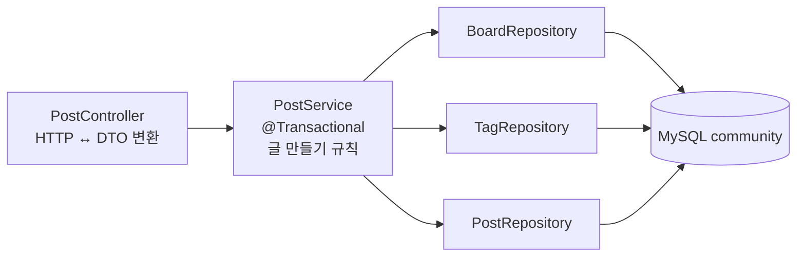

# 1-3. 서비스로 나누기 — 태그까지 한 트랜잭션으로

## 상황

> "태그도 저장해 주세요. 없는 태그면 새로 만들고요. 같은 태그가 두 번 오면 한 번만 붙여 주세요."

1-2에서는 컨트롤러가 저장소 둘(`BoardRepository`·`PostRepository`)을 바로 불렀다. 태그까지 저장하려면 일이 늘어난다.

1. slug로 게시판을 찾는다.
2. 태그 이름마다 `tag`에서 찾고, 없으면 `INSERT`한다.
3. `post`에 글을 `INSERT`한다.
4. `post_tag`에 (글, 태그) 연결을 태그 수만큼 `INSERT`한다.

DB에 쓰는 일이 여러 번이다. **3번에서 실패하면 2번에서 새로 만든 태그만 덩그러니 남는다.** 이 묶음을 "전부 되거나, 전부 안 되거나"로 만들어야 한다. 그 경계가 **트랜잭션**이고, 트랜잭션은 서비스 메서드 하나에 건다.

그래서 이 단계에서 **컨트롤러에서 서비스를 떼어 낸다.** 저장소는 1-2의 JPA 저장소 그대로 쓴다.



## 왜 나누나

나누는 기준은 **바뀌는 이유가 다르냐**다.

| 층 | 하는 일 | 이 층만 고치는 경우 |
|---|---|---|
| `PostController` | HTTP 받기(본문 → 요청 DTO), HTTP 돌려주기(상태 코드·헤더·응답 DTO) | 응답에 헤더를 하나 더 넣는다, 경로를 바꾼다 |
| `PostService` | 글 만들기 규칙(게시판 확인, 태그 찾기·만들기, 시각 정하기)과 트랜잭션 경계 | "같은 태그는 한 번만", "작성 시각은 서버 시계" 같은 규칙을 바꾼다 |
| `PostRepository` 등 | 테이블 하나에 넣고 꺼내기 | 조회 조건(`findBySlug` 등)을 더한다 |

- 같은 규칙을 다른 API(예: 관리자용 글쓰기)에서 써도 서비스를 그대로 부르면 된다. 컨트롤러에 규칙이 있으면 복사해야 한다.
- 서비스는 `ResponseEntity`를 모르고, 컨트롤러는 `TagRepository`를 모른다. 서로 모르니 한쪽을 바꿔도 다른 쪽은 그대로다.
- 트랜잭션은 "어디서부터 어디까지가 한 묶음인가"다. HTTP를 다루는 컨트롤러도, 테이블 하나만 아는 저장소도 그 묶음을 알 수 없다. 묶음을 아는 곳이 서비스다.

## 화면 시나리오

사용자가 화면에서 무엇을 하면 어떤 요청이 서버로 가고, 서버·DB에서 무슨 일이 일어나 어떤 응답이 돌아와 화면이 어떻게 바뀌는지다. 흐름을 펼치면 사용자 행동부터 응답까지 차례대로 볼 수 있다.

```screen
{
  "title": "글쓰기 — 태그까지 한 번에",
  "summary": "태그가 저장되고 응답에 실린다. 서버 안에서는 서비스 메서드 하나가 트랜잭션 하나다.",
  "screen": [
    {
      "type": "bar",
      "id": "bar",
      "label": "새 글 쓰기",
      "right": "김자바"
    },
    {
      "type": "select",
      "id": "board",
      "label": "게시판",
      "value": "개발"
    },
    {
      "type": "field",
      "id": "title",
      "label": "제목",
      "value": "[채점] 태그 저장"
    },
    {
      "type": "field",
      "id": "content",
      "label": "본문",
      "value": "Spring Boot로 만든 첫 게시글입니다.",
      "multiline": true
    },
    {
      "type": "chips",
      "id": "tags",
      "label": "태그",
      "items": [
        "spring",
        "채점태그"
      ]
    },
    {
      "type": "actions",
      "id": "buttons",
      "items": [
        {
          "id": "save",
          "label": "저장",
          "variant": "primary"
        }
      ]
    },
    {
      "type": "text",
      "id": "new-tags",
      "value": "#spring #채점태그",
      "emphasis": "caption",
      "tone": "muted"
    },
    {
      "type": "toast",
      "id": "toast",
      "value": "글을 올렸어요",
      "tone": "success"
    },
    {
      "type": "toast",
      "id": "error",
      "value": "저장하지 못했어요",
      "tone": "error"
    }
  ],
  "flows": [
    {
      "name": "저장 — 서버 안 계층과 트랜잭션",
      "steps": [
        {
          "kind": "user",
          "text": "새 태그 '채점태그'를 붙여 저장한다",
          "focus": [
            "tags",
            "save"
          ]
        },
        {
          "kind": "request",
          "method": "POST",
          "path": "/api/posts",
          "headers": [
            "Content-Type: application/json"
          ],
          "body": "{\n  \"boardSlug\": \"dev\",\n  \"title\": \"[채점] 태그 저장\",\n  \"content\": \"Spring Boot로 만든 첫 게시글입니다.\",\n  \"tags\": [\n    \"spring\",\n    \"채점태그\",\n    \"spring\"\n  ],\n  \"visibility\": \"PUBLIC\"\n}"
        },
        {
          "kind": "server",
          "text": "PostController: HTTP만 안다 — 요청 DTO를 받아 postService.create(...)를 부른다"
        },
        {
          "kind": "server",
          "text": "PostService.create(@Transactional): 트랜잭션 시작. 태그 이름의 중복을 지운다(spring, 채점태그)"
        },
        {
          "kind": "db",
          "sql": "SELECT ... FROM board WHERE slug = 'dev'"
        },
        {
          "kind": "db",
          "sql": "SELECT ... FROM tag WHERE name = 'spring'",
          "note": "있다 — 그 태그를 쓴다"
        },
        {
          "kind": "db",
          "sql": "SELECT ... FROM tag WHERE name = '채점태그'",
          "note": "없다 — 새로 만든다"
        },
        {
          "kind": "db",
          "sql": "INSERT INTO tag (created_at, name) VALUES (NOW(), '채점태그')"
        },
        {
          "kind": "db",
          "sql": "INSERT INTO post (author_id, board_id, content, created_at, title, updated_at, visibility) VALUES (2, 2, ..., 'PUBLIC')"
        },
        {
          "kind": "db",
          "sql": "INSERT INTO post_tag (post_id, tag_id) VALUES (22, 2), (22, 10)",
          "note": "메서드가 끝날 때 COMMIT — 여기까지 한 묶음"
        },
        {
          "kind": "response",
          "status": 201,
          "headers": [
            "Location: /api/posts/22"
          ],
          "body": "{\n  \"id\": 22,\n  \"boardSlug\": \"dev\",\n  \"title\": \"[채점] 태그 저장\",\n  \"content\": \"Spring Boot로 만든 첫 게시글입니다.\",\n  \"tags\": [\n    \"spring\",\n    \"채점태그\"\n  ],\n  \"visibility\": \"PUBLIC\",\n  \"createdAt\": \"2026-10-06T17:30:00\"\n}"
        },
        {
          "kind": "screen",
          "text": "응답의 tags로 태그를 바로 그린다. 같은 태그를 두 번 보냈어도 한 번만 붙었다",
          "focus": [
            "new-tags",
            "toast"
          ]
        }
      ]
    },
    {
      "name": "중간에 실패하면 — 새 태그도 되돌린다",
      "steps": [
        {
          "kind": "user",
          "text": "제목을 201자로 쓰고 새 태그 '[채점]롤백태그'를 붙여 저장한다",
          "focus": [
            "title",
            "save"
          ]
        },
        {
          "kind": "request",
          "method": "POST",
          "path": "/api/posts",
          "headers": [
            "Content-Type: application/json"
          ],
          "body": "{\"boardSlug\": \"dev\", \"title\": \"[채점] 관찰-000…(201자)\", \"tags\": [\"spring\", \"[채점]롤백태그\"], ...}"
        },
        {
          "kind": "db",
          "sql": "INSERT INTO tag (created_at, name) VALUES (NOW(), '[채점]롤백태그')",
          "note": "새 태그는 들어갔다(아직 COMMIT 전)"
        },
        {
          "kind": "db",
          "sql": "INSERT INTO post (...) VALUES (..., '[채점] 관찰-000…', ...)",
          "note": "Data too long for column 'title' — 실패"
        },
        {
          "kind": "server",
          "text": "예외가 서비스 메서드 밖으로 나가므로 트랜잭션이 ROLLBACK — 방금 넣은 태그도 사라진다"
        },
        {
          "kind": "response",
          "status": 500,
          "body": "{\"status\": 500, \"error\": \"Internal Server Error\", \"path\": \"/api/posts\"}"
        },
        {
          "kind": "screen",
          "text": "저장 실패. DB에는 글도 새 태그도 남지 않았다(500은 1-5에서 400으로 바꾼다)",
          "focus": [
            "error"
          ]
        }
      ]
    }
  ]
}
```

## 만들 것

| 층 | 하는 일 | 하지 않는 일 |
|---|---|---|
| `PostController` | 요청 DTO 받기 → 서비스 호출 → 응답 DTO·201·Location 만들기 | 저장소 호출, 시각 정하기, 태그 처리 |
| `PostService` | 글 하나 만들기 — 게시판 찾기, 태그 찾기·만들기, 글 저장. 메서드 하나가 트랜잭션 하나(`@Transactional`) | HTTP(`ResponseEntity`, 헤더)를 알지 않는다 |
| `PostRepository`·`BoardRepository`·`TagRepository` | 1-2와 같은 `JpaRepository` 인터페이스. `TagRepository`에 `findByName` | — |

**API** — 요청은 그대로, 응답에 `tags`가 추가된다(7개 필드).

```json
{
  "id": 22,
  "boardSlug": "dev",
  "title": "[채점] 태그 저장",
  "content": "Spring Boot로 만든 첫 게시글입니다.",
  "tags": ["spring", "채점태그"],
  "visibility": "PUBLIC",
  "createdAt": "2026-10-06T17:30:00"
}
```

상태 `201`, `Location: /api/posts/{id}`는 1-2와 같다.

**태그 규칙**

- 이미 있는 이름(예: `spring`)은 그 태그를 연결한다.
- 없는 이름은 `tag`에 새로 만든 뒤 연결한다.
- 같은 이름이 요청에 두 번 와도 한 번만 연결한다.
- 연결 테이블은 `post_tag`(복합 기본키 `post_id`, `tag_id`)다.

**트랜잭션 규칙** — 게시판 찾기부터 `post_tag` 연결까지가 한 트랜잭션이다. 중간에 실패하면 새로 만든 태그도 남지 않는다.

**필드 규칙** — 1-2의 표 그대로다. 아직 검증하지 않는다. 이 단계 정답 코드에서도 제목 `null`은 `500`이다(관찰 O1). 달라진 점은 실패할 때 **반쪽이 남지 않는다**는 것이다(관찰 O2와 D3). 검증은 [1-5](1-5-validation.md)에서 한다.

## 따라 치기

1-2의 `PostCreateRequest`·`Board`·`BoardRepository`·`PostRepository`는 그대로 둔다. 아래 다섯 파일을 만들거나 고친다. 이 코드로 아래 "직접 확인"의 C1~C3이 통과하는 것을 확인했다.

**① `Tag.java`·`TagRepository.java` — 태그 엔티티와 저장소(`org.example.tag`)**

[E3 레슨](../../lessons/E3-what-is-jpa.md)에서 만들었다면 그대로 쓴다. 없으면 E3의 예시 그대로 만든다(`tag` 테이블의 `id`·`name`·`created_at`). 저장소에는 이름으로 찾는 메서드 하나를 둔다.

```java
public interface TagRepository extends JpaRepository<Tag, Long> {

    Optional<Tag> findByName(String name);
}
```

**② `Post.java` — 태그 연결 추가**

1-2의 `Post`에 아래를 더한다(import는 `jakarta.persistence.JoinTable`·`ManyToMany`, `org.example.tag.Tag`, `java.util.LinkedHashSet`·`Set`).

```java
    @ManyToMany(fetch = FetchType.LAZY)
    @JoinTable(
            name = "post_tag",
            joinColumns = @JoinColumn(name = "post_id"),
            inverseJoinColumns = @JoinColumn(name = "tag_id")
    )
    private Set<Tag> tags = new LinkedHashSet<>();

    public void addTag(Tag tag) {
        tags.add(tag);
    }

    public Set<Tag> getTags() {
        return tags;
    }
```

| 줄 | 뜻 |
|---|---|
| `@ManyToMany` + `@JoinTable(name = "post_tag", …)` | 글 하나에 태그 여럿, 태그 하나에 글 여럿. 그 사이를 `post_tag` 테이블이 잇는다. `joinColumns`는 "이 엔티티(글) 쪽 컬럼", `inverseJoinColumns`는 "상대(태그) 쪽 컬럼"이다. |
| `Set<Tag>` · `LinkedHashSet` | 같은 태그를 두 번 넣어도 하나만 남는다. `LinkedHashSet`은 넣은 순서를 지킨다. |
| `addTag(tag)` | 글을 저장할 때 Hibernate가 이 집합을 보고 `post_tag`에 행을 넣는다. 연결 행을 내가 `INSERT`하지 않는다. |

**③ `PostService.java` — 글 만들기 규칙과 트랜잭션(`org.example.post`)**

```java
package org.example.post;

import org.example.board.Board;
import org.example.board.BoardRepository;
import org.example.tag.Tag;
import org.example.tag.TagRepository;
import org.springframework.stereotype.Service;
import org.springframework.transaction.annotation.Transactional;

import java.time.LocalDateTime;
import java.util.LinkedHashSet;
import java.util.List;
import java.util.Set;

// 글 만들기 규칙. HTTP(ResponseEntity, 헤더 등)는 알지 않는다.
@Service
public class PostService {

    // 로그인 기능이 없는 동안 작성자를 고정한다 — 1-6에서 토큰 기반으로 바꾼다
    private static final long FIXED_AUTHOR_ID = 2L;

    private final PostRepository postRepository;
    private final BoardRepository boardRepository;
    private final TagRepository tagRepository;

    public PostService(PostRepository postRepository, BoardRepository boardRepository,
                        TagRepository tagRepository) {
        this.postRepository = postRepository;
        this.boardRepository = boardRepository;
        this.tagRepository = tagRepository;
    }

    // 글 한 행 + 새 태그 + post_tag 연결을 한 트랜잭션으로 — 중간에 실패하면 전부 되돌린다
    @Transactional
    public Post create(PostCreateRequest request) {
        Board board = boardRepository.findBySlug(request.boardSlug())
                .orElseThrow(() -> new IllegalArgumentException("게시판을 찾을 수 없습니다: " + request.boardSlug()));

        LocalDateTime now = LocalDateTime.now();
        Post post = new Post(board, FIXED_AUTHOR_ID, request.title(), request.content(),
                request.visibility(), now);

        for (String tagName : distinctTagNames(request.tags())) {
            Tag tag = tagRepository.findByName(tagName)
                    .orElseGet(() -> tagRepository.save(new Tag(tagName, now)));
            post.addTag(tag);
        }

        return postRepository.save(post);
    }

    private List<String> distinctTagNames(List<String> tags) {
        if (tags == null) {
            return List.of();
        }
        Set<String> seen = new LinkedHashSet<>(tags);
        return List.copyOf(seen);
    }
}
```

| 줄 | 뜻 |
|---|---|
| `@Service` | 이 클래스로 객체(빈)를 하나 만들어 두라는 표시. Spring은 서버를 켤 때 이 표시가 붙은 클래스를 찾아 **딱 하나** 만든다. 이게 없으면 컨트롤러가 받을 `PostService`가 없어서 서버가 안 뜬다(아래 "일부러 망가뜨리기" 1번). |
| `private final …Repository` 셋 + 생성자 | **생성자 주입**. Spring이 서비스를 만들 때 생성자 인자를 보고, 보관 중인 저장소 빈을 넣어 준다. 생성자가 하나면 `@Autowired`를 안 붙여도 된다. |
| `@Transactional` | 메서드가 시작할 때 트랜잭션을 열고, 정상으로 끝나면 `COMMIT`, 예외가 밖으로 나가면 `ROLLBACK`한다. 안에서 부른 저장소들은 모두 같은 트랜잭션(같은 DB 연결)을 쓴다. |
| `findByName(...).orElseGet(() -> tagRepository.save(...))` | 있으면 그 태그, 없을 때만 만든다. 이미 있는 이름을 또 `INSERT`하면 `tag.name`의 UNIQUE에 걸린다. |
| `distinctTagNames` | 요청 안의 중복을 미리 지운다. `LinkedHashSet`에 넣었다 빼면 중복 없이 순서가 유지된다. |
| `new Post(...)`, `new Tag(...)` | 값을 담는 엔티티는 `new` 해도 된다. `new` 하지 말라는 건 **다른 빈**(서비스·저장소) 이야기다. |

왜 `final` + 생성자인가.

- **빠뜨릴 수 없다** — 생성자 인자라서 저장소 없이는 `PostService`를 만들 수가 없다. 컴파일러와 Spring이 둘 다 막아 준다. 필드 주입(`@Autowired private PostRepository postRepository;`)은 빠져도 일단 만들어지고, 쓰는 순간 `null`이 터진다.
- **바뀌지 않는다** — `final`이라 한 번 들어온 저장소를 중간에 다른 걸로 바꿀 수 없다. 빈은 서버 전체에서 하나를 여러 요청이 같이 쓰므로, 안 바뀌는 게 안전하다.
- **테스트하기 쉽다** — Spring 없이도 생성자에 가짜 저장소를 넣어 시험할 수 있다(7-2).

**④ `PostResponse.java` — `tags` 추가**

```java
public record PostResponse(
        Long id,
        String boardSlug,
        String title,
        String content,
        List<String> tags,
        String visibility,
        LocalDateTime createdAt
) {
}
```

**⑤ `PostController.java` — HTTP만 안다(통째로 바꾼다)**

```java
package org.example.post;

import org.example.tag.Tag;
import org.slf4j.Logger;
import org.slf4j.LoggerFactory;
import org.springframework.http.ResponseEntity;
import org.springframework.web.bind.annotation.PostMapping;
import org.springframework.web.bind.annotation.RequestBody;
import org.springframework.web.bind.annotation.RequestMapping;
import org.springframework.web.bind.annotation.RestController;

import java.net.URI;
import java.util.List;

@RestController
@RequestMapping("/api/posts")
public class PostController {

    private static final Logger log = LoggerFactory.getLogger(PostController.class);

    private final PostService postService;

    public PostController(PostService postService) {
        this.postService = postService;
    }

    @PostMapping
    public ResponseEntity<PostResponse> create(@RequestBody PostCreateRequest request) {
        log.info("게시글 작성 요청 제목: {}", request.title());

        Post post = postService.create(request);
        PostResponse response = toResponse(post);

        return ResponseEntity.created(URI.create("/api/posts/" + post.getId())).body(response);
    }

    private PostResponse toResponse(Post post) {
        List<String> tagNames = post.getTags().stream().map(Tag::getName).toList();
        return new PostResponse(
                post.getId(),
                post.getBoard().getSlug(),
                post.getTitle(),
                post.getContent(),
                tagNames,
                post.getVisibility(),
                post.getCreatedAt()
        );
    }
}
```

| 줄 | 뜻 |
|---|---|
| `private final PostService postService;` + 생성자 | 컨트롤러에서 저장소 필드가 사라졌다. 서비스 하나만 받는다. |
| `postService.create(request)` | 컨트롤러는 "글을 만들어 줘"라고 부탁만 한다. 게시판·태그·시각은 서비스가 정한다. |
| `toResponse(post)` | 엔티티 → 응답 DTO 변환은 컨트롤러 한 곳에서 한다(채점 R5). 서비스는 엔티티를 돌려준다. |
| `ResponseEntity.created(...)` | `201`과 `Location` 헤더. HTTP 일이라 컨트롤러에 남는다. |

서버를 켜면 Spring이 이 순서로 조립한다. 저장소(Spring Data JPA가 만든 구현)를 먼저 만들고, 그걸 넣어 서비스를 만들고, 그 서비스를 넣어 컨트롤러를 만든다. 어느 하나라도 만들 수 없으면 서버가 뜨지 않는다.

`PostRepository`는 1-2부터 인터페이스였다. 서비스는 그 인터페이스 타입으로 받고, 실제 구현은 Spring Data JPA가 만든 객체가 들어온다. 저장 방식이 바뀌어도(예: 테스트용 가짜 저장소) 서비스 코드는 그대로다.

## 일부러 망가뜨리기

다 만들어 통과한 뒤, 하나씩 망가뜨려 에러를 직접 보고 되돌린다. 메시지는 Spring Boot 4.1.1에서 이 단계 정답 코드로 재현한 원문이다(경로 앞부분은 PC마다 다르다).

**1. `PostService`에서 `@Service`를 지운다** → 서버가 안 뜬다.

```text
***************************
APPLICATION FAILED TO START
***************************

Description:

Parameter 0 of constructor in org.example.post.PostController required a bean of type 'org.example.post.PostService' that could not be found.


Action:

Consider defining a bean of type 'org.example.post.PostService' in your configuration.
```

- **어디를 보나** — 상자 안 `Description:`. "`PostController` 생성자의 0번째 인자(`PostService`)를 만들 빈이 없다"는 뜻이다.
- **고치는 법** — `@Service`를 되돌린다. 저장소(`PostRepository` 등)에는 `@Repository`가 없어도 된다. `JpaRepository`를 상속한 인터페이스는 Spring Data JPA가 찾아 빈을 만든다. → [에러 도감: 빈을 찾을 수 없음](../../errors.md#빈을-찾을-수-없음)

**2. 컨트롤러에서 `new PostService()`로 직접 만든다** → 컴파일이 안 된다.

```java
public PostController() {
    this.postService = new PostService();   // 망가뜨린 코드
}
```

```text
…/PostController.java:24: error: constructor PostService in class PostService cannot be applied to given types;
        this.postService = new PostService();   // 망가뜨린 코드
                           ^
  required: PostRepository,BoardRepository,TagRepository
  found:    no arguments
  reason: actual and formal argument lists differ in length
```

- **어디를 보나** — `required:`(생성자가 원하는 것)와 `found:`(내가 넘긴 것).
- **인자를 맞춰 넣을 수도 없다** — `PostRepository`는 인터페이스라 `new`로 만들 수 없다. 구현은 Spring Data JPA가 서버를 켤 때 만든 객체 하나뿐이다. 그래서 다른 빈은 직접 `new` 하지 않고 생성자로 받는다. → [에러 도감: 생성자 인자 불일치](../../errors.md#생성자-인자-불일치)

**3. 필드 주입으로 바꾼다** — `@Autowired private PostService postService;`(생성자 없음)

- 서버는 **정상으로 뜨고 `201`도 나온다.** 그래서 더 위험하다.
- `final`을 같이 쓰면 컴파일이 안 된다.

  ```text
  …/PostController.java:23: error: variable postService not initialized in the default constructor
      private final PostService postService;
                                ^
  ```

- `final`을 빼고 Spring 밖에서 `new PostController()`로 만들어 부르면(테스트 코드에서 흔하다) 실행 중에 터진다.

  ```text
  Caused by: java.lang.NullPointerException: Cannot invoke "org.example.post.PostService.create(org.example.post.PostCreateRequest)" because "this.postService" is null
	at org.example.post.PostController.create(PostController.java:29)
  ```

- **고치는 법** — 생성자 주입 + `final`로 되돌린다(채점 R4). → [에러 도감: new로 만든 객체의 null](../../errors.md#new로-만든-객체의-null)

**4. 순환 참조를 만든다** — `PostService`가 생성자로 `PostController`를 받게 한다(서비스가 컨트롤러를 부르는, 거꾸로 된 방향).

```java
private final PostController postController;   // 망가뜨린 코드

public PostService(PostRepository postRepository, BoardRepository boardRepository,
                    TagRepository tagRepository, PostController postController) {
    this.postController = postController;
    // …
}
```

```text
***************************
APPLICATION FAILED TO START
***************************

Description:

The dependencies of some of the beans in the application context form a cycle:

┌─────┐
|  postController defined in URL […/org/example/post/PostController.class]
↑     ↓
|  postService defined in URL […/org/example/post/PostService.class]
└─────┘
```

- **어디를 보나** — `┌─────┐` 상자. 컨트롤러를 만들려면 서비스가, 서비스를 만들려면 컨트롤러가 필요하다.
- **고치는 법** — 방향을 컨트롤러 → 서비스 → 저장소 한 방향으로. 서비스는 컨트롤러를 몰라야 한다. `Action:`에 나오는 `spring.main.allow-circular-references`는 문제를 숨길 뿐이라 쓰지 않는다. → [에러 도감: 빈 순환 참조](../../errors.md#빈-순환-참조)

**5. `@Transactional`을 지운다** → 성공하는 요청은 그대로 `201`이다. 차이는 **실패할 때** 보인다. 관찰 요청 O2(제목 201자 + 새 태그 `[채점]롤백태그`)를 보내고 DB를 본다.

```bash
docker compose exec -T mysql mysql --default-character-set=utf8mb4 -ucommunity -pcommunity community -e "
SELECT id, name FROM tag WHERE name = '[채점]롤백태그';"
```

| | O2 응답 | `tag`에 `[채점]롤백태그` |
|---|---|---|
| `@Transactional` 있음(정답) | `500` | 없음(0행) — 글 저장이 실패하자 태그 `INSERT`도 되돌려졌다 |
| `@Transactional` 지움 | `500` | **1행 남음** — 글은 없는데 태그만 생겼다 |

트랜잭션이 없으면 저장소 메서드 하나하나가 따로 `COMMIT`된다. 태그 `INSERT`는 이미 확정된 뒤에 글 `INSERT`가 실패한 것이다.

고치는 법 — 서비스 메서드에 `@Transactional`을 되돌린다. 남은 태그는 `docker compose down -v && docker compose up -d`(javaExperience 레포 루트)으로 지운다. → [G3 첫 트랜잭션](../../lessons/G3-first-transaction.md) **루트 compose의 `down -v`는 `community`·`practice`·`project` DB와 CloudBeaver 작업 공간(저장한 SQL·연결 설정)을 함께 초기화한다. 먼저 `./docker/mysql/dump.sh`로 DB를 백업하고 CloudBeaver 자료는 따로 보관한다(DB 덤프에 포함되지 않음).**

## 구현 가이드

화면 시나리오의 서버·DB 흐름을 이 단계에서 바뀐 파일에 연결한다. 먼저 **만들 것**의 계약대로 직접 작성하고, 필요한 역할만 펼쳐 파일 전문과 비교한다.

이 단계의 처리 흐름:
- PostController: HTTP만 안다 — 요청 DTO를 받아 postService.create(...)를 부른다
- PostService.create(@Transactional): 트랜잭션 시작. 태그 이름의 중복을 지운다(spring, 채점태그)
- 있다 — 그 태그를 쓴다
- 없다 — 새로 만든다

<details>
<summary>Controller — HTTP 연결</summary>

`PostController.java`. 매핑과 메서드의 입력·응답을 위 **만들 것**의 HTTP 계약과 대조한다.

</details>

<details>
<summary>DTO — 요청·응답 필드</summary>

`PostResponse.java`. 필드 이름·타입·검증·응답 형태를 위 **만들 것**과 대조한다.

</details>

<details>
<summary>Service — 처리 순서</summary>

`PostService.java`. 위 서버 처리 순서가 어디에서 검증·조회·상태 변경으로 이어지는지 따라간다. 변경된 메서드: `create`. 트랜잭션 경계는 아래 코드의 `@Transactional` 위치에서 확인한다.

</details>

<details>
<summary>JPA / Repository — DB 조건</summary>

`TagRepository.java`. 쿼리·파생 메서드의 조건을 화면 시나리오의 DB 단계 및 직접 확인 SQL과 대조한다.

</details>

<details>
<summary>Entity — 테이블·상태</summary>

`Post.java`, `Tag.java`. 실제 테이블의 컬럼·외래키와 엔티티 매핑을 대조한다. 변경된 메서드: `addTag`.

</details>

<details>
<summary>MyBatis — 태그·글·연결 행을 한 트랜잭션으로</summary>

아래 **MyBatis 대체 구현 코드**의 9개 파일을 이 단계 전체 소스에 적용한다. Controller는 HTTP와 `Location`만 맡고 `PostService.create`가 `@Transactional` 안에서 `findBoardBySlug`, 태그 조회·삽입, 글 삽입, `post_tag` 연결을 순서대로 실행한다. `PostCreationMapper.java`의 메서드와 `PostCreationMapper.xml`의 같은 `id`를 짝지어 본다.

`spring`처럼 요청에 두 번 나온 이름은 먼저 제거한다. DB가 대소문자 차이를 같은 태그로 볼 수도 있으므로 `findTagByName`이 돌려준 **태그 ID**로도 중복을 제거한다.

응답에는 요청 철자 대신 DB에 저장된 `TagWriteRow.name`을 넣는다. `useGeneratedKeys`가 채운 글 ID로 `post_tag`를 INSERT한다. 이 단계의 글 INSERT는 여전히 일부 컬럼만 적고 `status`·카운트는 DB 기본값에 맡긴다.

O2의 201자 제목에서는 태그 INSERT 뒤 글 INSERT가 실패한다. 서비스의 `@Transactional` 때문에 먼저 넣은 `[채점]롤백태그`도 되돌려져 D3가 0이어야 한다. JPA 경로와 MyBatis 경로에 같은 O2·D3를 실행해 본다.

</details>

## 직접 확인

API 서버 주소는 페이지 상단의 공통 입력에서 설정하고, HTTP 요청은 아래 실행 패널에서 순서대로 보낸다. Postman 설정은 접어서 필요할 때 확인할 수 있다.

```bash


# DB 확인 — 방금 글의 태그, 채점태그 개수
docker compose exec -T mysql mysql --default-character-set=utf8mb4 -ucommunity -pcommunity community -e "
SELECT t.name FROM post_tag pt JOIN tag t ON t.id = pt.tag_id WHERE pt.post_id = (SELECT MAX(id) FROM post) ORDER BY t.name;
SELECT COUNT(*) FROM tag WHERE name = '채점태그';"

```

CloudBeaver의 `community` 연결으로 `post_tag`를 열어 봐도 된다. 방금 글의 id로 두 행이 보인다.

버튼으로 확인 — 아래 실행 패널에서 요청을 보내고 채점 기준의 C 항목을 대조한다. 관찰 요청(O1·O2)을 먼저 보낸다.

```check
{
  "requests": [
    {
      "id": "O1",
      "title": "관찰 O1 — 제목 없음(null)",
      "method": "POST",
      "path": "/api/posts",
      "body": {
        "boardSlug": "dev",
        "title": null,
        "content": "본문",
        "tags": [],
        "visibility": "PUBLIC"
      }
    },
    {
      "id": "O2",
      "title": "관찰 O2 — 제목 201자 + 새 태그(되돌려지나)",
      "method": "POST",
      "path": "/api/posts",
      "body": {
        "boardSlug": "dev",
        "title": "[채점] 관찰-0000000000000000000000000000000000000000000000000000000000000000000000000000000000000000000000000000000000000000000000000000000000000000000000000000000000000000000000000000000000000000000000000",
        "content": "본문",
        "tags": [
          "spring",
          "[채점]롤백태그"
        ],
        "visibility": "PUBLIC"
      }
    },
    {
      "id": "A",
      "title": "요청 A(두 번) — 태그 포함, spring 중복",
      "method": "POST",
      "path": "/api/posts",
      "body": {
        "boardSlug": "dev",
        "title": "[채점] 태그 저장",
        "content": "Spring Boot로 만든 첫 게시글입니다.",
        "tags": [
          "spring",
          "채점태그",
          "spring"
        ],
        "visibility": "PUBLIC"
      },
      "repeat": 2
    }
  ],
  "checks": [
    {
      "id": "C1",
      "request": "A#1",
      "expect": {
        "status": 201,
        "headers": {
          "Location": {
            "endsWith": "/api/posts/{{A#1.body.id}}"
          }
        },
        "json": [
          {
            "path": "$.id",
            "gt": 21
          }
        ]
      }
    },
    {
      "id": "C2",
      "request": "A#1",
      "expect": {
        "json": [
          {
            "path": "$.id",
            "type": "number"
          },
          {
            "path": "$.boardSlug",
            "equals": "dev"
          },
          {
            "path": "$.title",
            "equals": "[채점] 태그 저장"
          },
          {
            "path": "$.content",
            "equals": "Spring Boot로 만든 첫 게시글입니다."
          },
          {
            "path": "$.tags",
            "length": 2
          },
          {
            "path": "$.tags",
            "contains": "spring"
          },
          {
            "path": "$.tags",
            "contains": "채점태그"
          },
          {
            "path": "$.visibility",
            "equals": "PUBLIC"
          },
          {
            "path": "$.createdAt",
            "matches": "^\\d{4}-\\d{2}-\\d{2}T\\d{2}:\\d{2}"
          }
        ]
      }
    },
    {
      "id": "C3",
      "request": "A#2",
      "expect": {
        "status": 201,
        "json": [
          {
            "path": "$.id",
            "gt": "{{A#1.body.id}}"
          },
          {
            "path": "$.tags",
            "length": 2
          }
        ]
      }
    },
    {
      "id": "C4",
      "manual": "관찰(채점 안 함) — O1 제목 null: 정답 코드에서는 여전히 500. 1-5에서 400으로 바꾼다"
    },
    {
      "id": "C5",
      "manual": "관찰(채점 안 함) — O2 제목 201자 + 새 태그: 정답 코드에서는 500이고, 트랜잭션이 되돌려 [채점]롤백태그가 남지 않는다(D3). 1-5에서 400으로 바꾼다"
    }
  ]
}
```

## 채점 기준

C = HTTP 확인(필수), D = DB 확인(필수, SELECT만), R = 코드 리뷰(피드백용). C4·C5는 **관찰**이다(채점 안 함 — 필수 N/M에 세지 않는다). `{id}`는 C1 응답의 `id`다. 이 단계는 구조를 바꾸는 단계라 **R 항목이 핵심 피드백**이다.

| # | 확인 방법 | 기대 |
|---|---|---|
| C1 | 요청 A | 상태 `201`, `Location`이 `/api/posts/{id}`로 끝나고 `id`가 21보다 크다 |
| C2 | 요청 A | 본문 7개 필드. `tags` = `["spring","채점태그"]`(순서 무관, 중복 없음), 나머지는 요청 값과 같다 |
| C3 | 요청 A를 한 번 더 | 상태 `201`, `id`가 C1보다 크고 `tags`는 여전히 2개 |
| C4 | 관찰 O1 — 제목 `null` | **채점 제외(관찰)** — 결과 줄의 필수 N/M에 세지 않는다. 받은 상태 코드를 적기만 한다. (정답 코드: `500` → 1-5에서 `400`) |
| C5 | 관찰 O2 — 제목 201자 + 새 태그 | **채점 제외(관찰)** — 결과 줄의 필수 N/M에 세지 않는다. 받은 상태 코드를 적기만 한다. (정답 코드: `500`, 새 태그는 되돌려진다 — D3 → 1-5에서 `400`) |
| D1 | `SELECT t.name FROM post_tag pt JOIN tag t ON t.id = pt.tag_id WHERE pt.post_id = {id} ORDER BY t.name` | 2행: `spring`, `채점태그` |
| D2 | `SELECT COUNT(*) FROM tag WHERE name = '채점태그'` | `1` — 요청을 여러 번 보내도 태그는 하나 |
| D3 | `SELECT COUNT(*) FROM tag WHERE name = '[채점]롤백태그'` | `0` — 실패한 요청의 새 태그가 남지 않았다 |
| R1 | 컨트롤러 | 저장소를 부르지 않는다. 서비스만 호출하고 HTTP(상태·헤더·DTO)만 다룬다 |
| R2 | 서비스 | `@Service` 클래스가 있고 HTTP 타입(`ResponseEntity`, `HttpServletRequest` 등)을 쓰지 않는다 |
| R3 | 트랜잭션 | 글·태그 저장이 서비스 메서드 하나의 `@Transactional` 안에 있다 |
| R4 | 주입 | 생성자 주입 + `final` 필드. `@Autowired` 필드 주입이나 `new`로 직접 만들기가 없다 |
| R5 | 변환 | 엔티티와 요청·응답 DTO가 분리되어 있고, 엔티티 → 응답 DTO 변환 위치가 한 군데로 정해져 있다 |
| R6 | 태그 | 이름으로 찾고 없을 때만 만든다. 요청 안의 중복을 제거한다 |

## 필요한 지식

- [E1 계층을 나누는 이유](../../lessons/E1-why-layers.md) — 나눠진 조각을 누가 이어 붙이나
- [W02 왜 Controller·Service·Repository로 나누나](../../docs/knowledge/W02-why-layers.md) — 안 나누면 생기는 일
- [P02 MVC 패턴과 계층형 구조](../../docs/knowledge/P02-mvc-layered-architecture.md)
- [P11 빈 등록과 의존성 주입](../../docs/knowledge/P11-bean-registration-di.md) — `@Service`와 생성자 주입
- [P03 — 생성자 주입과 빈 선택](../../docs/knowledge/P03-annotations-cheatsheet.md#22-생성자-주입과-빈-선택)
- [P12 왜 빈과 IoC인가](../../docs/knowledge/P12-why-beans-ioc-intro.md) — `new`를 직접 안 쓰는 이유
- [W11 트랜잭션은 왜 서비스 계층에 거나](../../docs/knowledge/W11-why-tx-in-service.md)
- [G3 첫 트랜잭션](../../lessons/G3-first-transaction.md) — 반쪽 저장을 직접 만들어 본다
- [P20 — cascade, orphanRemoval, 다대다](../../docs/knowledge/P20-jpa-entity-mapping.md#25-cascade-orphanremoval-다대다) — `post_tag`를 어떻게 매핑할까

## 힌트 (막힐 때만)

<details>
<summary>힌트 1 — 서비스 뼈대</summary>

`@Service` 클래스에 저장소 셋을 `private final`로 두고, 셋을 받는 생성자 하나. `public Post create(PostCreateRequest request)`에 `@Transactional`(`org.springframework.transaction.annotation`). 컨트롤러에 있던 게시판 찾기·`new Post(...)`·`save`를 그대로 옮긴다.
</details>

<details>
<summary>힌트 2 — 태그</summary>

`post_tag`는 컬럼이 두 개뿐인 연결 테이블이라 `@ManyToMany` + `@JoinTable(name = "post_tag", ...)`로 매핑할 수 있다. 태그는 `TagRepository.findByName`으로 찾고 없으면 `save`한다. 요청 목록은 `new LinkedHashSet<>(tags)`로 중복을 지운다.
</details>

<details>
<summary>힌트 3 — 응답의 tags</summary>

`post.getTags().stream().map(Tag::getName).toList()`. 서비스가 돌려준 `Post`의 태그는 서비스 안에서 찾거나 만든 객체라, 컨트롤러에서 이름을 읽어도 DB에 다시 가지 않는다.
</details>

## 다음 단계

[1-4. 엔티티와 테이블 정확히 맞추기](1-4-save-to-db.md) — 지금 `post` 행의 `published_at`은 `NULL`이고 `status`는 DB 기본값이다. 엔티티를 테이블의 모든 컬럼에 맞추고, 작성자를 응답에 싣는다.
