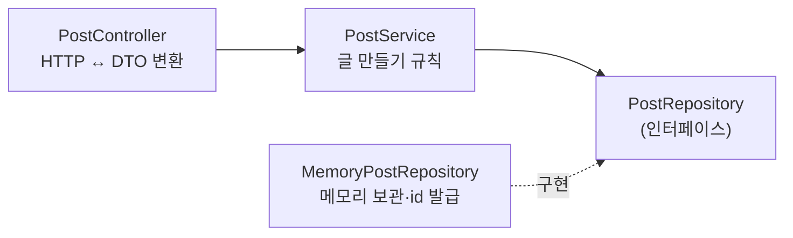

# 1-3. 서비스·저장소로 나누기

## 상황

컨트롤러 하나에 요청 받기, id 발급, 보관, 응답 만들기가 다 들어 있다. 다음 단계에서 메모리 대신 DB에 저장해야 하는데, 지금 구조라면 컨트롤러를 통째로 고쳐야 한다.

**API는 그대로 두고 코드만 세 층으로 나눈다.** 저장 방식이 바뀌어도 바뀌는 곳이 한 군데가 되도록.



## 만들 것

| 층 | 하는 일 | 하지 않는 일 |
|---|---|---|
| `PostController` | 요청 DTO 받기 → 서비스 호출 → 응답 DTO·201·Location 만들기 | 보관, id 발급, 시각 정하기 |
| `PostService` | 글 하나 만들기(생성 시각 정하기, 저장소에 저장) | HTTP(`ResponseEntity`, 헤더)를 알지 않는다 |
| `PostRepository` | 저장·id 발급의 **약속(인터페이스)** | — |
| `MemoryPostRepository` | 그 약속의 메모리 구현(`Map` + `AtomicLong`) | — |

- **API 계약은 1-2와 완전히 같다.** 요청·응답·상태 코드·`Location` 모두 그대로.
- 저장되는 글은 요청·응답 DTO와 다른 클래스로 둔다(예: `Post`). 이 클래스가 다음 단계에서 JPA 엔티티가 된다.
- 객체는 Spring이 만들어 넣어 주게 한다(생성자 주입). 직접 `new PostService()` 하지 않는다.

## 직접 확인

1-2와 같다. 요청 A를 두 번 보내 `201`, `Location`, id 증가를 확인한다.

```bash
BASE=http://localhost:8080
curl -i -X POST "$BASE/api/posts" -H 'Content-Type: application/json' \
  -d '{"boardSlug":"dev","title":"[채점] 첫 게시글","content":"Spring Boot로 만든 첫 게시글입니다.","tags":["spring","jpa"],"visibility":"PUBLIC"}'
```

## 채점 기준

C = HTTP 확인(필수), R = 코드 리뷰(피드백용). 이 단계는 **구조를 바꾸는 단계라 R 항목이 핵심 피드백**이다.

| # | 확인 방법 | 기대 |
|---|---|---|
| C1 | 요청 A | 상태 `201`, `Location`이 `/api/posts/{응답의 id}`로 끝난다 |
| C2 | 요청 A | 본문 7개 필드(`id`·`boardSlug`·`title`·`content`·`tags`·`visibility`·`createdAt`), `id`·`createdAt` 말고는 요청 값과 같다 |
| C3 | 요청 A를 한 번 더 | `id`가 정확히 1 커진다 |
| R1 | 컨트롤러 | `Map`, 카운터, 저장 코드가 컨트롤러에 남아 있지 않다. 서비스만 호출한다 |
| R2 | 서비스 | `@Service` 클래스가 있고 HTTP 타입(`ResponseEntity`, `HttpServletRequest` 등)을 쓰지 않는다 |
| R3 | 저장소 | `PostRepository` 인터페이스와 메모리 구현(`@Repository`)이 있고, 서비스는 **인터페이스 타입**에 의존한다 |
| R4 | 주입 | 생성자 주입 + `final` 필드. `@Autowired` 필드 주입이나 `new`로 직접 만들기가 없다 |
| R5 | 모델 분리 | 저장되는 클래스(`Post` 등)와 요청·응답 DTO가 분리되어 있다. 변환 위치가 한 군데로 정해져 있다 |

## 필요한 지식

- [W02 왜 Controller·Service·Repository로 나누나](../../docs/knowledge/W02-why-layers.md) — 안 나누면 생기는 일
- [P02 MVC 패턴과 계층형 구조](../../docs/knowledge/P02-mvc-layered-architecture.md)
- [W12 인터페이스는 왜 만드나](../../docs/knowledge/W12-why-interfaces.md) — 다음 단계에서 저장소를 갈아 끼우는 이유
- [P11 빈 등록과 의존성 주입](../../docs/knowledge/P11-bean-registration-di.md) — `@Service`·`@Repository`와 생성자 주입
- [P03 — 생성자 주입과 빈 선택](../../docs/knowledge/P03-annotations-cheatsheet.md#22-생성자-주입과-빈-선택)
- [P12 왜 빈과 IoC인가](../../docs/knowledge/P12-why-beans-ioc-intro.md) — `new`를 직접 안 쓰는 이유

## 힌트 (막힐 때만)

<details>
<summary>힌트 1 — 저장소 약속</summary>

`interface PostRepository { Post save(Post post); }` 정도로 시작한다. 메모리 구현은 `ConcurrentHashMap<Long, Post>`와 `AtomicLong`으로 id를 붙여 저장한 뒤 돌려준다.
</details>

<details>
<summary>힌트 2 — 생성자 주입</summary>

`private final PostService postService;` 필드와 그 필드를 받는 생성자 하나. 생성자가 하나면 `@Autowired`를 안 붙여도 Spring이 주입한다.
</details>

## 다음 단계

[1-4. DB에 저장하기](1-4-save-to-db.md) — `MemoryPostRepository`를 JPA로 바꾼다. 이 단계에서 잘 나눴다면 컨트롤러는 거의 안 바뀐다.
