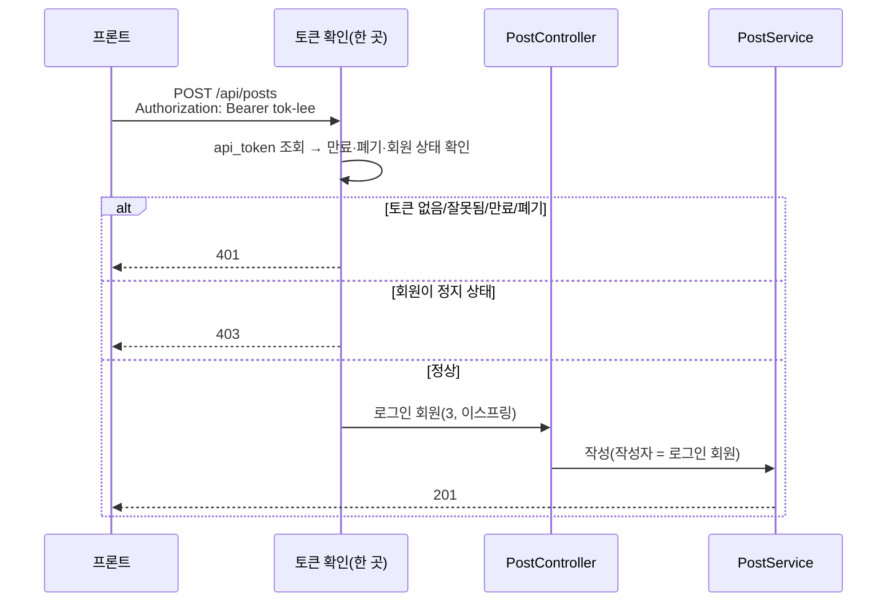

# 1-6. 토큰으로 작성자 정하기

## 상황

지금은 누가 보내도 작성자가 김자바다. 실제 서비스에서는 사용자가 로그인한 뒤 받은 **토큰**을 요청 헤더에 실어 보낸다.

로그인과 토큰 발급은 이번에 만들지 않는다. **토큰은 이미 발급되어 `api_token` 테이블에 있다고 가정**하고, 요청에 실려 온 토큰의 주인을 작성자로 정한다.



## 만들 것

**요청 헤더** — `Authorization: Bearer <토큰>`

| 토큰 | 주인 | 결과 |
|---|---|---|
| `tok-kimjava` | 2 김자바 | 정상 |
| `tok-lee` | 3 이스프링 | 정상 |
| `tok-admin` | 1 운영자(ADMIN) | 정상 — 공지 게시판에 쓸 수 있다 |
| `tok-kimjava-old` | 2 김자바 | **만료**(`expires_at` = 2026-01-01) |
| `tok-kimjava-revoked` | 2 김자바 | **폐기**(`revoked_at` 있음) |
| `tok-choi` | 5 최정지 | 토큰은 유효하지만 **회원이 정지(SUSPENDED)** |

**규칙**

| 상황 | 응답 |
|---|---|
| 헤더 없음 / `Bearer ` 형식이 아님 / 없는 토큰 / 만료 / 폐기 | `401`, `application/problem+json`, 응답 헤더 `WWW-Authenticate: Bearer` |
| 토큰은 유효한데 회원이 `ACTIVE`가 아님 | `403`, `application/problem+json` |
| 정상 | 작성자 = **토큰 주인**. 응답 `author`도 토큰 주인 |

- **인증을 먼저 본다.** 토큰이 없으면 본문이 잘못돼도 `401`이다(400이 아님).
- 요청 본문에 `"authorId"` 같은 값이 와도 **무시한다.** 작성자를 클라이언트가 정하게 두면 남의 이름으로 글을 쓸 수 있다.
- 1-5의 공지 게시판 규칙(운영자만)은 이제 토큰 주인 기준이다.
- 만료는 "지금 시각 ≥ `expires_at`"이다.

## 직접 확인

```bash
BASE=http://localhost:8080
BODY='{"boardSlug":"dev","title":"[채점] 토큰","content":"토큰으로 쓴 글","tags":["spring"],"visibility":"PUBLIC"}'
post() { curl -s -i -X POST "$BASE/api/posts" -H 'Content-Type: application/json' "$@"; echo; echo ----; }

post -H 'Authorization: Bearer tok-lee' -d "$BODY"                                   # T1 정상(이스프링)
post -H 'Authorization: Bearer tok-kimjava' \
  -d '{"boardSlug":"dev","title":"[채점] 토큰-작성자위조","content":"본문","tags":[],"visibility":"PUBLIC","authorId":1}'   # T2 authorId 무시
post -d "$BODY"                                                                       # T3 헤더 없음
post -H 'Authorization: tok-kimjava' -d "$BODY"                                       # T4 Bearer 없음
post -H 'Authorization: Bearer no-such-token' -d "$BODY"                              # T5 없는 토큰
post -H 'Authorization: Bearer tok-kimjava-old' -d "$BODY"                            # T6 만료
post -H 'Authorization: Bearer tok-kimjava-revoked' -d "$BODY"                        # T7 폐기
post -H 'Authorization: Bearer tok-choi' -d "$BODY"                                   # T8 정지 회원
post -d '{"title": "[채점] 깨짐"'                                                       # T9 깨진 본문 + 헤더 없음
post -H 'Authorization: Bearer tok-admin' \
  -d '{"boardSlug":"notice","title":"[채점] 토큰-공지","content":"공지","tags":[],"visibility":"PUBLIC"}'           # T10 운영자 공지
post -H 'Authorization: Bearer tok-kimjava' \
  -d '{"boardSlug":"notice","title":"[채점] 토큰-공지-실패","content":"공지","tags":[],"visibility":"PUBLIC"}'      # T11 일반 회원 공지
```

## 채점 기준

C = HTTP 확인(필수), D = DB 확인(필수, SELECT만), R = 코드 리뷰(피드백용). 요청은 위 T1~T11을 그대로 쓴다. `{id}`는 T1 응답의 `id`다.

| # | 확인 방법 | 기대 |
|---|---|---|
| C1 | T1 | `201`, `author.id` = `3`, `author.nickname` = `이스프링` |
| C2 | T2 | `201`, `author.id` = `2`(본문의 `authorId: 1`은 무시) |
| C3 | T3 | `401`, `Content-Type: application/problem+json`, 응답 헤더 `WWW-Authenticate`가 `Bearer`로 시작 |
| C4 | T4 | `401` |
| C5 | T5 | `401` |
| C6 | T6 | `401` |
| C7 | T7 | `401` |
| C8 | T8 | `403`, `Content-Type: application/problem+json` |
| C9 | T9 | `401`(인증이 먼저 — 400이 아님) |
| C10 | T10 | `201`, `author.id` = `1` |
| C11 | T11 | `403` |
| D1 | `SELECT author_id FROM post WHERE id = {id}` | `3` |
| D2 | `SELECT COUNT(*) FROM post WHERE title = '[채점] 토큰-공지-실패'` | `0` |
| R1 | 한 곳에서 확인 | 토큰 확인이 컨트롤러 메서드마다 반복되지 않는다(인터셉터·필터·`HandlerMethodArgumentResolver` 등 한 곳) |
| R2 | 401과 403 | "누구인지 모름"(401)과 "누구인지는 알지만 안 됨"(403)을 구분한다 |
| R3 | 시각 | 만료 판단의 현재 시각을 바꿔 끼울 수 있다(예: `Clock` 빈 주입) — 테스트에서 시간을 고정할 수 있다 |
| R4 | 비밀값 | 토큰 원문을 로그에 남기지 않는다 |
| R5 | 작성자 출처 | 서비스가 작성자를 요청 본문이 아니라 인증된 회원에서 받는다 |

## 필요한 지식

- [D11 웹 보안 기초 — 인증과 인가](../../docs/knowledge/D11-web-security-basics.md#32-인증과-인가-신원-확인-후-객체까지-확인) — 401과 403
- [B01 계정 생애주기](../../docs/knowledge/B01-account-lifecycle.md) — 토큰·세션, 정지·탈퇴 회원 처리
- [S05 — 필터, 인터셉터, AOP 비교](../../docs/knowledge/S05-mvc-request-flow.md#필터-인터셉터-aop-비교) — 토큰 확인을 어디에 둘까
- [S05 — ArgumentResolver와 MessageConverter는 어떻게 다른가](../../docs/knowledge/S05-mvc-request-flow.md#q2-argumentresolver와-messageconverter는-어떻게-다른가) — C9(인증 먼저)와 관련
- [W13 프론트와 백엔드의 경계](../../docs/knowledge/W13-frontend-backend-boundary.md) — 클라이언트가 보낸 값을 믿으면 안 되는 이유(C2)
- [W20 시간과 타임존](../../docs/knowledge/W20-time-timezone.md) — 만료 시각 비교와 `Clock`
- (선택) [S12 Spring Security 아키텍처](../../docs/knowledge/S12-security-architecture.md) · [S13 JWT·OAuth2](../../docs/knowledge/S13-jwt-oauth2.md) — 같은 일을 Spring Security와 JWT로 한다면

## 힌트 (막힐 때만)

<details>
<summary>힌트 1 — 어디서 확인할까</summary>

`HandlerInterceptor`의 `preHandle`은 컨트롤러 메서드의 매개변수(`@RequestBody`)를 만들기 **전에** 실행된다. 그래서 C9(깨진 본문 + 토큰 없음 → 401)를 맞추기 쉽다. 확인한 회원은 `request.setAttribute(...)`로 넘긴다. `/api/**`에만 적용하고 `/hello`는 빼는 식으로 등록 경로를 정한다(`WebMvcConfigurer.addInterceptors`).
</details>

<details>
<summary>힌트 2 — 컨트롤러에서 회원 받기</summary>

`@LoginMember` 같은 애노테이션을 만들고 `HandlerMethodArgumentResolver`로 그 매개변수에 회원을 넣어 주면 컨트롤러가 `create(@LoginMember LoginMember me, @Valid @RequestBody PostCreateRequest req)`처럼 깔끔해진다.
</details>

<details>
<summary>힌트 3 — 401 응답 만들기</summary>

인터셉터에서 예외를 던지면 1-5에서 만든 `@RestControllerAdvice`가 처리할 수 있다. `WWW-Authenticate` 헤더는 `ResponseEntity`나 `HttpServletResponse`로 붙인다.
</details>

## 다음 단계

1장 끝. 2장(게시글 조회)은 준비 중이다 — [시나리오 목차](../README.md#목차)
