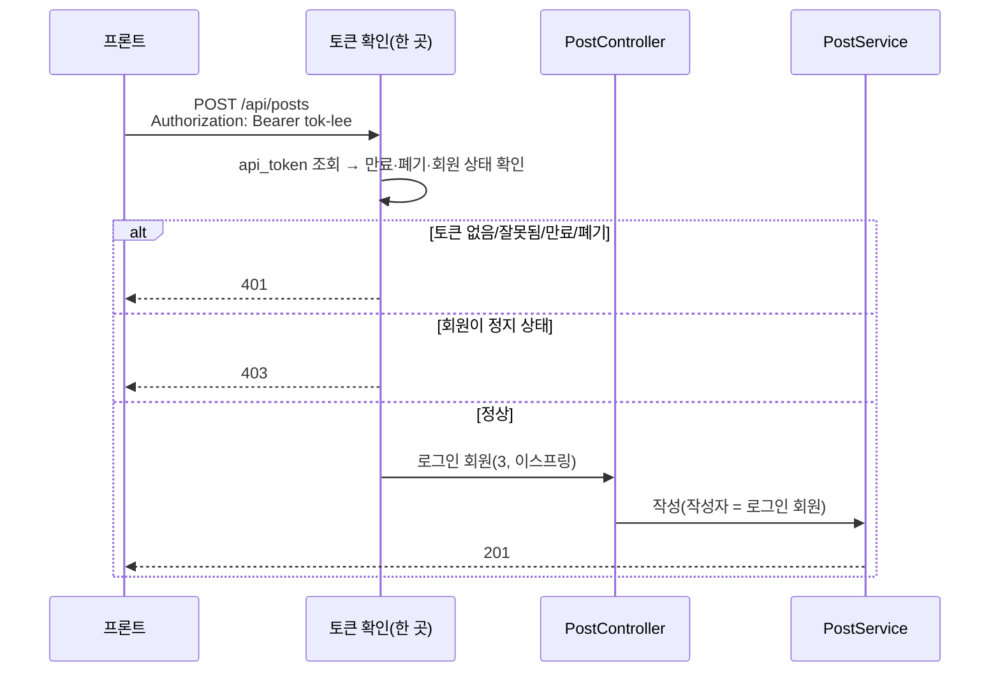

# 1-6. 토큰으로 작성자 정하기

## 상황

지금은 누가 보내도 작성자가 김자바다. 실제 서비스에서는 사용자가 로그인한 뒤 받은 **토큰**을 요청 헤더에 실어 보낸다.

로그인과 토큰 발급은 이번에 만들지 않는다. **토큰은 이미 발급되어 `api_token` 테이블에 있다고 가정**하고, 요청에 실려 온 토큰의 주인을 작성자로 정한다.



## 화면 시나리오

사용자가 화면에서 무엇을 하면 어떤 요청이 서버로 가고, 서버·DB에서 무슨 일이 일어나 어떤 응답이 돌아와 화면이 어떻게 바뀌는지다. 흐름을 펼치면 사용자 행동부터 응답까지 차례대로 볼 수 있다.

```screen
{
  "title": "로그인한 사용자의 글쓰기",
  "summary": "프론트는 로그인 때 받은 토큰을 매 요청 헤더에 싣는다. 서버는 그 토큰의 주인을 작성자로 쓴다.",
  "screen": [
    {
      "type": "bar",
      "id": "bar",
      "label": "새 글 쓰기",
      "right": "이스프링 (로그인됨)"
    },
    {
      "type": "select",
      "id": "board",
      "label": "게시판",
      "value": "개발"
    },
    {
      "type": "field",
      "id": "title",
      "label": "제목",
      "value": "[채점] 첫 게시글"
    },
    {
      "type": "field",
      "id": "content",
      "label": "본문",
      "value": "Spring Boot로 만든 첫 게시글입니다.",
      "multiline": true
    },
    {
      "type": "chips",
      "id": "tags",
      "label": "태그",
      "items": [
        "spring",
        "jpa"
      ]
    },
    {
      "type": "select",
      "id": "visibility",
      "label": "공개 범위",
      "value": "전체 공개"
    },
    {
      "type": "actions",
      "id": "buttons",
      "items": [
        {
          "id": "save",
          "label": "저장",
          "variant": "primary"
        }
      ]
    },
    {
      "type": "text",
      "id": "new-meta",
      "value": "#24 · 이스프링 · 방금 전",
      "emphasis": "caption",
      "tone": "muted"
    },
    {
      "type": "toast",
      "id": "toast",
      "value": "로그인이 만료됐어요. 다시 로그인해 주세요",
      "tone": "warning"
    }
  ],
  "flows": [
    {
      "name": "로그인한 이스프링이 저장",
      "steps": [
        {
          "kind": "user",
          "text": "이스프링으로 로그인한 상태에서 저장한다",
          "focus": [
            "bar",
            "save"
          ]
        },
        {
          "kind": "request",
          "method": "POST",
          "path": "/api/posts",
          "headers": [
            "Content-Type: application/json",
            "Authorization: Bearer tok-lee"
          ],
          "body": "{\"boardSlug\": \"dev\", \"title\": \"[채점] 토큰\", ...}"
        },
        {
          "kind": "server",
          "text": "토큰 확인(인터셉터·ArgumentResolver 등 한 곳): Bearer 형식 → 토큰 조회 → 만료·폐기·회원 상태 확인"
        },
        {
          "kind": "db",
          "sql": "SELECT member_id, expires_at, revoked_at FROM api_token WHERE token = 'tok-lee'"
        },
        {
          "kind": "server",
          "text": "작성자 = 토큰 주인(3, 이스프링). 본문에 authorId가 와도 무시한다"
        },
        {
          "kind": "response",
          "status": 201,
          "headers": [
            "Location: /api/posts/24"
          ],
          "body": "{\"id\": 24, \"author\": {\"id\": 3, \"nickname\": \"이스프링\"}, ...}"
        },
        {
          "kind": "screen",
          "text": "작성자가 '이스프링'으로 표시된다",
          "focus": [
            "new-meta"
          ]
        }
      ]
    },
    {
      "name": "토큰이 만료됨",
      "steps": [
        {
          "kind": "user",
          "text": "며칠 만에 들어와 저장한다(저장된 토큰이 만료됨)",
          "focus": [
            "save"
          ]
        },
        {
          "kind": "request",
          "method": "POST",
          "path": "/api/posts",
          "headers": [
            "Content-Type: application/json",
            "Authorization: Bearer tok-kimjava-old"
          ],
          "body": "{\"boardSlug\": \"dev\", ...}"
        },
        {
          "kind": "server",
          "text": "토큰 확인에서 막힌다 — 본문은 아예 읽지 않는다(그래서 본문이 깨져도 401)"
        },
        {
          "kind": "response",
          "status": 401,
          "headers": [
            "WWW-Authenticate: Bearer",
            "Content-Type: application/problem+json"
          ],
          "body": "{\"status\": 401, \"detail\": \"로그인이 필요합니다.\"}"
        },
        {
          "kind": "screen",
          "text": "401이면 로그인 화면으로 보내고, 다시 로그인하면 쓰던 글을 이어서 저장한다",
          "focus": [
            "toast"
          ]
        }
      ]
    },
    {
      "name": "정지된 회원",
      "steps": [
        {
          "kind": "user",
          "text": "정지된 회원(최정지)이 저장한다",
          "focus": [
            "save"
          ]
        },
        {
          "kind": "request",
          "method": "POST",
          "path": "/api/posts",
          "headers": [
            "Content-Type: application/json",
            "Authorization: Bearer tok-choi"
          ],
          "body": "{\"boardSlug\": \"dev\", ...}"
        },
        {
          "kind": "server",
          "text": "토큰은 유효하다 — 누구인지는 안다. 하지만 회원 상태가 SUSPENDED → 403"
        },
        {
          "kind": "response",
          "status": 403,
          "headers": [
            "Content-Type: application/problem+json"
          ],
          "body": "{\"status\": 403, \"detail\": \"이용이 정지된 계정입니다.\"}"
        },
        {
          "kind": "screen",
          "text": "다시 로그인해도 소용없으므로 로그인 화면이 아니라 '이용이 정지된 계정이에요' 안내를 띄운다"
        }
      ]
    }
  ]
}
```

## 만들 것

**요청 헤더** — `Authorization: Bearer <토큰>`

| 토큰 | 주인 | 결과 |
|---|---|---|
| `tok-kimjava` | 2 김자바 | 정상 |
| `tok-lee` | 3 이스프링 | 정상 |
| `tok-admin` | 1 운영자(ADMIN) | 정상 — 공지 게시판에 쓸 수 있다 |
| `tok-kimjava-old` | 2 김자바 | **만료**(`expires_at` = 2026-01-01) |
| `tok-kimjava-revoked` | 2 김자바 | **폐기**(`revoked_at` 있음) |
| `tok-choi` | 5 최정지 | 토큰은 유효하지만 **회원이 정지(SUSPENDED)** |

**규칙**

| 상황 | 응답 |
|---|---|
| 헤더 없음 / `Bearer ` 형식이 아님 / 없는 토큰 / 만료 / 폐기 | `401`, `application/problem+json`, 응답 헤더 `WWW-Authenticate: Bearer` |
| 토큰은 유효한데 회원이 `ACTIVE`가 아님 | `403`, `application/problem+json` |
| 정상 | 작성자 = **토큰 주인**. 응답 `author`도 토큰 주인 |

- **인증을 먼저 본다.** 토큰이 없으면 본문이 잘못돼도 `401`이다(400이 아님).
- 요청 본문에 `"authorId"` 같은 값이 와도 **무시한다.** 작성자를 클라이언트가 정하게 두면 남의 이름으로 글을 쓸 수 있다.
- 1-5의 공지 게시판 규칙(운영자만)은 이제 토큰 주인 기준이다.
- 만료는 "지금 시각 ≥ `expires_at`"이다.
- **CORS 사전 요청(preflight, `OPTIONS`)은 토큰 확인에서 뺀다.** 브라우저는 토큰을 싣기 전에 `OPTIONS`로 먼저 묻는데, 이것까지 막으면 1-1에서 연 CORS가 무너져 브라우저 API 실행 화면이 전부 "CORS로 막혔어요"가 된다. 인터셉터 맨 앞에서 `CorsUtils.isPreFlightRequest(request)`면 통과시킨다.

## 구현 가이드

화면 시나리오의 서버·DB 흐름을 이 단계에서 바뀐 파일에 연결한다. 먼저 **만들 것**의 계약대로 직접 작성하고, 필요한 역할만 펼쳐 파일 전문과 비교한다.

이 단계의 처리 흐름:
- 토큰 확인(인터셉터·ArgumentResolver 등 한 곳): Bearer 형식 → 토큰 조회 → 만료·폐기·회원 상태 확인
- 작성자 = 토큰 주인(3, 이스프링). 본문에 authorId가 와도 무시한다
- 토큰 확인에서 막힌다 — 본문은 아예 읽지 않는다(그래서 본문이 깨져도 401)
- 토큰은 유효하다 — 누구인지는 안다. 하지만 회원 상태가 SUSPENDED → 403

<details>
<summary>Controller — HTTP 연결</summary>

`AuthInterceptor.java`, `PostController.java`. 매핑과 메서드의 입력·응답을 위 **만들 것**의 HTTP 계약과 대조한다. 변경된 메서드: `preHandle`, `create`.

</details>

<details>
<summary>Service — 처리 순서</summary>

`PostService.java`. 위 서버 처리 순서가 어디에서 검증·조회·상태 변경으로 이어지는지 따라간다. 변경된 메서드: `create`. 트랜잭션 경계는 아래 코드의 `@Transactional` 위치에서 확인한다.

</details>

<details>
<summary>JPA / Repository — DB 조건</summary>

`ApiTokenRepository.java`. 쿼리·파생 메서드의 조건을 화면 시나리오의 DB 단계 및 직접 확인 SQL과 대조한다. 직접 작성한 JPQL·SQL과 아래 파일의 `@Query`를 비교한다.

</details>

<details>
<summary>MyBatis — 토큰 조회와 글·태그 저장 대체 경로</summary>

아래 **MyBatis 대체 구현 코드** 접기를 선택해 기본 JPA 스냅샷에 15개 파일 변경을 적용한다. `AuthTokenMapper.xml`은 `api_token`과 `member`를 JOIN해 만료·폐기·회원 상태를 한 번에 읽는다.

토큰 원문은 결과 DTO와 로그에 싣지 않는다. `PostCreationMapper.xml`은 게시판의 `write_role`과 인증된 작성자를 조회하고, `post` INSERT의 생성 키로 `tag`와 `post_tag`를 연결한다.

태그 ID와 DB에 저장된 이름으로 중복 연결을 막고 응답을 만든다. `PostService`의 `@Transactional`이 글·태그 저장을 한 트랜잭션으로 묶는다.

`PostController`는 요청의 `authorId`를 읽지 않고 인터셉터가 확인한 회원 ID만 전달한다. JPA와 MyBatis 양쪽에서 T1~T11 및 D1·D2를 같은 계약으로 확인한다.

</details>

<details>
<summary>Entity — 테이블·상태</summary>

`ApiToken.java`. 실제 테이블의 컬럼·외래키와 엔티티 매핑을 대조한다.

</details>

<details>
<summary>예외 처리 — 실패 응답</summary>

`AuthenticationRequiredException.java`, `MemberNotActiveException.java`, `ApiExceptionHandler.java`. 예외가 어떤 HTTP 상태와 오류 본문으로 바뀌는지 실패 계약과 대조한다. 변경된 메서드: `handleAuthenticationRequired`, `handleMemberNotActive`.

</details>

<details>
<summary>설정·보조 코드</summary>

`AuthenticatedMember.java`, `ClockConfig.java`, `LoginMember.java`, `LoginMemberArgumentResolver.java`, `WebMvcConfig.java`, `application.yml`. 이 파일에서 바뀐 설정·보조 타입이 서버 흐름의 어느 단계에 필요한지 확인한다.

변경된 메서드: `clock`, `supportsParameter`, `resolveArgument`, `addInterceptors`. `application.yml`의 `org.hibernate.orm.jdbc.bind`는 `info`로 낮춰 토큰 조회 바인딩 값이 로그에 남지 않게 한다.

</details>

## 직접 확인

```bash
BASE=http://localhost:8080
BODY='{"boardSlug":"dev","title":"[채점] 토큰","content":"토큰으로 쓴 글","tags":["spring"],"visibility":"PUBLIC"}'
post() { curl -s -i -X POST "$BASE/api/posts" -H 'Content-Type: application/json' "$@"; echo; echo ----; }

post -H 'Authorization: Bearer tok-lee' -d "$BODY"                                   # T1 정상(이스프링)
post -H 'Authorization: Bearer tok-kimjava' \
  -d '{"boardSlug":"dev","title":"[채점] 토큰-작성자위조","content":"본문","tags":[],"visibility":"PUBLIC","authorId":1}'   # T2 authorId 무시
post -d "$BODY"                                                                       # T3 헤더 없음
post -H 'Authorization: tok-kimjava' -d "$BODY"                                       # T4 Bearer 없음
post -H 'Authorization: Bearer no-such-token' -d "$BODY"                              # T5 없는 토큰
post -H 'Authorization: Bearer tok-kimjava-old' -d "$BODY"                            # T6 만료
post -H 'Authorization: Bearer tok-kimjava-revoked' -d "$BODY"                        # T7 폐기
post -H 'Authorization: Bearer tok-choi' -d "$BODY"                                   # T8 정지 회원
post -d '{"title": "[채점] 깨짐"'                                                       # T9 깨진 본문 + 헤더 없음
post -H 'Authorization: Bearer tok-admin' \
  -d '{"boardSlug":"notice","title":"[채점] 토큰-공지","content":"공지","tags":[],"visibility":"PUBLIC"}'           # T10 운영자 공지
post -H 'Authorization: Bearer tok-kimjava' \
  -d '{"boardSlug":"notice","title":"[채점] 토큰-공지-실패","content":"공지","tags":[],"visibility":"PUBLIC"}'      # T11 일반 회원 공지
```

버튼으로 확인 — 아래 실행 칸이 위 요청을 그대로 보내고 채점 기준의 C 항목을 대조한다.

```check
{
  "requests": [
    {
      "id": "T1",
      "title": "T1 정상(이스프링)",
      "method": "POST",
      "path": "/api/posts",
      "headers": {
        "Authorization": "Bearer tok-lee"
      },
      "body": {
        "boardSlug": "dev",
        "title": "[채점] 토큰",
        "content": "토큰으로 쓴 글",
        "tags": [
          "spring"
        ],
        "visibility": "PUBLIC"
      }
    },
    {
      "id": "T2",
      "title": "T2 본문의 authorId는 무시",
      "method": "POST",
      "path": "/api/posts",
      "headers": {
        "Authorization": "Bearer tok-kimjava"
      },
      "body": {
        "boardSlug": "dev",
        "title": "[채점] 토큰-작성자위조",
        "content": "본문",
        "tags": [],
        "visibility": "PUBLIC",
        "authorId": 1
      }
    },
    {
      "id": "T3",
      "title": "T3 헤더 없음",
      "method": "POST",
      "path": "/api/posts",
      "body": {
        "boardSlug": "dev",
        "title": "[채점] 토큰",
        "content": "토큰으로 쓴 글",
        "tags": [
          "spring"
        ],
        "visibility": "PUBLIC"
      }
    },
    {
      "id": "T4",
      "title": "T4 Bearer 없음",
      "method": "POST",
      "path": "/api/posts",
      "headers": {
        "Authorization": "tok-kimjava"
      },
      "body": {
        "boardSlug": "dev",
        "title": "[채점] 토큰",
        "content": "토큰으로 쓴 글",
        "tags": [
          "spring"
        ],
        "visibility": "PUBLIC"
      }
    },
    {
      "id": "T5",
      "title": "T5 없는 토큰",
      "method": "POST",
      "path": "/api/posts",
      "headers": {
        "Authorization": "Bearer no-such-token"
      },
      "body": {
        "boardSlug": "dev",
        "title": "[채점] 토큰",
        "content": "토큰으로 쓴 글",
        "tags": [
          "spring"
        ],
        "visibility": "PUBLIC"
      }
    },
    {
      "id": "T6",
      "title": "T6 만료",
      "method": "POST",
      "path": "/api/posts",
      "headers": {
        "Authorization": "Bearer tok-kimjava-old"
      },
      "body": {
        "boardSlug": "dev",
        "title": "[채점] 토큰",
        "content": "토큰으로 쓴 글",
        "tags": [
          "spring"
        ],
        "visibility": "PUBLIC"
      }
    },
    {
      "id": "T7",
      "title": "T7 폐기",
      "method": "POST",
      "path": "/api/posts",
      "headers": {
        "Authorization": "Bearer tok-kimjava-revoked"
      },
      "body": {
        "boardSlug": "dev",
        "title": "[채점] 토큰",
        "content": "토큰으로 쓴 글",
        "tags": [
          "spring"
        ],
        "visibility": "PUBLIC"
      }
    },
    {
      "id": "T8",
      "title": "T8 정지 회원",
      "method": "POST",
      "path": "/api/posts",
      "headers": {
        "Authorization": "Bearer tok-choi"
      },
      "body": {
        "boardSlug": "dev",
        "title": "[채점] 토큰",
        "content": "토큰으로 쓴 글",
        "tags": [
          "spring"
        ],
        "visibility": "PUBLIC"
      }
    },
    {
      "id": "T9",
      "title": "T9 깨진 본문 + 헤더 없음",
      "method": "POST",
      "path": "/api/posts",
      "headers": {
        "Content-Type": "application/json"
      },
      "body": "{\"title\": \"[채점] 깨짐\""
    },
    {
      "id": "T10",
      "title": "T10 운영자 공지",
      "method": "POST",
      "path": "/api/posts",
      "headers": {
        "Authorization": "Bearer tok-admin"
      },
      "body": {
        "boardSlug": "notice",
        "title": "[채점] 토큰-공지",
        "content": "공지",
        "tags": [],
        "visibility": "PUBLIC"
      }
    },
    {
      "id": "T11",
      "title": "T11 일반 회원 공지",
      "method": "POST",
      "path": "/api/posts",
      "headers": {
        "Authorization": "Bearer tok-kimjava"
      },
      "body": {
        "boardSlug": "notice",
        "title": "[채점] 토큰-공지-실패",
        "content": "공지",
        "tags": [],
        "visibility": "PUBLIC"
      }
    }
  ],
  "checks": [
    {
      "id": "C1",
      "request": "T1",
      "expect": {
        "status": 201,
        "json": [
          {
            "path": "$.author.id",
            "equals": 3
          },
          {
            "path": "$.author.nickname",
            "equals": "이스프링"
          }
        ]
      }
    },
    {
      "id": "C2",
      "request": "T2",
      "expect": {
        "status": 201,
        "json": [
          {
            "path": "$.author.id",
            "equals": 2
          }
        ]
      }
    },
    {
      "id": "C3",
      "request": "T3",
      "expect": {
        "status": 401,
        "headers": {
          "Content-Type": {
            "contains": "application/problem+json"
          },
          "WWW-Authenticate": {
            "matches": "^Bearer"
          }
        }
      }
    },
    {
      "id": "C4",
      "request": "T4",
      "expect": {
        "status": 401
      }
    },
    {
      "id": "C5",
      "request": "T5",
      "expect": {
        "status": 401
      }
    },
    {
      "id": "C6",
      "request": "T6",
      "expect": {
        "status": 401
      }
    },
    {
      "id": "C7",
      "request": "T7",
      "expect": {
        "status": 401
      }
    },
    {
      "id": "C8",
      "request": "T8",
      "expect": {
        "status": 403,
        "headers": {
          "Content-Type": {
            "contains": "application/problem+json"
          }
        }
      }
    },
    {
      "id": "C9",
      "request": "T9",
      "expect": {
        "status": 401
      }
    },
    {
      "id": "C10",
      "request": "T10",
      "expect": {
        "status": 201,
        "json": [
          {
            "path": "$.author.id",
            "equals": 1
          }
        ]
      }
    },
    {
      "id": "C11",
      "request": "T11",
      "expect": {
        "status": 403
      }
    }
  ]
}
```

## 채점 기준

C = HTTP 확인(필수), D = DB 확인(필수, SELECT만), R = 코드 리뷰(피드백용). 요청은 위 T1~T11을 그대로 쓴다. `{id}`는 T1 응답의 `id`다.

| # | 확인 방법 | 기대 |
|---|---|---|
| C1 | T1 | `201`, `author.id` = `3`, `author.nickname` = `이스프링` |
| C2 | T2 | `201`, `author.id` = `2`(본문의 `authorId: 1`은 무시) |
| C3 | T3 | `401`, `Content-Type: application/problem+json`, 응답 헤더 `WWW-Authenticate`가 `Bearer`로 시작 |
| C4 | T4 | `401` |
| C5 | T5 | `401` |
| C6 | T6 | `401` |
| C7 | T7 | `401` |
| C8 | T8 | `403`, `Content-Type: application/problem+json` |
| C9 | T9 | `401`(인증이 먼저 — 400이 아님) |
| C10 | T10 | `201`, `author.id` = `1` |
| C11 | T11 | `403` |
| D1 | `SELECT author_id FROM post WHERE id = {id}` | `3` |
| D2 | `SELECT COUNT(*) FROM post WHERE title = '[채점] 토큰-공지-실패'` | `0` |
| R1 | 한 곳에서 확인 | 토큰 확인이 컨트롤러 메서드마다 반복되지 않는다(인터셉터·필터·`HandlerMethodArgumentResolver` 등 한 곳) |
| R2 | 401과 403 | "누구인지 모름"(401)과 "누구인지는 알지만 안 됨"(403)을 구분한다 |
| R3 | 시각 | 만료 판단의 현재 시각을 바꿔 끼울 수 있다(예: `Clock` 빈 주입) — 테스트에서 시간을 고정할 수 있다 |
| R4 | 비밀값 | 토큰 원문을 로그에 남기지 않는다 — 내가 쓴 로그 문은 물론, `application.yml`의 `org.hibernate.orm.jdbc.bind: trace`(1-4의 SQL 로그 읽기에서 본 것)도 토큰 조회 SQL의 값을 그대로 찍는다. 이 단계부터 그 줄을 지우거나 `info`로 낮춘다 |
| R5 | 작성자 출처 | 서비스가 작성자를 요청 본문이 아니라 인증된 회원에서 받는다 |
| R6 | 사전 요청 | 토큰 확인이 `OPTIONS` 사전 요청을 막지 않는다(`CorsUtils.isPreFlightRequest`) |

## 필요한 지식

- [D11 웹 보안 기초 — 인증과 인가](../../docs/knowledge/D11-web-security-basics.md#32-인증과-인가-신원-확인-후-객체까지-확인) — 401과 403
- [B01 계정 생애주기](../../docs/knowledge/B01-account-lifecycle.md) — 토큰·세션, 정지·탈퇴 회원 처리
- [S05 — 필터, 인터셉터, AOP 비교](../../docs/knowledge/S05-mvc-request-flow.md#필터-인터셉터-aop-비교) — 토큰 확인을 어디에 둘까
- [S05 — ArgumentResolver와 MessageConverter는 어떻게 다른가](../../docs/knowledge/S05-mvc-request-flow.md#q2-argumentresolver와-messageconverter는-어떻게-다른가) — C9(인증 먼저)와 관련
- [W13 프론트와 백엔드의 경계](../../docs/knowledge/W13-frontend-backend-boundary.md) — 클라이언트가 보낸 값을 믿으면 안 되는 이유(C2)
- [W20 시간과 타임존](../../docs/knowledge/W20-time-timezone.md) — 만료 시각 비교와 `Clock`
- (선택) [S12 Spring Security 아키텍처](../../docs/knowledge/S12-security-architecture.md) · [S13 JWT·OAuth2](../../docs/knowledge/S13-jwt-oauth2.md) — 같은 일을 Spring Security와 JWT로 한다면

## 힌트 (막힐 때만)

<details>
<summary>힌트 1 — 어디서 확인할까</summary>

`HandlerInterceptor`의 `preHandle`은 컨트롤러 메서드의 매개변수(`@RequestBody`)를 만들기 **전에** 실행된다. 그래서 C9(깨진 본문 + 토큰 없음 → 401)를 맞추기 쉽다.

확인한 회원은 `request.setAttribute(...)`로 넘긴다. `/api/**`에 적용하되 0장의 공개 실습 API `/api/start/**`는 `excludePathPatterns`로 뺀다(`WebMvcConfigurer.addInterceptors`).

`/hello`도 `/api/**` 밖이라 대상이 아니다. 2-1부터는 로그인 없이 보는 GET이 생기므로, "GET이고 `Authorization` 헤더가 없으면 통과"를 지금 넣어 두거나 2-1에서 고친다(헤더가 **있는데** 틀리면 GET이라도 401). </details>

<details>
<summary>힌트 2 — 컨트롤러에서 회원 받기</summary>

`@LoginMember` 같은 애노테이션을 만들고 `HandlerMethodArgumentResolver`로 그 매개변수에 회원을 넣어 주면 컨트롤러가 `create(@LoginMember LoginMember me, @Valid @RequestBody PostCreateRequest req)`처럼 깔끔해진다.
</details>

<details>
<summary>힌트 3 — 401 응답 만들기</summary>

인터셉터에서 예외를 던지면 1-5에서 만든 `@RestControllerAdvice`가 처리할 수 있다. `WWW-Authenticate` 헤더는 `ResponseEntity`나 `HttpServletResponse`로 붙인다.
</details>

## 다음 단계

[1-7. DB 직접 조작](1-7-direct-db-dml.md) — 방금 만든 글을 SQL로 확인하고 트랜잭션을 연습한다.
