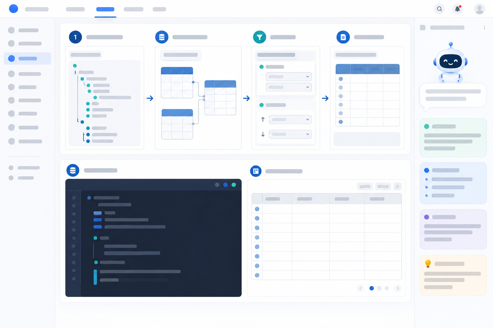

# DB-01. API 응답에서 첫 SQL까지 — 게시판 글 목록 · 기초

<style>
main:has(.db01) { max-width:1600px; }
.db01 { --db-ink:var(--fg); --db-muted:var(--muted); --db-line:var(--line); --db-blue:#2563eb; --db-teal:#0f8b8d; --db-violet:#7354c8; --db-amber:#b76512; color:var(--db-ink); }
.db01 * { box-sizing:border-box; }
.db01 .db01-lead { margin:7px 0 12px; color:var(--db-muted); font-size:.95rem; line-height:1.55; }
.db01 .db01-request { display:flex; align-items:center; flex-wrap:wrap; gap:10px; padding:10px 14px; border:1px solid #93c5fd; border-radius:14px; background:linear-gradient(100deg,#eff6ff,#f0fdfa 72%,#fff); color:#13294b; }
.db01 .db01-method { padding:5px 9px; border-radius:8px; background:#d1fae5; color:#087857; font-size:.76rem; font-weight:900; }
.db01 .db01-path { overflow-wrap:anywhere; color:#13294b; font-family:ui-monospace,SFMono-Regular,Consolas,monospace; font-size:.88rem; font-weight:800; }
.db01 .db01-contract-note { margin-left:auto; color:#53657e; font-size:.72rem; }
.db01 .db01-stepnav { display:none; }
.db01 .db01-flow { display:grid; grid-template-columns:repeat(4,minmax(0,1fr)); gap:18px; margin:12px 0; }
.db01 .db01-stage { position:relative; min-width:0; padding:12px; border:1px solid #d9e4f2; border-radius:16px; background:linear-gradient(160deg,#fff,#f6f9ff); box-shadow:0 5px 16px #18365c0c; scroll-margin-top:18px; }
.db01 .db01-stage:not(:last-child)::after { content:'→'; position:absolute; z-index:2; top:47%; right:-18px; width:18px; color:#0d9bad; font-size:1.3rem; font-weight:900; text-align:center; }
.db01 .db01-stage:nth-child(2){background:linear-gradient(160deg,#fff,#f0fbfa)}
.db01 .db01-stage:nth-child(3){background:linear-gradient(160deg,#fff,#fff8eb)}
.db01 .db01-stage:nth-child(4){background:linear-gradient(160deg,#fff,#f6f2ff)}
.db01 .db01-stage:target { outline:3px solid #16b8c7; box-shadow:0 0 0 6px #16b8c724,0 8px 24px #18365c18; }
.db01 .db01-stagehead { display:flex; align-items:center; gap:8px; margin-bottom:8px; color:#172d50; font-size:.88rem; font-weight:850; }
.db01 .db01-stagehead b { display:grid; width:25px; height:25px; flex:0 0 25px; place-items:center; border-radius:8px; background:#dbeafe; color:#1d4ed8; }
.db01 .db01-stage:nth-child(2) .db01-stagehead b{background:#ccfbf1;color:#087e76}.db01 .db01-stage:nth-child(3) .db01-stagehead b{background:#ffedd5;color:#b45309}.db01 .db01-stage:nth-child(4) .db01-stagehead b{background:#ede9fe;color:#6d48b6}
.db01 .db01-stage p { margin:4px 0 8px; color:#596b82; font-size:.75rem; line-height:1.45; }
.db01 .db01-json { margin:0; padding:8px; border-radius:9px; background:#12243c; color:#d9eaff; font: .7rem/1.55 ui-monospace,SFMono-Regular,Menlo,monospace; white-space:pre-wrap; overflow-wrap:anywhere; }
.db01 .db01-json em { color:#7ee7cb; font-style:normal; }
.db01 .db01-mapline { display:flex; flex-wrap:wrap; align-items:center; gap:4px; margin:5px 0; color:#243b5b; font:.68rem/1.3 ui-monospace,SFMono-Regular,Menlo,monospace; }
.db01 .db01-node { padding:4px 6px; border:1px solid #c9d8eb; border-radius:7px; background:#fff; }
.db01 .db01-arrow { color:#0891a2; font-size:.85rem; font-weight:900; }
.db01 .db01-condition { display:flex; flex-wrap:wrap; gap:5px; }
.db01 .db01-condition code { padding:4px 6px; border-radius:6px; background:#fff; color:#854d0e; font-size:.67rem; }
.db01 .db01-resultline { display:flex; flex-wrap:wrap; gap:5px; margin-top:7px; }
.db01 .db01-resultline span { padding:4px 6px; border-radius:6px; background:#fff; color:#433474; font-size:.68rem; }
.db01 .db01-firstrow { display:grid; grid-template-columns:42px minmax(0,1fr); gap:2px 7px; margin-top:7px; padding:8px; border:1px solid #dcd3fa; border-radius:9px; background:#fff; color:#352a58; font-size:.68rem; }
.db01 .db01-firstrow b { color:#7055b4; }
.db01 .db01-evidence { color:#665d7c; font-size:.65rem; }
.db01 .db01-proof { display:grid; grid-template-columns:minmax(0,1.15fr) minmax(0,.85fr); gap:12px; margin:10px 0 18px; }
.db01 .db01-proofcard { min-width:0; padding:12px 14px; border:1px solid #d9e4f2; border-radius:14px; background:linear-gradient(120deg,#f7fbff,#fff); }
.db01 .db01-proofhead { display:flex; align-items:center; justify-content:space-between; gap:8px; margin-bottom:6px; color:#192f51; font-size:.82rem; font-weight:850; }
.db01 .db01-proofhead small { color:#60738a; font-size:.68rem; font-weight:600; }
.db01 .db01-sqlpeek { margin:0; padding:9px 10px; border-radius:9px; background:#12243c; color:#e0edff; font:.68rem/1.45 ui-monospace,SFMono-Regular,Menlo,monospace; white-space:pre-wrap; overflow-wrap:anywhere; }
.db01 .db01-rowscroll { overflow-x:auto; }
.db01 .db01-rowtable { width:100%; border-collapse:collapse; color:#293c56; font-size:.66rem; white-space:nowrap; }
.db01 .db01-rowtable th,.db01 .db01-rowtable td { padding:6px 5px; border-bottom:1px solid #e1e8f1; text-align:left; }
.db01 .db01-rowtable th { color:#60738a; font-size:.62rem; }
.db01 .db01-rowtable tbody tr { background:#eefbf7; }
.db01 .db01-rowtable strong { color:#087e76; }
.db01 .db01-deep { margin:18px 0; }
.db01 .db01-deep summary { cursor:pointer; color:var(--db-blue); font-weight:800; }
.db01 .db01-deep[open] summary { margin-bottom:12px; }
.db01 .db01-card { min-width:0; padding:16px; border:1px solid var(--db-line); border-radius:16px; background:var(--card); box-shadow:0 5px 18px #152b4510; }
.db01 .db01-card h3 { margin:0 0 7px; font-size:1.04rem; }
.db01 .db01-card p { margin:4px 0 12px; color:var(--db-muted); font-size:.88rem; line-height:1.6; }
.db01 .db01-kicker { color:var(--db-blue); font-size:.76rem; font-weight:800; letter-spacing:.04em; }
.db01 .db01-pills { display:flex; flex-wrap:wrap; gap:7px; margin:12px 0 0; }
.db01 .db01-pill { padding:6px 9px; border-radius:999px; background:color-mix(in srgb,var(--db-blue) 10%,var(--card)); color:var(--db-ink); font-size:.78rem; }
.db01 .db01-response { display:grid; grid-template-columns:repeat(2,minmax(0,1fr)); gap:7px; margin-top:14px; }
.db01 .db01-field { display:flex; justify-content:space-between; gap:8px; padding:8px 10px; border:1px solid var(--db-line); border-radius:9px; background:color-mix(in srgb,var(--db-blue) 4%,var(--card)); font-size:.8rem; }
.db01 .db01-field code { color:var(--db-blue); overflow-wrap:anywhere; }
.db01 .db01-relations { display:grid; grid-template-columns:repeat(3,minmax(0,1fr)); gap:9px; margin:14px 0; }
.db01 .db01-table { padding:10px; border:1px solid color-mix(in srgb,var(--db-blue) 30%,var(--db-line)); border-radius:11px; background:color-mix(in srgb,var(--db-blue) 5%,var(--card)); }
.db01 .db01-table strong { display:block; margin-bottom:7px; color:var(--db-blue); }
.db01 .db01-table small { display:block; margin:3px 0; color:var(--db-muted); font-family:ui-monospace,SFMono-Regular,Menlo,monospace; font-size:.74rem; overflow-wrap:anywhere; }
.db01 .db01-relation-note { padding:10px 12px; border-left:3px solid var(--db-teal); border-radius:7px; background:color-mix(in srgb,var(--db-teal) 10%,var(--card)); color:var(--db-ink); font-size:.82rem; line-height:1.55; }
.db01 .db01-section { margin:18px 0; }
.db01 .db01-rulegrid { display:grid; grid-template-columns:1fr 1fr; gap:12px; }
.db01 .db01-rule { padding:13px; border:1px solid var(--db-line); border-radius:12px; background:var(--card); }
.db01 .db01-rule code { display:block; margin:7px 0; color:var(--db-blue); font-size:.85rem; }
.db01 .db01-observe { border-left:4px solid #f0a42b; background:color-mix(in srgb,#f0a42b 12%,var(--card)); padding:12px 14px; border-radius:9px; color:var(--db-ink); line-height:1.6; }
.db01 .db01-mockup img { display:block; width:100%; height:auto; border:1px solid var(--db-line); border-radius:12px; }
@media(max-width:850px){ .db01 .db01-flow{grid-template-columns:repeat(2,minmax(0,1fr));gap:10px}.db01 .db01-stage:nth-child(2)::after{content:'↓';top:auto;bottom:-18px;right:48%}.db01 .db01-stage:nth-child(3)::after{content:'→';top:47%;right:-10px}.db01 .db01-proof{grid-template-columns:1fr}.db01 .db01-stepnav{display:grid} }
@media(max-width:520px){ .db01 .db01-request{align-items:flex-start}.db01 .db01-path{font-size:.78rem}.db01 .db01-contract-note{width:100%;margin-left:0}.db01 .db01-stepnav{grid-template-columns:repeat(4,minmax(0,1fr));gap:5px;margin:9px 0}.db01 .db01-stepnav a{padding:7px 3px;border:1px solid #bfdbfe;border-radius:9px;background:#eff6ff;color:#1d4ed8;text-align:center;text-decoration:none;font-size:.68rem;font-weight:800}.db01 .db01-flow{grid-template-columns:1fr;gap:8px}.db01 .db01-stage{padding:11px}.db01 .db01-stage:not(:last-child)::after,.db01 .db01-stage:nth-child(2)::after,.db01 .db01-stage:nth-child(3)::after{content:'↓';top:auto;right:48%;bottom:-14px;font-size:.9rem}.db01 .db01-stagehead{font-size:.82rem}.db01 .db01-json{font-size:.68rem}.db01 .db01-proofcard{padding:10px}.db01 .db01-proof{gap:8px}.db01 .db01-sqlpeek{font-size:.62rem}.db01 .db01-relations{grid-template-columns:1fr 1fr}.db01 .db01-rulegrid{grid-template-columns:1fr}.db01 .db01-card{padding:14px} }
</style>

<section class="db01" aria-label="API에서 SQL로 이어지는 학습 화면">
<p class="db01-lead">응답 한 줄을 따라가며 <strong>테이블 연결 → 조회 조건 → 실제 행</strong>으로 바꿔 봅니다.</p>
<div class="db01-request" aria-label="목록 API 요청 계약">
  <span class="db01-method">GET</span><span class="db01-path">/api/boards/dev/posts?size=20&amp;cursor=</span>
  <span class="db01-contract-note">M1 계약 · 비로그인 · 첫 페이지</span>
</div>
<p class="db01-lead">체크아웃에 M1 API 구현은 아직 없습니다. 요청 버튼 대신 같은 계약을 SQL로 추적합니다.</p>
<nav class="db01-stepnav" aria-label="흐름 단계 바로가기"><a href="#db01-stage-1">① 응답</a><a href="#db01-stage-2">② 테이블</a><a href="#db01-stage-3">③ 조건</a><a href="#db01-stage-4">④ 행 확인</a></nav>
<div class="db01-flow" aria-label="응답에서 실제 행까지 이어지는 흐름">
<section class="db01-stage" id="db01-stage-1">
  <div class="db01-stagehead"><b>1</b> 응답 필드</div>
  <p>화면에 필요한 값만 JSON으로 내려옵니다.</p>
  <pre class="db01-json">{
  <em>"id"</em>: 145,
  <em>"title"</em>: "스프링 트랜잭션 전파 삽질기",
  <em>"authorNickname"</em>: "밤샘개발자",
  <em>"likeCount"</em>: 20,
  <em>"commentCount"</em>: 1,
  <em>"tags"</em>: ["java"]
}</pre>
  <p class="db01-evidence">M1 필드 계약 + practice seed의 글 145</p>
</section>
<section class="db01-stage" id="db01-stage-2">
  <div class="db01-stagehead"><b>2</b> 저장된 테이블</div>
  <p>표시값을 JOIN 경로로 연결합니다.</p>
  <div class="db01-mapline"><span class="db01-node">board.slug</span><span class="db01-arrow">→</span><span class="db01-node">post.board_id</span></div>
  <div class="db01-mapline"><span class="db01-node">post.author_id</span><span class="db01-arrow">→</span><span class="db01-node">member.nickname</span></div>
  <div class="db01-mapline"><span class="db01-node">post.id</span><span class="db01-arrow">→</span><span class="db01-node">post_tag</span><span class="db01-arrow">→</span><span class="db01-node">tag.name</span></div>
  <p class="db01-evidence">카운트는 post.like_count · post.comment_count</p>
</section>
<section class="db01-stage" id="db01-stage-3">
  <div class="db01-stagehead"><b>3</b> WHERE · ORDER</div>
  <p><code>dev</code> 게시판의 공개된 발행 글만 최신순으로.</p>
  <div class="db01-condition"><code>slug = 'dev'</code><code>status = 'PUBLISHED'</code><code>deleted_at IS NULL</code><code>visibility = 'PUBLIC'</code><code>published_at DESC</code><code>id DESC</code></div>
  <div class="db01-resultline"><span>SELECT 응답 필드</span><span>LIMIT 20</span><span>태그는 일괄 조회</span></div>
</section>
<section class="db01-stage" id="db01-stage-4">
  <div class="db01-stagehead"><b>4</b> 실제 첫 행</div>
  <p>practice seed와 계약을 대조합니다.</p>
  <div class="db01-firstrow"><b>id</b><span>145 · PUBLIC</span><b>제목</b><span>스프링 트랜잭션 전파 삽질기</span><b>작성자</b><span>밤샘개발자</span><b>카운트</b><span>좋아요 20 · 댓글 1</span><b>태그</b><span>java</span></div>
  <p class="db01-evidence">첫 5개 ID: 145 · 144 · 143 · 140 · 138</p>
</section>
</div>
<div class="db01-proof" aria-label="SQL과 실제 결과 연결">
  <section class="db01-proofcard"><div class="db01-proofhead">SQL 초안 <small>board → post → member · 태그는 별도 1회 조회</small></div>
  <pre class="db01-sqlpeek">SELECT p.id, p.title, m.nickname,
       p.like_count, p.comment_count, p.published_at
FROM board b JOIN post p ON p.board_id = b.id
JOIN member m ON m.id = p.author_id
WHERE b.slug='dev' AND p.status='PUBLISHED'
  AND p.deleted_at IS NULL AND p.visibility='PUBLIC'
ORDER BY p.published_at DESC, p.id DESC LIMIT 20;</pre></section>
  <section class="db01-proofcard"><div class="db01-proofhead">practice DB · 첫 결과 행 <small>seed 기준</small></div>
  <div class="db01-rowscroll"><table class="db01-rowtable"><thead><tr><th>id</th><th>title</th><th>nickname</th><th>like</th><th>comment</th></tr></thead><tbody><tr><td><strong>145</strong></td><td>스프링 트랜잭션 전파 삽질기</td><td>밤샘개발자</td><td>20</td><td>1</td></tr></tbody></table></div>
  <p class="db01-evidence">태그 일괄 조회 결과: java · seed 검증값</p></section>
</div>
<details class="db01-deep">
<summary>요청 계약과 응답 필드 전체 보기</summary>
<section class="db01-card">
  <span class="db01-kicker">M1 계약 · practice DB의 비로그인 기준</span>
  <p>이 주소는 <code>practice/MISSIONS.md</code> M1의 목록 계약입니다. 이번 첫 요청은 커서가 비어 있습니다. 실제 M1 API 구현이 아직 없는 체크아웃에서는 버튼으로 요청을 보내지 않고, 아래 SQL로 데이터 경로를 먼저 확인합니다.</p>
  <div class="db01-pills"><span class="db01-pill">목록은 PUBLISHED</span><span class="db01-pill">삭제 글 제외</span><span class="db01-pill">비로그인: PUBLIC</span><span class="db01-pill">본문 content 제외</span></div>
  <div class="db01-response" aria-label="응답 필드">
    <div class="db01-field"><code>id</code><span>글 식별자</span></div><div class="db01-field"><code>title</code><span>목록 제목</span></div>
    <div class="db01-field"><code>authorNickname</code><span>작성자 표시</span></div><div class="db01-field"><code>likeCount</code><span>좋아요 수</span></div>
    <div class="db01-field"><code>commentCount</code><span>댓글 수</span></div><div class="db01-field"><code>tags[]</code><span>태그 이름 목록</span></div>
    <div class="db01-field"><code>publishedAt</code><span>발행 시각</span></div>
  </div>
</section>
<section class="db01-card db01-section">
  <span class="db01-kicker">응답 값이 저장된 곳</span><h3>한 글은 여러 테이블에서 조립됩니다</h3>
  <div class="db01-relations" aria-label="테이블과 열 관계">
    <div class="db01-table"><strong>board</strong><small>id · slug</small></div>
    <div class="db01-table"><strong>post</strong><small>id · board_id</small><small>author_id · title</small><small>like_count · comment_count</small><small>published_at · status · deleted_at</small></div>
    <div class="db01-table"><strong>member</strong><small>id · nickname</small></div>
    <div class="db01-table"><strong>post_tag</strong><small>post_id · tag_id</small></div>
    <div class="db01-table"><strong>tag</strong><small>id · name</small></div>
  </div>
  <div class="db01-relation-note"><b>관계 읽기</b><br>요청의 <code>dev</code>는 <code>board.slug</code>에서 <code>board.id</code>로 바뀌고, <code>post.board_id</code>와 연결됩니다. 작성자 닉네임은 <code>post.author_id → member.id → member.nickname</code>을 따라갑니다. 태그는 <code>post → post_tag → tag</code>를 따라갑니다.</div>
</section>
<aside class="db01-card db01-section" aria-label="학습 힌트">
  <span class="db01-kicker">먼저 스스로 답하기</span><h3>목록 API가 필요한 데이터는?</h3>
  <div class="db01-question">응답에 <code>authorNickname</code>과 <code>tags[]</code>가 있습니다. 어떤 테이블을 연결하고, <code>likeCount</code>는 매번 COUNT 쿼리로 계산해야 할까요?</div>
  <div class="db01-hint"><b>힌트</b><br><code>post</code>에는 <code>like_count</code>와 <code>comment_count</code>가 목록 표시를 위해 저장돼 있습니다. 태그는 다대다 연결 테이블을 거치므로, 글마다 따로 조회하지 말고 현재 페이지의 글 ID를 모아 한 번에 가져올 수 있습니다.</div>
  <p class="db01-observe" style="margin-top:12px">이번 화면은 데이터가 실제로 흘러가는 실행 로그가 아니라, API 계약에서 SQL을 유도하는 학습 경로입니다. 실제 쿼리 수·실행 계획은 DB에서 확인한 뒤 기록하세요.</p>
</aside>
</details>
</section>

## 이번 요청에서 정할 것

`GET /api/boards/dev/posts?size=20&cursor=`는 목록 첫 페이지입니다. 지금은 쿼리 파라미터가 어떤 열을 바꾸는지부터 구분합니다.

| 계약·응답 | 스키마에서 찾을 열 | SQL에서 할 일 |
|---|---|---|
| 경로의 `slug=dev` | `board.slug` | `board`와 `post`를 `board.id = post.board_id`로 연결 |
| `id`, `title` | `post.id`, `post.title` | 목록 SELECT에 포함 |
| `authorNickname` | `member.nickname` | `post.author_id = member.id`로 연결 |
| `likeCount`, `commentCount` | `post.like_count`, `post.comment_count` | 저장된 요약 열을 읽는다. 이번 단계에서 다시 COUNT하지 않는다 |
| `tags[]` | `tag.name` | `post_tag`를 거쳐 현재 페이지 글의 태그를 한 번에 읽는다 |
| `publishedAt` | `post.published_at` | 내림차순 정렬에 사용하고 응답에도 포함 |
| 목록 규칙 | `post.status`, `post.deleted_at`, `post.visibility` | 비로그인 기준 `PUBLISHED`, 미삭제, `PUBLIC` 행만 남긴다 |
| `size=20`, 빈 `cursor` | 요청 파라미터 | 첫 페이지는 커서 조건 없이 정렬 후 20개를 읽는다. 커서 인코딩·다음 페이지는 DB-02에서 다룬다 |

### 조건과 정렬을 먼저 말로 만들기

- `WHERE`: 게시판 slug가 `dev`이고, `status = 'PUBLISHED'`, `deleted_at IS NULL`, 비로그인에게 공개되는 `visibility = 'PUBLIC'`.
- `ORDER BY`: `published_at DESC`, 같은 시각이면 `id DESC`. 두 번째 기준이 없으면 동률 행 순서는 고정되지 않습니다.
- 본문: `content`는 목록 응답에 없으므로 이 SELECT에 넣지 않습니다.
- 태그: 한 게시글에 여러 태그가 붙을 수 있습니다. 메인 SELECT에 바로 JOIN하면 글 한 행이 태그 수만큼 반복될 수 있으므로, 이번 초안은 현재 페이지 글을 먼저 고른 뒤 태그를 별도 일괄 조회합니다.

## SQL 초안 만들기

먼저 아래 빈칸을 채우고 실행해 보세요.

1. `authorNickname`을 얻으려면 어떤 테이블이 필요한가요?
2. `dev`를 게시글 테이블의 `board_id`로 연결하려면 어떤 JOIN 조건이 필요한가요?
3. 목록 계약의 세 상태 조건과 정렬 기준을 WHERE·ORDER BY에 적으세요.
4. 좋아요 수를 얻으려고 `post_like`를 JOIN해야 하나요, `post.like_count`를 읽으면 되나요?

<details>
<summary>기준 SQL 보기 — 게시글 목록과 태그 일괄 조회</summary>

목록 첫 페이지용 SQL입니다. 커서가 비어 있으므로 커서 비교 조건은 아직 없습니다.

```sql
SELECT
    p.id,
    p.title,
    m.nickname AS authorNickname,
    p.like_count AS likeCount,
    p.comment_count AS commentCount,
    p.published_at AS publishedAt
FROM board b
JOIN post p ON p.board_id = b.id
JOIN member m ON m.id = p.author_id
WHERE b.slug = 'dev'
  AND p.status = 'PUBLISHED'
  AND p.deleted_at IS NULL
  AND p.visibility = 'PUBLIC'
ORDER BY p.published_at DESC, p.id DESC
LIMIT 20;
```

목록 쿼리에서 나온 `post.id` 20개를 모아 아래처럼 태그를 조회합니다. 실제 실행 때는 `IN` 안에 방금 조회한 페이지의 ID를 넣으세요.

```sql
SELECT pt.post_id, t.name
FROM post_tag pt
JOIN tag t ON t.id = pt.tag_id
WHERE pt.post_id IN (145, 144, 143, 140, 138)
ORDER BY pt.post_id, t.name;
```

예시는 첫 다섯 ID로 관계를 확인하기 위한 것입니다. 실제 페이지 크기가 20이면 두 번째 쿼리에는 첫 쿼리에서 나온 최대 20개의 ID를 넣습니다. 이 방식은 태그 N+1을 피하는 한 가지 방법이며, 실제 M1 구현은 SQL 로그로 조회 횟수를 확인합니다.

</details>

## DBeaver에서 실제 행 확인

`docker compose up -d`로 DB가 준비된 뒤 CloudBeaver의 `practice (학습용)` 연결을 선택합니다. 아래 쿼리는 읽기 전용입니다. 실행한 결과와 화면의 API 필드를 한 줄씩 대조하세요.

```sql
SELECT
    p.id,
    p.title,
    m.nickname AS authorNickname,
    p.like_count AS likeCount,
    p.comment_count AS commentCount,
    p.published_at AS publishedAt
FROM board b
JOIN post p ON p.board_id = b.id
JOIN member m ON m.id = p.author_id
WHERE b.slug = 'dev'
  AND p.status = 'PUBLISHED'
  AND p.deleted_at IS NULL
  AND p.visibility = 'PUBLIC'
ORDER BY p.published_at DESC, p.id DESC
LIMIT 20;
```

M1의 비로그인 정답 확인값은 필터에 맞는 전체 글 50개이고, 첫 페이지 첫 다섯 ID는 `145, 144, 143, 140, 138`입니다. 한 번의 목록 SQL은 `size=20`에 맞춰 최대 20행만 반환합니다. 첫 행 145는 seed에서 제목 `스프링 트랜잭션 전파 삽질기`, 작성자 `밤샘개발자`, 좋아요 20, 댓글 1, 발행 시각 `2026-10-03 10:10:08`입니다. 태그는 두 번째 SQL에서 `java`로 확인됩니다. 이 값은 `docker/mysql/init/02-practice.sql`의 seed에서 대조했습니다. 현재 실행 중인 DB가 seed 이후 변경됐다면 DBeaver 결과를 기준으로 원인을 확인하세요.



> 시안은 텍스트 없는 레이아웃 참고 이미지입니다. 실제 API 경로·테이블·열·결과값은 위 계약과 seed를 기준으로 표시했습니다. 이 페이지는 아직 같은 뷰포트 캡처와 시안 비교를 마치지 않은 초안입니다.

## 완료 기준

| 확인 | 통과 기준 |
|---|---|
| 응답→스키마 | `authorNickname`, `tags[]`, 카운트 필드의 원본 테이블·열과 관계를 설명한다 |
| 조건 | 비로그인 첫 페이지의 `PUBLISHED`·미삭제·`PUBLIC` 조건을 고른다 |
| 정렬 | `published_at DESC, id DESC`가 필요한 이유를 설명한다 |
| SQL | 목록 쿼리와 현재 페이지 태그 일괄 조회를 작성한다. `content`는 목록에서 제외한다 |
| 실제 행 | CloudBeaver `practice`에서 읽기 쿼리를 실행하고 M1의 첫 다섯 ID를 확인한다 |

## 다음 단계

[DB 시나리오 계획](../../docs/design/DB-SCENARIO-PLAN.md)의 DB-02에서 커서 조건과 다음 페이지를 같은 API에 연결합니다. 기존 [2-2 게시판 목록](../ch2-read-post/2-2-board-list.md)의 offset/page 방식과 나란히 비교하세요. 실제 API의 M1 계약은 [학습용 미션 M1](../../practice/MISSIONS.md#m1-게시판-글-목록상세--서비스-로직-분리)에서 확인합니다.
